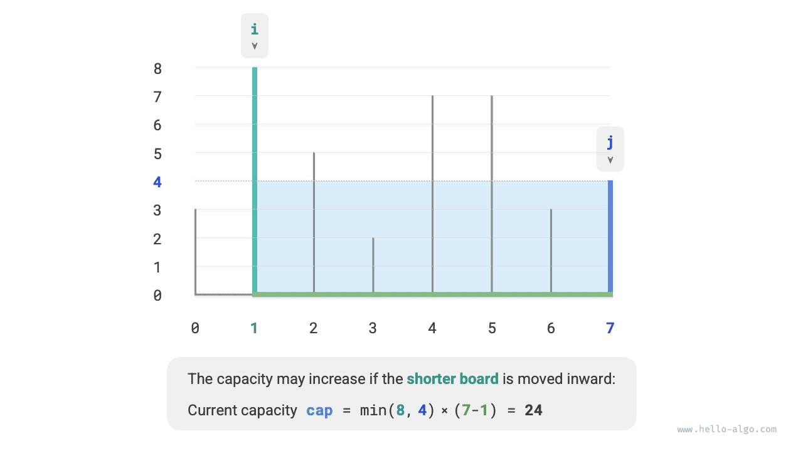
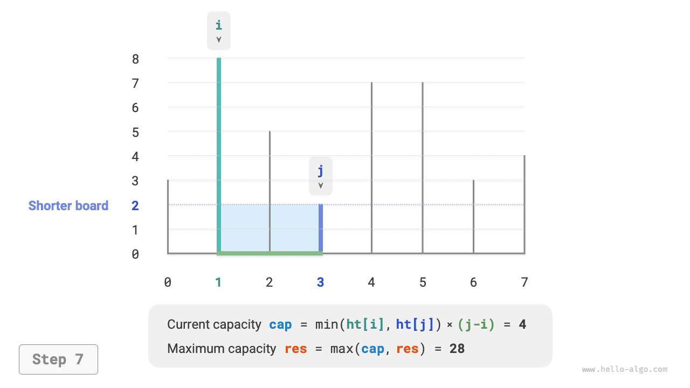
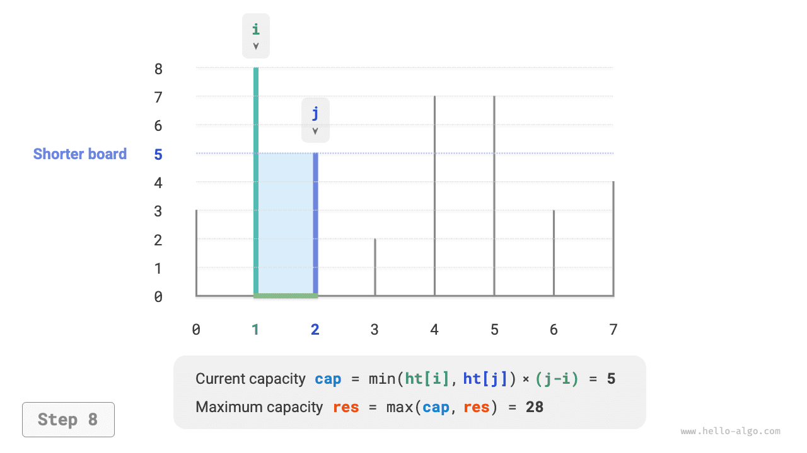
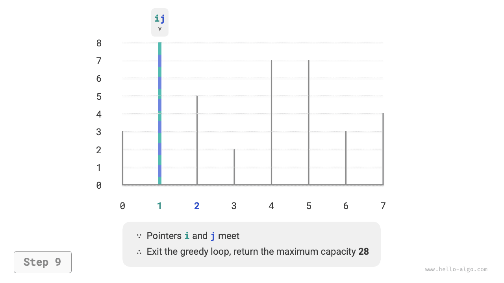

# 15.3 &nbsp; 최대 용량 문제

!!! question "문제"

    배열 $ht$의 각 원소는 수직 칸막이의 높이를 나타낸다. 배열에서 임의의 두 칸막이와 그 사이의 공간으로 용기를 만들 수 있다.
    
    용량은 높이와 너비의 곱(넓이)이다. 높이는 더 낮은 칸막이로 결정되고, 너비는 두 칸막이의 배열 인덱스 차이다.
    
    용량이 최대가 되도록 두 칸막이를 골라 최대 용량을 반환하라. 예시는 아래 그림(15-7)과 같다.

{ class="animation-figure" }

<p align="center"> 그림 15-7 &nbsp; 최대 용량 문제 예시 데이터 </p>

임의의 두 칸막이로 용기를 만들므로 **이 문제의 상태는 두 칸막이의 인덱스 $[i, j]$다**.

문제에 따르면 용량은 높이와 너비의 곱이고, 높이는 낮은 칸막이로 결정되며 너비는 두 인덱스의 차다. 용량을 $cap[i, j]$라고 하면 다음 공식을 얻는다.

$$
cap[i, j] = \min(ht[i], ht[j]) \times (j - i)
$$

배열 길이가 $n$이면 두 칸막이의 조합 수(전체 상태 수)는 $C_n^2 = \frac{n(n - 1)}{2}$이다. 가장 직접적으로는 **모든 상태를 열거하여** 최대 용량을 구할 수 있으며, 시간 복잡도는 $O(n^2)$이다.

### 1. &nbsp; 탐욕 전략 결정

더 효율적인 풀이도 있다. 아래 그림(15-8)처럼 인덱스 $i < j$이고 높이 $ht[i] < ht[j]$인 상태 $[i, j]$를 고르자. 즉, $i$는 낮은 칸막이, $j$는 높은 칸막이다.

{ class="animation-figure" }

<p align="center"> 그림 15-8 &nbsp; 초기 상태 </p>

아래 그림(15-9)과 같이 **높은 칸막이 $j$를 낮은 칸막이 $i$ 쪽으로 옮기면 용량은 반드시 작아진다**.

$j$를 옮기면 너비 $j-i$는 확실히 줄어든다. 높이는 낮은 칸막이로 결정되므로 그대로이거나($i$가 계속 더 낮음), 더 낮아질 수만 있다(이동한 $j$가 더 낮아짐).

{ class="animation-figure" }

<p align="center"> 그림 15-9 &nbsp; 높은 칸막이를 안쪽으로 옮긴 상태 </p>

반대로 생각하면 **낮은 칸막이 $i$를 안쪽으로 옮겨야만 용량이 커질 가능성이 있다**. 너비는 반드시 줄지만 **높이는 커질 수도 있기 때문이다**(이동한 $i$가 더 높을 수 있다). 아래 그림(15-10)에서는 낮은 칸막이를 옮긴 뒤 넓이가 커진다.

{ class="animation-figure" }

<p align="center"> 그림 15-10 &nbsp; 낮은 칸막이를 안쪽으로 옮긴 상태 </p>

따라서 두 포인터를 용기의 양 끝에 놓고, 매번 낮은 칸막이 쪽 포인터를 안쪽으로 옮겨 두 포인터가 만날 때까지 진행하는 탐욕 전략을 도출할 수 있다.

아래 그림(15-11)은 탐욕 전략의 실행 과정이다.

1. 처음에는 포인터 $i$와 $j$를 배열의 양 끝에 둔다.
2. 현재 상태의 용량 $cap[i, j]$를 계산하고 최대 용량을 갱신한다.
3. 칸막이 $i$와 $j$의 높이를 비교하여 낮은 쪽을 안쪽으로 한 칸 옮긴다.
4. $i$와 $j$가 만날 때까지 `2.` 단계와 `3.` 단계를 반복한다.

=== "<1>"
    { class="animation-figure" }

=== "<2>"
    { class="animation-figure" }

=== "<3>"
    { class="animation-figure" }

=== "<4>"
    { class="animation-figure" }

=== "<5>"
    { class="animation-figure" }

=== "<6>"
    { class="animation-figure" }

=== "<7>"
    { class="animation-figure" }

=== "<8>"
    { class="animation-figure" }

=== "<9>"
    { class="animation-figure" }

<p align="center"> 그림 15-11 &nbsp; 최대 용량 문제의 탐욕 과정 </p>

### 2. &nbsp; 코드 구현

반복문은 최대 $n$ 회 실행되므로 **시간 복잡도는 $O(n)$이다**.

변수 $i$, $j$, $res$는 상수 크기의 추가 공간을 사용하므로 **공간 복잡도는 $O(1)$이다**.

=== "Python"

    ```python title="max_capacity.py"
    def max_capacity(ht: list[int]) -> int:
        """최대 용량: 탐욕"""
        # i와 j가 각각 배열의 양 끝을 가리키도록 초기화한다
        i, j = 0, len(ht) - 1
        # 최대 용량의 초깃값은 0이다
        res = 0
        # 두 칸막이가 만날 때까지 탐욕적 선택을 반복한다
        while i < j:
            # 최대 용량을 갱신한다
            cap = min(ht[i], ht[j]) * (j - i)
            res = max(res, cap)
            # 낮은 칸막이를 안쪽으로 이동한다
            if ht[i] < ht[j]:
                i += 1
            else:
                j -= 1
        return res
    ```

=== "C++"

    ```cpp title="max_capacity.cpp"
    /* 최대 용량: 탐욕 */
    int maxCapacity(vector<int> &ht) {
        // i와 j가 각각 배열의 양 끝을 가리키도록 초기화한다
        int i = 0, j = ht.size() - 1;
        // 최대 용량의 초깃값은 0이다
        int res = 0;
        // 두 칸막이가 만날 때까지 탐욕적 선택을 반복한다
        while (i < j) {
            // 최대 용량을 갱신한다
            int cap = min(ht[i], ht[j]) * (j - i);
            res = max(res, cap);
            // 낮은 칸막이를 안쪽으로 이동한다
            if (ht[i] < ht[j]) {
                i++;
            } else {
                j--;
            }
        }
        return res;
    }
    ```

=== "Java"

    ```java title="max_capacity.java"
    /* 최대 용량: 탐욕 */
    int maxCapacity(int[] ht) {
        // i와 j가 각각 배열의 양 끝을 가리키도록 초기화한다
        int i = 0, j = ht.length - 1;
        // 최대 용량의 초깃값은 0이다
        int res = 0;
        // 두 칸막이가 만날 때까지 탐욕적 선택을 반복한다
        while (i < j) {
            // 최대 용량을 갱신한다
            int cap = Math.min(ht[i], ht[j]) * (j - i);
            res = Math.max(res, cap);
            // 낮은 칸막이를 안쪽으로 이동한다
            if (ht[i] < ht[j]) {
                i++;
            } else {
                j--;
            }
        }
        return res;
    }
    ```

=== "C#"

    ```csharp title="max_capacity.cs"
    /* 최대 용량: 탐욕 */
    int MaxCapacity(int[] ht) {
        // i와 j가 각각 배열의 양 끝을 가리키도록 초기화한다
        int i = 0, j = ht.Length - 1;
        // 최대 용량의 초깃값은 0이다
        int res = 0;
        // 두 칸막이가 만날 때까지 탐욕적 선택을 반복한다
        while (i < j) {
            // 최대 용량을 갱신한다
            int cap = Math.Min(ht[i], ht[j]) * (j - i);
            res = Math.Max(res, cap);
            // 낮은 칸막이를 안쪽으로 이동한다
            if (ht[i] < ht[j]) {
                i++;
            } else {
                j--;
            }
        }
        return res;
    }
    ```

=== "Go"

    ```go title="max_capacity.go"
    /* 최대 용량: 탐욕 */
    func maxCapacity(ht []int) int {
        // i와 j가 각각 배열의 양 끝을 가리키도록 초기화한다
        i, j := 0, len(ht)-1
        // 최대 용량의 초깃값은 0이다
        res := 0
        // 두 칸막이가 만날 때까지 탐욕적 선택을 반복한다
        for i < j {
            // 최대 용량을 갱신한다
            capacity := int(math.Min(float64(ht[i]), float64(ht[j]))) * (j - i)
            res = int(math.Max(float64(res), float64(capacity)))
            // 낮은 칸막이를 안쪽으로 이동한다
            if ht[i] < ht[j] {
                i++
            } else {
                j--
            }
        }
        return res
    }
    ```

=== "Swift"

    ```swift title="max_capacity.swift"
    /* 최대 용량: 탐욕 */
    func maxCapacity(ht: [Int]) -> Int {
        // i와 j가 각각 배열의 양 끝을 가리키도록 초기화한다
        var i = ht.startIndex, j = ht.endIndex - 1
        // 최대 용량의 초깃값은 0이다
        var res = 0
        // 두 칸막이가 만날 때까지 탐욕적 선택을 반복한다
        while i < j {
            // 최대 용량을 갱신한다
            let cap = min(ht[i], ht[j]) * (j - i)
            res = max(res, cap)
            // 낮은 칸막이를 안쪽으로 이동한다
            if ht[i] < ht[j] {
                i += 1
            } else {
                j -= 1
            }
        }
        return res
    }
    ```

=== "JS"

    ```javascript title="max_capacity.js"
    /* 최대 용량: 탐욕 */
    function maxCapacity(ht) {
        // i와 j가 각각 배열의 양 끝을 가리키도록 초기화한다
        let i = 0,
            j = ht.length - 1;
        // 최대 용량의 초깃값은 0이다
        let res = 0;
        // 두 칸막이가 만날 때까지 탐욕적 선택을 반복한다
        while (i < j) {
            // 최대 용량을 갱신한다
            const cap = Math.min(ht[i], ht[j]) * (j - i);
            res = Math.max(res, cap);
            // 낮은 칸막이를 안쪽으로 이동한다
            if (ht[i] < ht[j]) {
                i += 1;
            } else {
                j -= 1;
            }
        }
        return res;
    }
    ```

=== "TS"

    ```typescript title="max_capacity.ts"
    /* 최대 용량: 탐욕 */
    function maxCapacity(ht: number[]): number {
        // i와 j가 각각 배열의 양 끝을 가리키도록 초기화한다
        let i = 0,
            j = ht.length - 1;
        // 최대 용량의 초깃값은 0이다
        let res = 0;
        // 두 칸막이가 만날 때까지 탐욕적 선택을 반복한다
        while (i < j) {
            // 최대 용량을 갱신한다
            const cap: number = Math.min(ht[i], ht[j]) * (j - i);
            res = Math.max(res, cap);
            // 낮은 칸막이를 안쪽으로 이동한다
            if (ht[i] < ht[j]) {
                i += 1;
            } else {
                j -= 1;
            }
        }
        return res;
    }
    ```

=== "Dart"

    ```dart title="max_capacity.dart"
    /* 최대 용량: 탐욕 */
    int maxCapacity(List<int> ht) {
      // i와 j가 각각 배열의 양 끝을 가리키도록 초기화한다
      int i = 0, j = ht.length - 1;
      // 최대 용량의 초깃값은 0이다
      int res = 0;
      // 두 칸막이가 만날 때까지 탐욕적 선택을 반복한다
      while (i < j) {
        // 최대 용량을 갱신한다
        int cap = min(ht[i], ht[j]) * (j - i);
        res = max(res, cap);
        // 낮은 칸막이를 안쪽으로 이동한다
        if (ht[i] < ht[j]) {
          i++;
        } else {
          j--;
        }
      }
      return res;
    }
    ```

=== "Rust"

    ```rust title="max_capacity.rs"
    /* 최대 용량: 탐욕 */
    fn max_capacity(ht: &[i32]) -> i32 {
        // i와 j가 각각 배열의 양 끝을 가리키도록 초기화한다
        let mut i = 0;
        let mut j = ht.len() - 1;
        // 최대 용량의 초깃값은 0이다
        let mut res = 0;
        // 두 칸막이가 만날 때까지 탐욕적 선택을 반복한다
        while i < j {
            // 최대 용량을 갱신한다
            let cap = std::cmp::min(ht[i], ht[j]) * (j - i) as i32;
            res = std::cmp::max(res, cap);
            // 낮은 칸막이를 안쪽으로 이동한다
            if ht[i] < ht[j] {
                i += 1;
            } else {
                j -= 1;
            }
        }
        res
    }
    ```

=== "C"

    ```c title="max_capacity.c"
    /* 최대 용량: 탐욕 */
    int maxCapacity(int ht[], int htLength) {
        // i와 j가 각각 배열의 양 끝을 가리키도록 초기화한다
        int i = 0;
        int j = htLength - 1;
        // 최대 용량의 초깃값은 0이다
        int res = 0;
        // 두 칸막이가 만날 때까지 탐욕적 선택을 반복한다
        while (i < j) {
            // 최대 용량을 갱신한다
            int capacity = myMin(ht[i], ht[j]) * (j - i);
            res = myMax(res, capacity);
            // 낮은 칸막이를 안쪽으로 이동한다
            if (ht[i] < ht[j]) {
                i++;
            } else {
                j--;
            }
        }
        return res;
    }
    ```

=== "Kotlin"

    ```kotlin title="max_capacity.kt"
    /* 최대 용량: 탐욕 */
    fun maxCapacity(ht: IntArray): Int {
        // i와 j가 각각 배열의 양 끝을 가리키도록 초기화한다
        var i = 0
        var j = ht.size - 1
        // 최대 용량의 초깃값은 0이다
        var res = 0
        // 두 칸막이가 만날 때까지 탐욕적 선택을 반복한다
        while (i < j) {
            // 최대 용량을 갱신한다
            val cap = min(ht[i], ht[j]) * (j - i)
            res = max(res, cap)
            // 낮은 칸막이를 안쪽으로 이동한다
            if (ht[i] < ht[j]) {
                i++
            } else {
                j--
            }
        }
        return res
    }
    ```

=== "Ruby"

    ```ruby title="max_capacity.rb"
    ### 최대 용량: 탐욕 ###
    def max_capacity(ht)
      # i와 j가 각각 배열의 양 끝을 가리키도록 초기화한다
      i, j = 0, ht.length - 1
      # 최대 용량의 초깃값은 0이다
      res = 0

      # 두 칸막이가 만날 때까지 탐욕적 선택을 반복한다
      while i < j
        # 최대 용량을 갱신한다
        cap = [ht[i], ht[j]].min * (j - i)
        res = [res, cap].max
        # 낮은 칸막이를 안쪽으로 이동한다
        if ht[i] < ht[j]
          i += 1
        else
          j -= 1
        end
      end

      res
    end
    ```

??? pythontutor "코드 시각화"

    <div style="height: 549px; width: 100%;"><iframe class="pythontutor-iframe" title="코드 시각화" src="https://pythontutor.com/iframe-embed.html#code=def%20max_capacity%28ht%3A%20list%5Bint%5D%29%20-%3E%20int%3A%0A%20%20%20%20%22%22%22%EC%B5%9C%EB%8C%80%20%EC%9A%A9%EB%9F%89%3A%20%ED%83%90%EC%9A%95%22%22%22%0A%20%20%20%20%23%20i%EC%99%80%20j%EA%B0%80%20%EA%B0%81%EA%B0%81%20%EB%B0%B0%EC%97%B4%EC%9D%98%20%EC%96%91%20%EB%81%9D%EC%9D%84%20%EA%B0%80%EB%A6%AC%ED%82%A4%EB%8F%84%EB%A1%9D%20%EC%B4%88%EA%B8%B0%ED%99%94%ED%95%9C%EB%8B%A4%0A%20%20%20%20i,%20j%20%3D%200,%20len%28ht%29%20-%201%0A%20%20%20%20%23%20%EC%B5%9C%EB%8C%80%20%EC%9A%A9%EB%9F%89%EC%9D%98%20%EC%B4%88%EA%B9%83%EA%B0%92%EC%9D%80%200%EC%9D%B4%EB%8B%A4%0A%20%20%20%20res%20%3D%200%0A%20%20%20%20%23%20%EB%91%90%20%EC%B9%B8%EB%A7%89%EC%9D%B4%EA%B0%80%20%EB%A7%8C%EB%82%A0%20%EB%95%8C%EA%B9%8C%EC%A7%80%20%ED%83%90%EC%9A%95%EC%A0%81%20%EC%84%A0%ED%83%9D%EC%9D%84%20%EB%B0%98%EB%B3%B5%ED%95%9C%EB%8B%A4%0A%20%20%20%20while%20i%20%3C%20j%3A%0A%20%20%20%20%20%20%20%20%23%20%EC%B5%9C%EB%8C%80%20%EC%9A%A9%EB%9F%89%EC%9D%84%20%EA%B0%B1%EC%8B%A0%ED%95%9C%EB%8B%A4%0A%20%20%20%20%20%20%20%20cap%20%3D%20min%28ht%5Bi%5D,%20ht%5Bj%5D%29%20%2A%20%28j%20-%20i%29%0A%20%20%20%20%20%20%20%20res%20%3D%20max%28res,%20cap%29%0A%20%20%20%20%20%20%20%20%23%20%EB%82%AE%EC%9D%80%20%EC%B9%B8%EB%A7%89%EC%9D%B4%EB%A5%BC%20%EC%95%88%EC%AA%BD%EC%9C%BC%EB%A1%9C%20%EC%9D%B4%EB%8F%99%ED%95%9C%EB%8B%A4%0A%20%20%20%20%20%20%20%20if%20ht%5Bi%5D%20%3C%20ht%5Bj%5D%3A%0A%20%20%20%20%20%20%20%20%20%20%20%20i%20%2B%3D%201%0A%20%20%20%20%20%20%20%20else%3A%0A%20%20%20%20%20%20%20%20%20%20%20%20j%20-%3D%201%0A%20%20%20%20return%20res%0A%0A%0A%22%22%22%EC%8B%A4%ED%96%89%20%EC%BD%94%EB%93%9C%22%22%22%0Aif%20__name__%20%3D%3D%20%22__main__%22%3A%0A%20%20%20%20ht%20%3D%20%5B3,%208,%205,%202,%207,%207,%203,%204%5D%0A%0A%20%20%20%20%23%20%ED%83%90%EC%9A%95%20%EC%95%8C%EA%B3%A0%EB%A6%AC%EC%A6%98%0A%20%20%20%20res%20%3D%20max_capacity%28ht%29%0A%20%20%20%20print%28f%22%EC%B5%9C%EB%8C%80%20%EC%9A%A9%EB%9F%89%EC%9D%80%20%7Bres%7D%EC%9D%B4%EB%8B%A4%22%29&codeDivHeight=472&codeDivWidth=350&cumulative=false&curInstr=4&heapPrimitives=nevernest&origin=opt-frontend.js&py=311&rawInputLstJSON=%5B%5D&textReferences=false"> </iframe></div>
    <div style="margin-top: 5px;"><a href="https://pythontutor.com/iframe-embed.html#code=def%20max_capacity%28ht%3A%20list%5Bint%5D%29%20-%3E%20int%3A%0A%20%20%20%20%22%22%22%EC%B5%9C%EB%8C%80%20%EC%9A%A9%EB%9F%89%3A%20%ED%83%90%EC%9A%95%22%22%22%0A%20%20%20%20%23%20i%EC%99%80%20j%EA%B0%80%20%EA%B0%81%EA%B0%81%20%EB%B0%B0%EC%97%B4%EC%9D%98%20%EC%96%91%20%EB%81%9D%EC%9D%84%20%EA%B0%80%EB%A6%AC%ED%82%A4%EB%8F%84%EB%A1%9D%20%EC%B4%88%EA%B8%B0%ED%99%94%ED%95%9C%EB%8B%A4%0A%20%20%20%20i,%20j%20%3D%200,%20len%28ht%29%20-%201%0A%20%20%20%20%23%20%EC%B5%9C%EB%8C%80%20%EC%9A%A9%EB%9F%89%EC%9D%98%20%EC%B4%88%EA%B9%83%EA%B0%92%EC%9D%80%200%EC%9D%B4%EB%8B%A4%0A%20%20%20%20res%20%3D%200%0A%20%20%20%20%23%20%EB%91%90%20%EC%B9%B8%EB%A7%89%EC%9D%B4%EA%B0%80%20%EB%A7%8C%EB%82%A0%20%EB%95%8C%EA%B9%8C%EC%A7%80%20%ED%83%90%EC%9A%95%EC%A0%81%20%EC%84%A0%ED%83%9D%EC%9D%84%20%EB%B0%98%EB%B3%B5%ED%95%9C%EB%8B%A4%0A%20%20%20%20while%20i%20%3C%20j%3A%0A%20%20%20%20%20%20%20%20%23%20%EC%B5%9C%EB%8C%80%20%EC%9A%A9%EB%9F%89%EC%9D%84%20%EA%B0%B1%EC%8B%A0%ED%95%9C%EB%8B%A4%0A%20%20%20%20%20%20%20%20cap%20%3D%20min%28ht%5Bi%5D,%20ht%5Bj%5D%29%20%2A%20%28j%20-%20i%29%0A%20%20%20%20%20%20%20%20res%20%3D%20max%28res,%20cap%29%0A%20%20%20%20%20%20%20%20%23%20%EB%82%AE%EC%9D%80%20%EC%B9%B8%EB%A7%89%EC%9D%B4%EB%A5%BC%20%EC%95%88%EC%AA%BD%EC%9C%BC%EB%A1%9C%20%EC%9D%B4%EB%8F%99%ED%95%9C%EB%8B%A4%0A%20%20%20%20%20%20%20%20if%20ht%5Bi%5D%20%3C%20ht%5Bj%5D%3A%0A%20%20%20%20%20%20%20%20%20%20%20%20i%20%2B%3D%201%0A%20%20%20%20%20%20%20%20else%3A%0A%20%20%20%20%20%20%20%20%20%20%20%20j%20-%3D%201%0A%20%20%20%20return%20res%0A%0A%0A%22%22%22%EC%8B%A4%ED%96%89%20%EC%BD%94%EB%93%9C%22%22%22%0Aif%20__name__%20%3D%3D%20%22__main__%22%3A%0A%20%20%20%20ht%20%3D%20%5B3,%208,%205,%202,%207,%207,%203,%204%5D%0A%0A%20%20%20%20%23%20%ED%83%90%EC%9A%95%20%EC%95%8C%EA%B3%A0%EB%A6%AC%EC%A6%98%0A%20%20%20%20res%20%3D%20max_capacity%28ht%29%0A%20%20%20%20print%28f%22%EC%B5%9C%EB%8C%80%20%EC%9A%A9%EB%9F%89%EC%9D%80%20%7Bres%7D%EC%9D%B4%EB%8B%A4%22%29&codeDivHeight=800&codeDivWidth=600&cumulative=false&curInstr=4&heapPrimitives=nevernest&origin=opt-frontend.js&py=311&rawInputLstJSON=%5B%5D&textReferences=false" target="_blank" rel="noopener noreferrer">전체 화면 ></a></div>

### 3. &nbsp; 정확성 증명

탐욕 알고리즘이 모든 경우 열거보다 빠른 이유는 매번 일부 상태를 '건너뛰기' 때문이다.

예를 들어 상태 $cap[i, j]$에서 $i$가 낮은 칸막이, $j$가 높은 칸막이라고 하자. 낮은 $i$를 탐욕적으로 한 칸 안쪽으로 옮기면 아래 그림(15-12)의 상태들을 건너뛴다. **이는 이후에 그 상태들의 용량을 확인할 수 없다는 뜻이다**.

$$
cap[i, i+1], cap[i, i+2], \dots, cap[i, j-2], cap[i, j-1]
$$

{ class="animation-figure" }

<p align="center"> 그림 15-12 &nbsp; 낮은 칸막이를 옮겨 건너뛴 상태들 </p>

**건너뛴 상태들은 사실 높은 칸막이 $j$를 안쪽으로 옮긴 모든 상태다**. 앞에서 높은 칸막이를 안쪽으로 옮기면 용량이 반드시 줄어듦을 보였다. 따라서 건너뛴 상태는 최적해가 될 수 없으며, **이를 건너뛰어도 최적해를 놓치지 않는다**.

이 분석은 낮은 칸막이를 옮기는 연산이 '안전'하며 탐욕 전략이 유효함을 보여 준다.
