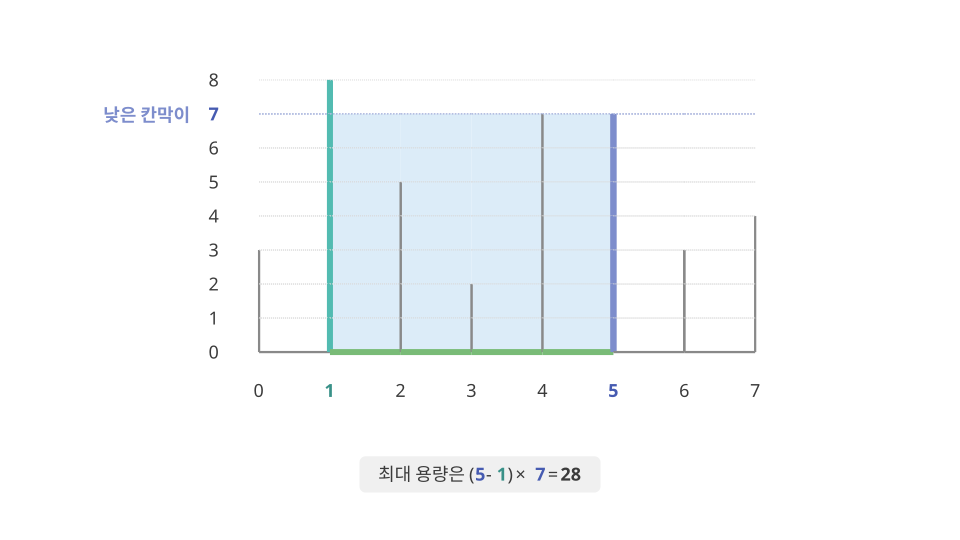
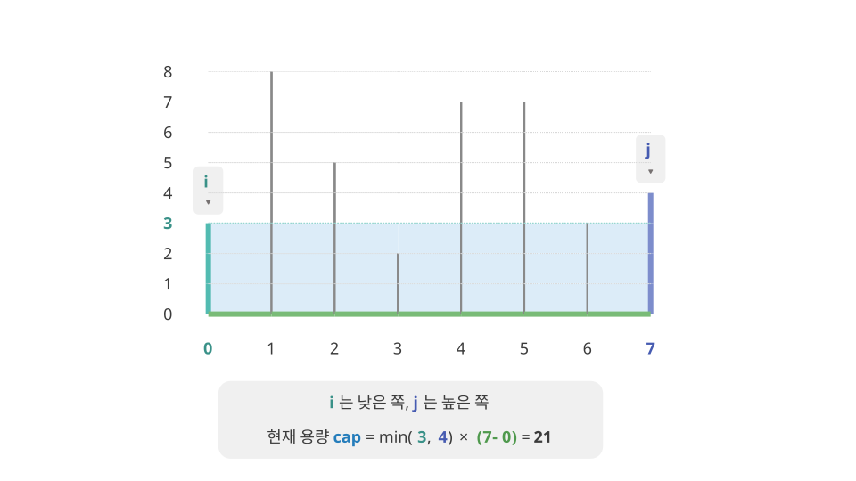
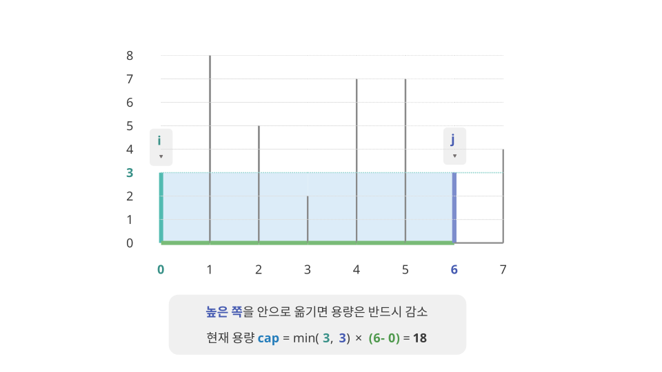
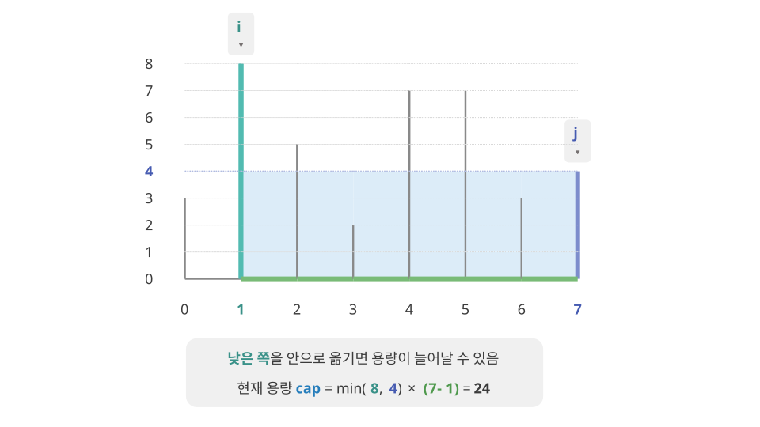
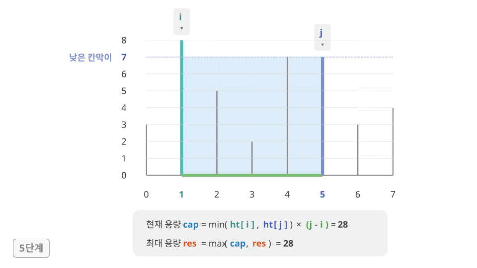
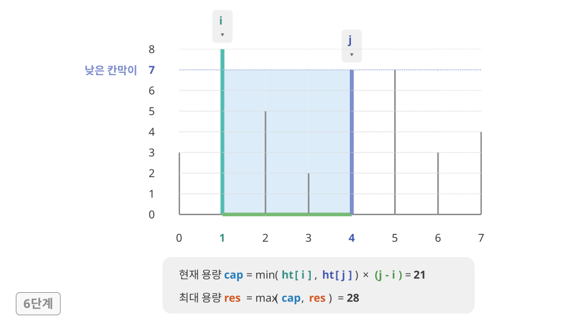
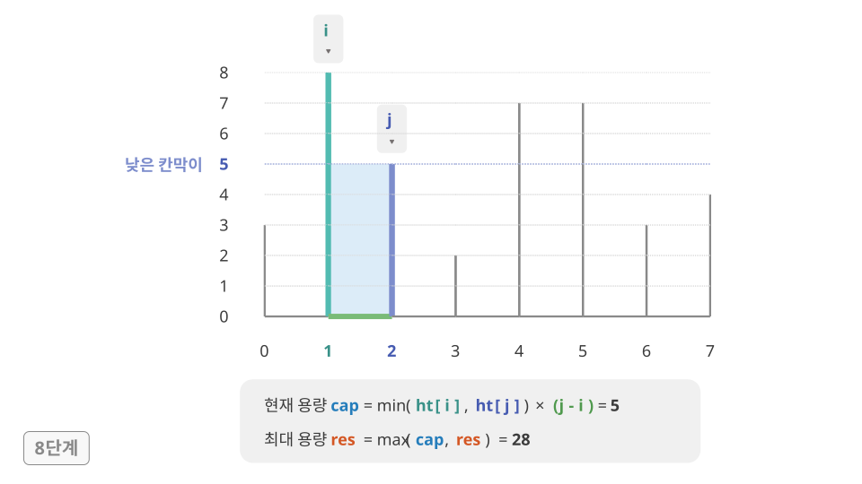
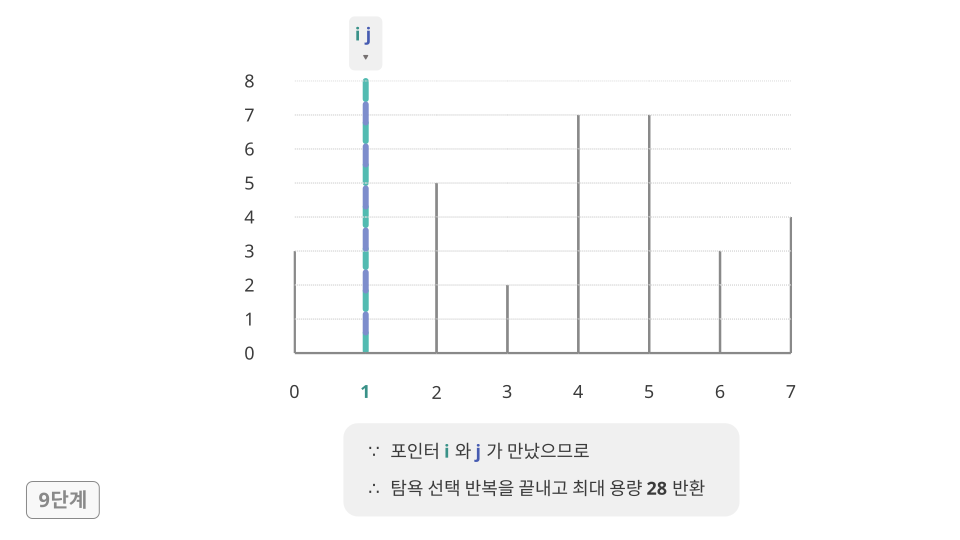
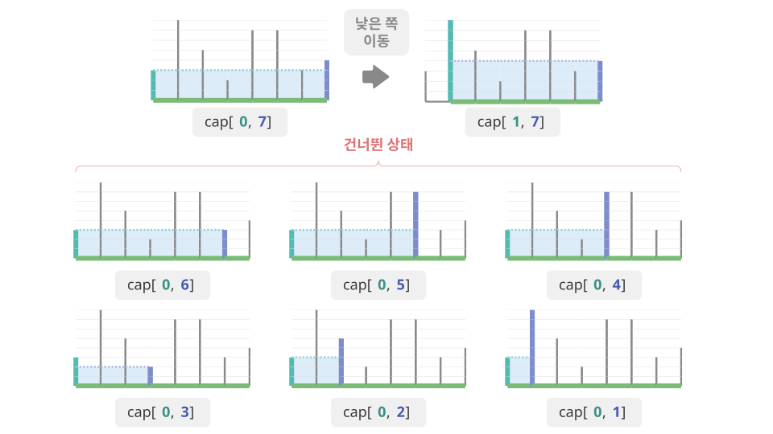

# 15.3 &nbsp; 최대 용량 문제

!!! question

    배열 $ht$가 입력으로 주어지고 각 원소는 수직 칸막이 하나의 높이를 나타낸다. 배열에서 임의의 칸막이 두 개를 고르면 두 칸막이와 그 사이의 공간이 하나의 용기를 이룬다.
    
    용기의 용량은 높이와 너비를 곱한 값(넓이)이다. 높이는 두 칸막이 중 낮은 쪽이 결정하고 너비는 두 칸막이의 배열 인덱스 차이이다.
    
    배열에서 용량이 가장 큰 용기를 이루는 칸막이 두 개를 골라 그 최대 용량을 반환하라. 아래 그림(15-7)은 한 가지 예이다.

{ class="animation-figure" }

<p align="center"> 그림 15-7 &nbsp; 최대 용량 문제의 예시 데이터 </p>

임의의 칸막이 두 개가 용기를 이루므로 **이 문제의 상태는 두 칸막이의 인덱스이며 $[i, j]$로 나타낸다**.

용량은 높이와 너비의 곱이다. 높이는 낮은 칸막이가 결정하고 너비는 두 칸막이의 배열 인덱스 차이이다. 용량을 $cap[i, j]$라고 하면 다음 식을 얻는다.

$$
cap[i, j] = \min(ht[i], ht[j]) \times (j - i)
$$

배열 길이가 $n$이면 두 칸막이의 조합 수(전체 상태 수)는 $C_n^2 = \frac{n(n - 1)}{2}$이다. 가장 직접적인 방법은 **모든 상태를 빠짐없이 조사해** 최대 용량을 구하는 것이다. 시간 복잡도는 $O(n^2)$이다.

### 1. &nbsp; 탐욕 전략 정하기

이 문제는 더 효율적으로 풀 수 있다. 아래 그림(15-8)처럼 인덱스가 $i < j$이고 높이가 $ht[i] < ht[j]$인 상태 $[i, j]$를 하나 고르자. 즉 $i$는 낮은 쪽이고 $j$는 높은 쪽이다.

{ class="animation-figure" }

<p align="center"> 그림 15-8 &nbsp; 초기 상태 </p>

아래 그림(15-9)처럼 **높은 쪽 $j$를 낮은 쪽 $i$ 쪽으로 옮기면 용량은 반드시 줄어든다**.

높은 쪽 $j$를 옮기면 너비 $j-i$가 반드시 줄어든다. 높이는 낮은 쪽이 결정하므로 그대로이거나($i$가 여전히 낮은 경우) 더 낮아질 수밖에 없다(이동한 $j$가 낮은 쪽이 된 경우).

{ class="animation-figure" }

<p align="center"> 그림 15-9 &nbsp; 높은 쪽을 안으로 옮긴 뒤의 상태 </p>

반대로 생각하면 **낮은 쪽 $i$를 안으로 옮겨야만 용량이 커질 가능성이 있다**. 너비는 반드시 줄어들지만 **높이는 더 높아질 수 있기 때문이다**(옮긴 쪽 $i$에서 더 높은 칸막이를 만날 수 있다). 아래 그림(15-10)에서는 낮은 쪽을 옮긴 뒤 넓이가 커졌다.

{ class="animation-figure" }

<p align="center"> 그림 15-10 &nbsp; 낮은 쪽을 안으로 옮긴 뒤의 상태 </p>

이로부터 다음 탐욕 전략을 얻는다. 두 포인터를 용기의 양 끝에 놓고, 두 포인터가 만날 때까지 매번 낮은 칸막이 쪽 포인터를 안으로 옮긴다.

아래 그림(15-11)은 탐욕 전략을 실행하는 과정을 보여 준다.

1. 초기 상태에서는 포인터 $i$와 $j$를 배열의 양 끝에 놓는다.
2. 현재 상태의 용량 $cap[i, j]$를 계산하고 최대 용량을 갱신한다.
3. 칸막이 $i$와 $j$의 높이를 비교해 낮은 쪽을 안으로 한 칸 옮긴다.
4. `2.` 단계와 `3.` 단계를 반복하다가 $i$와 $j$가 만나면 종료한다.

=== "<1>"
    { class="animation-figure" }

=== "<2>"
    { class="animation-figure" }

=== "<3>"
    { class="animation-figure" }

=== "<4>"
    { class="animation-figure" }

=== "<5>"
    { class="animation-figure" }

=== "<6>"
    { class="animation-figure" }

=== "<7>"
    { class="animation-figure" }

=== "<8>"
    { class="animation-figure" }

=== "<9>"
    { class="animation-figure" }

<p align="center"> 그림 15-11 &nbsp; 최대 용량 문제의 탐욕 선택 과정 </p>

### 2. &nbsp; 코드 구현

반복문은 최대 $n$번 실행되므로 **시간 복잡도는 $O(n)$이다**.

변수 $i$, $j$, $res$가 사용하는 추가 공간은 상수 크기이므로 **공간 복잡도는 $O(1)$이다**.

=== "Python"

    ```python title="max_capacity.py"
    def max_capacity(ht: list[int]) -> int:
        """탐욕 알고리즘으로 최대 용량 구하기"""
        # i와 j를 각각 배열의 양 끝에 놓는다
        i, j = 0, len(ht) - 1
        # 최대 용량의 초깃값은 0이다
        res = 0
        # 두 칸막이가 만날 때까지 탐욕 선택을 반복한다
        while i < j:
            # 최대 용량을 갱신한다
            cap = min(ht[i], ht[j]) * (j - i)
            res = max(res, cap)
            # 낮은 칸막이 쪽을 안으로 한 칸 옮긴다
            if ht[i] < ht[j]:
                i += 1
            else:
                j -= 1
        return res
    ```

=== "C++"

    ```cpp title="max_capacity.cpp"
    /* 탐욕 알고리즘으로 최대 용량 구하기 */
    int maxCapacity(vector<int> &ht) {
        // i와 j를 각각 배열의 양 끝에 놓는다
        int i = 0, j = ht.size() - 1;
        // 최대 용량의 초깃값은 0이다
        int res = 0;
        // 두 칸막이가 만날 때까지 탐욕 선택을 반복한다
        while (i < j) {
            // 최대 용량을 갱신한다
            int cap = min(ht[i], ht[j]) * (j - i);
            res = max(res, cap);
            // 낮은 칸막이 쪽을 안으로 한 칸 옮긴다
            if (ht[i] < ht[j]) {
                i++;
            } else {
                j--;
            }
        }
        return res;
    }
    ```

=== "Java"

    ```java title="max_capacity.java"
    /* 탐욕 알고리즘으로 최대 용량 구하기 */
    int maxCapacity(int[] ht) {
        // i와 j를 각각 배열의 양 끝에 놓는다
        int i = 0, j = ht.length - 1;
        // 최대 용량의 초깃값은 0이다
        int res = 0;
        // 두 칸막이가 만날 때까지 탐욕 선택을 반복한다
        while (i < j) {
            // 최대 용량을 갱신한다
            int cap = Math.min(ht[i], ht[j]) * (j - i);
            res = Math.max(res, cap);
            // 낮은 칸막이 쪽을 안으로 한 칸 옮긴다
            if (ht[i] < ht[j]) {
                i++;
            } else {
                j--;
            }
        }
        return res;
    }
    ```

=== "C#"

    ```csharp title="max_capacity.cs"
    /* 탐욕 알고리즘으로 최대 용량 구하기 */
    int MaxCapacity(int[] ht) {
        // i와 j를 각각 배열의 양 끝에 놓는다
        int i = 0, j = ht.Length - 1;
        // 최대 용량의 초깃값은 0이다
        int res = 0;
        // 두 칸막이가 만날 때까지 탐욕 선택을 반복한다
        while (i < j) {
            // 최대 용량을 갱신한다
            int cap = Math.Min(ht[i], ht[j]) * (j - i);
            res = Math.Max(res, cap);
            // 낮은 칸막이 쪽을 안으로 한 칸 옮긴다
            if (ht[i] < ht[j]) {
                i++;
            } else {
                j--;
            }
        }
        return res;
    }
    ```

=== "Go"

    ```go title="max_capacity.go"
    /* 탐욕 알고리즘으로 최대 용량 구하기 */
    func maxCapacity(ht []int) int {
        // i와 j를 각각 배열의 양 끝에 놓는다
        i, j := 0, len(ht)-1
        // 최대 용량의 초깃값은 0이다
        res := 0
        // 두 칸막이가 만날 때까지 탐욕 선택을 반복한다
        for i < j {
            // 최대 용량을 갱신한다
            capacity := int(math.Min(float64(ht[i]), float64(ht[j]))) * (j - i)
            res = int(math.Max(float64(res), float64(capacity)))
            // 낮은 칸막이 쪽을 안으로 한 칸 옮긴다
            if ht[i] < ht[j] {
                i++
            } else {
                j--
            }
        }
        return res
    }
    ```

=== "Swift"

    ```swift title="max_capacity.swift"
    /* 탐욕 알고리즘으로 최대 용량 구하기 */
    func maxCapacity(ht: [Int]) -> Int {
        // i와 j를 각각 배열의 양 끝에 놓는다
        var i = ht.startIndex, j = ht.endIndex - 1
        // 최대 용량의 초깃값은 0이다
        var res = 0
        // 두 칸막이가 만날 때까지 탐욕 선택을 반복한다
        while i < j {
            // 최대 용량을 갱신한다
            let cap = min(ht[i], ht[j]) * (j - i)
            res = max(res, cap)
            // 낮은 칸막이 쪽을 안으로 한 칸 옮긴다
            if ht[i] < ht[j] {
                i += 1
            } else {
                j -= 1
            }
        }
        return res
    }
    ```

=== "JS"

    ```javascript title="max_capacity.js"
    /* 탐욕 알고리즘으로 최대 용량 구하기 */
    function maxCapacity(ht) {
        // i와 j를 각각 배열의 양 끝에 놓는다
        let i = 0,
            j = ht.length - 1;
        // 최대 용량의 초깃값은 0이다
        let res = 0;
        // 두 칸막이가 만날 때까지 탐욕 선택을 반복한다
        while (i < j) {
            // 최대 용량을 갱신한다
            const cap = Math.min(ht[i], ht[j]) * (j - i);
            res = Math.max(res, cap);
            // 낮은 칸막이 쪽을 안으로 한 칸 옮긴다
            if (ht[i] < ht[j]) {
                i += 1;
            } else {
                j -= 1;
            }
        }
        return res;
    }
    ```

=== "TS"

    ```typescript title="max_capacity.ts"
    /* 탐욕 알고리즘으로 최대 용량 구하기 */
    function maxCapacity(ht: number[]): number {
        // i와 j를 각각 배열의 양 끝에 놓는다
        let i = 0,
            j = ht.length - 1;
        // 최대 용량의 초깃값은 0이다
        let res = 0;
        // 두 칸막이가 만날 때까지 탐욕 선택을 반복한다
        while (i < j) {
            // 최대 용량을 갱신한다
            const cap: number = Math.min(ht[i], ht[j]) * (j - i);
            res = Math.max(res, cap);
            // 낮은 칸막이 쪽을 안으로 한 칸 옮긴다
            if (ht[i] < ht[j]) {
                i += 1;
            } else {
                j -= 1;
            }
        }
        return res;
    }
    ```

=== "Dart"

    ```dart title="max_capacity.dart"
    /* 탐욕 알고리즘으로 최대 용량 구하기 */
    int maxCapacity(List<int> ht) {
      // i와 j를 각각 배열의 양 끝에 놓는다
      int i = 0, j = ht.length - 1;
      // 최대 용량의 초깃값은 0이다
      int res = 0;
      // 두 칸막이가 만날 때까지 탐욕 선택을 반복한다
      while (i < j) {
        // 최대 용량을 갱신한다
        int cap = min(ht[i], ht[j]) * (j - i);
        res = max(res, cap);
        // 낮은 칸막이 쪽을 안으로 한 칸 옮긴다
        if (ht[i] < ht[j]) {
          i++;
        } else {
          j--;
        }
      }
      return res;
    }
    ```

=== "Rust"

    ```rust title="max_capacity.rs"
    /* 탐욕 알고리즘으로 최대 용량 구하기 */
    fn max_capacity(ht: &[i32]) -> i32 {
        // i와 j를 각각 배열의 양 끝에 놓는다
        let mut i = 0;
        let mut j = ht.len() - 1;
        // 최대 용량의 초깃값은 0이다
        let mut res = 0;
        // 두 칸막이가 만날 때까지 탐욕 선택을 반복한다
        while i < j {
            // 최대 용량을 갱신한다
            let cap = std::cmp::min(ht[i], ht[j]) * (j - i) as i32;
            res = std::cmp::max(res, cap);
            // 낮은 칸막이 쪽을 안으로 한 칸 옮긴다
            if ht[i] < ht[j] {
                i += 1;
            } else {
                j -= 1;
            }
        }
        res
    }
    ```

=== "C"

    ```c title="max_capacity.c"
    /* 탐욕 알고리즘으로 최대 용량 구하기 */
    int maxCapacity(int ht[], int htLength) {
        // i와 j를 각각 배열의 양 끝에 놓는다
        int i = 0;
        int j = htLength - 1;
        // 최대 용량의 초깃값은 0이다
        int res = 0;
        // 두 칸막이가 만날 때까지 탐욕 선택을 반복한다
        while (i < j) {
            // 최대 용량을 갱신한다
            int capacity = myMin(ht[i], ht[j]) * (j - i);
            res = myMax(res, capacity);
            // 낮은 칸막이 쪽을 안으로 한 칸 옮긴다
            if (ht[i] < ht[j]) {
                i++;
            } else {
                j--;
            }
        }
        return res;
    }
    ```

=== "Kotlin"

    ```kotlin title="max_capacity.kt"
    /* 탐욕 알고리즘으로 최대 용량 구하기 */
    fun maxCapacity(ht: IntArray): Int {
        // i와 j를 각각 배열의 양 끝에 놓는다
        var i = 0
        var j = ht.size - 1
        // 최대 용량의 초깃값은 0이다
        var res = 0
        // 두 칸막이가 만날 때까지 탐욕 선택을 반복한다
        while (i < j) {
            // 최대 용량을 갱신한다
            val cap = min(ht[i], ht[j]) * (j - i)
            res = max(res, cap)
            // 낮은 칸막이 쪽을 안으로 한 칸 옮긴다
            if (ht[i] < ht[j]) {
                i++
            } else {
                j--
            }
        }
        return res
    }
    ```

=== "Ruby"

    ```ruby title="max_capacity.rb"
    ### 탐욕 알고리즘으로 최대 용량 구하기 ###
    def max_capacity(ht)
      # i와 j를 각각 배열의 양 끝에 놓는다
      i, j = 0, ht.length - 1
      # 최대 용량의 초깃값은 0이다
      res = 0

      # 두 칸막이가 만날 때까지 탐욕 선택을 반복한다
      while i < j
        # 최대 용량을 갱신한다
        cap = [ht[i], ht[j]].min * (j - i)
        res = [res, cap].max
        # 낮은 칸막이 쪽을 안으로 한 칸 옮긴다
        if ht[i] < ht[j]
          i += 1
        else
          j -= 1
        end
      end

      res
    end
    ```

??? pythontutor "실행 과정 시각화"

    <div style="height: 549px; width: 100%;"><iframe class="pythontutor-iframe" title="실행 과정 시각화" src="https://pythontutor.com/iframe-embed.html#code=def%20max_capacity%28ht%3A%20list%5Bint%5D%29%20-%3E%20int%3A%0A%20%20%20%20%22%22%22%ED%83%90%EC%9A%95%20%EC%95%8C%EA%B3%A0%EB%A6%AC%EC%A6%98%EC%9C%BC%EB%A1%9C%20%EC%B5%9C%EB%8C%80%20%EC%9A%A9%EB%9F%89%20%EA%B5%AC%ED%95%98%EA%B8%B0%22%22%22%0A%20%20%20%20%23%20i%EC%99%80%20j%EB%A5%BC%20%EA%B0%81%EA%B0%81%20%EB%B0%B0%EC%97%B4%EC%9D%98%20%EC%96%91%20%EB%81%9D%EC%97%90%20%EB%86%93%EB%8A%94%EB%8B%A4%0A%20%20%20%20i,%20j%20%3D%200,%20len%28ht%29%20-%201%0A%20%20%20%20%23%20%EC%B5%9C%EB%8C%80%20%EC%9A%A9%EB%9F%89%EC%9D%98%20%EC%B4%88%EA%B9%83%EA%B0%92%EC%9D%80%200%EC%9D%B4%EB%8B%A4%0A%20%20%20%20res%20%3D%200%0A%20%20%20%20%23%20%EB%91%90%20%EC%B9%B8%EB%A7%89%EC%9D%B4%EA%B0%80%20%EB%A7%8C%EB%82%A0%20%EB%95%8C%EA%B9%8C%EC%A7%80%20%ED%83%90%EC%9A%95%20%EC%84%A0%ED%83%9D%EC%9D%84%20%EB%B0%98%EB%B3%B5%ED%95%9C%EB%8B%A4%0A%20%20%20%20while%20i%20%3C%20j%3A%0A%20%20%20%20%20%20%20%20%23%20%EC%B5%9C%EB%8C%80%20%EC%9A%A9%EB%9F%89%EC%9D%84%20%EA%B0%B1%EC%8B%A0%ED%95%9C%EB%8B%A4%0A%20%20%20%20%20%20%20%20cap%20%3D%20min%28ht%5Bi%5D,%20ht%5Bj%5D%29%20%2A%20%28j%20-%20i%29%0A%20%20%20%20%20%20%20%20res%20%3D%20max%28res,%20cap%29%0A%20%20%20%20%20%20%20%20%23%20%EB%82%AE%EC%9D%80%20%EC%B9%B8%EB%A7%89%EC%9D%B4%20%EC%AA%BD%EC%9D%84%20%EC%95%88%EC%9C%BC%EB%A1%9C%20%ED%95%9C%20%EC%B9%B8%20%EC%98%AE%EA%B8%B4%EB%8B%A4%0A%20%20%20%20%20%20%20%20if%20ht%5Bi%5D%20%3C%20ht%5Bj%5D%3A%0A%20%20%20%20%20%20%20%20%20%20%20%20i%20%2B%3D%201%0A%20%20%20%20%20%20%20%20else%3A%0A%20%20%20%20%20%20%20%20%20%20%20%20j%20-%3D%201%0A%20%20%20%20return%20res%0A%0A%0A%22%22%22Driver%20Code%22%22%22%0Aif%20__name__%20%3D%3D%20%22__main__%22%3A%0A%20%20%20%20ht%20%3D%20%5B3,%208,%205,%202,%207,%207,%203,%204%5D%0A%0A%20%20%20%20%23%20%ED%83%90%EC%9A%95%20%EC%95%8C%EA%B3%A0%EB%A6%AC%EC%A6%98%0A%20%20%20%20res%20%3D%20max_capacity%28ht%29%0A%20%20%20%20print%28f%22%EC%B5%9C%EB%8C%80%20%EC%9A%A9%EB%9F%89%3A%20%7Bres%7D%22%29&codeDivHeight=472&codeDivWidth=350&cumulative=false&curInstr=4&heapPrimitives=nevernest&origin=opt-frontend.js&py=311&rawInputLstJSON=%5B%5D&textReferences=false"> </iframe></div>
    <div style="margin-top: 5px;"><a href="https://pythontutor.com/iframe-embed.html#code=def%20max_capacity%28ht%3A%20list%5Bint%5D%29%20-%3E%20int%3A%0A%20%20%20%20%22%22%22%ED%83%90%EC%9A%95%20%EC%95%8C%EA%B3%A0%EB%A6%AC%EC%A6%98%EC%9C%BC%EB%A1%9C%20%EC%B5%9C%EB%8C%80%20%EC%9A%A9%EB%9F%89%20%EA%B5%AC%ED%95%98%EA%B8%B0%22%22%22%0A%20%20%20%20%23%20i%EC%99%80%20j%EB%A5%BC%20%EA%B0%81%EA%B0%81%20%EB%B0%B0%EC%97%B4%EC%9D%98%20%EC%96%91%20%EB%81%9D%EC%97%90%20%EB%86%93%EB%8A%94%EB%8B%A4%0A%20%20%20%20i,%20j%20%3D%200,%20len%28ht%29%20-%201%0A%20%20%20%20%23%20%EC%B5%9C%EB%8C%80%20%EC%9A%A9%EB%9F%89%EC%9D%98%20%EC%B4%88%EA%B9%83%EA%B0%92%EC%9D%80%200%EC%9D%B4%EB%8B%A4%0A%20%20%20%20res%20%3D%200%0A%20%20%20%20%23%20%EB%91%90%20%EC%B9%B8%EB%A7%89%EC%9D%B4%EA%B0%80%20%EB%A7%8C%EB%82%A0%20%EB%95%8C%EA%B9%8C%EC%A7%80%20%ED%83%90%EC%9A%95%20%EC%84%A0%ED%83%9D%EC%9D%84%20%EB%B0%98%EB%B3%B5%ED%95%9C%EB%8B%A4%0A%20%20%20%20while%20i%20%3C%20j%3A%0A%20%20%20%20%20%20%20%20%23%20%EC%B5%9C%EB%8C%80%20%EC%9A%A9%EB%9F%89%EC%9D%84%20%EA%B0%B1%EC%8B%A0%ED%95%9C%EB%8B%A4%0A%20%20%20%20%20%20%20%20cap%20%3D%20min%28ht%5Bi%5D,%20ht%5Bj%5D%29%20%2A%20%28j%20-%20i%29%0A%20%20%20%20%20%20%20%20res%20%3D%20max%28res,%20cap%29%0A%20%20%20%20%20%20%20%20%23%20%EB%82%AE%EC%9D%80%20%EC%B9%B8%EB%A7%89%EC%9D%B4%20%EC%AA%BD%EC%9D%84%20%EC%95%88%EC%9C%BC%EB%A1%9C%20%ED%95%9C%20%EC%B9%B8%20%EC%98%AE%EA%B8%B4%EB%8B%A4%0A%20%20%20%20%20%20%20%20if%20ht%5Bi%5D%20%3C%20ht%5Bj%5D%3A%0A%20%20%20%20%20%20%20%20%20%20%20%20i%20%2B%3D%201%0A%20%20%20%20%20%20%20%20else%3A%0A%20%20%20%20%20%20%20%20%20%20%20%20j%20-%3D%201%0A%20%20%20%20return%20res%0A%0A%0A%22%22%22Driver%20Code%22%22%22%0Aif%20__name__%20%3D%3D%20%22__main__%22%3A%0A%20%20%20%20ht%20%3D%20%5B3,%208,%205,%202,%207,%207,%203,%204%5D%0A%0A%20%20%20%20%23%20%ED%83%90%EC%9A%95%20%EC%95%8C%EA%B3%A0%EB%A6%AC%EC%A6%98%0A%20%20%20%20res%20%3D%20max_capacity%28ht%29%0A%20%20%20%20print%28f%22%EC%B5%9C%EB%8C%80%20%EC%9A%A9%EB%9F%89%3A%20%7Bres%7D%22%29&codeDivHeight=800&codeDivWidth=600&cumulative=false&curInstr=4&heapPrimitives=nevernest&origin=opt-frontend.js&py=311&rawInputLstJSON=%5B%5D&textReferences=false" target="_blank" rel="noopener noreferrer">전체 화면으로 보기 ></a></div>

### 3. &nbsp; 정당성 증명

탐욕법이 완전 탐색보다 빠른 이유는 매번 탐욕 선택을 할 때 일부 상태를 ‘건너뛰기’ 때문이다.

예를 들어 상태 $cap[i, j]$에서 $i$가 낮은 쪽이고 $j$가 높은 쪽이라고 하자. 탐욕 전략에 따라 낮은 쪽 $i$를 안으로 한 칸 옮기면 아래 그림(15-12)의 상태들을 ‘건너뛰게’ 된다. **이후에는 이 상태들의 용량을 확인할 수 없다**.

$$
cap[i, i+1], cap[i, i+2], \dots, cap[i, j-2], cap[i, j-1]
$$

{ class="animation-figure" }

<p align="center"> 그림 15-12 &nbsp; 낮은 쪽을 옮기면서 건너뛴 상태 </p>

자세히 보면 **건너뛴 상태는 모두 높은 쪽 $j$를 안으로 옮겨 얻는 상태이다**. 앞에서 높은 쪽을 안으로 옮기면 용량이 반드시 줄어든다는 것을 증명했다. 따라서 건너뛴 상태는 어느 것도 최적해일 수 없고, **건너뛰어도 최적해를 놓치지 않는다**.

이 분석으로 낮은 쪽을 옮기는 연산이 ‘안전’하고 탐욕 전략이 타당하다는 것을 알 수 있다.
