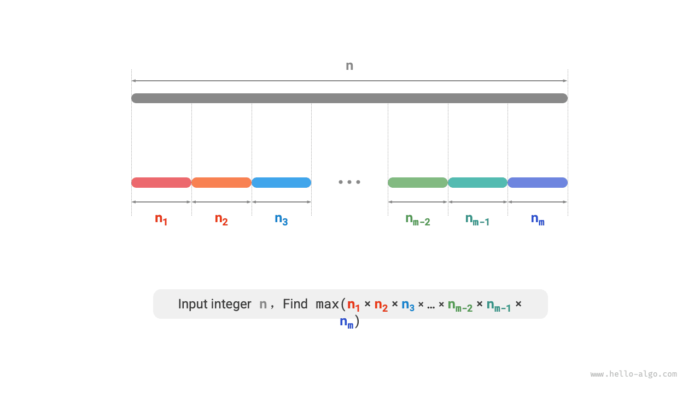
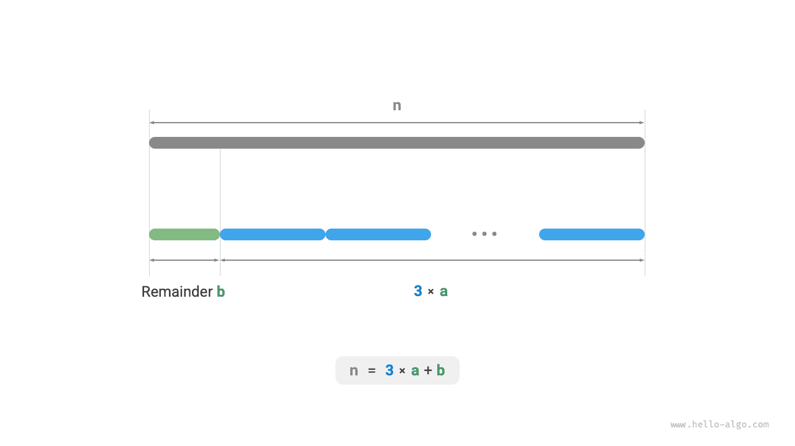

# 정수 분할의 최대 곱 문제

!!! question "문제"

    양의 정수 $n$을 두 개 이상의 양의 정수의 합으로 나누었을 때, 나눈 정수들의 곱이 최대 얼마가 되는지 구하라. 아래 그림을 참고하자.



$n$을 $m$ 개의 정수 인수로 나누고 $i$ 번째 인수를 $n_i$라고 하면 다음과 같다.

$$
n = \sum_{i=1}^{m}n_i
$$

목표는 모든 정수 인수의 곱을 최대화하는 것이다.

$$
\max(\prod_{i=1}^{m}n_i)
$$

생각해야 할 것은 나누는 개수 $m$과 각 $n_i$의 값이다.

### 탐욕 전략 결정

경험상 두 정수의 곱은 합보다 큰 경우가 많다. $n$에서 인수 $2$를 나누어 내면 곱은 $2(n-2)$다. 이를 $n$과 비교해 보자.

$$
\begin{aligned}
2(n-2) & \geq n \newline
2n - n - 4 & \geq 0 \newline
n & \geq 4
\end{aligned}
$$

아래 그림과 같이 $n \geq 4$이면 $2$를 나누어 낸 뒤 곱이 커진다. **이는 $4$ 이상의 정수는 모두 나누어야 한다는 뜻이다**.

**탐욕 전략 1**: 분할에 $\geq 4$인 인수가 있으면 계속 나누어야 한다. 최종 분할에는 $1$, $2$, $3$만 있어야 한다.


이제 어느 인수가 가장 좋은지 생각해 보자. $1$, $2$, $3$ 중 $1$이 가장 나쁘다는 것은 분명하다. $1 \times (n-1) < n$이 항상 성립하므로 $1$을 나누어 내면 오히려 곱이 줄어들기 때문이다.

아래 그림에서 $n = 6$일 때 $3 \times 3 > 2 \times 2 \times 2$다. **따라서 $2$보다 $3$으로 나누는 편이 더 좋다**.

**탐욕 전략 2**: 분할에는 $2$가 많아도 두 개만 있어야 한다. $2$ 세 개는 언제나 $3$ 두 개로 바꾸어 더 큰 곱을 얻을 수 있기 때문이다.


위 내용을 종합하면 다음 탐욕 전략을 얻는다.

1. 정수 $n$에서 인수 $3$을 계속 나누어 내고, 나머지가 $0$, $1$, $2$가 되면 멈춘다.
2. 나머지가 $0$이면 $n$이 $3$의 배수이므로 추가로 처리하지 않는다.
3. 나머지가 $2$이면 더 나누지 않고 그대로 둔다.
4. 나머지가 $1$이면 $2 \times 2 > 1 \times 3$이므로 마지막 $3$과 나머지 $1$을 $2$ 두 개로 바꾼다.

### 코드 구현

아래 그림과 같이 반복문으로 정수를 나눌 필요 없이 내림 정수 나눗셈으로 $3$의 개수 $a$를, 나머지 연산으로 나머지 $b$를 구할 수 있다. 이때 다음이 성립한다.

$$
n = 3 a + b
$$

경계 경우인 $n \leq 3$에서는 반드시 $1$을 하나 나누어 내야 하므로 곱은 $1 \times (n - 1)$이다.

```src
[file]{max_product_cutting}-[class]{}-[func]{max_product_cutting}
```



**시간 복잡도는 프로그래밍 언어의 거듭제곱 구현 방식에 달려 있다**. Python에서 자주 쓰는 거듭제곱 계산 방법은 세 가지다.

- 연산자 `**`와 함수 `pow()`의 시간 복잡도는 모두 $O(\log⁡ a)$이다.
- 함수 `math.pow()`는 내부적으로 C 라이브러리의 `pow()`를 호출하여 부동 소수점 거듭제곱을 계산하며, 시간 복잡도는 $O(1)$이다.

변수 $a$와 $b$는 상수 크기의 추가 공간을 사용하므로 **공간 복잡도는 $O(1)$이다**.

### 정확성 증명

귀류법을 사용하며 $n \geq 4$인 경우만 분석한다.

1. **모든 인수는 $\leq 3$이다**: 최적 분할에 $\geq 4$인 인수 $x$가 있다고 가정하자. 이를 $2(x-2)$로 더 나누면 곱이 커지거나 같아진다. 이는 가정과 모순이다.
2. **분할에 $1$이 없다**: 최적 분할에 인수 $1$이 있다고 가정하자. 이를 다른 인수에 합치면 더 큰 곱을 얻으므로 가정과 모순이다.
3. **분할에 $2$는 최대 두 개다**: 최적 분할에 $2$가 세 개 있다고 가정하자. $3$ 두 개로 바꾸면 곱이 더 커지므로 가정과 모순이다.
