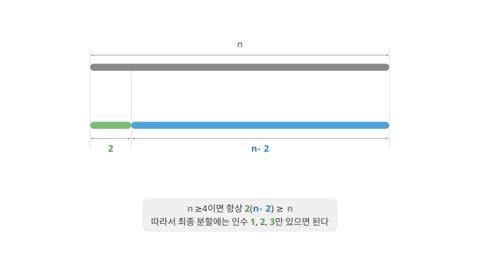

# 정수 분할의 최대 곱 문제

!!! question

    양의 정수 $n$을 적어도 두 양의 정수의 합으로 나눌 때, 나눈 정수들을 모두 곱해 얻을 수 있는 최댓값을 구하라. 아래 그림과 같다.


$n$을 정수 인수 $m$개로 나누고 $i$번째 인수를 $n_i$라고 하면 다음과 같다.

$$
n = \sum_{i=1}^{m}n_i
$$

목표는 모든 정수 인수의 곱을 최대화하는 것이다. 식으로 쓰면 다음과 같다.

$$
\max(\prod_{i=1}^{m}n_i)
$$

몇 개의 인수로 나눌지($m$), 각 인수 $n_i$의 값은 얼마로 할지 정해야 한다.

### 탐욕 전략 정하기

두 정수의 곱은 흔히 두 수의 합보다 크다. $n$에서 인수 $2$를 떼어 내면 두 수의 곱은 $2(n-2)$이다. 이 곱을 $n$과 비교해 보자.

$$
\begin{aligned}
2(n-2) & \geq n \newline
2n - n - 4 & \geq 0 \newline
n & \geq 4
\end{aligned}
$$

아래 그림처럼 $n \geq 4$일 때 $2$를 하나 떼어 내면 곱이 커진다. **따라서 $4$ 이상인 정수는 모두 더 나누어야 한다**.

**탐욕 전략 1**: 분할에 $\geq 4$인 인수가 있으면 더 나눈다. 최종 분할에는 $1$, $2$, $3$ 세 종류의 인수만 있어야 한다.



다음으로 어떤 인수가 가장 유리한지 생각해 보자. $1$, $2$, $3$ 중에서 가장 불리한 것은 분명 $1$이다. 항상 $1 \times (n-1) < n$이므로 $1$을 떼어 내면 오히려 곱이 줄어든다.

아래 그림처럼 $n = 6$이면 $3 \times 3 > 2 \times 2 \times 2$이다. **이는 $2$를 떼어 내는 것보다 $3$을 떼어 내는 편이 낫다는 뜻이다**.

**탐욕 전략 2**: 분할에서 $2$는 많아야 두 개만 있어야 한다. $2$ 세 개는 언제든 $3$ 두 개로 바꾸어 더 큰 곱을 얻을 수 있기 때문이다.


이상의 논의에서 다음 탐욕 전략을 얻을 수 있다.

1. 정수 $n$이 주어지면 나머지가 $0$, $1$, $2$ 중 하나가 될 때까지 인수 $3$을 계속 떼어 낸다.
2. 나머지가 $0$이면 $n$이 $3$의 배수라는 뜻이므로 그대로 둔다.
3. 나머지가 $2$이면 더 나누지 않고 그대로 남긴다.
4. 나머지가 $1$이면 $2 \times 2 > 1 \times 3$이므로 마지막 $3$과 나머지 $1$을 $2$ 두 개로 바꾼다.

### 코드 구현

아래 그림처럼 반복문으로 정수를 나눌 필요는 없다. 내림 나눗셈으로 $3$의 개수 $a$를 구하고 나머지 연산으로 나머지 $b$를 구하면 다음 식이 성립한다.

$$
n = 3 a + b
$$

경계 조건인 $n \leq 3$에서는 반드시 $1$을 하나 떼어 내야 하며 곱은 $1 \times (n - 1)$이다.

```src
[file]{max_product_cutting}-[class]{}-[func]{max_product_cutting}
```


**시간 복잡도는 프로그래밍 언어에서 거듭제곱을 어떻게 구현하는지에 따라 달라진다**. 예를 들어 Python에서 거듭제곱을 계산할 때 흔히 쓰는 방법은 세 가지이다.

- 연산자 `**`와 함수 `pow()`의 시간 복잡도는 모두 $O(\log⁡ a)$이다.
- `math.pow()` 함수는 내부에서 C 라이브러리의 `pow()` 함수를 호출한다. 이 함수는 부동 소수점 거듭제곱을 계산하며 시간 복잡도는 $O(1)$이다.

변수 $a$와 $b$가 사용하는 추가 공간은 상수 크기이므로 **공간 복잡도는 $O(1)$이다**.

### 정당성 증명

귀류법을 사용하며 $n \geq 4$인 경우만 분석한다.

1. **모든 인수는 $\leq 3$**: 최적 분할에 값이 $\geq 4$인 인수 $x$가 있다고 가정하자. 이를 더 나누어 곱이 $2(x-2)$가 되도록 하면 더 크거나 같은 곱을 얻을 수 있다. 이는 가정에 모순된다.
2. **분할에는 $1$이 없다**: 최적 분할에 인수 $1$이 하나 있다고 가정하자. 이 인수를 다른 인수에 더하면 반드시 더 큰 곱을 얻는다. 이는 가정에 모순된다.
3. **분할에서 $2$는 많아야 두 개이다**: 최적 분할에 $2$가 세 개 있다고 가정하자. 이를 $3$ 두 개로 바꾸면 반드시 곱이 커진다. 이는 가정에 모순된다.
