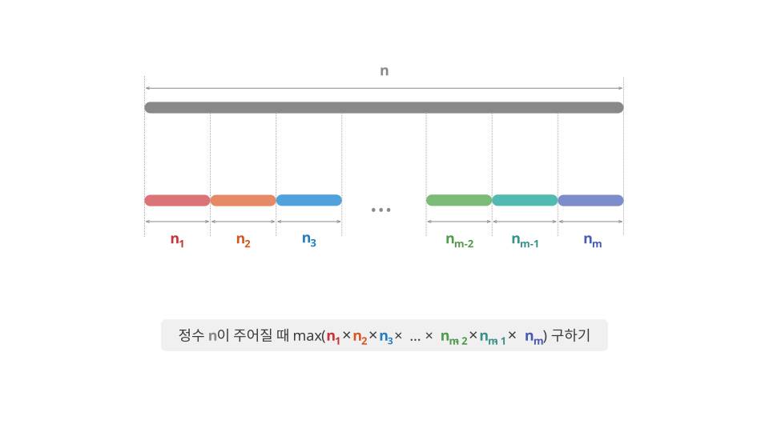
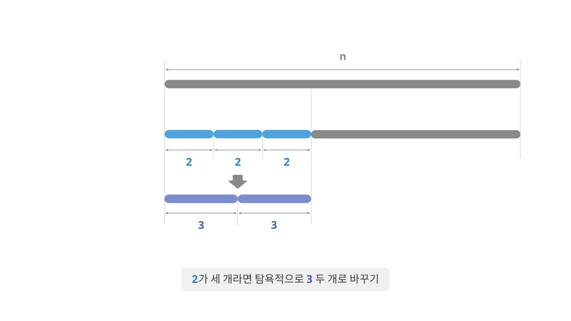
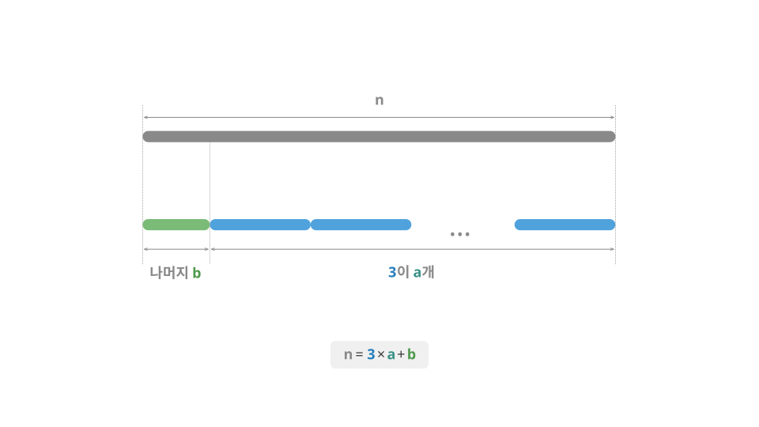

# 15.4 &nbsp; 정수 분할의 최대 곱 문제

!!! question

    양의 정수 $n$을 적어도 두 양의 정수의 합으로 나눌 때, 나눈 정수들을 모두 곱해 얻을 수 있는 최댓값을 구하라. 아래 그림(15-13)과 같다.

{ class="animation-figure" }

<p align="center"> 그림 15-13 &nbsp; 정수 분할의 최대 곱 문제 정의 </p>

$n$을 정수 인수 $m$개로 나누고 $i$번째 인수를 $n_i$라고 하면 다음과 같다.

$$
n = \sum_{i=1}^{m}n_i
$$

목표는 모든 정수 인수의 곱을 최대화하는 것이다. 식으로 쓰면 다음과 같다.

$$
\max(\prod_{i=1}^{m}n_i)
$$

몇 개의 인수로 나눌지($m$), 각 인수 $n_i$의 값은 얼마로 할지 정해야 한다.

### 1. &nbsp; 탐욕 전략 정하기

두 정수의 곱은 흔히 두 수의 합보다 크다. $n$에서 인수 $2$를 떼어 내면 두 수의 곱은 $2(n-2)$이다. 이 곱을 $n$과 비교해 보자.

$$
\begin{aligned}
2(n-2) & \geq n \newline
2n - n - 4 & \geq 0 \newline
n & \geq 4
\end{aligned}
$$

아래 그림(15-14)처럼 $n \geq 4$일 때 $2$를 하나 떼어 내면 곱이 커진다. **따라서 $4$ 이상인 정수는 모두 더 나누어야 한다**.

**탐욕 전략 1**: 분할에 $\geq 4$인 인수가 있으면 더 나눈다. 최종 분할에는 $1$, $2$, $3$ 세 종류의 인수만 있어야 한다.

{ class="animation-figure" }

<p align="center"> 그림 15-14 &nbsp; 나누면 커지는 곱 </p>

다음으로 어떤 인수가 가장 유리한지 생각해 보자. $1$, $2$, $3$ 중에서 가장 불리한 것은 분명 $1$이다. 항상 $1 \times (n-1) < n$이므로 $1$을 떼어 내면 오히려 곱이 줄어든다.

아래 그림(15-15)처럼 $n = 6$이면 $3 \times 3 > 2 \times 2 \times 2$이다. **이는 $2$를 떼어 내는 것보다 $3$을 떼어 내는 편이 낫다는 뜻이다**.

**탐욕 전략 2**: 분할에서 $2$는 많아야 두 개만 있어야 한다. $2$ 세 개는 언제든 $3$ 두 개로 바꾸어 더 큰 곱을 얻을 수 있기 때문이다.

{ class="animation-figure" }

<p align="center"> 그림 15-15 &nbsp; 최적 분할 인수 </p>

이상의 논의에서 다음 탐욕 전략을 얻을 수 있다.

1. 정수 $n$이 주어지면 나머지가 $0$, $1$, $2$ 중 하나가 될 때까지 인수 $3$을 계속 떼어 낸다.
2. 나머지가 $0$이면 $n$이 $3$의 배수라는 뜻이므로 그대로 둔다.
3. 나머지가 $2$이면 더 나누지 않고 그대로 남긴다.
4. 나머지가 $1$이면 $2 \times 2 > 1 \times 3$이므로 마지막 $3$과 나머지 $1$을 $2$ 두 개로 바꾼다.

### 2. &nbsp; 코드 구현

아래 그림(15-16)처럼 반복문으로 정수를 나눌 필요는 없다. 내림 나눗셈으로 $3$의 개수 $a$를 구하고 나머지 연산으로 나머지 $b$를 구하면 다음 식이 성립한다.

$$
n = 3 a + b
$$

경계 조건인 $n \leq 3$에서는 반드시 $1$을 하나 떼어 내야 하며 곱은 $1 \times (n - 1)$이다.

=== "Python"

    ```python title="max_product_cutting.py"
    def max_product_cutting(n: int) -> int:
        """탐욕 알고리즘으로 정수 분할의 최대 곱 구하기"""
        # n <= 3이면 반드시 1을 하나 떼어 낸다
        if n <= 3:
            return 1 * (n - 1)
        # 탐욕적으로 3씩 떼어 낸다. a는 3의 개수이고 b는 나머지이다
        a, b = n // 3, n % 3
        if b == 1:
            # 나머지가 1이면 1 * 3 한 쌍을 2 * 2로 바꾼다
            return int(math.pow(3, a - 1)) * 2 * 2
        if b == 2:
            # 나머지가 2이면 그대로 둔다
            return int(math.pow(3, a)) * 2
        # 나머지가 0이면 그대로 둔다
        return int(math.pow(3, a))
    ```

=== "C++"

    ```cpp title="max_product_cutting.cpp"
    /* 탐욕 알고리즘으로 정수 분할의 최대 곱 구하기 */
    int maxProductCutting(int n) {
        // n <= 3이면 반드시 1을 하나 떼어 낸다
        if (n <= 3) {
            return 1 * (n - 1);
        }
        // 탐욕적으로 3씩 떼어 낸다. a는 3의 개수이고 b는 나머지이다
        int a = n / 3;
        int b = n % 3;
        if (b == 1) {
            // 나머지가 1이면 1 * 3 한 쌍을 2 * 2로 바꾼다
            return (int)pow(3, a - 1) * 2 * 2;
        }
        if (b == 2) {
            // 나머지가 2이면 그대로 둔다
            return (int)pow(3, a) * 2;
        }
        // 나머지가 0이면 그대로 둔다
        return (int)pow(3, a);
    }
    ```

=== "Java"

    ```java title="max_product_cutting.java"
    /* 탐욕 알고리즘으로 정수 분할의 최대 곱 구하기 */
    int maxProductCutting(int n) {
        // n <= 3이면 반드시 1을 하나 떼어 낸다
        if (n <= 3) {
            return 1 * (n - 1);
        }
        // 탐욕적으로 3씩 떼어 낸다. a는 3의 개수이고 b는 나머지이다
        int a = n / 3;
        int b = n % 3;
        if (b == 1) {
            // 나머지가 1이면 1 * 3 한 쌍을 2 * 2로 바꾼다
            return (int) Math.pow(3, a - 1) * 2 * 2;
        }
        if (b == 2) {
            // 나머지가 2이면 그대로 둔다
            return (int) Math.pow(3, a) * 2;
        }
        // 나머지가 0이면 그대로 둔다
        return (int) Math.pow(3, a);
    }
    ```

=== "C#"

    ```csharp title="max_product_cutting.cs"
    /* 탐욕 알고리즘으로 정수 분할의 최대 곱 구하기 */
    int MaxProductCutting(int n) {
        // n <= 3이면 반드시 1을 하나 떼어 낸다
        if (n <= 3) {
            return 1 * (n - 1);
        }
        // 탐욕적으로 3씩 떼어 낸다. a는 3의 개수이고 b는 나머지이다
        int a = n / 3;
        int b = n % 3;
        if (b == 1) {
            // 나머지가 1이면 1 * 3 한 쌍을 2 * 2로 바꾼다
            return (int)Math.Pow(3, a - 1) * 2 * 2;
        }
        if (b == 2) {
            // 나머지가 2이면 그대로 둔다
            return (int)Math.Pow(3, a) * 2;
        }
        // 나머지가 0이면 그대로 둔다
        return (int)Math.Pow(3, a);
    }
    ```

=== "Go"

    ```go title="max_product_cutting.go"
    /* 탐욕 알고리즘으로 정수 분할의 최대 곱 구하기 */
    func maxProductCutting(n int) int {
        // n <= 3이면 반드시 1을 하나 떼어 낸다
        if n <= 3 {
            return 1 * (n - 1)
        }
        // 탐욕적으로 3씩 떼어 낸다. a는 3의 개수이고 b는 나머지이다
        a := n / 3
        b := n % 3
        if b == 1 {
            // 나머지가 1이면 1 * 3 한 쌍을 2 * 2로 바꾼다
            return int(math.Pow(3, float64(a-1))) * 2 * 2
        }
        if b == 2 {
            // 나머지가 2이면 그대로 둔다
            return int(math.Pow(3, float64(a))) * 2
        }
        // 나머지가 0이면 그대로 둔다
        return int(math.Pow(3, float64(a)))
    }
    ```

=== "Swift"

    ```swift title="max_product_cutting.swift"
    /* 탐욕 알고리즘으로 정수 분할의 최대 곱 구하기 */
    func maxProductCutting(n: Int) -> Int {
        // n <= 3이면 반드시 1을 하나 떼어 낸다
        if n <= 3 {
            return 1 * (n - 1)
        }
        // 탐욕적으로 3씩 떼어 낸다. a는 3의 개수이고 b는 나머지이다
        let a = n / 3
        let b = n % 3
        if b == 1 {
            // 나머지가 1이면 1 * 3 한 쌍을 2 * 2로 바꾼다
            return pow(3, a - 1) * 2 * 2
        }
        if b == 2 {
            // 나머지가 2이면 그대로 둔다
            return pow(3, a) * 2
        }
        // 나머지가 0이면 그대로 둔다
        return pow(3, a)
    }
    ```

=== "JS"

    ```javascript title="max_product_cutting.js"
    /* 탐욕 알고리즘으로 정수 분할의 최대 곱 구하기 */
    function maxProductCutting(n) {
        // n <= 3이면 반드시 1을 하나 떼어 낸다
        if (n <= 3) {
            return 1 * (n - 1);
        }
        // 탐욕적으로 3씩 떼어 낸다. a는 3의 개수이고 b는 나머지이다
        let a = Math.floor(n / 3);
        let b = n % 3;
        if (b === 1) {
            // 나머지가 1이면 1 * 3 한 쌍을 2 * 2로 바꾼다
            return Math.pow(3, a - 1) * 2 * 2;
        }
        if (b === 2) {
            // 나머지가 2이면 그대로 둔다
            return Math.pow(3, a) * 2;
        }
        // 나머지가 0이면 그대로 둔다
        return Math.pow(3, a);
    }
    ```

=== "TS"

    ```typescript title="max_product_cutting.ts"
    /* 탐욕 알고리즘으로 정수 분할의 최대 곱 구하기 */
    function maxProductCutting(n: number): number {
        // n <= 3이면 반드시 1을 하나 떼어 낸다
        if (n <= 3) {
            return 1 * (n - 1);
        }
        // 탐욕적으로 3씩 떼어 낸다. a는 3의 개수이고 b는 나머지이다
        let a: number = Math.floor(n / 3);
        let b: number = n % 3;
        if (b === 1) {
            // 나머지가 1이면 1 * 3 한 쌍을 2 * 2로 바꾼다
            return Math.pow(3, a - 1) * 2 * 2;
        }
        if (b === 2) {
            // 나머지가 2이면 그대로 둔다
            return Math.pow(3, a) * 2;
        }
        // 나머지가 0이면 그대로 둔다
        return Math.pow(3, a);
    }
    ```

=== "Dart"

    ```dart title="max_product_cutting.dart"
    /* 탐욕 알고리즘으로 정수 분할의 최대 곱 구하기 */
    int maxProductCutting(int n) {
      // n <= 3이면 반드시 1을 하나 떼어 낸다
      if (n <= 3) {
        return 1 * (n - 1);
      }
      // 탐욕적으로 3씩 떼어 낸다. a는 3의 개수이고 b는 나머지이다
      int a = n ~/ 3;
      int b = n % 3;
      if (b == 1) {
        // 나머지가 1이면 1 * 3 한 쌍을 2 * 2로 바꾼다
        return (pow(3, a - 1) * 2 * 2).toInt();
      }
      if (b == 2) {
        // 나머지가 2이면 그대로 둔다
        return (pow(3, a) * 2).toInt();
      }
      // 나머지가 0이면 그대로 둔다
      return pow(3, a).toInt();
    }
    ```

=== "Rust"

    ```rust title="max_product_cutting.rs"
    /* 탐욕 알고리즘으로 정수 분할의 최대 곱 구하기 */
    fn max_product_cutting(n: i32) -> i32 {
        // n <= 3이면 반드시 1을 하나 떼어 낸다
        if n <= 3 {
            return 1 * (n - 1);
        }
        // 탐욕적으로 3씩 떼어 낸다. a는 3의 개수이고 b는 나머지이다
        let a = n / 3;
        let b = n % 3;
        if b == 1 {
            // 나머지가 1이면 1 * 3 한 쌍을 2 * 2로 바꾼다
            3_i32.pow(a as u32 - 1) * 2 * 2
        } else if b == 2 {
            // 나머지가 2이면 그대로 둔다
            3_i32.pow(a as u32) * 2
        } else {
            // 나머지가 0이면 그대로 둔다
            3_i32.pow(a as u32)
        }
    }
    ```

=== "C"

    ```c title="max_product_cutting.c"
    /* 탐욕 알고리즘으로 정수 분할의 최대 곱 구하기 */
    int maxProductCutting(int n) {
        // n <= 3이면 반드시 1을 하나 떼어 낸다
        if (n <= 3) {
            return 1 * (n - 1);
        }
        // 탐욕적으로 3씩 떼어 낸다. a는 3의 개수이고 b는 나머지이다
        int a = n / 3;
        int b = n % 3;
        if (b == 1) {
            // 나머지가 1이면 1 * 3 한 쌍을 2 * 2로 바꾼다
            return pow(3, a - 1) * 2 * 2;
        }
        if (b == 2) {
            // 나머지가 2이면 그대로 둔다
            return pow(3, a) * 2;
        }
        // 나머지가 0이면 그대로 둔다
        return pow(3, a);
    }
    ```

=== "Kotlin"

    ```kotlin title="max_product_cutting.kt"
    /* 탐욕 알고리즘으로 정수 분할의 최대 곱 구하기 */
    fun maxProductCutting(n: Int): Int {
        // n <= 3이면 반드시 1을 하나 떼어 낸다
        if (n <= 3) {
            return 1 * (n - 1)
        }
        // 탐욕적으로 3씩 떼어 낸다. a는 3의 개수이고 b는 나머지이다
        val a = n / 3
        val b = n % 3
        if (b == 1) {
            // 나머지가 1이면 1 * 3 한 쌍을 2 * 2로 바꾼다
            return 3.0.pow((a - 1)).toInt() * 2 * 2
        }
        if (b == 2) {
            // 나머지가 2이면 그대로 둔다
            return 3.0.pow(a).toInt() * 2
        }
        // 나머지가 0이면 그대로 둔다
        return 3.0.pow(a).toInt()
    }
    ```

=== "Ruby"

    ```ruby title="max_product_cutting.rb"
    ### 탐욕 알고리즘으로 정수 분할의 최대 곱 구하기 ###
    def max_product_cutting(n)
      # n <= 3이면 반드시 1을 하나 떼어 낸다
      return 1 * (n - 1) if n <= 3
      # 탐욕적으로 3씩 떼어 낸다. a는 3의 개수이고 b는 나머지이다
      a, b = n / 3, n % 3
      # 나머지가 1이면 1 * 3 한 쌍을 2 * 2로 바꾼다
      return (3.pow(a - 1) * 2 * 2).to_i if b == 1
      # 나머지가 2이면 그대로 둔다
      return (3.pow(a) * 2).to_i if b == 2
      # 나머지가 0이면 그대로 둔다
      3.pow(a).to_i
    end
    ```

??? pythontutor "실행 과정 시각화"

    <div style="height: 549px; width: 100%;"><iframe class="pythontutor-iframe" title="실행 과정 시각화" src="https://pythontutor.com/iframe-embed.html#code=import%20math%0A%0Adef%20max_product_cutting%28n%3A%20int%29%20-%3E%20int%3A%0A%20%20%20%20%22%22%22%ED%83%90%EC%9A%95%20%EC%95%8C%EA%B3%A0%EB%A6%AC%EC%A6%98%EC%9C%BC%EB%A1%9C%20%EC%A0%95%EC%88%98%20%EB%B6%84%ED%95%A0%EC%9D%98%20%EC%B5%9C%EB%8C%80%20%EA%B3%B1%20%EA%B5%AC%ED%95%98%EA%B8%B0%22%22%22%0A%20%20%20%20%23%20n%20%3C%3D%203%EC%9D%B4%EB%A9%B4%20%EB%B0%98%EB%93%9C%EC%8B%9C%201%EC%9D%84%20%ED%95%98%EB%82%98%20%EB%96%BC%EC%96%B4%20%EB%82%B8%EB%8B%A4%0A%20%20%20%20if%20n%20%3C%3D%203%3A%0A%20%20%20%20%20%20%20%20return%201%20%2A%20%28n%20-%201%29%0A%20%20%20%20%23%20%ED%83%90%EC%9A%95%EC%A0%81%EC%9C%BC%EB%A1%9C%203%EC%94%A9%20%EB%96%BC%EC%96%B4%20%EB%82%B8%EB%8B%A4.%20a%EB%8A%94%203%EC%9D%98%20%EA%B0%9C%EC%88%98%EC%9D%B4%EA%B3%A0%20b%EB%8A%94%20%EB%82%98%EB%A8%B8%EC%A7%80%EC%9D%B4%EB%8B%A4%0A%20%20%20%20a,%20b%20%3D%20n%20//%203,%20n%20%25%203%0A%20%20%20%20if%20b%20%3D%3D%201%3A%0A%20%20%20%20%20%20%20%20%23%20%EB%82%98%EB%A8%B8%EC%A7%80%EA%B0%80%201%EC%9D%B4%EB%A9%B4%201%20%2A%203%20%ED%95%9C%20%EC%8C%8D%EC%9D%84%202%20%2A%202%EB%A1%9C%20%EB%B0%94%EA%BE%BC%EB%8B%A4%0A%20%20%20%20%20%20%20%20return%20int%28math.pow%283,%20a%20-%201%29%29%20%2A%202%20%2A%202%0A%20%20%20%20if%20b%20%3D%3D%202%3A%0A%20%20%20%20%20%20%20%20%23%20%EB%82%98%EB%A8%B8%EC%A7%80%EA%B0%80%202%EC%9D%B4%EB%A9%B4%20%EA%B7%B8%EB%8C%80%EB%A1%9C%20%EB%91%94%EB%8B%A4%0A%20%20%20%20%20%20%20%20return%20int%28math.pow%283,%20a%29%29%20%2A%202%0A%20%20%20%20%23%20%EB%82%98%EB%A8%B8%EC%A7%80%EA%B0%80%200%EC%9D%B4%EB%A9%B4%20%EA%B7%B8%EB%8C%80%EB%A1%9C%20%EB%91%94%EB%8B%A4%0A%20%20%20%20return%20int%28math.pow%283,%20a%29%29%0A%0A%22%22%22Driver%20Code%22%22%22%0Aif%20__name__%20%3D%3D%20%22__main__%22%3A%0A%20%20%20%20n%20%3D%2058%0A%0A%20%20%20%20%23%20%ED%83%90%EC%9A%95%20%EC%95%8C%EA%B3%A0%EB%A6%AC%EC%A6%98%0A%20%20%20%20res%20%3D%20max_product_cutting%28n%29%0A%20%20%20%20print%28f%22%EB%B6%84%ED%95%A0%ED%95%9C%20%EC%88%98%EB%93%A4%EC%9D%98%20%EC%B5%9C%EB%8C%80%20%EA%B3%B1%3A%20%7Bres%7D%22%29&codeDivHeight=472&codeDivWidth=350&cumulative=false&curInstr=5&heapPrimitives=nevernest&origin=opt-frontend.js&py=311&rawInputLstJSON=%5B%5D&textReferences=false"> </iframe></div>
    <div style="margin-top: 5px;"><a href="https://pythontutor.com/iframe-embed.html#code=import%20math%0A%0Adef%20max_product_cutting%28n%3A%20int%29%20-%3E%20int%3A%0A%20%20%20%20%22%22%22%ED%83%90%EC%9A%95%20%EC%95%8C%EA%B3%A0%EB%A6%AC%EC%A6%98%EC%9C%BC%EB%A1%9C%20%EC%A0%95%EC%88%98%20%EB%B6%84%ED%95%A0%EC%9D%98%20%EC%B5%9C%EB%8C%80%20%EA%B3%B1%20%EA%B5%AC%ED%95%98%EA%B8%B0%22%22%22%0A%20%20%20%20%23%20n%20%3C%3D%203%EC%9D%B4%EB%A9%B4%20%EB%B0%98%EB%93%9C%EC%8B%9C%201%EC%9D%84%20%ED%95%98%EB%82%98%20%EB%96%BC%EC%96%B4%20%EB%82%B8%EB%8B%A4%0A%20%20%20%20if%20n%20%3C%3D%203%3A%0A%20%20%20%20%20%20%20%20return%201%20%2A%20%28n%20-%201%29%0A%20%20%20%20%23%20%ED%83%90%EC%9A%95%EC%A0%81%EC%9C%BC%EB%A1%9C%203%EC%94%A9%20%EB%96%BC%EC%96%B4%20%EB%82%B8%EB%8B%A4.%20a%EB%8A%94%203%EC%9D%98%20%EA%B0%9C%EC%88%98%EC%9D%B4%EA%B3%A0%20b%EB%8A%94%20%EB%82%98%EB%A8%B8%EC%A7%80%EC%9D%B4%EB%8B%A4%0A%20%20%20%20a,%20b%20%3D%20n%20//%203,%20n%20%25%203%0A%20%20%20%20if%20b%20%3D%3D%201%3A%0A%20%20%20%20%20%20%20%20%23%20%EB%82%98%EB%A8%B8%EC%A7%80%EA%B0%80%201%EC%9D%B4%EB%A9%B4%201%20%2A%203%20%ED%95%9C%20%EC%8C%8D%EC%9D%84%202%20%2A%202%EB%A1%9C%20%EB%B0%94%EA%BE%BC%EB%8B%A4%0A%20%20%20%20%20%20%20%20return%20int%28math.pow%283,%20a%20-%201%29%29%20%2A%202%20%2A%202%0A%20%20%20%20if%20b%20%3D%3D%202%3A%0A%20%20%20%20%20%20%20%20%23%20%EB%82%98%EB%A8%B8%EC%A7%80%EA%B0%80%202%EC%9D%B4%EB%A9%B4%20%EA%B7%B8%EB%8C%80%EB%A1%9C%20%EB%91%94%EB%8B%A4%0A%20%20%20%20%20%20%20%20return%20int%28math.pow%283,%20a%29%29%20%2A%202%0A%20%20%20%20%23%20%EB%82%98%EB%A8%B8%EC%A7%80%EA%B0%80%200%EC%9D%B4%EB%A9%B4%20%EA%B7%B8%EB%8C%80%EB%A1%9C%20%EB%91%94%EB%8B%A4%0A%20%20%20%20return%20int%28math.pow%283,%20a%29%29%0A%0A%22%22%22Driver%20Code%22%22%22%0Aif%20__name__%20%3D%3D%20%22__main__%22%3A%0A%20%20%20%20n%20%3D%2058%0A%0A%20%20%20%20%23%20%ED%83%90%EC%9A%95%20%EC%95%8C%EA%B3%A0%EB%A6%AC%EC%A6%98%0A%20%20%20%20res%20%3D%20max_product_cutting%28n%29%0A%20%20%20%20print%28f%22%EB%B6%84%ED%95%A0%ED%95%9C%20%EC%88%98%EB%93%A4%EC%9D%98%20%EC%B5%9C%EB%8C%80%20%EA%B3%B1%3A%20%7Bres%7D%22%29&codeDivHeight=800&codeDivWidth=600&cumulative=false&curInstr=5&heapPrimitives=nevernest&origin=opt-frontend.js&py=311&rawInputLstJSON=%5B%5D&textReferences=false" target="_blank" rel="noopener noreferrer">전체 화면으로 보기 ></a></div>

{ class="animation-figure" }

<p align="center"> 그림 15-16 &nbsp; 정수 분할의 최대 곱 계산 방법 </p>

**시간 복잡도는 프로그래밍 언어에서 거듭제곱을 어떻게 구현하는지에 따라 달라진다**. 예를 들어 Python에서 거듭제곱을 계산할 때 흔히 쓰는 방법은 세 가지이다.

- 연산자 `**`와 함수 `pow()`의 시간 복잡도는 모두 $O(\log⁡ a)$이다.
- `math.pow()` 함수는 내부에서 C 라이브러리의 `pow()` 함수를 호출한다. 이 함수는 부동 소수점 거듭제곱을 계산하며 시간 복잡도는 $O(1)$이다.

변수 $a$와 $b$가 사용하는 추가 공간은 상수 크기이므로 **공간 복잡도는 $O(1)$이다**.

### 3. &nbsp; 정당성 증명

귀류법을 사용하며 $n \geq 4$인 경우만 분석한다.

1. **모든 인수는 $\leq 3$**: 최적 분할에 값이 $\geq 4$인 인수 $x$가 있다고 가정하자. 이를 더 나누어 곱이 $2(x-2)$가 되도록 하면 더 크거나 같은 곱을 얻을 수 있다. 이는 가정에 모순된다.
2. **분할에는 $1$이 없다**: 최적 분할에 인수 $1$이 하나 있다고 가정하자. 이 인수를 다른 인수에 더하면 반드시 더 큰 곱을 얻는다. 이는 가정에 모순된다.
3. **분할에서 $2$는 많아야 두 개이다**: 최적 분할에 $2$가 세 개 있다고 가정하자. 이를 $3$ 두 개로 바꾸면 반드시 곱이 커진다. 이는 가정에 모순된다.
