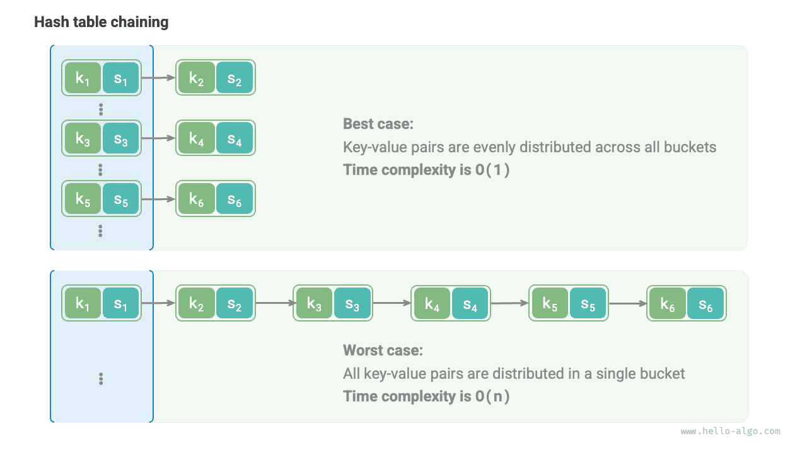

# 해시 알고리즘

앞의 두 절에서는 해시 테이블의 작동 원리와 해시 충돌 처리 방법을 알아보았다. 하지만 개방 주소법이든 체이닝이든 **충돌이 발생해도 해시 테이블이 정상적으로 작동하게 할 뿐, 충돌 발생 자체를 줄이지는 못한다**.

충돌이 너무 자주 발생하면 성능이 급격히 나빠진다. 아래 그림의 체이닝 해시 테이블에서 이상적인 경우는 키-값 쌍이 각 버킷에 고르게 분포하여 최고의 조회 효율을 얻는 것이다. 최악의 경우에는 모든 키-값 쌍이 같은 버킷에 들어가 시간 복잡도가 $O(n)$으로 나빠진다.



**키-값 쌍의 분포는 해시 함수가 결정한다**. 해시 함수는 먼저 해시값을 계산하고 배열 길이로 나눈 나머지를 구한다.

```shell
index = hash(key) % capacity
```

위 식에서 해시 테이블 용량 `capacity`가 고정되면 **해시 알고리즘 `hash()`가 출력값을 결정하며**, 나아가 키-값 쌍의 분포를 결정한다.

따라서 해시 충돌 확률을 낮추려면 해시 알고리즘 `hash()`의 설계에 집중해야 한다.

## 해시 알고리즘의 목표

‘빠르고 안정적인’ 해시 테이블을 구현하려면 해시 알고리즘이 다음 특징을 갖추어야 한다.

- **결정성**: 같은 입력에는 항상 같은 출력을 생성해야 한다. 그래야 해시 테이블을 신뢰할 수 있다.
- **높은 효율**: 해시값 계산이 충분히 빨라야 한다. 계산 비용이 작을수록 해시 테이블의 실용성이 높아진다.
- **균등 분포**: 키-값 쌍이 해시 테이블에 고르게 분포하도록 해야 한다. 분포가 고를수록 충돌 확률은 낮아진다.

해시 알고리즘은 해시 테이블 외에도 여러 분야에서 널리 사용된다.

- **비밀번호 저장**: 사용자의 비밀번호를 보호하기 위해 시스템은 보통 평문 대신 해시값을 저장한다. 사용자가 비밀번호를 입력하면 해시값을 계산해 저장된 값과 비교하고, 두 값이 같으면 올바른 비밀번호로 판단한다.
- **데이터 무결성 검사**: 송신자는 데이터의 해시값을 계산해 함께 보낼 수 있다. 수신자는 받은 데이터의 해시값을 다시 계산하여 전달받은 해시값과 비교한다. 둘이 같으면 데이터가 온전하다고 판단한다.

암호학 관련 응용에서는 해시값으로 원래 비밀번호를 추론하는 등의 역공학을 막기 위해 더 높은 수준의 보안 특성이 필요하다.

- **일방향성**: 해시값으로 입력 데이터에 관한 정보를 역으로 추론할 수 없어야 한다.
- **충돌 저항성**: 해시값이 같은 서로 다른 두 입력을 찾기가 극히 어려워야 한다.
- **눈사태 효과**: 입력의 작은 변화가 출력의 크고 예측할 수 없는 변화로 이어져야 한다.

**‘균등 분포’와 ‘충돌 저항성’은 서로 독립된 개념이다**. 균등 분포를 만족한다고 충돌 저항성도 만족하는 것은 아니다. 예를 들어 `key`가 무작위로 입력되면 해시 함수 `key % 100`은 고르게 분포하는 출력을 만들 수 있다. 하지만 이 알고리즘은 너무 단순하여 마지막 두 자리가 같은 모든 `key`의 출력이 같다. 따라서 해시값에서 유효한 `key`를 쉽게 역추론하여 비밀번호를 깰 수 있다.

## 해시 알고리즘의 설계

해시 알고리즘 설계는 여러 요소를 고려해야 하는 복잡한 문제다. 다만 요구 수준이 높지 않은 상황에서는 간단한 알고리즘을 설계할 수 있다.

- **덧셈 해싱**: 입력의 각 문자에 해당하는 ASCII 코드를 모두 더한 값을 해시값으로 삼는다.
- **곱셈 해싱**: 곱셈의 비상관성을 이용하여 매번 상수를 곱하고, 각 문자의 ASCII 코드를 해시값에 누적한다.
- **XOR 해싱**: 입력 데이터의 각 원소를 XOR 연산으로 하나의 해시값에 누적한다.
- **회전 해싱**: 각 문자의 ASCII 코드를 해시값에 누적하되, 누적하기 전에 해시값에 회전 연산을 수행한다.

```src
[file]{simple_hash}-[class]{}-[func]{rot_hash}
```

각 알고리즘의 마지막 단계에서는 큰 소수 $1000000007$로 나눈 나머지를 구하여 해시값이 적절한 범위에 있도록 한다. 왜 소수로 나누어야 할까? 합성수로 나누면 어떤 단점이 있을까? 생각해 볼 만한 흥미로운 문제다.

결론부터 말하면 **큰 소수를 모듈러 연산의 법으로 사용하면 해시값의 균등 분포를 최대한 보장할 수 있다**. 소수는 다른 수와 공약수를 갖지 않으므로 나머지 연산에서 생기는 주기적 패턴을 줄여 충돌을 피할 수 있기 때문이다.

예를 들어 합성수 $9$를 법으로 선택했다고 하자. 이 수는 $3$으로 나누어떨어지므로, $3$으로 나누어떨어지는 모든 `key`는 $0$, $3$, $6$의 세 해시값에 매핑된다.

$$
\begin{aligned}
\text{modulus} & = 9 \newline
\text{key} & = \{ 0, 3, 6, 9, 12, 15, 18, 21, 24, 27, 30, 33, \dots \} \newline
\text{hash} & = \{ 0, 3, 6, 0, 3, 6, 0, 3, 6, 0, 3, 6,\dots \}
\end{aligned}
$$

입력 `key`가 마침 이런 등차수열 분포를 따르면 해시값에 군집이 생겨 충돌이 심해진다. 이제 `modulus`를 소수 $13$으로 바꾸면 `key`와 `modulus` 사이에 공약수가 없으므로 출력 해시값의 균등성이 뚜렷하게 좋아진다.

$$
\begin{aligned}
\text{modulus} & = 13 \newline
\text{key} & = \{ 0, 3, 6, 9, 12, 15, 18, 21, 24, 27, 30, 33, \dots \} \newline
\text{hash} & = \{ 0, 3, 6, 9, 12, 2, 5, 8, 11, 1, 4, 7, \dots \}
\end{aligned}
$$

`key`가 무작위로 균등하게 분포함을 보장할 수 있다면 소수와 합성수 중 어느 것을 법으로 써도 균등한 해시값을 얻을 수 있다. 반면 `key`의 분포에 주기성이 있으면 합성수로 나눌 때 군집이 생기기 쉽다.

따라서 보통 소수를 법으로 선택하며, 가능한 한 큰 소수를 사용해 주기적 패턴을 줄이고 해시 알고리즘의 안정성을 높인다.

## 대표적인 해시 알고리즘

앞에서 소개한 간단한 해시 알고리즘은 비교적 ‘취약하여’ 설계 목표에 크게 못 미친다. 예를 들어 덧셈과 XOR는 교환법칙을 만족하므로, 이 두 해싱 방식은 내용은 같고 순서만 다른 문자열을 구분하지 못한다. 이는 해시 충돌을 늘리고 보안 문제를 일으킬 수 있다.

실제로는 MD5, SHA-1, SHA-2, SHA-3 같은 표준 해시 알고리즘을 주로 사용한다. 이들은 길이가 임의인 입력 데이터를 고정 길이의 해시값으로 매핑한다.

지난 한 세기 가까이 해시 알고리즘은 계속 개선되고 최적화되어 왔다. 일부 연구자는 성능을 높이는 데 힘쓰고, 다른 연구자와 해커는 보안 문제를 찾는 데 집중한다. 아래 표는 실제 응용에서 흔히 쓰이는 해시 알고리즘을 보여 준다.

- MD5와 SHA-1은 여러 차례 공격에 성공한 사례가 있어 각종 보안 응용에서 사용이 중단되었다.
- SHA-2 계열의 SHA-256은 가장 안전한 해시 알고리즘 중 하나로, 아직 성공한 공격 사례가 없어 각종 보안 응용과 프로토콜에서 자주 사용된다.
- SHA-3는 SHA-2보다 구현 비용이 낮고 계산 효율이 높지만, 현재 보급 범위는 SHA-2 계열에 못 미친다.

<p align="center"> 표 <id> &nbsp; 대표적인 해시 알고리즘 </p>

|          | MD5                            | SHA-1            | SHA-2                        | SHA-3               |
| -------- | ------------------------------ | ---------------- | ---------------------------- | ------------------- |
| 발표 시기 | 1992                           | 1995             | 2002                         | 2008                |
| 출력 길이 | 128 bit                        | 160 bit          | 256/512 bit                  | 224/256/384/512 bit |
| 해시 충돌 | 비교적 많음                           | 비교적 많음             | 매우 적음                         | 매우 적음                |
| 보안 수준 | 낮음, 공격 성공 사례가 있음               | 낮음, 공격 성공 사례가 있음 | 높음                           | 높음                  |
| 활용     | 사용 중단, 데이터 무결성 검사에는 여전히 사용 | 사용 중단         | 암호화폐 거래 검증, 전자 서명 등 | SHA-2를 대체할 수 있음    |

## 자료 구조의 해시값

해시 테이블의 `key`는 정수, 소수, 문자열 등의 자료형일 수 있다. 프로그래밍 언어는 보통 이러한 자료형에 내장 해시 알고리즘을 제공하여 버킷 인덱스를 계산한다. 예를 들어 Python에서는 `hash()` 함수로 여러 자료형의 해시값을 구할 수 있다.

- 정수와 불리언의 해시값은 그 값 자체다.
- 부동 소수점 수와 문자열의 해시값 계산은 더 복잡하다. 관심 있는 독자는 따로 알아보자.
- 튜플은 각 원소의 해시값을 계산한 뒤 이를 결합하여 하나의 해시값을 얻는다.
- 객체의 해시값은 메모리 주소를 기반으로 생성된다. 객체의 해시 메서드를 재정의하면 내용을 기반으로 해시값을 만들 수도 있다.

!!! tip "참고"

    프로그래밍 언어마다 내장 해시값 계산 함수의 정의와 방식이 다르다는 점에 주의하자.

=== "Python"

    ```python title="built_in_hash.py"
    num = 3
    hash_num = hash(num)
    # 정수 3의 해시값은 3

    bol = True
    hash_bol = hash(bol)
    # 불리언 True의 해시값은 1

    dec = 3.14159
    hash_dec = hash(dec)
    # 소수 3.14159의 해시값은 326484311674566659

    str = "Hello 算法"
    hash_str = hash(str)
    # 문자열 “Hello 算法”의 해시값은 4617003410720528961

    tup = (12836, "小哈")
    hash_tup = hash(tup)
    # 튜플 (12836, '小哈')의 해시값은 1029005403108185979

    obj = ListNode(0)
    hash_obj = hash(obj)
    # 노드 객체 <ListNode object at 0x1058fd810>의 해시값은 274267521
    ```

=== "C++"

    ```cpp title="built_in_hash.cpp"
    int num = 3;
    size_t hashNum = hash<int>()(num);
    // 정수 3의 해시값은 3

    bool bol = true;
    size_t hashBol = hash<bool>()(bol);
    // 불리언 1의 해시값은 1

    double dec = 3.14159;
    size_t hashDec = hash<double>()(dec);
    // 소수 3.14159의 해시값은 4614256650576692846

    string str = "Hello 算法";
    size_t hashStr = hash<string>()(str);
    // 문자열 “Hello 算法”의 해시값은 15466937326284535026

    // C++의 내장 std::hash()는 기본 자료형의 해시값 계산만 제공한다
    // 배열과 객체의 해시값 계산은 직접 구현해야 한다
    ```

=== "Java"

    ```java title="built_in_hash.java"
    int num = 3;
    int hashNum = Integer.hashCode(num);
    // 정수 3의 해시값은 3

    boolean bol = true;
    int hashBol = Boolean.hashCode(bol);
    // 불리언 true의 해시값은 1231

    double dec = 3.14159;
    int hashDec = Double.hashCode(dec);
    // 소수 3.14159의 해시값은 -1340954729

    String str = "Hello 算法";
    int hashStr = str.hashCode();
    // 문자열 “Hello 算法”의 해시값은 -727081396

    Object[] arr = { 12836, "小哈" };
    int hashTup = Arrays.hashCode(arr);
    // 배열 [12836, 小哈]의 해시값은 1151158

    ListNode obj = new ListNode(0);
    int hashObj = obj.hashCode();
    // 노드 객체 utils.ListNode@7dc5e7b4의 해시값은 2110121908
    ```

=== "C#"

    ```csharp title="built_in_hash.cs"
    int num = 3;
    int hashNum = num.GetHashCode();
    // 정수 3의 해시값은 3;

    bool bol = true;
    int hashBol = bol.GetHashCode();
    // 불리언 true의 해시값은 1;

    double dec = 3.14159;
    int hashDec = dec.GetHashCode();
    // 소수 3.14159의 해시값은 -1340954729;

    string str = "Hello 算法";
    int hashStr = str.GetHashCode();
    // 문자열 “Hello 算法”의 해시값은 -586107568;

    object[] arr = [12836, "小哈"];
    int hashTup = arr.GetHashCode();
    // 배열 [12836, 小哈]의 해시값은 42931033;

    ListNode obj = new(0);
    int hashObj = obj.GetHashCode();
    // 노드 객체 0의 해시값은 39053774;
    ```

=== "Go"

    ```go title="built_in_hash.go"
    // Go는 내장 hash code 함수를 제공하지 않는다
    ```

=== "Swift"

    ```swift title="built_in_hash.swift"
    let num = 3
    let hashNum = num.hashValue
    // 정수 3의 해시값은 9047044699613009734

    let bol = true
    let hashBol = bol.hashValue
    // 불리언 true의 해시값은 -4431640247352757451

    let dec = 3.14159
    let hashDec = dec.hashValue
    // 소수 3.14159의 해시값은 -2465384235396674631

    let str = "Hello 算法"
    let hashStr = str.hashValue
    // 문자열 “Hello 算法”의 해시값은 -7850626797806988787

    let arr = [AnyHashable(12836), AnyHashable("小哈")]
    let hashTup = arr.hashValue
    // 배열 [AnyHashable(12836), AnyHashable("小哈")]의 해시값은 -2308633508154532996

    let obj = ListNode(x: 0)
    let hashObj = obj.hashValue
    // 노드 객체 utils.ListNode의 해시값은 -2434780518035996159
    ```

=== "JS"

    ```javascript title="built_in_hash.js"
    // JavaScript는 내장 hash code 함수를 제공하지 않는다
    ```

=== "TS"

    ```typescript title="built_in_hash.ts"
    // TypeScript는 내장 hash code 함수를 제공하지 않는다
    ```

=== "Dart"

    ```dart title="built_in_hash.dart"
    int num = 3;
    int hashNum = num.hashCode;
    // 정수 3의 해시값은 34803

    bool bol = true;
    int hashBol = bol.hashCode;
    // 불리언 true의 해시값은 1231

    double dec = 3.14159;
    int hashDec = dec.hashCode;
    // 소수 3.14159의 해시값은 2570631074981783

    String str = "Hello 算法";
    int hashStr = str.hashCode;
    // 문자열 “Hello 算法”의 해시값은 468167534

    List arr = [12836, "小哈"];
    int hashArr = arr.hashCode;
    // 배열 [12836, 小哈]의 해시값은 976512528

    ListNode obj = new ListNode(0);
    int hashObj = obj.hashCode;
    // 노드 객체 Instance of 'ListNode'의 해시값은 1033450432
    ```

=== "Rust"

    ```rust title="built_in_hash.rs"
    use std::collections::hash_map::DefaultHasher;
    use std::hash::{Hash, Hasher};

    let num = 3;
    let mut num_hasher = DefaultHasher::new();
    num.hash(&mut num_hasher);
    let hash_num = num_hasher.finish();
    // 정수 3의 해시값은 568126464209439262

    let bol = true;
    let mut bol_hasher = DefaultHasher::new();
    bol.hash(&mut bol_hasher);
    let hash_bol = bol_hasher.finish();
    // 불리언 true의 해시값은 4952851536318644461

    let dec: f32 = 3.14159;
    let mut dec_hasher = DefaultHasher::new();
    dec.to_bits().hash(&mut dec_hasher);
    let hash_dec = dec_hasher.finish();
    // 소수 3.14159의 해시값은 2566941990314602357

    let str = "Hello 算法";
    let mut str_hasher = DefaultHasher::new();
    str.hash(&mut str_hasher);
    let hash_str = str_hasher.finish();
    // 문자열 “Hello 算法”의 해시값은 16092673739211250988

    let arr = (&12836, &"小哈");
    let mut tup_hasher = DefaultHasher::new();
    arr.hash(&mut tup_hasher);
    let hash_tup = tup_hasher.finish();
    // 튜플 (12836, "小哈")의 해시값은 1885128010422702749

    let node = ListNode::new(42);
    let mut hasher = DefaultHasher::new();
    node.borrow().val.hash(&mut hasher);
    let hash = hasher.finish();
    // 노드 객체 RefCell { value: ListNode { val: 42, next: None } }의 해시값은 15387811073369036852
    ```

=== "C"

    ```c title="built_in_hash.c"
    // C는 내장 hash code 함수를 제공하지 않는다
    ```

=== "Kotlin"

    ```kotlin title="built_in_hash.kt"
    val num = 3
    val hashNum = num.hashCode()
    // 정수 3의 해시값은 3

    val bol = true
    val hashBol = bol.hashCode()
    // 불리언 true의 해시값은 1231

    val dec = 3.14159
    val hashDec = dec.hashCode()
    // 소수 3.14159의 해시값은 -1340954729

    val str = "Hello 算法"
    val hashStr = str.hashCode()
    // 문자열 “Hello 算法”의 해시값은 -727081396

    val arr = arrayOf<Any>(12836, "小哈")
    val hashTup = arr.hashCode()
    // 배열 [12836, 小哈]의 해시값은 189568618

    val obj = ListNode(0)
    val hashObj = obj.hashCode()
    // 노드 객체 utils.ListNode@1d81eb93의 해시값은 495053715
    ```

=== "Ruby"

    ```ruby title="built_in_hash.rb"
    num = 3
    hash_num = num.hash
    # 정수 3의 해시값은 -4385856518450339636

    bol = true
    hash_bol = bol.hash
    # 불리언 true의 해시값은 -1617938112149317027

    dec = 3.14159
    hash_dec = dec.hash
    # 소수 3.14159의 해시값은 -1479186995943067893

    str = "Hello 算法"
    hash_str = str.hash
    # 문자열 “Hello 算法”의 해시값은 -4075943250025831763

    tup = [12836, '小哈']
    hash_tup = tup.hash
    # 튜플 (12836, '小哈')의 해시값은 1999544809202288822

    obj = ListNode.new(0)
    hash_obj = obj.hash
    # 노드 객체 #<ListNode:0x000078133140ab70>의 해시값은 4302940560806366381
    ```

??? pythontutor "코드 시각화"

    https://pythontutor.com/render.html#code=class%20ListNode%3A%0A%20%20%20%20%22%22%22%EC%97%B0%EA%B2%B0%20%EB%A6%AC%EC%8A%A4%ED%8A%B8%20%EB%85%B8%EB%93%9C%20%ED%81%B4%EB%9E%98%EC%8A%A4%22%22%22%0A%20%20%20%20def%20__init__%28self%2C%20val%3A%20int%29%3A%0A%20%20%20%20%20%20%20%20self.val%3A%20int%20%3D%20val%20%20%23%20%EB%85%B8%EB%93%9C%20%EA%B0%92%0A%20%20%20%20%20%20%20%20self.next%3A%20ListNode%20%7C%20None%20%3D%20None%20%20%23%20%ED%9B%84%EC%86%8D%20%EB%85%B8%EB%93%9C%20%EC%B0%B8%EC%A1%B0%0A%0A%22%22%22%EC%8B%A4%ED%96%89%20%EC%BD%94%EB%93%9C%22%22%22%0Aif%20__name__%20%3D%3D%20%22__main__%22%3A%0A%20%20%20%20num%20%3D%203%0A%20%20%20%20hash_num%20%3D%20hash%28num%29%0A%20%20%20%20%23%20%EC%A0%95%EC%88%98%203%EC%9D%98%20%ED%95%B4%EC%8B%9C%EA%B0%92%EC%9D%80%203%0A%0A%20%20%20%20bol%20%3D%20True%0A%20%20%20%20hash_bol%20%3D%20hash%28bol%29%0A%20%20%20%20%23%20%EB%B6%88%EB%A6%AC%EC%96%B8%20True%EC%9D%98%20%ED%95%B4%EC%8B%9C%EA%B0%92%EC%9D%80%201%0A%0A%20%20%20%20dec%20%3D%203.14159%0A%20%20%20%20hash_dec%20%3D%20hash%28dec%29%0A%20%20%20%20%23%20%EC%86%8C%EC%88%98%203.14159%EC%9D%98%20%ED%95%B4%EC%8B%9C%EA%B0%92%EC%9D%80%20326484311674566659%0A%0A%20%20%20%20str%20%3D%20%22Hello%20%E7%AE%97%E6%B3%95%22%0A%20%20%20%20hash_str%20%3D%20hash%28str%29%0A%20%20%20%20%23%20%EB%AC%B8%EC%9E%90%EC%97%B4%20%E2%80%9CHello%20%E7%AE%97%E6%B3%95%E2%80%9D%EC%9D%98%20%ED%95%B4%EC%8B%9C%EA%B0%92%EC%9D%80%204617003410720528961%0A%0A%20%20%20%20tup%20%3D%20%2812836%2C%20%22%E5%B0%8F%E5%93%88%22%29%0A%20%20%20%20hash_tup%20%3D%20hash%28tup%29%0A%20%20%20%20%23%20%ED%8A%9C%ED%94%8C%20%2812836%2C%20%27%E5%B0%8F%E5%93%88%27%29%EC%9D%98%20%ED%95%B4%EC%8B%9C%EA%B0%92%EC%9D%80%201029005403108185979%0A%0A%20%20%20%20obj%20%3D%20ListNode%280%29%0A%20%20%20%20hash_obj%20%3D%20hash%28obj%29%0A%20%20%20%20%23%20%EB%85%B8%EB%93%9C%20%EA%B0%9D%EC%B2%B4%20%3CListNode%20object%20at%200x1058fd810%3E%EC%9D%98%20%ED%95%B4%EC%8B%9C%EA%B0%92%EC%9D%80%20274267521&cumulative=false&curInstr=19&heapPrimitives=nevernest&mode=display&origin=opt-frontend.js&py=311&rawInputLstJSON=%5B%5D&textReferences=false

많은 프로그래밍 언어에서는 **불변 객체만 해시 테이블의 `key`로 사용할 수 있다**. 리스트(동적 배열)를 `key`로 사용하면 내용이 바뀔 때 해시값도 달라져, 기존의 `value`를 조회할 수 없게 된다.

연결 리스트 노드 같은 사용자 정의 객체는 멤버 변수가 바뀔 수 있어도 해시 가능하다. **객체의 해시값은 보통 메모리 주소를 기반으로 생성되기 때문이다**. 내용이 바뀌어도 메모리 주소가 그대로면 해시값도 바뀌지 않는다.

서로 다른 콘솔에서 실행하면 출력되는 해시값이 다르다는 점을 발견했을 것이다. **Python 인터프리터가 시작될 때마다 문자열 해시 함수에 무작위 솔트(salt) 값을 추가하기 때문이다**. 이 방식은 HashDoS 공격을 효과적으로 방지하여 해시 알고리즘의 보안성을 높인다.
