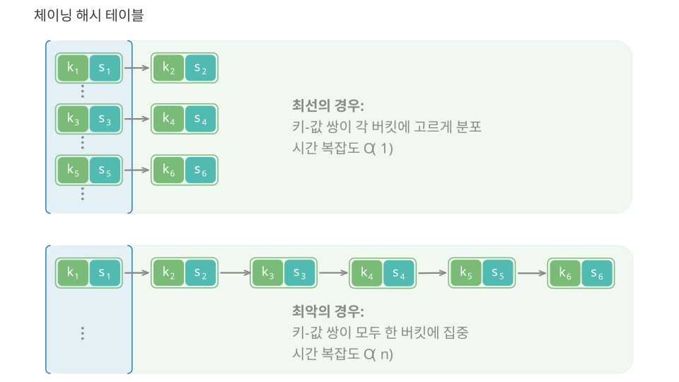

# 해시 알고리즘

앞의 두 절에서는 해시 테이블의 동작 원리와 해시 충돌을 처리하는 방법을 살펴보았다. 개방 주소법과 체이닝은 모두 **충돌이 발생해도 해시 테이블이 정상적으로 작동하게 해 줄 뿐, 충돌 자체를 줄이지는 못한다**.

해시 충돌이 너무 잦으면 해시 테이블의 성능이 급격히 떨어진다. 아래 그림처럼 체이닝 해시 테이블에서는 키-값 쌍이 각 버킷에 고르게 분포할 때 조회 효율이 가장 좋다. 최악의 경우에는 모든 쌍이 한 버킷에 저장되어 시간 복잡도가 $O(n)$까지 떨어진다.



**키-값 쌍의 분포는 해시 함수가 결정한다**. 해시 함수가 인덱스를 구하는 과정을 떠올려 보자. 먼저 해시값을 계산한 뒤 배열의 길이로 나눈 나머지를 구한다.

```shell
index = hash(key) % capacity
```

위 식에서 해시 테이블의 용량 `capacity`가 고정되어 있으면 **출력값은 해시 알고리즘 `hash()`로 결정되며**, 그 결과 키-값 쌍이 테이블 안에서 어떻게 분포할지도 결정한다.

따라서 해시 충돌이 일어날 확률을 낮추려면 해시 알고리즘 `hash()`의 설계에 주목해야 한다.

## 해시 알고리즘의 목표

빠르고 안정적인 해시 테이블을 구현하려면 해시 알고리즘에 다음과 같은 특성이 있어야 한다.

- **결정성**: 같은 입력에는 언제나 같은 출력을 내야 한다. 그래야 해시 테이블의 조회 결과를 신뢰할 수 있다.
- **효율성**: 해시값을 충분히 빠르게 계산할 수 있어야 한다. 계산 비용이 낮을수록 해시 테이블을 실제로 활용하기 좋다.
- **균등 분포**: 해시 알고리즘은 키-값 쌍을 테이블에 고르게 분산시켜야 한다. 분포가 고를수록 해시 충돌이 일어날 확률이 낮다.

해시 알고리즘은 해시 테이블 구현 외에도 여러 분야에서 널리 쓰인다.

- **비밀번호 저장**: 시스템은 사용자의 비밀번호를 보호하기 위해 보통 평문 대신 해시값을 저장한다. 사용자가 비밀번호를 입력하면 그 해시값을 계산해 저장해 둔 해시값과 비교한다. 두 값이 일치하면 올바른 비밀번호로 판단한다.
- **데이터 무결성 검사**: 송신 측은 데이터의 해시값을 계산해서 데이터와 함께 보낼 수 있다. 수신 측은 받은 데이터의 해시값을 다시 계산해 전송받은 해시값과 비교한다. 둘이 일치하면 데이터가 온전하다고 판단한다.

암호학에 응용할 때는 해시값에서 원래 비밀번호를 추론하는 등의 역추적을 막기 위해 더 높은 수준의 보안 특성이 필요하다.

- **일방향성**: 해시값으로부터 입력 데이터에 관한 어떤 정보도 역으로 알아낼 수 없어야 한다.
- **충돌 저항성**: 해시값이 같은 서로 다른 두 입력을 찾기가 극도로 어려워야 한다.
- **눈사태 효과**: 입력이 조금만 바뀌어도 출력은 크게, 예측하기 어려운 방식으로 달라져야 한다.

**‘균등 분포’와 ‘충돌 저항성’은 서로 독립적인 개념이다**. 분포가 균등하다고 해서 충돌 저항성까지 갖추는 것은 아니다. 예를 들어 입력 `key`가 무작위라면 해시 함수 `key % 100`의 출력은 고르게 분포할 수 있다. 하지만 이 알고리즘은 너무 단순해 끝 두 자리가 같은 `key`는 모두 같은 출력을 낸다. 따라서 해시값으로부터 통과할 수 있는 `key`를 쉽게 알아내 비밀번호를 깰 수 있다.

## 해시 알고리즘 설계

해시 알고리즘을 설계하려면 여러 요인을 고려해야 하므로 문제 자체는 복잡하다. 다만 요구 수준이 높지 않은 상황에서는 간단한 알고리즘을 직접 설계할 수도 있다.

- **덧셈 해시**: 입력의 각 문자를 ASCII 코드로 바꾸어 모두 더하고 그 합을 해시값으로 삼는다.
- **곱셈 해시**: 매번 같은 상수를 곱해 이전까지의 값에 다른 가중치를 주면서 각 문자의 ASCII 코드를 해시값에 누적한다.
- **XOR 해시**: 입력 데이터의 각 원소를 XOR 연산으로 하나의 해시값에 누적한다.
- **회전 해시**: 각 문자의 ASCII 코드를 해시값에 누적하되, 매번 누적하기 전에 해시값의 비트를 회전시킨다.

```src
[file]{simple_hash}-[class]{}-[func]{rot_hash}
```

각 알고리즘의 마지막 단계에서는 큰 소수 $1000000007$로 나눈 나머지를 구해 해시값이 적절한 범위에 들게 한다. 여기서 왜 소수를 강조할까? 합성수로 나눈 나머지를 쓰면 어떤 단점이 있을지 생각해 보자.

먼저 결론부터 말하면, **큰 소수를 법으로 쓰면 해시값을 최대한 고르게 분포시킬 수 있다**. 소수는 다른 수와 1 이외의 공약수가 없어 나머지 연산에서 나타나는 주기적인 패턴을 줄이고 해시 충돌을 피하는 데 도움이 된다.

예를 들어 합성수 $9$를 법으로 선택했다고 하자. 이 수는 $3$으로 나누어떨어지므로 $3$으로 나누어떨어지는 모든 `key`는 $0$, $3$, $6$이라는 세 해시값 중 하나에 대응한다.

$$
\begin{aligned}
\text{modulus} & = 9 \newline
\text{key} & = \{ 0, 3, 6, 9, 12, 15, 18, 21, 24, 27, 30, 33, \dots \} \newline
\text{hash} & = \{ 0, 3, 6, 0, 3, 6, 0, 3, 6, 0, 3, 6,\dots \}
\end{aligned}
$$

입력 `key`가 마침 이런 등차수열을 이루면 해시값이 몇 곳에 몰려 충돌이 더 잦아진다. 이제 `modulus`를 소수 $13$으로 바꿔 보자. `key`와 `modulus` 사이에 1 이외의 공약수가 없어 출력 해시값이 훨씬 고르게 분포한다.

$$
\begin{aligned}
\text{modulus} & = 13 \newline
\text{key} & = \{ 0, 3, 6, 9, 12, 15, 18, 21, 24, 27, 30, 33, \dots \} \newline
\text{hash} & = \{ 0, 3, 6, 9, 12, 2, 5, 8, 11, 1, 4, 7, \dots \}
\end{aligned}
$$

다만 `key`가 무작위로 고르게 분포한다면 소수와 합성수 중 어느 쪽을 법으로 선택해도 고르게 분포한 해시값을 얻을 수 있다. 반면 `key`의 분포에 주기성이 있으면 합성수로 나머지를 구할 때 특정 값에 더 쉽게 몰린다.

그래서 보통은 소수를 법으로 선택하며, 되도록 큰 소수를 쓰는 것이 좋다. 그래야 주기적인 패턴을 최대한 없애고 해시 알고리즘이 더 안정적으로 작동한다.

## 대표적인 해시 알고리즘

지금까지 살펴본 간단한 해시 알고리즘은 비교적 취약하며 앞에서 세운 설계 목표에 크게 못 미친다. 예를 들어 덧셈과 XOR 연산은 교환 법칙이 성립한다. 그래서 덧셈 해시와 XOR 해시는 같은 문자가 순서만 다르게 나열된 문자열을 구별하지 못한다. 이로 인해 해시 충돌이 늘고 보안 문제가 생길 수 있다.

실제로는 MD5, SHA-1, SHA-2, SHA-3 등의 표준 해시 알고리즘을 흔히 사용한다. 이들은 길이에 상관없이 입력 데이터를 고정 길이의 해시값으로 변환한다.

지난 한 세기 가까이 해시 알고리즘은 꾸준히 개선되어 왔다. 성능을 높이려는 연구자가 있는 한편, 보안상의 문제를 찾는 연구자와 해커도 있다. 아래 표는 실제로 흔히 쓰이는 해시 알고리즘을 보여 준다.

- MD5와 SHA-1에 대한 공격이 여러 차례 성공하면서 각종 보안 응용 분야에서는 이들을 더 이상 사용하지 않는다.
- SHA-2 계열의 SHA-256은 가장 안전한 해시 알고리즘 중 하나이다. 아직 성공한 공격 사례가 없어 다양한 보안 응용 분야와 프로토콜에서 널리 쓰인다.
- SHA-3는 SHA-2보다 구현 비용이 낮고 계산 효율이 높지만, 현재는 SHA-2 계열만큼 널리 쓰이지 않는다.

<p align="center">표 <id> &nbsp; 대표적인 해시 알고리즘</p>

|          | MD5                            | SHA-1            | SHA-2                        | SHA-3               |
| -------- | ------------------------------ | ---------------- | ---------------------------- | ------------------- |
| 발표 시기 | 1992                           | 1995             | 2002                         | 2008                |
| 출력 길이 | 128 bit                        | 160 bit          | 256/512 bit                  | 224/256/384/512 bit |
| 해시 충돌 | 비교적 많음                           | 비교적 많음             | 매우 적음                         | 매우 적음                |
| 보안 수준 | 낮음. 공격에 성공한 사례가 있음               | 낮음. 공격에 성공한 사례가 있음 | 높음                           | 높음                  |
| 용도     | 사용 중단. 데이터 무결성 검사에는 여전히 쓰임 | 사용 중단         | 암호화폐 거래 검증, 디지털 서명 등 | SHA-2를 대체할 수 있음    |

## 자료 구조의 해시값

해시 테이블의 `key`에는 정수, 실수, 문자열 등 여러 자료형을 쓸 수 있다. 프로그래밍 언어는 대개 이들 자료형에 내장 해시 알고리즘을 제공해 해시 테이블의 버킷 인덱스를 계산할 수 있게 한다. 예를 들어 Python에서는 `hash()` 함수를 호출해 다양한 자료형의 해시값을 구할 수 있다.

- 정수와 불리언의 해시값은 그 값 자체이다.
- 부동 소수점 수와 문자열의 해시값을 계산하는 과정은 더 복잡하다. 관심 있는 독자는 따로 살펴보기 바란다.
- 튜플에서는 각 원소의 해시값을 계산한 뒤 이 값들을 결합해 하나의 해시값을 만든다.
- 객체의 해시값은 메모리 주소를 바탕으로 생성된다. 객체의 해시 메서드를 재정의하면 내용에 따라 해시값을 생성할 수도 있다.

!!! tip

    내장 해시값 계산 함수의 정의와 계산 방식은 프로그래밍 언어마다 다르다.

```snippet
builtin_hash
```

??? pythontutor "실행 과정 시각화"

    @tutor builtin_hash_tutor

많은 프로그래밍 언어에서 **불변 객체만 해시 테이블의 `key`로 사용할 수 있다**. 리스트(동적 배열)를 `key`로 쓴다고 가정해 보자. 리스트의 내용이 바뀔 때 해시값까지 달라지면 해시 테이블에서 원래의 `value`를 찾을 수 없게 된다.

사용자 정의 객체(예: 연결 리스트 노드)는 멤버 변수의 값이 바뀔 수 있지만 해시할 수 있다. **객체의 해시값은 보통 메모리 주소를 바탕으로 생성되기 때문이다**. 내용이 바뀌어도 메모리 주소가 그대로이면 해시값도 변하지 않는다.

다른 콘솔에서 프로그램을 실행하면 출력되는 해시값이 다르다는 것을 알아차렸을지도 모른다. **Python 인터프리터가 시작할 때마다 문자열 해시 함수에 임의의 솔트(salt) 값을 더하기 때문이다**. 이렇게 하면 HashDoS 공격을 효과적으로 방지하고 해시 알고리즘의 보안성을 높일 수 있다.
