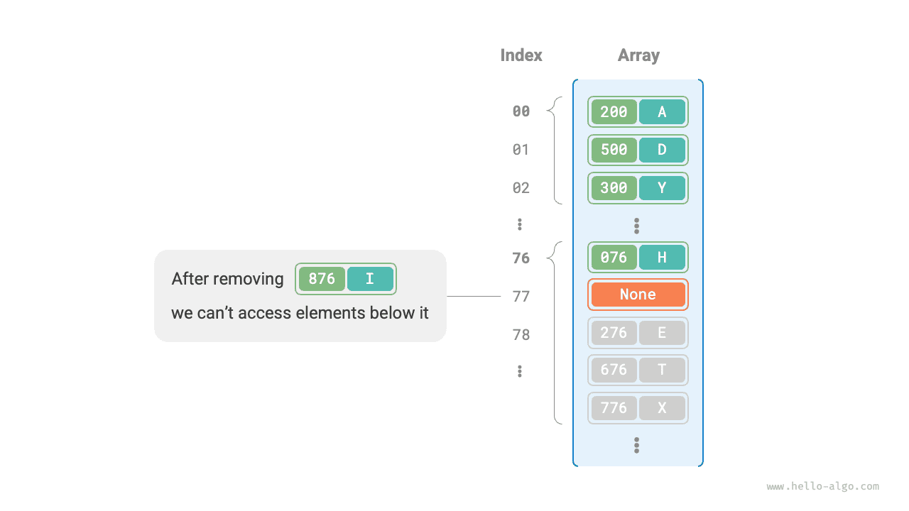

# 해시 충돌

앞 절에서 설명했듯이 **해시 함수의 입력 공간은 보통 출력 공간보다 훨씬 크므로**, 이론적으로 해시 충돌은 피할 수 없다. 예를 들어 입력 공간이 모든 정수이고 출력 공간이 배열 용량만큼이라면, 여러 정수가 같은 버킷 인덱스에 매핑될 수밖에 없다.

해시 충돌은 잘못된 조회 결과를 일으켜 해시 테이블의 사용 가능성을 크게 해친다. 이를 해결하려면 충돌이 생길 때마다 해시 테이블을 확장하여 충돌이 없어질 때까지 반복할 수 있다. 단순하고 효과적인 방법이지만, 확장할 때 많은 데이터를 옮기고 해시값을 계산해야 하므로 효율은 매우 낮다. 효율을 높이려면 다음 전략을 사용할 수 있다.

1. 해시 테이블의 자료 구조를 개선하여 **해시 충돌이 발생해도 정상적으로 작동하게 한다**.
2. 필요한 경우, 즉 해시 충돌이 심할 때만 용량을 확장한다.

해시 테이블의 구조를 개선하는 대표적인 방법은 ‘체이닝’과 ‘개방 주소법’이다.

## 체이닝

기본 해시 테이블에서는 버킷 하나에 키-값 쌍 하나만 저장할 수 있다. <u>체이닝(separate chaining)</u>은 단일 원소를 연결 리스트로 바꾸고, 키-값 쌍을 노드로 삼아 충돌한 키-값 쌍을 모두 같은 연결 리스트에 저장한다. 아래 그림은 체이닝 해시 테이블의 예다.


체이닝 해시 테이블에서는 연산 방식이 다음과 같이 바뀐다.

- **원소 조회**: `key`를 입력하여 해시 함수로 버킷 인덱스를 구한 뒤 연결 리스트의 머리 노드에 접근한다. 이후 리스트를 순회하며 `key`를 비교하여 목표 키-값 쌍을 찾는다.
- **원소 추가**: 해시 함수로 연결 리스트의 머리 노드에 접근한 뒤, 노드(키-값 쌍)를 리스트에 추가한다.
- **원소 삭제**: 해시 함수의 결과로 연결 리스트의 맨 앞에 접근한 뒤, 순회하여 목표 노드를 찾아 삭제한다.

체이닝에는 다음과 같은 한계가 있다.

- **공간 사용량 증가**: 연결 리스트에는 노드 포인터가 있으므로 배열보다 메모리를 더 많이 사용한다.
- **조회 효율 감소**: 해당 원소를 찾으려면 연결 리스트를 선형으로 순회해야 한다.

다음 코드는 간단한 체이닝 해시 테이블을 구현한다. 두 가지에 주의하자.

- 코드를 단순화하기 위해 연결 리스트 대신 리스트(동적 배열)를 사용한다. 따라서 해시 테이블(배열)은 여러 버킷을 포함하며, 각 버킷은 리스트다.
- 아래 구현에는 용량 확장 메서드가 포함된다. 적재율이 $\frac{2}{3}$를 넘으면 해시 테이블을 기존 크기의 $2$배로 늘린다.

```src
[file]{hash_map_chaining}-[class]{hash_map_chaining}-[func]{}
```

연결 리스트가 매우 길어지면 $O(n)$의 조회 효율은 나빠진다. **이때 연결 리스트를 ‘AVL 트리’나 ‘레드-블랙 트리’로 바꾸면** 조회의 시간 복잡도를 $O(\log n)$으로 개선할 수 있다.

## 개방 주소법

<u>개방 주소법(open addressing)</u>은 추가 자료 구조를 도입하지 않고 ‘여러 차례 탐사’하여 해시 충돌을 처리한다. 대표적인 탐사 방식에는 선형 탐사, 이차 탐사, 다중 해싱 등이 있다.

선형 탐사를 예로 개방 주소법 해시 테이블의 작동 원리를 알아보자.

### 선형 탐사

선형 탐사는 고정 간격의 선형 탐색으로 탐사하며, 일반 해시 테이블과 연산 방식이 다르다.

- **원소 삽입**: 해시 함수로 버킷 인덱스를 구한다. 이미 원소가 있으면 충돌 위치부터 뒤로 일정한 간격(보통 $1$)으로 순회하여 빈 버킷을 찾고 원소를 넣는다.
- **원소 탐색**: 해시 충돌이 있으면 같은 간격으로 뒤를 순회하다가 해당 원소를 찾으면 `value`를 반환한다. 빈 버킷을 만나면 목표 원소가 없다는 뜻이므로 `None`을 반환한다.

아래 그림은 개방 주소법(선형 탐사) 해시 테이블의 키-값 쌍 분포를 보여 준다. 이 해시 함수에서는 마지막 두 자리가 같은 `key`가 모두 같은 버킷에 매핑된다. 선형 탐사를 통해 이들은 해당 버킷과 그 뒤의 버킷에 차례로 저장된다.


하지만 **선형 탐사에서는 ‘군집 현상’이 쉽게 발생한다**. 배열에서 연속으로 채워진 구간이 길수록 그 구간에서 충돌할 가능성도 커진다. 그 결과 군집이 더욱 커지는 악순환이 생기고, 결국 삽입, 삭제, 탐색, 갱신의 효율이 낮아진다.

**개방 주소법 해시 테이블에서는 원소를 곧바로 삭제하면 안 된다**는 점에 주의하자. 삭제하면 배열에 빈 버킷 `None`이 생긴다. 조회 중 선형 탐사가 이 버킷에 도달하면 바로 반환하므로 그 뒤의 원소에 접근할 수 없게 된다. 아래 그림과 같이 프로그램이 그 원소들을 존재하지 않는다고 잘못 판단할 수 있다.



이 문제는 <u>지연 삭제(lazy deletion)</u>로 해결할 수 있다. 원소를 해시 테이블에서 곧바로 제거하지 않고 **상수 `TOMBSTONE`으로 해당 버킷을 표시한다**. `None`과 `TOMBSTONE`은 모두 빈 버킷을 나타내며 새 키-값 쌍을 넣을 수 있다. 하지만 `TOMBSTONE`을 만나면 그 뒤에도 키-값 쌍이 있을 수 있으므로 탐사를 계속해야 한다.

그러나 **지연 삭제는 해시 테이블의 성능 저하를 가속할 수 있다**. 삭제할 때마다 삭제 표시가 생기므로 `TOMBSTONE`이 늘어날수록 탐색 시간도 길어진다. 목표 원소를 찾기 위해 여러 `TOMBSTONE`을 건너뛰어야 할 수 있기 때문이다.

이를 위해 선형 탐사 중 처음 만난 `TOMBSTONE`의 인덱스를 기록하고, 찾은 목표 원소와 그 `TOMBSTONE`의 위치를 교환하는 방법을 생각할 수 있다. 조회하거나 추가할 때마다 원소가 이상적인 위치(탐사 시작점)에 더 가까운 버킷으로 옮겨지므로 조회 효율이 좋아진다.

다음 코드는 지연 삭제를 포함한 개방 주소법(선형 탐사) 해시 테이블을 구현한다. 공간을 더 충분히 활용하기 위해 해시 테이블을 ‘원형 배열’로 보고, 끝을 넘으면 처음으로 돌아와 순회를 계속한다.

```src
[file]{hash_map_open_addressing}-[class]{hash_map_open_addressing}-[func]{}
```

### 이차 탐사

이차 탐사는 선형 탐사처럼 개방 주소법의 대표적인 전략이다. 충돌이 발생하면 고정 간격으로 이동하는 대신 ‘탐사 횟수의 제곱’만큼, 즉 $1, 4, 9, \dots$칸을 이동한다.

이차 탐사의 주요 장점은 다음과 같다.

- 탐사 횟수의 제곱만큼 떨어진 위치로 이동하여 선형 탐사의 군집 현상을 완화하려 한다.
- 더 먼 거리로 건너뛰며 빈 위치를 찾으므로 데이터를 더 고르게 분포시키는 데 도움이 된다.

하지만 이차 탐사도 완벽하지는 않다.

- 일부 위치가 다른 위치보다 더 쉽게 채워지는 군집 현상이 여전히 존재한다.
- 제곱의 증가 때문에 해시 테이블 전체를 탐사하지 못할 수 있다. 즉, 빈 버킷이 있어도 그곳에 도달하지 못할 수 있다.

### 다중 해싱

이름 그대로 여러 해시 함수 $f_1(x)$, $f_2(x)$, $f_3(x)$, $\dots$를 사용하여 탐사하는 방법이다.

- **원소 삽입**: 해시 함수 $f_1(x)$에서 충돌하면 $f_2(x)$를 시도한다. 이런 식으로 빈 위치를 찾을 때까지 계속한 뒤 원소를 넣는다.
- **원소 탐색**: 같은 해시 함수 순서로 탐색하여 목표 원소를 찾으면 반환한다. 빈 위치를 만나거나 모든 함수를 시도했다면 원소가 없다는 뜻이므로 `None`을 반환한다.

선형 탐사보다 군집 현상이 덜 발생하지만, 여러 해시 함수로 인해 추가 계산이 필요하다.

!!! tip "참고"

    개방 주소법의 선형 탐사, 이차 탐사, 다중 해싱 모두 ‘원소를 곧바로 삭제할 수 없다’는 문제가 있다는 점에 주의하자.

## 프로그래밍 언어의 선택

프로그래밍 언어마다 해시 테이블 구현 전략이 다르다. 몇 가지 예를 살펴보자.

- Python은 개방 주소법을 사용한다. 딕셔너리 `dict`는 의사 난수를 이용해 탐사한다.
- Java는 체이닝을 사용한다. JDK 1.8부터는 `HashMap` 내부 배열 길이가 64 이상이고 연결 리스트 길이가 8 이상이면, 탐색 성능을 높이기 위해 연결 리스트를 레드-블랙 트리로 바꾼다.
- Go 1.24부터 내장 `map`은 기본적으로 Swiss Table 기반의 개방 주소법을 사용한다. Go 1.23 이하에서는 체이닝을 사용하며, 버킷 하나에 키-값 쌍을 최대 8개 저장하고 용량을 넘으면 오버플로 버킷을 연결한다.
