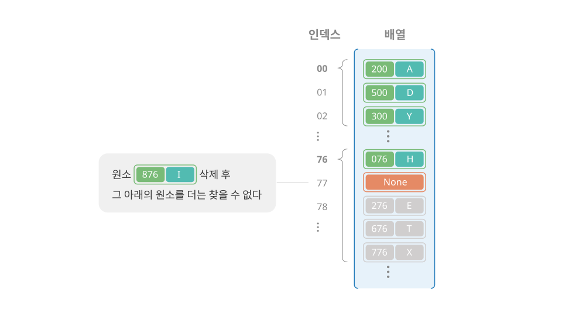

# 6.2 &nbsp; 해시 충돌

앞 절에서 살펴봤듯이 **해시 함수의 입력 공간은 대개 출력 공간보다 훨씬 크므로** 이론적으로 해시 충돌을 피할 수 없다. 예를 들어 입력은 모든 정수이고 가능한 출력의 개수는 배열의 용량과 같다면, 여러 정수가 같은 버킷 인덱스에 대응할 수밖에 없다.

해시 충돌로 조회 결과가 틀리면 해시 테이블을 제대로 사용하기 어렵다. 한 가지 해결 방법은 충돌이 생길 때마다 충돌이 사라질 때까지 해시 테이블의 용량을 늘리는 것이다. 단순하면서도 효과가 있지만 효율이 너무 낮다. 용량을 늘리려면 많은 데이터를 옮기고 해시값을 계산해야 하기 때문이다. 효율을 높이려면 다음 전략을 쓸 수 있다.

1. 해시 테이블의 구조를 개선해 **해시 충돌이 일어나도 테이블이 정상적으로 작동하게 한다**.
2. 필요할 때, 즉 해시 충돌이 심해졌을 때만 용량을 늘린다.

해시 테이블의 구조를 개선하는 대표적인 방법은 ‘체이닝’과 ‘개방 주소법’이다.

## 6.2.1 &nbsp; 체이닝

앞서 본 해시 테이블에서는 버킷 하나에 키-값 쌍 하나만 저장할 수 있었다. <u>체이닝(separate chaining)</u>은 단일 원소 대신 연결 리스트를 둔다. 키-값 쌍을 노드로 삼아 충돌한 쌍을 모두 같은 리스트에 저장한다. 아래 그림(6-5)은 체이닝 해시 테이블의 예이다.

{ class="animation-figure" }

<p align="center"> 그림 6-5 &nbsp; 체이닝 해시 테이블 </p>

체이닝을 적용하면 해시 테이블에서 각 연산을 수행하는 방법이 다음과 같이 달라진다.

- **원소 조회**: `key`를 입력하여 해시 함수로 버킷 인덱스를 구하면 연결 리스트의 첫 노드에 접근할 수 있다. 리스트를 순회하면서 `key`를 비교해 원하는 키-값 쌍을 찾는다.
- **원소 추가**: 먼저 해시 함수를 통해 연결 리스트의 첫 노드에 접근한 다음 노드(키-값 쌍)를 리스트에 추가한다.
- **원소 삭제**: 해시 함수의 결과로 연결 리스트의 맨 앞에 접근한 다음 리스트를 순회해 대상 노드를 찾아 삭제한다.

체이닝에는 다음과 같은 한계가 있다.

- **공간 사용량 증가**: 연결 리스트는 노드 포인터를 저장하므로 배열보다 메모리 공간을 더 많이 사용한다.
- **조회 효율 저하**: 원하는 원소를 찾으려면 연결 리스트를 선형으로 순회해야 한다.

아래 코드는 체이닝 해시 테이블을 간단히 구현한다. 두 가지에 주목하자.

- 코드를 단순화하기 위해 연결 리스트 대신 리스트(동적 배열)를 쓴다. 이 구현에서 해시 테이블은 여러 버킷을 담은 배열이고 각 버킷은 리스트이다.
- 아래 구현에는 해시 테이블의 용량을 늘리는 메서드도 있다. 적재율이 $\frac{2}{3}$를 넘으면 용량을 기존의 $2$배로 늘린다.

=== "Python"

    ```python title="hash_map_chaining.py"
    class HashMapChaining:
        """체이닝 해시 테이블"""

        def __init__(self):
            """생성자"""
            self.size = 0  # 키-값 쌍의 개수
            self.capacity = 4  # 해시 테이블의 용량
            self.load_thres = 2.0 / 3.0  # 용량을 늘리는 기준이 되는 적재율
            self.extend_ratio = 2  # 용량 증가 배수
            self.buckets = [[] for _ in range(self.capacity)]  # 버킷 배열

        def hash_func(self, key: int) -> int:
            """해시 함수"""
            return key % self.capacity

        def load_factor(self) -> float:
            """적재율"""
            return self.size / self.capacity

        def get(self, key: int) -> str | None:
            """조회"""
            index = self.hash_func(key)
            bucket = self.buckets[index]
            # 버킷을 순회하다가 key를 찾으면 해당 val 반환
            for pair in bucket:
                if pair.key == key:
                    return pair.val
            # key를 찾지 못하면 None 반환
            return None

        def put(self, key: int, val: str):
            """추가"""
            # 적재율이 임계값을 넘으면 용량 늘리기
            if self.load_factor() > self.load_thres:
                self.extend()
            index = self.hash_func(key)
            bucket = self.buckets[index]
            # 버킷을 순회하다가 지정한 key를 만나면 해당 val을 갱신하고 반환
            for pair in bucket:
                if pair.key == key:
                    pair.val = val
                    return
            # 해당 key가 없으면 맨 뒤에 키-값 쌍 추가
            pair = Pair(key, val)
            bucket.append(pair)
            self.size += 1

        def remove(self, key: int):
            """삭제"""
            index = self.hash_func(key)
            bucket = self.buckets[index]
            # 버킷을 순회하며 해당 키-값 쌍 삭제
            for pair in bucket:
                if pair.key == key:
                    bucket.remove(pair)
                    self.size -= 1
                    break

        def extend(self):
            """해시 테이블 용량 늘리기"""
            # 기존 해시 테이블 임시 보관
            buckets = self.buckets
            # 용량을 늘린 새 해시 테이블 초기화
            self.capacity *= self.extend_ratio
            self.buckets = [[] for _ in range(self.capacity)]
            self.size = 0
            # 기존 해시 테이블의 키-값 쌍을 새 해시 테이블로 이동
            for bucket in buckets:
                for pair in bucket:
                    self.put(pair.key, pair.val)

        def print(self):
            """해시 테이블 출력"""
            for bucket in self.buckets:
                res = []
                for pair in bucket:
                    res.append(str(pair.key) + " -> " + pair.val)
                print(res)
    ```

=== "C++"

    ```cpp title="hash_map_chaining.cpp"
    /* 체이닝 해시 테이블 */
    class HashMapChaining {
      private:
        int size;                       // 키-값 쌍의 개수
        int capacity;                   // 해시 테이블의 용량
        double loadThres;               // 용량을 늘리는 기준이 되는 적재율
        int extendRatio;                // 용량 증가 배수
        vector<vector<Pair *>> buckets; // 버킷 배열

      public:
        /* 생성자 */
        HashMapChaining() : size(0), capacity(4), loadThres(2.0 / 3.0), extendRatio(2) {
            buckets.resize(capacity);
        }

        /* 소멸자 */
        ~HashMapChaining() {
            for (auto &bucket : buckets) {
                for (Pair *pair : bucket) {
                    // 메모리 해제
                    delete pair;
                }
            }
        }

        /* 해시 함수 */
        int hashFunc(int key) {
            return key % capacity;
        }

        /* 적재율 */
        double loadFactor() {
            return (double)size / (double)capacity;
        }

        /* 조회 */
        string get(int key) {
            int index = hashFunc(key);
            // 버킷을 순회하다가 key를 찾으면 해당 val 반환
            for (Pair *pair : buckets[index]) {
                if (pair->key == key) {
                    return pair->val;
                }
            }
            // key를 찾지 못하면 빈 문자열 반환
            return "";
        }

        /* 추가 */
        void put(int key, string val) {
            // 적재율이 임계값을 넘으면 용량 늘리기
            if (loadFactor() > loadThres) {
                extend();
            }
            int index = hashFunc(key);
            // 버킷을 순회하다가 지정한 key를 만나면 해당 val을 갱신하고 반환
            for (Pair *pair : buckets[index]) {
                if (pair->key == key) {
                    pair->val = val;
                    return;
                }
            }
            // 해당 key가 없으면 맨 뒤에 키-값 쌍 추가
            buckets[index].push_back(new Pair(key, val));
            size++;
        }

        /* 삭제 */
        void remove(int key) {
            int index = hashFunc(key);
            auto &bucket = buckets[index];
            // 버킷을 순회하며 해당 키-값 쌍 삭제
            for (int i = 0; i < bucket.size(); i++) {
                if (bucket[i]->key == key) {
                    Pair *tmp = bucket[i];
                    bucket.erase(bucket.begin() + i); // 여기서 키-값 쌍 삭제
                    delete tmp;                       // 메모리 해제
                    size--;
                    return;
                }
            }
        }

        /* 해시 테이블 용량 늘리기 */
        void extend() {
            // 기존 해시 테이블 임시 보관
            vector<vector<Pair *>> bucketsTmp = buckets;
            // 용량을 늘린 새 해시 테이블 초기화
            capacity *= extendRatio;
            buckets.clear();
            buckets.resize(capacity);
            size = 0;
            // 기존 해시 테이블의 키-값 쌍을 새 해시 테이블로 이동
            for (auto &bucket : bucketsTmp) {
                for (Pair *pair : bucket) {
                    put(pair->key, pair->val);
                    // 메모리 해제
                    delete pair;
                }
            }
        }

        /* 해시 테이블 출력 */
        void print() {
            for (auto &bucket : buckets) {
                cout << "[";
                for (Pair *pair : bucket) {
                    cout << pair->key << " -> " << pair->val << ", ";
                }
                cout << "]\n";
            }
        }
    };
    ```

=== "Java"

    ```java title="hash_map_chaining.java"
    /* 체이닝 해시 테이블 */
    class HashMapChaining {
        int size; // 키-값 쌍의 개수
        int capacity; // 해시 테이블의 용량
        double loadThres; // 용량을 늘리는 기준이 되는 적재율
        int extendRatio; // 용량 증가 배수
        List<List<Pair>> buckets; // 버킷 배열

        /* 생성자 */
        public HashMapChaining() {
            size = 0;
            capacity = 4;
            loadThres = 2.0 / 3.0;
            extendRatio = 2;
            buckets = new ArrayList<>(capacity);
            for (int i = 0; i < capacity; i++) {
                buckets.add(new ArrayList<>());
            }
        }

        /* 해시 함수 */
        int hashFunc(int key) {
            return key % capacity;
        }

        /* 적재율 */
        double loadFactor() {
            return (double) size / capacity;
        }

        /* 조회 */
        String get(int key) {
            int index = hashFunc(key);
            List<Pair> bucket = buckets.get(index);
            // 버킷을 순회하다가 key를 찾으면 해당 val 반환
            for (Pair pair : bucket) {
                if (pair.key == key) {
                    return pair.val;
                }
            }
            // key를 찾지 못하면 null 반환
            return null;
        }

        /* 추가 */
        void put(int key, String val) {
            // 적재율이 임계값을 넘으면 용량 늘리기
            if (loadFactor() > loadThres) {
                extend();
            }
            int index = hashFunc(key);
            List<Pair> bucket = buckets.get(index);
            // 버킷을 순회하다가 지정한 key를 만나면 해당 val을 갱신하고 반환
            for (Pair pair : bucket) {
                if (pair.key == key) {
                    pair.val = val;
                    return;
                }
            }
            // 해당 key가 없으면 맨 뒤에 키-값 쌍 추가
            Pair pair = new Pair(key, val);
            bucket.add(pair);
            size++;
        }

        /* 삭제 */
        void remove(int key) {
            int index = hashFunc(key);
            List<Pair> bucket = buckets.get(index);
            // 버킷을 순회하며 해당 키-값 쌍 삭제
            for (Pair pair : bucket) {
                if (pair.key == key) {
                    bucket.remove(pair);
                    size--;
                    break;
                }
            }
        }

        /* 해시 테이블 용량 늘리기 */
        void extend() {
            // 기존 해시 테이블 임시 보관
            List<List<Pair>> bucketsTmp = buckets;
            // 용량을 늘린 새 해시 테이블 초기화
            capacity *= extendRatio;
            buckets = new ArrayList<>(capacity);
            for (int i = 0; i < capacity; i++) {
                buckets.add(new ArrayList<>());
            }
            size = 0;
            // 기존 해시 테이블의 키-값 쌍을 새 해시 테이블로 이동
            for (List<Pair> bucket : bucketsTmp) {
                for (Pair pair : bucket) {
                    put(pair.key, pair.val);
                }
            }
        }

        /* 해시 테이블 출력 */
        void print() {
            for (List<Pair> bucket : buckets) {
                List<String> res = new ArrayList<>();
                for (Pair pair : bucket) {
                    res.add(pair.key + " -> " + pair.val);
                }
                System.out.println(res);
            }
        }
    }
    ```

=== "C#"

    ```csharp title="hash_map_chaining.cs"
    /* 체이닝 해시 테이블 */
    class HashMapChaining {
        int size; // 키-값 쌍의 개수
        int capacity; // 해시 테이블의 용량
        double loadThres; // 용량을 늘리는 기준이 되는 적재율
        int extendRatio; // 용량 증가 배수
        List<List<Pair>> buckets; // 버킷 배열

        /* 생성자 */
        public HashMapChaining() {
            size = 0;
            capacity = 4;
            loadThres = 2.0 / 3.0;
            extendRatio = 2;
            buckets = new List<List<Pair>>(capacity);
            for (int i = 0; i < capacity; i++) {
                buckets.Add([]);
            }
        }

        /* 해시 함수 */
        int HashFunc(int key) {
            return key % capacity;
        }

        /* 적재율 */
        double LoadFactor() {
            return (double)size / capacity;
        }

        /* 조회 */
        public string? Get(int key) {
            int index = HashFunc(key);
            // 버킷을 순회하다가 key를 찾으면 해당 val 반환
            foreach (Pair pair in buckets[index]) {
                if (pair.key == key) {
                    return pair.val;
                }
            }
            // key를 찾지 못하면 null 반환
            return null;
        }

        /* 추가 */
        public void Put(int key, string val) {
            // 적재율이 임계값을 넘으면 용량 늘리기
            if (LoadFactor() > loadThres) {
                Extend();
            }
            int index = HashFunc(key);
            // 버킷을 순회하다가 지정한 key를 만나면 해당 val을 갱신하고 반환
            foreach (Pair pair in buckets[index]) {
                if (pair.key == key) {
                    pair.val = val;
                    return;
                }
            }
            // 해당 key가 없으면 맨 뒤에 키-값 쌍 추가
            buckets[index].Add(new Pair(key, val));
            size++;
        }

        /* 삭제 */
        public void Remove(int key) {
            int index = HashFunc(key);
            // 버킷을 순회하며 해당 키-값 쌍 삭제
            foreach (Pair pair in buckets[index].ToList()) {
                if (pair.key == key) {
                    buckets[index].Remove(pair);
                    size--;
                    break;
                }
            }
        }

        /* 해시 테이블 용량 늘리기 */
        void Extend() {
            // 기존 해시 테이블 임시 보관
            List<List<Pair>> bucketsTmp = buckets;
            // 용량을 늘린 새 해시 테이블 초기화
            capacity *= extendRatio;
            buckets = new List<List<Pair>>(capacity);
            for (int i = 0; i < capacity; i++) {
                buckets.Add([]);
            }
            size = 0;
            // 기존 해시 테이블의 키-값 쌍을 새 해시 테이블로 이동
            foreach (List<Pair> bucket in bucketsTmp) {
                foreach (Pair pair in bucket) {
                    Put(pair.key, pair.val);
                }
            }
        }

        /* 해시 테이블 출력 */
        public void Print() {
            foreach (List<Pair> bucket in buckets) {
                List<string> res = [];
                foreach (Pair pair in bucket) {
                    res.Add(pair.key + " -> " + pair.val);
                }
                foreach (string kv in res) {
                    Console.WriteLine(kv);
                }
            }
        }
    }
    ```

=== "Go"

    ```go title="hash_map_chaining.go"
    /* 체이닝 해시 테이블 */
    type hashMapChaining struct {
        size        int      // 키-값 쌍의 개수
        capacity    int      // 해시 테이블의 용량
        loadThres   float64  // 용량을 늘리는 기준이 되는 적재율
        extendRatio int      // 용량 증가 배수
        buckets     [][]pair // 버킷 배열
    }

    /* 생성자 */
    func newHashMapChaining() *hashMapChaining {
        buckets := make([][]pair, 4)
        for i := 0; i < 4; i++ {
            buckets[i] = make([]pair, 0)
        }
        return &hashMapChaining{
            size:        0,
            capacity:    4,
            loadThres:   2.0 / 3.0,
            extendRatio: 2,
            buckets:     buckets,
        }
    }

    /* 해시 함수 */
    func (m *hashMapChaining) hashFunc(key int) int {
        return key % m.capacity
    }

    /* 적재율 */
    func (m *hashMapChaining) loadFactor() float64 {
        return float64(m.size) / float64(m.capacity)
    }

    /* 조회 */
    func (m *hashMapChaining) get(key int) string {
        idx := m.hashFunc(key)
        bucket := m.buckets[idx]
        // 버킷을 순회하다가 key를 찾으면 해당 val 반환
        for _, p := range bucket {
            if p.key == key {
                return p.val
            }
        }
        // key를 찾지 못하면 빈 문자열 반환
        return ""
    }

    /* 추가 */
    func (m *hashMapChaining) put(key int, val string) {
        // 적재율이 임계값을 넘으면 용량 늘리기
        if m.loadFactor() > m.loadThres {
            m.extend()
        }
        idx := m.hashFunc(key)
        // 버킷을 순회하다가 지정한 key를 만나면 해당 val을 갱신하고 반환
        for i := range m.buckets[idx] {
            if m.buckets[idx][i].key == key {
                m.buckets[idx][i].val = val
                return
            }
        }
        // 해당 key가 없으면 맨 뒤에 키-값 쌍 추가
        p := pair{
            key: key,
            val: val,
        }
        m.buckets[idx] = append(m.buckets[idx], p)
        m.size += 1
    }

    /* 삭제 */
    func (m *hashMapChaining) remove(key int) {
        idx := m.hashFunc(key)
        // 버킷을 순회하며 해당 키-값 쌍 삭제
        for i, p := range m.buckets[idx] {
            if p.key == key {
                // 슬라이스에서 원소 삭제
                m.buckets[idx] = append(m.buckets[idx][:i], m.buckets[idx][i+1:]...)
                m.size -= 1
                break
            }
        }
    }

    /* 해시 테이블 용량 늘리기 */
    func (m *hashMapChaining) extend() {
        // 기존 해시 테이블 임시 보관
        tmpBuckets := make([][]pair, len(m.buckets))
        for i := 0; i < len(m.buckets); i++ {
            tmpBuckets[i] = make([]pair, len(m.buckets[i]))
            copy(tmpBuckets[i], m.buckets[i])
        }
        // 용량을 늘린 새 해시 테이블 초기화
        m.capacity *= m.extendRatio
        m.buckets = make([][]pair, m.capacity)
        for i := 0; i < m.capacity; i++ {
            m.buckets[i] = make([]pair, 0)
        }
        m.size = 0
        // 기존 해시 테이블의 키-값 쌍을 새 해시 테이블로 이동
        for _, bucket := range tmpBuckets {
            for _, p := range bucket {
                m.put(p.key, p.val)
            }
        }
    }

    /* 해시 테이블 출력 */
    func (m *hashMapChaining) print() {
        var builder strings.Builder

        for _, bucket := range m.buckets {
            builder.WriteString("[")
            for _, p := range bucket {
                builder.WriteString(strconv.Itoa(p.key) + " -> " + p.val + " ")
            }
            builder.WriteString("]")
            fmt.Println(builder.String())
            builder.Reset()
        }
    }
    ```

=== "Swift"

    ```swift title="hash_map_chaining.swift"
    /* 체이닝 해시 테이블 */
    class HashMapChaining {
        var size: Int // 키-값 쌍의 개수
        var capacity: Int // 해시 테이블의 용량
        var loadThres: Double // 용량을 늘리는 기준이 되는 적재율
        var extendRatio: Int // 용량 증가 배수
        var buckets: [[Pair]] // 버킷 배열

        /* 생성자 */
        init() {
            size = 0
            capacity = 4
            loadThres = 2.0 / 3.0
            extendRatio = 2
            buckets = Array(repeating: [], count: capacity)
        }

        /* 해시 함수 */
        func hashFunc(key: Int) -> Int {
            key % capacity
        }

        /* 적재율 */
        func loadFactor() -> Double {
            Double(size) / Double(capacity)
        }

        /* 조회 */
        func get(key: Int) -> String? {
            let index = hashFunc(key: key)
            let bucket = buckets[index]
            // 버킷을 순회하다가 key를 찾으면 해당 val 반환
            for pair in bucket {
                if pair.key == key {
                    return pair.val
                }
            }
            // key를 찾지 못하면 nil 반환
            return nil
        }

        /* 추가 */
        func put(key: Int, val: String) {
            // 적재율이 임계값을 넘으면 용량 늘리기
            if loadFactor() > loadThres {
                extend()
            }
            let index = hashFunc(key: key)
            let bucket = buckets[index]
            // 버킷을 순회하다가 지정한 key를 만나면 해당 val을 갱신하고 반환
            for pair in bucket {
                if pair.key == key {
                    pair.val = val
                    return
                }
            }
            // 해당 key가 없으면 맨 뒤에 키-값 쌍 추가
            let pair = Pair(key: key, val: val)
            buckets[index].append(pair)
            size += 1
        }

        /* 삭제 */
        func remove(key: Int) {
            let index = hashFunc(key: key)
            let bucket = buckets[index]
            // 버킷을 순회하며 해당 키-값 쌍 삭제
            for (pairIndex, pair) in bucket.enumerated() {
                if pair.key == key {
                    buckets[index].remove(at: pairIndex)
                    size -= 1
                    break
                }
            }
        }

        /* 해시 테이블 용량 늘리기 */
        func extend() {
            // 기존 해시 테이블 임시 보관
            let bucketsTmp = buckets
            // 용량을 늘린 새 해시 테이블 초기화
            capacity *= extendRatio
            buckets = Array(repeating: [], count: capacity)
            size = 0
            // 기존 해시 테이블의 키-값 쌍을 새 해시 테이블로 이동
            for bucket in bucketsTmp {
                for pair in bucket {
                    put(key: pair.key, val: pair.val)
                }
            }
        }

        /* 해시 테이블 출력 */
        func print() {
            for bucket in buckets {
                let res = bucket.map { "\($0.key) -> \($0.val)" }
                Swift.print(res)
            }
        }
    }
    ```

=== "JS"

    ```javascript title="hash_map_chaining.js"
    /* 체이닝 해시 테이블 */
    class HashMapChaining {
        #size; // 키-값 쌍의 개수
        #capacity; // 해시 테이블의 용량
        #loadThres; // 용량을 늘리는 기준이 되는 적재율
        #extendRatio; // 용량 증가 배수
        #buckets; // 버킷 배열

        /* 생성자 */
        constructor() {
            this.#size = 0;
            this.#capacity = 4;
            this.#loadThres = 2.0 / 3.0;
            this.#extendRatio = 2;
            this.#buckets = new Array(this.#capacity).fill(null).map((x) => []);
        }

        /* 해시 함수 */
        #hashFunc(key) {
            return key % this.#capacity;
        }

        /* 적재율 */
        #loadFactor() {
            return this.#size / this.#capacity;
        }

        /* 조회 */
        get(key) {
            const index = this.#hashFunc(key);
            const bucket = this.#buckets[index];
            // 버킷을 순회하다가 key를 찾으면 해당 val 반환
            for (const pair of bucket) {
                if (pair.key === key) {
                    return pair.val;
                }
            }
            // key를 찾지 못하면 null 반환
            return null;
        }

        /* 추가 */
        put(key, val) {
            // 적재율이 임계값을 넘으면 용량 늘리기
            if (this.#loadFactor() > this.#loadThres) {
                this.#extend();
            }
            const index = this.#hashFunc(key);
            const bucket = this.#buckets[index];
            // 버킷을 순회하다가 지정한 key를 만나면 해당 val을 갱신하고 반환
            for (const pair of bucket) {
                if (pair.key === key) {
                    pair.val = val;
                    return;
                }
            }
            // 해당 key가 없으면 맨 뒤에 키-값 쌍 추가
            const pair = new Pair(key, val);
            bucket.push(pair);
            this.#size++;
        }

        /* 삭제 */
        remove(key) {
            const index = this.#hashFunc(key);
            let bucket = this.#buckets[index];
            // 버킷을 순회하며 해당 키-값 쌍 삭제
            for (let i = 0; i < bucket.length; i++) {
                if (bucket[i].key === key) {
                    bucket.splice(i, 1);
                    this.#size--;
                    break;
                }
            }
        }

        /* 해시 테이블 용량 늘리기 */
        #extend() {
            // 기존 해시 테이블 임시 보관
            const bucketsTmp = this.#buckets;
            // 용량을 늘린 새 해시 테이블 초기화
            this.#capacity *= this.#extendRatio;
            this.#buckets = new Array(this.#capacity).fill(null).map((x) => []);
            this.#size = 0;
            // 기존 해시 테이블의 키-값 쌍을 새 해시 테이블로 이동
            for (const bucket of bucketsTmp) {
                for (const pair of bucket) {
                    this.put(pair.key, pair.val);
                }
            }
        }

        /* 해시 테이블 출력 */
        print() {
            for (const bucket of this.#buckets) {
                let res = [];
                for (const pair of bucket) {
                    res.push(pair.key + ' -> ' + pair.val);
                }
                console.log(res);
            }
        }
    }
    ```

=== "TS"

    ```typescript title="hash_map_chaining.ts"
    /* 체이닝 해시 테이블 */
    class HashMapChaining {
        #size: number; // 키-값 쌍의 개수
        #capacity: number; // 해시 테이블의 용량
        #loadThres: number; // 용량을 늘리는 기준이 되는 적재율
        #extendRatio: number; // 용량 증가 배수
        #buckets: Pair[][]; // 버킷 배열

        /* 생성자 */
        constructor() {
            this.#size = 0;
            this.#capacity = 4;
            this.#loadThres = 2.0 / 3.0;
            this.#extendRatio = 2;
            this.#buckets = new Array(this.#capacity).fill(null).map((x) => []);
        }

        /* 해시 함수 */
        #hashFunc(key: number): number {
            return key % this.#capacity;
        }

        /* 적재율 */
        #loadFactor(): number {
            return this.#size / this.#capacity;
        }

        /* 조회 */
        get(key: number): string | null {
            const index = this.#hashFunc(key);
            const bucket = this.#buckets[index];
            // 버킷을 순회하다가 key를 찾으면 해당 val 반환
            for (const pair of bucket) {
                if (pair.key === key) {
                    return pair.val;
                }
            }
            // key를 찾지 못하면 null 반환
            return null;
        }

        /* 추가 */
        put(key: number, val: string): void {
            // 적재율이 임계값을 넘으면 용량 늘리기
            if (this.#loadFactor() > this.#loadThres) {
                this.#extend();
            }
            const index = this.#hashFunc(key);
            const bucket = this.#buckets[index];
            // 버킷을 순회하다가 지정한 key를 만나면 해당 val을 갱신하고 반환
            for (const pair of bucket) {
                if (pair.key === key) {
                    pair.val = val;
                    return;
                }
            }
            // 해당 key가 없으면 맨 뒤에 키-값 쌍 추가
            const pair = new Pair(key, val);
            bucket.push(pair);
            this.#size++;
        }

        /* 삭제 */
        remove(key: number): void {
            const index = this.#hashFunc(key);
            let bucket = this.#buckets[index];
            // 버킷을 순회하며 해당 키-값 쌍 삭제
            for (let i = 0; i < bucket.length; i++) {
                if (bucket[i].key === key) {
                    bucket.splice(i, 1);
                    this.#size--;
                    break;
                }
            }
        }

        /* 해시 테이블 용량 늘리기 */
        #extend(): void {
            // 기존 해시 테이블 임시 보관
            const bucketsTmp = this.#buckets;
            // 용량을 늘린 새 해시 테이블 초기화
            this.#capacity *= this.#extendRatio;
            this.#buckets = new Array(this.#capacity).fill(null).map((x) => []);
            this.#size = 0;
            // 기존 해시 테이블의 키-값 쌍을 새 해시 테이블로 이동
            for (const bucket of bucketsTmp) {
                for (const pair of bucket) {
                    this.put(pair.key, pair.val);
                }
            }
        }

        /* 해시 테이블 출력 */
        print(): void {
            for (const bucket of this.#buckets) {
                let res = [];
                for (const pair of bucket) {
                    res.push(pair.key + ' -> ' + pair.val);
                }
                console.log(res);
            }
        }
    }
    ```

=== "Dart"

    ```dart title="hash_map_chaining.dart"
    /* 체이닝 해시 테이블 */
    class HashMapChaining {
      late int size; // 키-값 쌍의 개수
      late int capacity; // 해시 테이블의 용량
      late double loadThres; // 용량을 늘리는 기준이 되는 적재율
      late int extendRatio; // 용량 증가 배수
      late List<List<Pair>> buckets; // 버킷 배열

      /* 생성자 */
      HashMapChaining() {
        size = 0;
        capacity = 4;
        loadThres = 2.0 / 3.0;
        extendRatio = 2;
        buckets = List.generate(capacity, (_) => []);
      }

      /* 해시 함수 */
      int hashFunc(int key) {
        return key % capacity;
      }

      /* 적재율 */
      double loadFactor() {
        return size / capacity;
      }

      /* 조회 */
      String? get(int key) {
        int index = hashFunc(key);
        List<Pair> bucket = buckets[index];
        // 버킷을 순회하다가 key를 찾으면 해당 val 반환
        for (Pair pair in bucket) {
          if (pair.key == key) {
            return pair.val;
          }
        }
        // key를 찾지 못하면 null 반환
        return null;
      }

      /* 추가 */
      void put(int key, String val) {
        // 적재율이 임계값을 넘으면 용량 늘리기
        if (loadFactor() > loadThres) {
          extend();
        }
        int index = hashFunc(key);
        List<Pair> bucket = buckets[index];
        // 버킷을 순회하다가 지정한 key를 만나면 해당 val을 갱신하고 반환
        for (Pair pair in bucket) {
          if (pair.key == key) {
            pair.val = val;
            return;
          }
        }
        // 해당 key가 없으면 맨 뒤에 키-값 쌍 추가
        Pair pair = Pair(key, val);
        bucket.add(pair);
        size++;
      }

      /* 삭제 */
      void remove(int key) {
        int index = hashFunc(key);
        List<Pair> bucket = buckets[index];
        // 버킷을 순회하며 해당 키-값 쌍 삭제
        for (Pair pair in bucket) {
          if (pair.key == key) {
            bucket.remove(pair);
            size--;
            break;
          }
        }
      }

      /* 해시 테이블 용량 늘리기 */
      void extend() {
        // 기존 해시 테이블 임시 보관
        List<List<Pair>> bucketsTmp = buckets;
        // 용량을 늘린 새 해시 테이블 초기화
        capacity *= extendRatio;
        buckets = List.generate(capacity, (_) => []);
        size = 0;
        // 기존 해시 테이블의 키-값 쌍을 새 해시 테이블로 이동
        for (List<Pair> bucket in bucketsTmp) {
          for (Pair pair in bucket) {
            put(pair.key, pair.val);
          }
        }
      }

      /* 해시 테이블 출력 */
      void printHashMap() {
        for (List<Pair> bucket in buckets) {
          List<String> res = [];
          for (Pair pair in bucket) {
            res.add("${pair.key} -> ${pair.val}");
          }
          print(res);
        }
      }
    }
    ```

=== "Rust"

    ```rust title="hash_map_chaining.rs"
    /* 체이닝 해시 테이블 */
    struct HashMapChaining {
        size: usize,
        capacity: usize,
        load_thres: f32,
        extend_ratio: usize,
        buckets: Vec<Vec<Pair>>,
    }

    impl HashMapChaining {
        /* 생성자 */
        fn new() -> Self {
            Self {
                size: 0,
                capacity: 4,
                load_thres: 2.0 / 3.0,
                extend_ratio: 2,
                buckets: vec![vec![]; 4],
            }
        }

        /* 해시 함수 */
        fn hash_func(&self, key: i32) -> usize {
            key as usize % self.capacity
        }

        /* 적재율 */
        fn load_factor(&self) -> f32 {
            self.size as f32 / self.capacity as f32
        }

        /* 삭제 */
        fn remove(&mut self, key: i32) -> Option<String> {
            let index = self.hash_func(key);

            // 버킷을 순회하며 해당 키-값 쌍 삭제
            for (i, p) in self.buckets[index].iter_mut().enumerate() {
                if p.key == key {
                    let pair = self.buckets[index].remove(i);
                    self.size -= 1;
                    return Some(pair.val);
                }
            }

            // key를 찾지 못하면 None 반환
            None
        }

        /* 해시 테이블 용량 늘리기 */
        fn extend(&mut self) {
            // 기존 해시 테이블 임시 보관
            let buckets_tmp = std::mem::take(&mut self.buckets);

            // 용량을 늘린 새 해시 테이블 초기화
            self.capacity *= self.extend_ratio;
            self.buckets = vec![Vec::new(); self.capacity as usize];
            self.size = 0;

            // 기존 해시 테이블의 키-값 쌍을 새 해시 테이블로 이동
            for bucket in buckets_tmp {
                for pair in bucket {
                    self.put(pair.key, pair.val);
                }
            }
        }

        /* 해시 테이블 출력 */
        fn print(&self) {
            for bucket in &self.buckets {
                let mut res = Vec::new();
                for pair in bucket {
                    res.push(format!("{} -> {}", pair.key, pair.val));
                }
                println!("{:?}", res);
            }
        }

        /* 추가 */
        fn put(&mut self, key: i32, val: String) {
            // 적재율이 임계값을 넘으면 용량 늘리기
            if self.load_factor() > self.load_thres {
                self.extend();
            }

            let index = self.hash_func(key);

            // 버킷을 순회하다가 지정한 key를 만나면 해당 val을 갱신하고 반환
            for pair in self.buckets[index].iter_mut() {
                if pair.key == key {
                    pair.val = val;
                    return;
                }
            }

            // 해당 key가 없으면 맨 뒤에 키-값 쌍 추가
            let pair = Pair { key, val };
            self.buckets[index].push(pair);
            self.size += 1;
        }

        /* 조회 */
        fn get(&self, key: i32) -> Option<&str> {
            let index = self.hash_func(key);

            // 버킷을 순회하다가 key를 찾으면 해당 val 반환
            for pair in self.buckets[index].iter() {
                if pair.key == key {
                    return Some(&pair.val);
                }
            }

            // key를 찾지 못하면 None 반환
            None
        }
    }
    ```

=== "C"

    ```c title="hash_map_chaining.c"
    /* 연결 리스트 노드 */
    typedef struct Node {
        Pair *pair;
        struct Node *next;
    } Node;

    /* 체이닝 해시 테이블 */
    typedef struct {
        int size;         // 키-값 쌍의 개수
        int capacity;     // 해시 테이블의 용량
        double loadThres; // 용량을 늘리는 기준이 되는 적재율
        int extendRatio;  // 용량 증가 배수
        Node **buckets;   // 버킷 배열
    } HashMapChaining;

    /* 생성자 */
    HashMapChaining *newHashMapChaining() {
        HashMapChaining *hashMap = (HashMapChaining *)malloc(sizeof(HashMapChaining));
        hashMap->size = 0;
        hashMap->capacity = 4;
        hashMap->loadThres = 2.0 / 3.0;
        hashMap->extendRatio = 2;
        hashMap->buckets = (Node **)malloc(hashMap->capacity * sizeof(Node *));
        for (int i = 0; i < hashMap->capacity; i++) {
            hashMap->buckets[i] = NULL;
        }
        return hashMap;
    }

    /* 소멸자 */
    void delHashMapChaining(HashMapChaining *hashMap) {
        for (int i = 0; i < hashMap->capacity; i++) {
            Node *cur = hashMap->buckets[i];
            while (cur) {
                Node *tmp = cur;
                cur = cur->next;
                free(tmp->pair);
                free(tmp);
            }
        }
        free(hashMap->buckets);
        free(hashMap);
    }

    /* 해시 함수 */
    int hashFunc(HashMapChaining *hashMap, int key) {
        return key % hashMap->capacity;
    }

    /* 적재율 */
    double loadFactor(HashMapChaining *hashMap) {
        return (double)hashMap->size / (double)hashMap->capacity;
    }

    /* 조회 */
    char *get(HashMapChaining *hashMap, int key) {
        int index = hashFunc(hashMap, key);
        // 버킷을 순회하다가 key를 찾으면 해당 val 반환
        Node *cur = hashMap->buckets[index];
        while (cur) {
            if (cur->pair->key == key) {
                return cur->pair->val;
            }
            cur = cur->next;
        }
        return ""; // key를 찾지 못하면 빈 문자열 반환
    }

    /* 추가 */
    void put(HashMapChaining *hashMap, int key, const char *val) {
        // 적재율이 임계값을 넘으면 용량 늘리기
        if (loadFactor(hashMap) > hashMap->loadThres) {
            extend(hashMap);
        }
        int index = hashFunc(hashMap, key);
        // 버킷을 순회하다가 지정한 key를 만나면 해당 val을 갱신하고 반환
        Node *cur = hashMap->buckets[index];
        while (cur) {
            if (cur->pair->key == key) {
                strcpy(cur->pair->val, val); // 지정한 key를 만나면 해당 val을 갱신하고 반환
                return;
            }
            cur = cur->next;
        }
        // 해당 key가 없으면 연결 리스트의 맨 앞에 키-값 쌍 추가
        Pair *newPair = (Pair *)malloc(sizeof(Pair));
        newPair->key = key;
        strcpy(newPair->val, val);
        Node *newNode = (Node *)malloc(sizeof(Node));
        newNode->pair = newPair;
        newNode->next = hashMap->buckets[index];
        hashMap->buckets[index] = newNode;
        hashMap->size++;
    }

    /* 해시 테이블 용량 늘리기 */
    void extend(HashMapChaining *hashMap) {
        // 기존 해시 테이블 임시 보관
        int oldCapacity = hashMap->capacity;
        Node **oldBuckets = hashMap->buckets;
        // 용량을 늘린 새 해시 테이블 초기화
        hashMap->capacity *= hashMap->extendRatio;
        hashMap->buckets = (Node **)malloc(hashMap->capacity * sizeof(Node *));
        for (int i = 0; i < hashMap->capacity; i++) {
            hashMap->buckets[i] = NULL;
        }
        hashMap->size = 0;
        // 기존 해시 테이블의 키-값 쌍을 새 해시 테이블로 이동
        for (int i = 0; i < oldCapacity; i++) {
            Node *cur = oldBuckets[i];
            while (cur) {
                put(hashMap, cur->pair->key, cur->pair->val);
                Node *temp = cur;
                cur = cur->next;
                // 메모리 해제
                free(temp->pair);
                free(temp);
            }
        }

        free(oldBuckets);
    }

    /* 삭제 */
    void removeItem(HashMapChaining *hashMap, int key) {
        int index = hashFunc(hashMap, key);
        Node *cur = hashMap->buckets[index];
        Node *pre = NULL;
        while (cur) {
            if (cur->pair->key == key) {
                // 여기서 키-값 쌍 삭제
                if (pre) {
                    pre->next = cur->next;
                } else {
                    hashMap->buckets[index] = cur->next;
                }
                // 메모리 해제
                free(cur->pair);
                free(cur);
                hashMap->size--;
                return;
            }
            pre = cur;
            cur = cur->next;
        }
    }

    /* 해시 테이블 출력 */
    void print(HashMapChaining *hashMap) {
        for (int i = 0; i < hashMap->capacity; i++) {
            Node *cur = hashMap->buckets[i];
            printf("[");
            while (cur) {
                printf("%d -> %s, ", cur->pair->key, cur->pair->val);
                cur = cur->next;
            }
            printf("]\n");
        }
    }
    ```

=== "Kotlin"

    ```kotlin title="hash_map_chaining.kt"
    /* 체이닝 해시 테이블 */
    class HashMapChaining {
        var size: Int // 키-값 쌍의 개수
        var capacity: Int // 해시 테이블의 용량
        val loadThres: Double // 용량을 늘리는 기준이 되는 적재율
        val extendRatio: Int // 용량 증가 배수
        var buckets: MutableList<MutableList<Pair>> // 버킷 배열

        /* 생성자 */
        init {
            size = 0
            capacity = 4
            loadThres = 2.0 / 3.0
            extendRatio = 2
            buckets = mutableListOf()
            for (i in 0..<capacity) {
                buckets.add(mutableListOf())
            }
        }

        /* 해시 함수 */
        fun hashFunc(key: Int): Int {
            return key % capacity
        }

        /* 적재율 */
        fun loadFactor(): Double {
            return (size / capacity).toDouble()
        }

        /* 조회 */
        fun get(key: Int): String? {
            val index = hashFunc(key)
            val bucket = buckets[index]
            // 버킷을 순회하다가 key를 찾으면 해당 val 반환
            for (pair in bucket) {
                if (pair.key == key) return pair._val
            }
            // key를 찾지 못하면 null 반환
            return null
        }

        /* 추가 */
        fun put(key: Int, _val: String) {
            // 적재율이 임계값을 넘으면 용량 늘리기
            if (loadFactor() > loadThres) {
                extend()
            }
            val index = hashFunc(key)
            val bucket = buckets[index]
            // 버킷을 순회하다가 지정한 key를 만나면 해당 val을 갱신하고 반환
            for (pair in bucket) {
                if (pair.key == key) {
                    pair._val = _val
                    return
                }
            }
            // 해당 key가 없으면 맨 뒤에 키-값 쌍 추가
            val pair = Pair(key, _val)
            bucket.add(pair)
            size++
        }

        /* 삭제 */
        fun remove(key: Int) {
            val index = hashFunc(key)
            val bucket = buckets[index]
            // 버킷을 순회하며 해당 키-값 쌍 삭제
            for (pair in bucket) {
                if (pair.key == key) {
                    bucket.remove(pair)
                    size--
                    break
                }
            }
        }

        /* 해시 테이블 용량 늘리기 */
        fun extend() {
            // 기존 해시 테이블 임시 보관
            val bucketsTmp = buckets
            // 용량을 늘린 새 해시 테이블 초기화
            capacity *= extendRatio
            // mutablelist의 크기는 고정되어 있지 않음
            buckets = mutableListOf()
            for (i in 0..<capacity) {
                buckets.add(mutableListOf())
            }
            size = 0
            // 기존 해시 테이블의 키-값 쌍을 새 해시 테이블로 이동
            for (bucket in bucketsTmp) {
                for (pair in bucket) {
                    put(pair.key, pair._val)
                }
            }
        }

        /* 해시 테이블 출력 */
        fun print() {
            for (bucket in buckets) {
                val res = mutableListOf<String>()
                for (pair in bucket) {
                    val k = pair.key
                    val v = pair._val
                    res.add("$k -> $v")
                }
                println(res)
            }
        }
    }
    ```

=== "Ruby"

    ```ruby title="hash_map_chaining.rb"
    ### 체이닝 해시 테이블 ###
    class HashMapChaining
      ### 생성자 ###
      def initialize
        @size = 0 # 키-값 쌍의 개수
        @capacity = 4 # 해시 테이블의 용량
        @load_thres = 2.0 / 3.0 # 용량을 늘리는 기준이 되는 적재율
        @extend_ratio = 2 # 용량 증가 배수
        @buckets = Array.new(@capacity) { [] } # 버킷 배열
      end

      ### 해시 함수 ###
      def hash_func(key)
        key % @capacity
      end

      ### 적재율 ###
      def load_factor
        @size / @capacity.to_f
      end

      ### 조회 ###
      def get(key)
        index = hash_func(key)
        bucket = @buckets[index]
        # 버킷을 순회하다가 key를 찾으면 해당 val 반환
        for pair in bucket
          return pair.val if pair.key == key
        end
        # key를 찾지 못하면 nil 반환
        nil
      end

      ### 추가 ###
      def put(key, val)
        # 적재율이 임계값을 넘으면 용량 늘리기
        extend if load_factor > @load_thres
        index = hash_func(key)
        bucket = @buckets[index]
        # 버킷을 순회하다가 지정한 key를 만나면 해당 val을 갱신하고 반환
        for pair in bucket
          if pair.key == key
            pair.val = val
            return
          end
        end
        # 해당 key가 없으면 맨 뒤에 키-값 쌍 추가
        pair = Pair.new(key, val)
        bucket << pair
        @size += 1
      end

      ### 삭제 ###
      def remove(key)
        index = hash_func(key)
        bucket = @buckets[index]
        # 버킷을 순회하며 해당 키-값 쌍 삭제
        for pair in bucket
          if pair.key == key
            bucket.delete(pair)
            @size -= 1
            break
          end
        end
      end

      ### 해시 테이블 용량 늘리기 ###
      def extend
        # 기존 해시 테이블 임시 보관
        buckets = @buckets
        # 용량을 늘린 새 해시 테이블 초기화
        @capacity *= @extend_ratio
        @buckets = Array.new(@capacity) { [] }
        @size = 0
        # 기존 해시 테이블의 키-값 쌍을 새 해시 테이블로 이동
        for bucket in buckets
          for pair in bucket
            put(pair.key, pair.val)
          end
        end
      end

      ### 해시 테이블 출력 ###
      def print
        for bucket in @buckets
          res = []
          for pair in bucket
            res << "#{pair.key} -> #{pair.val}"
          end
          pp res
        end
      end
    end
    ```

??? pythontutor "실행 과정 시각화"

    <div style="height: 549px; width: 100%;"><iframe class="pythontutor-iframe" title="실행 과정 시각화" src="https://pythontutor.com/iframe-embed.html#code=class%20Pair%3A%0A%20%20%20%20%22%22%22%ED%82%A4-%EA%B0%92%20%EC%8C%8D%22%22%22%0A%20%20%20%20def%20__init__%28self,%20key%3A%20int,%20val%3A%20str%29%3A%0A%20%20%20%20%20%20%20%20self.key%20%3D%20key%0A%20%20%20%20%20%20%20%20self.val%20%3D%20val%0A%0Aclass%20HashMapChaining%3A%0A%20%20%20%20%22%22%22%EC%B2%B4%EC%9D%B4%EB%8B%9D%20%ED%95%B4%EC%8B%9C%20%ED%85%8C%EC%9D%B4%EB%B8%94%22%22%22%0A%0A%20%20%20%20def%20__init__%28self%29%3A%0A%20%20%20%20%20%20%20%20%22%22%22%EC%83%9D%EC%84%B1%EC%9E%90%22%22%22%0A%20%20%20%20%20%20%20%20self.size%20%3D%200%0A%20%20%20%20%20%20%20%20self.capacity%20%3D%204%0A%20%20%20%20%20%20%20%20self.load_thres%20%3D%202.0%20/%203.0%0A%20%20%20%20%20%20%20%20self.extend_ratio%20%3D%202%0A%20%20%20%20%20%20%20%20self.buckets%20%3D%20%5B%5B%5D%20for%20_%20in%20range%28self.capacity%29%5D%0A%0A%20%20%20%20def%20hash_func%28self,%20key%3A%20int%29%20-%3E%20int%3A%0A%20%20%20%20%20%20%20%20%22%22%22%ED%95%B4%EC%8B%9C%20%ED%95%A8%EC%88%98%22%22%22%0A%20%20%20%20%20%20%20%20return%20key%20%25%20self.capacity%0A%0A%20%20%20%20def%20load_factor%28self%29%20-%3E%20float%3A%0A%20%20%20%20%20%20%20%20%22%22%22%EC%A0%81%EC%9E%AC%EC%9C%A8%22%22%22%0A%20%20%20%20%20%20%20%20return%20self.size%20/%20self.capacity%0A%0A%20%20%20%20def%20get%28self,%20key%3A%20int%29%20-%3E%20str%20%7C%20None%3A%0A%20%20%20%20%20%20%20%20%22%22%22%EC%A1%B0%ED%9A%8C%22%22%22%0A%20%20%20%20%20%20%20%20index%20%3D%20self.hash_func%28key%29%0A%20%20%20%20%20%20%20%20bucket%20%3D%20self.buckets%5Bindex%5D%0A%20%20%20%20%20%20%20%20for%20pair%20in%20bucket%3A%0A%20%20%20%20%20%20%20%20%20%20%20%20if%20pair.key%20%3D%3D%20key%3A%0A%20%20%20%20%20%20%20%20%20%20%20%20%20%20%20%20return%20pair.val%0A%20%20%20%20%20%20%20%20return%20None%0A%0A%20%20%20%20def%20put%28self,%20key%3A%20int,%20val%3A%20str%29%3A%0A%20%20%20%20%20%20%20%20%22%22%22%EC%B6%94%EA%B0%80%22%22%22%0A%20%20%20%20%20%20%20%20if%20self.load_factor%28%29%20%3E%20self.load_thres%3A%0A%20%20%20%20%20%20%20%20%20%20%20%20self.extend%28%29%0A%20%20%20%20%20%20%20%20index%20%3D%20self.hash_func%28key%29%0A%20%20%20%20%20%20%20%20bucket%20%3D%20self.buckets%5Bindex%5D%0A%20%20%20%20%20%20%20%20for%20pair%20in%20bucket%3A%0A%20%20%20%20%20%20%20%20%20%20%20%20if%20pair.key%20%3D%3D%20key%3A%0A%20%20%20%20%20%20%20%20%20%20%20%20%20%20%20%20pair.val%20%3D%20val%0A%20%20%20%20%20%20%20%20%20%20%20%20%20%20%20%20return%0A%20%20%20%20%20%20%20%20pair%20%3D%20Pair%28key,%20val%29%0A%20%20%20%20%20%20%20%20bucket.append%28pair%29%0A%20%20%20%20%20%20%20%20self.size%20%2B%3D%201%0A%0A%20%20%20%20def%20remove%28self,%20key%3A%20int%29%3A%0A%20%20%20%20%20%20%20%20%22%22%22%EC%82%AD%EC%A0%9C%22%22%22%0A%20%20%20%20%20%20%20%20index%20%3D%20self.hash_func%28key%29%0A%20%20%20%20%20%20%20%20bucket%20%3D%20self.buckets%5Bindex%5D%0A%20%20%20%20%20%20%20%20for%20pair%20in%20bucket%3A%0A%20%20%20%20%20%20%20%20%20%20%20%20if%20pair.key%20%3D%3D%20key%3A%0A%20%20%20%20%20%20%20%20%20%20%20%20%20%20%20%20bucket.remove%28pair%29%0A%20%20%20%20%20%20%20%20%20%20%20%20%20%20%20%20self.size%20-%3D%201%0A%20%20%20%20%20%20%20%20%20%20%20%20%20%20%20%20break%0A%0A%20%20%20%20def%20extend%28self%29%3A%0A%20%20%20%20%20%20%20%20%22%22%22%ED%95%B4%EC%8B%9C%20%ED%85%8C%EC%9D%B4%EB%B8%94%20%EC%9A%A9%EB%9F%89%20%EB%8A%98%EB%A6%AC%EA%B8%B0%22%22%22%0A%20%20%20%20%20%20%20%20buckets%20%3D%20self.buckets%0A%20%20%20%20%20%20%20%20self.capacity%20%2A%3D%20self.extend_ratio%0A%20%20%20%20%20%20%20%20self.buckets%20%3D%20%5B%5B%5D%20for%20_%20in%20range%28self.capacity%29%5D%0A%20%20%20%20%20%20%20%20self.size%20%3D%200%0A%20%20%20%20%20%20%20%20for%20bucket%20in%20buckets%3A%0A%20%20%20%20%20%20%20%20%20%20%20%20for%20pair%20in%20bucket%3A%0A%20%20%20%20%20%20%20%20%20%20%20%20%20%20%20%20self.put%28pair.key,%20pair.val%29%0A%0A%20%20%20%20def%20print%28self%29%3A%0A%20%20%20%20%20%20%20%20%22%22%22%ED%95%B4%EC%8B%9C%20%ED%85%8C%EC%9D%B4%EB%B8%94%20%EC%B6%9C%EB%A0%A5%22%22%22%0A%20%20%20%20%20%20%20%20for%20bucket%20in%20self.buckets%3A%0A%20%20%20%20%20%20%20%20%20%20%20%20res%20%3D%20%5B%5D%0A%20%20%20%20%20%20%20%20%20%20%20%20for%20pair%20in%20bucket%3A%0A%20%20%20%20%20%20%20%20%20%20%20%20%20%20%20%20res.append%28str%28pair.key%29%20%2B%20%22%20-%3E%20%22%20%2B%20pair.val%29%0A%20%20%20%20%20%20%20%20%20%20%20%20print%28res%29%0A%0A%0A%22%22%22Driver%20Code%22%22%22%0Aif%20__name__%20%3D%3D%20%22__main__%22%3A%0A%20%20%20%20%23%20%ED%95%B4%EC%8B%9C%20%ED%85%8C%EC%9D%B4%EB%B8%94%20%EC%B4%88%EA%B8%B0%ED%99%94%0A%20%20%20%20hashmap%20%3D%20HashMapChaining%28%29%0A%0A%20%20%20%20%23%20%EC%B6%94%EA%B0%80%0A%20%20%20%20hashmap.put%2812836,%20%22%EC%83%A4%EC%98%A4%ED%95%98%22%29%0A%20%20%20%20hashmap.put%2815937,%20%22%EC%83%A4%EC%98%A4%EB%A4%84%22%29%0A%20%20%20%20hashmap.put%2816750,%20%22%EC%83%A4%EC%98%A4%EC%91%A4%EC%95%88%22%29%0A%20%20%20%20hashmap.put%2813276,%20%22%EC%83%A4%EC%98%A4%ED%8C%8C%22%29%0A%20%20%20%20hashmap.put%2810583,%20%22%EC%83%A4%EC%98%A4%EC%95%BC%22%29%0A%0A%20%20%20%20%23%20%EC%A1%B0%ED%9A%8C%0A%20%20%20%20name%20%3D%20hashmap.get%2813276%29%0A%0A%20%20%20%20%23%20%EC%82%AD%EC%A0%9C%0A%20%20%20%20hashmap.remove%2812836%29&codeDivHeight=472&codeDivWidth=350&cumulative=false&curInstr=4&heapPrimitives=nevernest&origin=opt-frontend.js&py=311&rawInputLstJSON=%5B%5D&textReferences=false"> </iframe></div>
    <div style="margin-top: 5px;"><a href="https://pythontutor.com/iframe-embed.html#code=class%20Pair%3A%0A%20%20%20%20%22%22%22%ED%82%A4-%EA%B0%92%20%EC%8C%8D%22%22%22%0A%20%20%20%20def%20__init__%28self,%20key%3A%20int,%20val%3A%20str%29%3A%0A%20%20%20%20%20%20%20%20self.key%20%3D%20key%0A%20%20%20%20%20%20%20%20self.val%20%3D%20val%0A%0Aclass%20HashMapChaining%3A%0A%20%20%20%20%22%22%22%EC%B2%B4%EC%9D%B4%EB%8B%9D%20%ED%95%B4%EC%8B%9C%20%ED%85%8C%EC%9D%B4%EB%B8%94%22%22%22%0A%0A%20%20%20%20def%20__init__%28self%29%3A%0A%20%20%20%20%20%20%20%20%22%22%22%EC%83%9D%EC%84%B1%EC%9E%90%22%22%22%0A%20%20%20%20%20%20%20%20self.size%20%3D%200%0A%20%20%20%20%20%20%20%20self.capacity%20%3D%204%0A%20%20%20%20%20%20%20%20self.load_thres%20%3D%202.0%20/%203.0%0A%20%20%20%20%20%20%20%20self.extend_ratio%20%3D%202%0A%20%20%20%20%20%20%20%20self.buckets%20%3D%20%5B%5B%5D%20for%20_%20in%20range%28self.capacity%29%5D%0A%0A%20%20%20%20def%20hash_func%28self,%20key%3A%20int%29%20-%3E%20int%3A%0A%20%20%20%20%20%20%20%20%22%22%22%ED%95%B4%EC%8B%9C%20%ED%95%A8%EC%88%98%22%22%22%0A%20%20%20%20%20%20%20%20return%20key%20%25%20self.capacity%0A%0A%20%20%20%20def%20load_factor%28self%29%20-%3E%20float%3A%0A%20%20%20%20%20%20%20%20%22%22%22%EC%A0%81%EC%9E%AC%EC%9C%A8%22%22%22%0A%20%20%20%20%20%20%20%20return%20self.size%20/%20self.capacity%0A%0A%20%20%20%20def%20get%28self,%20key%3A%20int%29%20-%3E%20str%20%7C%20None%3A%0A%20%20%20%20%20%20%20%20%22%22%22%EC%A1%B0%ED%9A%8C%22%22%22%0A%20%20%20%20%20%20%20%20index%20%3D%20self.hash_func%28key%29%0A%20%20%20%20%20%20%20%20bucket%20%3D%20self.buckets%5Bindex%5D%0A%20%20%20%20%20%20%20%20for%20pair%20in%20bucket%3A%0A%20%20%20%20%20%20%20%20%20%20%20%20if%20pair.key%20%3D%3D%20key%3A%0A%20%20%20%20%20%20%20%20%20%20%20%20%20%20%20%20return%20pair.val%0A%20%20%20%20%20%20%20%20return%20None%0A%0A%20%20%20%20def%20put%28self,%20key%3A%20int,%20val%3A%20str%29%3A%0A%20%20%20%20%20%20%20%20%22%22%22%EC%B6%94%EA%B0%80%22%22%22%0A%20%20%20%20%20%20%20%20if%20self.load_factor%28%29%20%3E%20self.load_thres%3A%0A%20%20%20%20%20%20%20%20%20%20%20%20self.extend%28%29%0A%20%20%20%20%20%20%20%20index%20%3D%20self.hash_func%28key%29%0A%20%20%20%20%20%20%20%20bucket%20%3D%20self.buckets%5Bindex%5D%0A%20%20%20%20%20%20%20%20for%20pair%20in%20bucket%3A%0A%20%20%20%20%20%20%20%20%20%20%20%20if%20pair.key%20%3D%3D%20key%3A%0A%20%20%20%20%20%20%20%20%20%20%20%20%20%20%20%20pair.val%20%3D%20val%0A%20%20%20%20%20%20%20%20%20%20%20%20%20%20%20%20return%0A%20%20%20%20%20%20%20%20pair%20%3D%20Pair%28key,%20val%29%0A%20%20%20%20%20%20%20%20bucket.append%28pair%29%0A%20%20%20%20%20%20%20%20self.size%20%2B%3D%201%0A%0A%20%20%20%20def%20remove%28self,%20key%3A%20int%29%3A%0A%20%20%20%20%20%20%20%20%22%22%22%EC%82%AD%EC%A0%9C%22%22%22%0A%20%20%20%20%20%20%20%20index%20%3D%20self.hash_func%28key%29%0A%20%20%20%20%20%20%20%20bucket%20%3D%20self.buckets%5Bindex%5D%0A%20%20%20%20%20%20%20%20for%20pair%20in%20bucket%3A%0A%20%20%20%20%20%20%20%20%20%20%20%20if%20pair.key%20%3D%3D%20key%3A%0A%20%20%20%20%20%20%20%20%20%20%20%20%20%20%20%20bucket.remove%28pair%29%0A%20%20%20%20%20%20%20%20%20%20%20%20%20%20%20%20self.size%20-%3D%201%0A%20%20%20%20%20%20%20%20%20%20%20%20%20%20%20%20break%0A%0A%20%20%20%20def%20extend%28self%29%3A%0A%20%20%20%20%20%20%20%20%22%22%22%ED%95%B4%EC%8B%9C%20%ED%85%8C%EC%9D%B4%EB%B8%94%20%EC%9A%A9%EB%9F%89%20%EB%8A%98%EB%A6%AC%EA%B8%B0%22%22%22%0A%20%20%20%20%20%20%20%20buckets%20%3D%20self.buckets%0A%20%20%20%20%20%20%20%20self.capacity%20%2A%3D%20self.extend_ratio%0A%20%20%20%20%20%20%20%20self.buckets%20%3D%20%5B%5B%5D%20for%20_%20in%20range%28self.capacity%29%5D%0A%20%20%20%20%20%20%20%20self.size%20%3D%200%0A%20%20%20%20%20%20%20%20for%20bucket%20in%20buckets%3A%0A%20%20%20%20%20%20%20%20%20%20%20%20for%20pair%20in%20bucket%3A%0A%20%20%20%20%20%20%20%20%20%20%20%20%20%20%20%20self.put%28pair.key,%20pair.val%29%0A%0A%20%20%20%20def%20print%28self%29%3A%0A%20%20%20%20%20%20%20%20%22%22%22%ED%95%B4%EC%8B%9C%20%ED%85%8C%EC%9D%B4%EB%B8%94%20%EC%B6%9C%EB%A0%A5%22%22%22%0A%20%20%20%20%20%20%20%20for%20bucket%20in%20self.buckets%3A%0A%20%20%20%20%20%20%20%20%20%20%20%20res%20%3D%20%5B%5D%0A%20%20%20%20%20%20%20%20%20%20%20%20for%20pair%20in%20bucket%3A%0A%20%20%20%20%20%20%20%20%20%20%20%20%20%20%20%20res.append%28str%28pair.key%29%20%2B%20%22%20-%3E%20%22%20%2B%20pair.val%29%0A%20%20%20%20%20%20%20%20%20%20%20%20print%28res%29%0A%0A%0A%22%22%22Driver%20Code%22%22%22%0Aif%20__name__%20%3D%3D%20%22__main__%22%3A%0A%20%20%20%20%23%20%ED%95%B4%EC%8B%9C%20%ED%85%8C%EC%9D%B4%EB%B8%94%20%EC%B4%88%EA%B8%B0%ED%99%94%0A%20%20%20%20hashmap%20%3D%20HashMapChaining%28%29%0A%0A%20%20%20%20%23%20%EC%B6%94%EA%B0%80%0A%20%20%20%20hashmap.put%2812836,%20%22%EC%83%A4%EC%98%A4%ED%95%98%22%29%0A%20%20%20%20hashmap.put%2815937,%20%22%EC%83%A4%EC%98%A4%EB%A4%84%22%29%0A%20%20%20%20hashmap.put%2816750,%20%22%EC%83%A4%EC%98%A4%EC%91%A4%EC%95%88%22%29%0A%20%20%20%20hashmap.put%2813276,%20%22%EC%83%A4%EC%98%A4%ED%8C%8C%22%29%0A%20%20%20%20hashmap.put%2810583,%20%22%EC%83%A4%EC%98%A4%EC%95%BC%22%29%0A%0A%20%20%20%20%23%20%EC%A1%B0%ED%9A%8C%0A%20%20%20%20name%20%3D%20hashmap.get%2813276%29%0A%0A%20%20%20%20%23%20%EC%82%AD%EC%A0%9C%0A%20%20%20%20hashmap.remove%2812836%29&codeDivHeight=800&codeDivWidth=600&cumulative=false&curInstr=4&heapPrimitives=nevernest&origin=opt-frontend.js&py=311&rawInputLstJSON=%5B%5D&textReferences=false" target="_blank" rel="noopener noreferrer">전체 화면으로 보기 ></a></div>

연결 리스트가 길면 조회에 $O(n)$의 시간이 걸려 효율이 낮다. **이때 연결 리스트를 AVL 트리나 레드-블랙 트리로 바꾸면** 조회의 시간 복잡도를 $O(\log n)$으로 개선할 수 있다.

## 6.2.2 &nbsp; 개방 주소법

<u>개방 주소법(open addressing)</u>은 별도의 자료 구조를 두지 않고 여러 번 탐사하여 해시 충돌을 처리한다. 대표적인 방법으로 선형 탐사, 제곱 탐사, 다중 해싱이 있다.

선형 탐사를 예로 들어 개방 주소법 해시 테이블이 어떻게 작동하는지 살펴보자.

### 1. &nbsp; 선형 탐사

선형 탐사는 일정한 간격으로 선형 검색을 수행한다. 따라서 일반적인 해시 테이블과 연산 방식이 다르다.

- **원소 삽입**: 해시 함수로 버킷 인덱스를 계산한다. 버킷에 이미 원소가 있으면 충돌한 위치에서부터 일정한 간격(보통 $1$)으로 다음 칸들을 차례로 살펴본다. 빈 버킷을 찾으면 그곳에 원소를 삽입한다.
- **원소 검색**: 해시 충돌이 일어나면 같은 간격으로 뒤쪽을 차례로 살펴본다. 원하는 원소를 찾으면 `value`를 반환한다. 빈 버킷을 만나면 해시 테이블에 해당 원소가 없다는 뜻이므로 `None`을 반환한다.

아래 그림(6-6)은 개방 주소법(선형 탐사)을 사용하는 해시 테이블의 키-값 쌍 분포를 보여 준다. 이 해시 함수에서는 끝 두 자리가 같은 `key`가 모두 같은 버킷에 대응한다. 선형 탐사를 거치면서 이들은 해당 버킷과 그 아래 버킷들에 차례로 저장된다.

{ class="animation-figure" }

<p align="center"> 그림 6-6 &nbsp; 개방 주소법(선형 탐사) 해시 테이블의 키-값 쌍 분포 </p>

하지만 **선형 탐사에서는 군집화가 일어나기 쉽다**. 배열에서 연속으로 점유된 구간이 길수록 그 구간에서 해시 충돌이 발생할 가능성이 높다. 그러면 그 주변에 원소가 더 모여 구간이 길어지는 악순환이 생긴다. 결국 추가, 삭제, 조회, 갱신 연산의 효율이 모두 떨어진다.

주의할 점은 **개방 주소법 해시 테이블에서는 원소를 바로 삭제할 수 없다는 것이다**. 원소를 지운 자리에 빈 버킷 `None`이 생기면 선형 탐사로 조회하는 도중 이 버킷을 만나는 순간 검색이 끝난다. 그 아래에 있는 원소에 더는 접근할 수 없어 실제로는 있는 원소를 없다고 잘못 판단할 수 있다. 아래 그림(6-7)이 그 예이다.

{ class="animation-figure" }

<p align="center"> 그림 6-7 &nbsp; 개방 주소법에서 원소를 삭제할 때 생기는 조회 문제 </p>

이 문제에는 <u>지연 삭제(lazy deletion)</u>를 사용할 수 있다. 원소를 해시 테이블에서 바로 제거하는 대신 **상수 `TOMBSTONE`으로 해당 버킷에 표시를 남긴다**. 이 방식에서 `None`과 `TOMBSTONE`은 모두 키-값 쌍을 넣을 수 있는 빈 버킷이다. 다만 선형 탐사 중 `TOMBSTONE`을 만나면 그 아래에 키-값 쌍이 남아 있을 수 있으므로 계속 탐사해야 한다.

하지만 **지연 삭제 때문에 해시 테이블의 성능이 더 빨리 떨어질 수도 있다**. 삭제할 때마다 표시가 하나씩 생기므로 `TOMBSTONE`이 늘수록 검색 시간도 늘어난다. 선형 탐사에서 원하는 원소를 찾기까지 `TOMBSTONE`을 여러 개 지나쳐야 할 수 있기 때문이다.

이를 개선하려면 선형 탐사 중 처음 만난 `TOMBSTONE`의 인덱스를 기록했다가 찾고 있던 원소와 그 `TOMBSTONE`의 위치를 맞바꾼다. 그러면 원소를 조회하거나 추가할 때마다 해당 원소가 원래의 이상적인 위치(탐사 시작점)에 더 가까운 버킷으로 옮겨져 조회 효율이 높아진다.

아래 코드는 지연 삭제를 지원하는 개방 주소법(선형 탐사) 해시 테이블을 구현한다. 공간을 충분히 활용할 수 있도록 테이블을 원형 배열로 취급한다. 배열 끝을 지나면 처음으로 돌아와 순회를 이어 간다.

=== "Python"

    ```python title="hash_map_open_addressing.py"
    class HashMapOpenAddressing:
        """개방 주소법 해시 테이블"""

        def __init__(self):
            """생성자"""
            self.size = 0  # 키-값 쌍의 개수
            self.capacity = 4  # 해시 테이블의 용량
            self.load_thres = 2.0 / 3.0  # 용량을 늘리는 기준이 되는 적재율
            self.extend_ratio = 2  # 용량 증가 배수
            self.buckets: list[Pair | None] = [None] * self.capacity  # 버킷 배열
            self.TOMBSTONE = Pair(-1, "-1")  # 삭제 표시

        def hash_func(self, key: int) -> int:
            """해시 함수"""
            return key % self.capacity

        def load_factor(self) -> float:
            """적재율"""
            return self.size / self.capacity

        def find_bucket(self, key: int) -> int:
            """key에 해당하는 버킷 인덱스 찾기"""
            index = self.hash_func(key)
            first_tombstone = -1
            for _ in range(self.capacity):
                bucket = self.buckets[index]
                if bucket is None:
                    break
                # 처음 만난 삭제 표시의 위치 기록
                if bucket is self.TOMBSTONE:
                    if first_tombstone == -1:
                        first_tombstone = index
                # key를 만나면 해당 버킷 인덱스 반환
                elif bucket.key == key:
                    # 앞서 삭제 표시를 만났으면 키-값 쌍을 그 위치로 이동
                    if first_tombstone != -1:
                        self.buckets[first_tombstone] = bucket
                        self.buckets[index] = self.TOMBSTONE
                        return first_tombstone  # 옮긴 뒤의 버킷 인덱스 반환
                    return index  # 버킷 인덱스 반환
                # 다음 버킷 인덱스 계산. 끝을 지나면 처음으로 돌아감
                index = (index + 1) % self.capacity
            # key가 없으면 삽입할 위치의 인덱스 반환
            return index if first_tombstone == -1 else first_tombstone

        def get(self, key: int) -> str:
            """조회"""
            # key에 해당하는 버킷 인덱스 찾기
            index = self.find_bucket(key)
            # 키-값 쌍을 찾으면 해당 val 반환
            if self.buckets[index] not in [None, self.TOMBSTONE]:
                return self.buckets[index].val
            # 키-값 쌍이 없으면 None 반환
            return None

        def put(self, key: int, val: str):
            """추가"""
            # 적재율이 임계값을 넘으면 용량 늘리기
            if self.load_factor() > self.load_thres:
                self.extend()
            # key에 해당하는 버킷 인덱스 찾기
            index = self.find_bucket(key)
            # 키-값 쌍을 찾으면 val을 덮어쓰고 반환
            if self.buckets[index] not in [None, self.TOMBSTONE]:
                self.buckets[index].val = val
                return
            # 키-값 쌍이 없으면 새로 추가
            self.buckets[index] = Pair(key, val)
            self.size += 1

        def remove(self, key: int):
            """삭제"""
            # key에 해당하는 버킷 인덱스 찾기
            index = self.find_bucket(key)
            # 키-값 쌍을 찾으면 삭제 표시로 덮어쓰기
            if self.buckets[index] not in [None, self.TOMBSTONE]:
                self.buckets[index] = self.TOMBSTONE
                self.size -= 1

        def extend(self):
            """해시 테이블 용량 늘리기"""
            # 기존 해시 테이블 임시 보관
            buckets_tmp = self.buckets
            # 용량을 늘린 새 해시 테이블 초기화
            self.capacity *= self.extend_ratio
            self.buckets = [None] * self.capacity
            self.size = 0
            # 기존 해시 테이블의 키-값 쌍을 새 해시 테이블로 이동
            for pair in buckets_tmp:
                if pair not in [None, self.TOMBSTONE]:
                    self.put(pair.key, pair.val)

        def print(self):
            """해시 테이블 출력"""
            for pair in self.buckets:
                if pair is None:
                    print("None")
                elif pair is self.TOMBSTONE:
                    print("TOMBSTONE")
                else:
                    print(pair.key, "->", pair.val)
    ```

=== "C++"

    ```cpp title="hash_map_open_addressing.cpp"
    /* 개방 주소법 해시 테이블 */
    class HashMapOpenAddressing {
      private:
        int size;                             // 키-값 쌍의 개수
        int capacity = 4;                     // 해시 테이블의 용량
        const double loadThres = 2.0 / 3.0;     // 용량을 늘리는 기준이 되는 적재율
        const int extendRatio = 2;            // 용량 증가 배수
        vector<Pair *> buckets;               // 버킷 배열
        Pair *TOMBSTONE = new Pair(-1, "-1"); // 삭제 표시

      public:
        /* 생성자 */
        HashMapOpenAddressing() : size(0), buckets(capacity, nullptr) {
        }

        /* 소멸자 */
        ~HashMapOpenAddressing() {
            for (Pair *pair : buckets) {
                if (pair != nullptr && pair != TOMBSTONE) {
                    delete pair;
                }
            }
            delete TOMBSTONE;
        }

        /* 해시 함수 */
        int hashFunc(int key) {
            return key % capacity;
        }

        /* 적재율 */
        double loadFactor() {
            return (double)size / capacity;
        }

        /* key에 해당하는 버킷 인덱스 찾기 */
        int findBucket(int key) {
            int index = hashFunc(key);
            int firstTombstone = -1;
            // 선형 탐사 중 빈 버킷을 만나면 반복 종료
            while (buckets[index] != nullptr) {
                // key를 만나면 해당 버킷 인덱스 반환
                if (buckets[index]->key == key) {
                    // 앞서 삭제 표시를 만났으면 키-값 쌍을 그 위치로 이동
                    if (firstTombstone != -1) {
                        buckets[firstTombstone] = buckets[index];
                        buckets[index] = TOMBSTONE;
                        return firstTombstone; // 옮긴 뒤의 버킷 인덱스 반환
                    }
                    return index; // 버킷 인덱스 반환
                }
                // 처음 만난 삭제 표시의 위치 기록
                if (firstTombstone == -1 && buckets[index] == TOMBSTONE) {
                    firstTombstone = index;
                }
                // 다음 버킷 인덱스 계산. 끝을 지나면 처음으로 돌아감
                index = (index + 1) % capacity;
            }
            // key가 없으면 삽입할 위치의 인덱스 반환
            return firstTombstone == -1 ? index : firstTombstone;
        }

        /* 조회 */
        string get(int key) {
            // key에 해당하는 버킷 인덱스 찾기
            int index = findBucket(key);
            // 키-값 쌍을 찾으면 해당 val 반환
            if (buckets[index] != nullptr && buckets[index] != TOMBSTONE) {
                return buckets[index]->val;
            }
            // 키-값 쌍이 없으면 빈 문자열 반환
            return "";
        }

        /* 추가 */
        void put(int key, string val) {
            // 적재율이 임계값을 넘으면 용량 늘리기
            if (loadFactor() > loadThres) {
                extend();
            }
            // key에 해당하는 버킷 인덱스 찾기
            int index = findBucket(key);
            // 키-값 쌍을 찾으면 val을 덮어쓰고 반환
            if (buckets[index] != nullptr && buckets[index] != TOMBSTONE) {
                buckets[index]->val = val;
                return;
            }
            // 키-값 쌍이 없으면 새로 추가
            buckets[index] = new Pair(key, val);
            size++;
        }

        /* 삭제 */
        void remove(int key) {
            // key에 해당하는 버킷 인덱스 찾기
            int index = findBucket(key);
            // 키-값 쌍을 찾으면 삭제 표시로 덮어쓰기
            if (buckets[index] != nullptr && buckets[index] != TOMBSTONE) {
                delete buckets[index];
                buckets[index] = TOMBSTONE;
                size--;
            }
        }

        /* 해시 테이블 용량 늘리기 */
        void extend() {
            // 기존 해시 테이블 임시 보관
            vector<Pair *> bucketsTmp = buckets;
            // 용량을 늘린 새 해시 테이블 초기화
            capacity *= extendRatio;
            buckets = vector<Pair *>(capacity, nullptr);
            size = 0;
            // 기존 해시 테이블의 키-값 쌍을 새 해시 테이블로 이동
            for (Pair *pair : bucketsTmp) {
                if (pair != nullptr && pair != TOMBSTONE) {
                    put(pair->key, pair->val);
                    delete pair;
                }
            }
        }

        /* 해시 테이블 출력 */
        void print() {
            for (Pair *pair : buckets) {
                if (pair == nullptr) {
                    cout << "nullptr" << endl;
                } else if (pair == TOMBSTONE) {
                    cout << "TOMBSTONE" << endl;
                } else {
                    cout << pair->key << " -> " << pair->val << endl;
                }
            }
        }
    };
    ```

=== "Java"

    ```java title="hash_map_open_addressing.java"
    /* 개방 주소법 해시 테이블 */
    class HashMapOpenAddressing {
        private int size; // 키-값 쌍의 개수
        private int capacity = 4; // 해시 테이블의 용량
        private final double loadThres = 2.0 / 3.0; // 용량을 늘리는 기준이 되는 적재율
        private final int extendRatio = 2; // 용량 증가 배수
        private Pair[] buckets; // 버킷 배열
        private final Pair TOMBSTONE = new Pair(-1, "-1"); // 삭제 표시

        /* 생성자 */
        public HashMapOpenAddressing() {
            size = 0;
            buckets = new Pair[capacity];
        }

        /* 해시 함수 */
        private int hashFunc(int key) {
            return key % capacity;
        }

        /* 적재율 */
        private double loadFactor() {
            return (double) size / capacity;
        }

        /* key에 해당하는 버킷 인덱스 찾기 */
        private int findBucket(int key) {
            int index = hashFunc(key);
            int firstTombstone = -1;
            // 선형 탐사 중 빈 버킷을 만나면 반복 종료
            while (buckets[index] != null) {
                // key를 만나면 해당 버킷 인덱스 반환
                if (buckets[index].key == key) {
                    // 앞서 삭제 표시를 만났으면 키-값 쌍을 그 위치로 이동
                    if (firstTombstone != -1) {
                        buckets[firstTombstone] = buckets[index];
                        buckets[index] = TOMBSTONE;
                        return firstTombstone; // 옮긴 뒤의 버킷 인덱스 반환
                    }
                    return index; // 버킷 인덱스 반환
                }
                // 처음 만난 삭제 표시의 위치 기록
                if (firstTombstone == -1 && buckets[index] == TOMBSTONE) {
                    firstTombstone = index;
                }
                // 다음 버킷 인덱스 계산. 끝을 지나면 처음으로 돌아감
                index = (index + 1) % capacity;
            }
            // key가 없으면 삽입할 위치의 인덱스 반환
            return firstTombstone == -1 ? index : firstTombstone;
        }

        /* 조회 */
        public String get(int key) {
            // key에 해당하는 버킷 인덱스 찾기
            int index = findBucket(key);
            // 키-값 쌍을 찾으면 해당 val 반환
            if (buckets[index] != null && buckets[index] != TOMBSTONE) {
                return buckets[index].val;
            }
            // 키-값 쌍이 없으면 null 반환
            return null;
        }

        /* 추가 */
        public void put(int key, String val) {
            // 적재율이 임계값을 넘으면 용량 늘리기
            if (loadFactor() > loadThres) {
                extend();
            }
            // key에 해당하는 버킷 인덱스 찾기
            int index = findBucket(key);
            // 키-값 쌍을 찾으면 val을 덮어쓰고 반환
            if (buckets[index] != null && buckets[index] != TOMBSTONE) {
                buckets[index].val = val;
                return;
            }
            // 키-값 쌍이 없으면 새로 추가
            buckets[index] = new Pair(key, val);
            size++;
        }

        /* 삭제 */
        public void remove(int key) {
            // key에 해당하는 버킷 인덱스 찾기
            int index = findBucket(key);
            // 키-값 쌍을 찾으면 삭제 표시로 덮어쓰기
            if (buckets[index] != null && buckets[index] != TOMBSTONE) {
                buckets[index] = TOMBSTONE;
                size--;
            }
        }

        /* 해시 테이블 용량 늘리기 */
        private void extend() {
            // 기존 해시 테이블 임시 보관
            Pair[] bucketsTmp = buckets;
            // 용량을 늘린 새 해시 테이블 초기화
            capacity *= extendRatio;
            buckets = new Pair[capacity];
            size = 0;
            // 기존 해시 테이블의 키-값 쌍을 새 해시 테이블로 이동
            for (Pair pair : bucketsTmp) {
                if (pair != null && pair != TOMBSTONE) {
                    put(pair.key, pair.val);
                }
            }
        }

        /* 해시 테이블 출력 */
        public void print() {
            for (Pair pair : buckets) {
                if (pair == null) {
                    System.out.println("null");
                } else if (pair == TOMBSTONE) {
                    System.out.println("TOMBSTONE");
                } else {
                    System.out.println(pair.key + " -> " + pair.val);
                }
            }
        }
    }
    ```

=== "C#"

    ```csharp title="hash_map_open_addressing.cs"
    /* 개방 주소법 해시 테이블 */
    class HashMapOpenAddressing {
        int size; // 키-값 쌍의 개수
        int capacity = 4; // 해시 테이블의 용량
        double loadThres = 2.0 / 3.0; // 용량을 늘리는 기준이 되는 적재율
        int extendRatio = 2; // 용량 증가 배수
        Pair[] buckets; // 버킷 배열
        Pair TOMBSTONE = new(-1, "-1"); // 삭제 표시

        /* 생성자 */
        public HashMapOpenAddressing() {
            size = 0;
            buckets = new Pair[capacity];
        }

        /* 해시 함수 */
        int HashFunc(int key) {
            return key % capacity;
        }

        /* 적재율 */
        double LoadFactor() {
            return (double)size / capacity;
        }

        /* key에 해당하는 버킷 인덱스 찾기 */
        int FindBucket(int key) {
            int index = HashFunc(key);
            int firstTombstone = -1;
            // 선형 탐사 중 빈 버킷을 만나면 반복 종료
            while (buckets[index] != null) {
                // key를 만나면 해당 버킷 인덱스 반환
                if (buckets[index].key == key) {
                    // 앞서 삭제 표시를 만났으면 키-값 쌍을 그 위치로 이동
                    if (firstTombstone != -1) {
                        buckets[firstTombstone] = buckets[index];
                        buckets[index] = TOMBSTONE;
                        return firstTombstone; // 옮긴 뒤의 버킷 인덱스 반환
                    }
                    return index; // 버킷 인덱스 반환
                }
                // 처음 만난 삭제 표시의 위치 기록
                if (firstTombstone == -1 && buckets[index] == TOMBSTONE) {
                    firstTombstone = index;
                }
                // 다음 버킷 인덱스 계산. 끝을 지나면 처음으로 돌아감
                index = (index + 1) % capacity;
            }
            // key가 없으면 삽입할 위치의 인덱스 반환
            return firstTombstone == -1 ? index : firstTombstone;
        }

        /* 조회 */
        public string? Get(int key) {
            // key에 해당하는 버킷 인덱스 찾기
            int index = FindBucket(key);
            // 키-값 쌍을 찾으면 해당 val 반환
            if (buckets[index] != null && buckets[index] != TOMBSTONE) {
                return buckets[index].val;
            }
            // 키-값 쌍이 없으면 null 반환
            return null;
        }

        /* 추가 */
        public void Put(int key, string val) {
            // 적재율이 임계값을 넘으면 용량 늘리기
            if (LoadFactor() > loadThres) {
                Extend();
            }
            // key에 해당하는 버킷 인덱스 찾기
            int index = FindBucket(key);
            // 키-값 쌍을 찾으면 val을 덮어쓰고 반환
            if (buckets[index] != null && buckets[index] != TOMBSTONE) {
                buckets[index].val = val;
                return;
            }
            // 키-값 쌍이 없으면 새로 추가
            buckets[index] = new Pair(key, val);
            size++;
        }

        /* 삭제 */
        public void Remove(int key) {
            // key에 해당하는 버킷 인덱스 찾기
            int index = FindBucket(key);
            // 키-값 쌍을 찾으면 삭제 표시로 덮어쓰기
            if (buckets[index] != null && buckets[index] != TOMBSTONE) {
                buckets[index] = TOMBSTONE;
                size--;
            }
        }

        /* 해시 테이블 용량 늘리기 */
        void Extend() {
            // 기존 해시 테이블 임시 보관
            Pair[] bucketsTmp = buckets;
            // 용량을 늘린 새 해시 테이블 초기화
            capacity *= extendRatio;
            buckets = new Pair[capacity];
            size = 0;
            // 기존 해시 테이블의 키-값 쌍을 새 해시 테이블로 이동
            foreach (Pair pair in bucketsTmp) {
                if (pair != null && pair != TOMBSTONE) {
                    Put(pair.key, pair.val);
                }
            }
        }

        /* 해시 테이블 출력 */
        public void Print() {
            foreach (Pair pair in buckets) {
                if (pair == null) {
                    Console.WriteLine("null");
                } else if (pair == TOMBSTONE) {
                    Console.WriteLine("TOMBSTONE");
                } else {
                    Console.WriteLine(pair.key + " -> " + pair.val);
                }
            }
        }
    }
    ```

=== "Go"

    ```go title="hash_map_open_addressing.go"
    /* 개방 주소법 해시 테이블 */
    type hashMapOpenAddressing struct {
        size        int     // 키-값 쌍의 개수
        capacity    int     // 해시 테이블의 용량
        loadThres   float64 // 용량을 늘리는 기준이 되는 적재율
        extendRatio int     // 용량 증가 배수
        buckets     []*pair // 버킷 배열
        TOMBSTONE   *pair   // 삭제 표시
    }

    /* 생성자 */
    func newHashMapOpenAddressing() *hashMapOpenAddressing {
        return &hashMapOpenAddressing{
            size:        0,
            capacity:    4,
            loadThres:   2.0 / 3.0,
            extendRatio: 2,
            buckets:     make([]*pair, 4),
            TOMBSTONE:   &pair{-1, "-1"},
        }
    }

    /* 해시 함수 */
    func (h *hashMapOpenAddressing) hashFunc(key int) int {
        return key % h.capacity // 키로 해시값 계산
    }

    /* 적재율 */
    func (h *hashMapOpenAddressing) loadFactor() float64 {
        return float64(h.size) / float64(h.capacity) // 현재 적재율 계산
    }

    /* key에 해당하는 버킷 인덱스 찾기 */
    func (h *hashMapOpenAddressing) findBucket(key int) int {
        index := h.hashFunc(key) // 시작 인덱스 구하기
        firstTombstone := -1     // 처음 만난 TOMBSTONE의 위치 기록
        for h.buckets[index] != nil {
            if h.buckets[index].key == key {
                if firstTombstone != -1 {
                    // 앞서 삭제 표시를 만났으면 키-값 쌍을 그 위치로 이동
                    h.buckets[firstTombstone] = h.buckets[index]
                    h.buckets[index] = h.TOMBSTONE
                    return firstTombstone // 옮긴 뒤의 버킷 인덱스 반환
                }
                return index // 찾은 인덱스 반환
            }
            if firstTombstone == -1 && h.buckets[index] == h.TOMBSTONE {
                firstTombstone = index // 처음 만난 삭제 표시의 위치 기록
            }
            index = (index + 1) % h.capacity // 선형 탐사 중 끝을 지나면 처음으로 돌아감
        }
        // key가 없으면 삽입할 위치의 인덱스 반환
        if firstTombstone != -1 {
            return firstTombstone
        }
        return index
    }

    /* 조회 */
    func (h *hashMapOpenAddressing) get(key int) string {
        index := h.findBucket(key) // key에 해당하는 버킷 인덱스 찾기
        if h.buckets[index] != nil && h.buckets[index] != h.TOMBSTONE {
            return h.buckets[index].val // 키-값 쌍을 찾으면 해당 val 반환
        }
        return "" // 키-값 쌍이 없으면 "" 반환
    }

    /* 추가 */
    func (h *hashMapOpenAddressing) put(key int, val string) {
        if h.loadFactor() > h.loadThres {
            h.extend() // 적재율이 임계값을 넘으면 용량 늘리기
        }
        index := h.findBucket(key) // key에 해당하는 버킷 인덱스 찾기
        if h.buckets[index] == nil || h.buckets[index] == h.TOMBSTONE {
            h.buckets[index] = &pair{key, val} // 키-값 쌍이 없으면 새로 추가
            h.size++
        } else {
            h.buckets[index].val = val // 키-값 쌍을 찾으면 val 덮어쓰기
        }
    }

    /* 삭제 */
    func (h *hashMapOpenAddressing) remove(key int) {
        index := h.findBucket(key) // key에 해당하는 버킷 인덱스 찾기
        if h.buckets[index] != nil && h.buckets[index] != h.TOMBSTONE {
            h.buckets[index] = h.TOMBSTONE // 키-값 쌍을 찾으면 삭제 표시로 덮어쓰기
            h.size--
        }
    }

    /* 해시 테이블 용량 늘리기 */
    func (h *hashMapOpenAddressing) extend() {
        oldBuckets := h.buckets               // 기존 해시 테이블 임시 보관
        h.capacity *= h.extendRatio           // 용량 갱신
        h.buckets = make([]*pair, h.capacity) // 용량을 늘린 새 해시 테이블 초기화
        h.size = 0                            // 크기 초기화
        // 기존 해시 테이블의 키-값 쌍을 새 해시 테이블로 이동
        for _, pair := range oldBuckets {
            if pair != nil && pair != h.TOMBSTONE {
                h.put(pair.key, pair.val)
            }
        }
    }

    /* 해시 테이블 출력 */
    func (h *hashMapOpenAddressing) print() {
        for _, pair := range h.buckets {
            if pair == nil {
                fmt.Println("nil")
            } else if pair == h.TOMBSTONE {
                fmt.Println("TOMBSTONE")
            } else {
                fmt.Printf("%d -> %s\n", pair.key, pair.val)
            }
        }
    }
    ```

=== "Swift"

    ```swift title="hash_map_open_addressing.swift"
    /* 개방 주소법 해시 테이블 */
    class HashMapOpenAddressing {
        var size: Int // 키-값 쌍의 개수
        var capacity: Int // 해시 테이블의 용량
        var loadThres: Double // 용량을 늘리는 기준이 되는 적재율
        var extendRatio: Int // 용량 증가 배수
        var buckets: [Pair?] // 버킷 배열
        var TOMBSTONE: Pair // 삭제 표시

        /* 생성자 */
        init() {
            size = 0
            capacity = 4
            loadThres = 2.0 / 3.0
            extendRatio = 2
            buckets = Array(repeating: nil, count: capacity)
            TOMBSTONE = Pair(key: -1, val: "-1")
        }

        /* 해시 함수 */
        func hashFunc(key: Int) -> Int {
            key % capacity
        }

        /* 적재율 */
        func loadFactor() -> Double {
            Double(size) / Double(capacity)
        }

        /* key에 해당하는 버킷 인덱스 찾기 */
        func findBucket(key: Int) -> Int {
            var index = hashFunc(key: key)
            var firstTombstone = -1
            // 선형 탐사 중 빈 버킷을 만나면 반복 종료
            while buckets[index] != nil {
                // key를 만나면 해당 버킷 인덱스 반환
                if buckets[index]!.key == key {
                    // 앞서 삭제 표시를 만났으면 키-값 쌍을 그 위치로 이동
                    if firstTombstone != -1 {
                        buckets[firstTombstone] = buckets[index]
                        buckets[index] = TOMBSTONE
                        return firstTombstone // 옮긴 뒤의 버킷 인덱스 반환
                    }
                    return index // 버킷 인덱스 반환
                }
                // 처음 만난 삭제 표시의 위치 기록
                if firstTombstone == -1 && buckets[index] == TOMBSTONE {
                    firstTombstone = index
                }
                // 다음 버킷 인덱스 계산. 끝을 지나면 처음으로 돌아감
                index = (index + 1) % capacity
            }
            // key가 없으면 삽입할 위치의 인덱스 반환
            return firstTombstone == -1 ? index : firstTombstone
        }

        /* 조회 */
        func get(key: Int) -> String? {
            // key에 해당하는 버킷 인덱스 찾기
            let index = findBucket(key: key)
            // 키-값 쌍을 찾으면 해당 val 반환
            if buckets[index] != nil, buckets[index] != TOMBSTONE {
                return buckets[index]!.val
            }
            // 키-값 쌍이 없으면 null 반환
            return nil
        }

        /* 추가 */
        func put(key: Int, val: String) {
            // 적재율이 임계값을 넘으면 용량 늘리기
            if loadFactor() > loadThres {
                extend()
            }
            // key에 해당하는 버킷 인덱스 찾기
            let index = findBucket(key: key)
            // 키-값 쌍을 찾으면 val을 덮어쓰고 반환
            if buckets[index] != nil, buckets[index] != TOMBSTONE {
                buckets[index]!.val = val
                return
            }
            // 키-값 쌍이 없으면 새로 추가
            buckets[index] = Pair(key: key, val: val)
            size += 1
        }

        /* 삭제 */
        func remove(key: Int) {
            // key에 해당하는 버킷 인덱스 찾기
            let index = findBucket(key: key)
            // 키-값 쌍을 찾으면 삭제 표시로 덮어쓰기
            if buckets[index] != nil, buckets[index] != TOMBSTONE {
                buckets[index] = TOMBSTONE
                size -= 1
            }
        }

        /* 해시 테이블 용량 늘리기 */
        func extend() {
            // 기존 해시 테이블 임시 보관
            let bucketsTmp = buckets
            // 용량을 늘린 새 해시 테이블 초기화
            capacity *= extendRatio
            buckets = Array(repeating: nil, count: capacity)
            size = 0
            // 기존 해시 테이블의 키-값 쌍을 새 해시 테이블로 이동
            for pair in bucketsTmp {
                if let pair, pair != TOMBSTONE {
                    put(key: pair.key, val: pair.val)
                }
            }
        }

        /* 해시 테이블 출력 */
        func print() {
            for pair in buckets {
                if pair == nil {
                    Swift.print("null")
                } else if pair == TOMBSTONE {
                    Swift.print("TOMBSTONE")
                } else {
                    Swift.print("\(pair!.key) -> \(pair!.val)")
                }
            }
        }
    }
    ```

=== "JS"

    ```javascript title="hash_map_open_addressing.js"
    /* 개방 주소법 해시 테이블 */
    class HashMapOpenAddressing {
        #size; // 키-값 쌍의 개수
        #capacity; // 해시 테이블의 용량
        #loadThres; // 용량을 늘리는 기준이 되는 적재율
        #extendRatio; // 용량 증가 배수
        #buckets; // 버킷 배열
        #TOMBSTONE; // 삭제 표시

        /* 생성자 */
        constructor() {
            this.#size = 0; // 키-값 쌍의 개수
            this.#capacity = 4; // 해시 테이블의 용량
            this.#loadThres = 2.0 / 3.0; // 용량을 늘리는 기준이 되는 적재율
            this.#extendRatio = 2; // 용량 증가 배수
            this.#buckets = Array(this.#capacity).fill(null); // 버킷 배열
            this.#TOMBSTONE = new Pair(-1, '-1'); // 삭제 표시
        }

        /* 해시 함수 */
        #hashFunc(key) {
            return key % this.#capacity;
        }

        /* 적재율 */
        #loadFactor() {
            return this.#size / this.#capacity;
        }

        /* key에 해당하는 버킷 인덱스 찾기 */
        #findBucket(key) {
            let index = this.#hashFunc(key);
            let firstTombstone = -1;
            // 선형 탐사 중 빈 버킷을 만나면 반복 종료
            while (this.#buckets[index] !== null) {
                // key를 만나면 해당 버킷 인덱스 반환
                if (this.#buckets[index].key === key) {
                    // 앞서 삭제 표시를 만났으면 키-값 쌍을 그 위치로 이동
                    if (firstTombstone !== -1) {
                        this.#buckets[firstTombstone] = this.#buckets[index];
                        this.#buckets[index] = this.#TOMBSTONE;
                        return firstTombstone; // 옮긴 뒤의 버킷 인덱스 반환
                    }
                    return index; // 버킷 인덱스 반환
                }
                // 처음 만난 삭제 표시의 위치 기록
                if (
                    firstTombstone === -1 &&
                    this.#buckets[index] === this.#TOMBSTONE
                ) {
                    firstTombstone = index;
                }
                // 다음 버킷 인덱스 계산. 끝을 지나면 처음으로 돌아감
                index = (index + 1) % this.#capacity;
            }
            // key가 없으면 삽입할 위치의 인덱스 반환
            return firstTombstone === -1 ? index : firstTombstone;
        }

        /* 조회 */
        get(key) {
            // key에 해당하는 버킷 인덱스 찾기
            const index = this.#findBucket(key);
            // 키-값 쌍을 찾으면 해당 val 반환
            if (
                this.#buckets[index] !== null &&
                this.#buckets[index] !== this.#TOMBSTONE
            ) {
                return this.#buckets[index].val;
            }
            // 키-값 쌍이 없으면 null 반환
            return null;
        }

        /* 추가 */
        put(key, val) {
            // 적재율이 임계값을 넘으면 용량 늘리기
            if (this.#loadFactor() > this.#loadThres) {
                this.#extend();
            }
            // key에 해당하는 버킷 인덱스 찾기
            const index = this.#findBucket(key);
            // 키-값 쌍을 찾으면 val을 덮어쓰고 반환
            if (
                this.#buckets[index] !== null &&
                this.#buckets[index] !== this.#TOMBSTONE
            ) {
                this.#buckets[index].val = val;
                return;
            }
            // 키-값 쌍이 없으면 새로 추가
            this.#buckets[index] = new Pair(key, val);
            this.#size++;
        }

        /* 삭제 */
        remove(key) {
            // key에 해당하는 버킷 인덱스 찾기
            const index = this.#findBucket(key);
            // 키-값 쌍을 찾으면 삭제 표시로 덮어쓰기
            if (
                this.#buckets[index] !== null &&
                this.#buckets[index] !== this.#TOMBSTONE
            ) {
                this.#buckets[index] = this.#TOMBSTONE;
                this.#size--;
            }
        }

        /* 해시 테이블 용량 늘리기 */
        #extend() {
            // 기존 해시 테이블 임시 보관
            const bucketsTmp = this.#buckets;
            // 용량을 늘린 새 해시 테이블 초기화
            this.#capacity *= this.#extendRatio;
            this.#buckets = Array(this.#capacity).fill(null);
            this.#size = 0;
            // 기존 해시 테이블의 키-값 쌍을 새 해시 테이블로 이동
            for (const pair of bucketsTmp) {
                if (pair !== null && pair !== this.#TOMBSTONE) {
                    this.put(pair.key, pair.val);
                }
            }
        }

        /* 해시 테이블 출력 */
        print() {
            for (const pair of this.#buckets) {
                if (pair === null) {
                    console.log('null');
                } else if (pair === this.#TOMBSTONE) {
                    console.log('TOMBSTONE');
                } else {
                    console.log(pair.key + ' -> ' + pair.val);
                }
            }
        }
    }
    ```

=== "TS"

    ```typescript title="hash_map_open_addressing.ts"
    /* 개방 주소법 해시 테이블 */
    class HashMapOpenAddressing {
        private size: number; // 키-값 쌍의 개수
        private capacity: number; // 해시 테이블의 용량
        private loadThres: number; // 용량을 늘리는 기준이 되는 적재율
        private extendRatio: number; // 용량 증가 배수
        private buckets: Array<Pair | null>; // 버킷 배열
        private TOMBSTONE: Pair; // 삭제 표시

        /* 생성자 */
        constructor() {
            this.size = 0; // 키-값 쌍의 개수
            this.capacity = 4; // 해시 테이블의 용량
            this.loadThres = 2.0 / 3.0; // 용량을 늘리는 기준이 되는 적재율
            this.extendRatio = 2; // 용량 증가 배수
            this.buckets = Array(this.capacity).fill(null); // 버킷 배열
            this.TOMBSTONE = new Pair(-1, '-1'); // 삭제 표시
        }

        /* 해시 함수 */
        private hashFunc(key: number): number {
            return key % this.capacity;
        }

        /* 적재율 */
        private loadFactor(): number {
            return this.size / this.capacity;
        }

        /* key에 해당하는 버킷 인덱스 찾기 */
        private findBucket(key: number): number {
            let index = this.hashFunc(key);
            let firstTombstone = -1;
            // 선형 탐사 중 빈 버킷을 만나면 반복 종료
            while (this.buckets[index] !== null) {
                // key를 만나면 해당 버킷 인덱스 반환
                if (this.buckets[index]!.key === key) {
                    // 앞서 삭제 표시를 만났으면 키-값 쌍을 그 위치로 이동
                    if (firstTombstone !== -1) {
                        this.buckets[firstTombstone] = this.buckets[index];
                        this.buckets[index] = this.TOMBSTONE;
                        return firstTombstone; // 옮긴 뒤의 버킷 인덱스 반환
                    }
                    return index; // 버킷 인덱스 반환
                }
                // 처음 만난 삭제 표시의 위치 기록
                if (
                    firstTombstone === -1 &&
                    this.buckets[index] === this.TOMBSTONE
                ) {
                    firstTombstone = index;
                }
                // 다음 버킷 인덱스 계산. 끝을 지나면 처음으로 돌아감
                index = (index + 1) % this.capacity;
            }
            // key가 없으면 삽입할 위치의 인덱스 반환
            return firstTombstone === -1 ? index : firstTombstone;
        }

        /* 조회 */
        get(key: number): string | null {
            // key에 해당하는 버킷 인덱스 찾기
            const index = this.findBucket(key);
            // 키-값 쌍을 찾으면 해당 val 반환
            if (
                this.buckets[index] !== null &&
                this.buckets[index] !== this.TOMBSTONE
            ) {
                return this.buckets[index]!.val;
            }
            // 키-값 쌍이 없으면 null 반환
            return null;
        }

        /* 추가 */
        put(key: number, val: string): void {
            // 적재율이 임계값을 넘으면 용량 늘리기
            if (this.loadFactor() > this.loadThres) {
                this.extend();
            }
            // key에 해당하는 버킷 인덱스 찾기
            const index = this.findBucket(key);
            // 키-값 쌍을 찾으면 val을 덮어쓰고 반환
            if (
                this.buckets[index] !== null &&
                this.buckets[index] !== this.TOMBSTONE
            ) {
                this.buckets[index]!.val = val;
                return;
            }
            // 키-값 쌍이 없으면 새로 추가
            this.buckets[index] = new Pair(key, val);
            this.size++;
        }

        /* 삭제 */
        remove(key: number): void {
            // key에 해당하는 버킷 인덱스 찾기
            const index = this.findBucket(key);
            // 키-값 쌍을 찾으면 삭제 표시로 덮어쓰기
            if (
                this.buckets[index] !== null &&
                this.buckets[index] !== this.TOMBSTONE
            ) {
                this.buckets[index] = this.TOMBSTONE;
                this.size--;
            }
        }

        /* 해시 테이블 용량 늘리기 */
        private extend(): void {
            // 기존 해시 테이블 임시 보관
            const bucketsTmp = this.buckets;
            // 용량을 늘린 새 해시 테이블 초기화
            this.capacity *= this.extendRatio;
            this.buckets = Array(this.capacity).fill(null);
            this.size = 0;
            // 기존 해시 테이블의 키-값 쌍을 새 해시 테이블로 이동
            for (const pair of bucketsTmp) {
                if (pair !== null && pair !== this.TOMBSTONE) {
                    this.put(pair.key, pair.val);
                }
            }
        }

        /* 해시 테이블 출력 */
        print(): void {
            for (const pair of this.buckets) {
                if (pair === null) {
                    console.log('null');
                } else if (pair === this.TOMBSTONE) {
                    console.log('TOMBSTONE');
                } else {
                    console.log(pair.key + ' -> ' + pair.val);
                }
            }
        }
    }
    ```

=== "Dart"

    ```dart title="hash_map_open_addressing.dart"
    /* 개방 주소법 해시 테이블 */
    class HashMapOpenAddressing {
      late int _size; // 키-값 쌍의 개수
      int _capacity = 4; // 해시 테이블의 용량
      double _loadThres = 2.0 / 3.0; // 용량을 늘리는 기준이 되는 적재율
      int _extendRatio = 2; // 용량 증가 배수
      late List<Pair?> _buckets; // 버킷 배열
      Pair _TOMBSTONE = Pair(-1, "-1"); // 삭제 표시

      /* 생성자 */
      HashMapOpenAddressing() {
        _size = 0;
        _buckets = List.generate(_capacity, (index) => null);
      }

      /* 해시 함수 */
      int hashFunc(int key) {
        return key % _capacity;
      }

      /* 적재율 */
      double loadFactor() {
        return _size / _capacity;
      }

      /* key에 해당하는 버킷 인덱스 찾기 */
      int findBucket(int key) {
        int index = hashFunc(key);
        int firstTombstone = -1;
        for (int i = 0; i < _capacity; i++) {
          final bucket = _buckets[index];
          if (bucket == null) break;
          // 처음 만난 삭제 표시의 위치 기록
          if (identical(bucket, _TOMBSTONE)) {
            if (firstTombstone == -1) firstTombstone = index;
          } else if (bucket.key == key) {
            // 앞서 삭제 표시를 만났으면 키-값 쌍을 그 위치로 이동
            if (firstTombstone != -1) {
              _buckets[firstTombstone] = bucket;
              _buckets[index] = _TOMBSTONE;
              return firstTombstone; // 옮긴 뒤의 버킷 인덱스 반환
            }
            return index; // 버킷 인덱스 반환
          }
          // 다음 버킷 인덱스 계산. 끝을 지나면 처음으로 돌아감
          index = (index + 1) % _capacity;
        }
        // key가 없으면 삽입할 위치의 인덱스 반환
        return firstTombstone == -1 ? index : firstTombstone;
      }

      /* 조회 */
      String? get(int key) {
        // key에 해당하는 버킷 인덱스 찾기
        int index = findBucket(key);
        // 키-값 쌍을 찾으면 해당 val 반환
        if (_buckets[index] != null && _buckets[index] != _TOMBSTONE) {
          return _buckets[index]!.val;
        }
        // 키-값 쌍이 없으면 null 반환
        return null;
      }

      /* 추가 */
      void put(int key, String val) {
        // 적재율이 임계값을 넘으면 용량 늘리기
        if (loadFactor() > _loadThres) {
          extend();
        }
        // key에 해당하는 버킷 인덱스 찾기
        int index = findBucket(key);
        // 키-값 쌍을 찾으면 val을 덮어쓰고 반환
        if (_buckets[index] != null && _buckets[index] != _TOMBSTONE) {
          _buckets[index]!.val = val;
          return;
        }
        // 키-값 쌍이 없으면 새로 추가
        _buckets[index] = new Pair(key, val);
        _size++;
      }

      /* 삭제 */
      void remove(int key) {
        // key에 해당하는 버킷 인덱스 찾기
        int index = findBucket(key);
        // 키-값 쌍을 찾으면 삭제 표시로 덮어쓰기
        if (_buckets[index] != null && _buckets[index] != _TOMBSTONE) {
          _buckets[index] = _TOMBSTONE;
          _size--;
        }
      }

      /* 해시 테이블 용량 늘리기 */
      void extend() {
        // 기존 해시 테이블 임시 보관
        List<Pair?> bucketsTmp = _buckets;
        // 용량을 늘린 새 해시 테이블 초기화
        _capacity *= _extendRatio;
        _buckets = List.generate(_capacity, (index) => null);
        _size = 0;
        // 기존 해시 테이블의 키-값 쌍을 새 해시 테이블로 이동
        for (Pair? pair in bucketsTmp) {
          if (pair != null && pair != _TOMBSTONE) {
            put(pair.key, pair.val);
          }
        }
      }

      /* 해시 테이블 출력 */
      void printHashMap() {
        for (Pair? pair in _buckets) {
          if (pair == null) {
            print("null");
          } else if (pair == _TOMBSTONE) {
            print("TOMBSTONE");
          } else {
            print("${pair.key} -> ${pair.val}");
          }
        }
      }
    }
    ```

=== "Rust"

    ```rust title="hash_map_open_addressing.rs"
    /* 개방 주소법 해시 테이블 */
    struct HashMapOpenAddressing {
        size: usize,                // 키-값 쌍의 개수
        capacity: usize,            // 해시 테이블의 용량
        load_thres: f64,            // 용량을 늘리는 기준이 되는 적재율
        extend_ratio: usize,        // 용량 증가 배수
        buckets: Vec<Option<Pair>>, // 버킷 배열
        TOMBSTONE: Option<Pair>,    // 삭제 표시
    }

    impl HashMapOpenAddressing {
        /* 생성자 */
        fn new() -> Self {
            Self {
                size: 0,
                capacity: 4,
                load_thres: 2.0 / 3.0,
                extend_ratio: 2,
                buckets: vec![None; 4],
                TOMBSTONE: Some(Pair {
                    key: -1,
                    val: "-1".to_string(),
                }),
            }
        }

        /* 해시 함수 */
        fn hash_func(&self, key: i32) -> usize {
            (key % self.capacity as i32) as usize
        }

        /* 적재율 */
        fn load_factor(&self) -> f64 {
            self.size as f64 / self.capacity as f64
        }

        /* key에 해당하는 버킷 인덱스 찾기 */
        fn find_bucket(&mut self, key: i32) -> usize {
            let mut index = self.hash_func(key);
            let mut first_tombstone = -1;
            // 선형 탐사 중 빈 버킷을 만나면 반복 종료
            while self.buckets[index].is_some() {
                // key를 만나면 해당 버킷 인덱스 반환
                if self.buckets[index].as_ref().unwrap().key == key {
                    // 앞서 삭제 표시를 만났으면 키-값 쌍을 그 위치로 이동
                    if first_tombstone != -1 {
                        self.buckets[first_tombstone as usize] = self.buckets[index].take();
                        self.buckets[index] = self.TOMBSTONE.clone();
                        return first_tombstone as usize; // 옮긴 뒤의 버킷 인덱스 반환
                    }
                    return index; // 버킷 인덱스 반환
                }
                // 처음 만난 삭제 표시의 위치 기록
                if first_tombstone == -1 && self.buckets[index] == self.TOMBSTONE {
                    first_tombstone = index as i32;
                }
                // 다음 버킷 인덱스 계산. 끝을 지나면 처음으로 돌아감
                index = (index + 1) % self.capacity;
            }
            // key가 없으면 삽입할 위치의 인덱스 반환
            if first_tombstone == -1 {
                index
            } else {
                first_tombstone as usize
            }
        }

        /* 조회 */
        fn get(&mut self, key: i32) -> Option<&str> {
            // key에 해당하는 버킷 인덱스 찾기
            let index = self.find_bucket(key);
            // 키-값 쌍을 찾으면 해당 val 반환
            if self.buckets[index].is_some() && self.buckets[index] != self.TOMBSTONE {
                return self.buckets[index].as_ref().map(|pair| &pair.val as &str);
            }
            // 키-값 쌍이 없으면 null 반환
            None
        }

        /* 추가 */
        fn put(&mut self, key: i32, val: String) {
            // 적재율이 임계값을 넘으면 용량 늘리기
            if self.load_factor() > self.load_thres {
                self.extend();
            }
            // key에 해당하는 버킷 인덱스 찾기
            let index = self.find_bucket(key);
            // 키-값 쌍을 찾으면 val을 덮어쓰고 반환
            if self.buckets[index].is_some() && self.buckets[index] != self.TOMBSTONE {
                self.buckets[index].as_mut().unwrap().val = val;
                return;
            }
            // 키-값 쌍이 없으면 새로 추가
            self.buckets[index] = Some(Pair { key, val });
            self.size += 1;
        }

        /* 삭제 */
        fn remove(&mut self, key: i32) {
            // key에 해당하는 버킷 인덱스 찾기
            let index = self.find_bucket(key);
            // 키-값 쌍을 찾으면 삭제 표시로 덮어쓰기
            if self.buckets[index].is_some() && self.buckets[index] != self.TOMBSTONE {
                self.buckets[index] = self.TOMBSTONE.clone();
                self.size -= 1;
            }
        }

        /* 해시 테이블 용량 늘리기 */
        fn extend(&mut self) {
            // 기존 해시 테이블 임시 보관
            let buckets_tmp = self.buckets.clone();
            // 용량을 늘린 새 해시 테이블 초기화
            self.capacity *= self.extend_ratio;
            self.buckets = vec![None; self.capacity];
            self.size = 0;

            // 기존 해시 테이블의 키-값 쌍을 새 해시 테이블로 이동
            for pair in buckets_tmp {
                if pair.is_none() || pair == self.TOMBSTONE {
                    continue;
                }
                let pair = pair.unwrap();

                self.put(pair.key, pair.val);
            }
        }
        /* 해시 테이블 출력 */
        fn print(&self) {
            for pair in &self.buckets {
                if pair.is_none() {
                    println!("null");
                } else if pair == &self.TOMBSTONE {
                    println!("TOMBSTONE");
                } else {
                    let pair = pair.as_ref().unwrap();
                    println!("{} -> {}", pair.key, pair.val);
                }
            }
        }
    }
    ```

=== "C"

    ```c title="hash_map_open_addressing.c"
    /* 개방 주소법 해시 테이블 */
    typedef struct {
        int size;         // 키-값 쌍의 개수
        int capacity;     // 해시 테이블의 용량
        double loadThres; // 용량을 늘리는 기준이 되는 적재율
        int extendRatio;  // 용량 증가 배수
        Pair **buckets;   // 버킷 배열
        Pair *TOMBSTONE;  // 삭제 표시
    } HashMapOpenAddressing;

    /* 생성자 */
    HashMapOpenAddressing *newHashMapOpenAddressing() {
        HashMapOpenAddressing *hashMap = (HashMapOpenAddressing *)malloc(sizeof(HashMapOpenAddressing));
        hashMap->size = 0;
        hashMap->capacity = 4;
        hashMap->loadThres = 2.0 / 3.0;
        hashMap->extendRatio = 2;
        hashMap->buckets = (Pair **)calloc(hashMap->capacity, sizeof(Pair *));
        hashMap->TOMBSTONE = (Pair *)malloc(sizeof(Pair));
        hashMap->TOMBSTONE->key = -1;
        hashMap->TOMBSTONE->val = "-1";

        return hashMap;
    }

    /* 소멸자 */
    void delHashMapOpenAddressing(HashMapOpenAddressing *hashMap) {
        for (int i = 0; i < hashMap->capacity; i++) {
            Pair *pair = hashMap->buckets[i];
            if (pair != NULL && pair != hashMap->TOMBSTONE) {
                free(pair->val);
                free(pair);
            }
        }
        free(hashMap->buckets);
        free(hashMap->TOMBSTONE);
        free(hashMap);
    }

    /* 해시 함수 */
    int hashFunc(HashMapOpenAddressing *hashMap, int key) {
        return key % hashMap->capacity;
    }

    /* 적재율 */
    double loadFactor(HashMapOpenAddressing *hashMap) {
        return (double)hashMap->size / (double)hashMap->capacity;
    }

    /* key에 해당하는 버킷 인덱스 찾기 */
    int findBucket(HashMapOpenAddressing *hashMap, int key) {
        int index = hashFunc(hashMap, key);
        int firstTombstone = -1;
        // 선형 탐사 중 빈 버킷을 만나면 반복 종료
        while (hashMap->buckets[index] != NULL) {
            // key를 만나면 해당 버킷 인덱스 반환
            if (hashMap->buckets[index]->key == key) {
                // 앞서 삭제 표시를 만났으면 키-값 쌍을 그 위치로 이동
                if (firstTombstone != -1) {
                    hashMap->buckets[firstTombstone] = hashMap->buckets[index];
                    hashMap->buckets[index] = hashMap->TOMBSTONE;
                    return firstTombstone; // 옮긴 뒤의 버킷 인덱스 반환
                }
                return index; // 버킷 인덱스 반환
            }
            // 처음 만난 삭제 표시의 위치 기록
            if (firstTombstone == -1 && hashMap->buckets[index] == hashMap->TOMBSTONE) {
                firstTombstone = index;
            }
            // 다음 버킷 인덱스 계산. 끝을 지나면 처음으로 돌아감
            index = (index + 1) % hashMap->capacity;
        }
        // key가 없으면 삽입할 위치의 인덱스 반환
        return firstTombstone == -1 ? index : firstTombstone;
    }

    /* 조회 */
    char *get(HashMapOpenAddressing *hashMap, int key) {
        // key에 해당하는 버킷 인덱스 찾기
        int index = findBucket(hashMap, key);
        // 키-값 쌍을 찾으면 해당 val 반환
        if (hashMap->buckets[index] != NULL && hashMap->buckets[index] != hashMap->TOMBSTONE) {
            return hashMap->buckets[index]->val;
        }
        // 키-값 쌍이 없으면 빈 문자열 반환
        return "";
    }

    /* 추가 */
    void put(HashMapOpenAddressing *hashMap, int key, char *val) {
        // 적재율이 임계값을 넘으면 용량 늘리기
        if (loadFactor(hashMap) > hashMap->loadThres) {
            extend(hashMap);
        }
        // key에 해당하는 버킷 인덱스 찾기
        int index = findBucket(hashMap, key);
        // 키-값 쌍을 찾으면 val을 덮어쓰고 반환
        if (hashMap->buckets[index] != NULL && hashMap->buckets[index] != hashMap->TOMBSTONE) {
            free(hashMap->buckets[index]->val);
            hashMap->buckets[index]->val = (char *)malloc(strlen(val) + 1);
            strcpy(hashMap->buckets[index]->val, val);
            hashMap->buckets[index]->val[strlen(val)] = '\0';
            return;
        }
        // 키-값 쌍이 없으면 새로 추가
        Pair *pair = (Pair *)malloc(sizeof(Pair));
        pair->key = key;
        pair->val = (char *)malloc(strlen(val) + 1);
        strcpy(pair->val, val);
        pair->val[strlen(val)] = '\0';

        hashMap->buckets[index] = pair;
        hashMap->size++;
    }

    /* 삭제 */
    void removeItem(HashMapOpenAddressing *hashMap, int key) {
        // key에 해당하는 버킷 인덱스 찾기
        int index = findBucket(hashMap, key);
        // 키-값 쌍을 찾으면 삭제 표시로 덮어쓰기
        if (hashMap->buckets[index] != NULL && hashMap->buckets[index] != hashMap->TOMBSTONE) {
            Pair *pair = hashMap->buckets[index];
            free(pair->val);
            free(pair);
            hashMap->buckets[index] = hashMap->TOMBSTONE;
            hashMap->size--;
        }
    }

    /* 해시 테이블 용량 늘리기 */
    void extend(HashMapOpenAddressing *hashMap) {
        // 기존 해시 테이블 임시 보관
        Pair **bucketsTmp = hashMap->buckets;
        int oldCapacity = hashMap->capacity;
        // 용량을 늘린 새 해시 테이블 초기화
        hashMap->capacity *= hashMap->extendRatio;
        hashMap->buckets = (Pair **)calloc(hashMap->capacity, sizeof(Pair *));
        hashMap->size = 0;
        // 기존 해시 테이블의 키-값 쌍을 새 해시 테이블로 이동
        for (int i = 0; i < oldCapacity; i++) {
            Pair *pair = bucketsTmp[i];
            if (pair != NULL && pair != hashMap->TOMBSTONE) {
                put(hashMap, pair->key, pair->val);
                free(pair->val);
                free(pair);
            }
        }
        free(bucketsTmp);
    }

    /* 해시 테이블 출력 */
    void print(HashMapOpenAddressing *hashMap) {
        for (int i = 0; i < hashMap->capacity; i++) {
            Pair *pair = hashMap->buckets[i];
            if (pair == NULL) {
                printf("NULL\n");
            } else if (pair == hashMap->TOMBSTONE) {
                printf("TOMBSTONE\n");
            } else {
                printf("%d -> %s\n", pair->key, pair->val);
            }
        }
    }
    ```

=== "Kotlin"

    ```kotlin title="hash_map_open_addressing.kt"
    /* 개방 주소법 해시 테이블 */
    class HashMapOpenAddressing {
        private var size: Int               // 키-값 쌍의 개수
        private var capacity: Int           // 해시 테이블의 용량
        private val loadThres: Double       // 용량을 늘리는 기준이 되는 적재율
        private val extendRatio: Int        // 용량 증가 배수
        private var buckets: Array<Pair?>   // 버킷 배열
        private val TOMBSTONE: Pair         // 삭제 표시

        /* 생성자 */
        init {
            size = 0
            capacity = 4
            loadThres = 2.0 / 3.0
            extendRatio = 2
            buckets = arrayOfNulls(capacity)
            TOMBSTONE = Pair(-1, "-1")
        }

        /* 해시 함수 */
        fun hashFunc(key: Int): Int {
            return key % capacity
        }

        /* 적재율 */
        fun loadFactor(): Double {
            return (size / capacity).toDouble()
        }

        /* key에 해당하는 버킷 인덱스 찾기 */
        fun findBucket(key: Int): Int {
            var index = hashFunc(key)
            var firstTombstone = -1
            // 선형 탐사 중 빈 버킷을 만나면 반복 종료
            while (buckets[index] != null) {
                // key를 만나면 해당 버킷 인덱스 반환
                if (buckets[index]?.key == key) {
                    // 앞서 삭제 표시를 만났으면 키-값 쌍을 그 위치로 이동
                    if (firstTombstone != -1) {
                        buckets[firstTombstone] = buckets[index]
                        buckets[index] = TOMBSTONE
                        return firstTombstone // 옮긴 뒤의 버킷 인덱스 반환
                    }
                    return index // 버킷 인덱스 반환
                }
                // 처음 만난 삭제 표시의 위치 기록
                if (firstTombstone == -1 && buckets[index] == TOMBSTONE) {
                    firstTombstone = index
                }
                // 다음 버킷 인덱스 계산. 끝을 지나면 처음으로 돌아감
                index = (index + 1) % capacity
            }
            // key가 없으면 삽입할 위치의 인덱스 반환
            return if (firstTombstone == -1) index else firstTombstone
        }

        /* 조회 */
        fun get(key: Int): String? {
            // key에 해당하는 버킷 인덱스 찾기
            val index = findBucket(key)
            // 키-값 쌍을 찾으면 해당 val 반환
            if (buckets[index] != null && buckets[index] != TOMBSTONE) {
                return buckets[index]?._val
            }
            // 키-값 쌍이 없으면 null 반환
            return null
        }

        /* 추가 */
        fun put(key: Int, _val: String) {
            // 적재율이 임계값을 넘으면 용량 늘리기
            if (loadFactor() > loadThres) {
                extend()
            }
            // key에 해당하는 버킷 인덱스 찾기
            val index = findBucket(key)
            // 키-값 쌍을 찾으면 val을 덮어쓰고 반환
            if (buckets[index] != null && buckets[index] != TOMBSTONE) {
                buckets[index]!!._val = _val
                return
            }
            // 키-값 쌍이 없으면 새로 추가
            buckets[index] = Pair(key, _val)
            size++
        }

        /* 삭제 */
        fun remove(key: Int) {
            // key에 해당하는 버킷 인덱스 찾기
            val index = findBucket(key)
            // 키-값 쌍을 찾으면 삭제 표시로 덮어쓰기
            if (buckets[index] != null && buckets[index] != TOMBSTONE) {
                buckets[index] = TOMBSTONE
                size--
            }
        }

        /* 해시 테이블 용량 늘리기 */
        fun extend() {
            // 기존 해시 테이블 임시 보관
            val bucketsTmp = buckets
            // 용량을 늘린 새 해시 테이블 초기화
            capacity *= extendRatio
            buckets = arrayOfNulls(capacity)
            size = 0
            // 기존 해시 테이블의 키-값 쌍을 새 해시 테이블로 이동
            for (pair in bucketsTmp) {
                if (pair != null && pair != TOMBSTONE) {
                    put(pair.key, pair._val)
                }
            }
        }

        /* 해시 테이블 출력 */
        fun print() {
            for (pair in buckets) {
                if (pair == null) {
                    println("null")
                } else if (pair == TOMBSTONE) {
                    println("TOMESTOME")
                } else {
                    println("${pair.key} -> ${pair._val}")
                }
            }
        }
    }
    ```

=== "Ruby"

    ```ruby title="hash_map_open_addressing.rb"
    ### 개방 주소법 해시 테이블 ###
    class HashMapOpenAddressing
      TOMBSTONE = Pair.new(-1, '-1') # 삭제 표시

      ### 생성자 ###
      def initialize
        @size = 0 # 키-값 쌍의 개수
        @capacity = 4 # 해시 테이블의 용량
        @load_thres = 2.0 / 3.0 # 용량을 늘리는 기준이 되는 적재율
        @extend_ratio = 2 # 용량 증가 배수
        @buckets = Array.new(@capacity) # 버킷 배열
      end

      ### 해시 함수 ###
      def hash_func(key)
        key % @capacity
      end

      ### 적재율 ###
      def load_factor
        @size / @capacity.to_f
      end

      ### key에 해당하는 버킷 인덱스 찾기 ###
      def find_bucket(key)
        index = hash_func(key)
        first_tombstone = -1
        # 선형 탐사 중 빈 버킷을 만나면 반복 종료
        while !@buckets[index].nil?
          # key를 만나면 해당 버킷 인덱스 반환
          if @buckets[index].key == key
            # 앞서 삭제 표시를 만났으면 키-값 쌍을 그 위치로 이동
            if first_tombstone != -1
              @buckets[first_tombstone] = @buckets[index]
              @buckets[index] = TOMBSTONE
              return first_tombstone # 옮긴 뒤의 버킷 인덱스 반환
            end
            return index # 버킷 인덱스 반환
          end
          # 처음 만난 삭제 표시의 위치 기록
          first_tombstone = index if first_tombstone == -1 && @buckets[index] == TOMBSTONE
          # 다음 버킷 인덱스 계산. 끝을 지나면 처음으로 돌아감
          index = (index + 1) % @capacity
        end
        # key가 없으면 삽입할 위치의 인덱스 반환
        first_tombstone == -1 ? index : first_tombstone
      end

      ### 조회 ###
      def get(key)
        # key에 해당하는 버킷 인덱스 찾기
        index = find_bucket(key)
        # 키-값 쌍을 찾으면 해당 val 반환
        return @buckets[index].val unless [nil, TOMBSTONE].include?(@buckets[index])
        # 키-값 쌍이 없으면 nil 반환
        nil
      end

      ### 추가 ###
      def put(key, val)
        # 적재율이 임계값을 넘으면 용량 늘리기
        extend if load_factor > @load_thres
        # key에 해당하는 버킷 인덱스 찾기
        index = find_bucket(key)
        # 키-값 쌍을 찾으면 val을 덮어쓰고 반환
        unless [nil, TOMBSTONE].include?(@buckets[index])
          @buckets[index].val = val
          return
        end
        # 키-값 쌍이 없으면 새로 추가
        @buckets[index] = Pair.new(key, val)
        @size += 1
      end

      ### 삭제 ###
      def remove(key)
        # key에 해당하는 버킷 인덱스 찾기
        index = find_bucket(key)
        # 키-값 쌍을 찾으면 삭제 표시로 덮어쓰기
        unless [nil, TOMBSTONE].include?(@buckets[index])
          @buckets[index] = TOMBSTONE
          @size -= 1
        end
      end

      ### 해시 테이블 용량 늘리기 ###
      def extend
        # 기존 해시 테이블 임시 보관
        buckets_tmp = @buckets
        # 용량을 늘린 새 해시 테이블 초기화
        @capacity *= @extend_ratio
        @buckets = Array.new(@capacity)
        @size = 0
        # 기존 해시 테이블의 키-값 쌍을 새 해시 테이블로 이동
        for pair in buckets_tmp
          put(pair.key, pair.val) unless [nil, TOMBSTONE].include?(pair)
        end
      end

      ### 해시 테이블 출력 ###
      def print
        for pair in @buckets
          if pair.nil?
            puts "Nil"
          elsif pair == TOMBSTONE
            puts "TOMBSTONE"
          else
            puts "#{pair.key} -> #{pair.val}"
          end
        end
      end
    end
    ```

### 2. &nbsp; 제곱 탐사

제곱 탐사는 선형 탐사와 마찬가지로 개방 주소법에서 흔히 쓰는 전략이다. 충돌이 일어나면 고정된 칸 수만큼 이동하는 대신 탐사 횟수의 제곱, 즉 $1, 4, 9, \dots$칸만큼 떨어진 위치를 살펴본다.

제곱 탐사의 주요 장점은 다음과 같다.

- 탐사 횟수의 제곱만큼 떨어진 위치를 살펴보아 선형 탐사에서 나타나는 군집화를 완화하려 한다.
- 빈자리를 찾을 때 더 먼 곳까지 건너뛰므로 데이터를 더 고르게 분산시키는 데 도움이 된다.

하지만 제곱 탐사에도 한계가 있다.

- 어떤 위치가 다른 위치보다 쉽게 점유되는 군집화 현상이 여전히 발생한다.
- 제곱수가 커짐에 따라 해시 테이블 전체를 탐사하지 못할 수 있다. 따라서 빈 버킷이 있어도 거기에 도달하지 못할 수 있다.

### 3. &nbsp; 다중 해싱

다중 해싱은 이름처럼 $f_1(x)$, $f_2(x)$, $f_3(x)$, $\dots$ 등 여러 해시 함수를 사용하여 탐사한다.

- **원소 삽입**: 해시 함수 $f_1(x)$에서 충돌이 일어나면 다음 함수 $f_2(x)$로 탐사한다. 이런 식으로 다음 함수를 차례로 시도하다가 빈자리를 찾으면 원소를 삽입한다.
- **원소 검색**: 삽입할 때와 같은 순서로 해시 함수를 적용하고 원하는 원소를 찾으면 반환한다. 빈자리를 만나거나 모든 함수를 시도하고도 찾지 못하면 해시 테이블에 해당 원소가 없으므로 `None`을 반환한다.

선형 탐사에 비해 다중 해싱은 군집화가 덜 일어나지만 여러 해시 함수를 사용하므로 계산량이 늘어난다.

!!! tip

    개방 주소법을 사용하는 해시 테이블에서는 선형 탐사, 제곱 탐사, 다중 해싱 모두 원소를 바로 삭제할 수 없다는 점에 주의하자.

## 6.2.3 &nbsp; 프로그래밍 언어별 선택

프로그래밍 언어마다 해시 테이블의 구현 전략이 다르다. 몇 가지 예를 살펴보자.

- Python은 개방 주소법을 채택한다. 딕셔너리 `dict`는 의사 난수를 이용하여 탐사한다.
- Java는 체이닝을 사용한다. JDK 1.8부터는 `HashMap`의 내부 배열 길이가 64 이상이고 연결 리스트 길이가 8에 이르면 조회 성능을 높이기 위해 리스트를 레드-블랙 트리로 바꾼다.
- Go 1.24부터 내장 `map`은 기본적으로 Swiss Table에 기반한 개방 주소법을 사용한다. Go 1.23과 그 이전 버전은 체이닝을 사용하며 버킷 하나에 키-값 쌍을 최대 8개까지 저장하고 용량을 넘으면 오버플로 버킷을 연결한다.
