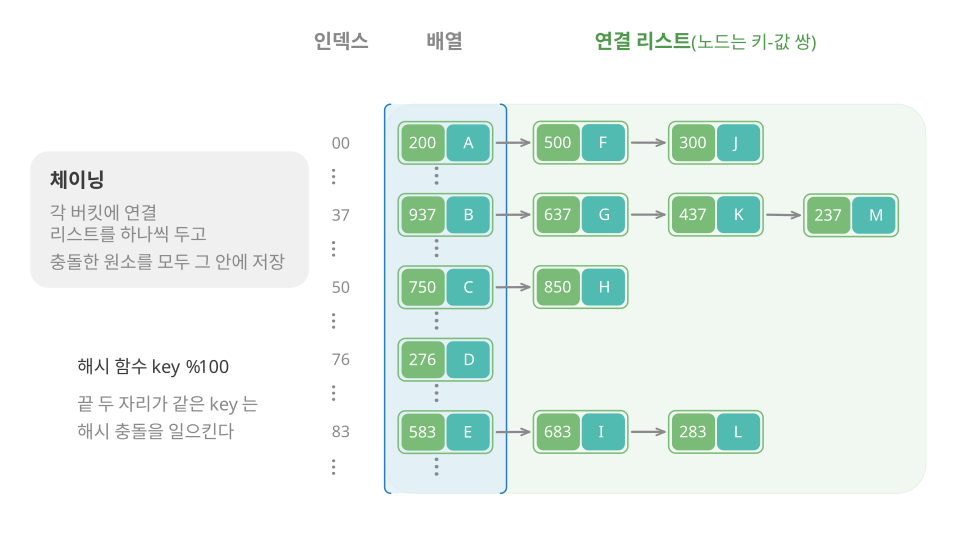
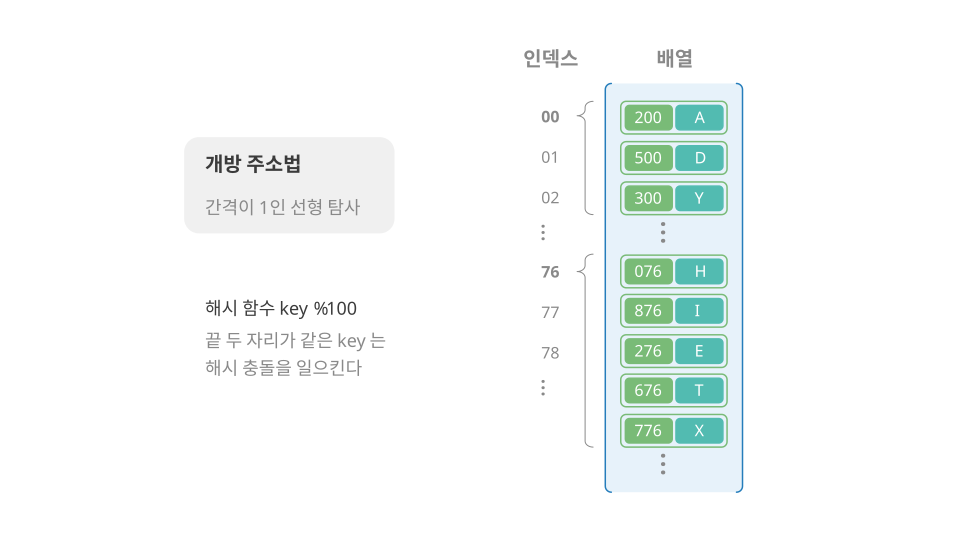

# 해시 충돌

앞 절에서 살펴봤듯이 **해시 함수의 입력 공간은 대개 출력 공간보다 훨씬 크므로** 이론적으로 해시 충돌을 피할 수 없다. 예를 들어 입력은 모든 정수이고 가능한 출력의 개수는 배열의 용량과 같다면, 여러 정수가 같은 버킷 인덱스에 대응할 수밖에 없다.

해시 충돌로 조회 결과가 틀리면 해시 테이블을 제대로 사용하기 어렵다. 한 가지 해결 방법은 충돌이 생길 때마다 충돌이 사라질 때까지 해시 테이블의 용량을 늘리는 것이다. 단순하면서도 효과가 있지만 효율이 너무 낮다. 용량을 늘리려면 많은 데이터를 옮기고 해시값을 계산해야 하기 때문이다. 효율을 높이려면 다음 전략을 쓸 수 있다.

1. 해시 테이블의 구조를 개선해 **해시 충돌이 일어나도 테이블이 정상적으로 작동하게 한다**.
2. 필요할 때, 즉 해시 충돌이 심해졌을 때만 용량을 늘린다.

해시 테이블의 구조를 개선하는 대표적인 방법은 ‘체이닝’과 ‘개방 주소법’이다.

## 체이닝

앞서 본 해시 테이블에서는 버킷 하나에 키-값 쌍 하나만 저장할 수 있었다. <u>체이닝(separate chaining)</u>은 단일 원소 대신 연결 리스트를 둔다. 키-값 쌍을 노드로 삼아 충돌한 쌍을 모두 같은 리스트에 저장한다. 아래 그림은 체이닝 해시 테이블의 예이다.



체이닝을 적용하면 해시 테이블에서 각 연산을 수행하는 방법이 다음과 같이 달라진다.

- **원소 조회**: `key`를 입력하여 해시 함수로 버킷 인덱스를 구하면 연결 리스트의 첫 노드에 접근할 수 있다. 리스트를 순회하면서 `key`를 비교해 원하는 키-값 쌍을 찾는다.
- **원소 추가**: 먼저 해시 함수를 통해 연결 리스트의 첫 노드에 접근한 다음 노드(키-값 쌍)를 리스트에 추가한다.
- **원소 삭제**: 해시 함수의 결과로 연결 리스트의 맨 앞에 접근한 다음 리스트를 순회해 대상 노드를 찾아 삭제한다.

체이닝에는 다음과 같은 한계가 있다.

- **공간 사용량 증가**: 연결 리스트는 노드 포인터를 저장하므로 배열보다 메모리 공간을 더 많이 사용한다.
- **조회 효율 저하**: 원하는 원소를 찾으려면 연결 리스트를 선형으로 순회해야 한다.

아래 코드는 체이닝 해시 테이블을 간단히 구현한다. 두 가지에 주목하자.

- 코드를 단순화하기 위해 연결 리스트 대신 리스트(동적 배열)를 쓴다. 이 구현에서 해시 테이블은 여러 버킷을 담은 배열이고 각 버킷은 리스트이다.
- 아래 구현에는 해시 테이블의 용량을 늘리는 메서드도 있다. 적재율이 $\frac{2}{3}$를 넘으면 용량을 기존의 $2$배로 늘린다.

```src
[file]{hash_map_chaining}-[class]{hash_map_chaining}-[func]{}
```

연결 리스트가 길면 조회에 $O(n)$의 시간이 걸려 효율이 낮다. **이때 연결 리스트를 AVL 트리나 레드-블랙 트리로 바꾸면** 조회의 시간 복잡도를 $O(\log n)$으로 개선할 수 있다.

## 개방 주소법

<u>개방 주소법(open addressing)</u>은 별도의 자료 구조를 두지 않고 여러 번 탐사하여 해시 충돌을 처리한다. 대표적인 방법으로 선형 탐사, 제곱 탐사, 다중 해싱이 있다.

선형 탐사를 예로 들어 개방 주소법 해시 테이블이 어떻게 작동하는지 살펴보자.

### 선형 탐사

선형 탐사는 일정한 간격으로 선형 검색을 수행한다. 따라서 일반적인 해시 테이블과 연산 방식이 다르다.

- **원소 삽입**: 해시 함수로 버킷 인덱스를 계산한다. 버킷에 이미 원소가 있으면 충돌한 위치에서부터 일정한 간격(보통 $1$)으로 다음 칸들을 차례로 살펴본다. 빈 버킷을 찾으면 그곳에 원소를 삽입한다.
- **원소 검색**: 해시 충돌이 일어나면 같은 간격으로 뒤쪽을 차례로 살펴본다. 원하는 원소를 찾으면 `value`를 반환한다. 빈 버킷을 만나면 해시 테이블에 해당 원소가 없다는 뜻이므로 `None`을 반환한다.

아래 그림은 개방 주소법(선형 탐사)을 사용하는 해시 테이블의 키-값 쌍 분포를 보여 준다. 이 해시 함수에서는 끝 두 자리가 같은 `key`가 모두 같은 버킷에 대응한다. 선형 탐사를 거치면서 이들은 해당 버킷과 그 아래 버킷들에 차례로 저장된다.



하지만 **선형 탐사에서는 군집화가 일어나기 쉽다**. 배열에서 연속으로 점유된 구간이 길수록 그 구간에서 해시 충돌이 발생할 가능성이 높다. 그러면 그 주변에 원소가 더 모여 구간이 길어지는 악순환이 생긴다. 결국 추가, 삭제, 조회, 갱신 연산의 효율이 모두 떨어진다.

주의할 점은 **개방 주소법 해시 테이블에서는 원소를 바로 삭제할 수 없다는 것이다**. 원소를 지운 자리에 빈 버킷 `None`이 생기면 선형 탐사로 조회하는 도중 이 버킷을 만나는 순간 검색이 끝난다. 그 아래에 있는 원소에 더는 접근할 수 없어 실제로는 있는 원소를 없다고 잘못 판단할 수 있다. 아래 그림이 그 예이다.


이 문제에는 <u>지연 삭제(lazy deletion)</u>를 사용할 수 있다. 원소를 해시 테이블에서 바로 제거하는 대신 **상수 `TOMBSTONE`으로 해당 버킷에 표시를 남긴다**. 이 방식에서 `None`과 `TOMBSTONE`은 모두 키-값 쌍을 넣을 수 있는 빈 버킷이다. 다만 선형 탐사 중 `TOMBSTONE`을 만나면 그 아래에 키-값 쌍이 남아 있을 수 있으므로 계속 탐사해야 한다.

하지만 **지연 삭제 때문에 해시 테이블의 성능이 더 빨리 떨어질 수도 있다**. 삭제할 때마다 표시가 하나씩 생기므로 `TOMBSTONE`이 늘수록 검색 시간도 늘어난다. 선형 탐사에서 원하는 원소를 찾기까지 `TOMBSTONE`을 여러 개 지나쳐야 할 수 있기 때문이다.

이를 개선하려면 선형 탐사 중 처음 만난 `TOMBSTONE`의 인덱스를 기록했다가 찾고 있던 원소와 그 `TOMBSTONE`의 위치를 맞바꾼다. 그러면 원소를 조회하거나 추가할 때마다 해당 원소가 원래의 이상적인 위치(탐사 시작점)에 더 가까운 버킷으로 옮겨져 조회 효율이 높아진다.

아래 코드는 지연 삭제를 지원하는 개방 주소법(선형 탐사) 해시 테이블을 구현한다. 공간을 충분히 활용할 수 있도록 테이블을 원형 배열로 취급한다. 배열 끝을 지나면 처음으로 돌아와 순회를 이어 간다.

```src
[file]{hash_map_open_addressing}-[class]{hash_map_open_addressing}-[func]{}
```

### 제곱 탐사

제곱 탐사는 선형 탐사와 마찬가지로 개방 주소법에서 흔히 쓰는 전략이다. 충돌이 일어나면 고정된 칸 수만큼 이동하는 대신 탐사 횟수의 제곱, 즉 $1, 4, 9, \dots$칸만큼 떨어진 위치를 살펴본다.

제곱 탐사의 주요 장점은 다음과 같다.

- 탐사 횟수의 제곱만큼 떨어진 위치를 살펴보아 선형 탐사에서 나타나는 군집화를 완화하려 한다.
- 빈자리를 찾을 때 더 먼 곳까지 건너뛰므로 데이터를 더 고르게 분산시키는 데 도움이 된다.

하지만 제곱 탐사에도 한계가 있다.

- 어떤 위치가 다른 위치보다 쉽게 점유되는 군집화 현상이 여전히 발생한다.
- 제곱수가 커짐에 따라 해시 테이블 전체를 탐사하지 못할 수 있다. 따라서 빈 버킷이 있어도 거기에 도달하지 못할 수 있다.

### 다중 해싱

다중 해싱은 이름처럼 $f_1(x)$, $f_2(x)$, $f_3(x)$, $\dots$ 등 여러 해시 함수를 사용하여 탐사한다.

- **원소 삽입**: 해시 함수 $f_1(x)$에서 충돌이 일어나면 다음 함수 $f_2(x)$로 탐사한다. 이런 식으로 다음 함수를 차례로 시도하다가 빈자리를 찾으면 원소를 삽입한다.
- **원소 검색**: 삽입할 때와 같은 순서로 해시 함수를 적용하고 원하는 원소를 찾으면 반환한다. 빈자리를 만나거나 모든 함수를 시도하고도 찾지 못하면 해시 테이블에 해당 원소가 없으므로 `None`을 반환한다.

선형 탐사에 비해 다중 해싱은 군집화가 덜 일어나지만 여러 해시 함수를 사용하므로 계산량이 늘어난다.

!!! tip

    개방 주소법을 사용하는 해시 테이블에서는 선형 탐사, 제곱 탐사, 다중 해싱 모두 원소를 바로 삭제할 수 없다는 점에 주의하자.

## 프로그래밍 언어별 선택

프로그래밍 언어마다 해시 테이블의 구현 전략이 다르다. 몇 가지 예를 살펴보자.

- Python은 개방 주소법을 채택한다. 딕셔너리 `dict`는 의사 난수를 이용하여 탐사한다.
- Java는 체이닝을 사용한다. JDK 1.8부터는 `HashMap`의 내부 배열 길이가 64 이상이고 연결 리스트 길이가 8에 이르면 조회 성능을 높이기 위해 리스트를 레드-블랙 트리로 바꾼다.
- Go 1.24부터 내장 `map`은 기본적으로 Swiss Table에 기반한 개방 주소법을 사용한다. Go 1.23과 그 이전 버전은 체이닝을 사용하며 버킷 하나에 키-값 쌍을 최대 8개까지 저장하고 용량을 넘으면 오버플로 버킷을 연결한다.
