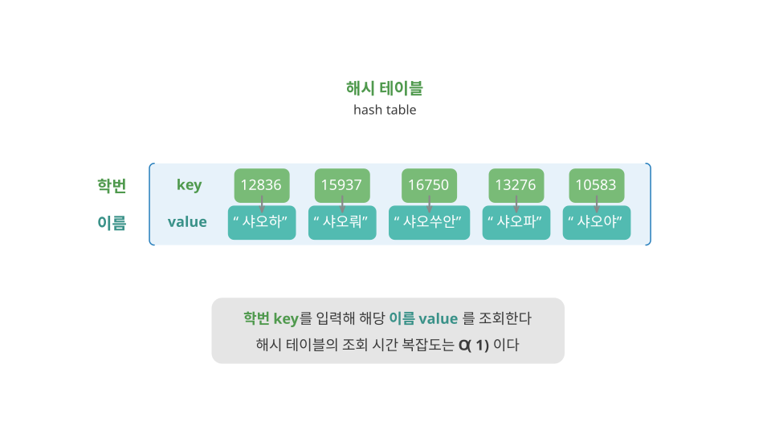
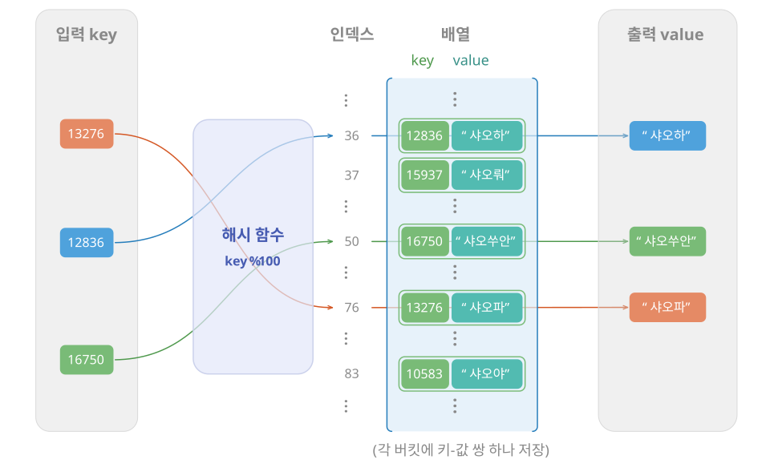
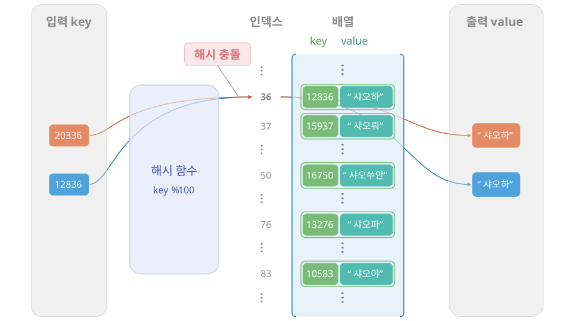

# 해시 테이블

<u>해시 테이블(hash table)</u>은 <u>해시표</u>라고도 한다. 키 `key`와 값 `value` 사이에 대응 관계를 만들어 원소를 효율적으로 조회하는 자료 구조이다. 구체적으로는 키 `key`를 입력하면 $O(1)$ 시간에 그에 해당하는 값 `value`를 얻을 수 있다.

아래 그림처럼 학생 $n$명이 있고 각 학생에게 ‘이름’과 ‘학번’이라는 두 가지 데이터가 있다고 하자. 학번을 입력받아 해당 이름을 반환하는 조회 기능은 그림과 같은 해시 테이블로 구현할 수 있다.



배열과 연결 리스트로도 조회 기능을 구현할 수 있다. 아래 표는 해시 테이블과 두 자료 구조의 효율을 비교한 것이다.

- **원소 추가**: 배열(또는 연결 리스트)의 끝에 원소를 추가하기만 하면 되므로 $O(1)$ 시간이 걸린다.
- **원소 조회**: 배열(또는 연결 리스트)이 정렬되어 있지 않으므로 모든 원소를 순회해야 하며 $O(n)$ 시간이 걸린다.
- **원소 삭제**: 먼저 원소를 찾은 다음 배열(또는 연결 리스트)에서 삭제해야 하므로 $O(n)$ 시간이 걸린다.

<p align="center">표 <id> &nbsp; 원소 조회 효율 비교</p>

|          | 배열   | 연결 리스트   | 해시 테이블 |
| -------- | ------ | ------ | ------ |
| 원소 검색 | $O(n)$ | $O(n)$ | $O(1)$ |
| 원소 추가 | $O(1)$ | $O(1)$ | $O(1)$ |
| 원소 삭제 | $O(n)$ | $O(n)$ | $O(1)$ |

해시 테이블에서 **추가, 삭제, 조회, 갱신의 시간 복잡도는 모두 $O(1)$**로 매우 효율적이다.

## 해시 테이블의 기본 연산

해시 테이블의 대표적인 연산으로는 초기화, 조회, 키-값 쌍 추가와 삭제가 있다. 아래 코드는 그 예이다.

```snippet
hash_map_operations
```

??? pythontutor "실행 과정 시각화"

    @tutor hash_map_operations_tutor

해시 테이블을 순회하는 방법은 크게 세 가지이다. 키-값 쌍 전체를 순회하거나, 키만 순회하거나, 값만 순회한다. 아래 코드에서 각 방법을 살펴보자.

```snippet
hash_map_traversal
```

??? pythontutor "실행 과정 시각화"

    @tutor hash_map_traversal_tutor

## 간단한 해시 테이블 구현

가장 단순한 경우부터 생각해 보자. **배열 하나만 사용해 해시 테이블을 구현한다**. 배열에서 원소를 담을 수 있는 칸 하나를 <u>버킷(bucket)</u>이라고 하며 버킷마다 키-값 쌍 하나를 저장할 수 있다. 따라서 조회란 `key`에 대응하는 버킷을 찾아 그 안에서 `value`를 가져오는 연산이다.

그러면 `key`로 어떻게 해당 버킷을 찾을까? 이때 사용하는 것이 <u>해시 함수(hash function)</u>이다. 해시 함수는 큰 입력 공간을 작은 출력 공간에 대응시킨다. 해시 테이블의 입력 공간은 가능한 모든 `key`이고 출력 공간은 모든 버킷(배열 인덱스)이다. 다시 말해 `key`를 입력하면 **해시 함수로 해당 `key`의 키-값 쌍이 배열 어디에 저장되어 있는지 알 수 있다**.

`key`를 입력했을 때 해시 함수의 계산 과정은 다음 두 단계로 나뉜다.

1. `hash()`와 같은 해시 알고리즘으로 해시값을 계산한다.
2. 해시값을 버킷 수(배열 길이) `capacity`로 나눈 나머지를 구한다. 이 값이 `key`에 대응하는 버킷의 배열 인덱스 `index`이다.

```shell
index = hash(key) % capacity
```

그다음 `index`로 해시 테이블의 해당 버킷에 접근해 `value`를 얻을 수 있다.

배열 길이를 `capacity = 100`, 해시 알고리즘을 `hash(key) = key`라고 하면 해시 함수는 `key % 100`이다. 아래 그림은 학번을 `key`로, 이름을 `value`로 삼아 해시 함수의 동작 원리를 보여 준다.



아래 코드는 간단한 해시 테이블을 구현한다. 키-값 쌍을 나타내기 위해 `key`와 `value`를 `Pair`라는 클래스로 묶는다.

```src
[file]{array_hash_map}-[class]{array_hash_map}-[func]{}
```

## 해시 충돌과 용량 확장

해시 함수는 본질적으로 모든 `key`로 이루어진 입력 공간을 배열의 모든 인덱스로 이루어진 출력 공간에 대응시킨다. 대개 입력 공간이 출력 공간보다 훨씬 크므로 **이론적으로 여러 입력이 같은 출력에 대응하는 경우가 반드시 존재한다**.

앞 예제의 해시 함수에서는 입력 `key`의 끝 두 자리가 같으면 출력도 같다. 예를 들어 학번이 12836과 20336인 두 학생을 조회하면 다음 결과를 얻는다.

```shell
12836 % 100 = 36
20336 % 100 = 36
```

아래 그림에서 두 학번은 같은 이름을 가리킨다. 이는 분명 잘못된 결과이다. 이처럼 여러 입력이 하나의 출력에 대응하는 현상을 <u>해시 충돌(hash collision)</u>이라고 한다.



해시 테이블의 용량 $n$이 클수록 여러 `key`가 한 버킷에 배정될 확률이 낮아져 충돌이 줄어든다. 따라서 **해시 테이블의 용량을 늘려 해시 충돌을 줄일 수 있다**.

아래 그림의 두 키-값 쌍 `(136, A)`, `(236, D)`는 용량을 늘리기 전에는 충돌하지만 용량을 늘린 뒤에는 충돌하지 않는다.


배열의 용량을 늘릴 때와 마찬가지로 해시 테이블도 용량을 늘리려면 모든 키-값 쌍을 기존 테이블에서 새 테이블로 옮겨야 하므로 시간이 많이 든다. 게다가 용량 `capacity`가 달라지므로 모든 키-값 쌍의 저장 위치를 해시 함수로 다시 계산해야 한다. 이 때문에 확장에 드는 계산 비용은 더 커진다. 그래서 프로그래밍 언어에서는 대개 해시 테이블의 용량을 처음부터 넉넉히 확보해 잦은 확장을 피한다.

<u>적재율(load factor)</u>은 해시 테이블의 원소 수를 버킷 수로 나눈 값이다. 해시 충돌의 정도를 가늠하는 중요한 지표이며 **테이블의 용량을 늘릴 시점을 결정하는 기준으로도 자주 쓰인다**. 예를 들어 Java에서는 적재율이 $0.75$를 넘으면 시스템이 해시 테이블의 용량을 기존의 $2$배로 늘린다.
