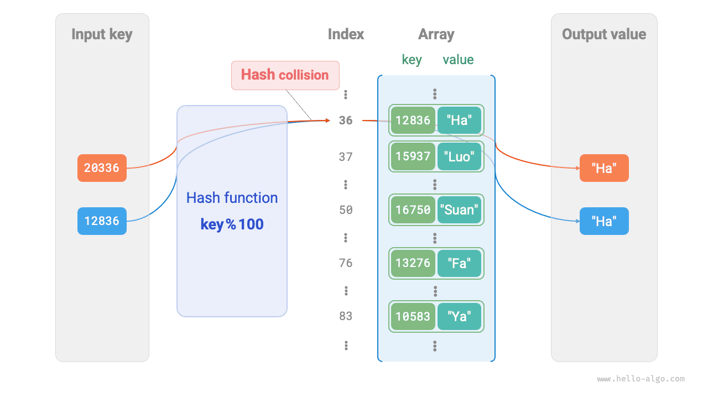

# 6.1 &nbsp; 해시 테이블

<u>해시 테이블(hash table)</u>은 <u>해시 표</u>라고도 하며, 키 `key`와 값 `value` 사이의 대응 관계를 만들어 원소를 효율적으로 조회한다. 구체적으로 키 `key`를 입력하면 해당 값 `value`를 $O(1)$ 시간에 얻을 수 있다.

아래 그림(6-1)과 같이 학생 $n$명에게 각각 ‘이름’과 ‘학번’이라는 두 데이터가 있다고 하자. ‘학번을 입력하면 해당 이름을 반환하는’ 조회 기능을 구현하려면 그림의 해시 테이블을 사용할 수 있다.

{ class="animation-figure" }

<p align="center"> 그림 6-1 &nbsp; 해시 테이블의 추상적 표현 </p>

해시 테이블 외에 배열과 연결 리스트로도 조회 기능을 구현할 수 있다. 효율 비교는 아래 표(6-1)와 같다.

- **원소 추가**: 배열(연결 리스트)의 끝에 원소를 추가하면 되므로 $O(1)$ 시간이 걸린다.
- **원소 조회**: 배열(연결 리스트)이 정렬되어 있지 않으므로 모든 원소를 순회해야 하며 $O(n)$ 시간이 걸린다.
- **원소 삭제**: 먼저 원소를 찾은 뒤 배열(연결 리스트)에서 삭제해야 하므로 $O(n)$ 시간이 걸린다.

<p align="center"> 표 6-1 &nbsp; 원소 조회 효율 비교 </p>

<div class="center-table" markdown>

|          | 배열   | 연결 리스트   | 해시 테이블 |
| -------- | ------ | ------ | ------ |
| 원소 탐색 | $O(n)$ | $O(n)$ | $O(1)$ |
| 원소 추가 | $O(1)$ | $O(1)$ | $O(1)$ |
| 원소 삭제 | $O(n)$ | $O(n)$ | $O(1)$ |

</div>

이처럼 **해시 테이블에서는 삽입, 삭제, 탐색, 갱신의 시간 복잡도가 모두 $O(1)$**로 매우 효율적이다.

## 6.1.1 &nbsp; 해시 테이블의 기본 연산

대표적인 연산에는 초기화, 조회, 키-값 쌍 추가와 삭제 등이 있다. 예제 코드는 다음과 같다.

=== "Python"

    ```python title="hash_map.py"
    # 해시 테이블 초기화
    hmap: dict = {}

    # 추가 연산
    # 해시 테이블에 키-값 쌍 (key, value) 추가
    hmap[12836] = "小哈"
    hmap[15937] = "小啰"
    hmap[16750] = "小算"
    hmap[13276] = "小法"
    hmap[10583] = "小鸭"

    # 조회 연산
    # 해시 테이블에 키 key를 입력하여 값 value를 얻음
    name: str = hmap[15937]

    # 삭제 연산
    # 해시 테이블에서 키-값 쌍 (key, value) 삭제
    hmap.pop(10583)
    ```

=== "C++"

    ```cpp title="hash_map.cpp"
    /* 해시 테이블 초기화 */
    unordered_map<int, string> map;

    /* 추가 연산 */
    // 해시 테이블에 키-값 쌍 (key, value) 추가
    map[12836] = "小哈";
    map[15937] = "小啰";
    map[16750] = "小算";
    map[13276] = "小法";
    map[10583] = "小鸭";

    /* 조회 연산 */
    // 해시 테이블에 키 key를 입력하여 값 value를 얻음
    string name = map[15937];

    /* 삭제 연산 */
    // 해시 테이블에서 키-값 쌍 (key, value) 삭제
    map.erase(10583);
    ```

=== "Java"

    ```java title="hash_map.java"
    /* 해시 테이블 초기화 */
    Map<Integer, String> map = new HashMap<>();

    /* 추가 연산 */
    // 해시 테이블에 키-값 쌍 (key, value) 추가
    map.put(12836, "小哈");
    map.put(15937, "小啰");
    map.put(16750, "小算");
    map.put(13276, "小法");
    map.put(10583, "小鸭");

    /* 조회 연산 */
    // 해시 테이블에 키 key를 입력하여 값 value를 얻음
    String name = map.get(15937);

    /* 삭제 연산 */
    // 해시 테이블에서 키-값 쌍 (key, value) 삭제
    map.remove(10583);
    ```

=== "C#"

    ```csharp title="hash_map.cs"
    /* 해시 테이블 초기화 */
    Dictionary<int, string> map = new() {
        /* 추가 연산 */
        // 해시 테이블에 키-값 쌍 (key, value) 추가
        { 12836, "小哈" },
        { 15937, "小啰" },
        { 16750, "小算" },
        { 13276, "小法" },
        { 10583, "小鸭" }
    };

    /* 조회 연산 */
    // 해시 테이블에 키 key를 입력하여 값 value를 얻음
    string name = map[15937];

    /* 삭제 연산 */
    // 해시 테이블에서 키-값 쌍 (key, value) 삭제
    map.Remove(10583);
    ```

=== "Go"

    ```go title="hash_map_test.go"
    /* 해시 테이블 초기화 */
    hmap := make(map[int]string)

    /* 추가 연산 */
    // 해시 테이블에 키-값 쌍 (key, value) 추가
    hmap[12836] = "小哈"
    hmap[15937] = "小啰"
    hmap[16750] = "小算"
    hmap[13276] = "小法"
    hmap[10583] = "小鸭"

    /* 조회 연산 */
    // 해시 테이블에 키 key를 입력하여 값 value를 얻음
    name := hmap[15937]

    /* 삭제 연산 */
    // 해시 테이블에서 키-값 쌍 (key, value) 삭제
    delete(hmap, 10583)
    ```

=== "Swift"

    ```swift title="hash_map.swift"
    /* 해시 테이블 초기화 */
    var map: [Int: String] = [:]

    /* 추가 연산 */
    // 해시 테이블에 키-값 쌍 (key, value) 추가
    map[12836] = "小哈"
    map[15937] = "小啰"
    map[16750] = "小算"
    map[13276] = "小法"
    map[10583] = "小鸭"

    /* 조회 연산 */
    // 해시 테이블에 키 key를 입력하여 값 value를 얻음
    let name = map[15937]!

    /* 삭제 연산 */
    // 해시 테이블에서 키-값 쌍 (key, value) 삭제
    map.removeValue(forKey: 10583)
    ```

=== "JS"

    ```javascript title="hash_map.js"
    /* 해시 테이블 초기화 */
    const map = new Map();
    /* 추가 연산 */
    // 해시 테이블에 키-값 쌍 (key, value) 추가
    map.set(12836, '小哈');
    map.set(15937, '小啰');
    map.set(16750, '小算');
    map.set(13276, '小法');
    map.set(10583, '小鸭');

    /* 조회 연산 */
    // 해시 테이블에 키 key를 입력하여 값 value를 얻음
    let name = map.get(15937);

    /* 삭제 연산 */
    // 해시 테이블에서 키-값 쌍 (key, value) 삭제
    map.delete(10583);
    ```

=== "TS"

    ```typescript title="hash_map.ts"
    /* 해시 테이블 초기화 */
    const map = new Map<number, string>();
    /* 추가 연산 */
    // 해시 테이블에 키-값 쌍 (key, value) 추가
    map.set(12836, '小哈');
    map.set(15937, '小啰');
    map.set(16750, '小算');
    map.set(13276, '小法');
    map.set(10583, '小鸭');
    console.info('\n추가한 뒤의 해시 테이블\nKey -> Value');
    console.info(map);

    /* 조회 연산 */
    // 해시 테이블에 키 key를 입력하여 값 value를 얻음
    let name = map.get(15937);
    console.info('\n학번 15937을 입력하여 찾은 이름 ' + name);

    /* 삭제 연산 */
    // 해시 테이블에서 키-값 쌍 (key, value) 삭제
    map.delete(10583);
    console.info('\n10583을 삭제한 뒤의 해시 테이블\nKey -> Value');
    console.info(map);
    ```

=== "Dart"

    ```dart title="hash_map.dart"
    /* 해시 테이블 초기화 */
    Map<int, String> map = {};

    /* 추가 연산 */
    // 해시 테이블에 키-값 쌍 (key, value) 추가
    map[12836] = "小哈";
    map[15937] = "小啰";
    map[16750] = "小算";
    map[13276] = "小法";
    map[10583] = "小鸭";

    /* 조회 연산 */
    // 해시 테이블에 키 key를 입력하여 값 value를 얻음
    String name = map[15937];

    /* 삭제 연산 */
    // 해시 테이블에서 키-값 쌍 (key, value) 삭제
    map.remove(10583);
    ```

=== "Rust"

    ```rust title="hash_map.rs"
    use std::collections::HashMap;

    /* 해시 테이블 초기화 */
    let mut map: HashMap<i32, String> = HashMap::new();

    /* 추가 연산 */
    // 해시 테이블에 키-값 쌍 (key, value) 추가
    map.insert(12836, "小哈".to_string());
    map.insert(15937, "小啰".to_string());
    map.insert(16750, "小算".to_string());
    map.insert(13279, "小法".to_string());
    map.insert(10583, "小鸭".to_string());

    /* 조회 연산 */
    // 해시 테이블에 키 key를 입력하여 값 value를 얻음
    let _name: Option<&String> = map.get(&15937);

    /* 삭제 연산 */
    // 해시 테이블에서 키-값 쌍 (key, value) 삭제
    let _removed_value: Option<String> = map.remove(&10583);
    ```

=== "C"

    ```c title="hash_map.c"
    // C는 내장 해시 테이블을 제공하지 않는다
    ```

=== "Kotlin"

    ```kotlin title="hash_map.kt"
    /* 해시 테이블 초기화 */
    val map = HashMap<Int,String>()

    /* 추가 연산 */
    // 해시 테이블에 키-값 쌍 (key, value) 추가
    map[12836] = "小哈"
    map[15937] = "小啰"
    map[16750] = "小算"
    map[13276] = "小法"
    map[10583] = "小鸭"

    /* 조회 연산 */
    // 해시 테이블에 키 key를 입력하여 값 value를 얻음
    val name = map[15937]

    /* 삭제 연산 */
    // 해시 테이블에서 키-값 쌍 (key, value) 삭제
    map.remove(10583)
    ```

=== "Ruby"

    ```ruby title="hash_map.rb"
    # 해시 테이블 초기화
    hmap = {}

    # 추가 연산
    # 해시 테이블에 키-값 쌍 (key, value) 추가
    hmap[12836] = "小哈"
    hmap[15937] = "小啰"
    hmap[16750] = "小算"
    hmap[13276] = "小法"
    hmap[10583] = "小鸭"

    # 조회 연산
    # 해시 테이블에 키 key를 입력하여 값 value를 얻음
    name = hmap[15937]

    # 삭제 연산
    # 해시 테이블에서 키-값 쌍 (key, value) 삭제
    hmap.delete(10583)
    ```

??? pythontutor "코드 시각화"

    <div style="height: 549px; width: 100%;"><iframe class="pythontutor-iframe" title="코드 시각화" src="https://pythontutor.com/iframe-embed.html#code=%22%22%22%EC%8B%A4%ED%96%89%20%EC%BD%94%EB%93%9C%22%22%22%0Aif%20__name__%20%3D%3D%20%22__main__%22%3A%0A%20%20%20%20%23%20%ED%95%B4%EC%8B%9C%20%ED%85%8C%EC%9D%B4%EB%B8%94%20%EC%B4%88%EA%B8%B0%ED%99%94%0A%20%20%20%20hmap%20%3D%20%7B%7D%0A%20%20%20%20%0A%20%20%20%20%23%20%EC%B6%94%EA%B0%80%20%EC%97%B0%EC%82%B0%0A%20%20%20%20%23%20%ED%95%B4%EC%8B%9C%20%ED%85%8C%EC%9D%B4%EB%B8%94%EC%97%90%20%ED%82%A4-%EA%B0%92%20%EC%8C%8D%20%28key%2C%20value%29%20%EC%B6%94%EA%B0%80%0A%20%20%20%20hmap%5B12836%5D%20%3D%20%22%E5%B0%8F%E5%93%88%22%0A%20%20%20%20hmap%5B15937%5D%20%3D%20%22%E5%B0%8F%E5%95%B0%22%0A%20%20%20%20hmap%5B16750%5D%20%3D%20%22%E5%B0%8F%E7%AE%97%22%0A%20%20%20%20hmap%5B13276%5D%20%3D%20%22%E5%B0%8F%E6%B3%95%22%0A%20%20%20%20hmap%5B10583%5D%20%3D%20%22%E5%B0%8F%E9%B8%AD%22%0A%20%20%20%20%0A%20%20%20%20%23%20%EC%A1%B0%ED%9A%8C%20%EC%97%B0%EC%82%B0%0A%20%20%20%20%23%20%ED%95%B4%EC%8B%9C%20%ED%85%8C%EC%9D%B4%EB%B8%94%EC%97%90%20%ED%82%A4%20key%EB%A5%BC%20%EC%9E%85%EB%A0%A5%ED%95%98%EC%97%AC%20%EA%B0%92%20value%EB%A5%BC%20%EC%96%BB%EC%9D%8C%0A%20%20%20%20name%20%3D%20hmap%5B15937%5D%0A%20%20%20%20%0A%20%20%20%20%23%20%EC%82%AD%EC%A0%9C%20%EC%97%B0%EC%82%B0%0A%20%20%20%20%23%20%ED%95%B4%EC%8B%9C%20%ED%85%8C%EC%9D%B4%EB%B8%94%EC%97%90%EC%84%9C%20%ED%82%A4-%EA%B0%92%20%EC%8C%8D%20%28key%2C%20value%29%20%EC%82%AD%EC%A0%9C%0A%20%20%20%20hmap.pop%2810583%29&codeDivHeight=472&codeDivWidth=350&cumulative=false&curInstr=2&heapPrimitives=nevernest&origin=opt-frontend.js&py=311&rawInputLstJSON=%5B%5D&textReferences=false"> </iframe></div>
    <div style="margin-top: 5px;"><a href="https://pythontutor.com/iframe-embed.html#code=%22%22%22%EC%8B%A4%ED%96%89%20%EC%BD%94%EB%93%9C%22%22%22%0Aif%20__name__%20%3D%3D%20%22__main__%22%3A%0A%20%20%20%20%23%20%ED%95%B4%EC%8B%9C%20%ED%85%8C%EC%9D%B4%EB%B8%94%20%EC%B4%88%EA%B8%B0%ED%99%94%0A%20%20%20%20hmap%20%3D%20%7B%7D%0A%20%20%20%20%0A%20%20%20%20%23%20%EC%B6%94%EA%B0%80%20%EC%97%B0%EC%82%B0%0A%20%20%20%20%23%20%ED%95%B4%EC%8B%9C%20%ED%85%8C%EC%9D%B4%EB%B8%94%EC%97%90%20%ED%82%A4-%EA%B0%92%20%EC%8C%8D%20%28key%2C%20value%29%20%EC%B6%94%EA%B0%80%0A%20%20%20%20hmap%5B12836%5D%20%3D%20%22%E5%B0%8F%E5%93%88%22%0A%20%20%20%20hmap%5B15937%5D%20%3D%20%22%E5%B0%8F%E5%95%B0%22%0A%20%20%20%20hmap%5B16750%5D%20%3D%20%22%E5%B0%8F%E7%AE%97%22%0A%20%20%20%20hmap%5B13276%5D%20%3D%20%22%E5%B0%8F%E6%B3%95%22%0A%20%20%20%20hmap%5B10583%5D%20%3D%20%22%E5%B0%8F%E9%B8%AD%22%0A%20%20%20%20%0A%20%20%20%20%23%20%EC%A1%B0%ED%9A%8C%20%EC%97%B0%EC%82%B0%0A%20%20%20%20%23%20%ED%95%B4%EC%8B%9C%20%ED%85%8C%EC%9D%B4%EB%B8%94%EC%97%90%20%ED%82%A4%20key%EB%A5%BC%20%EC%9E%85%EB%A0%A5%ED%95%98%EC%97%AC%20%EA%B0%92%20value%EB%A5%BC%20%EC%96%BB%EC%9D%8C%0A%20%20%20%20name%20%3D%20hmap%5B15937%5D%0A%20%20%20%20%0A%20%20%20%20%23%20%EC%82%AD%EC%A0%9C%20%EC%97%B0%EC%82%B0%0A%20%20%20%20%23%20%ED%95%B4%EC%8B%9C%20%ED%85%8C%EC%9D%B4%EB%B8%94%EC%97%90%EC%84%9C%20%ED%82%A4-%EA%B0%92%20%EC%8C%8D%20%28key%2C%20value%29%20%EC%82%AD%EC%A0%9C%0A%20%20%20%20hmap.pop%2810583%29&codeDivHeight=800&codeDivWidth=600&cumulative=false&curInstr=2&heapPrimitives=nevernest&origin=opt-frontend.js&py=311&rawInputLstJSON=%5B%5D&textReferences=false" target="_blank" rel="noopener noreferrer">전체 화면 ></a></div>

해시 테이블을 순회하는 대표적인 방식은 키-값 쌍 순회, 키 순회, 값 순회의 세 가지다. 예제 코드는 다음과 같다.

=== "Python"

    ```python title="hash_map.py"
    # 해시 테이블 순회
    # 키-값 쌍 key->value 순회
    for key, value in hmap.items():
        print(key, "->", value)
    # 키 key만 순회
    for key in hmap.keys():
        print(key)
    # 값 value만 순회
    for value in hmap.values():
        print(value)
    ```

=== "C++"

    ```cpp title="hash_map.cpp"
    /* 해시 테이블 순회 */
    // 키-값 쌍 key->value 순회
    for (auto kv: map) {
        cout << kv.first << " -> " << kv.second << endl;
    }
    // 이터레이터로 key->value 순회
    for (auto iter = map.begin(); iter != map.end(); iter++) {
        cout << iter->first << "->" << iter->second << endl;
    }
    ```

=== "Java"

    ```java title="hash_map.java"
    /* 해시 테이블 순회 */
    // 키-값 쌍 key->value 순회
    for (Map.Entry <Integer, String> kv: map.entrySet()) {
        System.out.println(kv.getKey() + " -> " + kv.getValue());
    }
    // 키 key만 순회
    for (int key: map.keySet()) {
        System.out.println(key);
    }
    // 값 value만 순회
    for (String val: map.values()) {
        System.out.println(val);
    }
    ```

=== "C#"

    ```csharp title="hash_map.cs"
    /* 해시 테이블 순회 */
    // 키-값 쌍 Key->Value 순회
    foreach (var kv in map) {
        Console.WriteLine(kv.Key + " -> " + kv.Value);
    }
    // 키 key만 순회
    foreach (int key in map.Keys) {
        Console.WriteLine(key);
    }
    // 값 value만 순회
    foreach (string val in map.Values) {
        Console.WriteLine(val);
    }
    ```

=== "Go"

    ```go title="hash_map_test.go"
    /* 해시 테이블 순회 */
    // 키-값 쌍 key->value 순회
    for key, value := range hmap {
        fmt.Println(key, "->", value)
    }
    // 키 key만 순회
    for key := range hmap {
        fmt.Println(key)
    }
    // 값 value만 순회
    for _, value := range hmap {
        fmt.Println(value)
    }
    ```

=== "Swift"

    ```swift title="hash_map.swift"
    /* 해시 테이블 순회 */
    // 키-값 쌍 Key->Value 순회
    for (key, value) in map {
        print("\(key) -> \(value)")
    }
    // 키 Key만 순회
    for key in map.keys {
        print(key)
    }
    // 값 Value만 순회
    for value in map.values {
        print(value)
    }
    ```

=== "JS"

    ```javascript title="hash_map.js"
    /* 해시 테이블 순회 */
    console.info('\n키-값 쌍 Key->Value 순회');
    for (const [k, v] of map.entries()) {
        console.info(k + ' -> ' + v);
    }
    console.info('\n키 Key만 순회');
    for (const k of map.keys()) {
        console.info(k);
    }
    console.info('\n값 Value만 순회');
    for (const v of map.values()) {
        console.info(v);
    }
    ```

=== "TS"

    ```typescript title="hash_map.ts"
    /* 해시 테이블 순회 */
    console.info('\n키-값 쌍 Key->Value 순회');
    for (const [k, v] of map.entries()) {
        console.info(k + ' -> ' + v);
    }
    console.info('\n키 Key만 순회');
    for (const k of map.keys()) {
        console.info(k);
    }
    console.info('\n값 Value만 순회');
    for (const v of map.values()) {
        console.info(v);
    }
    ```

=== "Dart"

    ```dart title="hash_map.dart"
    /* 해시 테이블 순회 */
    // 키-값 쌍 Key->Value 순회
    map.forEach((key, value) {
      print('$key -> $value');
    });

    // 키 Key만 순회
    map.keys.forEach((key) {
      print(key);
    });

    // 값 Value만 순회
    map.values.forEach((value) {
      print(value);
    });
    ```

=== "Rust"

    ```rust title="hash_map.rs"
    /* 해시 테이블 순회 */
    // 키-값 쌍 Key->Value 순회
    for (key, value) in &map {
        println!("{key} -> {value}");
    }

    // 키 Key만 순회
    for key in map.keys() {
        println!("{key}");
    }

    // 값 Value만 순회
    for value in map.values() {
        println!("{value}");
    }
    ```

=== "C"

    ```c title="hash_map.c"
    // C는 내장 해시 테이블을 제공하지 않는다
    ```

=== "Kotlin"

    ```kotlin title="hash_map.kt"
    /* 해시 테이블 순회 */
    // 키-값 쌍 key->value 순회
    for ((key, value) in map) {
        println("$key -> $value")
    }
    // 키 key만 순회
    for (key in map.keys) {
        println(key)
    }
    // 값 value만 순회
    for (_val in map.values) {
        println(_val)
    }
    ```

=== "Ruby"

    ```ruby title="hash_map.rb"
    # 해시 테이블 순회
    # 키-값 쌍 key->value 순회
    hmap.entries.each { |key, value| puts "#{key} -> #{value}" }

    # 키 key만 순회
    hmap.keys.each { |key| puts key }

    # 값 value만 순회
    hmap.values.each { |val| puts val }
    ```

??? pythontutor "코드 시각화"

    <div style="height: 549px; width: 100%;"><iframe class="pythontutor-iframe" title="코드 시각화" src="https://pythontutor.com/iframe-embed.html#code=%22%22%22%EC%8B%A4%ED%96%89%20%EC%BD%94%EB%93%9C%22%22%22%0Aif%20__name__%20%3D%3D%20%22__main__%22%3A%0A%20%20%20%20%23%20%ED%95%B4%EC%8B%9C%20%ED%85%8C%EC%9D%B4%EB%B8%94%20%EC%B4%88%EA%B8%B0%ED%99%94%0A%20%20%20%20hmap%20%3D%20%7B%7D%0A%20%20%20%20%0A%20%20%20%20%23%20%EC%B6%94%EA%B0%80%20%EC%97%B0%EC%82%B0%0A%20%20%20%20%23%20%ED%95%B4%EC%8B%9C%20%ED%85%8C%EC%9D%B4%EB%B8%94%EC%97%90%20%ED%82%A4-%EA%B0%92%20%EC%8C%8D%20%28key%2C%20value%29%20%EC%B6%94%EA%B0%80%0A%20%20%20%20hmap%5B12836%5D%20%3D%20%22%E5%B0%8F%E5%93%88%22%0A%20%20%20%20hmap%5B15937%5D%20%3D%20%22%E5%B0%8F%E5%95%B0%22%0A%20%20%20%20hmap%5B16750%5D%20%3D%20%22%E5%B0%8F%E7%AE%97%22%0A%20%20%20%20hmap%5B13276%5D%20%3D%20%22%E5%B0%8F%E6%B3%95%22%0A%20%20%20%20hmap%5B10583%5D%20%3D%20%22%E5%B0%8F%E9%B8%AD%22%0A%20%20%20%20%0A%20%20%20%20%23%20%ED%95%B4%EC%8B%9C%20%ED%85%8C%EC%9D%B4%EB%B8%94%20%EC%88%9C%ED%9A%8C%0A%20%20%20%20%23%20%ED%82%A4-%EA%B0%92%20%EC%8C%8D%20key-%3Evalue%20%EC%88%9C%ED%9A%8C%0A%20%20%20%20for%20key%2C%20value%20in%20hmap.items%28%29%3A%0A%20%20%20%20%20%20%20%20print%28key%2C%20%22-%3E%22%2C%20value%29%0A%20%20%20%20%23%20%ED%82%A4%20key%EB%A7%8C%20%EC%88%9C%ED%9A%8C%0A%20%20%20%20for%20key%20in%20hmap.keys%28%29%3A%0A%20%20%20%20%20%20%20%20print%28key%29%0A%20%20%20%20%23%20%EA%B0%92%20value%EB%A7%8C%20%EC%88%9C%ED%9A%8C%0A%20%20%20%20for%20value%20in%20hmap.values%28%29%3A%0A%20%20%20%20%20%20%20%20print%28value%29&codeDivHeight=472&codeDivWidth=350&cumulative=false&curInstr=8&heapPrimitives=nevernest&origin=opt-frontend.js&py=311&rawInputLstJSON=%5B%5D&textReferences=false"> </iframe></div>
    <div style="margin-top: 5px;"><a href="https://pythontutor.com/iframe-embed.html#code=%22%22%22%EC%8B%A4%ED%96%89%20%EC%BD%94%EB%93%9C%22%22%22%0Aif%20__name__%20%3D%3D%20%22__main__%22%3A%0A%20%20%20%20%23%20%ED%95%B4%EC%8B%9C%20%ED%85%8C%EC%9D%B4%EB%B8%94%20%EC%B4%88%EA%B8%B0%ED%99%94%0A%20%20%20%20hmap%20%3D%20%7B%7D%0A%20%20%20%20%0A%20%20%20%20%23%20%EC%B6%94%EA%B0%80%20%EC%97%B0%EC%82%B0%0A%20%20%20%20%23%20%ED%95%B4%EC%8B%9C%20%ED%85%8C%EC%9D%B4%EB%B8%94%EC%97%90%20%ED%82%A4-%EA%B0%92%20%EC%8C%8D%20%28key%2C%20value%29%20%EC%B6%94%EA%B0%80%0A%20%20%20%20hmap%5B12836%5D%20%3D%20%22%E5%B0%8F%E5%93%88%22%0A%20%20%20%20hmap%5B15937%5D%20%3D%20%22%E5%B0%8F%E5%95%B0%22%0A%20%20%20%20hmap%5B16750%5D%20%3D%20%22%E5%B0%8F%E7%AE%97%22%0A%20%20%20%20hmap%5B13276%5D%20%3D%20%22%E5%B0%8F%E6%B3%95%22%0A%20%20%20%20hmap%5B10583%5D%20%3D%20%22%E5%B0%8F%E9%B8%AD%22%0A%20%20%20%20%0A%20%20%20%20%23%20%ED%95%B4%EC%8B%9C%20%ED%85%8C%EC%9D%B4%EB%B8%94%20%EC%88%9C%ED%9A%8C%0A%20%20%20%20%23%20%ED%82%A4-%EA%B0%92%20%EC%8C%8D%20key-%3Evalue%20%EC%88%9C%ED%9A%8C%0A%20%20%20%20for%20key%2C%20value%20in%20hmap.items%28%29%3A%0A%20%20%20%20%20%20%20%20print%28key%2C%20%22-%3E%22%2C%20value%29%0A%20%20%20%20%23%20%ED%82%A4%20key%EB%A7%8C%20%EC%88%9C%ED%9A%8C%0A%20%20%20%20for%20key%20in%20hmap.keys%28%29%3A%0A%20%20%20%20%20%20%20%20print%28key%29%0A%20%20%20%20%23%20%EA%B0%92%20value%EB%A7%8C%20%EC%88%9C%ED%9A%8C%0A%20%20%20%20for%20value%20in%20hmap.values%28%29%3A%0A%20%20%20%20%20%20%20%20print%28value%29&codeDivHeight=800&codeDivWidth=600&cumulative=false&curInstr=8&heapPrimitives=nevernest&origin=opt-frontend.js&py=311&rawInputLstJSON=%5B%5D&textReferences=false" target="_blank" rel="noopener noreferrer">전체 화면 ></a></div>

## 6.1.2 &nbsp; 간단한 해시 테이블 구현

먼저 가장 간단한 경우로 **배열 하나만 사용하여 해시 테이블을 구현해 보자**. 해시 테이블에서는 배열의 각 자리를 <u>버킷(bucket)</u>이라고 하며, 버킷마다 키-값 쌍 하나를 저장할 수 있다. 따라서 조회 연산은 `key`에 해당하는 버킷을 찾고 그 안에서 `value`를 얻는 것이다.

그렇다면 `key`로 해당 버킷을 어떻게 찾을까? 이를 위해 <u>해시 함수(hash function)</u>를 사용한다. 해시 함수는 큰 입력 공간을 작은 출력 공간에 매핑한다. 해시 테이블에서 입력 공간은 모든 `key`이고, 출력 공간은 모든 버킷(배열 인덱스)이다. 즉, `key`를 입력하면 **해시 함수를 통해 그 키-값 쌍이 배열에 저장되는 위치를 얻을 수 있다**.

`key`를 입력했을 때 해시 함수의 계산 과정은 다음 두 단계로 나뉜다.

1. 어떤 해시 알고리즘 `hash()`로 해시값을 계산한다.
2. 해시값을 버킷 수(배열 길이) `capacity`로 나눈 나머지를 구하여 `key`에 해당하는 버킷(배열 인덱스) `index`를 얻는다.

```shell
index = hash(key) % capacity
```

그런 다음 `index`로 해시 테이블의 해당 버킷에 접근하여 `value`를 얻는다.

배열 길이가 `capacity = 100`이고 해시 알고리즘이 `hash(key) = key`이면, 해시 함수는 `key % 100`이다. 아래 그림(6-2)은 학번을 `key`, 이름을 `value`로 삼아 해시 함수의 작동 원리를 보여 준다.

{ class="animation-figure" }

<p align="center"> 그림 6-2 &nbsp; 해시 함수의 작동 원리 </p>

다음 코드는 간단한 해시 테이블을 구현한다. `key`와 `value`를 `Pair` 클래스로 묶어 키-값 쌍을 표현한다.

=== "Python"

    ```python title="array_hash_map.py"
    class Pair:
        """키-값 쌍"""

        def __init__(self, key: int, val: str):
            self.key = key
            self.val = val

    class ArrayHashMap:
        """배열로 구현한 해시 테이블"""

        def __init__(self):
            """생성자"""
            # 버킷 100개를 포함하는 배열을 초기화한다
            self.buckets: list[Pair | None] = [None] * 100

        def hash_func(self, key: int) -> int:
            """해시 함수"""
            index = key % 100
            return index

        def get(self, key: int) -> str | None:
            """조회 연산"""
            index: int = self.hash_func(key)
            pair: Pair = self.buckets[index]
            if pair is None:
                return None
            return pair.val

        def put(self, key: int, val: str):
            """추가 및 갱신 연산"""
            pair = Pair(key, val)
            index: int = self.hash_func(key)
            self.buckets[index] = pair

        def remove(self, key: int):
            """삭제 연산"""
            index: int = self.hash_func(key)
            # None으로 설정하여 삭제를 나타낸다
            self.buckets[index] = None

        def entry_set(self) -> list[Pair]:
            """모든 키-값 쌍 반환"""
            result: list[Pair] = []
            for pair in self.buckets:
                if pair is not None:
                    result.append(pair)
            return result

        def key_set(self) -> list[int]:
            """모든 키 반환"""
            result = []
            for pair in self.buckets:
                if pair is not None:
                    result.append(pair.key)
            return result

        def value_set(self) -> list[str]:
            """모든 값 반환"""
            result = []
            for pair in self.buckets:
                if pair is not None:
                    result.append(pair.val)
            return result

        def print(self):
            """해시 테이블 출력"""
            for pair in self.buckets:
                if pair is not None:
                    print(pair.key, "->", pair.val)
    ```

=== "C++"

    ```cpp title="array_hash_map.cpp"
    /* 키-값 쌍 */
    struct Pair {
      public:
        int key;
        string val;
        Pair(int key, string val) {
            this->key = key;
            this->val = val;
        }
    };

    /* 배열로 구현한 해시 테이블 */
    class ArrayHashMap {
      private:
        vector<Pair *> buckets;

      public:
        ArrayHashMap() {
            // 버킷 100개를 포함하는 배열을 초기화한다
            buckets = vector<Pair *>(100);
        }

        ~ArrayHashMap() {
            // 메모리 해제
            for (const auto &bucket : buckets) {
                delete bucket;
            }
            buckets.clear();
        }

        /* 해시 함수 */
        int hashFunc(int key) {
            int index = key % 100;
            return index;
        }

        /* 조회 연산 */
        string get(int key) {
            int index = hashFunc(key);
            Pair *pair = buckets[index];
            if (pair == nullptr)
                return "";
            return pair->val;
        }

        /* 추가 연산 */
        void put(int key, string val) {
            Pair *pair = new Pair(key, val);
            int index = hashFunc(key);
            buckets[index] = pair;
        }

        /* 삭제 연산 */
        void remove(int key) {
            int index = hashFunc(key);
            // 메모리를 해제하고 nullptr로 설정한다
            delete buckets[index];
            buckets[index] = nullptr;
        }

        /* 모든 키-값 쌍 반환 */
        vector<Pair *> pairSet() {
            vector<Pair *> pairSet;
            for (Pair *pair : buckets) {
                if (pair != nullptr) {
                    pairSet.push_back(pair);
                }
            }
            return pairSet;
        }

        /* 모든 키 반환 */
        vector<int> keySet() {
            vector<int> keySet;
            for (Pair *pair : buckets) {
                if (pair != nullptr) {
                    keySet.push_back(pair->key);
                }
            }
            return keySet;
        }

        /* 모든 값 반환 */
        vector<string> valueSet() {
            vector<string> valueSet;
            for (Pair *pair : buckets) {
                if (pair != nullptr) {
                    valueSet.push_back(pair->val);
                }
            }
            return valueSet;
        }

        /* 해시 테이블 출력 */
        void print() {
            for (Pair *kv : pairSet()) {
                cout << kv->key << " -> " << kv->val << endl;
            }
        }
    };
    ```

=== "Java"

    ```java title="array_hash_map.java"
    /* 키-값 쌍 */
    class Pair {
        public int key;
        public String val;

        public Pair(int key, String val) {
            this.key = key;
            this.val = val;
        }
    }

    /* 배열로 구현한 해시 테이블 */
    class ArrayHashMap {
        private List<Pair> buckets;

        public ArrayHashMap() {
            // 버킷 100개를 포함하는 배열을 초기화한다
            buckets = new ArrayList<>();
            for (int i = 0; i < 100; i++) {
                buckets.add(null);
            }
        }

        /* 해시 함수 */
        private int hashFunc(int key) {
            int index = key % 100;
            return index;
        }

        /* 조회 연산 */
        public String get(int key) {
            int index = hashFunc(key);
            Pair pair = buckets.get(index);
            if (pair == null)
                return null;
            return pair.val;
        }

        /* 추가 연산 */
        public void put(int key, String val) {
            Pair pair = new Pair(key, val);
            int index = hashFunc(key);
            buckets.set(index, pair);
        }

        /* 삭제 연산 */
        public void remove(int key) {
            int index = hashFunc(key);
            // null로 설정하여 삭제를 나타낸다
            buckets.set(index, null);
        }

        /* 모든 키-값 쌍 반환 */
        public List<Pair> pairSet() {
            List<Pair> pairSet = new ArrayList<>();
            for (Pair pair : buckets) {
                if (pair != null)
                    pairSet.add(pair);
            }
            return pairSet;
        }

        /* 모든 키 반환 */
        public List<Integer> keySet() {
            List<Integer> keySet = new ArrayList<>();
            for (Pair pair : buckets) {
                if (pair != null)
                    keySet.add(pair.key);
            }
            return keySet;
        }

        /* 모든 값 반환 */
        public List<String> valueSet() {
            List<String> valueSet = new ArrayList<>();
            for (Pair pair : buckets) {
                if (pair != null)
                    valueSet.add(pair.val);
            }
            return valueSet;
        }

        /* 해시 테이블 출력 */
        public void print() {
            for (Pair kv : pairSet()) {
                System.out.println(kv.key + " -> " + kv.val);
            }
        }
    }
    ```

=== "C#"

    ```csharp title="array_hash_map.cs"
    /* 키-값 쌍 int->string */
    class Pair(int key, string val) {
        public int key = key;
        public string val = val;
    }

    /* 배열로 구현한 해시 테이블 */
    class ArrayHashMap {
        List<Pair?> buckets;
        public ArrayHashMap() {
            // 버킷 100개를 포함하는 배열을 초기화한다
            buckets = [];
            for (int i = 0; i < 100; i++) {
                buckets.Add(null);
            }
        }

        /* 해시 함수 */
        int HashFunc(int key) {
            int index = key % 100;
            return index;
        }

        /* 조회 연산 */
        public string? Get(int key) {
            int index = HashFunc(key);
            Pair? pair = buckets[index];
            if (pair == null) return null;
            return pair.val;
        }

        /* 추가 연산 */
        public void Put(int key, string val) {
            Pair pair = new(key, val);
            int index = HashFunc(key);
            buckets[index] = pair;
        }

        /* 삭제 연산 */
        public void Remove(int key) {
            int index = HashFunc(key);
            // null로 설정하여 삭제를 나타낸다
            buckets[index] = null;
        }

        /* 모든 키-값 쌍 반환 */
        public List<Pair> PairSet() {
            List<Pair> pairSet = [];
            foreach (Pair? pair in buckets) {
                if (pair != null)
                    pairSet.Add(pair);
            }
            return pairSet;
        }

        /* 모든 키 반환 */
        public List<int> KeySet() {
            List<int> keySet = [];
            foreach (Pair? pair in buckets) {
                if (pair != null)
                    keySet.Add(pair.key);
            }
            return keySet;
        }

        /* 모든 값 반환 */
        public List<string> ValueSet() {
            List<string> valueSet = [];
            foreach (Pair? pair in buckets) {
                if (pair != null)
                    valueSet.Add(pair.val);
            }
            return valueSet;
        }

        /* 해시 테이블 출력 */
        public void Print() {
            foreach (Pair kv in PairSet()) {
                Console.WriteLine(kv.key + " -> " + kv.val);
            }
        }
    }
    ```

=== "Go"

    ```go title="array_hash_map.go"
    /* 키-값 쌍 */
    type pair struct {
        key int
        val string
    }

    /* 배열로 구현한 해시 테이블 */
    type arrayHashMap struct {
        buckets []*pair
    }

    /* 해시 테이블 초기화 */
    func newArrayHashMap() *arrayHashMap {
        // 버킷 100개를 포함하는 배열을 초기화한다
        buckets := make([]*pair, 100)
        return &arrayHashMap{buckets: buckets}
    }

    /* 해시 함수 */
    func (a *arrayHashMap) hashFunc(key int) int {
        index := key % 100
        return index
    }

    /* 조회 연산 */
    func (a *arrayHashMap) get(key int) string {
        index := a.hashFunc(key)
        pair := a.buckets[index]
        if pair == nil {
            return "찾을 수 없음"
        }
        return pair.val
    }

    /* 추가 연산 */
    func (a *arrayHashMap) put(key int, val string) {
        pair := &pair{key: key, val: val}
        index := a.hashFunc(key)
        a.buckets[index] = pair
    }

    /* 삭제 연산 */
    func (a *arrayHashMap) remove(key int) {
        index := a.hashFunc(key)
        // nil로 설정하여 삭제를 나타낸다
        a.buckets[index] = nil
    }

    /* 모든 키-값 쌍 반환 */
    func (a *arrayHashMap) pairSet() []*pair {
        var pairs []*pair
        for _, pair := range a.buckets {
            if pair != nil {
                pairs = append(pairs, pair)
            }
        }
        return pairs
    }

    /* 모든 키 반환 */
    func (a *arrayHashMap) keySet() []int {
        var keys []int
        for _, pair := range a.buckets {
            if pair != nil {
                keys = append(keys, pair.key)
            }
        }
        return keys
    }

    /* 모든 값 반환 */
    func (a *arrayHashMap) valueSet() []string {
        var values []string
        for _, pair := range a.buckets {
            if pair != nil {
                values = append(values, pair.val)
            }
        }
        return values
    }

    /* 해시 테이블 출력 */
    func (a *arrayHashMap) print() {
        for _, pair := range a.buckets {
            if pair != nil {
                fmt.Println(pair.key, "->", pair.val)
            }
        }
    }
    ```

=== "Swift"

    ```swift title="array_hash_map.swift"
    /* 키-값 쌍 */
    class Pair: Equatable {
        public var key: Int
        public var val: String

        public init(key: Int, val: String) {
            self.key = key
            self.val = val
        }

        public static func == (lhs: Pair, rhs: Pair) -> Bool {
            lhs.key == rhs.key && lhs.val == rhs.val
        }
    }

    /* 배열로 구현한 해시 테이블 */
    class ArrayHashMap {
        private var buckets: [Pair?]

        init() {
            // 버킷 100개를 포함하는 배열을 초기화한다
            buckets = Array(repeating: nil, count: 100)
        }

        /* 해시 함수 */
        private func hashFunc(key: Int) -> Int {
            let index = key % 100
            return index
        }

        /* 조회 연산 */
        func get(key: Int) -> String? {
            let index = hashFunc(key: key)
            let pair = buckets[index]
            return pair?.val
        }

        /* 추가 연산 */
        func put(key: Int, val: String) {
            let pair = Pair(key: key, val: val)
            let index = hashFunc(key: key)
            buckets[index] = pair
        }

        /* 삭제 연산 */
        func remove(key: Int) {
            let index = hashFunc(key: key)
            // nil로 설정하여 삭제를 나타낸다
            buckets[index] = nil
        }

        /* 모든 키-값 쌍 반환 */
        func pairSet() -> [Pair] {
            buckets.compactMap { $0 }
        }

        /* 모든 키 반환 */
        func keySet() -> [Int] {
            buckets.compactMap { $0?.key }
        }

        /* 모든 값 반환 */
        func valueSet() -> [String] {
            buckets.compactMap { $0?.val }
        }

        /* 해시 테이블 출력 */
        func print() {
            for pair in pairSet() {
                Swift.print("\(pair.key) -> \(pair.val)")
            }
        }
    }
    ```

=== "JS"

    ```javascript title="array_hash_map.js"
    /* 키-값 쌍 Number -> String */
    class Pair {
        constructor(key, val) {
            this.key = key;
            this.val = val;
        }
    }

    /* 배열로 구현한 해시 테이블 */
    class ArrayHashMap {
        #buckets;
        constructor() {
            // 버킷 100개를 포함하는 배열을 초기화한다
            this.#buckets = new Array(100).fill(null);
        }

        /* 해시 함수 */
        #hashFunc(key) {
            return key % 100;
        }

        /* 조회 연산 */
        get(key) {
            let index = this.#hashFunc(key);
            let pair = this.#buckets[index];
            if (pair === null) return null;
            return pair.val;
        }

        /* 추가 연산 */
        set(key, val) {
            let index = this.#hashFunc(key);
            this.#buckets[index] = new Pair(key, val);
        }

        /* 삭제 연산 */
        delete(key) {
            let index = this.#hashFunc(key);
            // null로 설정하여 삭제를 나타낸다
            this.#buckets[index] = null;
        }

        /* 모든 키-값 쌍 반환 */
        entries() {
            let arr = [];
            for (let i = 0; i < this.#buckets.length; i++) {
                if (this.#buckets[i]) {
                    arr.push(this.#buckets[i]);
                }
            }
            return arr;
        }

        /* 모든 키 반환 */
        keys() {
            let arr = [];
            for (let i = 0; i < this.#buckets.length; i++) {
                if (this.#buckets[i]) {
                    arr.push(this.#buckets[i].key);
                }
            }
            return arr;
        }

        /* 모든 값 반환 */
        values() {
            let arr = [];
            for (let i = 0; i < this.#buckets.length; i++) {
                if (this.#buckets[i]) {
                    arr.push(this.#buckets[i].val);
                }
            }
            return arr;
        }

        /* 해시 테이블 출력 */
        print() {
            let pairSet = this.entries();
            for (const pair of pairSet) {
                console.info(`${pair.key} -> ${pair.val}`);
            }
        }
    }
    ```

=== "TS"

    ```typescript title="array_hash_map.ts"
    /* 키-값 쌍 Number -> String */
    class Pair {
        public key: number;
        public val: string;

        constructor(key: number, val: string) {
            this.key = key;
            this.val = val;
        }
    }

    /* 배열로 구현한 해시 테이블 */
    class ArrayHashMap {
        private readonly buckets: (Pair | null)[];

        constructor() {
            // 버킷 100개를 포함하는 배열을 초기화한다
            this.buckets = new Array(100).fill(null);
        }

        /* 해시 함수 */
        private hashFunc(key: number): number {
            return key % 100;
        }

        /* 조회 연산 */
        public get(key: number): string | null {
            let index = this.hashFunc(key);
            let pair = this.buckets[index];
            if (pair === null) return null;
            return pair.val;
        }

        /* 추가 연산 */
        public set(key: number, val: string) {
            let index = this.hashFunc(key);
            this.buckets[index] = new Pair(key, val);
        }

        /* 삭제 연산 */
        public delete(key: number) {
            let index = this.hashFunc(key);
            // null로 설정하여 삭제를 나타낸다
            this.buckets[index] = null;
        }

        /* 모든 키-값 쌍 반환 */
        public entries(): (Pair | null)[] {
            let arr: (Pair | null)[] = [];
            for (let i = 0; i < this.buckets.length; i++) {
                if (this.buckets[i]) {
                    arr.push(this.buckets[i]);
                }
            }
            return arr;
        }

        /* 모든 키 반환 */
        public keys(): (number | undefined)[] {
            let arr: (number | undefined)[] = [];
            for (let i = 0; i < this.buckets.length; i++) {
                if (this.buckets[i]) {
                    arr.push(this.buckets[i].key);
                }
            }
            return arr;
        }

        /* 모든 값 반환 */
        public values(): (string | undefined)[] {
            let arr: (string | undefined)[] = [];
            for (let i = 0; i < this.buckets.length; i++) {
                if (this.buckets[i]) {
                    arr.push(this.buckets[i].val);
                }
            }
            return arr;
        }

        /* 해시 테이블 출력 */
        public print() {
            let pairSet = this.entries();
            for (const pair of pairSet) {
                console.info(`${pair.key} -> ${pair.val}`);
            }
        }
    }
    ```

=== "Dart"

    ```dart title="array_hash_map.dart"
    /* 키-값 쌍 */
    class Pair {
      int key;
      String val;
      Pair(this.key, this.val);
    }

    /* 배열로 구현한 해시 테이블 */
    class ArrayHashMap {
      late List<Pair?> _buckets;

      ArrayHashMap() {
        // 버킷 100개를 포함하는 배열을 초기화한다
        _buckets = List.filled(100, null);
      }

      /* 해시 함수 */
      int _hashFunc(int key) {
        final int index = key % 100;
        return index;
      }

      /* 조회 연산 */
      String? get(int key) {
        final int index = _hashFunc(key);
        final Pair? pair = _buckets[index];
        if (pair == null) {
          return null;
        }
        return pair.val;
      }

      /* 추가 연산 */
      void put(int key, String val) {
        final Pair pair = Pair(key, val);
        final int index = _hashFunc(key);
        _buckets[index] = pair;
      }

      /* 삭제 연산 */
      void remove(int key) {
        final int index = _hashFunc(key);
        _buckets[index] = null;
      }

      /* 모든 키-값 쌍 반환 */
      List<Pair> pairSet() {
        List<Pair> pairSet = [];
        for (final Pair? pair in _buckets) {
          if (pair != null) {
            pairSet.add(pair);
          }
        }
        return pairSet;
      }

      /* 모든 키 반환 */
      List<int> keySet() {
        List<int> keySet = [];
        for (final Pair? pair in _buckets) {
          if (pair != null) {
            keySet.add(pair.key);
          }
        }
        return keySet;
      }

      /* 모든 값 반환 */
      List<String> values() {
        List<String> valueSet = [];
        for (final Pair? pair in _buckets) {
          if (pair != null) {
            valueSet.add(pair.val);
          }
        }
        return valueSet;
      }

      /* 해시 테이블 출력 */
      void printHashMap() {
        for (final Pair kv in pairSet()) {
          print("${kv.key} -> ${kv.val}");
        }
      }
    }
    ```

=== "Rust"

    ```rust title="array_hash_map.rs"
    /* 키-값 쌍 */
    #[derive(Debug, Clone, PartialEq)]
    pub struct Pair {
        pub key: i32,
        pub val: String,
    }

    /* 배열로 구현한 해시 테이블 */
    pub struct ArrayHashMap {
        buckets: Vec<Option<Pair>>,
    }

    impl ArrayHashMap {
        pub fn new() -> ArrayHashMap {
            // 버킷 100개를 포함하는 배열을 초기화한다
            Self {
                buckets: vec![None; 100],
            }
        }

        /* 해시 함수 */
        fn hash_func(&self, key: i32) -> usize {
            key as usize % 100
        }

        /* 조회 연산 */
        pub fn get(&self, key: i32) -> Option<&String> {
            let index = self.hash_func(key);
            self.buckets[index].as_ref().map(|pair| &pair.val)
        }

        /* 추가 연산 */
        pub fn put(&mut self, key: i32, val: &str) {
            let index = self.hash_func(key);
            self.buckets[index] = Some(Pair {
                key,
                val: val.to_string(),
            });
        }

        /* 삭제 연산 */
        pub fn remove(&mut self, key: i32) {
            let index = self.hash_func(key);
            // None으로 설정하여 삭제를 나타낸다
            self.buckets[index] = None;
        }

        /* 모든 키-값 쌍 반환 */
        pub fn entry_set(&self) -> Vec<&Pair> {
            self.buckets
                .iter()
                .filter_map(|pair| pair.as_ref())
                .collect()
        }

        /* 모든 키 반환 */
        pub fn key_set(&self) -> Vec<&i32> {
            self.buckets
                .iter()
                .filter_map(|pair| pair.as_ref().map(|pair| &pair.key))
                .collect()
        }

        /* 모든 값 반환 */
        pub fn value_set(&self) -> Vec<&String> {
            self.buckets
                .iter()
                .filter_map(|pair| pair.as_ref().map(|pair| &pair.val))
                .collect()
        }

        /* 해시 테이블 출력 */
        pub fn print(&self) {
            for pair in self.entry_set() {
                println!("{} -> {}", pair.key, pair.val);
            }
        }
    }
    ```

=== "C"

    ```c title="array_hash_map.c"
    /* 키-값 쌍 int->string */
    typedef struct {
        int key;
        char *val;
    } Pair;

    /* 배열로 구현한 해시 테이블 */
    typedef struct {
        Pair *buckets[MAX_SIZE];
    } ArrayHashMap;

    /* 생성자 */
    ArrayHashMap *newArrayHashMap() {
        ArrayHashMap *hmap = malloc(sizeof(ArrayHashMap));
        for (int i=0; i < MAX_SIZE; i++) {
            hmap->buckets[i] = NULL;
        }
        return hmap;
    }

    /* 소멸자 */
    void delArrayHashMap(ArrayHashMap *hmap) {
        for (int i = 0; i < MAX_SIZE; i++) {
            if (hmap->buckets[i] != NULL) {
                free(hmap->buckets[i]->val);
                free(hmap->buckets[i]);
            }
        }
        free(hmap);
    }

    /* 추가 연산 */
    void put(ArrayHashMap *hmap, const int key, const char *val) {
        Pair *Pair = malloc(sizeof(Pair));
        Pair->key = key;
        Pair->val = malloc(strlen(val) + 1);
        strcpy(Pair->val, val);

        int index = hashFunc(key);
        hmap->buckets[index] = Pair;
    }

    /* 삭제 연산 */
    void removeItem(ArrayHashMap *hmap, const int key) {
        int index = hashFunc(key);
        free(hmap->buckets[index]->val);
        free(hmap->buckets[index]);
        hmap->buckets[index] = NULL;
    }

    /* 모든 키-값 쌍 반환 */
    void pairSet(ArrayHashMap *hmap, MapSet *set) {
        Pair *entries;
        int i = 0, index = 0;
        int total = 0;
        /* 유효한 키-값 쌍의 개수를 센다 */
        for (i = 0; i < MAX_SIZE; i++) {
            if (hmap->buckets[i] != NULL) {
                total++;
            }
        }
        entries = malloc(sizeof(Pair) * total);
        for (i = 0; i < MAX_SIZE; i++) {
            if (hmap->buckets[i] != NULL) {
                entries[index].key = hmap->buckets[i]->key;
                entries[index].val = malloc(strlen(hmap->buckets[i]->val) + 1);
                strcpy(entries[index].val, hmap->buckets[i]->val);
                index++;
            }
        }
        set->set = entries;
        set->len = total;
    }

    /* 모든 키 반환 */
    void keySet(ArrayHashMap *hmap, MapSet *set) {
        int *keys;
        int i = 0, index = 0;
        int total = 0;
        /* 유효한 키-값 쌍의 개수를 센다 */
        for (i = 0; i < MAX_SIZE; i++) {
            if (hmap->buckets[i] != NULL) {
                total++;
            }
        }
        keys = malloc(total * sizeof(int));
        for (i = 0; i < MAX_SIZE; i++) {
            if (hmap->buckets[i] != NULL) {
                keys[index] = hmap->buckets[i]->key;
                index++;
            }
        }
        set->set = keys;
        set->len = total;
    }

    /* 모든 값 반환 */
    void valueSet(ArrayHashMap *hmap, MapSet *set) {
        char **vals;
        int i = 0, index = 0;
        int total = 0;
        /* 유효한 키-값 쌍의 개수를 센다 */
        for (i = 0; i < MAX_SIZE; i++) {
            if (hmap->buckets[i] != NULL) {
                total++;
            }
        }
        vals = malloc(total * sizeof(char *));
        for (i = 0; i < MAX_SIZE; i++) {
            if (hmap->buckets[i] != NULL) {
                vals[index] = hmap->buckets[i]->val;
                index++;
            }
        }
        set->set = vals;
        set->len = total;
    }

    /* 해시 테이블 출력 */
    void print(ArrayHashMap *hmap) {
        int i;
        MapSet set;
        pairSet(hmap, &set);
        Pair *entries = (Pair *)set.set;
        for (i = 0; i < set.len; i++) {
            printf("%d -> %s\n", entries[i].key, entries[i].val);
        }
        free(set.set);
    }
    ```

=== "Kotlin"

    ```kotlin title="array_hash_map.kt"
    /* 키-값 쌍 */
    class Pair(
        var key: Int,
        var _val: String
    )

    /* 배열로 구현한 해시 테이블 */
    class ArrayHashMap {
        // 버킷 100개를 포함하는 배열을 초기화한다
        private val buckets = arrayOfNulls<Pair>(100)

        /* 해시 함수 */
        fun hashFunc(key: Int): Int {
            val index = key % 100
            return index
        }

        /* 조회 연산 */
        fun get(key: Int): String? {
            val index = hashFunc(key)
            val pair = buckets[index] ?: return null
            return pair._val
        }

        /* 추가 연산 */
        fun put(key: Int, _val: String) {
            val pair = Pair(key, _val)
            val index = hashFunc(key)
            buckets[index] = pair
        }

        /* 삭제 연산 */
        fun remove(key: Int) {
            val index = hashFunc(key)
            // null로 설정하여 삭제를 나타낸다
            buckets[index] = null
        }

        /* 모든 키-값 쌍 반환 */
        fun pairSet(): MutableList<Pair> {
            val pairSet = mutableListOf<Pair>()
            for (pair in buckets) {
                if (pair != null)
                    pairSet.add(pair)
            }
            return pairSet
        }

        /* 모든 키 반환 */
        fun keySet(): MutableList<Int> {
            val keySet = mutableListOf<Int>()
            for (pair in buckets) {
                if (pair != null)
                    keySet.add(pair.key)
            }
            return keySet
        }

        /* 모든 값 반환 */
        fun valueSet(): MutableList<String> {
            val valueSet = mutableListOf<String>()
            for (pair in buckets) {
                if (pair != null)
                    valueSet.add(pair._val)
            }
            return valueSet
        }

        /* 해시 테이블 출력 */
        fun print() {
            for (kv in pairSet()) {
                val key = kv.key
                val _val = kv._val
                println("$key -> $_val")
            }
        }
    }
    ```

=== "Ruby"

    ```ruby title="array_hash_map.rb"
    ### 키-값 쌍 ###
    class Pair
      attr_accessor :key, :val

      def initialize(key, val)
        @key = key
        @val = val
      end
    end

    ### 배열로 구현한 해시 테이블 ###
    class ArrayHashMap
      ### 생성자 ###
      def initialize
        # 버킷 100개를 포함하는 배열을 초기화한다
        @buckets = Array.new(100)
      end

      ### 해시 함수 ###
      def hash_func(key)
        index = key % 100
      end

      ### 조회 연산 ###
      def get(key)
        index = hash_func(key)
        pair = @buckets[index]

        return if pair.nil?
        pair.val
      end

      ### 추가 연산 ###
      def put(key, val)
        pair = Pair.new(key, val)
        index = hash_func(key)
        @buckets[index] = pair
      end

      ### 삭제 연산 ###
      def remove(key)
        index = hash_func(key)
        # nil로 설정하여 삭제를 나타낸다
        @buckets[index] = nil
      end

      ### 모든 키-값 쌍 반환 ###
      def entry_set
        result = []
        @buckets.each { |pair| result << pair unless pair.nil? }
        result
      end

      ### 모든 키 반환 ###
      def key_set
        result = []
        @buckets.each { |pair| result << pair.key unless pair.nil? }
        result
      end

      ### 모든 값 반환 ###
      def value_set
        result = []
        @buckets.each { |pair| result << pair.val unless pair.nil? }
        result
      end

      ### 해시 테이블 출력 ###
      def print
        @buckets.each { |pair| puts "#{pair.key} -> #{pair.val}" unless pair.nil? }
      end
    end
    ```

??? pythontutor "코드 시각화"

    <div style="height: 549px; width: 100%;"><iframe class="pythontutor-iframe" title="코드 시각화" src="https://pythontutor.com/iframe-embed.html#code=class%20Pair%3A%0A%20%20%22%22%22%ED%82%A4-%EA%B0%92%20%EC%8C%8D%22%22%22%0A%20%20def%20__init__%28self,%20key%3A%20int,%20val%3A%20str%29%3A%0A%20%20%20%20self.key%20%3D%20key%0A%20%20%20%20self.val%20%3D%20val%0A%0A%0Aclass%20ArrayHashMap%3A%0A%20%20%22%22%22%EB%B0%B0%EC%97%B4%EB%A1%9C%20%EA%B5%AC%ED%98%84%ED%95%9C%20%ED%95%B4%EC%8B%9C%20%ED%85%8C%EC%9D%B4%EB%B8%94%22%22%22%0A%0A%20%20def%20__init__%28self%29%3A%0A%20%20%20%20%22%22%22%EC%83%9D%EC%84%B1%EC%9E%90%22%22%22%0A%20%20%20%20%23%20%EB%B2%84%ED%82%B7%2020%EA%B0%9C%EB%A5%BC%20%ED%8F%AC%ED%95%A8%ED%95%98%EB%8A%94%20%EB%B0%B0%EC%97%B4%EC%9D%84%20%EC%B4%88%EA%B8%B0%ED%99%94%ED%95%9C%EB%8B%A4%0A%20%20%20%20self.buckets%3A%20list%5BPair%20%7C%20None%5D%20%3D%20%5BNone%5D%20%2A%2020%0A%0A%20%20def%20hash_func%28self,%20key%3A%20int%29%20-%3E%20int%3A%0A%20%20%20%20%22%22%22%ED%95%B4%EC%8B%9C%20%ED%95%A8%EC%88%98%22%22%22%0A%20%20%20%20index%20%3D%20key%20%25%2020%0A%20%20%20%20return%20index%0A%0A%20%20def%20get%28self,%20key%3A%20int%29%20-%3E%20str%3A%0A%20%20%20%20%22%22%22%EC%A1%B0%ED%9A%8C%20%EC%97%B0%EC%82%B0%22%22%22%0A%20%20%20%20index%3A%20int%20%3D%20self.hash_func%28key%29%0A%20%20%20%20pair%3A%20Pair%20%3D%20self.buckets%5Bindex%5D%0A%20%20%20%20if%20pair%20is%20None%3A%0A%20%20%20%20%20%20return%20None%0A%20%20%20%20return%20pair.val%0A%0A%20%20def%20put%28self,%20key%3A%20int,%20val%3A%20str%29%3A%0A%20%20%20%20%22%22%22%EC%B6%94%EA%B0%80%20%EC%97%B0%EC%82%B0%22%22%22%0A%20%20%20%20pair%20%3D%20Pair%28key,%20val%29%0A%20%20%20%20index%3A%20int%20%3D%20self.hash_func%28key%29%0A%20%20%20%20self.buckets%5Bindex%5D%20%3D%20pair%0A%0A%20%20def%20remove%28self,%20key%3A%20int%29%3A%0A%20%20%20%20%22%22%22%EC%82%AD%EC%A0%9C%20%EC%97%B0%EC%82%B0%22%22%22%0A%20%20%20%20index%3A%20int%20%3D%20self.hash_func%28key%29%0A%20%20%20%20%23%20None%EC%9C%BC%EB%A1%9C%20%EC%84%A4%EC%A0%95%ED%95%98%EC%97%AC%20%EC%82%AD%EC%A0%9C%EB%A5%BC%20%EB%82%98%ED%83%80%EB%82%B8%EB%8B%A4%0A%20%20%20%20self.buckets%5Bindex%5D%20%3D%20None%0A%0A%20%20def%20entry_set%28self%29%20-%3E%20list%5BPair%5D%3A%0A%20%20%20%20%22%22%22%EB%AA%A8%EB%93%A0%20%ED%82%A4-%EA%B0%92%20%EC%8C%8D%20%EB%B0%98%ED%99%98%22%22%22%0A%20%20%20%20result%3A%20list%5BPair%5D%20%3D%20%5B%5D%0A%20%20%20%20for%20pair%20in%20self.buckets%3A%0A%20%20%20%20%20%20if%20pair%20is%20not%20None%3A%0A%20%20%20%20%20%20%20%20result.append%28pair%29%0A%20%20%20%20return%20result%0A%0A%20%20def%20key_set%28self%29%20-%3E%20list%5Bint%5D%3A%0A%20%20%20%20%22%22%22%EB%AA%A8%EB%93%A0%20%ED%82%A4%20%EB%B0%98%ED%99%98%22%22%22%0A%20%20%20%20result%20%3D%20%5B%5D%0A%20%20%20%20for%20pair%20in%20self.buckets%3A%0A%20%20%20%20%20%20if%20pair%20is%20not%20None%3A%0A%20%20%20%20%20%20%20%20result.append%28pair.key%29%0A%20%20%20%20return%20result%0A%0A%20%20def%20value_set%28self%29%20-%3E%20list%5Bstr%5D%3A%0A%20%20%20%20%22%22%22%EB%AA%A8%EB%93%A0%20%EA%B0%92%20%EB%B0%98%ED%99%98%22%22%22%0A%20%20%20%20result%20%3D%20%5B%5D%0A%20%20%20%20for%20pair%20in%20self.buckets%3A%0A%20%20%20%20%20%20if%20pair%20is%20not%20None%3A%0A%20%20%20%20%20%20%20%20result.append%28pair.val%29%0A%20%20%20%20return%20result%0A%0A%20%20def%20print%28self%29%3A%0A%20%20%20%20%22%22%22%ED%95%B4%EC%8B%9C%20%ED%85%8C%EC%9D%B4%EB%B8%94%20%EC%B6%9C%EB%A0%A5%22%22%22%0A%20%20%20%20for%20pair%20in%20self.buckets%3A%0A%20%20%20%20%20%20if%20pair%20is%20not%20None%3A%0A%20%20%20%20%20%20%20%20print%28pair.key,%20%22-%3E%22,%20pair.val%29%0A%0A%0A%22%22%22%EC%8B%A4%ED%96%89%20%EC%BD%94%EB%93%9C%22%22%22%0Aif%20__name__%20%3D%3D%20%22__main__%22%3A%0A%20%20%23%20%ED%95%B4%EC%8B%9C%20%ED%85%8C%EC%9D%B4%EB%B8%94%20%EC%B4%88%EA%B8%B0%ED%99%94%0A%20%20hmap%20%3D%20ArrayHashMap%28%29%0A%0A%20%20%23%20%EC%B6%94%EA%B0%80%20%EC%97%B0%EC%82%B0%0A%20%20hmap.put%2812836,%20%22%E5%B0%8F%E5%93%88%22%29%0A%20%20hmap.put%2815937,%20%22%E5%B0%8F%E5%95%B0%22%29%0A%20%20hmap.put%2816750,%20%22%E5%B0%8F%E7%AE%97%22%29%0A%20%20hmap.put%2813276,%20%22%E5%B0%8F%E6%B3%95%22%29%0A%20%20hmap.put%2810583,%20%22%E5%B0%8F%E9%B8%AD%22%29%0A%0A%20%20%23%20%EC%A1%B0%ED%9A%8C%20%EC%97%B0%EC%82%B0%0A%20%20name%20%3D%20hmap.get%2815937%29%0A%0A%20%20%23%20%EC%82%AD%EC%A0%9C%20%EC%97%B0%EC%82%B0%0A%20%20hmap.remove%2810583%29%0A%0A%20%20%23%20%ED%95%B4%EC%8B%9C%20%ED%85%8C%EC%9D%B4%EB%B8%94%20%EC%88%9C%ED%9A%8C%0A%20%20print%28%22%5Cn%ED%82%A4-%EA%B0%92%20%EC%8C%8D%28%ED%82%A4-%3E%EA%B0%92%29%20%EC%88%9C%ED%9A%8C%22%29%0A%20%20for%20pair%20in%20hmap.entry_set%28%29%3A%0A%20%20%20%20print%28pair.key,%20%22-%3E%22,%20pair.val%29&codeDivHeight=472&codeDivWidth=350&cumulative=false&curInstr=4&heapPrimitives=nevernest&origin=opt-frontend.js&py=311&rawInputLstJSON=%5B%5D&textReferences=false"> </iframe></div>
    <div style="margin-top: 5px;"><a href="https://pythontutor.com/iframe-embed.html#code=class%20Pair%3A%0A%20%20%22%22%22%ED%82%A4-%EA%B0%92%20%EC%8C%8D%22%22%22%0A%20%20def%20__init__%28self,%20key%3A%20int,%20val%3A%20str%29%3A%0A%20%20%20%20self.key%20%3D%20key%0A%20%20%20%20self.val%20%3D%20val%0A%0A%0Aclass%20ArrayHashMap%3A%0A%20%20%22%22%22%EB%B0%B0%EC%97%B4%EB%A1%9C%20%EA%B5%AC%ED%98%84%ED%95%9C%20%ED%95%B4%EC%8B%9C%20%ED%85%8C%EC%9D%B4%EB%B8%94%22%22%22%0A%0A%20%20def%20__init__%28self%29%3A%0A%20%20%20%20%22%22%22%EC%83%9D%EC%84%B1%EC%9E%90%22%22%22%0A%20%20%20%20%23%20%EB%B2%84%ED%82%B7%2020%EA%B0%9C%EB%A5%BC%20%ED%8F%AC%ED%95%A8%ED%95%98%EB%8A%94%20%EB%B0%B0%EC%97%B4%EC%9D%84%20%EC%B4%88%EA%B8%B0%ED%99%94%ED%95%9C%EB%8B%A4%0A%20%20%20%20self.buckets%3A%20list%5BPair%20%7C%20None%5D%20%3D%20%5BNone%5D%20%2A%2020%0A%0A%20%20def%20hash_func%28self,%20key%3A%20int%29%20-%3E%20int%3A%0A%20%20%20%20%22%22%22%ED%95%B4%EC%8B%9C%20%ED%95%A8%EC%88%98%22%22%22%0A%20%20%20%20index%20%3D%20key%20%25%2020%0A%20%20%20%20return%20index%0A%0A%20%20def%20get%28self,%20key%3A%20int%29%20-%3E%20str%3A%0A%20%20%20%20%22%22%22%EC%A1%B0%ED%9A%8C%20%EC%97%B0%EC%82%B0%22%22%22%0A%20%20%20%20index%3A%20int%20%3D%20self.hash_func%28key%29%0A%20%20%20%20pair%3A%20Pair%20%3D%20self.buckets%5Bindex%5D%0A%20%20%20%20if%20pair%20is%20None%3A%0A%20%20%20%20%20%20return%20None%0A%20%20%20%20return%20pair.val%0A%0A%20%20def%20put%28self,%20key%3A%20int,%20val%3A%20str%29%3A%0A%20%20%20%20%22%22%22%EC%B6%94%EA%B0%80%20%EC%97%B0%EC%82%B0%22%22%22%0A%20%20%20%20pair%20%3D%20Pair%28key,%20val%29%0A%20%20%20%20index%3A%20int%20%3D%20self.hash_func%28key%29%0A%20%20%20%20self.buckets%5Bindex%5D%20%3D%20pair%0A%0A%20%20def%20remove%28self,%20key%3A%20int%29%3A%0A%20%20%20%20%22%22%22%EC%82%AD%EC%A0%9C%20%EC%97%B0%EC%82%B0%22%22%22%0A%20%20%20%20index%3A%20int%20%3D%20self.hash_func%28key%29%0A%20%20%20%20%23%20None%EC%9C%BC%EB%A1%9C%20%EC%84%A4%EC%A0%95%ED%95%98%EC%97%AC%20%EC%82%AD%EC%A0%9C%EB%A5%BC%20%EB%82%98%ED%83%80%EB%82%B8%EB%8B%A4%0A%20%20%20%20self.buckets%5Bindex%5D%20%3D%20None%0A%0A%20%20def%20entry_set%28self%29%20-%3E%20list%5BPair%5D%3A%0A%20%20%20%20%22%22%22%EB%AA%A8%EB%93%A0%20%ED%82%A4-%EA%B0%92%20%EC%8C%8D%20%EB%B0%98%ED%99%98%22%22%22%0A%20%20%20%20result%3A%20list%5BPair%5D%20%3D%20%5B%5D%0A%20%20%20%20for%20pair%20in%20self.buckets%3A%0A%20%20%20%20%20%20if%20pair%20is%20not%20None%3A%0A%20%20%20%20%20%20%20%20result.append%28pair%29%0A%20%20%20%20return%20result%0A%0A%20%20def%20key_set%28self%29%20-%3E%20list%5Bint%5D%3A%0A%20%20%20%20%22%22%22%EB%AA%A8%EB%93%A0%20%ED%82%A4%20%EB%B0%98%ED%99%98%22%22%22%0A%20%20%20%20result%20%3D%20%5B%5D%0A%20%20%20%20for%20pair%20in%20self.buckets%3A%0A%20%20%20%20%20%20if%20pair%20is%20not%20None%3A%0A%20%20%20%20%20%20%20%20result.append%28pair.key%29%0A%20%20%20%20return%20result%0A%0A%20%20def%20value_set%28self%29%20-%3E%20list%5Bstr%5D%3A%0A%20%20%20%20%22%22%22%EB%AA%A8%EB%93%A0%20%EA%B0%92%20%EB%B0%98%ED%99%98%22%22%22%0A%20%20%20%20result%20%3D%20%5B%5D%0A%20%20%20%20for%20pair%20in%20self.buckets%3A%0A%20%20%20%20%20%20if%20pair%20is%20not%20None%3A%0A%20%20%20%20%20%20%20%20result.append%28pair.val%29%0A%20%20%20%20return%20result%0A%0A%20%20def%20print%28self%29%3A%0A%20%20%20%20%22%22%22%ED%95%B4%EC%8B%9C%20%ED%85%8C%EC%9D%B4%EB%B8%94%20%EC%B6%9C%EB%A0%A5%22%22%22%0A%20%20%20%20for%20pair%20in%20self.buckets%3A%0A%20%20%20%20%20%20if%20pair%20is%20not%20None%3A%0A%20%20%20%20%20%20%20%20print%28pair.key,%20%22-%3E%22,%20pair.val%29%0A%0A%0A%22%22%22%EC%8B%A4%ED%96%89%20%EC%BD%94%EB%93%9C%22%22%22%0Aif%20__name__%20%3D%3D%20%22__main__%22%3A%0A%20%20%23%20%ED%95%B4%EC%8B%9C%20%ED%85%8C%EC%9D%B4%EB%B8%94%20%EC%B4%88%EA%B8%B0%ED%99%94%0A%20%20hmap%20%3D%20ArrayHashMap%28%29%0A%0A%20%20%23%20%EC%B6%94%EA%B0%80%20%EC%97%B0%EC%82%B0%0A%20%20hmap.put%2812836,%20%22%E5%B0%8F%E5%93%88%22%29%0A%20%20hmap.put%2815937,%20%22%E5%B0%8F%E5%95%B0%22%29%0A%20%20hmap.put%2816750,%20%22%E5%B0%8F%E7%AE%97%22%29%0A%20%20hmap.put%2813276,%20%22%E5%B0%8F%E6%B3%95%22%29%0A%20%20hmap.put%2810583,%20%22%E5%B0%8F%E9%B8%AD%22%29%0A%0A%20%20%23%20%EC%A1%B0%ED%9A%8C%20%EC%97%B0%EC%82%B0%0A%20%20name%20%3D%20hmap.get%2815937%29%0A%0A%20%20%23%20%EC%82%AD%EC%A0%9C%20%EC%97%B0%EC%82%B0%0A%20%20hmap.remove%2810583%29%0A%0A%20%20%23%20%ED%95%B4%EC%8B%9C%20%ED%85%8C%EC%9D%B4%EB%B8%94%20%EC%88%9C%ED%9A%8C%0A%20%20print%28%22%5Cn%ED%82%A4-%EA%B0%92%20%EC%8C%8D%28%ED%82%A4-%3E%EA%B0%92%29%20%EC%88%9C%ED%9A%8C%22%29%0A%20%20for%20pair%20in%20hmap.entry_set%28%29%3A%0A%20%20%20%20print%28pair.key,%20%22-%3E%22,%20pair.val%29&codeDivHeight=800&codeDivWidth=600&cumulative=false&curInstr=4&heapPrimitives=nevernest&origin=opt-frontend.js&py=311&rawInputLstJSON=%5B%5D&textReferences=false" target="_blank" rel="noopener noreferrer">전체 화면 ></a></div>

## 6.1.3 &nbsp; 해시 충돌과 용량 확장

해시 함수는 본질적으로 모든 `key`로 이루어진 입력 공간을 배열의 모든 인덱스로 이루어진 출력 공간에 매핑한다. 입력 공간은 대개 출력 공간보다 훨씬 크므로 **이론적으로 ‘여러 입력이 같은 출력에 대응하는’ 경우가 반드시 존재한다**.

앞의 해시 함수에서는 입력 `key`의 마지막 두 자리가 같으면 출력도 같다. 예를 들어 학번이 12836과 20336인 두 학생을 조회하면 다음과 같다.

```shell
12836 % 100 = 36
20336 % 100 = 36
```

아래 그림(6-3)에서 두 학번이 같은 이름을 가리키는데, 이는 명백히 잘못되었다. 이처럼 여러 입력이 같은 출력에 대응하는 현상을 <u>해시 충돌(hash collision)</u>이라고 한다.

{ class="animation-figure" }

<p align="center"> 그림 6-3 &nbsp; 해시 충돌의 예 </p>

해시 테이블의 용량 $n$이 커질수록 여러 `key`가 같은 버킷에 들어갈 확률은 낮아지고 충돌도 줄어든다. 따라서 **해시 테이블의 용량을 늘려 해시 충돌을 줄일 수 있다**.

아래 그림(6-4)에서 확장 전에는 키-값 쌍 `(136, A)`와 `(236, D)`가 충돌하지만 확장 후에는 충돌이 사라진다.

{ class="animation-figure" }

<p align="center"> 그림 6-4 &nbsp; 해시 테이블의 용량 확장 </p>

배열 확장과 마찬가지로 해시 테이블을 확장하려면 모든 키-값 쌍을 기존 테이블에서 새 테이블로 옮겨야 하므로 시간이 많이 든다. 또한 용량 `capacity`가 바뀌므로 해시 함수로 모든 키-값 쌍의 저장 위치를 다시 계산해야 하며, 이는 확장 비용을 더욱 늘린다. 따라서 프로그래밍 언어는 보통 충분히 큰 용량을 미리 확보하여 잦은 확장을 방지한다.

<u>적재율(load factor)</u>은 해시 테이블의 원소 수를 버킷 수로 나눈 값으로, 해시 충돌의 심각도를 측정하는 중요한 개념이다. **용량 확장을 시작하는 조건으로도 자주 사용된다**. 예를 들어 Java에서는 적재율이 $0.75$를 넘으면 해시 테이블의 용량을 기존의 $2$배로 늘린다.
