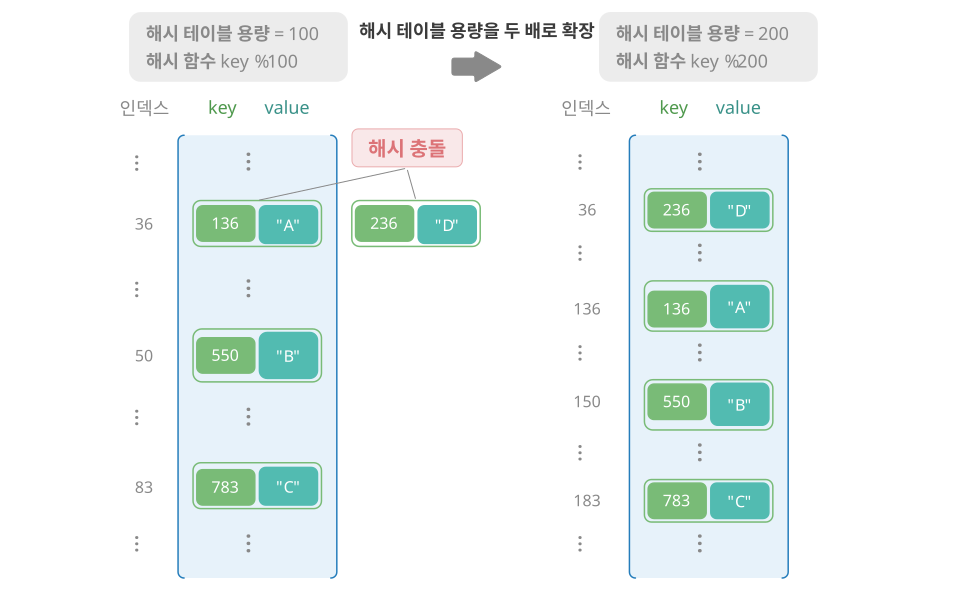

# 해시 테이블

<u>해시 테이블(hash table)</u>은 <u>해시 표</u>라고도 하며, 키 `key`와 값 `value` 사이의 대응 관계를 만들어 원소를 효율적으로 조회한다. 구체적으로 키 `key`를 입력하면 해당 값 `value`를 $O(1)$ 시간에 얻을 수 있다.

아래 그림과 같이 학생 $n$명에게 각각 ‘이름’과 ‘학번’이라는 두 데이터가 있다고 하자. ‘학번을 입력하면 해당 이름을 반환하는’ 조회 기능을 구현하려면 그림의 해시 테이블을 사용할 수 있다.


해시 테이블 외에 배열과 연결 리스트로도 조회 기능을 구현할 수 있다. 효율 비교는 아래 표와 같다.

- **원소 추가**: 배열(연결 리스트)의 끝에 원소를 추가하면 되므로 $O(1)$ 시간이 걸린다.
- **원소 조회**: 배열(연결 리스트)이 정렬되어 있지 않으므로 모든 원소를 순회해야 하며 $O(n)$ 시간이 걸린다.
- **원소 삭제**: 먼저 원소를 찾은 뒤 배열(연결 리스트)에서 삭제해야 하므로 $O(n)$ 시간이 걸린다.

<p align="center"> 표 <id> &nbsp; 원소 조회 효율 비교 </p>

|          | 배열   | 연결 리스트   | 해시 테이블 |
| -------- | ------ | ------ | ------ |
| 원소 탐색 | $O(n)$ | $O(n)$ | $O(1)$ |
| 원소 추가 | $O(1)$ | $O(1)$ | $O(1)$ |
| 원소 삭제 | $O(n)$ | $O(n)$ | $O(1)$ |

이처럼 **해시 테이블에서는 삽입, 삭제, 탐색, 갱신의 시간 복잡도가 모두 $O(1)$**로 매우 효율적이다.

## 해시 테이블의 기본 연산

대표적인 연산에는 초기화, 조회, 키-값 쌍 추가와 삭제 등이 있다. 예제 코드는 다음과 같다.

```snippet
hash_map_operations
```

??? pythontutor "코드 시각화"

    @tutor hash_map_operations_tutor

해시 테이블을 순회하는 대표적인 방식은 키-값 쌍 순회, 키 순회, 값 순회의 세 가지다. 예제 코드는 다음과 같다.

```snippet
hash_map_traversal
```

??? pythontutor "코드 시각화"

    @tutor hash_map_traversal_tutor

## 간단한 해시 테이블 구현

먼저 가장 간단한 경우로 **배열 하나만 사용하여 해시 테이블을 구현해 보자**. 해시 테이블에서는 배열의 각 자리를 <u>버킷(bucket)</u>이라고 하며, 버킷마다 키-값 쌍 하나를 저장할 수 있다. 따라서 조회 연산은 `key`에 해당하는 버킷을 찾고 그 안에서 `value`를 얻는 것이다.

그렇다면 `key`로 해당 버킷을 어떻게 찾을까? 이를 위해 <u>해시 함수(hash function)</u>를 사용한다. 해시 함수는 큰 입력 공간을 작은 출력 공간에 매핑한다. 해시 테이블에서 입력 공간은 모든 `key`이고, 출력 공간은 모든 버킷(배열 인덱스)이다. 즉, `key`를 입력하면 **해시 함수를 통해 그 키-값 쌍이 배열에 저장되는 위치를 얻을 수 있다**.

`key`를 입력했을 때 해시 함수의 계산 과정은 다음 두 단계로 나뉜다.

1. 어떤 해시 알고리즘 `hash()`로 해시값을 계산한다.
2. 해시값을 버킷 수(배열 길이) `capacity`로 나눈 나머지를 구하여 `key`에 해당하는 버킷(배열 인덱스) `index`를 얻는다.

```shell
index = hash(key) % capacity
```

그런 다음 `index`로 해시 테이블의 해당 버킷에 접근하여 `value`를 얻는다.

배열 길이가 `capacity = 100`이고 해시 알고리즘이 `hash(key) = key`이면, 해시 함수는 `key % 100`이다. 아래 그림은 학번을 `key`, 이름을 `value`로 삼아 해시 함수의 작동 원리를 보여 준다.


다음 코드는 간단한 해시 테이블을 구현한다. `key`와 `value`를 `Pair` 클래스로 묶어 키-값 쌍을 표현한다.

```src
[file]{array_hash_map}-[class]{array_hash_map}-[func]{}
```

## 해시 충돌과 용량 확장

해시 함수는 본질적으로 모든 `key`로 이루어진 입력 공간을 배열의 모든 인덱스로 이루어진 출력 공간에 매핑한다. 입력 공간은 대개 출력 공간보다 훨씬 크므로 **이론적으로 ‘여러 입력이 같은 출력에 대응하는’ 경우가 반드시 존재한다**.

앞의 해시 함수에서는 입력 `key`의 마지막 두 자리가 같으면 출력도 같다. 예를 들어 학번이 12836과 20336인 두 학생을 조회하면 다음과 같다.

```shell
12836 % 100 = 36
20336 % 100 = 36
```

아래 그림에서 두 학번이 같은 이름을 가리키는데, 이는 명백히 잘못되었다. 이처럼 여러 입력이 같은 출력에 대응하는 현상을 <u>해시 충돌(hash collision)</u>이라고 한다.


해시 테이블의 용량 $n$이 커질수록 여러 `key`가 같은 버킷에 들어갈 확률은 낮아지고 충돌도 줄어든다. 따라서 **해시 테이블의 용량을 늘려 해시 충돌을 줄일 수 있다**.

아래 그림에서 확장 전에는 키-값 쌍 `(136, A)`와 `(236, D)`가 충돌하지만 확장 후에는 충돌이 사라진다.



배열 확장과 마찬가지로 해시 테이블을 확장하려면 모든 키-값 쌍을 기존 테이블에서 새 테이블로 옮겨야 하므로 시간이 많이 든다. 또한 용량 `capacity`가 바뀌므로 해시 함수로 모든 키-값 쌍의 저장 위치를 다시 계산해야 하며, 이는 확장 비용을 더욱 늘린다. 따라서 프로그래밍 언어는 보통 충분히 큰 용량을 미리 확보하여 잦은 확장을 방지한다.

<u>적재율(load factor)</u>은 해시 테이블의 원소 수를 버킷 수로 나눈 값으로, 해시 충돌의 심각도를 측정하는 중요한 개념이다. **용량 확장을 시작하는 조건으로도 자주 사용된다**. 예를 들어 Java에서는 적재율이 $0.75$를 넘으면 해시 테이블의 용량을 기존의 $2$배로 늘린다.
