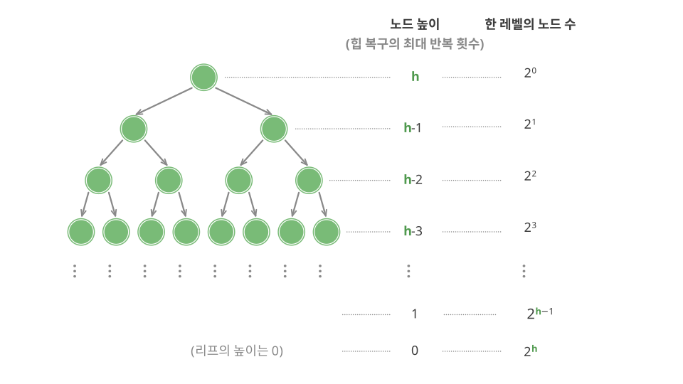

# 힙 구성 연산

리스트의 모든 원소로 힙을 만들고 싶을 때가 있다. 이 과정을 힙 구성 연산이라고 한다.

## 힙 삽입 연산을 이용한 구현

먼저 빈 힙을 만들고 리스트를 순회하며 원소를 하나씩 삽입한다. 각 원소를 힙의 맨 끝에 추가한 다음 그 원소부터 위로 올라가며 힙을 복구한다.

원소를 하나 삽입할 때마다 힙의 길이가 하나씩 늘어난다. 이진 트리에 위에서 아래로 차례로 노드가 추가되므로 힙은 위에서 아래로 만들어진다.

원소 수가 $n$이고 각 원소를 삽입하는 데 $O(\log{n})$ 시간이 걸리므로 이 방법으로 힙을 구성하는 시간 복잡도는 $O(n \log n)$이다.

## 순회하며 힙 복구하기

힙을 더 효율적으로 만드는 방법도 있다. 다음 두 단계로 진행한다.

1. 리스트의 모든 원소를 그대로 힙에 넣는다. 이때는 아직 힙의 성질을 만족한다고 할 수 없다.
2. 힙을 역순(레벨 순회 순서의 역순)으로 순회하면서 리프가 아닌 각 노드에서 위에서 아래로 힙을 복구한다.

**한 노드에서 힙을 복구하고 나면 그 노드를 루트로 하는 서브트리가 힙의 조건을 만족한다**. 역순으로 순회하기 때문에 힙은 아래에서 위로 만들어진다.

역순으로 순회하면 현재 노드 아래의 서브트리들은 이미 힙의 조건을 만족한다. 그래야 현재 노드에서 힙을 복구하는 연산이 제대로 동작한다.

**리프 노드는 자식이 없으므로 그 자체로 힙의 조건을 만족해 복구할 필요가 없다**. 다음 코드에서처럼 리프가 아닌 마지막 노드는 맨 끝 노드의 부모다. 이 부모부터 역순으로 순회하며 힙을 복구한다.

```src
[file]{my_heap}-[class]{max_heap}-[func]{__init__}
```

## 복잡도 분석

이제 두 번째 방법으로 힙을 구성하는 시간 복잡도를 구해 보자.

- 완전 이진 트리의 노드 수가 $n$이면 리프 노드 수는 $(n + 1) / 2$이다. 여기서 $/$는 나눈 뒤 소수점 이하를 버리는 연산이다. 따라서 힙을 복구해야 할 노드는 $n / 2$개다.
- 위에서 아래로 힙을 복구할 때 각 노드는 리프까지만 내려갈 수 있으므로 최대 반복 횟수는 이진 트리의 높이인 $\log n$이다.

두 값을 곱하면 힙 구성의 시간 복잡도는 $O(n \log n)$이다. **하지만 이 추정치는 정밀하지 않다. 이진 트리에서는 위쪽보다 아래쪽에 노드가 훨씬 많다는 점을 고려하지 않았기 때문이다**.

좀 더 정확하게 계산해 보자. 계산을 단순화하기 위해 노드 수가 $n$이고 높이가 $h$인 포화 이진 트리를 가정한다. 이 가정은 계산 결과의 타당성에 영향을 주지 않는다.



위 그림처럼 한 노드에서 아래로 힙을 복구할 때 최대 반복 횟수는 그 노드에서 리프까지의 거리, 즉 노드의 높이와 같다. 따라서 레벨마다 ‘노드 수 $\times$ 노드 높이’를 구해 더하면 **모든 노드에서 힙을 복구하는 반복 횟수의 합**을 얻는다.

$$
T(h) = 2^0h + 2^1(h-1) + 2^2(h-2) + \dots + 2^{(h-1)}\times1
$$

위 식은 학교에서 배운 수열의 성질로 정리할 수 있다. 먼저 $T(h)$에 $2$를 곱하면 다음과 같다.

$$
\begin{aligned}
T(h) & = 2^0h + 2^1(h-1) + 2^2(h-2) + \dots + 2^{h-1}\times1 \newline
2 T(h) & = 2^1h + 2^2(h-1) + 2^3(h-2) + \dots + 2^{h}\times1 \newline
\end{aligned}
$$

두 식의 항을 한 칸 어긋나게 맞춘 뒤 아래 식 $2 T(h)$에서 위 식 $T(h)$를 빼면 다음과 같다.

$$
2T(h) - T(h) = T(h) = -2^0h + 2^1 + 2^2 + \dots + 2^{h-1} + 2^h
$$

위 식에서 $T(h)$에 포함된 등비수열의 합을 합 공식으로 구하면 시간 복잡도는 다음과 같다.

$$
\begin{aligned}
T(h) & = 2 \frac{1 - 2^h}{1 - 2} - h \newline
& = 2^{h+1} - h - 2 \newline
& = O(2^h)
\end{aligned}
$$

높이 $h$인 포화 이진 트리의 노드 수는 $n = 2^{h+1} - 1$이므로 복잡도는 $O(2^h) = O(n)$이다. 즉 **입력 리스트로 힙을 구성하는 시간 복잡도는 $O(n)$으로 매우 효율적이다**.
