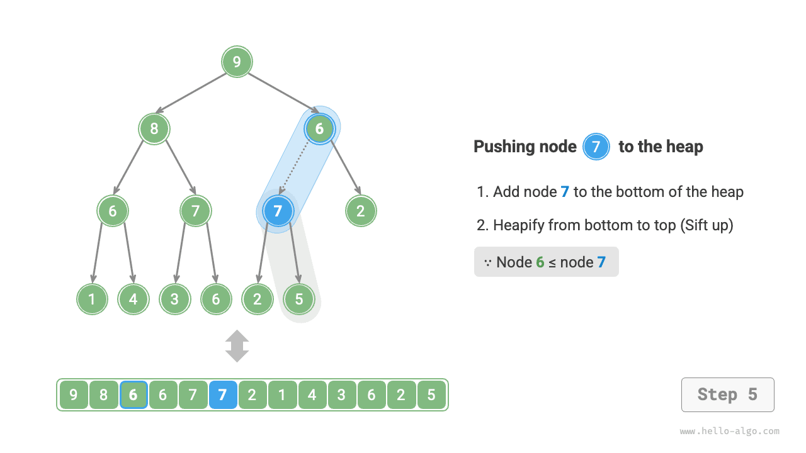
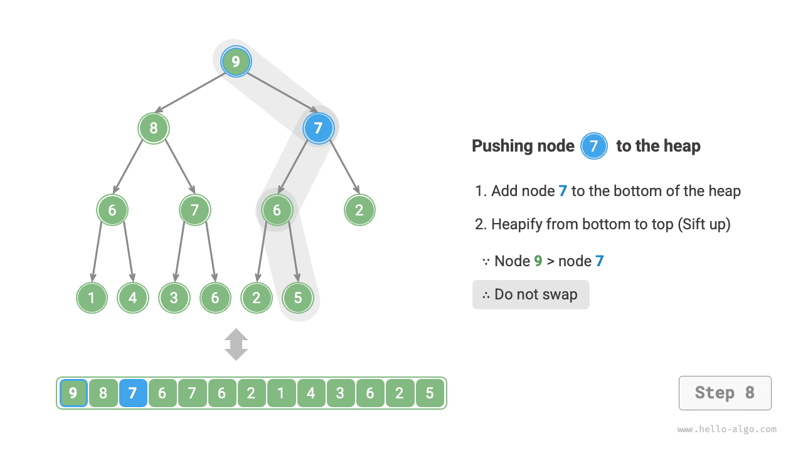
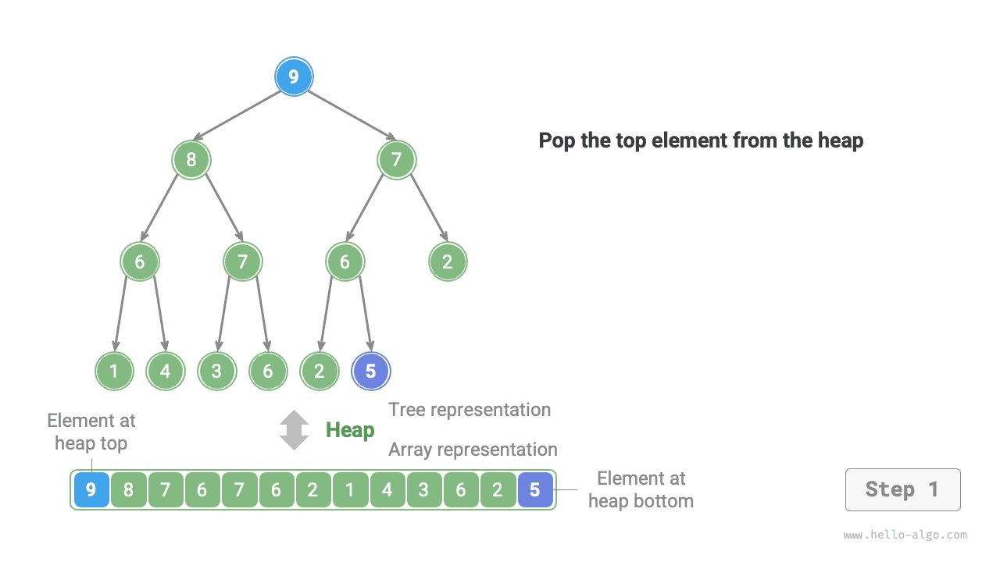
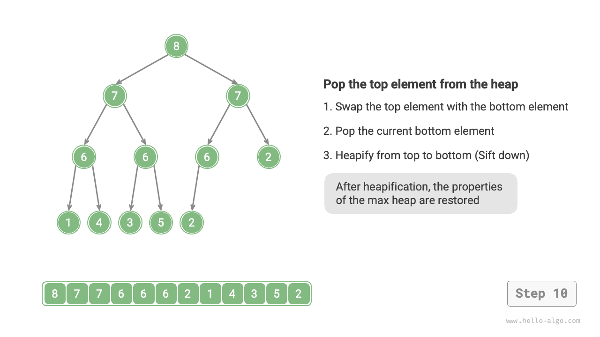

# 힙

<u>힙(heap)</u>은 특정 조건을 만족하는 완전 이진 트리로, 아래 그림과 같이 크게 두 종류로 나뉜다.

- <u>최소 힙(min heap)</u>: 모든 노드의 값이 자식 노드의 값보다 작거나 같다($\leq$).
- <u>최대 힙(max heap)</u>: 모든 노드의 값이 자식 노드의 값보다 크거나 같다($\geq$).


힙은 완전 이진 트리의 특수한 형태이므로 다음 성질을 가진다.

- 가장 아래 레벨은 왼쪽부터 노드가 채워지며, 나머지 레벨은 모두 가득 차 있다.
- 이진 트리의 루트 노드를 '힙의 루트', 가장 아래 레벨에서 맨 오른쪽에 있는 노드를 '힙의 끝'이라고 한다.
- 최대 힙(최소 힙)에서는 힙의 루트 원소(루트 노드)의 값이 가장 크다(작다).

## 힙의 주요 연산

많은 프로그래밍 언어에서 제공하는 것은 <u>우선순위 큐(priority queue)</u>라는 점을 알아 두자. 우선순위 큐는 우선순위에 따라 정렬되는 큐로 정의되는 추상 자료 구조다.

실제로 **힙은 보통 우선순위 큐를 구현하는 데 사용되며, 최대 힙은 원소를 큰 값부터 작은 값 순서로 꺼내는 우선순위 큐에 해당한다**. 사용하는 입장에서는 '우선순위 큐'와 '힙'을 동등한 자료 구조로 볼 수 있다. 따라서 이 책에서는 둘을 특별히 구분하지 않고 모두 '힙'이라고 한다.

힙의 주요 연산은 아래 표와 같다. 메서드 이름은 프로그래밍 언어에 따라 달라진다.

<p align="center"> 표 <id> &nbsp; 힙 연산의 효율 </p>

| 메서드 이름 | 설명 | 시간 복잡도 |
| ----------- | ------------------------------------------------ | ----------- |
| `push()`    | 힙에 원소 삽입 | $O(\log n)$ |
| `pop()`     | 힙의 루트 원소 꺼내기 | $O(\log n)$ |
| `peek()`    | 힙의 루트 원소에 접근(최대 / 최소 힙에서는 각각 최댓값 / 최솟값) | $O(1)$      |
| `size()`    | 힙의 원소 수 구하기 | $O(1)$      |
| `isEmpty()` | 힙이 비어 있는지 확인 | $O(1)$      |

실제 응용에서는 프로그래밍 언어가 제공하는 힙 클래스(또는 우선순위 큐 클래스)를 바로 사용할 수 있다.

정렬 알고리즘에서 '오름차순 정렬'과 '내림차순 정렬'을 선택하듯이, `flag`를 설정하거나 `Comparator`를 수정하여 '최소 힙'과 '최대 힙'을 전환할 수 있다. 코드는 다음과 같다.

=== "Python"

    ```python title="heap.py"
    # 최소 힙 초기화
    min_heap, flag = [], 1
    # 최대 힙 초기화
    max_heap, flag = [], -1

    # Python의 heapq 모듈은 기본적으로 최소 힙을 구현한다
    # 원소의 부호를 바꾼 뒤 삽입하면 대소 관계가 뒤집히므로 최대 힙을 구현할 수 있다
    # 이 예제에서 flag = 1이면 최소 힙, flag = -1이면 최대 힙에 해당한다

    # 힙에 원소 삽입
    heapq.heappush(max_heap, flag * 1)
    heapq.heappush(max_heap, flag * 3)
    heapq.heappush(max_heap, flag * 2)
    heapq.heappush(max_heap, flag * 5)
    heapq.heappush(max_heap, flag * 4)

    # 힙의 루트 원소 구하기
    peek: int = flag * max_heap[0] # 5

    # 힙의 루트 원소 꺼내기
    # 꺼낸 원소들은 큰 값부터 작은 값 순서로 나열된다
    val = flag * heapq.heappop(max_heap) # 5
    val = flag * heapq.heappop(max_heap) # 4
    val = flag * heapq.heappop(max_heap) # 3
    val = flag * heapq.heappop(max_heap) # 2
    val = flag * heapq.heappop(max_heap) # 1

    # 힙의 크기 구하기
    size: int = len(max_heap)

    # 힙이 비어 있는지 확인
    is_empty: bool = not max_heap

    # 리스트를 입력받아 힙 구성
    min_heap: list[int] = [1, 3, 2, 5, 4]
    heapq.heapify(min_heap)
    ```

=== "C++"

    ```cpp title="heap.cpp"
    /* 힙 초기화 */
    // 최소 힙 초기화
    priority_queue<int, vector<int>, greater<int>> minHeap;
    // 최대 힙 초기화
    priority_queue<int, vector<int>, less<int>> maxHeap;

    /* 힙에 원소 삽입 */
    maxHeap.push(1);
    maxHeap.push(3);
    maxHeap.push(2);
    maxHeap.push(5);
    maxHeap.push(4);

    /* 힙의 루트 원소 구하기 */
    int peek = maxHeap.top(); // 5

    /* 힙의 루트 원소 꺼내기 */
    // 꺼낸 원소들은 큰 값부터 작은 값 순서로 나열된다
    maxHeap.pop(); // 5
    maxHeap.pop(); // 4
    maxHeap.pop(); // 3
    maxHeap.pop(); // 2
    maxHeap.pop(); // 1

    /* 힙의 크기 구하기 */
    int size = maxHeap.size();

    /* 힙이 비어 있는지 확인 */
    bool isEmpty = maxHeap.empty();

    /* 리스트를 입력받아 힙 구성 */
    vector<int> input{1, 3, 2, 5, 4};
    priority_queue<int, vector<int>, greater<int>> minHeap(input.begin(), input.end());
    ```

=== "Java"

    ```java title="heap.java"
    /* 힙 초기화 */
    // 최소 힙 초기화
    Queue<Integer> minHeap = new PriorityQueue<>();
    // 최대 힙 초기화(lambda 식으로 Comparator를 수정하면 된다)
    Queue<Integer> maxHeap = new PriorityQueue<>((a, b) -> b - a);

    /* 힙에 원소 삽입 */
    maxHeap.offer(1);
    maxHeap.offer(3);
    maxHeap.offer(2);
    maxHeap.offer(5);
    maxHeap.offer(4);

    /* 힙의 루트 원소 구하기 */
    int peek = maxHeap.peek(); // 5

    /* 힙의 루트 원소 꺼내기 */
    // 꺼낸 원소들은 큰 값부터 작은 값 순서로 나열된다
    peek = maxHeap.poll(); // 5
    peek = maxHeap.poll(); // 4
    peek = maxHeap.poll(); // 3
    peek = maxHeap.poll(); // 2
    peek = maxHeap.poll(); // 1

    /* 힙의 크기 구하기 */
    int size = maxHeap.size();

    /* 힙이 비어 있는지 확인 */
    boolean isEmpty = maxHeap.isEmpty();

    /* 리스트를 입력받아 힙 구성 */
    minHeap = new PriorityQueue<>(Arrays.asList(1, 3, 2, 5, 4));
    ```

=== "C#"

    ```csharp title="heap.cs"
    /* 힙 초기화 */
    // 최소 힙 초기화
    PriorityQueue<int, int> minHeap = new();
    // 최대 힙 초기화(lambda 식으로 Comparer를 수정하면 된다)
    PriorityQueue<int, int> maxHeap = new(Comparer<int>.Create((x, y) => y.CompareTo(x)));

    /* 힙에 원소 삽입 */
    maxHeap.Enqueue(1, 1);
    maxHeap.Enqueue(3, 3);
    maxHeap.Enqueue(2, 2);
    maxHeap.Enqueue(5, 5);
    maxHeap.Enqueue(4, 4);

    /* 힙의 루트 원소 구하기 */
    int peek = maxHeap.Peek();//5

    /* 힙의 루트 원소 꺼내기 */
    // 꺼낸 원소들은 큰 값부터 작은 값 순서로 나열된다
    peek = maxHeap.Dequeue();  // 5
    peek = maxHeap.Dequeue();  // 4
    peek = maxHeap.Dequeue();  // 3
    peek = maxHeap.Dequeue();  // 2
    peek = maxHeap.Dequeue();  // 1

    /* 힙의 크기 구하기 */
    int size = maxHeap.Count;

    /* 힙이 비어 있는지 확인 */
    bool isEmpty = maxHeap.Count == 0;

    /* 리스트를 입력받아 힙 구성 */
    minHeap = new PriorityQueue<int, int>([(1, 1), (3, 3), (2, 2), (5, 5), (4, 4)]);
    ```

=== "Go"

    ```go title="heap.go"
    // Go에서는 heap.Interface를 구현하여 정수 최대 힙을 만들 수 있다
    // heap.Interface를 구현하려면 sort.Interface도 구현해야 한다
    type intHeap []any

    // Push는 heap.Interface의 메서드로, 힙에 원소를 삽입한다
    func (h *intHeap) Push(x any) {
        // Push와 Pop은 포인터 리시버(pointer receiver)를 매개변수로 사용한다
        // 슬라이스의 내용뿐 아니라 길이도 수정하기 때문이다.
        *h = append(*h, x.(int))
    }

    // Pop은 heap.Interface의 메서드로, 힙의 루트 원소를 꺼낸다
    func (h *intHeap) Pop() any {
        // 꺼낼 원소는 맨 끝에 저장되어 있다
        last := (*h)[len(*h)-1]
        *h = (*h)[:len(*h)-1]
        return last
    }

    // Len은 sort.Interface의 메서드다
    func (h *intHeap) Len() int {
        return len(*h)
    }

    // Less는 sort.Interface의 메서드다
    func (h *intHeap) Less(i, j int) bool {
        // 최소 힙을 구현하려면 부등호를 <로 바꿔야 한다
        return (*h)[i].(int) > (*h)[j].(int)
    }

    // Swap은 sort.Interface의 메서드다
    func (h *intHeap) Swap(i, j int) {
        (*h)[i], (*h)[j] = (*h)[j], (*h)[i]
    }

    // Top은 힙의 루트 원소를 구한다
    func (h *intHeap) Top() any {
        return (*h)[0]
    }

    /* 실행 코드 */
    func TestHeap(t *testing.T) {
        /* 힙 초기화 */
        // 최대 힙 초기화
        maxHeap := &intHeap{}
        heap.Init(maxHeap)
        /* 힙에 원소 삽입 */
        // heap.Interface의 메서드를 호출하여 원소를 추가한다
        heap.Push(maxHeap, 1)
        heap.Push(maxHeap, 3)
        heap.Push(maxHeap, 2)
        heap.Push(maxHeap, 4)
        heap.Push(maxHeap, 5)

        /* 힙의 루트 원소 구하기 */
        top := maxHeap.Top()
        fmt.Printf("힙의 루트 원소: %d\n", top)

        /* 힙의 루트 원소 꺼내기 */
        // heap.Interface의 메서드를 호출하여 원소를 제거한다
        heap.Pop(maxHeap) // 5
        heap.Pop(maxHeap) // 4
        heap.Pop(maxHeap) // 3
        heap.Pop(maxHeap) // 2
        heap.Pop(maxHeap) // 1

        /* 힙의 크기 구하기 */
        size := len(*maxHeap)
        fmt.Printf("힙의 원소 수: %d\n", size)

        /* 힙이 비어 있는지 확인 */
        isEmpty := len(*maxHeap) == 0
        fmt.Printf("힙이 비어 있는가: %t\n", isEmpty)
    }
    ```

=== "Swift"

    ```swift title="heap.swift"
    /* 힙 초기화 */
    // Swift의 Heap 타입은 최대 힙과 최소 힙을 모두 지원하며, swift-collections를 가져와야 한다
    var heap = Heap<Int>()

    /* 힙에 원소 삽입 */
    heap.insert(1)
    heap.insert(3)
    heap.insert(2)
    heap.insert(5)
    heap.insert(4)

    /* 힙의 루트 원소 구하기 */
    var peek = heap.max()!

    /* 힙의 루트 원소 꺼내기 */
    peek = heap.removeMax() // 5
    peek = heap.removeMax() // 4
    peek = heap.removeMax() // 3
    peek = heap.removeMax() // 2
    peek = heap.removeMax() // 1

    /* 힙의 크기 구하기 */
    let size = heap.count

    /* 힙이 비어 있는지 확인 */
    let isEmpty = heap.isEmpty

    /* 리스트를 입력받아 힙 구성 */
    let heap2 = Heap([1, 3, 2, 5, 4])
    ```

=== "JS"

    ```javascript title="heap.js"
    // JavaScript는 내장 Heap 클래스를 제공하지 않는다
    ```

=== "TS"

    ```typescript title="heap.ts"
    // TypeScript는 내장 Heap 클래스를 제공하지 않는다
    ```

=== "Dart"

    ```dart title="heap.dart"
    // Dart는 내장 Heap 클래스를 제공하지 않는다
    ```

=== "Rust"

    ```rust title="heap.rs"
    use std::collections::BinaryHeap;
    use std::cmp::Reverse;

    /* 힙 초기화 */
    // 최소 힙 초기화
    let mut min_heap = BinaryHeap::<Reverse<i32>>::new();
    // 최대 힙 초기화
    let mut max_heap = BinaryHeap::new();

    /* 힙에 원소 삽입 */
    max_heap.push(1);
    max_heap.push(3);
    max_heap.push(2);
    max_heap.push(5);
    max_heap.push(4);

    /* 힙의 루트 원소 구하기 */
    let peek = max_heap.peek().unwrap();  // 5

    /* 힙의 루트 원소 꺼내기 */
    // 꺼낸 원소들은 큰 값부터 작은 값 순서로 나열된다
    let peek = max_heap.pop().unwrap();   // 5
    let peek = max_heap.pop().unwrap();   // 4
    let peek = max_heap.pop().unwrap();   // 3
    let peek = max_heap.pop().unwrap();   // 2
    let peek = max_heap.pop().unwrap();   // 1

    /* 힙의 크기 구하기 */
    let size = max_heap.len();

    /* 힙이 비어 있는지 확인 */
    let is_empty = max_heap.is_empty();

    /* 리스트를 입력받아 힙 구성 */
    let min_heap = BinaryHeap::from(vec![Reverse(1), Reverse(3), Reverse(2), Reverse(5), Reverse(4)]);
    ```

=== "C"

    ```c title="heap.c"
    // C는 내장 Heap 클래스를 제공하지 않는다
    ```

=== "Kotlin"

    ```kotlin title="heap.kt"
    /* 힙 초기화 */
    // 최소 힙 초기화
    var minHeap = PriorityQueue<Int>()
    // 최대 힙 초기화(lambda 식으로 Comparator를 수정하면 된다)
    val maxHeap = PriorityQueue { a: Int, b: Int -> b - a }

    /* 힙에 원소 삽입 */
    maxHeap.offer(1)
    maxHeap.offer(3)
    maxHeap.offer(2)
    maxHeap.offer(5)
    maxHeap.offer(4)

    /* 힙의 루트 원소 구하기 */
    var peek = maxHeap.peek() // 5

    /* 힙의 루트 원소 꺼내기 */
    // 꺼낸 원소들은 큰 값부터 작은 값 순서로 나열된다
    peek = maxHeap.poll() // 5
    peek = maxHeap.poll() // 4
    peek = maxHeap.poll() // 3
    peek = maxHeap.poll() // 2
    peek = maxHeap.poll() // 1

    /* 힙의 크기 구하기 */
    val size = maxHeap.size

    /* 힙이 비어 있는지 확인 */
    val isEmpty = maxHeap.isEmpty()

    /* 리스트를 입력받아 힙 구성 */
    minHeap = PriorityQueue(mutableListOf(1, 3, 2, 5, 4))
    ```

=== "Ruby"

    ```ruby title="heap.rb"
    # Ruby는 내장 Heap 클래스를 제공하지 않는다
    ```

??? pythontutor "실행 시각화"

    https://pythontutor.com/render.html#code=import%20heapq%0A%0A%22%22%22%EC%8B%A4%ED%96%89%20%EC%BD%94%EB%93%9C%22%22%22%0Aif%20__name__%20%3D%3D%20%22__main__%22%3A%0A%20%20%20%20%23%20%EC%B5%9C%EC%86%8C%20%ED%9E%99%20%EC%B4%88%EA%B8%B0%ED%99%94%0A%20%20%20%20min_heap%2C%20flag%20%3D%20%5B%5D%2C%201%0A%20%20%20%20%23%20%EC%B5%9C%EB%8C%80%20%ED%9E%99%20%EC%B4%88%EA%B8%B0%ED%99%94%0A%20%20%20%20max_heap%2C%20flag%20%3D%20%5B%5D%2C%20-1%0A%20%20%20%20%0A%20%20%20%20%23%20Python%EC%9D%98%20heapq%20%EB%AA%A8%EB%93%88%EC%9D%80%20%EA%B8%B0%EB%B3%B8%EC%A0%81%EC%9C%BC%EB%A1%9C%20%EC%B5%9C%EC%86%8C%20%ED%9E%99%EC%9D%84%20%EA%B5%AC%ED%98%84%ED%95%9C%EB%8B%A4%0A%20%20%20%20%23%20%EC%9B%90%EC%86%8C%EC%9D%98%20%EB%B6%80%ED%98%B8%EB%A5%BC%20%EB%B0%94%EA%BE%BC%20%EB%92%A4%20%EC%82%BD%EC%9E%85%ED%95%98%EB%A9%B4%20%EB%8C%80%EC%86%8C%20%EA%B4%80%EA%B3%84%EA%B0%80%20%EB%92%A4%EC%A7%91%ED%9E%88%EB%AF%80%EB%A1%9C%20%EC%B5%9C%EB%8C%80%20%ED%9E%99%EC%9D%84%20%EA%B5%AC%ED%98%84%ED%95%A0%20%EC%88%98%20%EC%9E%88%EB%8B%A4%0A%20%20%20%20%23%20%EC%9D%B4%20%EC%98%88%EC%A0%9C%EC%97%90%EC%84%9C%20flag%20%3D%201%EC%9D%B4%EB%A9%B4%20%EC%B5%9C%EC%86%8C%20%ED%9E%99%2C%20flag%20%3D%20-1%EC%9D%B4%EB%A9%B4%20%EC%B5%9C%EB%8C%80%20%ED%9E%99%EC%97%90%20%ED%95%B4%EB%8B%B9%ED%95%9C%EB%8B%A4%0A%20%20%20%20%0A%20%20%20%20%23%20%ED%9E%99%EC%97%90%20%EC%9B%90%EC%86%8C%20%EC%82%BD%EC%9E%85%0A%20%20%20%20heapq.heappush%28max_heap%2C%20flag%20%2A%201%29%0A%20%20%20%20heapq.heappush%28max_heap%2C%20flag%20%2A%203%29%0A%20%20%20%20heapq.heappush%28max_heap%2C%20flag%20%2A%202%29%0A%20%20%20%20heapq.heappush%28max_heap%2C%20flag%20%2A%205%29%0A%20%20%20%20heapq.heappush%28max_heap%2C%20flag%20%2A%204%29%0A%20%20%20%20%0A%20%20%20%20%23%20%ED%9E%99%EC%9D%98%20%EB%A3%A8%ED%8A%B8%20%EC%9B%90%EC%86%8C%20%EA%B5%AC%ED%95%98%EA%B8%B0%0A%20%20%20%20peek%20%3D%20flag%20%2A%20max_heap%5B0%5D%20%23%205%0A%20%20%20%20%0A%20%20%20%20%23%20%ED%9E%99%EC%9D%98%20%EB%A3%A8%ED%8A%B8%20%EC%9B%90%EC%86%8C%20%EA%BA%BC%EB%82%B4%EA%B8%B0%0A%20%20%20%20%23%20%EA%BA%BC%EB%82%B8%20%EC%9B%90%EC%86%8C%EB%93%A4%EC%9D%80%20%ED%81%B0%20%EA%B0%92%EB%B6%80%ED%84%B0%20%EC%9E%91%EC%9D%80%20%EA%B0%92%20%EC%88%9C%EC%84%9C%EB%A1%9C%20%EB%82%98%EC%97%B4%EB%90%9C%EB%8B%A4%0A%20%20%20%20val%20%3D%20flag%20%2A%20heapq.heappop%28max_heap%29%20%23%205%0A%20%20%20%20val%20%3D%20flag%20%2A%20heapq.heappop%28max_heap%29%20%23%204%0A%20%20%20%20val%20%3D%20flag%20%2A%20heapq.heappop%28max_heap%29%20%23%203%0A%20%20%20%20val%20%3D%20flag%20%2A%20heapq.heappop%28max_heap%29%20%23%202%0A%20%20%20%20val%20%3D%20flag%20%2A%20heapq.heappop%28max_heap%29%20%23%201%0A%20%20%20%20%0A%20%20%20%20%23%20%ED%9E%99%EC%9D%98%20%ED%81%AC%EA%B8%B0%20%EA%B5%AC%ED%95%98%EA%B8%B0%0A%20%20%20%20size%20%3D%20len%28max_heap%29%0A%20%20%20%20%0A%20%20%20%20%23%20%ED%9E%99%EC%9D%B4%20%EB%B9%84%EC%96%B4%20%EC%9E%88%EB%8A%94%EC%A7%80%20%ED%99%95%EC%9D%B8%0A%20%20%20%20is_empty%20%3D%20not%20max_heap%0A%20%20%20%20%0A%20%20%20%20%23%20%EB%A6%AC%EC%8A%A4%ED%8A%B8%EB%A5%BC%20%EC%9E%85%EB%A0%A5%EB%B0%9B%EC%95%84%20%ED%9E%99%20%EA%B5%AC%EC%84%B1%0A%20%20%20%20min_heap%20%3D%20%5B1%2C%203%2C%202%2C%205%2C%204%5D%0A%20%20%20%20heapq.heapify%28min_heap%29&cumulative=false&curInstr=3&heapPrimitives=nevernest&mode=display&origin=opt-frontend.js&py=311&rawInputLstJSON=%5B%5D&textReferences=false

## 힙의 구현

아래에서는 최대 힙을 구현한다. 이를 최소 힙으로 바꾸려면 모든 대소 비교 조건을 반대로 바꾸면 된다(예를 들어 $\geq$를 $\leq$로 바꾼다). 관심 있는 독자는 직접 구현해 보자.

### 힙의 저장과 표현

'이진 트리' 장에서 살펴보았듯이 완전 이진 트리는 배열로 표현하기에 매우 적합하다. 힙은 완전 이진 트리이므로 **배열을 사용하여 힙을 저장한다**.

배열로 이진 트리를 표현할 때 원소는 노드의 값을, 인덱스는 이진 트리에서 노드의 위치를 나타낸다. **노드 포인터는 인덱스 매핑 공식으로 구현한다**.

아래 그림과 같이 인덱스 $i$가 주어지면 왼쪽 자식 노드의 인덱스는 $2i + 1$, 오른쪽 자식 노드의 인덱스는 $2i + 2$, 부모 노드의 인덱스는 $(i - 1) / 2$(내림 정수 나눗셈)이다. 인덱스가 범위를 벗어나면 빈 노드이거나 노드가 존재하지 않는다는 뜻이다.


나중에 편리하게 사용할 수 있도록 인덱스 매핑 공식을 함수로 만들 수 있다.

```src
[file]{my_heap}-[class]{max_heap}-[func]{parent}
```

### 힙의 루트 원소에 접근

힙의 루트 원소는 이진 트리의 루트 노드, 즉 리스트의 첫 번째 원소다.

```src
[file]{my_heap}-[class]{max_heap}-[func]{peek}
```

### 힙에 원소 삽입

원소 `val`이 주어지면 먼저 힙의 끝에 추가한다. 추가한 `val`이 힙의 다른 원소보다 클 수 있으므로, 힙의 성립 조건이 깨질 수 있다. **따라서 삽입한 노드에서 루트 노드까지의 경로에 있는 노드들을 조정해야 한다**. 이 연산을 <u>힙 재정렬(heapify)</u>이라고 한다.

삽입한 노드부터 **아래에서 위로 힙을 재정렬**해 보자. 아래 그림과 같이 삽입한 노드의 값과 부모 노드의 값을 비교하여 삽입한 노드가 더 크면 서로 바꾼다. 이 작업을 반복하여 아래에서 위로 힙의 노드들을 조정하고, 루트 노드를 지나거나 바꿀 필요가 없는 노드를 만나면 종료한다.

=== "<1>"
    

=== "<2>"
    

=== "<3>"
    

=== "<4>"
    

=== "<5>"
    

=== "<6>"
    

=== "<7>"
    

=== "<8>"
    

=== "<9>"
    

전체 노드 수가 $n$이면 트리의 높이는 $O(\log n)$이다. 따라서 힙 재정렬의 반복 횟수는 최대 $O(\log n)$이며, **힙에 원소를 삽입하는 연산의 시간 복잡도는 $O(\log n)$**이다. 코드는 다음과 같다.

```src
[file]{my_heap}-[class]{max_heap}-[func]{sift_up}
```

### 힙의 루트 원소 꺼내기

힙의 루트 원소는 이진 트리의 루트 노드, 즉 리스트의 첫 번째 원소다. 리스트에서 첫 번째 원소를 바로 삭제하면 이진 트리의 모든 노드 인덱스가 바뀌어, 이후 힙 재정렬로 복구하기가 어려워진다. 원소 인덱스의 변화를 최소화하기 위해 다음 절차를 사용한다.

1. 힙의 루트 원소와 끝 원소를 교환한다(루트 노드와 맨 오른쪽 리프 노드를 교환한다).
2. 교환 후 리스트에서 힙의 끝 원소를 삭제한다(이미 교환했으므로 실제로 삭제되는 것은 원래의 루트 원소다).
3. 루트 노드부터 **위에서 아래로 힙을 재정렬**한다.

아래 그림과 같이 **'위에서 아래로 힙 재정렬'은 '아래에서 위로 힙 재정렬'과 진행 방향이 반대다**. 루트 노드의 값을 두 자식 노드의 값과 비교하여, 더 큰 값을 가진 자식 노드와 루트 노드를 교환한다. 이 작업을 반복하며 리프 노드를 지나거나 교환할 필요가 없는 노드를 만나면 종료한다.

=== "<1>"
    

=== "<2>"
    

=== "<3>"
    

=== "<4>"
    

=== "<5>"
    

=== "<6>"
    

=== "<7>"
    

=== "<8>"
    

=== "<9>"
    

=== "<10>"
    

원소 삽입과 마찬가지로 힙의 루트 원소를 꺼내는 연산의 시간 복잡도도 $O(\log n)$이다. 코드는 다음과 같다.

```src
[file]{my_heap}-[class]{max_heap}-[func]{sift_down}
```

## 힙의 주요 응용

- **우선순위 큐**: 힙은 우선순위 큐를 구현할 때 가장 먼저 고려하는 자료 구조다. 삽입과 꺼내기 연산의 시간 복잡도는 모두 $O(\log n)$이고, 힙 구성 연산은 $O(n)$으로 모두 매우 효율적이다.
- **힙 정렬**: 데이터가 주어지면 이를 이용해 힙을 만든 뒤 원소를 계속 꺼내어 정렬된 데이터를 얻을 수 있다. 다만 힙 정렬은 보통 더 간결한 방법으로 구현한다. 자세한 내용은 '힙 정렬' 절을 참고하자.
- **가장 큰 $k$ 개 원소 구하기**: 대표적인 알고리즘 문제이자 흔한 응용 사례다. 예를 들어 인기 상위 10개 뉴스를 웨이보의 인기 검색어로 선정하거나, 판매량 상위 10개 상품을 고를 때 사용할 수 있다.
