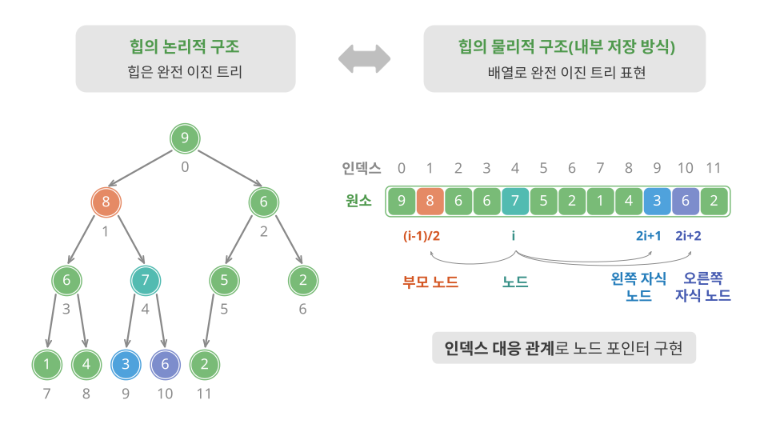
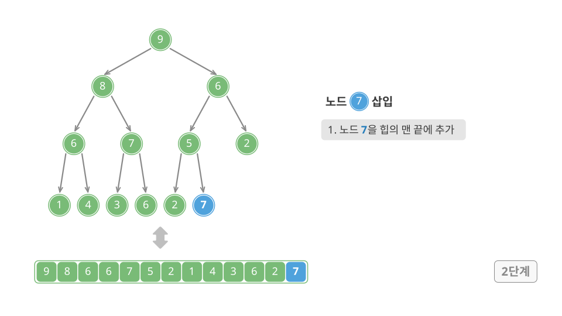
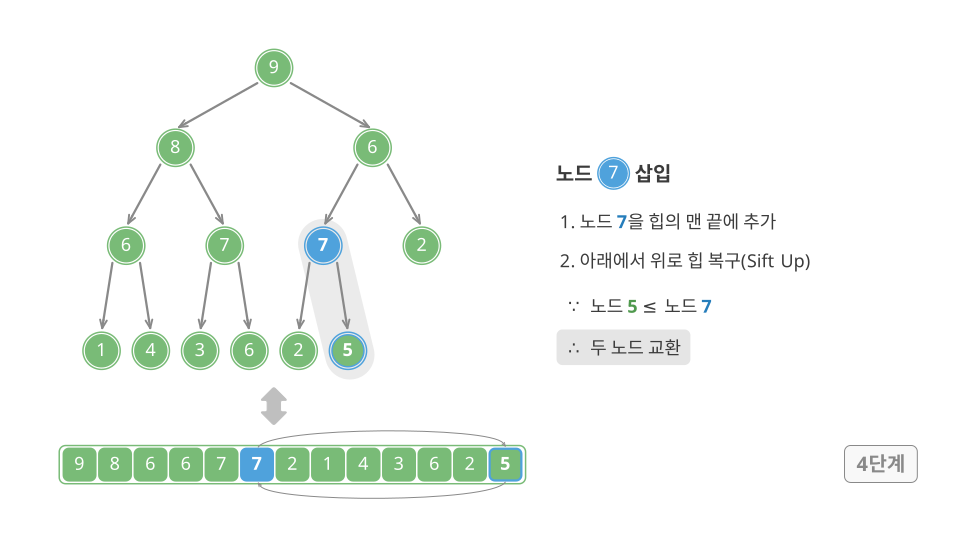
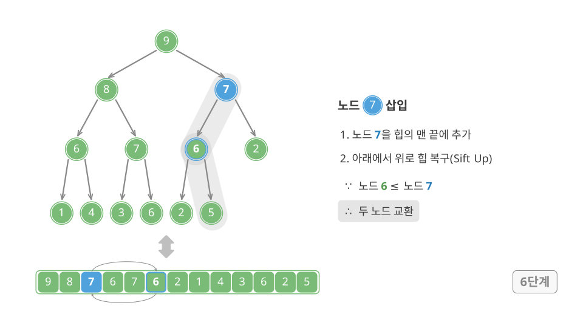
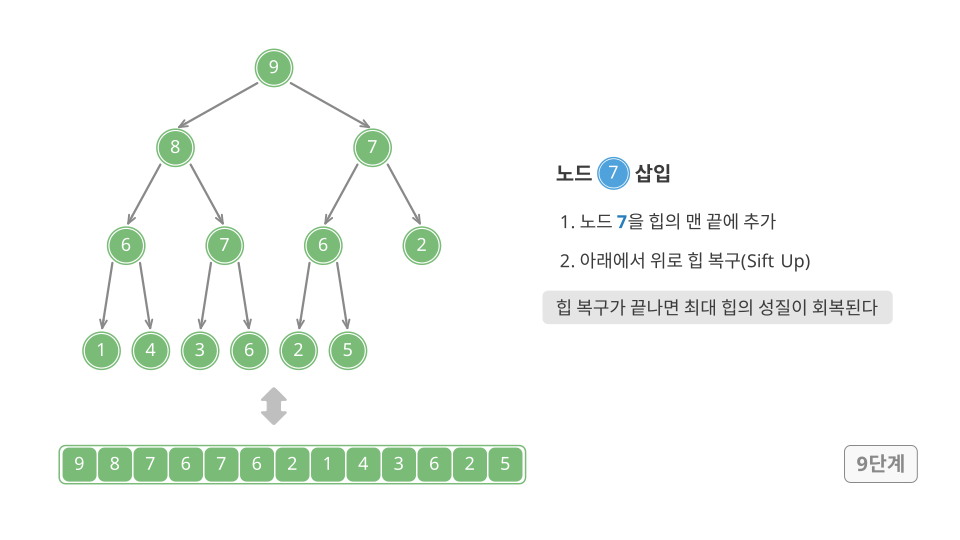
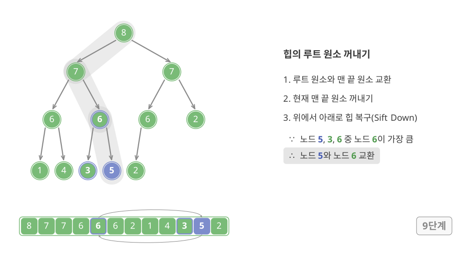

# 8.1 &nbsp; 힙

<u>힙(heap)</u>은 특정 조건을 만족하는 완전 이진 트리다. 아래 그림(8-1)과 같이 크게 두 종류로 나뉜다.

- <u>최소 힙(min heap)</u>: 모든 노드의 값 $\leq$ 그 자식 노드의 값.
- <u>최대 힙(max heap)</u>: 모든 노드의 값 $\geq$ 그 자식 노드의 값.

{ class="animation-figure" }

<p align="center"> 그림 8-1 &nbsp; 최소 힙과 최대 힙 </p>

힙은 완전 이진 트리의 특수한 경우로 다음과 같은 성질을 갖는다.

- 마지막 레벨은 왼쪽부터 채우고 나머지 레벨은 모두 채운다.
- 이진 트리의 루트 노드를 힙의 루트라 하고, 마지막 레벨에서 가장 오른쪽에 있는 노드를 힙의 맨 끝이라 한다.
- 최대 힙에서는 루트 원소(루트 노드)의 값이 최댓값이고, 최소 힙에서는 최솟값이다.

## 8.1.1 &nbsp; 힙의 주요 연산

여러 프로그래밍 언어가 제공하는 것은 <u>우선순위 큐(priority queue)</u>다. 이는 우선순위에 따라 원소를 꺼내는 큐로 정의되는 추상 자료 구조다.

**우선순위 큐는 보통 힙으로 구현하며, 최대 힙은 값이 큰 원소부터 꺼내는 우선순위 큐에 해당한다**. 사용하는 입장에서는 우선순위 큐와 힙을 동등한 자료 구조로 볼 수 있다. 따라서 이 책에서는 둘을 따로 구분하지 않고 힙이라 부른다.

힙의 주요 연산은 아래 표(8-1)와 같다. 실제 메서드 이름은 프로그래밍 언어에 따라 다르다.

<p align="center"> 표 8-1 &nbsp; 힙 연산의 효율 </p>

<div class="center-table" markdown>

| 메서드 이름      | 설명                                             | 시간 복잡도  |
| ----------- | ------------------------------------------------ | ----------- |
| `push()`    | 힙에 원소 삽입                                         | $O(\log n)$ |
| `pop()`     | 힙의 루트 원소 꺼내기                                     | $O(\log n)$ |
| `peek()`    | 힙의 루트 원소 조회(최대 힙에서는 최댓값, 최소 힙에서는 최솟값) | $O(1)$      |
| `size()`    | 힙의 원소 수 구하기                                 | $O(1)$      |
| `isEmpty()` | 힙이 비었는지 확인                                   | $O(1)$      |

</div>

실제로는 프로그래밍 언어가 제공하는 힙 클래스(또는 우선순위 큐 클래스)를 바로 사용할 수 있다.

정렬 알고리즘에서 오름차순과 내림차순을 바꾸듯이 `flag`를 설정하거나 `Comparator`를 바꾸어 최소 힙과 최대 힙을 전환할 수 있다. 코드는 다음과 같다.

=== "Python"

    ```python title="heap.py"
    # 최소 힙 초기화
    min_heap, flag = [], 1
    # 최대 힙 초기화
    max_heap, flag = [], -1

    # Python의 heapq 모듈은 기본적으로 최소 힙을 구현함
    # 원소의 부호를 바꿔 넣으면 대소 관계가 뒤집혀 최대 힙을 구현할 수 있음
    # 이 예제에서 flag = 1은 최소 힙, flag = -1은 최대 힙에 해당

    # 힙에 원소 삽입
    heapq.heappush(max_heap, flag * 1)
    heapq.heappush(max_heap, flag * 3)
    heapq.heappush(max_heap, flag * 2)
    heapq.heappush(max_heap, flag * 5)
    heapq.heappush(max_heap, flag * 4)

    # 힙의 루트 원소 구하기
    peek: int = flag * max_heap[0]  # 5

    # 힙의 루트 원소 꺼내기
    # 힙에서 꺼낸 원소는 내림차순 수열을 이룸
    val = flag * heapq.heappop(max_heap)  # 5
    val = flag * heapq.heappop(max_heap)  # 4
    val = flag * heapq.heappop(max_heap)  # 3
    val = flag * heapq.heappop(max_heap)  # 2
    val = flag * heapq.heappop(max_heap)  # 1

    # 힙 크기 구하기
    size: int = len(max_heap)

    # 힙이 비었는지 확인
    is_empty: bool = not max_heap

    # 입력 리스트로 힙 구성
    # 시간 복잡도는 O(nlogn)이 아니라 O(n)
    min_heap: list[int] = [1, 3, 2, 5, 4]
    heapq.heapify(min_heap)
    ```

=== "C++"

    ```cpp title="heap.cpp"
    /* 힙 초기화 */
    // 최소 힙 초기화
    priority_queue<int, vector<int>, greater<int>> minHeap;
    // 최대 힙 초기화
    priority_queue<int, vector<int>, less<int>> maxHeap;

    /* 힙에 원소 삽입 */
    maxHeap.push(1);
    maxHeap.push(3);
    maxHeap.push(2);
    maxHeap.push(5);
    maxHeap.push(4);

    /* 힙의 루트 원소 구하기 */
    int peek = maxHeap.top(); // 5

    /* 힙의 루트 원소 꺼내기 */
    // 힙에서 꺼낸 원소는 내림차순 수열을 이룸
    maxHeap.pop(); // 5
    maxHeap.pop(); // 4
    maxHeap.pop(); // 3
    maxHeap.pop(); // 2
    maxHeap.pop(); // 1

    /* 힙 크기 구하기 */
    int size = maxHeap.size();

    /* 힙이 비었는지 확인 */
    bool isEmpty = maxHeap.empty();

    /* 입력 리스트로 힙 구성 */
    // 시간 복잡도는 O(nlogn)이 아니라 O(n)
    vector<int> input{1, 3, 2, 5, 4};
    minHeap = priority_queue<int, vector<int>, greater<int>>(input.begin(), input.end());
    ```

=== "Java"

    ```java title="heap.java"
    /* 힙 초기화 */
    // 최소 힙 초기화
    Queue<Integer> minHeap = new PriorityQueue<>();
    // 최대 힙 초기화(람다 식으로 Comparator를 변경하면 됨)
    Queue<Integer> maxHeap = new PriorityQueue<>((a, b) -> b - a);

    /* 힙에 원소 삽입 */
    maxHeap.offer(1);
    maxHeap.offer(3);
    maxHeap.offer(2);
    maxHeap.offer(5);
    maxHeap.offer(4);

    /* 힙의 루트 원소 구하기 */
    int peek = maxHeap.peek(); // 5

    /* 힙의 루트 원소 꺼내기 */
    // 힙에서 꺼낸 원소는 내림차순 수열을 이룸
    peek = maxHeap.poll(); // 5
    peek = maxHeap.poll(); // 4
    peek = maxHeap.poll(); // 3
    peek = maxHeap.poll(); // 2
    peek = maxHeap.poll(); // 1

    /* 힙 크기 구하기 */
    int size = maxHeap.size();

    /* 힙이 비었는지 확인 */
    boolean isEmpty = maxHeap.isEmpty();

    /* 입력 리스트로 힙 구성 */
    // 시간 복잡도는 O(nlogn)이 아니라 O(n)
    minHeap = new PriorityQueue<>(Arrays.asList(1, 3, 2, 5, 4));
    ```

=== "C#"

    ```csharp title="heap.cs"
    /* 힙 초기화 */
    // 최소 힙 초기화
    PriorityQueue<int, int> minHeap = new();
    // 최대 힙 초기화(람다 식으로 Comparer를 변경하면 됨)
    PriorityQueue<int, int> maxHeap = new(Comparer<int>.Create((x, y) => y.CompareTo(x)));

    /* 힙에 원소 삽입 */
    maxHeap.Enqueue(1, 1);
    maxHeap.Enqueue(3, 3);
    maxHeap.Enqueue(2, 2);
    maxHeap.Enqueue(5, 5);
    maxHeap.Enqueue(4, 4);

    /* 힙의 루트 원소 구하기 */
    int peek = maxHeap.Peek(); // 5

    /* 힙의 루트 원소 꺼내기 */
    // 힙에서 꺼낸 원소는 내림차순 수열을 이룸
    peek = maxHeap.Dequeue(); // 5
    peek = maxHeap.Dequeue(); // 4
    peek = maxHeap.Dequeue(); // 3
    peek = maxHeap.Dequeue(); // 2
    peek = maxHeap.Dequeue(); // 1

    /* 힙 크기 구하기 */
    int size = maxHeap.Count;

    /* 힙이 비었는지 확인 */
    bool isEmpty = maxHeap.Count == 0;

    /* 입력 리스트로 힙 구성 */
    // 시간 복잡도는 O(nlogn)이 아니라 O(n)
    minHeap = new PriorityQueue<int, int>([(1, 1), (3, 3), (2, 2), (5, 5), (4, 4)]);
    ```

=== "Go"

    ```go title="heap.go"
    // Go에서는 heap.Interface를 구현해 정수 최대 힙을 만들 수 있음
    // heap.Interface를 구현하려면 sort.Interface도 구현해야 함
    type intHeap []any

    // Push는 힙에 원소를 삽입하는 heap.Interface 함수
    func (h *intHeap) Push(x any) {
        // Push와 Pop은 포인터 리시버를 사용
        // 슬라이스의 내용뿐만 아니라 길이도 바꾸기 때문
        *h = append(*h, x.(int))
    }

    // Pop은 슬라이스의 마지막 원소를 꺼내는 heap.Interface 함수(heap.Pop이 이미 루트를 마지막 자리로 옮김)
    func (h *intHeap) Pop() any {
        // 꺼낼 원소는 맨 끝에 위치
        last := (*h)[len(*h)-1]
        *h = (*h)[:len(*h)-1]
        return last
    }

    // Len은 sort.Interface 함수
    func (h *intHeap) Len() int {
        return len(*h)
    }

    // Less는 sort.Interface 함수
    func (h *intHeap) Less(i, j int) bool {
        // 최소 힙을 구현하려면 부등호를 작은 쪽을 고르는 방향으로 변경
        return (*h)[i].(int) > (*h)[j].(int)
    }

    // Swap은 sort.Interface 함수
    func (h *intHeap) Swap(i, j int) {
        (*h)[i], (*h)[j] = (*h)[j], (*h)[i]
    }

    // Top은 힙의 루트 원소를 조회
    func (h *intHeap) Top() any {
        return (*h)[0]
    }

    func TestHeap(t *testing.T) {
        /* 힙 초기화 */
        // 최대 힙 초기화
        maxHeap := &intHeap{}
        heap.Init(maxHeap)
        /* 힙에 원소 삽입 */
        // heap.Interface 함수를 호출하여 원소 추가
        heap.Push(maxHeap, 1)
        heap.Push(maxHeap, 3)
        heap.Push(maxHeap, 2)
        heap.Push(maxHeap, 5)
        heap.Push(maxHeap, 4)

        /* 힙의 루트 원소 구하기 */
        top := maxHeap.Top()
        fmt.Printf("힙의 루트 원소: %d\n", top)

        /* 힙의 루트 원소 꺼내기 */
        // heap.Interface 함수를 호출하여 원소 삭제
        fmt.Printf("꺼낸 원소: %d\n", heap.Pop(maxHeap)) // 5
        fmt.Printf("꺼낸 원소: %d\n", heap.Pop(maxHeap)) // 4
        fmt.Printf("꺼낸 원소: %d\n", heap.Pop(maxHeap)) // 3
        fmt.Printf("꺼낸 원소: %d\n", heap.Pop(maxHeap)) // 2
        fmt.Printf("꺼낸 원소: %d\n", heap.Pop(maxHeap)) // 1

        /* 힙 크기 구하기 */
        size := len(*maxHeap)
        fmt.Printf("힙의 원소 수: %d\n", size)

        /* 힙이 비었는지 확인 */
        isEmpty := len(*maxHeap) == 0
        fmt.Printf("빈 힙 여부: %t\n", isEmpty)
    }
    ```

=== "Swift"

    ```swift title="heap.swift"
    import HeapModule

    /* 힙 초기화 */
    // Swift의 Heap 타입은 최대 힙과 최소 힙을 모두 지원하며 swift-collections 패키지가 필요함
    var heap = Heap<Int>()

    /* 힙에 원소 삽입 */
    heap.insert(1)
    heap.insert(3)
    heap.insert(2)
    heap.insert(5)
    heap.insert(4)

    /* 힙의 루트 원소 구하기 */
    var peek = heap.max()

    /* 힙의 루트 원소 꺼내기 */
    peek = heap.removeMax() // 5
    peek = heap.removeMax() // 4
    peek = heap.removeMax() // 3
    peek = heap.removeMax() // 2
    peek = heap.removeMax() // 1

    /* 힙 크기 구하기 */
    let size = heap.count

    /* 힙이 비었는지 확인 */
    let isEmpty = heap.isEmpty

    /* 입력 리스트로 힙 구성 */
    // 시간 복잡도는 O(nlogn)이 아니라 O(n)
    let heap2 = Heap([1, 3, 2, 5, 4])
    ```

=== "JS"

    ```javascript title="heap.js"
    // JavaScript는 내장 Heap 클래스를 제공하지 않음
    ```

=== "TS"

    ```typescript title="heap.ts"
    // TypeScript는 내장 Heap 클래스를 제공하지 않음
    ```

=== "Dart"

    ```dart title="heap.dart"
    // Dart는 내장 Heap 클래스를 제공하지 않음
    ```

=== "Rust"

    ```rust title="heap.rs"
    use std::{cmp::Reverse, collections::BinaryHeap};

    /* 힙 초기화 */
    // 최소 힙 초기화
    // Rust의 BinaryHeap은 최대 힙이며 최소 힙에서는 원소를 Reverse로 감싸야 함
    #[allow(unused_assignments)]
    let mut min_heap = BinaryHeap::new();
    // 최대 힙 초기화
    let mut max_heap = BinaryHeap::new();

    /* 힙에 원소 삽입 */
    max_heap.push(1);
    max_heap.push(3);
    max_heap.push(2);
    max_heap.push(5);
    max_heap.push(4);

    /* 힙의 루트 원소 구하기 */
    let peek = max_heap.peek().unwrap(); // 5

    /* 힙의 루트 원소 꺼내기 */
    // 힙에서 꺼낸 원소는 내림차순 수열을 이룸
    let peek = max_heap.pop().unwrap(); // 5
    let peek = max_heap.pop().unwrap(); // 4
    let peek = max_heap.pop().unwrap(); // 3
    let peek = max_heap.pop().unwrap(); // 2
    let peek = max_heap.pop().unwrap(); // 1

    /* 힙 크기 구하기 */
    let size = max_heap.len();

    /* 힙이 비었는지 확인 */
    let is_empty = max_heap.is_empty();

    /* 입력 리스트로 힙 구성 */
    // 시간 복잡도는 O(nlogn)이 아니라 O(n)
    min_heap = BinaryHeap::from(vec![Reverse(1), Reverse(3), Reverse(2), Reverse(5), Reverse(4)]);
    ```

=== "C"

    ```c title="heap.c"
    // C는 내장 Heap 클래스를 제공하지 않음
    ```

=== "Kotlin"

    ```kotlin title="heap.kt"
    /* 힙 초기화 */
    // 최소 힙 초기화
    var minHeap = PriorityQueue<Int>()
    // 최대 힙 초기화(람다 식으로 Comparator를 변경하면 됨)
    val maxHeap = PriorityQueue { a: Int, b: Int -> b - a }

    /* 힙에 원소 삽입 */
    maxHeap.offer(1)
    maxHeap.offer(3)
    maxHeap.offer(2)
    maxHeap.offer(5)
    maxHeap.offer(4)

    /* 힙의 루트 원소 구하기 */
    var peek = maxHeap.peek() // 5

    /* 힙의 루트 원소 꺼내기 */
    // 힙에서 꺼낸 원소는 내림차순 수열을 이룸
    peek = maxHeap.poll() // 5
    peek = maxHeap.poll() // 4
    peek = maxHeap.poll() // 3
    peek = maxHeap.poll() // 2
    peek = maxHeap.poll() // 1

    /* 힙 크기 구하기 */
    val size = maxHeap.size

    /* 힙이 비었는지 확인 */
    val isEmpty = maxHeap.isEmpty()

    /* 입력 리스트로 힙 구성 */
    // 시간 복잡도는 O(nlogn)이 아니라 O(n)
    minHeap = PriorityQueue(mutableListOf<Int?>(1, 3, 2, 5, 4))
    ```

=== "Ruby"

    ```ruby title="heap.rb"
    # Ruby는 내장 Heap 클래스를 제공하지 않음
    ```

??? pythontutor "실행 과정 시각화"

    <div style="height: 549px; width: 100%;"><iframe class="pythontutor-iframe" title="실행 과정 시각화" src="https://pythontutor.com/iframe-embed.html#code=import%20heapq%0A%0A%22%22%22Driver%20Code%22%22%22%0Aif%20__name__%20%3D%3D%20%22__main__%22%3A%0A%20%20%20%20%23%20%EC%B5%9C%EC%86%8C%20%ED%9E%99%20%EC%B4%88%EA%B8%B0%ED%99%94%0A%20%20%20%20min_heap,%20flag%20%3D%20%5B%5D,%201%0A%20%20%20%20%23%20%EC%B5%9C%EB%8C%80%20%ED%9E%99%20%EC%B4%88%EA%B8%B0%ED%99%94%0A%20%20%20%20max_heap,%20flag%20%3D%20%5B%5D,%20-1%0A%20%20%20%20%0A%20%20%20%20%23%20%ED%8C%8C%EC%9D%B4%EC%8D%AC%EC%9D%98%20heapq%20%EB%AA%A8%EB%93%88%EC%9D%80%20%EA%B8%B0%EB%B3%B8%EC%A0%81%EC%9C%BC%EB%A1%9C%20%EC%B5%9C%EC%86%8C%20%ED%9E%99%EC%9D%84%20%EA%B5%AC%ED%98%84%ED%95%9C%EB%8B%A4%0A%20%20%20%20%23%20%EC%9B%90%EC%86%8C%EC%9D%98%20%EB%B6%80%ED%98%B8%EB%A5%BC%20%EB%B0%94%EA%BF%94%20%EB%84%A3%EC%9C%BC%EB%A9%B4%20%EB%8C%80%EC%86%8C%20%EA%B4%80%EA%B3%84%EA%B0%80%20%EB%92%A4%EC%A7%91%ED%98%80%20%EC%B5%9C%EB%8C%80%20%ED%9E%99%EC%9D%84%20%EA%B5%AC%ED%98%84%ED%95%A0%20%EC%88%98%20%EC%9E%88%EB%8B%A4%0A%20%20%20%20%23%20%EC%9D%B4%20%EC%98%88%EC%A0%9C%EC%97%90%EC%84%9C%20flag%20%3D%201%EC%9D%B4%EB%A9%B4%20%EC%B5%9C%EC%86%8C%20%ED%9E%99%EC%9D%B4%EA%B3%A0%20flag%20%3D%20-1%EC%9D%B4%EB%A9%B4%20%EC%B5%9C%EB%8C%80%20%ED%9E%99%EC%9D%B4%EB%8B%A4%0A%20%20%20%20%0A%20%20%20%20%23%20%ED%9E%99%EC%97%90%20%EC%9B%90%EC%86%8C%20%EC%82%BD%EC%9E%85%0A%20%20%20%20heapq.heappush%28max_heap,%20flag%20%2A%201%29%0A%20%20%20%20heapq.heappush%28max_heap,%20flag%20%2A%203%29%0A%20%20%20%20heapq.heappush%28max_heap,%20flag%20%2A%202%29%0A%20%20%20%20heapq.heappush%28max_heap,%20flag%20%2A%205%29%0A%20%20%20%20heapq.heappush%28max_heap,%20flag%20%2A%204%29%0A%20%20%20%20%0A%20%20%20%20%23%20%EB%A3%A8%ED%8A%B8%20%EC%9B%90%EC%86%8C%20%EC%A1%B0%ED%9A%8C%0A%20%20%20%20peek%20%3D%20flag%20%2A%20max_heap%5B0%5D%20%23%205%0A%20%20%20%20%0A%20%20%20%20%23%20%EB%A3%A8%ED%8A%B8%20%EC%9B%90%EC%86%8C%20%EA%BA%BC%EB%82%B4%EA%B8%B0%0A%20%20%20%20%23%20%EC%9B%90%EC%86%8C%EB%8A%94%20%ED%81%B0%20%EA%B0%92%EB%B6%80%ED%84%B0%20%EC%B0%A8%EB%A1%80%EB%A1%9C%20%EB%82%98%EC%98%A8%EB%8B%A4%0A%20%20%20%20val%20%3D%20flag%20%2A%20heapq.heappop%28max_heap%29%20%23%205%0A%20%20%20%20val%20%3D%20flag%20%2A%20heapq.heappop%28max_heap%29%20%23%204%0A%20%20%20%20val%20%3D%20flag%20%2A%20heapq.heappop%28max_heap%29%20%23%203%0A%20%20%20%20val%20%3D%20flag%20%2A%20heapq.heappop%28max_heap%29%20%23%202%0A%20%20%20%20val%20%3D%20flag%20%2A%20heapq.heappop%28max_heap%29%20%23%201%0A%20%20%20%20%0A%20%20%20%20%23%20%ED%9E%99%20%ED%81%AC%EA%B8%B0%20%ED%99%95%EC%9D%B8%0A%20%20%20%20size%20%3D%20len%28max_heap%29%0A%20%20%20%20%0A%20%20%20%20%23%20%ED%9E%99%EC%9D%B4%20%EB%B9%84%EC%97%88%EB%8A%94%EC%A7%80%20%ED%99%95%EC%9D%B8%0A%20%20%20%20is_empty%20%3D%20not%20max_heap%0A%20%20%20%20%0A%20%20%20%20%23%20%EC%A3%BC%EC%96%B4%EC%A7%84%20%EB%A6%AC%EC%8A%A4%ED%8A%B8%EB%A1%9C%20%ED%9E%99%20%EA%B5%AC%EC%84%B1%0A%20%20%20%20%23%20%EC%8B%9C%EA%B0%84%20%EB%B3%B5%EC%9E%A1%EB%8F%84%EB%8A%94%20O%28nlogn%29%EC%9D%B4%20%EC%95%84%EB%8B%88%EB%9D%BC%20O%28n%29%EC%9D%B4%EB%8B%A4%0A%20%20%20%20min_heap%20%3D%20%5B1,%203,%202,%205,%204%5D%0A%20%20%20%20heapq.heapify%28min_heap%29&codeDivHeight=472&codeDivWidth=350&cumulative=false&curInstr=3&heapPrimitives=nevernest&origin=opt-frontend.js&py=311&rawInputLstJSON=%5B%5D&textReferences=false"> </iframe></div>
    <div style="margin-top: 5px;"><a href="https://pythontutor.com/iframe-embed.html#code=import%20heapq%0A%0A%22%22%22Driver%20Code%22%22%22%0Aif%20__name__%20%3D%3D%20%22__main__%22%3A%0A%20%20%20%20%23%20%EC%B5%9C%EC%86%8C%20%ED%9E%99%20%EC%B4%88%EA%B8%B0%ED%99%94%0A%20%20%20%20min_heap,%20flag%20%3D%20%5B%5D,%201%0A%20%20%20%20%23%20%EC%B5%9C%EB%8C%80%20%ED%9E%99%20%EC%B4%88%EA%B8%B0%ED%99%94%0A%20%20%20%20max_heap,%20flag%20%3D%20%5B%5D,%20-1%0A%20%20%20%20%0A%20%20%20%20%23%20%ED%8C%8C%EC%9D%B4%EC%8D%AC%EC%9D%98%20heapq%20%EB%AA%A8%EB%93%88%EC%9D%80%20%EA%B8%B0%EB%B3%B8%EC%A0%81%EC%9C%BC%EB%A1%9C%20%EC%B5%9C%EC%86%8C%20%ED%9E%99%EC%9D%84%20%EA%B5%AC%ED%98%84%ED%95%9C%EB%8B%A4%0A%20%20%20%20%23%20%EC%9B%90%EC%86%8C%EC%9D%98%20%EB%B6%80%ED%98%B8%EB%A5%BC%20%EB%B0%94%EA%BF%94%20%EB%84%A3%EC%9C%BC%EB%A9%B4%20%EB%8C%80%EC%86%8C%20%EA%B4%80%EA%B3%84%EA%B0%80%20%EB%92%A4%EC%A7%91%ED%98%80%20%EC%B5%9C%EB%8C%80%20%ED%9E%99%EC%9D%84%20%EA%B5%AC%ED%98%84%ED%95%A0%20%EC%88%98%20%EC%9E%88%EB%8B%A4%0A%20%20%20%20%23%20%EC%9D%B4%20%EC%98%88%EC%A0%9C%EC%97%90%EC%84%9C%20flag%20%3D%201%EC%9D%B4%EB%A9%B4%20%EC%B5%9C%EC%86%8C%20%ED%9E%99%EC%9D%B4%EA%B3%A0%20flag%20%3D%20-1%EC%9D%B4%EB%A9%B4%20%EC%B5%9C%EB%8C%80%20%ED%9E%99%EC%9D%B4%EB%8B%A4%0A%20%20%20%20%0A%20%20%20%20%23%20%ED%9E%99%EC%97%90%20%EC%9B%90%EC%86%8C%20%EC%82%BD%EC%9E%85%0A%20%20%20%20heapq.heappush%28max_heap,%20flag%20%2A%201%29%0A%20%20%20%20heapq.heappush%28max_heap,%20flag%20%2A%203%29%0A%20%20%20%20heapq.heappush%28max_heap,%20flag%20%2A%202%29%0A%20%20%20%20heapq.heappush%28max_heap,%20flag%20%2A%205%29%0A%20%20%20%20heapq.heappush%28max_heap,%20flag%20%2A%204%29%0A%20%20%20%20%0A%20%20%20%20%23%20%EB%A3%A8%ED%8A%B8%20%EC%9B%90%EC%86%8C%20%EC%A1%B0%ED%9A%8C%0A%20%20%20%20peek%20%3D%20flag%20%2A%20max_heap%5B0%5D%20%23%205%0A%20%20%20%20%0A%20%20%20%20%23%20%EB%A3%A8%ED%8A%B8%20%EC%9B%90%EC%86%8C%20%EA%BA%BC%EB%82%B4%EA%B8%B0%0A%20%20%20%20%23%20%EC%9B%90%EC%86%8C%EB%8A%94%20%ED%81%B0%20%EA%B0%92%EB%B6%80%ED%84%B0%20%EC%B0%A8%EB%A1%80%EB%A1%9C%20%EB%82%98%EC%98%A8%EB%8B%A4%0A%20%20%20%20val%20%3D%20flag%20%2A%20heapq.heappop%28max_heap%29%20%23%205%0A%20%20%20%20val%20%3D%20flag%20%2A%20heapq.heappop%28max_heap%29%20%23%204%0A%20%20%20%20val%20%3D%20flag%20%2A%20heapq.heappop%28max_heap%29%20%23%203%0A%20%20%20%20val%20%3D%20flag%20%2A%20heapq.heappop%28max_heap%29%20%23%202%0A%20%20%20%20val%20%3D%20flag%20%2A%20heapq.heappop%28max_heap%29%20%23%201%0A%20%20%20%20%0A%20%20%20%20%23%20%ED%9E%99%20%ED%81%AC%EA%B8%B0%20%ED%99%95%EC%9D%B8%0A%20%20%20%20size%20%3D%20len%28max_heap%29%0A%20%20%20%20%0A%20%20%20%20%23%20%ED%9E%99%EC%9D%B4%20%EB%B9%84%EC%97%88%EB%8A%94%EC%A7%80%20%ED%99%95%EC%9D%B8%0A%20%20%20%20is_empty%20%3D%20not%20max_heap%0A%20%20%20%20%0A%20%20%20%20%23%20%EC%A3%BC%EC%96%B4%EC%A7%84%20%EB%A6%AC%EC%8A%A4%ED%8A%B8%EB%A1%9C%20%ED%9E%99%20%EA%B5%AC%EC%84%B1%0A%20%20%20%20%23%20%EC%8B%9C%EA%B0%84%20%EB%B3%B5%EC%9E%A1%EB%8F%84%EB%8A%94%20O%28nlogn%29%EC%9D%B4%20%EC%95%84%EB%8B%88%EB%9D%BC%20O%28n%29%EC%9D%B4%EB%8B%A4%0A%20%20%20%20min_heap%20%3D%20%5B1,%203,%202,%205,%204%5D%0A%20%20%20%20heapq.heapify%28min_heap%29&codeDivHeight=800&codeDivWidth=600&cumulative=false&curInstr=3&heapPrimitives=nevernest&origin=opt-frontend.js&py=311&rawInputLstJSON=%5B%5D&textReferences=false" target="_blank" rel="noopener noreferrer">전체 화면으로 보기 ></a></div>

## 8.1.2 &nbsp; 힙의 구현

여기서는 최대 힙을 구현한다. 최소 힙으로 바꾸려면 대소 관계를 판단하는 조건을 모두 뒤집으면 된다(예를 들어 $\geq$를 $\leq$로 바꾼다). 직접 구현해 보자.

### 1. &nbsp; 힙의 저장과 표현

‘이진 트리’ 장에서 살펴보았듯이 완전 이진 트리는 배열로 표현하기에 알맞다. 힙도 완전 이진 트리이므로 **배열을 사용해 힙을 저장한다**.

배열로 이진 트리를 나타낼 때 원소는 노드의 값을, 인덱스는 이진 트리에서 노드의 위치를 나타낸다. **노드 포인터의 역할은 인덱스 변환 공식이 한다**.

아래 그림(8-2)처럼 인덱스 $i$인 노드의 왼쪽 자식 인덱스는 $2i + 1$, 오른쪽 자식 인덱스는 $2i + 2$, 부모 인덱스는 $(i - 1) / 2$이다(나눈 뒤 내림). 인덱스가 범위를 벗어나면 빈 노드이거나 해당 노드가 존재하지 않는다는 뜻이다.

{ class="animation-figure" }

<p align="center"> 그림 8-2 &nbsp; 힙의 표현과 저장 </p>

나중에 편리하게 쓸 수 있도록 인덱스 변환 공식을 함수로 만들어 두자.

=== "Python"

    ```python title="my_heap.py"
    def left(self, i: int) -> int:
        """왼쪽 자식 노드의 인덱스 구하기"""
        return 2 * i + 1

    def right(self, i: int) -> int:
        """오른쪽 자식 노드의 인덱스 구하기"""
        return 2 * i + 2

    def parent(self, i: int) -> int:
        """부모 노드의 인덱스 구하기"""
        return (i - 1) // 2  # 나눗셈 결과를 내림
    ```

=== "C++"

    ```cpp title="my_heap.cpp"
    /* 왼쪽 자식 노드의 인덱스 구하기 */
    int left(int i) {
        return 2 * i + 1;
    }

    /* 오른쪽 자식 노드의 인덱스 구하기 */
    int right(int i) {
        return 2 * i + 2;
    }

    /* 부모 노드의 인덱스 구하기 */
    int parent(int i) {
        return (i - 1) / 2; // 나눗셈 결과를 내림
    }
    ```

=== "Java"

    ```java title="my_heap.java"
    /* 왼쪽 자식 노드의 인덱스 구하기 */
    int left(int i) {
        return 2 * i + 1;
    }

    /* 오른쪽 자식 노드의 인덱스 구하기 */
    int right(int i) {
        return 2 * i + 2;
    }

    /* 부모 노드의 인덱스 구하기 */
    int parent(int i) {
        return (i - 1) / 2; // 나눗셈 결과를 내림
    }
    ```

=== "C#"

    ```csharp title="my_heap.cs"
    /* 왼쪽 자식 노드의 인덱스 구하기 */
    int Left(int i) {
        return 2 * i + 1;
    }

    /* 오른쪽 자식 노드의 인덱스 구하기 */
    int Right(int i) {
        return 2 * i + 2;
    }

    /* 부모 노드의 인덱스 구하기 */
    int Parent(int i) {
        return (i - 1) / 2; // 나눗셈 결과를 내림
    }
    ```

=== "Go"

    ```go title="my_heap.go"
    /* 왼쪽 자식 노드의 인덱스 구하기 */
    func (h *maxHeap) left(i int) int {
        return 2*i + 1
    }

    /* 오른쪽 자식 노드의 인덱스 구하기 */
    func (h *maxHeap) right(i int) int {
        return 2*i + 2
    }

    /* 부모 노드의 인덱스 구하기 */
    func (h *maxHeap) parent(i int) int {
        // 나눗셈 결과를 내림
        return (i - 1) / 2
    }
    ```

=== "Swift"

    ```swift title="my_heap.swift"
    /* 왼쪽 자식 노드의 인덱스 구하기 */
    func left(i: Int) -> Int {
        2 * i + 1
    }

    /* 오른쪽 자식 노드의 인덱스 구하기 */
    func right(i: Int) -> Int {
        2 * i + 2
    }

    /* 부모 노드의 인덱스 구하기 */
    func parent(i: Int) -> Int {
        (i - 1) / 2 // 나눗셈 결과를 내림
    }
    ```

=== "JS"

    ```javascript title="my_heap.js"
    /* 왼쪽 자식 노드의 인덱스 구하기 */
    #left(i) {
        return 2 * i + 1;
    }

    /* 오른쪽 자식 노드의 인덱스 구하기 */
    #right(i) {
        return 2 * i + 2;
    }

    /* 부모 노드의 인덱스 구하기 */
    #parent(i) {
        return Math.floor((i - 1) / 2); // 나눗셈 결과를 내림
    }
    ```

=== "TS"

    ```typescript title="my_heap.ts"
    /* 왼쪽 자식 노드의 인덱스 구하기 */
    left(i: number): number {
        return 2 * i + 1;
    }

    /* 오른쪽 자식 노드의 인덱스 구하기 */
    right(i: number): number {
        return 2 * i + 2;
    }

    /* 부모 노드의 인덱스 구하기 */
    parent(i: number): number {
        return Math.floor((i - 1) / 2); // 나눗셈 결과를 내림
    }
    ```

=== "Dart"

    ```dart title="my_heap.dart"
    /* 왼쪽 자식 노드의 인덱스 구하기 */
    int _left(int i) {
      return 2 * i + 1;
    }

    /* 오른쪽 자식 노드의 인덱스 구하기 */
    int _right(int i) {
      return 2 * i + 2;
    }

    /* 부모 노드의 인덱스 구하기 */
    int _parent(int i) {
      return (i - 1) ~/ 2; // 나눗셈 결과를 내림
    }
    ```

=== "Rust"

    ```rust title="my_heap.rs"
    /* 왼쪽 자식 노드의 인덱스 구하기 */
    fn left(i: usize) -> usize {
        2 * i + 1
    }

    /* 오른쪽 자식 노드의 인덱스 구하기 */
    fn right(i: usize) -> usize {
        2 * i + 2
    }

    /* 부모 노드의 인덱스 구하기 */
    fn parent(i: usize) -> usize {
        (i - 1) / 2 // 나눗셈 결과를 내림
    }
    ```

=== "C"

    ```c title="my_heap.c"
    /* 왼쪽 자식 노드의 인덱스 구하기 */
    int left(MaxHeap *maxHeap, int i) {
        return 2 * i + 1;
    }

    /* 오른쪽 자식 노드의 인덱스 구하기 */
    int right(MaxHeap *maxHeap, int i) {
        return 2 * i + 2;
    }

    /* 부모 노드의 인덱스 구하기 */
    int parent(MaxHeap *maxHeap, int i) {
        return (i - 1) / 2; // 소수점 이하 내림
    }
    ```

=== "Kotlin"

    ```kotlin title="my_heap.kt"
    /* 왼쪽 자식 노드의 인덱스 구하기 */
    fun left(i: Int): Int {
        return 2 * i + 1
    }

    /* 오른쪽 자식 노드의 인덱스 구하기 */
    fun right(i: Int): Int {
        return 2 * i + 2
    }

    /* 부모 노드의 인덱스 구하기 */
    fun parent(i: Int): Int {
        return (i - 1) / 2 // 나눗셈 결과를 내림
    }
    ```

=== "Ruby"

    ```ruby title="my_heap.rb"
    ### 왼쪽 자식 노드의 인덱스 구하기 ###
    def left(i)
      2 * i + 1
    end

    ### 오른쪽 자식 노드의 인덱스 구하기 ###
    def right(i)
      2 * i + 2
    end

    ### 부모 노드의 인덱스 구하기 ###
    def parent(i)
      (i - 1) / 2     # 나눗셈 결과를 내림
    end
    ```

### 2. &nbsp; 힙의 루트 원소 조회

힙의 루트 원소는 이진 트리의 루트 노드, 즉 리스트의 첫 원소다.

=== "Python"

    ```python title="my_heap.py"
    def peek(self) -> int:
        """힙의 루트 원소 조회"""
        return self.max_heap[0]
    ```

=== "C++"

    ```cpp title="my_heap.cpp"
    /* 힙의 루트 원소 조회 */
    int peek() {
        return maxHeap[0];
    }
    ```

=== "Java"

    ```java title="my_heap.java"
    /* 힙의 루트 원소 조회 */
    int peek() {
        return maxHeap.get(0);
    }
    ```

=== "C#"

    ```csharp title="my_heap.cs"
    /* 힙의 루트 원소 조회 */
    int Peek() {
        return maxHeap[0];
    }
    ```

=== "Go"

    ```go title="my_heap.go"
    /* 힙의 루트 원소 조회 */
    func (h *maxHeap) peek() any {
        return h.data[0]
    }
    ```

=== "Swift"

    ```swift title="my_heap.swift"
    /* 힙의 루트 원소 조회 */
    func peek() -> Int {
        maxHeap[0]
    }
    ```

=== "JS"

    ```javascript title="my_heap.js"
    /* 힙의 루트 원소 조회 */
    peek() {
        return this.#maxHeap[0];
    }
    ```

=== "TS"

    ```typescript title="my_heap.ts"
    /* 힙의 루트 원소 조회 */
    peek(): number {
        return this.maxHeap[0];
    }
    ```

=== "Dart"

    ```dart title="my_heap.dart"
    /* 힙의 루트 원소 조회 */
    int peek() {
      return _maxHeap[0];
    }
    ```

=== "Rust"

    ```rust title="my_heap.rs"
    /* 힙의 루트 원소 조회 */
    fn peek(&self) -> Option<i32> {
        self.max_heap.first().copied()
    }
    ```

=== "C"

    ```c title="my_heap.c"
    /* 힙의 루트 원소 조회 */
    int peek(MaxHeap *maxHeap) {
        return maxHeap->data[0];
    }
    ```

=== "Kotlin"

    ```kotlin title="my_heap.kt"
    /* 힙의 루트 원소 조회 */
    fun peek(): Int {
        return maxHeap[0]
    }
    ```

=== "Ruby"

    ```ruby title="my_heap.rb"
    ### 힙의 루트 원소 조회 ###
    def peek
      @max_heap[0]
    end
    ```

??? pythontutor "실행 과정 시각화"

    <div style="height: 549px; width: 100%;"><iframe class="pythontutor-iframe" title="실행 과정 시각화" src="https://pythontutor.com/iframe-embed.html#code=class%20MaxHeap%3A%0A%20%20%20%20%22%22%22%EC%B5%9C%EB%8C%80%20%ED%9E%99%22%22%22%0A%0A%20%20%20%20def%20__init__%28self,%20nums%3A%20list%5Bint%5D%29%3A%0A%20%20%20%20%20%20%20%20%22%22%22%EC%83%9D%EC%84%B1%EC%9E%90%22%22%22%0A%20%20%20%20%20%20%20%20%23%20%EB%A6%AC%EC%8A%A4%ED%8A%B8%EC%9D%98%20%EC%9B%90%EC%86%8C%EB%A5%BC%20%EA%B7%B8%EB%8C%80%EB%A1%9C%20%ED%9E%99%EC%97%90%20%EC%B6%94%EA%B0%80%0A%20%20%20%20%20%20%20%20self.max_heap%20%3D%20nums%0A%0A%20%20%20%20def%20left%28self,%20i%3A%20int%29%20-%3E%20int%3A%0A%20%20%20%20%20%20%20%20%22%22%22%EC%99%BC%EC%AA%BD%20%EC%9E%90%EC%8B%9D%20%EB%85%B8%EB%93%9C%EC%9D%98%20%EC%9D%B8%EB%8D%B1%EC%8A%A4%20%EA%B5%AC%ED%95%98%EA%B8%B0%22%22%22%0A%20%20%20%20%20%20%20%20return%202%20%2A%20i%20%2B%201%0A%0A%20%20%20%20def%20right%28self,%20i%3A%20int%29%20-%3E%20int%3A%0A%20%20%20%20%20%20%20%20%22%22%22%EC%98%A4%EB%A5%B8%EC%AA%BD%20%EC%9E%90%EC%8B%9D%20%EB%85%B8%EB%93%9C%EC%9D%98%20%EC%9D%B8%EB%8D%B1%EC%8A%A4%20%EA%B5%AC%ED%95%98%EA%B8%B0%22%22%22%0A%20%20%20%20%20%20%20%20return%202%20%2A%20i%20%2B%202%0A%0A%20%20%20%20def%20parent%28self,%20i%3A%20int%29%20-%3E%20int%3A%0A%20%20%20%20%20%20%20%20%22%22%22%EB%B6%80%EB%AA%A8%20%EB%85%B8%EB%93%9C%EC%9D%98%20%EC%9D%B8%EB%8D%B1%EC%8A%A4%20%EA%B5%AC%ED%95%98%EA%B8%B0%22%22%22%0A%20%20%20%20%20%20%20%20return%20%28i%20-%201%29%20//%202%20%20%23%20%EB%82%98%EB%88%97%EC%85%88%20%EA%B2%B0%EA%B3%BC%EB%A5%BC%20%EB%82%B4%EB%A6%BC%0A%0A%20%20%20%20def%20size%28self%29%20-%3E%20int%3A%0A%20%20%20%20%20%20%20%20%22%22%22%ED%9E%99%20%ED%81%AC%EA%B8%B0%20%EA%B5%AC%ED%95%98%EA%B8%B0%22%22%22%0A%20%20%20%20%20%20%20%20return%20len%28self.max_heap%29%0A%0A%20%20%20%20def%20is_empty%28self%29%20-%3E%20bool%3A%0A%20%20%20%20%20%20%20%20%22%22%22%ED%9E%99%EC%9D%B4%20%EB%B9%84%EC%97%88%EB%8A%94%EC%A7%80%20%ED%99%95%EC%9D%B8%22%22%22%0A%20%20%20%20%20%20%20%20return%20self.size%28%29%20%3D%3D%200%0A%0A%20%20%20%20def%20peek%28self%29%20-%3E%20int%3A%0A%20%20%20%20%20%20%20%20%22%22%22%ED%9E%99%EC%9D%98%20%EB%A3%A8%ED%8A%B8%20%EC%9B%90%EC%86%8C%20%EC%A1%B0%ED%9A%8C%22%22%22%0A%20%20%20%20%20%20%20%20return%20self.max_heap%5B0%5D%0A%0A%0A%22%22%22Driver%20Code%22%22%22%0Aif%20__name__%20%3D%3D%20%22__main__%22%3A%0A%20%20%20%20%23%20%EC%B5%9C%EB%8C%80%20%ED%9E%99%20%EC%B4%88%EA%B8%B0%ED%99%94%0A%20%20%20%20%23%20%EC%9E%85%EB%A0%A5%20%EB%B0%B0%EC%97%B4%EC%9D%B4%20%EC%9D%B4%EB%AF%B8%20%ED%9E%99%20%EC%A1%B0%EA%B1%B4%EC%9D%84%20%EB%A7%8C%EC%A1%B1%ED%95%A8%EC%97%90%20%EC%9C%A0%EC%9D%98%20%0A%20%20%20%20max_heap%20%3D%20MaxHeap%28%5B9,%208,%206,%206,%207,%205,%202,%201,%204,%203,%206,%202%5D%29%0A%0A%20%20%20%20%23%20%ED%9E%99%EC%9D%98%20%EB%A3%A8%ED%8A%B8%20%EC%9B%90%EC%86%8C%20%EA%B5%AC%ED%95%98%EA%B8%B0%0A%20%20%20%20peek%20%3D%20max_heap.peek%28%29%0A%20%20%20%20print%28f%22%5Cn%ED%9E%99%EC%9D%98%20%EB%A3%A8%ED%8A%B8%20%EC%9B%90%EC%86%8C%3A%20%7Bpeek%7D%22%29&codeDivHeight=472&codeDivWidth=350&cumulative=false&curInstr=7&heapPrimitives=nevernest&origin=opt-frontend.js&py=311&rawInputLstJSON=%5B%5D&textReferences=false"> </iframe></div>
    <div style="margin-top: 5px;"><a href="https://pythontutor.com/iframe-embed.html#code=class%20MaxHeap%3A%0A%20%20%20%20%22%22%22%EC%B5%9C%EB%8C%80%20%ED%9E%99%22%22%22%0A%0A%20%20%20%20def%20__init__%28self,%20nums%3A%20list%5Bint%5D%29%3A%0A%20%20%20%20%20%20%20%20%22%22%22%EC%83%9D%EC%84%B1%EC%9E%90%22%22%22%0A%20%20%20%20%20%20%20%20%23%20%EB%A6%AC%EC%8A%A4%ED%8A%B8%EC%9D%98%20%EC%9B%90%EC%86%8C%EB%A5%BC%20%EA%B7%B8%EB%8C%80%EB%A1%9C%20%ED%9E%99%EC%97%90%20%EC%B6%94%EA%B0%80%0A%20%20%20%20%20%20%20%20self.max_heap%20%3D%20nums%0A%0A%20%20%20%20def%20left%28self,%20i%3A%20int%29%20-%3E%20int%3A%0A%20%20%20%20%20%20%20%20%22%22%22%EC%99%BC%EC%AA%BD%20%EC%9E%90%EC%8B%9D%20%EB%85%B8%EB%93%9C%EC%9D%98%20%EC%9D%B8%EB%8D%B1%EC%8A%A4%20%EA%B5%AC%ED%95%98%EA%B8%B0%22%22%22%0A%20%20%20%20%20%20%20%20return%202%20%2A%20i%20%2B%201%0A%0A%20%20%20%20def%20right%28self,%20i%3A%20int%29%20-%3E%20int%3A%0A%20%20%20%20%20%20%20%20%22%22%22%EC%98%A4%EB%A5%B8%EC%AA%BD%20%EC%9E%90%EC%8B%9D%20%EB%85%B8%EB%93%9C%EC%9D%98%20%EC%9D%B8%EB%8D%B1%EC%8A%A4%20%EA%B5%AC%ED%95%98%EA%B8%B0%22%22%22%0A%20%20%20%20%20%20%20%20return%202%20%2A%20i%20%2B%202%0A%0A%20%20%20%20def%20parent%28self,%20i%3A%20int%29%20-%3E%20int%3A%0A%20%20%20%20%20%20%20%20%22%22%22%EB%B6%80%EB%AA%A8%20%EB%85%B8%EB%93%9C%EC%9D%98%20%EC%9D%B8%EB%8D%B1%EC%8A%A4%20%EA%B5%AC%ED%95%98%EA%B8%B0%22%22%22%0A%20%20%20%20%20%20%20%20return%20%28i%20-%201%29%20//%202%20%20%23%20%EB%82%98%EB%88%97%EC%85%88%20%EA%B2%B0%EA%B3%BC%EB%A5%BC%20%EB%82%B4%EB%A6%BC%0A%0A%20%20%20%20def%20size%28self%29%20-%3E%20int%3A%0A%20%20%20%20%20%20%20%20%22%22%22%ED%9E%99%20%ED%81%AC%EA%B8%B0%20%EA%B5%AC%ED%95%98%EA%B8%B0%22%22%22%0A%20%20%20%20%20%20%20%20return%20len%28self.max_heap%29%0A%0A%20%20%20%20def%20is_empty%28self%29%20-%3E%20bool%3A%0A%20%20%20%20%20%20%20%20%22%22%22%ED%9E%99%EC%9D%B4%20%EB%B9%84%EC%97%88%EB%8A%94%EC%A7%80%20%ED%99%95%EC%9D%B8%22%22%22%0A%20%20%20%20%20%20%20%20return%20self.size%28%29%20%3D%3D%200%0A%0A%20%20%20%20def%20peek%28self%29%20-%3E%20int%3A%0A%20%20%20%20%20%20%20%20%22%22%22%ED%9E%99%EC%9D%98%20%EB%A3%A8%ED%8A%B8%20%EC%9B%90%EC%86%8C%20%EC%A1%B0%ED%9A%8C%22%22%22%0A%20%20%20%20%20%20%20%20return%20self.max_heap%5B0%5D%0A%0A%0A%22%22%22Driver%20Code%22%22%22%0Aif%20__name__%20%3D%3D%20%22__main__%22%3A%0A%20%20%20%20%23%20%EC%B5%9C%EB%8C%80%20%ED%9E%99%20%EC%B4%88%EA%B8%B0%ED%99%94%0A%20%20%20%20%23%20%EC%9E%85%EB%A0%A5%20%EB%B0%B0%EC%97%B4%EC%9D%B4%20%EC%9D%B4%EB%AF%B8%20%ED%9E%99%20%EC%A1%B0%EA%B1%B4%EC%9D%84%20%EB%A7%8C%EC%A1%B1%ED%95%A8%EC%97%90%20%EC%9C%A0%EC%9D%98%20%0A%20%20%20%20max_heap%20%3D%20MaxHeap%28%5B9,%208,%206,%206,%207,%205,%202,%201,%204,%203,%206,%202%5D%29%0A%0A%20%20%20%20%23%20%ED%9E%99%EC%9D%98%20%EB%A3%A8%ED%8A%B8%20%EC%9B%90%EC%86%8C%20%EA%B5%AC%ED%95%98%EA%B8%B0%0A%20%20%20%20peek%20%3D%20max_heap.peek%28%29%0A%20%20%20%20print%28f%22%5Cn%ED%9E%99%EC%9D%98%20%EB%A3%A8%ED%8A%B8%20%EC%9B%90%EC%86%8C%3A%20%7Bpeek%7D%22%29&codeDivHeight=800&codeDivWidth=600&cumulative=false&curInstr=7&heapPrimitives=nevernest&origin=opt-frontend.js&py=311&rawInputLstJSON=%5B%5D&textReferences=false" target="_blank" rel="noopener noreferrer">전체 화면으로 보기 ></a></div>

### 3. &nbsp; 힙에 원소 삽입

원소 `val`을 먼저 힙 맨 끝에 추가한다. 추가한 `val`이 힙의 다른 원소보다 크면 힙 조건이 깨질 수 있다. **따라서 삽입한 노드에서 루트까지 경로를 따라 노드들을 조정해야 한다**. 이렇게 힙의 성질을 복구하는 연산을 <u>힙화(heapify)</u>라고 한다.

삽입한 노드에서 시작해 **아래에서 위로 힙을 복구한다**. 아래 그림(8-3)처럼 삽입한 노드와 부모의 값을 비교해 삽입한 노드가 더 크면 서로 교환한다. 위로 올라가며 이 작업을 반복하고, 루트를 지나거나 교환할 필요가 없는 노드를 만나면 멈춘다.

=== "<1>"
    { class="animation-figure" }

=== "<2>"
    { class="animation-figure" }

=== "<3>"
    { class="animation-figure" }

=== "<4>"
    { class="animation-figure" }

=== "<5>"
    { class="animation-figure" }

=== "<6>"
    { class="animation-figure" }

=== "<7>"
    { class="animation-figure" }

=== "<8>"
    { class="animation-figure" }

=== "<9>"
    { class="animation-figure" }

<p align="center"> 그림 8-3 &nbsp; 힙에 원소를 삽입하는 단계 </p>

전체 노드 수가 $n$이면 트리의 높이는 $O(\log n)$이다. 따라서 힙 복구의 반복 횟수는 최대 $O(\log n)$이고, **원소 삽입의 시간 복잡도는 $O(\log n)$이다**. 코드는 다음과 같다.

=== "Python"

    ```python title="my_heap.py"
    def push(self, val: int):
        """힙에 원소 삽입"""
        # 노드 추가
        self.max_heap.append(val)
        # 아래에서 위로 힙 복구
        self.sift_up(self.size() - 1)

    def sift_up(self, i: int):
        """노드 i부터 아래에서 위로 힙 복구"""
        while True:
            # 노드 i의 부모 노드 구하기
            p = self.parent(i)
            # 루트를 지나거나 노드를 조정할 필요가 없으면 힙 복구 종료
            if p < 0 or self.max_heap[i] <= self.max_heap[p]:
                break
            # 두 노드 교환
            self.swap(i, p)
            # 위로 올라가며 힙 복구 반복
            i = p
    ```

=== "C++"

    ```cpp title="my_heap.cpp"
    /* 힙에 원소 삽입 */
    void push(int val) {
        // 노드 추가
        maxHeap.push_back(val);
        // 아래에서 위로 힙 복구
        siftUp(size() - 1);
    }

    /* 노드 i부터 아래에서 위로 힙 복구 */
    void siftUp(int i) {
        while (true) {
            // 노드 i의 부모 노드 구하기
            int p = parent(i);
            // 루트를 지나거나 노드를 조정할 필요가 없으면 힙 복구 종료
            if (p < 0 || maxHeap[i] <= maxHeap[p])
                break;
            // 두 노드 교환
            swap(maxHeap[i], maxHeap[p]);
            // 위로 올라가며 힙 복구 반복
            i = p;
        }
    }
    ```

=== "Java"

    ```java title="my_heap.java"
    /* 힙에 원소 삽입 */
    void push(int val) {
        // 노드 추가
        maxHeap.add(val);
        // 아래에서 위로 힙 복구
        siftUp(size() - 1);
    }

    /* 노드 i부터 아래에서 위로 힙 복구 */
    void siftUp(int i) {
        while (true) {
            // 노드 i의 부모 노드 구하기
            int p = parent(i);
            // 루트를 지나거나 노드를 조정할 필요가 없으면 힙 복구 종료
            if (p < 0 || maxHeap.get(i) <= maxHeap.get(p))
                break;
            // 두 노드 교환
            swap(i, p);
            // 위로 올라가며 힙 복구 반복
            i = p;
        }
    }
    ```

=== "C#"

    ```csharp title="my_heap.cs"
    /* 힙에 원소 삽입 */
    void Push(int val) {
        // 노드 추가
        maxHeap.Add(val);
        // 아래에서 위로 힙 복구
        SiftUp(Size() - 1);
    }

    /* 노드 i부터 아래에서 위로 힙 복구 */
    void SiftUp(int i) {
        while (true) {
            // 노드 i의 부모 노드 구하기
            int p = Parent(i);
            // 루트를 지나거나 노드를 조정할 필요가 없으면 힙 복구 종료
            if (p < 0 || maxHeap[i] <= maxHeap[p])
                break;
            // 두 노드 교환
            Swap(i, p);
            // 위로 올라가며 힙 복구 반복
            i = p;
        }
    }
    ```

=== "Go"

    ```go title="my_heap.go"
    /* 힙에 원소 삽입 */
    func (h *maxHeap) push(val any) {
        // 노드 추가
        h.data = append(h.data, val)
        // 아래에서 위로 힙 복구
        h.siftUp(len(h.data) - 1)
    }

    /* 노드 i부터 아래에서 위로 힙 복구 */
    func (h *maxHeap) siftUp(i int) {
        for true {
            // 노드 i의 부모 노드 구하기
            p := h.parent(i)
            // 루트를 지나거나 노드를 조정할 필요가 없으면 힙 복구 종료
            if p < 0 || h.data[i].(int) <= h.data[p].(int) {
                break
            }
            // 두 노드 교환
            h.swap(i, p)
            // 위로 올라가며 힙 복구 반복
            i = p
        }
    }
    ```

=== "Swift"

    ```swift title="my_heap.swift"
    /* 힙에 원소 삽입 */
    func push(val: Int) {
        // 노드 추가
        maxHeap.append(val)
        // 아래에서 위로 힙 복구
        siftUp(i: size() - 1)
    }

    /* 노드 i부터 아래에서 위로 힙 복구 */
    func siftUp(i: Int) {
        var i = i
        while true {
            // 노드 i의 부모 노드 구하기
            let p = parent(i: i)
            // 루트를 지나거나 노드를 조정할 필요가 없으면 힙 복구 종료
            if p < 0 || maxHeap[i] <= maxHeap[p] {
                break
            }
            // 두 노드 교환
            swap(i: i, j: p)
            // 위로 올라가며 힙 복구 반복
            i = p
        }
    }
    ```

=== "JS"

    ```javascript title="my_heap.js"
    /* 힙에 원소 삽입 */
    push(val) {
        // 노드 추가
        this.#maxHeap.push(val);
        // 아래에서 위로 힙 복구
        this.#siftUp(this.size() - 1);
    }

    /* 노드 i부터 아래에서 위로 힙 복구 */
    #siftUp(i) {
        while (true) {
            // 노드 i의 부모 노드 구하기
            const p = this.#parent(i);
            // 루트를 지나거나 노드를 조정할 필요가 없으면 힙 복구 종료
            if (p < 0 || this.#maxHeap[i] <= this.#maxHeap[p]) break;
            // 두 노드 교환
            this.#swap(i, p);
            // 위로 올라가며 힙 복구 반복
            i = p;
        }
    }
    ```

=== "TS"

    ```typescript title="my_heap.ts"
    /* 힙에 원소 삽입 */
    push(val: number): void {
        // 노드 추가
        this.maxHeap.push(val);
        // 아래에서 위로 힙 복구
        this.siftUp(this.size() - 1);
    }

    /* 노드 i부터 아래에서 위로 힙 복구 */
    siftUp(i: number): void {
        while (true) {
            // 노드 i의 부모 노드 구하기
            const p = this.parent(i);
            // 루트를 지나거나 노드를 조정할 필요가 없으면 힙 복구 종료
            if (p < 0 || this.maxHeap[i] <= this.maxHeap[p]) break;
            // 두 노드 교환
            this.swap(i, p);
            // 위로 올라가며 힙 복구 반복
            i = p;
        }
    }
    ```

=== "Dart"

    ```dart title="my_heap.dart"
    /* 힙에 원소 삽입 */
    void push(int val) {
      // 노드 추가
      _maxHeap.add(val);
      // 아래에서 위로 힙 복구
      siftUp(size() - 1);
    }

    /* 노드 i부터 아래에서 위로 힙 복구 */
    void siftUp(int i) {
      while (true) {
        // 노드 i의 부모 노드 구하기
        int p = _parent(i);
        // 루트를 지나거나 노드를 조정할 필요가 없으면 힙 복구 종료
        if (p < 0 || _maxHeap[i] <= _maxHeap[p]) {
          break;
        }
        // 두 노드 교환
        _swap(i, p);
        // 위로 올라가며 힙 복구 반복
        i = p;
      }
    }
    ```

=== "Rust"

    ```rust title="my_heap.rs"
    /* 힙에 원소 삽입 */
    fn push(&mut self, val: i32) {
        // 노드 추가
        self.max_heap.push(val);
        // 아래에서 위로 힙 복구
        self.sift_up(self.size() - 1);
    }

    /* 노드 i부터 아래에서 위로 힙 복구 */
    fn sift_up(&mut self, mut i: usize) {
        loop {
            // 노드 i가 이미 루트에 있으므로 힙 복구 종료
            if i == 0 {
                break;
            }
            // 노드 i의 부모 노드 구하기
            let p = Self::parent(i);
            // 노드를 조정할 필요가 없으면 힙 복구 종료
            if self.max_heap[i] <= self.max_heap[p] {
                break;
            }
            // 두 노드 교환
            self.swap(i, p);
            // 위로 올라가며 힙 복구 반복
            i = p;
        }
    }
    ```

=== "C"

    ```c title="my_heap.c"
    /* 힙에 원소 삽입 */
    void push(MaxHeap *maxHeap, int val) {
        // 기본 설정에서는 이렇게 많은 노드를 추가하면 안 됨
        if (maxHeap->size == MAX_SIZE) {
            printf("힙이 가득 찼다!");
            return;
        }
        // 노드 추가
        maxHeap->data[maxHeap->size] = val;
        maxHeap->size++;

        // 아래에서 위로 힙 복구
        siftUp(maxHeap, maxHeap->size - 1);
    }

    /* 노드 i부터 아래에서 위로 힙 복구 */
    void siftUp(MaxHeap *maxHeap, int i) {
        while (true) {
            // 노드 i의 부모 노드 구하기
            int p = parent(maxHeap, i);
            // 루트를 지나거나 노드를 조정할 필요가 없으면 힙 복구 종료
            if (p < 0 || maxHeap->data[i] <= maxHeap->data[p]) {
                break;
            }
            // 두 노드 교환
            swap(maxHeap, i, p);
            // 위로 올라가며 힙 복구 반복
            i = p;
        }
    }
    ```

=== "Kotlin"

    ```kotlin title="my_heap.kt"
    /* 힙에 원소 삽입 */
    fun push(_val: Int) {
        // 노드 추가
        maxHeap.add(_val)
        // 아래에서 위로 힙 복구
        siftUp(size() - 1)
    }

    /* 노드 i부터 아래에서 위로 힙 복구 */
    fun siftUp(it: Int) {
        // Kotlin의 함수 매개변수에는 다시 대입할 수 없으므로 임시 변수 생성
        var i = it
        while (true) {
            // 노드 i의 부모 노드 구하기
            val p = parent(i)
            // 루트를 지나거나 노드를 조정할 필요가 없으면 힙 복구 종료
            if (p < 0 || maxHeap[i] <= maxHeap[p]) break
            // 두 노드 교환
            swap(i, p)
            // 위로 올라가며 힙 복구 반복
            i = p
        }
    }
    ```

=== "Ruby"

    ```ruby title="my_heap.rb"
    ### 힙에 원소 삽입 ###
    def push(val)
      # 노드 추가
      @max_heap << val
      # 아래에서 위로 힙 복구
      sift_up(size - 1)
    end

    ### 노드 i부터 아래에서 위로 힙 복구 ###
    def sift_up(i)
      loop do
        # 노드 i의 부모 노드 구하기
        p = parent(i)
        # 루트를 지나거나 노드를 조정할 필요가 없으면 힙 복구 종료
        break if p < 0 || @max_heap[i] <= @max_heap[p]
        # 두 노드 교환
        swap(i, p)
        # 위로 올라가며 힙 복구 반복
        i = p
      end
    end
    ```

??? pythontutor "실행 과정 시각화"

    <div style="height: 549px; width: 100%;"><iframe class="pythontutor-iframe" title="실행 과정 시각화" src="https://pythontutor.com/iframe-embed.html#code=class%20MaxHeap%3A%0A%20%20%20%20%22%22%22%EC%B5%9C%EB%8C%80%20%ED%9E%99%22%22%22%0A%0A%20%20%20%20def%20__init__%28self,%20nums%3A%20list%5Bint%5D%29%3A%0A%20%20%20%20%20%20%20%20%22%22%22%EC%83%9D%EC%84%B1%EC%9E%90%22%22%22%0A%20%20%20%20%20%20%20%20%23%20%EB%A6%AC%EC%8A%A4%ED%8A%B8%EC%9D%98%20%EC%9B%90%EC%86%8C%EB%A5%BC%20%EA%B7%B8%EB%8C%80%EB%A1%9C%20%ED%9E%99%EC%97%90%20%EC%B6%94%EA%B0%80%0A%20%20%20%20%20%20%20%20self.max_heap%20%3D%20nums%0A%0A%20%20%20%20def%20left%28self,%20i%3A%20int%29%20-%3E%20int%3A%0A%20%20%20%20%20%20%20%20%22%22%22%EC%99%BC%EC%AA%BD%20%EC%9E%90%EC%8B%9D%20%EB%85%B8%EB%93%9C%EC%9D%98%20%EC%9D%B8%EB%8D%B1%EC%8A%A4%20%EA%B5%AC%ED%95%98%EA%B8%B0%22%22%22%0A%20%20%20%20%20%20%20%20return%202%20%2A%20i%20%2B%201%0A%0A%20%20%20%20def%20right%28self,%20i%3A%20int%29%20-%3E%20int%3A%0A%20%20%20%20%20%20%20%20%22%22%22%EC%98%A4%EB%A5%B8%EC%AA%BD%20%EC%9E%90%EC%8B%9D%20%EB%85%B8%EB%93%9C%EC%9D%98%20%EC%9D%B8%EB%8D%B1%EC%8A%A4%20%EA%B5%AC%ED%95%98%EA%B8%B0%22%22%22%0A%20%20%20%20%20%20%20%20return%202%20%2A%20i%20%2B%202%0A%0A%20%20%20%20def%20parent%28self,%20i%3A%20int%29%20-%3E%20int%3A%0A%20%20%20%20%20%20%20%20%22%22%22%EB%B6%80%EB%AA%A8%20%EB%85%B8%EB%93%9C%EC%9D%98%20%EC%9D%B8%EB%8D%B1%EC%8A%A4%20%EA%B5%AC%ED%95%98%EA%B8%B0%22%22%22%0A%20%20%20%20%20%20%20%20return%20%28i%20-%201%29%20//%202%20%20%23%20%EB%82%98%EB%88%97%EC%85%88%20%EA%B2%B0%EA%B3%BC%EB%A5%BC%20%EB%82%B4%EB%A6%BC%0A%0A%20%20%20%20def%20swap%28self,%20i%3A%20int,%20j%3A%20int%29%3A%0A%20%20%20%20%20%20%20%20%22%22%22%EC%9B%90%EC%86%8C%20%EA%B5%90%ED%99%98%22%22%22%0A%20%20%20%20%20%20%20%20self.max_heap%5Bi%5D,%20self.max_heap%5Bj%5D%20%3D%20self.max_heap%5Bj%5D,%20self.max_heap%5Bi%5D%0A%0A%20%20%20%20def%20size%28self%29%20-%3E%20int%3A%0A%20%20%20%20%20%20%20%20%22%22%22%ED%9E%99%20%ED%81%AC%EA%B8%B0%20%EA%B5%AC%ED%95%98%EA%B8%B0%22%22%22%0A%20%20%20%20%20%20%20%20return%20len%28self.max_heap%29%0A%0A%20%20%20%20def%20is_empty%28self%29%20-%3E%20bool%3A%0A%20%20%20%20%20%20%20%20%22%22%22%ED%9E%99%EC%9D%B4%20%EB%B9%84%EC%97%88%EB%8A%94%EC%A7%80%20%ED%99%95%EC%9D%B8%22%22%22%0A%20%20%20%20%20%20%20%20return%20self.size%28%29%20%3D%3D%200%0A%0A%20%20%20%20def%20push%28self,%20val%3A%20int%29%3A%0A%20%20%20%20%20%20%20%20%22%22%22%ED%9E%99%EC%97%90%20%EC%9B%90%EC%86%8C%20%EC%82%BD%EC%9E%85%22%22%22%0A%20%20%20%20%20%20%20%20%23%20%EB%85%B8%EB%93%9C%20%EC%B6%94%EA%B0%80%0A%20%20%20%20%20%20%20%20self.max_heap.append%28val%29%0A%20%20%20%20%20%20%20%20%23%20%EC%95%84%EB%9E%98%EC%97%90%EC%84%9C%20%EC%9C%84%EB%A1%9C%20%ED%9E%99%20%EB%B3%B5%EA%B5%AC%0A%20%20%20%20%20%20%20%20self.sift_up%28self.size%28%29%20-%201%29%0A%0A%20%20%20%20def%20sift_up%28self,%20i%3A%20int%29%3A%0A%20%20%20%20%20%20%20%20%22%22%22%EB%85%B8%EB%93%9C%20i%EB%B6%80%ED%84%B0%20%EC%95%84%EB%9E%98%EC%97%90%EC%84%9C%20%EC%9C%84%EB%A1%9C%20%ED%9E%99%20%EB%B3%B5%EA%B5%AC%22%22%22%0A%20%20%20%20%20%20%20%20while%20True%3A%0A%20%20%20%20%20%20%20%20%20%20%20%20%23%20%EB%85%B8%EB%93%9C%20i%EC%9D%98%20%EB%B6%80%EB%AA%A8%20%EB%85%B8%EB%93%9C%20%EA%B5%AC%ED%95%98%EA%B8%B0%0A%20%20%20%20%20%20%20%20%20%20%20%20p%20%3D%20self.parent%28i%29%0A%20%20%20%20%20%20%20%20%20%20%20%20%23%20%EB%A3%A8%ED%8A%B8%EB%A5%BC%20%EC%A7%80%EB%82%98%EA%B1%B0%EB%82%98%20%EB%85%B8%EB%93%9C%EB%A5%BC%20%EC%A1%B0%EC%A0%95%ED%95%A0%20%ED%95%84%EC%9A%94%EA%B0%80%20%EC%97%86%EC%9C%BC%EB%A9%B4%20%ED%9E%99%20%EB%B3%B5%EA%B5%AC%20%EC%A2%85%EB%A3%8C%0A%20%20%20%20%20%20%20%20%20%20%20%20if%20p%20%3C%200%20or%20self.max_heap%5Bi%5D%20%3C%3D%20self.max_heap%5Bp%5D%3A%0A%20%20%20%20%20%20%20%20%20%20%20%20%20%20%20%20break%0A%20%20%20%20%20%20%20%20%20%20%20%20%23%20%EB%91%90%20%EB%85%B8%EB%93%9C%20%EA%B5%90%ED%99%98%0A%20%20%20%20%20%20%20%20%20%20%20%20self.swap%28i,%20p%29%0A%20%20%20%20%20%20%20%20%20%20%20%20%23%20%EC%9C%84%EB%A1%9C%20%EC%98%AC%EB%9D%BC%EA%B0%80%EB%A9%B0%20%ED%9E%99%20%EB%B3%B5%EA%B5%AC%20%EB%B0%98%EB%B3%B5%0A%20%20%20%20%20%20%20%20%20%20%20%20i%20%3D%20p%0A%0A%0A%22%22%22Driver%20Code%22%22%22%0Aif%20__name__%20%3D%3D%20%22__main__%22%3A%0A%20%20%20%20%23%20%EC%B5%9C%EB%8C%80%20%ED%9E%99%20%EC%B4%88%EA%B8%B0%ED%99%94%0A%20%20%20%20%23%20%EC%9E%85%EB%A0%A5%20%EB%B0%B0%EC%97%B4%EC%9D%B4%20%EC%9D%B4%EB%AF%B8%20%ED%9E%99%20%EC%A1%B0%EA%B1%B4%EC%9D%84%20%EB%A7%8C%EC%A1%B1%ED%95%A8%EC%97%90%20%EC%9C%A0%EC%9D%98%0A%20%20%20%20max_heap%20%3D%20MaxHeap%28%5B9,%208,%206,%206,%207,%205,%202,%201,%204,%203,%206,%202%5D%29%0A%0A%20%20%20%20%23%20%ED%9E%99%EC%97%90%20%EC%9B%90%EC%86%8C%20%EC%82%BD%EC%9E%85%0A%20%20%20%20val%20%3D%207%0A%20%20%20%20max_heap.push%28val%29&codeDivHeight=472&codeDivWidth=350&cumulative=false&curInstr=8&heapPrimitives=nevernest&origin=opt-frontend.js&py=311&rawInputLstJSON=%5B%5D&textReferences=false"> </iframe></div>
    <div style="margin-top: 5px;"><a href="https://pythontutor.com/iframe-embed.html#code=class%20MaxHeap%3A%0A%20%20%20%20%22%22%22%EC%B5%9C%EB%8C%80%20%ED%9E%99%22%22%22%0A%0A%20%20%20%20def%20__init__%28self,%20nums%3A%20list%5Bint%5D%29%3A%0A%20%20%20%20%20%20%20%20%22%22%22%EC%83%9D%EC%84%B1%EC%9E%90%22%22%22%0A%20%20%20%20%20%20%20%20%23%20%EB%A6%AC%EC%8A%A4%ED%8A%B8%EC%9D%98%20%EC%9B%90%EC%86%8C%EB%A5%BC%20%EA%B7%B8%EB%8C%80%EB%A1%9C%20%ED%9E%99%EC%97%90%20%EC%B6%94%EA%B0%80%0A%20%20%20%20%20%20%20%20self.max_heap%20%3D%20nums%0A%0A%20%20%20%20def%20left%28self,%20i%3A%20int%29%20-%3E%20int%3A%0A%20%20%20%20%20%20%20%20%22%22%22%EC%99%BC%EC%AA%BD%20%EC%9E%90%EC%8B%9D%20%EB%85%B8%EB%93%9C%EC%9D%98%20%EC%9D%B8%EB%8D%B1%EC%8A%A4%20%EA%B5%AC%ED%95%98%EA%B8%B0%22%22%22%0A%20%20%20%20%20%20%20%20return%202%20%2A%20i%20%2B%201%0A%0A%20%20%20%20def%20right%28self,%20i%3A%20int%29%20-%3E%20int%3A%0A%20%20%20%20%20%20%20%20%22%22%22%EC%98%A4%EB%A5%B8%EC%AA%BD%20%EC%9E%90%EC%8B%9D%20%EB%85%B8%EB%93%9C%EC%9D%98%20%EC%9D%B8%EB%8D%B1%EC%8A%A4%20%EA%B5%AC%ED%95%98%EA%B8%B0%22%22%22%0A%20%20%20%20%20%20%20%20return%202%20%2A%20i%20%2B%202%0A%0A%20%20%20%20def%20parent%28self,%20i%3A%20int%29%20-%3E%20int%3A%0A%20%20%20%20%20%20%20%20%22%22%22%EB%B6%80%EB%AA%A8%20%EB%85%B8%EB%93%9C%EC%9D%98%20%EC%9D%B8%EB%8D%B1%EC%8A%A4%20%EA%B5%AC%ED%95%98%EA%B8%B0%22%22%22%0A%20%20%20%20%20%20%20%20return%20%28i%20-%201%29%20//%202%20%20%23%20%EB%82%98%EB%88%97%EC%85%88%20%EA%B2%B0%EA%B3%BC%EB%A5%BC%20%EB%82%B4%EB%A6%BC%0A%0A%20%20%20%20def%20swap%28self,%20i%3A%20int,%20j%3A%20int%29%3A%0A%20%20%20%20%20%20%20%20%22%22%22%EC%9B%90%EC%86%8C%20%EA%B5%90%ED%99%98%22%22%22%0A%20%20%20%20%20%20%20%20self.max_heap%5Bi%5D,%20self.max_heap%5Bj%5D%20%3D%20self.max_heap%5Bj%5D,%20self.max_heap%5Bi%5D%0A%0A%20%20%20%20def%20size%28self%29%20-%3E%20int%3A%0A%20%20%20%20%20%20%20%20%22%22%22%ED%9E%99%20%ED%81%AC%EA%B8%B0%20%EA%B5%AC%ED%95%98%EA%B8%B0%22%22%22%0A%20%20%20%20%20%20%20%20return%20len%28self.max_heap%29%0A%0A%20%20%20%20def%20is_empty%28self%29%20-%3E%20bool%3A%0A%20%20%20%20%20%20%20%20%22%22%22%ED%9E%99%EC%9D%B4%20%EB%B9%84%EC%97%88%EB%8A%94%EC%A7%80%20%ED%99%95%EC%9D%B8%22%22%22%0A%20%20%20%20%20%20%20%20return%20self.size%28%29%20%3D%3D%200%0A%0A%20%20%20%20def%20push%28self,%20val%3A%20int%29%3A%0A%20%20%20%20%20%20%20%20%22%22%22%ED%9E%99%EC%97%90%20%EC%9B%90%EC%86%8C%20%EC%82%BD%EC%9E%85%22%22%22%0A%20%20%20%20%20%20%20%20%23%20%EB%85%B8%EB%93%9C%20%EC%B6%94%EA%B0%80%0A%20%20%20%20%20%20%20%20self.max_heap.append%28val%29%0A%20%20%20%20%20%20%20%20%23%20%EC%95%84%EB%9E%98%EC%97%90%EC%84%9C%20%EC%9C%84%EB%A1%9C%20%ED%9E%99%20%EB%B3%B5%EA%B5%AC%0A%20%20%20%20%20%20%20%20self.sift_up%28self.size%28%29%20-%201%29%0A%0A%20%20%20%20def%20sift_up%28self,%20i%3A%20int%29%3A%0A%20%20%20%20%20%20%20%20%22%22%22%EB%85%B8%EB%93%9C%20i%EB%B6%80%ED%84%B0%20%EC%95%84%EB%9E%98%EC%97%90%EC%84%9C%20%EC%9C%84%EB%A1%9C%20%ED%9E%99%20%EB%B3%B5%EA%B5%AC%22%22%22%0A%20%20%20%20%20%20%20%20while%20True%3A%0A%20%20%20%20%20%20%20%20%20%20%20%20%23%20%EB%85%B8%EB%93%9C%20i%EC%9D%98%20%EB%B6%80%EB%AA%A8%20%EB%85%B8%EB%93%9C%20%EA%B5%AC%ED%95%98%EA%B8%B0%0A%20%20%20%20%20%20%20%20%20%20%20%20p%20%3D%20self.parent%28i%29%0A%20%20%20%20%20%20%20%20%20%20%20%20%23%20%EB%A3%A8%ED%8A%B8%EB%A5%BC%20%EC%A7%80%EB%82%98%EA%B1%B0%EB%82%98%20%EB%85%B8%EB%93%9C%EB%A5%BC%20%EC%A1%B0%EC%A0%95%ED%95%A0%20%ED%95%84%EC%9A%94%EA%B0%80%20%EC%97%86%EC%9C%BC%EB%A9%B4%20%ED%9E%99%20%EB%B3%B5%EA%B5%AC%20%EC%A2%85%EB%A3%8C%0A%20%20%20%20%20%20%20%20%20%20%20%20if%20p%20%3C%200%20or%20self.max_heap%5Bi%5D%20%3C%3D%20self.max_heap%5Bp%5D%3A%0A%20%20%20%20%20%20%20%20%20%20%20%20%20%20%20%20break%0A%20%20%20%20%20%20%20%20%20%20%20%20%23%20%EB%91%90%20%EB%85%B8%EB%93%9C%20%EA%B5%90%ED%99%98%0A%20%20%20%20%20%20%20%20%20%20%20%20self.swap%28i,%20p%29%0A%20%20%20%20%20%20%20%20%20%20%20%20%23%20%EC%9C%84%EB%A1%9C%20%EC%98%AC%EB%9D%BC%EA%B0%80%EB%A9%B0%20%ED%9E%99%20%EB%B3%B5%EA%B5%AC%20%EB%B0%98%EB%B3%B5%0A%20%20%20%20%20%20%20%20%20%20%20%20i%20%3D%20p%0A%0A%0A%22%22%22Driver%20Code%22%22%22%0Aif%20__name__%20%3D%3D%20%22__main__%22%3A%0A%20%20%20%20%23%20%EC%B5%9C%EB%8C%80%20%ED%9E%99%20%EC%B4%88%EA%B8%B0%ED%99%94%0A%20%20%20%20%23%20%EC%9E%85%EB%A0%A5%20%EB%B0%B0%EC%97%B4%EC%9D%B4%20%EC%9D%B4%EB%AF%B8%20%ED%9E%99%20%EC%A1%B0%EA%B1%B4%EC%9D%84%20%EB%A7%8C%EC%A1%B1%ED%95%A8%EC%97%90%20%EC%9C%A0%EC%9D%98%0A%20%20%20%20max_heap%20%3D%20MaxHeap%28%5B9,%208,%206,%206,%207,%205,%202,%201,%204,%203,%206,%202%5D%29%0A%0A%20%20%20%20%23%20%ED%9E%99%EC%97%90%20%EC%9B%90%EC%86%8C%20%EC%82%BD%EC%9E%85%0A%20%20%20%20val%20%3D%207%0A%20%20%20%20max_heap.push%28val%29&codeDivHeight=800&codeDivWidth=600&cumulative=false&curInstr=8&heapPrimitives=nevernest&origin=opt-frontend.js&py=311&rawInputLstJSON=%5B%5D&textReferences=false" target="_blank" rel="noopener noreferrer">전체 화면으로 보기 ></a></div>

### 4. &nbsp; 힙의 루트 원소 꺼내기

힙의 루트 원소는 이진 트리의 루트 노드이자 리스트의 첫 원소다. 리스트의 첫 원소를 바로 삭제하면 이진 트리의 모든 노드 인덱스가 바뀌므로 이후에 힙을 복구하기가 어렵다. 원소 인덱스의 변화를 최소화하기 위해 다음 단계를 따른다.

1. 루트 원소와 맨 끝 원소를 교환한다(루트 노드와 가장 오른쪽 리프를 교환한다).
2. 교환한 뒤 리스트에서 맨 끝 원소를 삭제한다. 이미 자리를 바꾸었으므로 실제로 삭제되는 것은 원래의 루트 원소다.
3. 루트 노드에서 시작해 **위에서 아래로 힙을 복구한다**.

아래 그림(8-4)처럼 **위에서 아래로 복구할 때는 아래에서 위로 복구할 때와 진행 방향이 반대다**. 루트 노드의 값과 두 자식의 값을 비교해 더 큰 자식이 루트보다 크면 그 자식과 루트를 교환한다. 이 작업을 반복하다가 리프를 지나거나 교환할 필요가 없는 노드를 만나면 멈춘다.

=== "<1>"
    { class="animation-figure" }

=== "<2>"
    { class="animation-figure" }

=== "<3>"
    { class="animation-figure" }

=== "<4>"
    { class="animation-figure" }

=== "<5>"
    { class="animation-figure" }

=== "<6>"
    { class="animation-figure" }

=== "<7>"
    { class="animation-figure" }

=== "<8>"
    { class="animation-figure" }

=== "<9>"
    { class="animation-figure" }

=== "<10>"
    { class="animation-figure" }

<p align="center"> 그림 8-4 &nbsp; 힙의 루트 원소를 꺼내는 단계 </p>

힙 삽입과 마찬가지로 힙의 루트 원소를 꺼내는 연산의 시간 복잡도도 $O(\log n)$이다. 코드는 다음과 같다.

=== "Python"

    ```python title="my_heap.py"
    def pop(self) -> int:
        """힙에서 원소 꺼내기"""
        # 빈 힙 처리
        if self.is_empty():
            raise IndexError("힙이 비어 있음")
        # 루트와 맨 오른쪽 리프 교환(첫 원소와 마지막 원소 교환)
        self.swap(0, self.size() - 1)
        # 노드 삭제
        val = self.max_heap.pop()
        # 위에서 아래로 힙 복구
        self.sift_down(0)
        # 힙의 루트 원소 반환
        return val

    def sift_down(self, i: int):
        """노드 i부터 위에서 아래로 힙 복구"""
        while True:
            # 노드 i, l, r 중 값이 가장 큰 노드의 인덱스를 ma에 저장
            l, r, ma = self.left(i), self.right(i), i
            if l < self.size() and self.max_heap[l] > self.max_heap[ma]:
                ma = l
            if r < self.size() and self.max_heap[r] > self.max_heap[ma]:
                ma = r
            # 노드 i가 가장 크거나 인덱스 l, r이 범위를 벗어나면 더 복구할 필요가 없으므로 반복 종료
            if ma == i:
                break
            # 두 노드 교환
            self.swap(i, ma)
            # 아래로 내려가며 힙 복구 반복
            i = ma
    ```

=== "C++"

    ```cpp title="my_heap.cpp"
    /* 힙에서 원소 꺼내기 */
    void pop() {
        // 빈 힙 처리
        if (isEmpty()) {
            throw out_of_range("힙이 비어 있음");
        }
        // 루트와 맨 오른쪽 리프 교환(첫 원소와 마지막 원소 교환)
        swap(maxHeap[0], maxHeap[size() - 1]);
        // 노드 삭제
        maxHeap.pop_back();
        // 위에서 아래로 힙 복구
        siftDown(0);
    }

    /* 노드 i부터 위에서 아래로 힙 복구 */
    void siftDown(int i) {
        while (true) {
            // 노드 i, l, r 중 값이 가장 큰 노드의 인덱스를 ma에 저장
            int l = left(i), r = right(i), ma = i;
            if (l < size() && maxHeap[l] > maxHeap[ma])
                ma = l;
            if (r < size() && maxHeap[r] > maxHeap[ma])
                ma = r;
            // 노드 i가 가장 크거나 인덱스 l, r이 범위를 벗어나면 더 복구할 필요가 없으므로 반복 종료
            if (ma == i)
                break;
            swap(maxHeap[i], maxHeap[ma]);
            // 아래로 내려가며 힙 복구 반복
            i = ma;
        }
    }
    ```

=== "Java"

    ```java title="my_heap.java"
    /* 힙에서 원소 꺼내기 */
    int pop() {
        // 빈 힙 처리
        if (isEmpty())
            throw new IndexOutOfBoundsException();
        // 루트와 맨 오른쪽 리프 교환(첫 원소와 마지막 원소 교환)
        swap(0, size() - 1);
        // 노드 삭제
        int val = maxHeap.remove(size() - 1);
        // 위에서 아래로 힙 복구
        siftDown(0);
        // 힙의 루트 원소 반환
        return val;
    }

    /* 노드 i부터 위에서 아래로 힙 복구 */
    void siftDown(int i) {
        while (true) {
            // 노드 i, l, r 중 값이 가장 큰 노드의 인덱스를 ma에 저장
            int l = left(i), r = right(i), ma = i;
            if (l < size() && maxHeap.get(l) > maxHeap.get(ma))
                ma = l;
            if (r < size() && maxHeap.get(r) > maxHeap.get(ma))
                ma = r;
            // 노드 i가 가장 크거나 인덱스 l, r이 범위를 벗어나면 더 복구할 필요가 없으므로 반복 종료
            if (ma == i)
                break;
            // 두 노드 교환
            swap(i, ma);
            // 아래로 내려가며 힙 복구 반복
            i = ma;
        }
    }
    ```

=== "C#"

    ```csharp title="my_heap.cs"
    /* 힙에서 원소 꺼내기 */
    int Pop() {
        // 빈 힙 처리
        if (IsEmpty())
            throw new IndexOutOfRangeException();
        // 루트와 맨 오른쪽 리프 교환(첫 원소와 마지막 원소 교환)
        Swap(0, Size() - 1);
        // 노드 삭제
        int val = maxHeap.Last();
        maxHeap.RemoveAt(Size() - 1);
        // 위에서 아래로 힙 복구
        SiftDown(0);
        // 힙의 루트 원소 반환
        return val;
    }

    /* 노드 i부터 위에서 아래로 힙 복구 */
    void SiftDown(int i) {
        while (true) {
            // 노드 i, l, r 중 값이 가장 큰 노드의 인덱스를 ma에 저장
            int l = Left(i), r = Right(i), ma = i;
            if (l < Size() && maxHeap[l] > maxHeap[ma])
                ma = l;
            if (r < Size() && maxHeap[r] > maxHeap[ma])
                ma = r;
            // 노드 i가 가장 크거나 리프를 지나면 힙 복구 종료
            if (ma == i) break;
            // 두 노드 교환
            Swap(i, ma);
            // 아래로 내려가며 힙 복구 반복
            i = ma;
        }
    }
    ```

=== "Go"

    ```go title="my_heap.go"
    /* 힙에서 원소 꺼내기 */
    func (h *maxHeap) pop() any {
        // 빈 힙 처리
        if h.isEmpty() {
            fmt.Println("오류")
            return nil
        }
        // 루트와 맨 오른쪽 리프 교환(첫 원소와 마지막 원소 교환)
        h.swap(0, h.size()-1)
        // 노드 삭제
        val := h.data[len(h.data)-1]
        h.data = h.data[:len(h.data)-1]
        // 위에서 아래로 힙 복구
        h.siftDown(0)

        // 힙의 루트 원소 반환
        return val
    }

    /* 노드 i부터 위에서 아래로 힙 복구 */
    func (h *maxHeap) siftDown(i int) {
        for true {
            // 노드 i, l, r 중 값이 가장 큰 노드의 인덱스를 max에 저장
            l, r, max := h.left(i), h.right(i), i
            if l < h.size() && h.data[l].(int) > h.data[max].(int) {
                max = l
            }
            if r < h.size() && h.data[r].(int) > h.data[max].(int) {
                max = r
            }
            // 노드 i가 가장 크거나 인덱스 l, r이 범위를 벗어나면 더 복구할 필요가 없으므로 반복 종료
            if max == i {
                break
            }
            // 두 노드 교환
            h.swap(i, max)
            // 아래로 내려가며 힙 복구 반복
            i = max
        }
    }
    ```

=== "Swift"

    ```swift title="my_heap.swift"
    /* 힙에서 원소 꺼내기 */
    func pop() -> Int {
        // 빈 힙 처리
        if isEmpty() {
            fatalError("힙이 비어 있음")
        }
        // 루트와 맨 오른쪽 리프 교환(첫 원소와 마지막 원소 교환)
        swap(i: 0, j: size() - 1)
        // 노드 삭제
        let val = maxHeap.remove(at: size() - 1)
        // 위에서 아래로 힙 복구
        siftDown(i: 0)
        // 힙의 루트 원소 반환
        return val
    }

    /* 노드 i부터 위에서 아래로 힙 복구 */
    func siftDown(i: Int) {
        var i = i
        while true {
            // 노드 i, l, r 중 값이 가장 큰 노드의 인덱스를 ma에 저장
            let l = left(i: i)
            let r = right(i: i)
            var ma = i
            if l < size(), maxHeap[l] > maxHeap[ma] {
                ma = l
            }
            if r < size(), maxHeap[r] > maxHeap[ma] {
                ma = r
            }
            // 노드 i가 가장 크거나 인덱스 l, r이 범위를 벗어나면 더 복구할 필요가 없으므로 반복 종료
            if ma == i {
                break
            }
            // 두 노드 교환
            swap(i: i, j: ma)
            // 아래로 내려가며 힙 복구 반복
            i = ma
        }
    }
    ```

=== "JS"

    ```javascript title="my_heap.js"
    /* 힙에서 원소 꺼내기 */
    pop() {
        // 빈 힙 처리
        if (this.isEmpty()) throw new Error('힙이 비어 있음');
        // 루트와 맨 오른쪽 리프 교환(첫 원소와 마지막 원소 교환)
        this.#swap(0, this.size() - 1);
        // 노드 삭제
        const val = this.#maxHeap.pop();
        // 위에서 아래로 힙 복구
        this.#siftDown(0);
        // 힙의 루트 원소 반환
        return val;
    }

    /* 노드 i부터 위에서 아래로 힙 복구 */
    #siftDown(i) {
        while (true) {
            // 노드 i, l, r 중 값이 가장 큰 노드의 인덱스를 ma에 저장
            const l = this.#left(i),
                r = this.#right(i);
            let ma = i;
            if (l < this.size() && this.#maxHeap[l] > this.#maxHeap[ma]) ma = l;
            if (r < this.size() && this.#maxHeap[r] > this.#maxHeap[ma]) ma = r;
            // 노드 i가 가장 크거나 인덱스 l, r이 범위를 벗어나면 더 복구할 필요가 없으므로 반복 종료
            if (ma === i) break;
            // 두 노드 교환
            this.#swap(i, ma);
            // 아래로 내려가며 힙 복구 반복
            i = ma;
        }
    }
    ```

=== "TS"

    ```typescript title="my_heap.ts"
    /* 힙에서 원소 꺼내기 */
    pop(): number {
        // 빈 힙 처리
        if (this.isEmpty()) throw new RangeError('힙이 비어 있다.');
        // 루트와 맨 오른쪽 리프 교환(첫 원소와 마지막 원소 교환)
        this.swap(0, this.size() - 1);
        // 노드 삭제
        const val = this.maxHeap.pop();
        // 위에서 아래로 힙 복구
        this.siftDown(0);
        // 힙의 루트 원소 반환
        return val;
    }

    /* 노드 i부터 위에서 아래로 힙 복구 */
    siftDown(i: number): void {
        while (true) {
            // 노드 i, l, r 중 값이 가장 큰 노드의 인덱스를 ma에 저장
            const l = this.left(i),
                r = this.right(i);
            let ma = i;
            if (l < this.size() && this.maxHeap[l] > this.maxHeap[ma]) ma = l;
            if (r < this.size() && this.maxHeap[r] > this.maxHeap[ma]) ma = r;
            // 노드 i가 가장 크거나 인덱스 l, r이 범위를 벗어나면 더 복구할 필요가 없으므로 반복 종료
            if (ma === i) break;
            // 두 노드 교환
            this.swap(i, ma);
            // 아래로 내려가며 힙 복구 반복
            i = ma;
        }
    }
    ```

=== "Dart"

    ```dart title="my_heap.dart"
    /* 힙에서 원소 꺼내기 */
    int pop() {
      // 빈 힙 처리
      if (isEmpty()) throw Exception('힙이 비어 있음');
      // 루트와 맨 오른쪽 리프 교환(첫 원소와 마지막 원소 교환)
      _swap(0, size() - 1);
      // 노드 삭제
      int val = _maxHeap.removeLast();
      // 위에서 아래로 힙 복구
      siftDown(0);
      // 힙의 루트 원소 반환
      return val;
    }

    /* 노드 i부터 위에서 아래로 힙 복구 */
    void siftDown(int i) {
      while (true) {
        // 노드 i, l, r 중 값이 가장 큰 노드의 인덱스를 ma에 저장
        int l = _left(i);
        int r = _right(i);
        int ma = i;
        if (l < size() && _maxHeap[l] > _maxHeap[ma]) ma = l;
        if (r < size() && _maxHeap[r] > _maxHeap[ma]) ma = r;
        // 노드 i가 가장 크거나 인덱스 l, r이 범위를 벗어나면 더 복구할 필요가 없으므로 반복 종료
        if (ma == i) break;
        // 두 노드 교환
        _swap(i, ma);
        // 아래로 내려가며 힙 복구 반복
        i = ma;
      }
    }
    ```

=== "Rust"

    ```rust title="my_heap.rs"
    /* 힙에서 원소 꺼내기 */
    fn pop(&mut self) -> i32 {
        // 빈 힙 처리
        if self.is_empty() {
            panic!("인덱스가 범위를 벗어났다");
        }
        // 루트와 맨 오른쪽 리프 교환(첫 원소와 마지막 원소 교환)
        self.swap(0, self.size() - 1);
        // 노드 삭제
        let val = self.max_heap.pop().unwrap();
        // 위에서 아래로 힙 복구
        self.sift_down(0);
        // 힙의 루트 원소 반환
        val
    }

    /* 노드 i부터 위에서 아래로 힙 복구 */
    fn sift_down(&mut self, mut i: usize) {
        loop {
            // 노드 i, l, r 중 값이 가장 큰 노드의 인덱스를 ma에 저장
            let (l, r, mut ma) = (Self::left(i), Self::right(i), i);
            if l < self.size() && self.max_heap[l] > self.max_heap[ma] {
                ma = l;
            }
            if r < self.size() && self.max_heap[r] > self.max_heap[ma] {
                ma = r;
            }
            // 노드 i가 가장 크거나 인덱스 l, r이 범위를 벗어나면 더 복구할 필요가 없으므로 반복 종료
            if ma == i {
                break;
            }
            // 두 노드 교환
            self.swap(i, ma);
            // 아래로 내려가며 힙 복구 반복
            i = ma;
        }
    }
    ```

=== "C"

    ```c title="my_heap.c"
    /* 힙에서 원소 꺼내기 */
    int pop(MaxHeap *maxHeap) {
        // 빈 힙 처리
        if (isEmpty(maxHeap)) {
            printf("힙이 비어 있다!");
            return INT_MAX;
        }
        // 루트와 맨 오른쪽 리프 교환(첫 원소와 마지막 원소 교환)
        swap(maxHeap, 0, size(maxHeap) - 1);
        // 노드 삭제
        int val = maxHeap->data[maxHeap->size - 1];
        maxHeap->size--;
        // 위에서 아래로 힙 복구
        siftDown(maxHeap, 0);

        // 힙의 루트 원소 반환
        return val;
    }

    /* 노드 i부터 위에서 아래로 힙 복구 */
    void siftDown(MaxHeap *maxHeap, int i) {
        while (true) {
            // 노드 i, l, r 중 값이 가장 큰 노드의 인덱스를 max에 저장
            int l = left(maxHeap, i);
            int r = right(maxHeap, i);
            int max = i;
            if (l < size(maxHeap) && maxHeap->data[l] > maxHeap->data[max]) {
                max = l;
            }
            if (r < size(maxHeap) && maxHeap->data[r] > maxHeap->data[max]) {
                max = r;
            }
            // 노드 i가 가장 크거나 인덱스 l, r이 범위를 벗어나면 더 복구할 필요가 없으므로 반복 종료
            if (max == i) {
                break;
            }
            // 두 노드 교환
            swap(maxHeap, i, max);
            // 아래로 내려가며 힙 복구 반복
            i = max;
        }
    }
    ```

=== "Kotlin"

    ```kotlin title="my_heap.kt"
    /* 힙에서 원소 꺼내기 */
    fun pop(): Int {
        // 빈 힙 처리
        if (isEmpty()) throw IndexOutOfBoundsException()
        // 루트와 맨 오른쪽 리프 교환(첫 원소와 마지막 원소 교환)
        swap(0, size() - 1)
        // 노드 삭제
        val _val = maxHeap.removeAt(size() - 1)
        // 위에서 아래로 힙 복구
        siftDown(0)
        // 힙의 루트 원소 반환
        return _val
    }

    /* 노드 i부터 위에서 아래로 힙 복구 */
    fun siftDown(it: Int) {
        // Kotlin의 함수 매개변수에는 다시 대입할 수 없으므로 임시 변수 생성
        var i = it
        while (true) {
            // 노드 i, l, r 중 값이 가장 큰 노드의 인덱스를 ma에 저장
            val l = left(i)
            val r = right(i)
            var ma = i
            if (l < size() && maxHeap[l] > maxHeap[ma]) ma = l
            if (r < size() && maxHeap[r] > maxHeap[ma]) ma = r
            // 노드 i가 가장 크거나 인덱스 l, r이 범위를 벗어나면 더 복구할 필요가 없으므로 반복 종료
            if (ma == i) break
            // 두 노드 교환
            swap(i, ma)
            // 아래로 내려가며 힙 복구 반복
            i = ma
        }
    }
    ```

=== "Ruby"

    ```ruby title="my_heap.rb"
    ### 힙에서 원소 꺼내기 ###
    def pop
      # 빈 힙 처리
      raise IndexError, "힙이 비어 있음" if is_empty?
      # 루트와 맨 오른쪽 리프 교환(첫 원소와 마지막 원소 교환)
      swap(0, size - 1)
      # 노드 삭제
      val = @max_heap.pop
      # 위에서 아래로 힙 복구
      sift_down(0)
      # 힙의 루트 원소 반환
      val
    end

    ### 노드 i부터 위에서 아래로 힙 복구 ###
    def sift_down(i)
      loop do
        # 노드 i, l, r 중 값이 가장 큰 노드의 인덱스를 ma에 저장
        l, r, ma = left(i), right(i), i
        ma = l if l < size && @max_heap[l] > @max_heap[ma]
        ma = r if r < size && @max_heap[r] > @max_heap[ma]

        # 노드 i가 가장 크거나 인덱스 l, r이 범위를 벗어나면 더 복구할 필요가 없으므로 반복 종료
        break if ma == i

        # 두 노드 교환
        swap(i, ma)
        # 아래로 내려가며 힙 복구 반복
        i = ma
      end
    end
    ```

??? pythontutor "실행 과정 시각화"

    <div style="height: 549px; width: 100%;"><iframe class="pythontutor-iframe" title="실행 과정 시각화" src="https://pythontutor.com/iframe-embed.html#code=class%20MaxHeap%3A%0A%20%20%22%22%22%EC%B5%9C%EB%8C%80%20%ED%9E%99%22%22%22%0A%0A%20%20def%20__init__%28self,%20nums%3A%20list%5Bint%5D%29%3A%0A%20%20%20%20%22%22%22%EC%83%9D%EC%84%B1%EC%9E%90%22%22%22%0A%20%20%20%20%23%20%EB%A6%AC%EC%8A%A4%ED%8A%B8%EC%9D%98%20%EC%9B%90%EC%86%8C%EB%A5%BC%20%EA%B7%B8%EB%8C%80%EB%A1%9C%20%ED%9E%99%EC%97%90%20%EC%B6%94%EA%B0%80%0A%20%20%20%20self.max_heap%20%3D%20nums%0A%0A%20%20def%20left%28self,%20i%3A%20int%29%20-%3E%20int%3A%0A%20%20%20%20%22%22%22%EC%99%BC%EC%AA%BD%20%EC%9E%90%EC%8B%9D%20%EB%85%B8%EB%93%9C%EC%9D%98%20%EC%9D%B8%EB%8D%B1%EC%8A%A4%20%EA%B5%AC%ED%95%98%EA%B8%B0%22%22%22%0A%20%20%20%20return%202%20%2A%20i%20%2B%201%0A%0A%20%20def%20right%28self,%20i%3A%20int%29%20-%3E%20int%3A%0A%20%20%20%20%22%22%22%EC%98%A4%EB%A5%B8%EC%AA%BD%20%EC%9E%90%EC%8B%9D%20%EB%85%B8%EB%93%9C%EC%9D%98%20%EC%9D%B8%EB%8D%B1%EC%8A%A4%20%EA%B5%AC%ED%95%98%EA%B8%B0%22%22%22%0A%20%20%20%20return%202%20%2A%20i%20%2B%202%0A%0A%20%20def%20parent%28self,%20i%3A%20int%29%20-%3E%20int%3A%0A%20%20%20%20%22%22%22%EB%B6%80%EB%AA%A8%20%EB%85%B8%EB%93%9C%EC%9D%98%20%EC%9D%B8%EB%8D%B1%EC%8A%A4%20%EA%B5%AC%ED%95%98%EA%B8%B0%22%22%22%0A%20%20%20%20return%20%28i%20-%201%29%20//%202%20%20%23%20%EB%82%98%EB%88%97%EC%85%88%20%EA%B2%B0%EA%B3%BC%EB%A5%BC%20%EB%82%B4%EB%A6%BC%0A%0A%20%20def%20swap%28self,%20i%3A%20int,%20j%3A%20int%29%3A%0A%20%20%20%20%22%22%22%EC%9B%90%EC%86%8C%20%EA%B5%90%ED%99%98%22%22%22%0A%20%20%20%20self.max_heap%5Bi%5D,%20self.max_heap%5Bj%5D%20%3D%20self.max_heap%5Bj%5D,%20self.max_heap%5Bi%5D%0A%0A%20%20def%20size%28self%29%20-%3E%20int%3A%0A%20%20%20%20%22%22%22%ED%9E%99%20%ED%81%AC%EA%B8%B0%20%EA%B5%AC%ED%95%98%EA%B8%B0%22%22%22%0A%20%20%20%20return%20len%28self.max_heap%29%0A%0A%20%20def%20is_empty%28self%29%20-%3E%20bool%3A%0A%20%20%20%20%22%22%22%ED%9E%99%EC%9D%B4%20%EB%B9%84%EC%97%88%EB%8A%94%EC%A7%80%20%ED%99%95%EC%9D%B8%22%22%22%0A%20%20%20%20return%20self.size%28%29%20%3D%3D%200%0A%0A%20%20def%20pop%28self%29%20-%3E%20int%3A%0A%20%20%20%20%22%22%22%ED%9E%99%EC%97%90%EC%84%9C%20%EC%9B%90%EC%86%8C%20%EA%BA%BC%EB%82%B4%EA%B8%B0%22%22%22%0A%20%20%20%20%23%20%EB%B9%88%20%ED%9E%99%20%EC%B2%98%EB%A6%AC%0A%20%20%20%20if%20self.is_empty%28%29%3A%0A%20%20%20%20%20%20raise%20IndexError%28%22%ED%9E%99%EC%9D%B4%20%EB%B9%84%EC%96%B4%20%EC%9E%88%EC%9D%8C%22%29%0A%20%20%20%20%23%20%EB%A3%A8%ED%8A%B8%EC%99%80%20%EB%A7%A8%20%EC%98%A4%EB%A5%B8%EC%AA%BD%20%EB%A6%AC%ED%94%84%20%EA%B5%90%ED%99%98%28%EC%B2%AB%20%EC%9B%90%EC%86%8C%EC%99%80%20%EB%A7%88%EC%A7%80%EB%A7%89%20%EC%9B%90%EC%86%8C%20%EA%B5%90%ED%99%98%29%0A%20%20%20%20self.swap%280,%20self.size%28%29%20-%201%29%0A%20%20%20%20%23%20%EB%85%B8%EB%93%9C%20%EC%82%AD%EC%A0%9C%0A%20%20%20%20val%20%3D%20self.max_heap.pop%28%29%0A%20%20%20%20%23%20%EC%9C%84%EC%97%90%EC%84%9C%20%EC%95%84%EB%9E%98%EB%A1%9C%20%ED%9E%99%20%EB%B3%B5%EA%B5%AC%0A%20%20%20%20self.sift_down%280%29%0A%20%20%20%20%23%20%ED%9E%99%EC%9D%98%20%EB%A3%A8%ED%8A%B8%20%EC%9B%90%EC%86%8C%20%EB%B0%98%ED%99%98%0A%20%20%20%20return%20val%0A%0A%20%20def%20sift_down%28self,%20i%3A%20int%29%3A%0A%20%20%20%20%22%22%22%EB%85%B8%EB%93%9C%20i%EB%B6%80%ED%84%B0%20%EC%9C%84%EC%97%90%EC%84%9C%20%EC%95%84%EB%9E%98%EB%A1%9C%20%ED%9E%99%20%EB%B3%B5%EA%B5%AC%22%22%22%0A%20%20%20%20while%20True%3A%0A%20%20%20%20%20%20%23%20%EB%85%B8%EB%93%9C%20i,%20l,%20r%20%EC%A4%91%20%EA%B0%92%EC%9D%B4%20%EA%B0%80%EC%9E%A5%20%ED%81%B0%20%EB%85%B8%EB%93%9C%EC%9D%98%20%EC%9D%B8%EB%8D%B1%EC%8A%A4%EB%A5%BC%20ma%EC%97%90%20%EC%A0%80%EC%9E%A5%0A%20%20%20%20%20%20l,%20r,%20ma%20%3D%20self.left%28i%29,%20self.right%28i%29,%20i%0A%20%20%20%20%20%20if%20l%20%3C%20self.size%28%29%20and%20self.max_heap%5Bl%5D%20%3E%20self.max_heap%5Bma%5D%3A%0A%20%20%20%20%20%20%20%20ma%20%3D%20l%0A%20%20%20%20%20%20if%20r%20%3C%20self.size%28%29%20and%20self.max_heap%5Br%5D%20%3E%20self.max_heap%5Bma%5D%3A%0A%20%20%20%20%20%20%20%20ma%20%3D%20r%0A%20%20%20%20%20%20%23%20%EB%85%B8%EB%93%9C%20i%EA%B0%80%20%EA%B0%80%EC%9E%A5%20%ED%81%AC%EA%B1%B0%EB%82%98%20%EC%9D%B8%EB%8D%B1%EC%8A%A4%20l,%20r%EC%9D%B4%20%EB%B2%94%EC%9C%84%EB%A5%BC%20%EB%B2%97%EC%96%B4%EB%82%98%EB%A9%B4%20%EB%8D%94%20%EB%B3%B5%EA%B5%AC%ED%95%A0%20%ED%95%84%EC%9A%94%EA%B0%80%20%EC%97%86%EC%9C%BC%EB%AF%80%EB%A1%9C%20%EB%B0%98%EB%B3%B5%20%EC%A2%85%EB%A3%8C%0A%20%20%20%20%20%20if%20ma%20%3D%3D%20i%3A%0A%20%20%20%20%20%20%20%20break%0A%20%20%20%20%20%20%23%20%EB%91%90%20%EB%85%B8%EB%93%9C%20%EA%B5%90%ED%99%98%0A%20%20%20%20%20%20self.swap%28i,%20ma%29%0A%20%20%20%20%20%20%23%20%EC%95%84%EB%9E%98%EB%A1%9C%20%EB%82%B4%EB%A0%A4%EA%B0%80%EB%A9%B0%20%ED%9E%99%20%EB%B3%B5%EA%B5%AC%20%EB%B0%98%EB%B3%B5%0A%20%20%20%20%20%20i%20%3D%20ma%0A%0A%0A%22%22%22Driver%20Code%22%22%22%0Aif%20__name__%20%3D%3D%20%22__main__%22%3A%0A%20%20%23%20%EC%B5%9C%EB%8C%80%20%ED%9E%99%20%EC%B4%88%EA%B8%B0%ED%99%94%0A%20%20%23%20%EC%9E%85%EB%A0%A5%20%EB%B0%B0%EC%97%B4%EC%9D%B4%20%EC%9D%B4%EB%AF%B8%20%ED%9E%99%20%EC%A1%B0%EA%B1%B4%EC%9D%84%20%EB%A7%8C%EC%A1%B1%ED%95%A8%EC%97%90%20%EC%9C%A0%EC%9D%98%0A%20%20max_heap%20%3D%20MaxHeap%28%5B9,%208,%207,%206,%207,%206,%202,%201,%204,%203,%206,%202,%205%5D%29%0A%0A%20%20%23%20%ED%9E%99%EC%9D%98%20%EB%A3%A8%ED%8A%B8%20%EC%9B%90%EC%86%8C%20%EA%BA%BC%EB%82%B4%EA%B8%B0%0A%20%20peek%20%3D%20max_heap.pop%28%29&codeDivHeight=472&codeDivWidth=350&cumulative=false&curInstr=8&heapPrimitives=nevernest&origin=opt-frontend.js&py=311&rawInputLstJSON=%5B%5D&textReferences=false"> </iframe></div>
    <div style="margin-top: 5px;"><a href="https://pythontutor.com/iframe-embed.html#code=class%20MaxHeap%3A%0A%20%20%22%22%22%EC%B5%9C%EB%8C%80%20%ED%9E%99%22%22%22%0A%0A%20%20def%20__init__%28self,%20nums%3A%20list%5Bint%5D%29%3A%0A%20%20%20%20%22%22%22%EC%83%9D%EC%84%B1%EC%9E%90%22%22%22%0A%20%20%20%20%23%20%EB%A6%AC%EC%8A%A4%ED%8A%B8%EC%9D%98%20%EC%9B%90%EC%86%8C%EB%A5%BC%20%EA%B7%B8%EB%8C%80%EB%A1%9C%20%ED%9E%99%EC%97%90%20%EC%B6%94%EA%B0%80%0A%20%20%20%20self.max_heap%20%3D%20nums%0A%0A%20%20def%20left%28self,%20i%3A%20int%29%20-%3E%20int%3A%0A%20%20%20%20%22%22%22%EC%99%BC%EC%AA%BD%20%EC%9E%90%EC%8B%9D%20%EB%85%B8%EB%93%9C%EC%9D%98%20%EC%9D%B8%EB%8D%B1%EC%8A%A4%20%EA%B5%AC%ED%95%98%EA%B8%B0%22%22%22%0A%20%20%20%20return%202%20%2A%20i%20%2B%201%0A%0A%20%20def%20right%28self,%20i%3A%20int%29%20-%3E%20int%3A%0A%20%20%20%20%22%22%22%EC%98%A4%EB%A5%B8%EC%AA%BD%20%EC%9E%90%EC%8B%9D%20%EB%85%B8%EB%93%9C%EC%9D%98%20%EC%9D%B8%EB%8D%B1%EC%8A%A4%20%EA%B5%AC%ED%95%98%EA%B8%B0%22%22%22%0A%20%20%20%20return%202%20%2A%20i%20%2B%202%0A%0A%20%20def%20parent%28self,%20i%3A%20int%29%20-%3E%20int%3A%0A%20%20%20%20%22%22%22%EB%B6%80%EB%AA%A8%20%EB%85%B8%EB%93%9C%EC%9D%98%20%EC%9D%B8%EB%8D%B1%EC%8A%A4%20%EA%B5%AC%ED%95%98%EA%B8%B0%22%22%22%0A%20%20%20%20return%20%28i%20-%201%29%20//%202%20%20%23%20%EB%82%98%EB%88%97%EC%85%88%20%EA%B2%B0%EA%B3%BC%EB%A5%BC%20%EB%82%B4%EB%A6%BC%0A%0A%20%20def%20swap%28self,%20i%3A%20int,%20j%3A%20int%29%3A%0A%20%20%20%20%22%22%22%EC%9B%90%EC%86%8C%20%EA%B5%90%ED%99%98%22%22%22%0A%20%20%20%20self.max_heap%5Bi%5D,%20self.max_heap%5Bj%5D%20%3D%20self.max_heap%5Bj%5D,%20self.max_heap%5Bi%5D%0A%0A%20%20def%20size%28self%29%20-%3E%20int%3A%0A%20%20%20%20%22%22%22%ED%9E%99%20%ED%81%AC%EA%B8%B0%20%EA%B5%AC%ED%95%98%EA%B8%B0%22%22%22%0A%20%20%20%20return%20len%28self.max_heap%29%0A%0A%20%20def%20is_empty%28self%29%20-%3E%20bool%3A%0A%20%20%20%20%22%22%22%ED%9E%99%EC%9D%B4%20%EB%B9%84%EC%97%88%EB%8A%94%EC%A7%80%20%ED%99%95%EC%9D%B8%22%22%22%0A%20%20%20%20return%20self.size%28%29%20%3D%3D%200%0A%0A%20%20def%20pop%28self%29%20-%3E%20int%3A%0A%20%20%20%20%22%22%22%ED%9E%99%EC%97%90%EC%84%9C%20%EC%9B%90%EC%86%8C%20%EA%BA%BC%EB%82%B4%EA%B8%B0%22%22%22%0A%20%20%20%20%23%20%EB%B9%88%20%ED%9E%99%20%EC%B2%98%EB%A6%AC%0A%20%20%20%20if%20self.is_empty%28%29%3A%0A%20%20%20%20%20%20raise%20IndexError%28%22%ED%9E%99%EC%9D%B4%20%EB%B9%84%EC%96%B4%20%EC%9E%88%EC%9D%8C%22%29%0A%20%20%20%20%23%20%EB%A3%A8%ED%8A%B8%EC%99%80%20%EB%A7%A8%20%EC%98%A4%EB%A5%B8%EC%AA%BD%20%EB%A6%AC%ED%94%84%20%EA%B5%90%ED%99%98%28%EC%B2%AB%20%EC%9B%90%EC%86%8C%EC%99%80%20%EB%A7%88%EC%A7%80%EB%A7%89%20%EC%9B%90%EC%86%8C%20%EA%B5%90%ED%99%98%29%0A%20%20%20%20self.swap%280,%20self.size%28%29%20-%201%29%0A%20%20%20%20%23%20%EB%85%B8%EB%93%9C%20%EC%82%AD%EC%A0%9C%0A%20%20%20%20val%20%3D%20self.max_heap.pop%28%29%0A%20%20%20%20%23%20%EC%9C%84%EC%97%90%EC%84%9C%20%EC%95%84%EB%9E%98%EB%A1%9C%20%ED%9E%99%20%EB%B3%B5%EA%B5%AC%0A%20%20%20%20self.sift_down%280%29%0A%20%20%20%20%23%20%ED%9E%99%EC%9D%98%20%EB%A3%A8%ED%8A%B8%20%EC%9B%90%EC%86%8C%20%EB%B0%98%ED%99%98%0A%20%20%20%20return%20val%0A%0A%20%20def%20sift_down%28self,%20i%3A%20int%29%3A%0A%20%20%20%20%22%22%22%EB%85%B8%EB%93%9C%20i%EB%B6%80%ED%84%B0%20%EC%9C%84%EC%97%90%EC%84%9C%20%EC%95%84%EB%9E%98%EB%A1%9C%20%ED%9E%99%20%EB%B3%B5%EA%B5%AC%22%22%22%0A%20%20%20%20while%20True%3A%0A%20%20%20%20%20%20%23%20%EB%85%B8%EB%93%9C%20i,%20l,%20r%20%EC%A4%91%20%EA%B0%92%EC%9D%B4%20%EA%B0%80%EC%9E%A5%20%ED%81%B0%20%EB%85%B8%EB%93%9C%EC%9D%98%20%EC%9D%B8%EB%8D%B1%EC%8A%A4%EB%A5%BC%20ma%EC%97%90%20%EC%A0%80%EC%9E%A5%0A%20%20%20%20%20%20l,%20r,%20ma%20%3D%20self.left%28i%29,%20self.right%28i%29,%20i%0A%20%20%20%20%20%20if%20l%20%3C%20self.size%28%29%20and%20self.max_heap%5Bl%5D%20%3E%20self.max_heap%5Bma%5D%3A%0A%20%20%20%20%20%20%20%20ma%20%3D%20l%0A%20%20%20%20%20%20if%20r%20%3C%20self.size%28%29%20and%20self.max_heap%5Br%5D%20%3E%20self.max_heap%5Bma%5D%3A%0A%20%20%20%20%20%20%20%20ma%20%3D%20r%0A%20%20%20%20%20%20%23%20%EB%85%B8%EB%93%9C%20i%EA%B0%80%20%EA%B0%80%EC%9E%A5%20%ED%81%AC%EA%B1%B0%EB%82%98%20%EC%9D%B8%EB%8D%B1%EC%8A%A4%20l,%20r%EC%9D%B4%20%EB%B2%94%EC%9C%84%EB%A5%BC%20%EB%B2%97%EC%96%B4%EB%82%98%EB%A9%B4%20%EB%8D%94%20%EB%B3%B5%EA%B5%AC%ED%95%A0%20%ED%95%84%EC%9A%94%EA%B0%80%20%EC%97%86%EC%9C%BC%EB%AF%80%EB%A1%9C%20%EB%B0%98%EB%B3%B5%20%EC%A2%85%EB%A3%8C%0A%20%20%20%20%20%20if%20ma%20%3D%3D%20i%3A%0A%20%20%20%20%20%20%20%20break%0A%20%20%20%20%20%20%23%20%EB%91%90%20%EB%85%B8%EB%93%9C%20%EA%B5%90%ED%99%98%0A%20%20%20%20%20%20self.swap%28i,%20ma%29%0A%20%20%20%20%20%20%23%20%EC%95%84%EB%9E%98%EB%A1%9C%20%EB%82%B4%EB%A0%A4%EA%B0%80%EB%A9%B0%20%ED%9E%99%20%EB%B3%B5%EA%B5%AC%20%EB%B0%98%EB%B3%B5%0A%20%20%20%20%20%20i%20%3D%20ma%0A%0A%0A%22%22%22Driver%20Code%22%22%22%0Aif%20__name__%20%3D%3D%20%22__main__%22%3A%0A%20%20%23%20%EC%B5%9C%EB%8C%80%20%ED%9E%99%20%EC%B4%88%EA%B8%B0%ED%99%94%0A%20%20%23%20%EC%9E%85%EB%A0%A5%20%EB%B0%B0%EC%97%B4%EC%9D%B4%20%EC%9D%B4%EB%AF%B8%20%ED%9E%99%20%EC%A1%B0%EA%B1%B4%EC%9D%84%20%EB%A7%8C%EC%A1%B1%ED%95%A8%EC%97%90%20%EC%9C%A0%EC%9D%98%0A%20%20max_heap%20%3D%20MaxHeap%28%5B9,%208,%207,%206,%207,%206,%202,%201,%204,%203,%206,%202,%205%5D%29%0A%0A%20%20%23%20%ED%9E%99%EC%9D%98%20%EB%A3%A8%ED%8A%B8%20%EC%9B%90%EC%86%8C%20%EA%BA%BC%EB%82%B4%EA%B8%B0%0A%20%20peek%20%3D%20max_heap.pop%28%29&codeDivHeight=800&codeDivWidth=600&cumulative=false&curInstr=8&heapPrimitives=nevernest&origin=opt-frontend.js&py=311&rawInputLstJSON=%5B%5D&textReferences=false" target="_blank" rel="noopener noreferrer">전체 화면으로 보기 ></a></div>

## 8.1.3 &nbsp; 힙의 대표적인 활용 사례

- **우선순위 큐**: 우선순위 큐를 구현할 때 가장 먼저 고려하는 자료 구조는 보통 힙이다. 삽입과 삭제의 시간 복잡도는 모두 $O(\log n)$이고 힙 구성은 $O(n)$으로, 모두 효율적인 연산이다.
- **힙 정렬**: 주어진 데이터로 힙을 만든 뒤 원소를 계속 꺼내면 정렬된 데이터를 얻을 수 있다. 실제로 힙 정렬은 보통 더 간결한 방법으로 구현한다. 자세한 내용은 ‘힙 정렬’ 절을 참고하자.
- **가장 큰 원소 $k$개 구하기**: 전형적인 알고리즘 문제이면서 활용 사례도 많다. 예를 들어 인기 상위 뉴스 10개를 웨이보 실시간 인기 목록에 올리거나 판매량 상위 상품 10개를 고를 수 있다.
