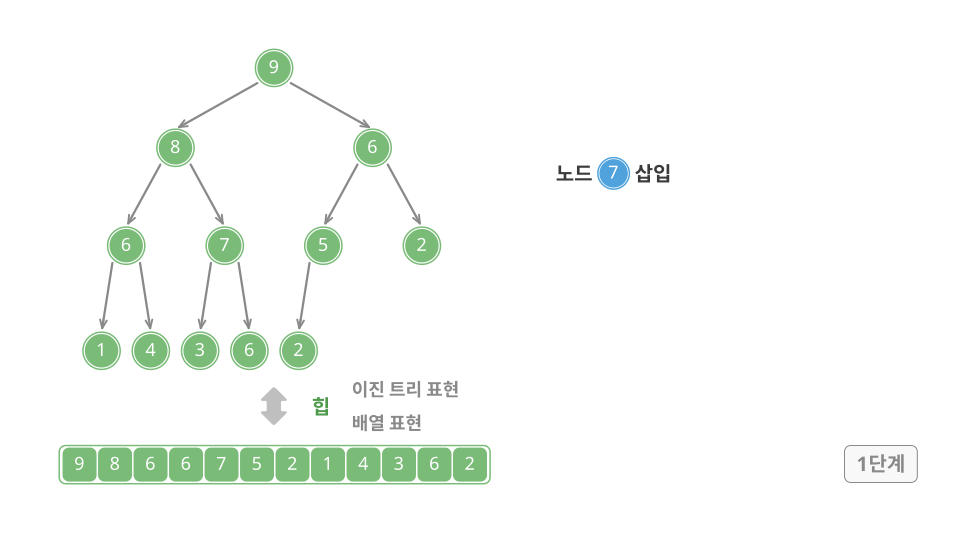
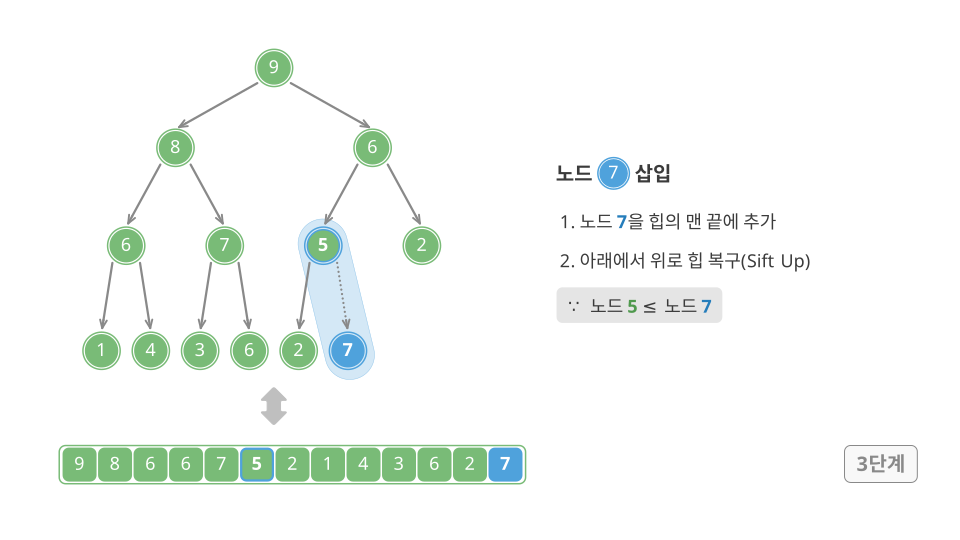
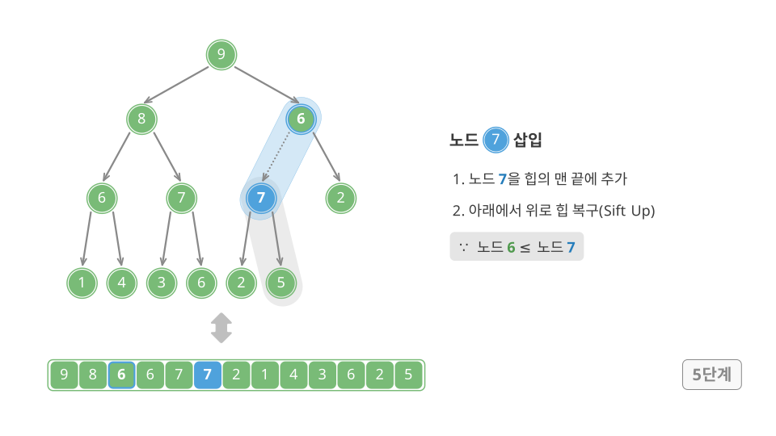
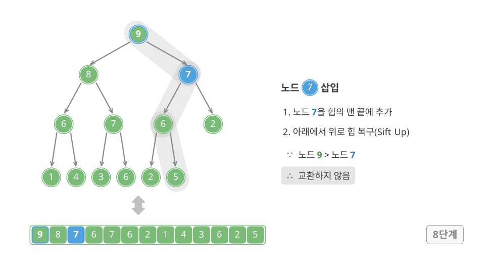
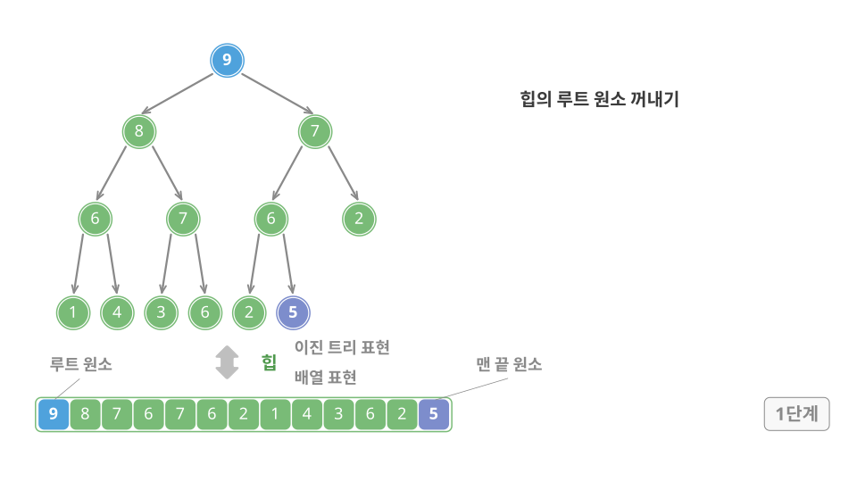
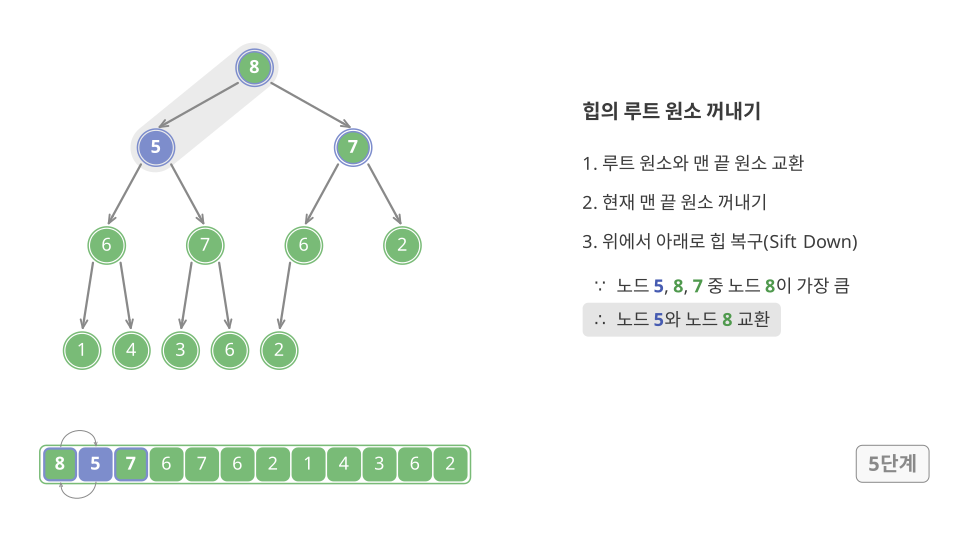
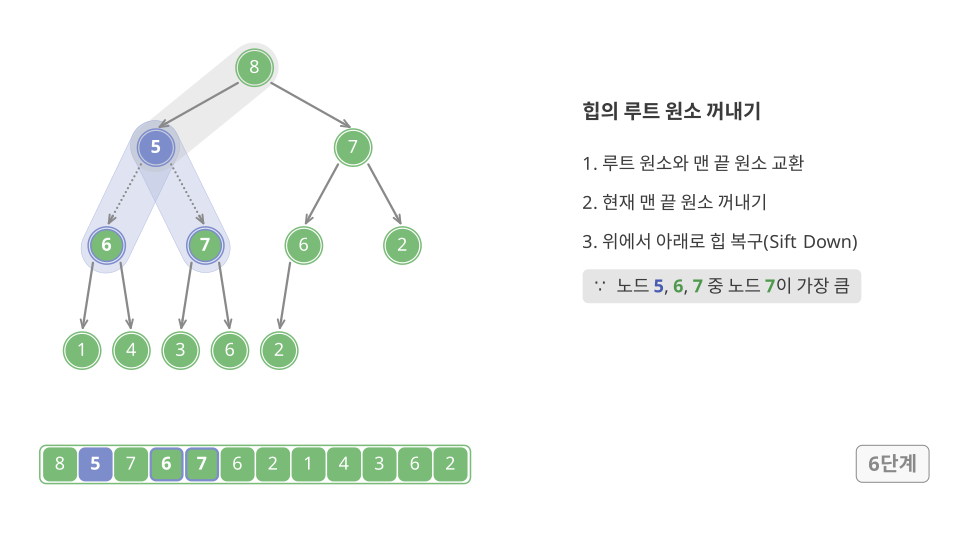
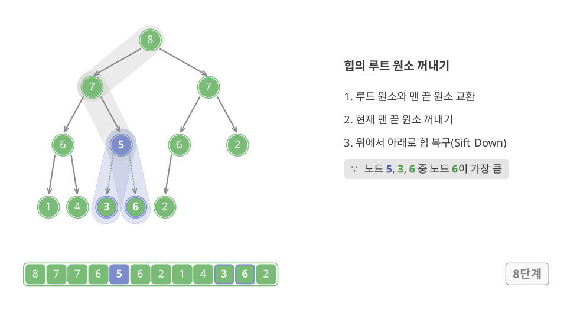

# 힙

<u>힙(heap)</u>은 특정 조건을 만족하는 완전 이진 트리다. 아래 그림과 같이 크게 두 종류로 나뉜다.

- <u>최소 힙(min heap)</u>: 모든 노드의 값 $\leq$ 그 자식 노드의 값.
- <u>최대 힙(max heap)</u>: 모든 노드의 값 $\geq$ 그 자식 노드의 값.


힙은 완전 이진 트리의 특수한 경우로 다음과 같은 성질을 갖는다.

- 마지막 레벨은 왼쪽부터 채우고 나머지 레벨은 모두 채운다.
- 이진 트리의 루트 노드를 힙의 루트라 하고, 마지막 레벨에서 가장 오른쪽에 있는 노드를 힙의 맨 끝이라 한다.
- 최대 힙에서는 루트 원소(루트 노드)의 값이 최댓값이고, 최소 힙에서는 최솟값이다.

## 힙의 주요 연산

여러 프로그래밍 언어가 제공하는 것은 <u>우선순위 큐(priority queue)</u>다. 이는 우선순위에 따라 원소를 꺼내는 큐로 정의되는 추상 자료 구조다.

**우선순위 큐는 보통 힙으로 구현하며, 최대 힙은 값이 큰 원소부터 꺼내는 우선순위 큐에 해당한다**. 사용하는 입장에서는 우선순위 큐와 힙을 동등한 자료 구조로 볼 수 있다. 따라서 이 책에서는 둘을 따로 구분하지 않고 힙이라 부른다.

힙의 주요 연산은 아래 표와 같다. 실제 메서드 이름은 프로그래밍 언어에 따라 다르다.

<p align="center"> 표 <id> &nbsp; 힙 연산의 효율 </p>

| 메서드 이름      | 설명                                             | 시간 복잡도  |
| ----------- | ------------------------------------------------ | ----------- |
| `push()`    | 힙에 원소 삽입                                         | $O(\log n)$ |
| `pop()`     | 힙의 루트 원소 꺼내기                                     | $O(\log n)$ |
| `peek()`    | 힙의 루트 원소 조회(최대 힙에서는 최댓값, 최소 힙에서는 최솟값) | $O(1)$      |
| `size()`    | 힙의 원소 수 구하기                                 | $O(1)$      |
| `isEmpty()` | 힙이 비었는지 확인                                   | $O(1)$      |

실제로는 프로그래밍 언어가 제공하는 힙 클래스(또는 우선순위 큐 클래스)를 바로 사용할 수 있다.

정렬 알고리즘에서 오름차순과 내림차순을 바꾸듯이 `flag`를 설정하거나 `Comparator`를 바꾸어 최소 힙과 최대 힙을 전환할 수 있다. 코드는 다음과 같다.

```snippet
heap_operations
```

??? pythontutor "실행 과정 시각화"

    @tutor heap_operations_tutor

## 힙의 구현

여기서는 최대 힙을 구현한다. 최소 힙으로 바꾸려면 대소 관계를 판단하는 조건을 모두 뒤집으면 된다(예를 들어 $\geq$를 $\leq$로 바꾼다). 직접 구현해 보자.

### 힙의 저장과 표현

‘이진 트리’ 장에서 살펴보았듯이 완전 이진 트리는 배열로 표현하기에 알맞다. 힙도 완전 이진 트리이므로 **배열을 사용해 힙을 저장한다**.

배열로 이진 트리를 나타낼 때 원소는 노드의 값을, 인덱스는 이진 트리에서 노드의 위치를 나타낸다. **노드 포인터의 역할은 인덱스 변환 공식이 한다**.

아래 그림처럼 인덱스 $i$인 노드의 왼쪽 자식 인덱스는 $2i + 1$, 오른쪽 자식 인덱스는 $2i + 2$, 부모 인덱스는 $(i - 1) / 2$이다(나눈 뒤 내림). 인덱스가 범위를 벗어나면 빈 노드이거나 해당 노드가 존재하지 않는다는 뜻이다.


나중에 편리하게 쓸 수 있도록 인덱스 변환 공식을 함수로 만들어 두자.

```src
[file]{my_heap}-[class]{max_heap}-[func]{parent}
```

### 힙의 루트 원소 조회

힙의 루트 원소는 이진 트리의 루트 노드, 즉 리스트의 첫 원소다.

```src
[file]{my_heap}-[class]{max_heap}-[func]{peek}
```

### 힙에 원소 삽입

원소 `val`을 먼저 힙 맨 끝에 추가한다. 추가한 `val`이 힙의 다른 원소보다 크면 힙 조건이 깨질 수 있다. **따라서 삽입한 노드에서 루트까지 경로를 따라 노드들을 조정해야 한다**. 이렇게 힙의 성질을 복구하는 연산을 <u>힙화(heapify)</u>라고 한다.

삽입한 노드에서 시작해 **아래에서 위로 힙을 복구한다**. 아래 그림처럼 삽입한 노드와 부모의 값을 비교해 삽입한 노드가 더 크면 서로 교환한다. 위로 올라가며 이 작업을 반복하고, 루트를 지나거나 교환할 필요가 없는 노드를 만나면 멈춘다.

=== "<1>"
    

=== "<2>"
    

=== "<3>"
    

=== "<4>"
    

=== "<5>"
    

=== "<6>"
    

=== "<7>"
    

=== "<8>"
    

=== "<9>"
    

전체 노드 수가 $n$이면 트리의 높이는 $O(\log n)$이다. 따라서 힙 복구의 반복 횟수는 최대 $O(\log n)$이고, **원소 삽입의 시간 복잡도는 $O(\log n)$이다**. 코드는 다음과 같다.

```src
[file]{my_heap}-[class]{max_heap}-[func]{sift_up}
```

### 힙의 루트 원소 꺼내기

힙의 루트 원소는 이진 트리의 루트 노드이자 리스트의 첫 원소다. 리스트의 첫 원소를 바로 삭제하면 이진 트리의 모든 노드 인덱스가 바뀌므로 이후에 힙을 복구하기가 어렵다. 원소 인덱스의 변화를 최소화하기 위해 다음 단계를 따른다.

1. 루트 원소와 맨 끝 원소를 교환한다(루트 노드와 가장 오른쪽 리프를 교환한다).
2. 교환한 뒤 리스트에서 맨 끝 원소를 삭제한다. 이미 자리를 바꾸었으므로 실제로 삭제되는 것은 원래의 루트 원소다.
3. 루트 노드에서 시작해 **위에서 아래로 힙을 복구한다**.

아래 그림처럼 **위에서 아래로 복구할 때는 아래에서 위로 복구할 때와 진행 방향이 반대다**. 루트 노드의 값과 두 자식의 값을 비교해 더 큰 자식이 루트보다 크면 그 자식과 루트를 교환한다. 이 작업을 반복하다가 리프를 지나거나 교환할 필요가 없는 노드를 만나면 멈춘다.

=== "<1>"
    

=== "<2>"
    

=== "<3>"
    

=== "<4>"
    

=== "<5>"
    

=== "<6>"
    

=== "<7>"
    

=== "<8>"
    

=== "<9>"
    

=== "<10>"
    

힙 삽입과 마찬가지로 힙의 루트 원소를 꺼내는 연산의 시간 복잡도도 $O(\log n)$이다. 코드는 다음과 같다.

```src
[file]{my_heap}-[class]{max_heap}-[func]{sift_down}
```

## 힙의 대표적인 활용 사례

- **우선순위 큐**: 우선순위 큐를 구현할 때 가장 먼저 고려하는 자료 구조는 보통 힙이다. 삽입과 삭제의 시간 복잡도는 모두 $O(\log n)$이고 힙 구성은 $O(n)$으로, 모두 효율적인 연산이다.
- **힙 정렬**: 주어진 데이터로 힙을 만든 뒤 원소를 계속 꺼내면 정렬된 데이터를 얻을 수 있다. 실제로 힙 정렬은 보통 더 간결한 방법으로 구현한다. 자세한 내용은 ‘힙 정렬’ 절을 참고하자.
- **가장 큰 원소 $k$개 구하기**: 전형적인 알고리즘 문제이면서 활용 사례도 많다. 예를 들어 인기 상위 뉴스 10개를 웨이보 실시간 인기 목록에 올리거나 판매량 상위 상품 10개를 고를 수 있다.
