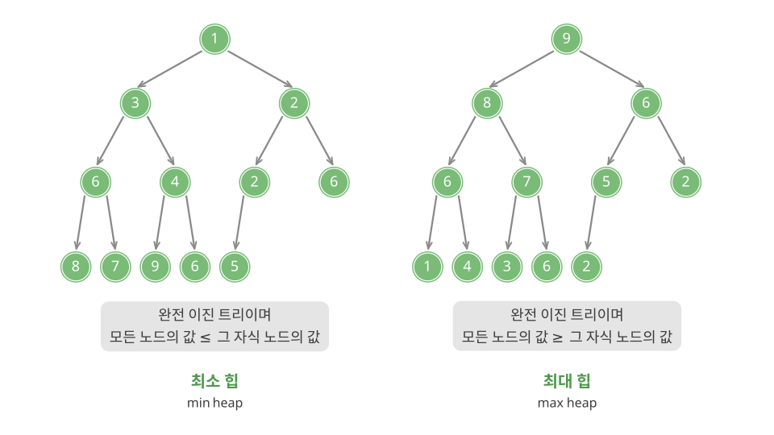
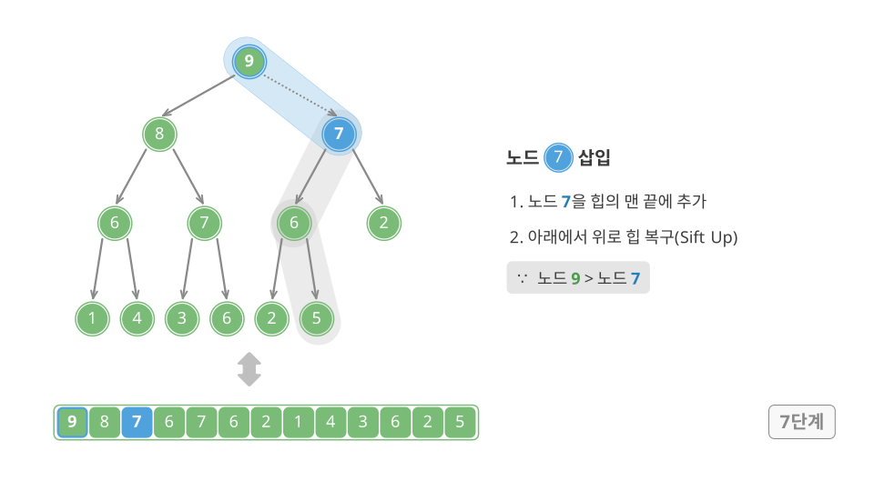
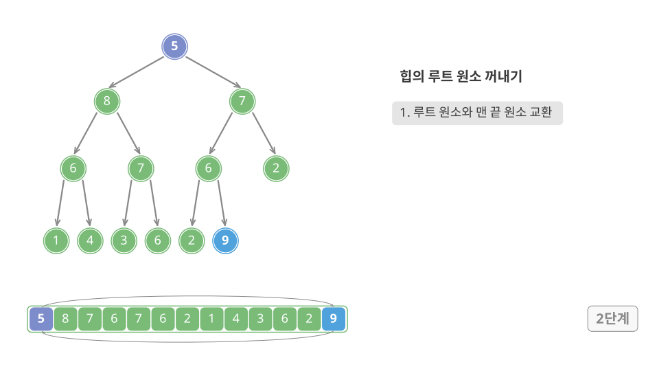
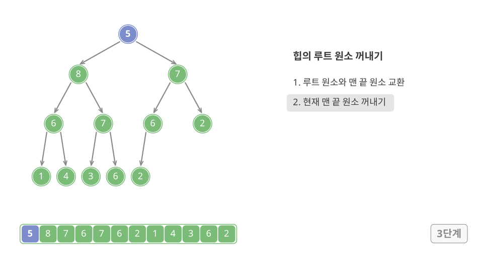
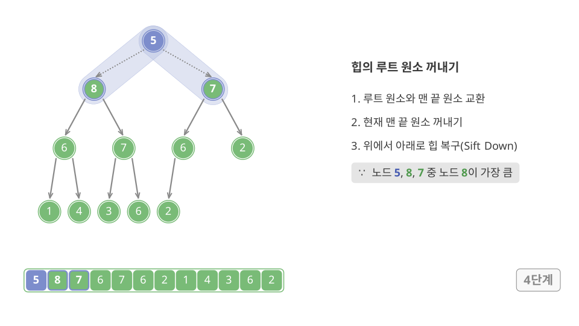
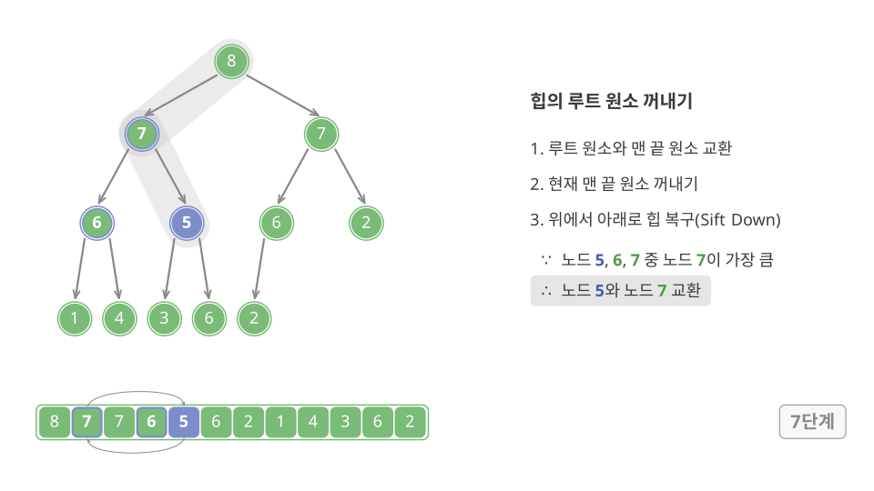
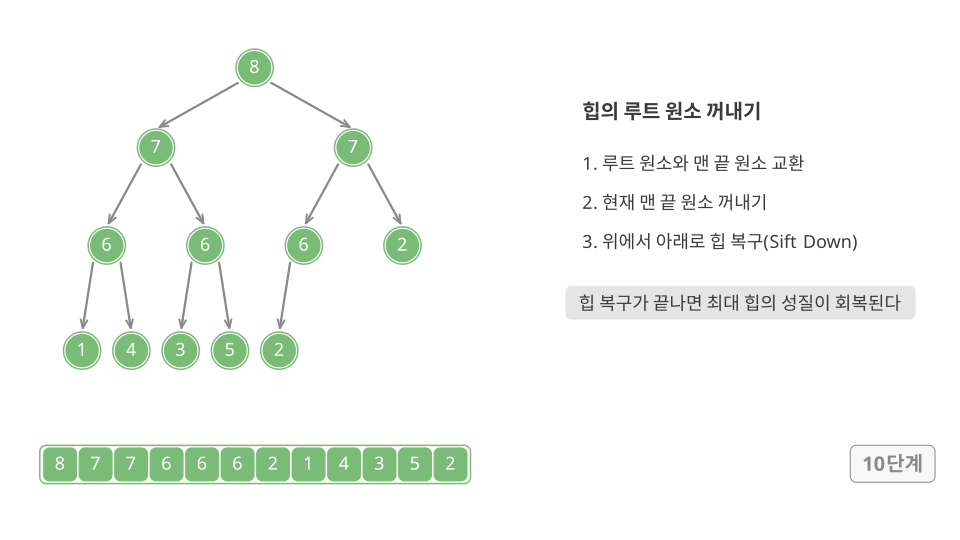

# 힙

<u>힙(heap)</u>은 특정 조건을 만족하는 완전 이진 트리로, 아래 그림과 같이 크게 두 종류로 나뉜다.

- <u>최소 힙(min heap)</u>: 모든 노드의 값이 자식 노드의 값보다 작거나 같다($\leq$).
- <u>최대 힙(max heap)</u>: 모든 노드의 값이 자식 노드의 값보다 크거나 같다($\geq$).



힙은 완전 이진 트리의 특수한 형태이므로 다음 성질을 가진다.

- 가장 아래 레벨은 왼쪽부터 노드가 채워지며, 나머지 레벨은 모두 가득 차 있다.
- 이진 트리의 루트 노드를 '힙의 루트', 가장 아래 레벨에서 맨 오른쪽에 있는 노드를 '힙의 끝'이라고 한다.
- 최대 힙(최소 힙)에서는 힙의 루트 원소(루트 노드)의 값이 가장 크다(작다).

## 힙의 주요 연산

많은 프로그래밍 언어에서 제공하는 것은 <u>우선순위 큐(priority queue)</u>라는 점을 알아 두자. 우선순위 큐는 우선순위에 따라 정렬되는 큐로 정의되는 추상 자료 구조다.

실제로 **힙은 보통 우선순위 큐를 구현하는 데 사용되며, 최대 힙은 원소를 큰 값부터 작은 값 순서로 꺼내는 우선순위 큐에 해당한다**. 사용하는 입장에서는 '우선순위 큐'와 '힙'을 동등한 자료 구조로 볼 수 있다. 따라서 이 책에서는 둘을 특별히 구분하지 않고 모두 '힙'이라고 한다.

힙의 주요 연산은 아래 표와 같다. 메서드 이름은 프로그래밍 언어에 따라 달라진다.

<p align="center"> 표 <id> &nbsp; 힙 연산의 효율 </p>

| 메서드 이름 | 설명 | 시간 복잡도 |
| ----------- | ------------------------------------------------ | ----------- |
| `push()`    | 힙에 원소 삽입 | $O(\log n)$ |
| `pop()`     | 힙의 루트 원소 꺼내기 | $O(\log n)$ |
| `peek()`    | 힙의 루트 원소에 접근(최대 / 최소 힙에서는 각각 최댓값 / 최솟값) | $O(1)$      |
| `size()`    | 힙의 원소 수 구하기 | $O(1)$      |
| `isEmpty()` | 힙이 비어 있는지 확인 | $O(1)$      |

실제 응용에서는 프로그래밍 언어가 제공하는 힙 클래스(또는 우선순위 큐 클래스)를 바로 사용할 수 있다.

정렬 알고리즘에서 '오름차순 정렬'과 '내림차순 정렬'을 선택하듯이, `flag`를 설정하거나 `Comparator`를 수정하여 '최소 힙'과 '최대 힙'을 전환할 수 있다. 코드는 다음과 같다.

```snippet
heap_operations
```

??? pythontutor "실행 시각화"

    @tutor heap_operations_tutor

## 힙의 구현

아래에서는 최대 힙을 구현한다. 이를 최소 힙으로 바꾸려면 모든 대소 비교 조건을 반대로 바꾸면 된다(예를 들어 $\geq$를 $\leq$로 바꾼다). 관심 있는 독자는 직접 구현해 보자.

### 힙의 저장과 표현

'이진 트리' 장에서 살펴보았듯이 완전 이진 트리는 배열로 표현하기에 매우 적합하다. 힙은 완전 이진 트리이므로 **배열을 사용하여 힙을 저장한다**.

배열로 이진 트리를 표현할 때 원소는 노드의 값을, 인덱스는 이진 트리에서 노드의 위치를 나타낸다. **노드 포인터는 인덱스 매핑 공식으로 구현한다**.

아래 그림과 같이 인덱스 $i$가 주어지면 왼쪽 자식 노드의 인덱스는 $2i + 1$, 오른쪽 자식 노드의 인덱스는 $2i + 2$, 부모 노드의 인덱스는 $(i - 1) / 2$(내림 정수 나눗셈)이다. 인덱스가 범위를 벗어나면 빈 노드이거나 노드가 존재하지 않는다는 뜻이다.


나중에 편리하게 사용할 수 있도록 인덱스 매핑 공식을 함수로 만들 수 있다.

```src
[file]{my_heap}-[class]{max_heap}-[func]{parent}
```

### 힙의 루트 원소에 접근

힙의 루트 원소는 이진 트리의 루트 노드, 즉 리스트의 첫 번째 원소다.

```src
[file]{my_heap}-[class]{max_heap}-[func]{peek}
```

### 힙에 원소 삽입

원소 `val`이 주어지면 먼저 힙의 끝에 추가한다. 추가한 `val`이 힙의 다른 원소보다 클 수 있으므로, 힙의 성립 조건이 깨질 수 있다. **따라서 삽입한 노드에서 루트 노드까지의 경로에 있는 노드들을 조정해야 한다**. 이 연산을 <u>힙 재정렬(heapify)</u>이라고 한다.

삽입한 노드부터 **아래에서 위로 힙을 재정렬**해 보자. 아래 그림과 같이 삽입한 노드의 값과 부모 노드의 값을 비교하여 삽입한 노드가 더 크면 서로 바꾼다. 이 작업을 반복하여 아래에서 위로 힙의 노드들을 조정하고, 루트 노드를 지나거나 바꿀 필요가 없는 노드를 만나면 종료한다.

=== "<1>"
    

=== "<2>"
    

=== "<3>"
    

=== "<4>"
    

=== "<5>"
    

=== "<6>"
    

=== "<7>"
    

=== "<8>"
    

=== "<9>"
    

전체 노드 수가 $n$이면 트리의 높이는 $O(\log n)$이다. 따라서 힙 재정렬의 반복 횟수는 최대 $O(\log n)$이며, **힙에 원소를 삽입하는 연산의 시간 복잡도는 $O(\log n)$**이다. 코드는 다음과 같다.

```src
[file]{my_heap}-[class]{max_heap}-[func]{sift_up}
```

### 힙의 루트 원소 꺼내기

힙의 루트 원소는 이진 트리의 루트 노드, 즉 리스트의 첫 번째 원소다. 리스트에서 첫 번째 원소를 바로 삭제하면 이진 트리의 모든 노드 인덱스가 바뀌어, 이후 힙 재정렬로 복구하기가 어려워진다. 원소 인덱스의 변화를 최소화하기 위해 다음 절차를 사용한다.

1. 힙의 루트 원소와 끝 원소를 교환한다(루트 노드와 맨 오른쪽 리프 노드를 교환한다).
2. 교환 후 리스트에서 힙의 끝 원소를 삭제한다(이미 교환했으므로 실제로 삭제되는 것은 원래의 루트 원소다).
3. 루트 노드부터 **위에서 아래로 힙을 재정렬**한다.

아래 그림과 같이 **'위에서 아래로 힙 재정렬'은 '아래에서 위로 힙 재정렬'과 진행 방향이 반대다**. 루트 노드의 값을 두 자식 노드의 값과 비교하여, 더 큰 값을 가진 자식 노드와 루트 노드를 교환한다. 이 작업을 반복하며 리프 노드를 지나거나 교환할 필요가 없는 노드를 만나면 종료한다.

=== "<1>"
    

=== "<2>"
    

=== "<3>"
    

=== "<4>"
    

=== "<5>"
    

=== "<6>"
    

=== "<7>"
    

=== "<8>"
    

=== "<9>"
    

=== "<10>"
    

원소 삽입과 마찬가지로 힙의 루트 원소를 꺼내는 연산의 시간 복잡도도 $O(\log n)$이다. 코드는 다음과 같다.

```src
[file]{my_heap}-[class]{max_heap}-[func]{sift_down}
```

## 힙의 주요 응용

- **우선순위 큐**: 힙은 우선순위 큐를 구현할 때 가장 먼저 고려하는 자료 구조다. 삽입과 꺼내기 연산의 시간 복잡도는 모두 $O(\log n)$이고, 힙 구성 연산은 $O(n)$으로 모두 매우 효율적이다.
- **힙 정렬**: 데이터가 주어지면 이를 이용해 힙을 만든 뒤 원소를 계속 꺼내어 정렬된 데이터를 얻을 수 있다. 다만 힙 정렬은 보통 더 간결한 방법으로 구현한다. 자세한 내용은 '힙 정렬' 절을 참고하자.
- **가장 큰 $k$ 개 원소 구하기**: 대표적인 알고리즘 문제이자 흔한 응용 사례다. 예를 들어 인기 상위 10개 뉴스를 웨이보의 인기 검색어로 선정하거나, 판매량 상위 10개 상품을 고를 때 사용할 수 있다.
