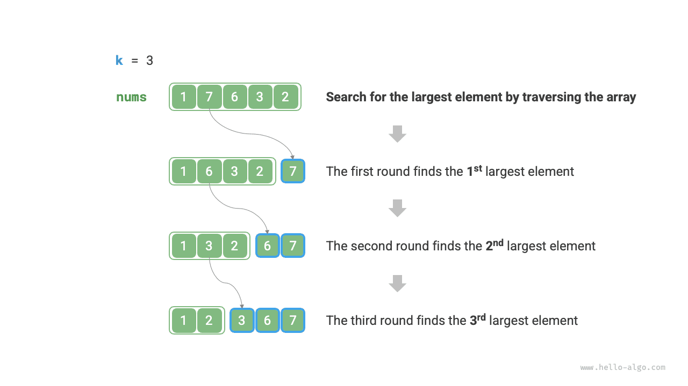
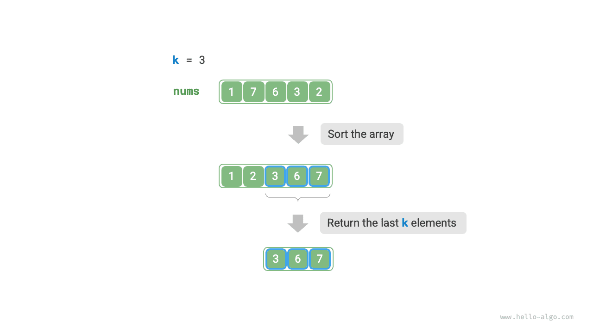
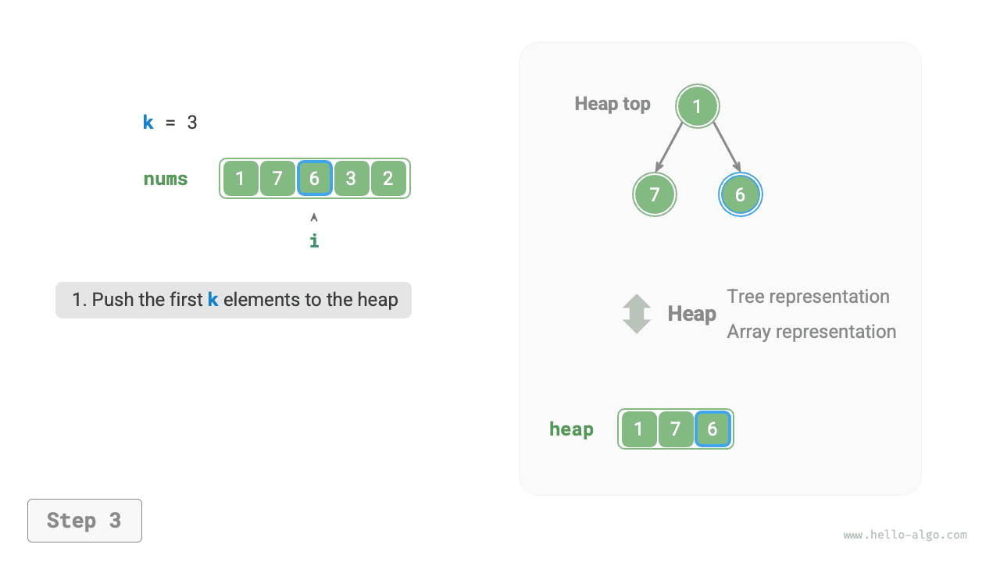

# Top-k 문제

!!! question "문제"

    길이가 $n$인 정렬되지 않은 배열 `nums`가 주어졌을 때, 배열에서 가장 큰 $k$ 개의 원소를 반환하라.

이 문제에 대해 먼저 발상이 비교적 직접적인 두 가지 풀이를 살펴보고, 이어서 더 효율적인 힙 기반 풀이를 소개한다.

## 방법 1: 순회하며 선택

아래 그림과 같이 $k$ 번 순회하면서 매 순회에서 각각 $1$, $2$, $\dots$, $k$ 번째로 큰 원소를 뽑을 수 있다. 시간 복잡도는 $O(nk)$이다.

이 방법은 $k \ll n$인 경우에만 적합하다. $k$가 $n$에 가까워지면 시간 복잡도가 $O(n^2)$에 가까워져 매우 오래 걸리기 때문이다.



!!! tip "참고"

    $k = n$이면 전체가 정렬된 수열을 얻을 수 있으며, 이는 '선택 정렬' 알고리즘과 같다.

## 방법 2: 정렬

아래 그림과 같이 배열 `nums`를 먼저 정렬한 뒤 맨 오른쪽의 $k$ 개 원소를 반환할 수 있다. 시간 복잡도는 $O(n \log n)$이다.

이 방법은 필요한 것보다 더 많은 일을 한다. 가장 큰 $k$ 개 원소만 찾으면 되며, 나머지 원소를 정렬할 필요는 없기 때문이다.



## 방법 3: 힙

힙을 이용하면 Top-k 문제를 더 효율적으로 해결할 수 있다. 과정은 아래 그림과 같다.

1. 루트 원소가 가장 작은 최소 힙을 초기화한다.
2. 먼저 배열의 앞 $k$ 개 원소를 차례로 힙에 삽입한다.
3. $k + 1$ 번째 원소부터 시작하여, 현재 원소가 힙의 루트 원소보다 크면 루트 원소를 꺼내고 현재 원소를 삽입한다.
4. 순회를 마치면 힙에 남은 원소가 가장 큰 $k$ 개 원소다.

=== "<1>"
    

=== "<2>"
    

=== "<3>"
    

=== "<4>"
    

=== "<5>"
    

=== "<6>"
    

=== "<7>"
    

=== "<8>"
    

=== "<9>"
    

예시 코드는 다음과 같다.

```src
[file]{top_k}-[class]{}-[func]{top_k_heap}
```

삽입과 꺼내기를 총 $n$ 차례 수행하고 힙의 최대 길이는 $k$이므로, 시간 복잡도는 $O(n \log k)$이다. 이 방법은 매우 효율적이다. $k$가 작으면 시간 복잡도가 $O(n)$에 가까워지고, $k$가 커도 $O(n \log n)$을 넘지 않는다.

또한 이 방법은 동적으로 들어오는 데이터 스트림에도 적합하다. 데이터가 계속 추가될 때 힙 안의 원소를 지속적으로 관리하면 가장 큰 $k$ 개 원소를 동적으로 갱신할 수 있다.
