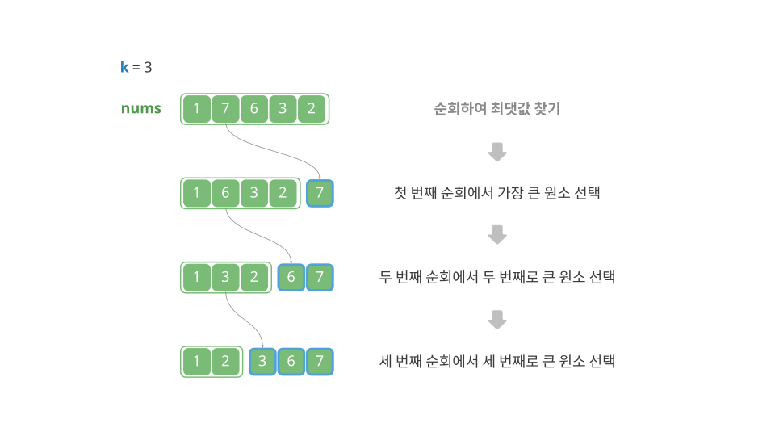
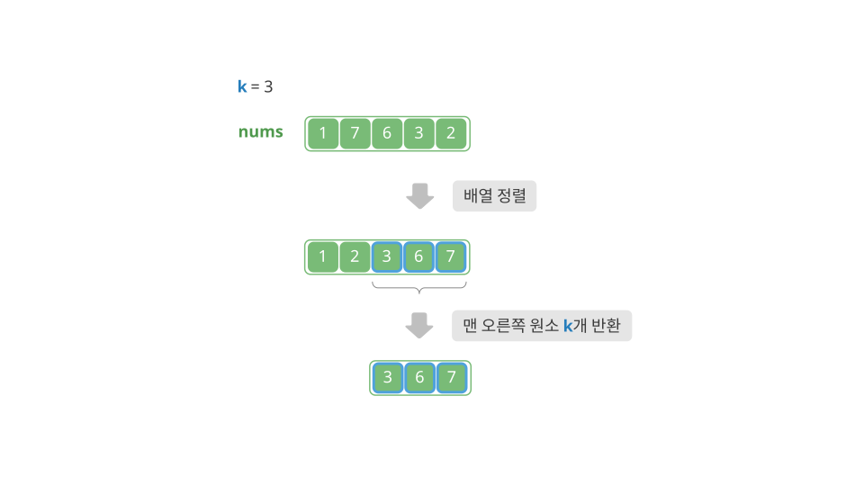
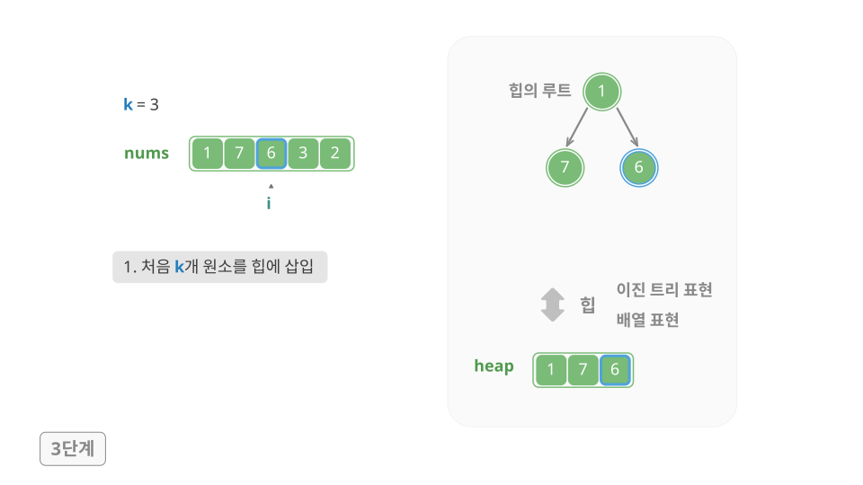
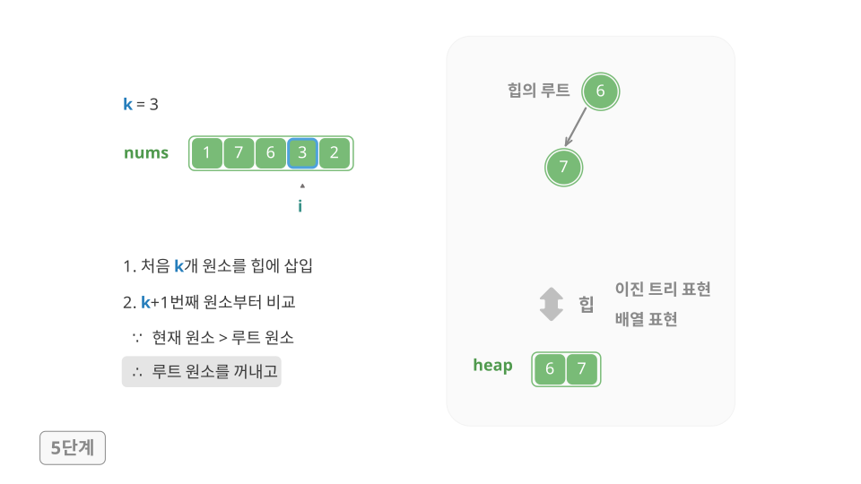
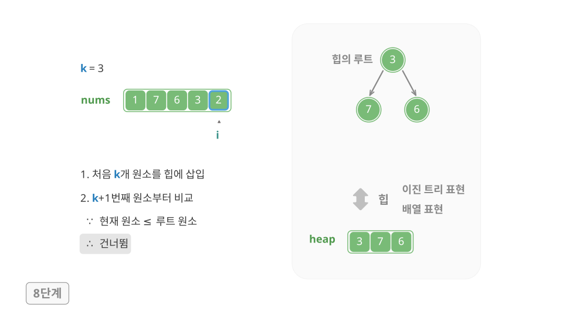

# 8.3 &nbsp; 상위 k개 찾기 문제

!!! question

    정렬되지 않은 배열 `nums`의 길이가 $n$일 때, 배열에서 가장 큰 원소 $k$개를 반환하라.

먼저 생각하기 쉬운 두 가지 풀이를 살펴본 뒤 더 효율적인 힙 풀이를 소개한다.

## 8.3.1 &nbsp; 방법 1: 순회하며 선택하기

아래 그림(8-6)처럼 $k$번 순회한다. 순회할 때마다 큰 순서대로 $1$번째, $2$번째, $\dots$, 마지막으로 $k$번째 원소를 뽑는다. 시간 복잡도는 $O(nk)$이다.

이 방법은 $k \ll n$일 때만 적합하다. $k$가 $n$에 가까우면 시간 복잡도가 $O(n^2)$에 가까워져 시간이 매우 오래 걸린다.

{ class="animation-figure" }

<p align="center"> 그림 8-6 &nbsp; 순회로 가장 큰 원소 k개 찾기 </p>

!!! tip

    $k = n$이면 정렬된 전체 수열을 얻게 되며, 이때는 선택 정렬 알고리즘과 같다.

## 8.3.2 &nbsp; 방법 2: 정렬

아래 그림(8-7)처럼 먼저 배열 `nums`를 정렬한 뒤 맨 오른쪽 원소 $k$개를 반환한다. 시간 복잡도는 $O(n \log n)$이다.

이 방법은 필요한 것보다 더 많은 일을 한다. 가장 큰 원소 $k$개만 찾으면 되므로 나머지 원소까지 정렬할 필요는 없다.

{ class="animation-figure" }

<p align="center"> 그림 8-7 &nbsp; 정렬로 가장 큰 원소 k개 찾기 </p>

## 8.3.3 &nbsp; 방법 3: 힙

힙을 사용하면 상위 k개 찾기 문제를 더 효율적으로 풀 수 있다. 과정은 아래 그림(8-8)과 같다.

1. 루트 원소가 최솟값인 최소 힙을 초기화한다.
2. 먼저 배열의 처음 $k$개 원소를 차례로 힙에 삽입한다.
3. $k + 1$번째 원소부터는 현재 원소가 루트 원소보다 클 때 루트 원소를 꺼내고 현재 원소를 삽입한다.
4. 순회를 마치면 힙에 남은 원소가 바로 가장 큰 원소 $k$개다.

=== "<1>"
    { class="animation-figure" }

=== "<2>"
    { class="animation-figure" }

=== "<3>"
    { class="animation-figure" }

=== "<4>"
    { class="animation-figure" }

=== "<5>"
    { class="animation-figure" }

=== "<6>"
    { class="animation-figure" }

=== "<7>"
    { class="animation-figure" }

=== "<8>"
    { class="animation-figure" }

=== "<9>"
    { class="animation-figure" }

<p align="center"> 그림 8-8 &nbsp; 힙으로 가장 큰 원소 k개 찾기 </p>

예제 코드는 다음과 같다.

=== "Python"

    ```python title="top_k.py"
    def top_k_heap(nums: list[int], k: int) -> list[int]:
        """힙을 이용해 배열에서 가장 큰 원소 k개 찾기"""
        # 최소 힙 초기화
        heap = []
        # 배열의 처음 k개 원소를 힙에 삽입
        for i in range(k):
            heapq.heappush(heap, nums[i])
        # k+1번째 원소부터 힙의 크기를 k로 유지
        for i in range(k, len(nums)):
            # 현재 원소가 루트보다 크면 루트를 꺼내고 현재 원소를 삽입
            if nums[i] > heap[0]:
                heapq.heappop(heap)
                heapq.heappush(heap, nums[i])
        return heap
    ```

=== "C++"

    ```cpp title="top_k.cpp"
    /* 힙을 이용해 배열에서 가장 큰 원소 k개 찾기 */
    priority_queue<int, vector<int>, greater<int>> topKHeap(vector<int> &nums, int k) {
        // 최소 힙 초기화
        priority_queue<int, vector<int>, greater<int>> heap;
        // 배열의 처음 k개 원소를 힙에 삽입
        for (int i = 0; i < k; i++) {
            heap.push(nums[i]);
        }
        // k+1번째 원소부터 힙의 크기를 k로 유지
        for (int i = k; i < nums.size(); i++) {
            // 현재 원소가 루트보다 크면 루트를 꺼내고 현재 원소를 삽입
            if (nums[i] > heap.top()) {
                heap.pop();
                heap.push(nums[i]);
            }
        }
        return heap;
    }
    ```

=== "Java"

    ```java title="top_k.java"
    /* 힙을 이용해 배열에서 가장 큰 원소 k개 찾기 */
    Queue<Integer> topKHeap(int[] nums, int k) {
        // 최소 힙 초기화
        Queue<Integer> heap = new PriorityQueue<Integer>();
        // 배열의 처음 k개 원소를 힙에 삽입
        for (int i = 0; i < k; i++) {
            heap.offer(nums[i]);
        }
        // k+1번째 원소부터 힙의 크기를 k로 유지
        for (int i = k; i < nums.length; i++) {
            // 현재 원소가 루트보다 크면 루트를 꺼내고 현재 원소를 삽입
            if (nums[i] > heap.peek()) {
                heap.poll();
                heap.offer(nums[i]);
            }
        }
        return heap;
    }
    ```

=== "C#"

    ```csharp title="top_k.cs"
    /* 힙을 이용해 배열에서 가장 큰 원소 k개 찾기 */
    PriorityQueue<int, int> TopKHeap(int[] nums, int k) {
        // 최소 힙 초기화
        PriorityQueue<int, int> heap = new();
        // 배열의 처음 k개 원소를 힙에 삽입
        for (int i = 0; i < k; i++) {
            heap.Enqueue(nums[i], nums[i]);
        }
        // k+1번째 원소부터 힙의 크기를 k로 유지
        for (int i = k; i < nums.Length; i++) {
            // 현재 원소가 루트보다 크면 루트를 꺼내고 현재 원소를 삽입
            if (nums[i] > heap.Peek()) {
                heap.Dequeue();
                heap.Enqueue(nums[i], nums[i]);
            }
        }
        return heap;
    }
    ```

=== "Go"

    ```go title="top_k.go"
    /* 힙을 이용해 배열에서 가장 큰 원소 k개 찾기 */
    func topKHeap(nums []int, k int) *minHeap {
        // 최소 힙 초기화
        h := &minHeap{}
        heap.Init(h)
        // 배열의 처음 k개 원소를 힙에 삽입
        for i := 0; i < k; i++ {
            heap.Push(h, nums[i])
        }
        // k+1번째 원소부터 힙의 크기를 k로 유지
        for i := k; i < len(nums); i++ {
            // 현재 원소가 루트보다 크면 루트를 꺼내고 현재 원소를 삽입
            if nums[i] > h.Top().(int) {
                heap.Pop(h)
                heap.Push(h, nums[i])
            }
        }
        return h
    }
    ```

=== "Swift"

    ```swift title="top_k.swift"
    /* 힙을 이용해 배열에서 가장 큰 원소 k개 찾기 */
    func topKHeap(nums: [Int], k: Int) -> [Int] {
        // 최소 힙을 초기화하고 처음 k개 원소로 힙 구성
        var heap = Heap(nums.prefix(k))
        // k+1번째 원소부터 힙의 크기를 k로 유지
        for i in nums.indices.dropFirst(k) {
            // 현재 원소가 루트보다 크면 루트를 꺼내고 현재 원소를 삽입
            if nums[i] > heap.min()! {
                _ = heap.removeMin()
                heap.insert(nums[i])
            }
        }
        return heap.unordered
    }
    ```

=== "JS"

    ```javascript title="top_k.js"
    /* 힙에 원소 삽입 */
    function pushMinHeap(maxHeap, val) {
        // 원소의 부호 반전
        maxHeap.push(-val);
    }

    /* 힙에서 원소 꺼내기 */
    function popMinHeap(maxHeap) {
        // 원소의 부호 반전
        return -maxHeap.pop();
    }

    /* 힙의 루트 원소 조회 */
    function peekMinHeap(maxHeap) {
        // 원소의 부호 반전
        return -maxHeap.peek();
    }

    /* 최소 힙의 모든 원소를 배열로 반환 */
    function getMinHeap(maxHeap) {
        // 원소의 부호 반전
        return maxHeap.getMaxHeap().map((num) => -num);
    }

    /* 힙을 이용해 배열에서 가장 큰 원소 k개 찾기 */
    function topKHeap(nums, k) {
        // 최소 힙 초기화
        // 모든 원소의 부호를 바꾸면 최대 힙을 최소 힙처럼 사용할 수 있음
        const maxHeap = new MaxHeap([]);
        // 배열의 처음 k개 원소를 힙에 삽입
        for (let i = 0; i < k; i++) {
            pushMinHeap(maxHeap, nums[i]);
        }
        // k+1번째 원소부터 힙의 크기를 k로 유지
        for (let i = k; i < nums.length; i++) {
            // 현재 원소가 루트보다 크면 루트를 꺼내고 현재 원소를 삽입
            if (nums[i] > peekMinHeap(maxHeap)) {
                popMinHeap(maxHeap);
                pushMinHeap(maxHeap, nums[i]);
            }
        }
        // 힙에 있는 원소 반환
        return getMinHeap(maxHeap);
    }
    ```

=== "TS"

    ```typescript title="top_k.ts"
    /* 힙에 원소 삽입 */
    function pushMinHeap(maxHeap: MaxHeap, val: number): void {
        // 원소의 부호 반전
        maxHeap.push(-val);
    }

    /* 힙에서 원소 꺼내기 */
    function popMinHeap(maxHeap: MaxHeap): number {
        // 원소의 부호 반전
        return -maxHeap.pop();
    }

    /* 힙의 루트 원소 조회 */
    function peekMinHeap(maxHeap: MaxHeap): number {
        // 원소의 부호 반전
        return -maxHeap.peek();
    }

    /* 최소 힙의 모든 원소를 배열로 반환 */
    function getMinHeap(maxHeap: MaxHeap): number[] {
        // 원소의 부호 반전
        return maxHeap.getMaxHeap().map((num: number) => -num);
    }

    /* 힙을 이용해 배열에서 가장 큰 원소 k개 찾기 */
    function topKHeap(nums: number[], k: number): number[] {
        // 최소 힙 초기화
        // 모든 원소의 부호를 바꾸면 최대 힙을 최소 힙처럼 사용할 수 있음
        const maxHeap = new MaxHeap([]);
        // 배열의 처음 k개 원소를 힙에 삽입
        for (let i = 0; i < k; i++) {
            pushMinHeap(maxHeap, nums[i]);
        }
        // k+1번째 원소부터 힙의 크기를 k로 유지
        for (let i = k; i < nums.length; i++) {
            // 현재 원소가 루트보다 크면 루트를 꺼내고 현재 원소를 삽입
            if (nums[i] > peekMinHeap(maxHeap)) {
                popMinHeap(maxHeap);
                pushMinHeap(maxHeap, nums[i]);
            }
        }
        // 힙에 있는 원소 반환
        return getMinHeap(maxHeap);
    }
    ```

=== "Dart"

    ```dart title="top_k.dart"
    /* 힙을 이용해 배열에서 가장 큰 원소 k개 찾기 */
    MinHeap topKHeap(List<int> nums, int k) {
      // 최소 힙을 초기화하고 배열의 처음 k개 원소 삽입
      MinHeap heap = MinHeap(nums.sublist(0, k));
      // k+1번째 원소부터 힙의 크기를 k로 유지
      for (int i = k; i < nums.length; i++) {
        // 현재 원소가 루트보다 크면 루트를 꺼내고 현재 원소를 삽입
        if (nums[i] > heap.peek()) {
          heap.pop();
          heap.push(nums[i]);
        }
      }
      return heap;
    }
    ```

=== "Rust"

    ```rust title="top_k.rs"
    /* 힙을 이용해 배열에서 가장 큰 원소 k개 찾기 */
    fn top_k_heap(nums: Vec<i32>, k: usize) -> BinaryHeap<Reverse<i32>> {
        // BinaryHeap은 최대 힙이므로 Reverse로 원소의 비교 순서를 뒤집어 최소 힙 구현
        let mut heap = BinaryHeap::<Reverse<i32>>::new();
        // 배열의 처음 k개 원소를 힙에 삽입
        for &num in nums.iter().take(k) {
            heap.push(Reverse(num));
        }
        // k+1번째 원소부터 힙의 크기를 k로 유지
        for &num in nums.iter().skip(k) {
            // 현재 원소가 루트보다 크면 루트를 꺼내고 현재 원소를 삽입
            if num > heap.peek().unwrap().0 {
                heap.pop();
                heap.push(Reverse(num));
            }
        }
        heap
    }
    ```

=== "C"

    ```c title="top_k.c"
    /* 힙에 원소 삽입 */
    void pushMinHeap(MaxHeap *maxHeap, int val) {
        // 원소의 부호 반전
        push(maxHeap, -val);
    }

    /* 힙에서 원소 꺼내기 */
    int popMinHeap(MaxHeap *maxHeap) {
        // 원소의 부호 반전
        return -pop(maxHeap);
    }

    /* 힙의 루트 원소 조회 */
    int peekMinHeap(MaxHeap *maxHeap) {
        // 원소의 부호 반전
        return -peek(maxHeap);
    }

    /* 최소 힙의 모든 원소를 배열로 반환 */
    int *getMinHeap(MaxHeap *maxHeap) {
        // 힙의 모든 원소의 부호를 바꿔 배열 res에 저장
        int *res = (int *)malloc(maxHeap->size * sizeof(int));
        for (int i = 0; i < maxHeap->size; i++) {
            res[i] = -maxHeap->data[i];
        }
        return res;
    }

    /* 힙을 이용해 배열에서 가장 큰 원소 k개를 찾는 함수 */
    int *topKHeap(int *nums, int sizeNums, int k) {
        // 최소 힙 초기화
        // 모든 원소의 부호를 바꾸면 최대 힙을 최소 힙처럼 사용할 수 있음
        int *empty = (int *)malloc(0);
        MaxHeap *maxHeap = newMaxHeap(empty, 0);
        // 배열의 처음 k개 원소를 힙에 삽입
        for (int i = 0; i < k; i++) {
            pushMinHeap(maxHeap, nums[i]);
        }
        // k+1번째 원소부터 힙의 크기를 k로 유지
        for (int i = k; i < sizeNums; i++) {
            // 현재 원소가 루트보다 크면 루트를 꺼내고 현재 원소를 삽입
            if (nums[i] > peekMinHeap(maxHeap)) {
                popMinHeap(maxHeap);
                pushMinHeap(maxHeap, nums[i]);
            }
        }
        int *res = getMinHeap(maxHeap);
        // 메모리 해제
        delMaxHeap(maxHeap);
        return res;
    }
    ```

=== "Kotlin"

    ```kotlin title="top_k.kt"
    /* 힙을 이용해 배열에서 가장 큰 원소 k개 찾기 */
    fun topKHeap(nums: IntArray, k: Int): Queue<Int> {
        // 최소 힙 초기화
        val heap = PriorityQueue<Int>()
        // 배열의 처음 k개 원소를 힙에 삽입
        for (i in 0..<k) {
            heap.offer(nums[i])
        }
        // k+1번째 원소부터 힙의 크기를 k로 유지
        for (i in k..<nums.size) {
            // 현재 원소가 루트보다 크면 루트를 꺼내고 현재 원소를 삽입
            if (nums[i] > heap.peek()) {
                heap.poll()
                heap.offer(nums[i])
            }
        }
        return heap
    }
    ```

=== "Ruby"

    ```ruby title="top_k.rb"
    ### 힙을 이용해 배열에서 가장 큰 원소 k개 찾기 ###
    def top_k_heap(nums, k)
      # 최소 힙 초기화
      # 모든 원소의 부호를 바꾸면 최대 힙을 최소 힙처럼 사용할 수 있음
      max_heap = MaxHeap.new([])

      # 배열의 처음 k개 원소를 힙에 삽입
      for i in 0...k
        push_min_heap(max_heap, nums[i])
      end

      # k+1번째 원소부터 힙의 크기를 k로 유지
      for i in k...nums.length
        # 현재 원소가 루트보다 크면 루트를 꺼내고 현재 원소를 삽입
        if nums[i] > peek_min_heap(max_heap)
          pop_min_heap(max_heap)
          push_min_heap(max_heap, nums[i])
        end
      end

      get_min_heap(max_heap)
    end
    ```

??? pythontutor "실행 과정 시각화"

    <div style="height: 549px; width: 100%;"><iframe class="pythontutor-iframe" title="실행 과정 시각화" src="https://pythontutor.com/iframe-embed.html#code=import%20heapq%0A%0Adef%20top_k_heap%28nums%3A%20list%5Bint%5D,%20k%3A%20int%29%20-%3E%20list%5Bint%5D%3A%0A%20%20%20%20%22%22%22%ED%9E%99%EC%9D%84%20%EC%9D%B4%EC%9A%A9%ED%95%B4%20%EB%B0%B0%EC%97%B4%EC%97%90%EC%84%9C%20%EA%B0%80%EC%9E%A5%20%ED%81%B0%20%EC%9B%90%EC%86%8C%20k%EA%B0%9C%20%EC%B0%BE%EA%B8%B0%22%22%22%0A%20%20%20%20%23%20%EC%B5%9C%EC%86%8C%20%ED%9E%99%20%EC%B4%88%EA%B8%B0%ED%99%94%0A%20%20%20%20heap%20%3D%20%5B%5D%0A%20%20%20%20%23%20%EB%B0%B0%EC%97%B4%EC%9D%98%20%EC%B2%98%EC%9D%8C%20k%EA%B0%9C%20%EC%9B%90%EC%86%8C%EB%A5%BC%20%ED%9E%99%EC%97%90%20%EC%82%BD%EC%9E%85%0A%20%20%20%20for%20i%20in%20range%28k%29%3A%0A%20%20%20%20%20%20%20%20heapq.heappush%28heap,%20nums%5Bi%5D%29%0A%20%20%20%20%23%20k%2B1%EB%B2%88%EC%A7%B8%20%EC%9B%90%EC%86%8C%EB%B6%80%ED%84%B0%20%ED%9E%99%EC%9D%98%20%ED%81%AC%EA%B8%B0%EB%A5%BC%20k%EB%A1%9C%20%EC%9C%A0%EC%A7%80%0A%20%20%20%20for%20i%20in%20range%28k,%20len%28nums%29%29%3A%0A%20%20%20%20%20%20%20%20%23%20%ED%98%84%EC%9E%AC%20%EC%9B%90%EC%86%8C%EA%B0%80%20%EB%A3%A8%ED%8A%B8%EB%B3%B4%EB%8B%A4%20%ED%81%AC%EB%A9%B4%20%EB%A3%A8%ED%8A%B8%EB%A5%BC%20%EA%BA%BC%EB%82%B4%EA%B3%A0%20%ED%98%84%EC%9E%AC%20%EC%9B%90%EC%86%8C%EB%A5%BC%20%EC%82%BD%EC%9E%85%0A%20%20%20%20%20%20%20%20if%20nums%5Bi%5D%20%3E%20heap%5B0%5D%3A%0A%20%20%20%20%20%20%20%20%20%20%20%20heapq.heappop%28heap%29%0A%20%20%20%20%20%20%20%20%20%20%20%20heapq.heappush%28heap,%20nums%5Bi%5D%29%0A%20%20%20%20return%20heap%0A%0A%22%22%22Driver%20Code%22%22%22%0Aif%20__name__%20%3D%3D%20%22__main__%22%3A%0A%20%20%20%20nums%20%3D%20%5B1,%207,%206,%203,%202%5D%0A%20%20%20%20k%20%3D%203%0A%0A%20%20%20%20res%20%3D%20top_k_heap%28nums,%20k%29&codeDivHeight=472&codeDivWidth=350&cumulative=false&curInstr=6&heapPrimitives=nevernest&origin=opt-frontend.js&py=311&rawInputLstJSON=%5B%5D&textReferences=false"> </iframe></div>
    <div style="margin-top: 5px;"><a href="https://pythontutor.com/iframe-embed.html#code=import%20heapq%0A%0Adef%20top_k_heap%28nums%3A%20list%5Bint%5D,%20k%3A%20int%29%20-%3E%20list%5Bint%5D%3A%0A%20%20%20%20%22%22%22%ED%9E%99%EC%9D%84%20%EC%9D%B4%EC%9A%A9%ED%95%B4%20%EB%B0%B0%EC%97%B4%EC%97%90%EC%84%9C%20%EA%B0%80%EC%9E%A5%20%ED%81%B0%20%EC%9B%90%EC%86%8C%20k%EA%B0%9C%20%EC%B0%BE%EA%B8%B0%22%22%22%0A%20%20%20%20%23%20%EC%B5%9C%EC%86%8C%20%ED%9E%99%20%EC%B4%88%EA%B8%B0%ED%99%94%0A%20%20%20%20heap%20%3D%20%5B%5D%0A%20%20%20%20%23%20%EB%B0%B0%EC%97%B4%EC%9D%98%20%EC%B2%98%EC%9D%8C%20k%EA%B0%9C%20%EC%9B%90%EC%86%8C%EB%A5%BC%20%ED%9E%99%EC%97%90%20%EC%82%BD%EC%9E%85%0A%20%20%20%20for%20i%20in%20range%28k%29%3A%0A%20%20%20%20%20%20%20%20heapq.heappush%28heap,%20nums%5Bi%5D%29%0A%20%20%20%20%23%20k%2B1%EB%B2%88%EC%A7%B8%20%EC%9B%90%EC%86%8C%EB%B6%80%ED%84%B0%20%ED%9E%99%EC%9D%98%20%ED%81%AC%EA%B8%B0%EB%A5%BC%20k%EB%A1%9C%20%EC%9C%A0%EC%A7%80%0A%20%20%20%20for%20i%20in%20range%28k,%20len%28nums%29%29%3A%0A%20%20%20%20%20%20%20%20%23%20%ED%98%84%EC%9E%AC%20%EC%9B%90%EC%86%8C%EA%B0%80%20%EB%A3%A8%ED%8A%B8%EB%B3%B4%EB%8B%A4%20%ED%81%AC%EB%A9%B4%20%EB%A3%A8%ED%8A%B8%EB%A5%BC%20%EA%BA%BC%EB%82%B4%EA%B3%A0%20%ED%98%84%EC%9E%AC%20%EC%9B%90%EC%86%8C%EB%A5%BC%20%EC%82%BD%EC%9E%85%0A%20%20%20%20%20%20%20%20if%20nums%5Bi%5D%20%3E%20heap%5B0%5D%3A%0A%20%20%20%20%20%20%20%20%20%20%20%20heapq.heappop%28heap%29%0A%20%20%20%20%20%20%20%20%20%20%20%20heapq.heappush%28heap,%20nums%5Bi%5D%29%0A%20%20%20%20return%20heap%0A%0A%22%22%22Driver%20Code%22%22%22%0Aif%20__name__%20%3D%3D%20%22__main__%22%3A%0A%20%20%20%20nums%20%3D%20%5B1,%207,%206,%203,%202%5D%0A%20%20%20%20k%20%3D%203%0A%0A%20%20%20%20res%20%3D%20top_k_heap%28nums,%20k%29&codeDivHeight=800&codeDivWidth=600&cumulative=false&curInstr=6&heapPrimitives=nevernest&origin=opt-frontend.js&py=311&rawInputLstJSON=%5B%5D&textReferences=false" target="_blank" rel="noopener noreferrer">전체 화면으로 보기 ></a></div>

삽입과 삭제를 처리하는 횟수는 총 $n$회이고 힙의 최대 길이는 $k$이므로 시간 복잡도는 $O(n \log k)$이다. 이 방법은 매우 효율적이다. $k$가 작으면 시간 복잡도가 $O(n)$에 가까워지고, $k$가 커도 $O(n \log n)$을 넘지 않는다.

이 방법은 데이터가 계속 들어오는 스트림에도 적합하다. 새 데이터가 추가될 때마다 힙 안의 원소를 관리하면 가장 큰 원소 $k$개를 계속 갱신할 수 있다.
