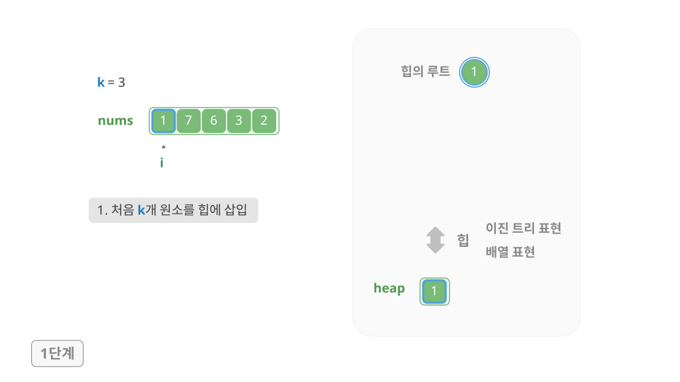
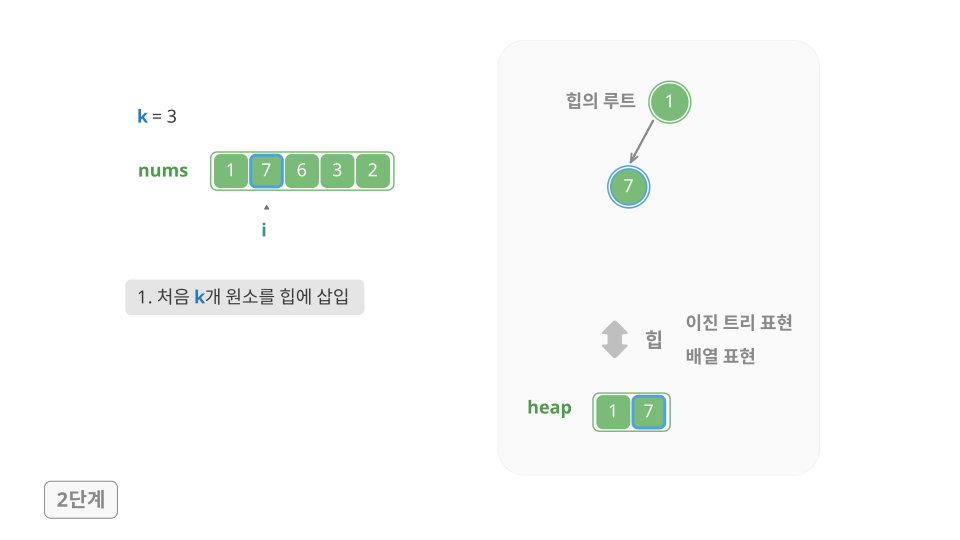
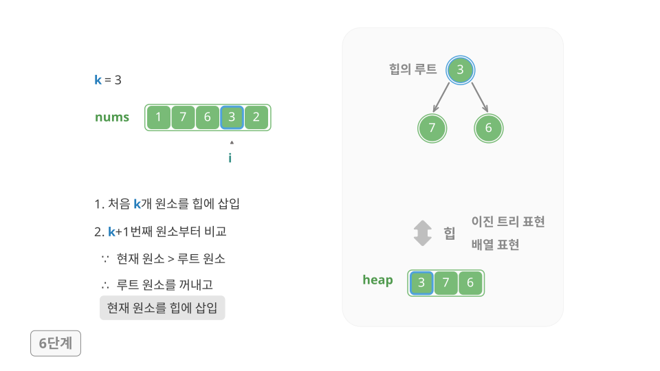
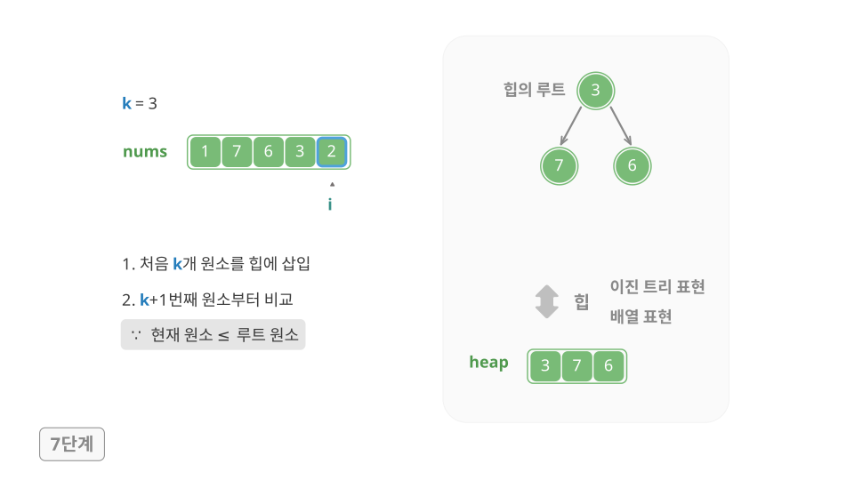
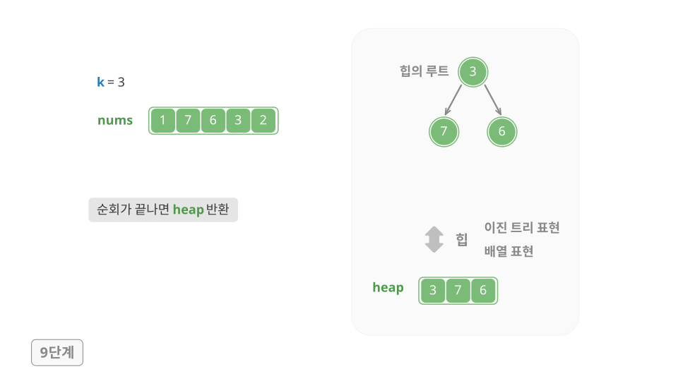

# 상위 k개 찾기 문제

!!! question

    정렬되지 않은 배열 `nums`의 길이가 $n$일 때, 배열에서 가장 큰 원소 $k$개를 반환하라.

먼저 생각하기 쉬운 두 가지 풀이를 살펴본 뒤 더 효율적인 힙 풀이를 소개한다.

## 방법 1: 순회하며 선택하기

아래 그림처럼 $k$번 순회한다. 순회할 때마다 큰 순서대로 $1$번째, $2$번째, $\dots$, 마지막으로 $k$번째 원소를 뽑는다. 시간 복잡도는 $O(nk)$이다.

이 방법은 $k \ll n$일 때만 적합하다. $k$가 $n$에 가까우면 시간 복잡도가 $O(n^2)$에 가까워져 시간이 매우 오래 걸린다.


!!! tip

    $k = n$이면 정렬된 전체 수열을 얻게 되며, 이때는 선택 정렬 알고리즘과 같다.

## 방법 2: 정렬

아래 그림처럼 먼저 배열 `nums`를 정렬한 뒤 맨 오른쪽 원소 $k$개를 반환한다. 시간 복잡도는 $O(n \log n)$이다.

이 방법은 필요한 것보다 더 많은 일을 한다. 가장 큰 원소 $k$개만 찾으면 되므로 나머지 원소까지 정렬할 필요는 없다.


## 방법 3: 힙

힙을 사용하면 상위 k개 찾기 문제를 더 효율적으로 풀 수 있다. 과정은 아래 그림과 같다.

1. 루트 원소가 최솟값인 최소 힙을 초기화한다.
2. 먼저 배열의 처음 $k$개 원소를 차례로 힙에 삽입한다.
3. $k + 1$번째 원소부터는 현재 원소가 루트 원소보다 클 때 루트 원소를 꺼내고 현재 원소를 삽입한다.
4. 순회를 마치면 힙에 남은 원소가 바로 가장 큰 원소 $k$개다.

=== "<1>"
    

=== "<2>"
    

=== "<3>"
    

=== "<4>"
    

=== "<5>"
    

=== "<6>"
    

=== "<7>"
    

=== "<8>"
    

=== "<9>"
    

예제 코드는 다음과 같다.

```src
[file]{top_k}-[class]{}-[func]{top_k_heap}
```

삽입과 삭제를 처리하는 횟수는 총 $n$회이고 힙의 최대 길이는 $k$이므로 시간 복잡도는 $O(n \log k)$이다. 이 방법은 매우 효율적이다. $k$가 작으면 시간 복잡도가 $O(n)$에 가까워지고, $k$가 커도 $O(n \log n)$을 넘지 않는다.

이 방법은 데이터가 계속 들어오는 스트림에도 적합하다. 새 데이터가 추가될 때마다 힙 안의 원소를 관리하면 가장 큰 원소 $k$개를 계속 갱신할 수 있다.
