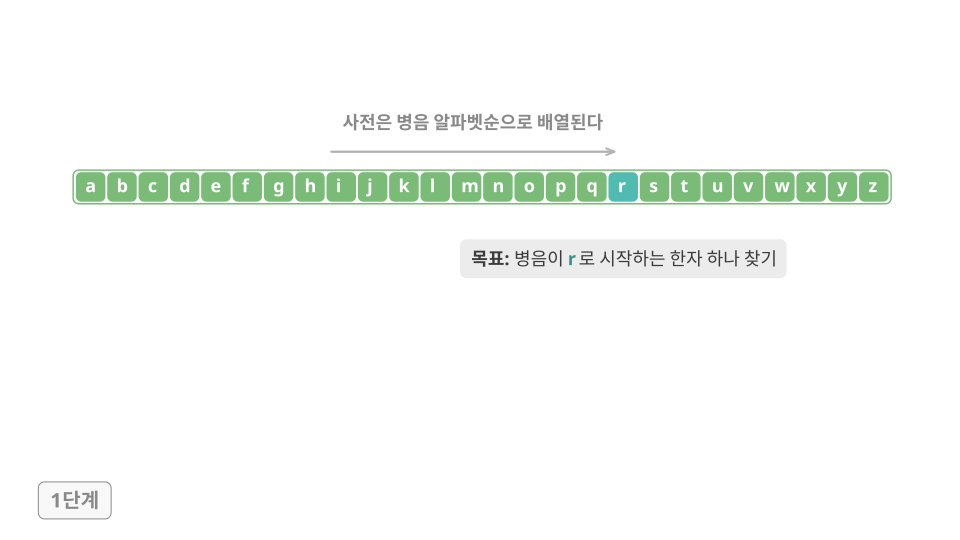
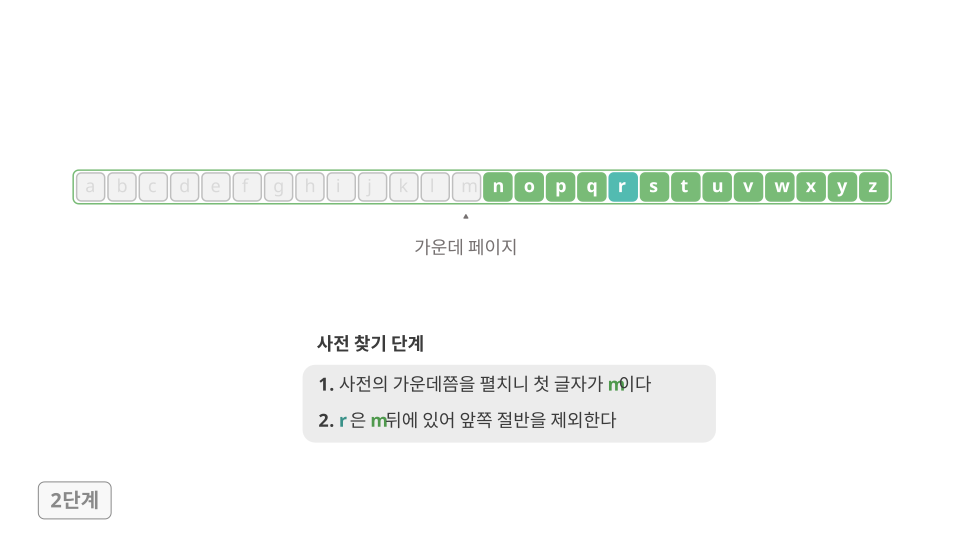
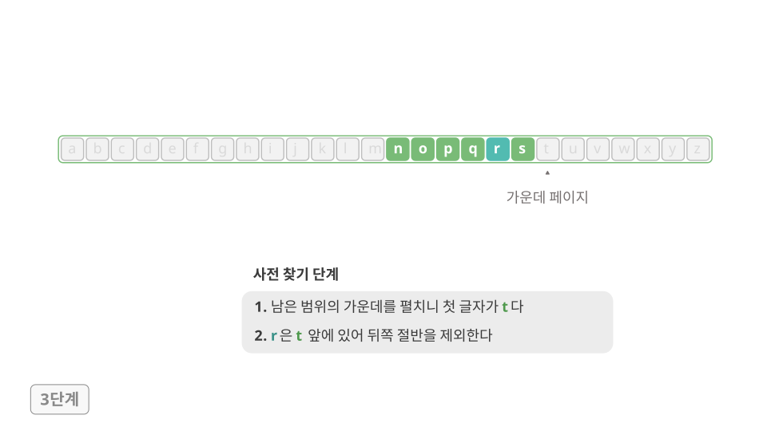
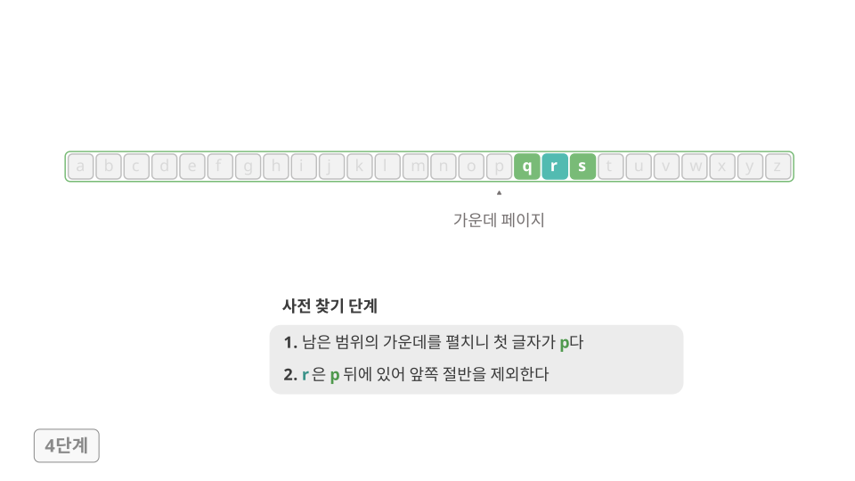
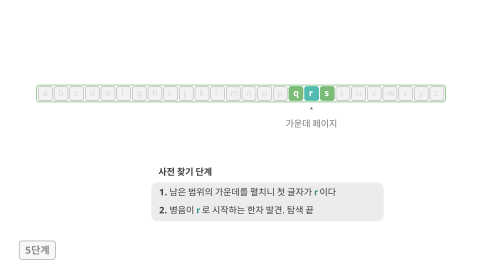
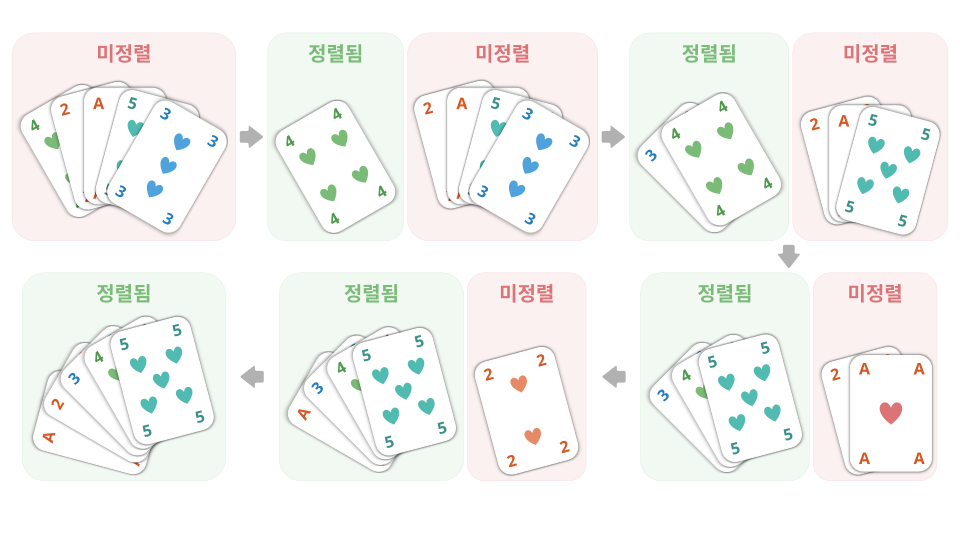
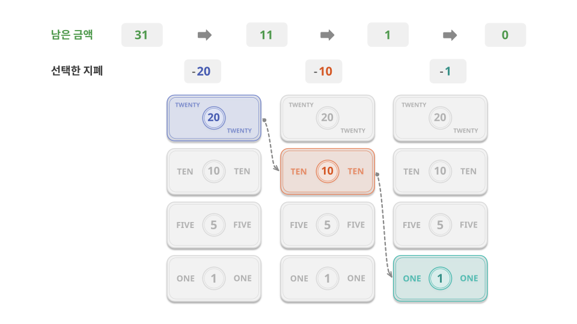

# 1.1 &nbsp; 알고리즘은 어디에나 있다

‘알고리즘’이라는 말을 들으면 자연스럽게 수학을 떠올리곤 한다. 하지만 많은 알고리즘은 복잡한 수학보다 기본적인 논리에 더 많이 의존한다. 이런 논리는 우리 일상 곳곳에서 찾아볼 수 있다.

알고리즘을 본격적으로 살펴보기 전에 흥미로운 사실이 하나 있다. **우리는 이미 자신도 모르게 많은 알고리즘을 배웠고 일상에서 익숙하게 활용하고 있다**. 구체적인 예를 몇 가지 살펴보자.

**첫 번째 예: 사전 찾기**. 중국어 사전에서 각 한자에는 병음이 있고, 한자는 병음의 알파벳순으로 배열되어 있다. 병음이 $r$로 시작하는 한자를 찾는다면 보통 다음 그림(1-1)과 같이 한다.

1. 사전의 가운데쯤을 펼쳐 그 페이지에 있는 한자의 병음이 어느 글자로 시작하는지 본다. 첫 글자가 $m$이라고 하자.
2. 병음 알파벳순으로 $r$은 $m$보다 뒤에 있으므로 사전의 앞쪽 절반을 제외한다. 탐색 범위가 뒤쪽 절반으로 좁아진다.
3. 병음이 $r$로 시작하는 페이지를 찾을 때까지 `1.`과 `2.` 단계를 되풀이한다.

=== "<1>"
    { class="animation-figure" }

=== "<2>"
    { class="animation-figure" }

=== "<3>"
    { class="animation-figure" }

=== "<4>"
    { class="animation-figure" }

=== "<5>"
    { class="animation-figure" }

 그림 1-1 &nbsp; 사전 찾기 단계 

초등학생도 배우는 이 사전 찾기가 바로 유명한 ‘이진 탐색’ 알고리즘이다. 자료 구조의 관점에서 사전은 정렬된 ‘배열’이고, 알고리즘의 관점에서 방금 살펴본 일련의 동작은 ‘이진 탐색’이다.

**두 번째 예: 카드 정리하기**. 카드놀이를 할 때면 매 판 손에 든 카드를 숫자가 작은 것부터 차례로 정리한다. 과정은 다음 그림(1-2)과 같다.

1. 카드를 정렬 구간과 미정렬 구간으로 나눈다. 처음에는 맨 왼쪽 카드 한 장이 이미 정렬되어 있다고 본다.
2. 미정렬 구간에서 카드 한 장을 꺼내 정렬 구간의 알맞은 위치에 끼워 넣는다. 그러면 맨 왼쪽 두 장이 정렬되어 있다.
3. `2.` 단계를 반복한다. 매번 미정렬 구간에서 한 장을 꺼내 정렬 구간에 끼워 넣으며, 모든 카드가 정렬되면 끝낸다.

{ class="animation-figure" }

 그림 1-2 &nbsp; 카드 정렬 단계 

이렇게 카드를 정리하는 방법이 바로 ‘삽입 정렬’ 알고리즘이다. 삽입 정렬은 작은 데이터 집합을 정렬할 때 매우 효율적이다. 여러 프로그래밍 언어의 정렬 라이브러리 함수에서도 삽입 정렬을 찾아볼 수 있다.

**세 번째 예: 거스름돈 주기**. 마트에서 $69$위안짜리 물건을 사고 계산원에게 $100$위안을 냈다고 하자. 계산원은 $31$위안을 거슬러 줘야 한다. 이때 자연스럽게 다음 그림(1-3)과 같이 생각하게 된다.

1. 선택지는 $31$위안보다 액면이 작은 돈으로, $1$위안권, $5$위안권, $10$위안권, $20$위안권이 있다.
2. 그중 가장 큰 $20$위안권을 꺼내면 $31 - 20 = 11$위안이 남는다.
3. 남은 금액에서 고를 수 있는 가장 큰 $10$위안권을 꺼내면 $11 - 10 = 1$위안이 남는다.
4. 남은 금액에서 고를 수 있는 가장 큰 $1$위안권을 꺼내면 $1 - 1 = 0$위안이 남는다.
5. 거스름돈을 모두 주었다. 금액은 $20 + 10 + 1 = 31$위안이다.

{ class="animation-figure" }

 그림 1-3 &nbsp; 거스름돈을 주는 과정 

각 단계에서 그때 가장 좋아 보이는 선택, 곧 가능한 한 큰 지폐를 고르는 선택을 했다. 그 결과 실제로 거스름돈을 줄 수 있는 방법을 얻었다. 자료 구조와 알고리즘의 관점에서 보면 이것이 바로 ‘탐욕’ 알고리즘이다.

요리 한 접시를 만드는 일부터 별과 별 사이를 여행하는 일까지, 거의 모든 문제를 해결하는 데 알고리즘이 쓰인다. 컴퓨터가 등장하면서 우리는 프로그래밍을 통해 자료 구조를 메모리에 저장하고 CPU와 GPU가 알고리즘을 실행하도록 코드를 작성할 수 있게 되었다. 이제 생활 속 문제를 컴퓨터로 옮겨 온갖 복잡한 문제를 더욱 효율적으로 풀 수 있다.

!!! tip

    자료 구조, 알고리즘, 배열, 이진 탐색 같은 개념이 아직 어렴풋해도 계속 읽어 보자. 이 책이 자료 구조와 알고리즘의 세계로 안내할 것이다.
