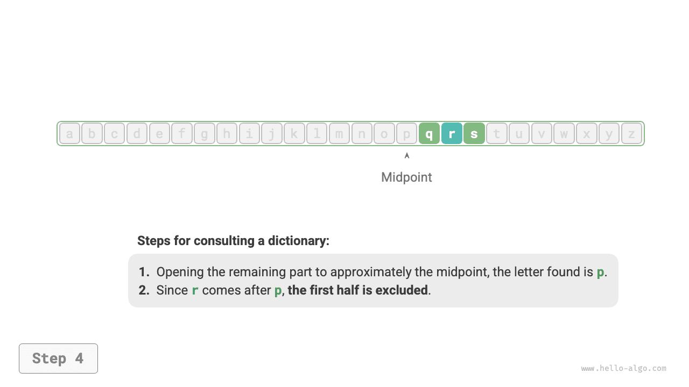

# 1.1 &nbsp; 어디에나 있는 알고리즘

‘알고리즘’이라는 말을 들으면 자연스럽게 수학을 떠올리게 된다. 하지만 실제로 많은 알고리즘은 복잡한 수학보다는 기본적인 논리에 더 많이 의존하며, 이러한 논리는 일상생활 곳곳에서 찾아볼 수 있다.

알고리즘을 본격적으로 살펴보기 전에 흥미로운 사실 하나를 소개하고자 한다. **여러분은 이미 자신도 모르게 많은 알고리즘을 익혔고, 일상생활에서 자연스럽게 사용하고 있다.** 몇 가지 구체적인 예를 통해 이 사실을 확인해 보자.

**예 1: 사전에서 단어 찾기**. 중국어 사전에서는 각 한자에 대응하는 병음이 있고, 표제어는 병음의 알파벳순으로 배열되어 있다. 병음의 첫 글자가 $r$인 한자를 찾는다고 가정하면, 보통 아래 그림(1-1)과 같은 방법을 사용한다.

1. 사전의 중간쯤을 펼쳐 그 페이지의 병음 첫 글자를 확인한다. 첫 글자가 $m$이라고 가정하자.
2. 병음의 알파벳순에서 $r$은 $m$ 뒤에 있으므로 사전의 앞쪽 절반을 제외하고 탐색 범위를 뒤쪽 절반으로 좁힌다.
3. 병음의 첫 글자가 $r$인 페이지를 찾을 때까지 단계 `1.`과 단계 `2.`를 반복한다.

=== "<1>"
    { class="animation-figure" }

=== "<2>"
    { class="animation-figure" }

=== "<3>"
    { class="animation-figure" }

=== "<4>"
    { class="animation-figure" }

=== "<5>"
    { class="animation-figure" }

 그림 1-1 &nbsp; 사전에서 단어를 찾는 단계 

초등학생도 익히는 사전 찾기는 사실 유명한 ‘이진 탐색’ 알고리즘이다. 자료 구조의 관점에서 사전은 정렬된 ‘배열’로 볼 수 있고, 알고리즘의 관점에서 앞서 살펴본 사전 찾기의 일련의 동작은 ‘이진 탐색’으로 볼 수 있다.

**예 2: 카드 정리하기**. 카드 게임을 할 때는 매번 손에 든 카드를 작은 수부터 큰 수 순서로 정리한다. 그 과정은 아래 그림(1-2)과 같다.

1. 카드를 ‘정렬된 부분’과 ‘정렬되지 않은 부분’으로 나누고, 처음에는 맨 왼쪽 카드 1장이 이미 정렬되어 있다고 가정한다.
2. 정렬되지 않은 부분에서 카드 한 장을 꺼내 정렬된 부분의 올바른 위치에 끼워 넣는다. 그러면 맨 왼쪽 카드 2장이 정렬된 상태가 된다.
3. 단계 `2.`를 반복하여 매번 정렬되지 않은 부분의 카드 한 장을 정렬된 부분에 끼워 넣는다. 모든 카드가 정렬될 때까지 계속한다.

{ class="animation-figure" }

 그림 1-2 &nbsp; 카드를 정렬하는 단계 

이러한 카드 정리 방법은 본질적으로 ‘삽입 정렬’ 알고리즘이며, 작은 데이터 집합을 처리할 때 매우 효율적이다. 많은 프로그래밍 언어의 정렬 라이브러리 함수에서도 삽입 정렬이 사용된다.

**예 3: 거스름돈 주기**. 마트에서 $69$위안어치 물건을 사고 계산원에게 $100$위안을 냈다고 가정하자. 계산원은 $31$위안을 거슬러 주어야 하며, 자연스럽게 아래 그림(1-3)과 같은 과정을 떠올린다.

1. 선택할 수 있는 것은 액면가가 $31$위안보다 작은 화폐로, $1$위안, $5$위안, $10$위안, $20$위안이 있다.
2. 선택지 중 가장 큰 $20$위안을 꺼내면 $31 - 20 = 11$위안이 남는다.
3. 남은 선택지 중 가장 큰 $10$위안을 꺼내면 $11 - 10 = 1$위안이 남는다.
4. 남은 선택지 중 가장 큰 $1$위안을 꺼내면 $1 - 1 = 0$위안이 남는다.
5. 거스름돈을 모두 주었다. 그 구성은 $20 + 10 + 1 = 31$위안이다.

{ class="animation-figure" }

 그림 1-3 &nbsp; 거스름돈을 주는 과정 

위 과정에서는 각 단계마다 현재 가장 좋아 보이는 선택, 즉 가능한 한 액면가가 큰 화폐를 고른다. 그 결과 거스름돈을 줄 수 있는 방법을 얻는다. 자료 구조와 알고리즘의 관점에서 이 방법은 본질적으로 ‘탐욕’ 알고리즘이다.

작게는 요리 한 가지를 만드는 일부터 크게는 성간 항해에 이르기까지, 거의 모든 문제의 해결에는 알고리즘이 필요하다. 컴퓨터의 등장으로 우리는 프로그래밍을 통해 자료 구조를 메모리에 저장하고, CPU와 GPU가 알고리즘을 실행하도록 코드를 작성할 수 있게 되었다. 이로써 현실의 문제를 컴퓨터로 옮겨 다양한 복잡한 문제를 더 효율적으로 해결할 수 있다.

!!! tip "참고"

    자료 구조, 알고리즘, 배열, 이진 탐색 등의 개념이 아직 막연하게 느껴져도 계속 읽어 나가면 된다. 이 책이 자료 구조와 알고리즘의 지식 세계로 안내할 것이다.
