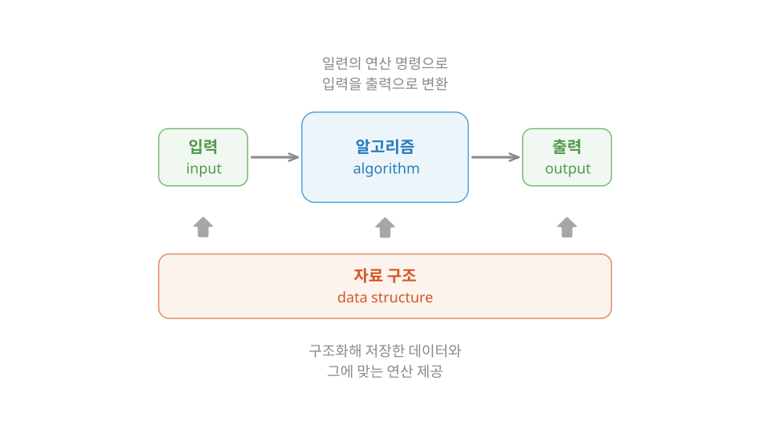

# 알고리즘이란 무엇인가

## 알고리즘의 정의

<u>알고리즘(algorithm)</u>은 유한한 시간 안에 특정 문제를 해결하는 일련의 명령이나 작업 절차다. 다음과 같은 특성이 있다.

- 풀려는 문제가 명확하고 입력과 출력이 분명하게 정의되어 있다.
- 실행할 수 있어야 한다. 유한한 수의 단계, 유한한 시간과 메모리 공간으로 완료할 수 있다.
- 각 단계의 의미가 명확하며 입력과 실행 조건이 같으면 출력도 항상 같다.

## 자료 구조의 정의

<u>자료 구조(data structure)</u>는 데이터를 조직하고 저장하는 방식이다. 데이터의 내용, 데이터 사이의 관계, 데이터를 다루는 방법을 아우르며 다음을 목표로 설계한다.

- 컴퓨터 메모리를 절약하도록 공간을 가능한 한 적게 차지한다.
- 데이터 접근, 추가, 삭제, 갱신 등의 연산을 가능한 한 빠르게 수행한다.
- 알고리즘이 효율적으로 실행될 수 있도록 간결한 데이터 표현과 논리적 정보를 제공한다.

**자료 구조를 설계할 때는 여러 요구 사이에서 균형을 잡아야 한다**. 한 측면을 개선하려면 다른 측면에서 양보해야 할 때가 많다. 두 가지 예를 살펴보자.

- 연결 리스트는 배열보다 데이터를 추가하고 삭제하기가 편리하지만 데이터에 접근하는 속도는 느리다.
- 그래프는 연결 리스트보다 더 풍부한 논리적 정보를 제공하지만 메모리 공간이 더 필요하다.

## 자료 구조와 알고리즘의 관계

아래 그림처럼 자료 구조와 알고리즘은 서로 깊이 연관되어 긴밀하게 맞물린다. 구체적으로는 다음 세 측면에서 살펴볼 수 있다.

- 자료 구조는 알고리즘의 토대다. 구조화해 저장한 데이터와 그 데이터를 다루는 방법을 알고리즘에 제공한다.
- 알고리즘은 자료 구조에 생명을 불어넣는다. 자료 구조 자체는 데이터에 관한 정보만 저장한다. 알고리즘과 결합해야 특정 문제를 해결할 수 있다.
- 같은 알고리즘을 여러 자료 구조로 구현할 수 있지만 실행 효율은 크게 달라질 수 있다. 알맞은 자료 구조를 선택하는 것이 중요하다.

자료 구조와 알고리즘은 아래 그림처럼 블록을 조립하는 일에 비유할 수 있다. 블록 세트에는 많은 부품과 함께 자세한 조립 설명서가 들어 있다. 설명서대로 한 단계씩 따라 하면 멋진 블록 모형을 완성할 수 있다.

둘 사이의 대응 관계를 자세히 정리하면 다음 표와 같다.

 표 <id> &nbsp; 블록 조립에 빗댄 자료 구조와 알고리즘 

| 자료 구조와 알고리즘 | 블록 조립                                 |
| -------------- | ---------------------------------------- |
| 입력 데이터       | 아직 조립하지 않은 블록                             |
| 자료 구조       | 모양, 크기, 연결 방식 등 블록을 구성하는 방식 |
| 알고리즘           | 블록을 목표한 모양으로 조립하는 일련의 작업 단계       |
| 출력 데이터       | 블록 모형                                 |

자료 구조와 알고리즘은 프로그래밍 언어와 독립적이라는 점을 기억하자. 이 책이 여러 언어로 구현 예를 제공할 수 있는 것도 그 덕분이다.

!!! tip "흔히 쓰는 줄임말"

    실제로 이야기할 때는 ‘자료 구조와 알고리즘’을 줄여 ‘알고리즘’이라고 부르는 경우가 많다. 예를 들어 널리 알려진 리트코드의 알고리즘 문제는 실제로 자료 구조와 알고리즘 양쪽의 지식을 함께 평가한다.
