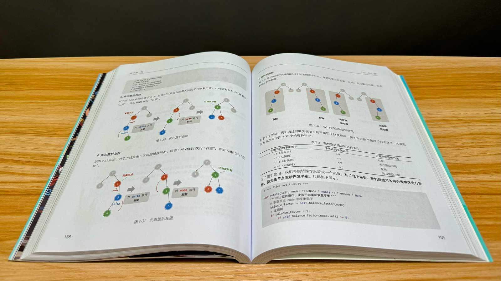
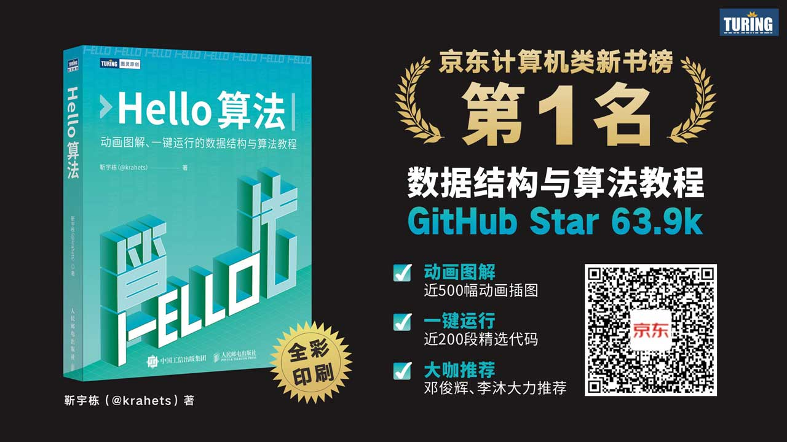

# 종이책

오랜 시간 다듬어 온 『Hello 算法』 중국어판 종이책이 드디어 출간되었다! 지금의 마음은 다음 시구로 표현할 수 있다.

바람과 달을 좇으며 멈추지 말라. 들판이 끝나는 곳에 봄 산이 있으리니.

{ class="animation-figure" }

아래 영상에서는 종이책을 소개하고 다음 주제에 대한 나의 생각을 나눈다.

- 자료 구조와 알고리즘을 배우는 것이 중요한 이유.
- 종이책의 프로그래밍 언어로 Python을 선택한 이유.
- 지식을 나누는 일에 대한 생각.

> 이제 막 영상을 올리기 시작했다. 많은 관심과 좋아요·코인·즐겨찾기를 부탁드린다. 감사드린다!

    <iframe src="//player.bilibili.com/player.html?aid=1051597767&bvid=BV1QH4y157uC&cid=1462564112&p=1&autoplay=0" scrolling="no" border="0" frameborder="no" framespacing="0" allowfullscreen="true"> </iframe>

종이책의 일부를 사진으로 소개한다.

{ class="animation-figure" }

{ class="animation-figure" }

## 장점과 아쉬운 점

종이책에서 기대할 만한 점을 정리하면 다음과 같다.

- 전체 컬러 인쇄로 이 책의 ‘애니메이션 그림’이 가진 장점을 충실하게 살렸다.
- 종이 재질을 신중하게 골라 색을 정확하게 재현하면서도 종이책 특유의 질감을 유지했다.
- 그림 속 수식을 이탤릭체로 표시하는 등 웹 버전보다 서식을 더 엄밀하게 다듬었다.
- 정가를 올리지 않고 마인드맵 접지와 책갈피를 함께 제공한다.
- 중국어판은 종이책, 웹 버전, PDF 버전의 내용을 동기화하여 자유롭게 오가며 읽을 수 있다.

!!! tip "참고"

    종이책과 웹 버전의 내용을 맞추기가 쉽지 않아 세부 내용에 차이가 있을 수 있다. 양해 부탁드린다!

물론 구입하기 전에 고려할 점도 있다.

- Python을 사용하므로 여러분의 주력 언어와 다를 수 있다. Python을 의사 코드처럼 보고 풀이의 아이디어를 이해하는 데 집중하면 된다.
- 전체 컬러 인쇄는 그림과 코드를 읽는 경험을 크게 개선하지만, 흑백 인쇄보다 가격이 조금 높다.

!!! tip "참고"

    ‘인쇄 품질’과 ‘가격’은 알고리즘의 ‘시간 효율’과 ‘공간 효율’처럼 동시에 만족시키기 어렵다. 나는 ‘인쇄 품질’이 ‘시간 효율’에 해당하며, 더 중요하게 고려해야 한다고 생각한다.

## 구매 링크

종이책에 관심이 있다면 한 권 구입해 보아도 좋다. 독자를 위해 신간 50% 할인 혜택을 마련했다. [이 링크](https://3.cn/1X-qmTD3)를 열거나 아래 QR 코드를 스캔하면 된다.

{ class="animation-figure" }

## 맺음말

처음에는 종이책을 출간하는 데 필요한 작업량을 과소평가했다. 오픈 소스 프로젝트만 잘 관리하면 어떤 자동화 방법으로 종이책을 만들 수 있을 것이라 생각했다. 실제로 해 보니 종이책의 제작 과정과 오픈 소스 프로젝트의 갱신 방식은 크게 달랐으며, 둘을 연결하려면 많은 추가 작업이 필요했다.

초고가 출판 기준을 충족하는 최종 원고가 되기까지는 여전히 긴 과정이 필요하다. 출판사의 기획, 편집, 디자인, 마케팅 담당자와 저자가 긴밀하게 협력하며 오랫동안 다듬어야 한다. 튜링의 기획 편집자 왕쥔화(王军花), 그리고 이 책의 출판 과정에 참여한 인민우전출판사와 튜링 커뮤니티의 모든 관계자에게 감사드린다!

이 책이 여러분에게 도움이 되기를 바란다!
