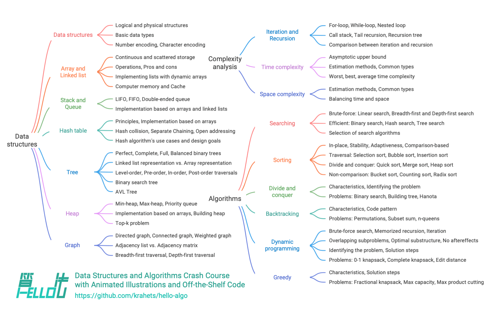

# 이 책에 대하여

이 프로젝트는 오픈 소스로 공개되는 무료 자료 구조와 알고리즘 입문서를 만드는 것을 목표로 한다. 처음 배우는 사람도 쉽게 접근할 수 있는 책을 지향한다.

- 책 전체에 애니메이션 그림을 사용하여 내용을 명확하고 이해하기 쉽게 설명한다. 난이도를 완만하게 높여 가며 초보자가 자료 구조와 알고리즘의 지식 지도를 탐험하도록 안내한다.
- 소스 코드를 클릭 한 번으로 실행할 수 있다. 독자가 실습을 통해 프로그래밍 능력을 키우고 알고리즘의 동작 원리와 자료 구조의 내부 구현을 이해하도록 돕는다.
- 독자들이 서로 도우며 공부하기를 권장한다. 댓글에서 질문하고 의견을 나누며 함께 성장할 수 있다.

## 대상 독자

알고리즘을 처음 접하는 입문자이거나, 문제를 풀어 본 경험은 조금 있지만 자료 구조와 알고리즘에 대한 이해가 막연해 알 것 같다가도 모르겠다는 생각이 든다면, 이 책은 바로 여러분을 위한 책이다!

이미 상당한 수의 문제를 풀었고 대부분의 문제 유형에 익숙하다면, 이 책을 통해 알고리즘 지식을 되짚고 체계적으로 정리할 수 있다. 저장소의 소스 코드는 ‘문제 풀이 도구 모음’이나 ‘알고리즘 사전’처럼 활용할 수 있다.

알고리즘의 ‘고수’라면 소중한 의견을 보내 주거나 [집필에 함께 참여해 주기를](../chapter_appendix/contribution.md) 기대한다.

!!! success "선수 지식"

    적어도 한 가지 언어의 프로그래밍 기초를 알고, 간단한 코드를 읽고 작성할 수 있어야 한다.

## 내용 구성

이 책의 주요 내용은 아래 그림과 같다.

- **복잡도 분석**: 자료 구조와 알고리즘을 평가하는 기준과 방법을 다룬다. 시간 복잡도와 공간 복잡도의 계산 방법, 대표적인 유형과 예제 등을 살펴본다.
- **자료 구조**: 기본 자료형과 자료 구조의 분류 방법을 다룬다. 배열, 연결 리스트, 스택, 큐, 해시 테이블, 트리, 힙, 그래프 등의 정의, 장단점, 자주 쓰는 연산, 대표적인 유형과 응용, 구현 방법 등을 살펴본다.
- **알고리즘**: 탐색, 정렬, 분할 정복, 백트래킹, 동적 계획법, 탐욕 등의 정의, 장단점, 효율성, 활용 상황, 문제 해결 단계와 예제 문제 등을 살펴본다.

## 감사의 말

이 책은 오픈 소스 커뮤니티의 수많은 기여자가 함께 노력한 덕분에 계속 발전하고 있다. 시간과 노력을 들여 준 모든 집필 참여자에게 감사드린다. 참여자는 다음과 같다(GitHub가 자동으로 생성한 순서): krahets, coderonion, Gonglja, nuomi1, Reanon, justin-tse, hpstory, danielsss, curtishd, night-cruise, S-N-O-R-L-A-X, rongyi, msk397, gvenusleo, khoaxuantu, rivertwilight, K3v123, gyt95, zhuoqinyue, yuelinxin, Zuoxun, mingXta, Phoenix0415, FangYuan33, GN-Yu, longsizhuo, pengchzn, QiLOL, Cathay-Chen, guowei-gong, xBLACKICEx, IsChristina, JoseHung, qualifier1024, hello-ikun, magentaqin, Guanngxu, thomasq0, sunshinesDL, L-Super, Transmigration-zhou, WSL0809, Slone123c, lhxsm, yuan0221, what-is-me, theNefelibatas, Shyam-Chen, sangxiaai, longranger2, codeberg-user, xiongsp, JeffersonHuang, prinpal, seven1240, Wonderdch, malone6, xiaomiusa87, gaofer, bluebean-cloud, a16su, SamJin98, hongyun-robot, nanlei, XiaChuerwu, yd-j, iron-irax, mgisr, steventimes, junminhong, heshuyue, danny900714, Nigh, Dr-XYZ, MolDuM, XC-Zero, reeswell, PXG-XPG, NI-SW, Horbin-Magician, Enlightenus, YangXuanyi, xjr7670, beatrix-chan, DullSword, qq909244296, iStig, boloboloda, hts0000, gledfish, fbigm, echo1937, jiaxianhua, wenjianmin, keshida, kilikilikid, lclc6, lwbaptx, linyejoe2, liuxjerry, szu17dmy, dshlstarr, Yucao-cy, coderlef, czruby, bongbongbakudan, beintentional, ZongYangL, ZhongYuuu, ZhongGuanbin, hezhizhen, linzeyan, ZJKung, JTCPOWI, KawaiiAsh, luluxia, xb534, ztkuaikuai, yw-1021, ElaBosak233, baagod, zhouLion, yishangzhang, yi427, yanedie, yabo083, weibk, wangwang105, th1nk3r-ing, tao363, 4yDX3906, syd168, sslmj2020, smilelsb, siqyka, selear, sdshaoda, Xi-Row, popozhu, nuquist19, noobcodemaker, XiaoK29, chadyi, lyl625760, lucaswangdev, llql1211, 0130w, shanghai-Jerry, EJackYang, Javesun99, eltociear, lipusheng, KNChiu, BlindTerran, ShiMaRing, lovelock, FreddieLi, FloranceYeh, fanchenggang, gltianwen, goerll, nedchu, curly210102, CuB3y0nd, KraHsu, CarrotDLaw, youshaoXG, bubble9um, Asashishi, Asa0oo0o0o, fanenr, eagleanurag, akshiterate, 52coder, foursevenlove, KorsChen, hopkings2008, yang-le, realwujing, Evilrabbit520, Umer-Jahangir, Turing-1024-Lee, Suremotoo, paoxiaomooo, Chieko-Seren, Senrian, Allen-Scai, 19santosh99, ymmmas, Risuntsy, Richard-Zhang1019, RafaelCaso, qingpeng9802, primexiao, Urbaner3, codetypess, nidhoggfgg, MwumLi, CreatorMetaSky, martinx, ZnYang2018, hugtyftg, logan-qiu, psychelzh, Kunchen-Luo, Keynman 및 KeiichiKasai.

이 책의 코드 검토는 coderonion, curtishd, Gonglja, gvenusleo, hpstory, justin-tse, khoaxuantu, krahets, night-cruise, nuomi1, Reanon 및 rongyi가 맡았다(알파벳순). 시간과 노력을 들여 준 이들에게 감사드린다. 이들 덕분에 각 언어의 코드가 일관된 규칙과 형식을 유지할 수 있었다.

영문판은 yuelinxin, K3v123, magentaqin, QiLOL, Phoenix0415, SamJin98, yanedie, RafaelCaso, pengchzn 및 thomasq0가 검토했다. 일본어판은 eltociear가, 러시아어판은 И. А. Шевкун과 Yuyan Huang이, 번체 중국어판은 Shyam-Chen과 Dr-XYZ가 검토했다. 이들의 기여 덕분에 더 많은 독자에게 이 책을 전할 수 있게 되었다. 모두에게 감사드린다.

이 책의 ePub 전자책 생성 도구는 zhongfq가 개발했다. 독자에게 더 유연한 독서 방식을 제공해 준 그의 기여에 감사드린다.

이 책을 쓰는 동안 많은 분의 도움을 받았다.

- 회사에서 나의 멘토였던 리시(李汐) 박사에게 감사드린다. 긴 대화 중 “어서 행동에 옮겨 보라”고 격려해 준 덕분에 이 책을 쓰겠다는 결심을 굳힐 수 있었다.
- 이 책의 첫 독자가 되어 준 여자 친구 파오파오(泡泡)에게 감사드린다. 알고리즘 입문자의 시각에서 많은 소중한 의견을 주어 초보자가 읽기 더 좋은 책이 되었다.
- 텅바오(腾宝), 치바오(琦宝), 페이바오(飞宝)에게 감사드린다. 이 책에 창의적인 이름을 지어 주어 모두가 첫 코드 “Hello World!”를 작성하던 아름다운 기억을 떠올리게 했다.
- 지식재산권에 관한 전문적인 도움을 준 샤오취안(校铨)에게 감사드린다. 이 도움은 오픈 소스 도서인 이 책을 완성해 가는 데 중요한 역할을 했다.
- 아름다운 표지와 로고를 디자인해 준 쑤퉁(苏潼)에게 감사드린다. 나의 지나친 꼼꼼함 때문에 여러 번 수정을 요청했는데도 인내심 있게 작업해 주었다.
- 편집과 조판에 관한 조언을 해 주고 오픈 소스 문서 테마 [Material-for-MkDocs](https://github.com/squidfunk/mkdocs-material)를 개발한 @squidfunk에게 감사드린다.

집필하면서 자료 구조와 알고리즘에 관한 많은 교재와 글을 읽었다. 이 작품들은 훌륭한 본보기가 되어 이 책의 정확성과 품질을 뒷받침해 주었다. 모든 선생님과 선배의 뛰어난 기여에 감사드린다!

이 책은 손으로 실습하고 머리로 생각하며 배우는 방식을 권장한다. 이 점에서는 [『실습으로 배우는 딥러닝(Dive into Deep Learning)』](https://github.com/d2l-ai/d2l-zh)에서 깊은 영감을 받았다. 독자 여러분에게 이 훌륭한 책을 적극 추천한다.

**부모님께 진심으로 감사드린다. 늘 보내 주신 지지와 격려 덕분에 이처럼 흥미로운 일을 할 기회를 얻었다.**
