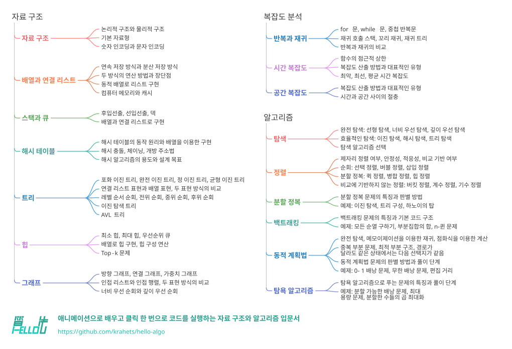

# 0.1 &nbsp; 이 책에 대하여

이 프로젝트의 목표는 누구나 무료로 이용할 수 있고 처음 배우는 사람도 쉽게 따라갈 수 있는 오픈 소스 자료 구조·알고리즘 입문서를 만드는 것이다.

- 책 전반에 걸쳐 애니메이션 그림으로 내용을 쉽게 풀어낸다. 초보자도 완만한 학습 곡선을 따라 자료 구조와 알고리즘의 개념 지도를 탐험할 수 있다.
- 소스 코드는 클릭 한 번으로 실행할 수 있다. 직접 연습하며 프로그래밍 실력을 기르고 알고리즘의 동작 원리와 자료 구조의 내부 구현을 알아볼 수 있다.
- 독자들이 서로 도우며 배우기를 권한다. 댓글로 질문과 생각을 나누고 토론하며 함께 성장하기 바란다.

## 0.1.1 &nbsp; 대상 독자

알고리즘을 한 번도 접해 보지 않았거나, 문제를 조금 풀어 봤지만 자료 구조와 알고리즘을 아는 듯 모르는 듯하다면 바로 당신을 위한 책이다!

이미 문제를 많이 풀어 대부분의 유형이 익숙하다면 이 책으로 알고리즘 지식을 복습하고 체계적으로 정리할 수 있다. 저장소의 소스 코드는 ‘문제 풀이 도구 모음’이나 ‘알고리즘 사전’으로 활용해도 좋다.

이미 알고리즘에 능숙한 독자라면 귀중한 의견을 보내 주거나 [집필에 함께해 주기](../chapter_appendix/contribution.md)를 기대한다.

!!! success "선수 지식"

    적어도 한 가지 언어로 프로그래밍하는 기초를 갖추고 간단한 코드를 읽고 쓸 수 있어야 한다.

## 0.1.2 &nbsp; 내용 구성

이 책의 주요 내용은 다음 그림(0-1)과 같다.

- **복잡도 분석**에서는 자료 구조와 알고리즘을 평가하는 기준과 방법을 살펴본다. 시간 복잡도와 공간 복잡도를 구하는 방법, 대표적인 유형과 예제 등을 다룬다.
- **자료 구조**에서는 기본 자료형과 자료 구조의 분류 방법을 살펴본다. 배열, 연결 리스트, 스택, 큐, 해시 테이블, 트리, 힙, 그래프 등의 정의, 장단점, 주요 연산, 대표 유형과 응용, 구현 방법 등을 다룬다.
- **알고리즘**에서는 탐색, 정렬, 분할 정복, 백트래킹, 동적 계획법, 탐욕 알고리즘 등의 정의, 장단점, 효율, 활용 상황, 풀이 절차, 예제 문제 등을 다룬다.

{ class="animation-figure" }

 그림 0-1 &nbsp; 이 책의 주요 내용 

## 0.1.3 &nbsp; 감사의 말

이 책은 오픈 소스 커뮤니티의 많은 기여자가 힘을 모아 계속 발전시켜 왔다. 시간과 노력을 들여 원고에 기여한 모든 분께 감사드린다. 깃허브가 자동으로 정한 순서대로 이름을 소개한다. krahets, coderonion, Gonglja, nuomi1, Reanon, justin-tse, hpstory, danielsss, curtishd, night-cruise, S-N-O-R-L-A-X, rongyi, msk397, gvenusleo, khoaxuantu, rivertwilight, K3v123, gyt95, zhuoqinyue, yuelinxin, Zuoxun, mingXta, Phoenix0415, FangYuan33, GN-Yu, longsizhuo, pengchzn, QiLOL, Cathay-Chen, guowei-gong, xBLACKICEx, IsChristina, JoseHung, qualifier1024, hello-ikun, magentaqin, Guanngxu, thomasq0, sunshinesDL, L-Super, Transmigration-zhou, WSL0809, Slone123c, lhxsm, yuan0221, what-is-me, theNefelibatas, Shyam-Chen, sangxiaai, longranger2, codeberg-user, xiongsp, JeffersonHuang, prinpal, seven1240, Wonderdch, malone6, xiaomiusa87, gaofer, bluebean-cloud, a16su, SamJin98, hongyun-robot, nanlei, XiaChuerwu, yd-j, iron-irax, mgisr, steventimes, junminhong, heshuyue, danny900714, Nigh, Dr-XYZ, MolDuM, XC-Zero, reeswell, PXG-XPG, NI-SW, Horbin-Magician, Enlightenus, YangXuanyi, xjr7670, beatrix-chan, DullSword, qq909244296, iStig, boloboloda, hts0000, gledfish, fbigm, echo1937, jiaxianhua, wenjianmin, keshida, kilikilikid, lclc6, lwbaptx, linyejoe2, liuxjerry, szu17dmy, dshlstarr, Yucao-cy, coderlef, czruby, bongbongbakudan, beintentional, ZongYangL, ZhongYuuu, ZhongGuanbin, hezhizhen, linzeyan, ZJKung, JTCPOWI, KawaiiAsh, luluxia, xb534, ztkuaikuai, yw-1021, ElaBosak233, baagod, zhouLion, yishangzhang, yi427, yanedie, yabo083, weibk, wangwang105, th1nk3r-ing, tao363, 4yDX3906, syd168, sslmj2020, smilelsb, siqyka, selear, sdshaoda, Xi-Row, popozhu, nuquist19, noobcodemaker, XiaoK29, chadyi, lyl625760, lucaswangdev, llql1211, 0130w, shanghai-Jerry, EJackYang, Javesun99, eltociear, lipusheng, KNChiu, BlindTerran, ShiMaRing, lovelock, FreddieLi, FloranceYeh, fanchenggang, gltianwen, goerll, nedchu, curly210102, CuB3y0nd, KraHsu, CarrotDLaw, youshaoXG, bubble9um, Asashishi, Asa0oo0o0o, fanenr, eagleanurag, akshiterate, 52coder, foursevenlove, KorsChen, hopkings2008, yang-le, realwujing, Evilrabbit520, Umer-Jahangir, Turing-1024-Lee, Suremotoo, paoxiaomooo, Chieko-Seren, Senrian, Allen-Scai, 19santosh99, ymmmas, Risuntsy, Richard-Zhang1019, RafaelCaso, qingpeng9802, primexiao, Urbaner3, codetypess, nidhoggfgg, MwumLi, CreatorMetaSky, martinx, ZnYang2018, hugtyftg, logan-qiu, psychelzh, Kunchen-Luo, Keynman 및 KeiichiKasai.

이 책의 코드 리뷰는 알파벳순으로 coderonion, curtishd, Gonglja, gvenusleo, hpstory, justin-tse, khoaxuantu, krahets, night-cruise, nuomi1, Reanon, rongyi가 맡았다. 시간과 노력을 들여 각 언어의 코드가 규칙에 맞고 일관되도록 다듬어 준 이들에게 감사드린다.

영어판은 yuelinxin, K3v123, magentaqin, QiLOL, Phoenix0415, SamJin98, yanedie, RafaelCaso, pengchzn, thomasq0가, 일본어판은 eltociear가 검토했다. 러시아어판은 И. А. Шевкун과 Yuyan Huang이, 중국어 번체판은 Shyam-Chen과 Dr-XYZ가 검토했다. 이들 덕분에 이 책이 더 넓은 독자층을 만날 수 있었다. 깊이 감사드린다.

이 책의 ePub 전자책 생성 도구는 zhongfq가 개발했다. 독자들이 더 다양한 방식으로 책을 읽을 수 있게 해 준 데 감사드린다.

이 책을 쓰는 동안 많은 분의 도움을 받았다.

- 회사에서 나를 지도해 준 리시(李汐) 박사님께 감사드린다. 이야기를 나누며 건네주신 “어서 행동으로 옮겨 봐요”라는 한마디 덕분에 책을 쓰겠다는 결심을 굳혔다.
- 첫 독자가 되어 준 여자 친구 파오파오(泡泡)에게 감사한다. 알고리즘을 처음 배우는 사람의 눈으로 소중한 의견을 많이 주어 이 책이 초보자에게 더 알맞아졌다.
- 텅바오(腾宝), 치바오(琦宝), 페이바오(飞宝)에게 감사한다. 여러분이 지어 준 재치 있는 책 제목은 첫 코드 한 줄 “Hello World!”를 썼을 때의 즐거운 기억을 떠올리게 한다.
- 지식 재산권에 관해 전문적인 도움을 준 샤오취안(校铨)에게 감사한다. 이 오픈 소스 책을 다듬는 데 큰 힘이 되었다.
- 멋진 표지와 로고를 디자인해 준 쑤퉁(苏潼)에게 감사한다. 세세한 데까지 신경 쓰는 내 부탁에 몇 번이고 인내심을 갖고 수정해 주었다.
- 편집과 조판에 관해 조언해 주고 오픈 소스 문서 테마 [Material-for-MkDocs](https://github.com/squidfunk/mkdocs-material)를 개발한 @squidfunk에게 감사드린다.

집필하면서 자료 구조와 알고리즘에 관한 많은 교재와 글을 읽었다. 이 작품들은 훌륭한 본보기가 되어 이 책의 정확성과 완성도를 지키는 데 도움을 주었다. 뛰어난 성과를 남겨 주신 모든 선생님과 선배께 감사드린다!

이 책은 머리로 생각하고 손으로 직접 해 보는 공부법을 권한다. 이 점에서는 [《직접 해 보며 배우는 딥러닝》](https://github.com/d2l-ai/d2l-zh)에서 큰 영감을 받았다. 독자 여러분에게도 이 훌륭한 책을 꼭 권하고 싶다.

**부모님께 진심으로 감사드린다. 한결같은 지지와 격려 덕분에 이토록 즐거운 일을 해 볼 기회를 얻었다**.
