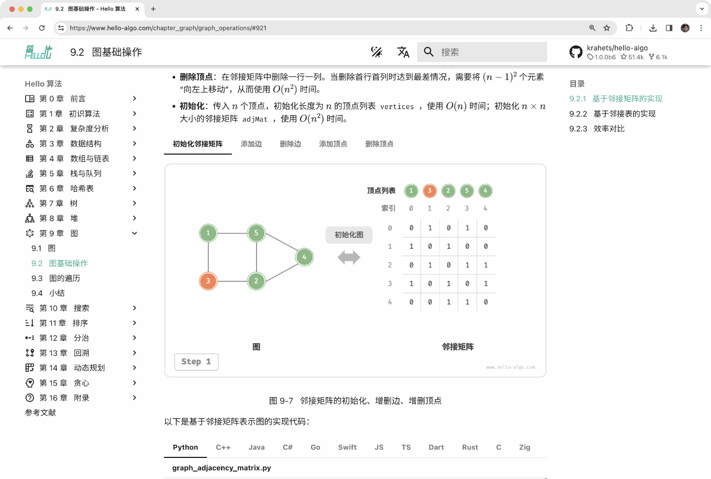
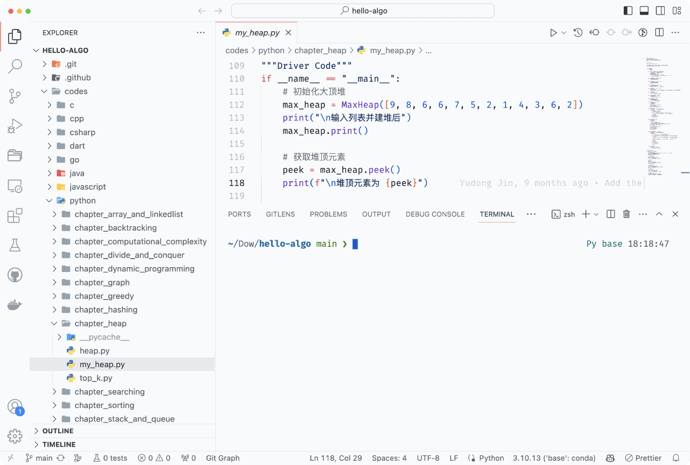
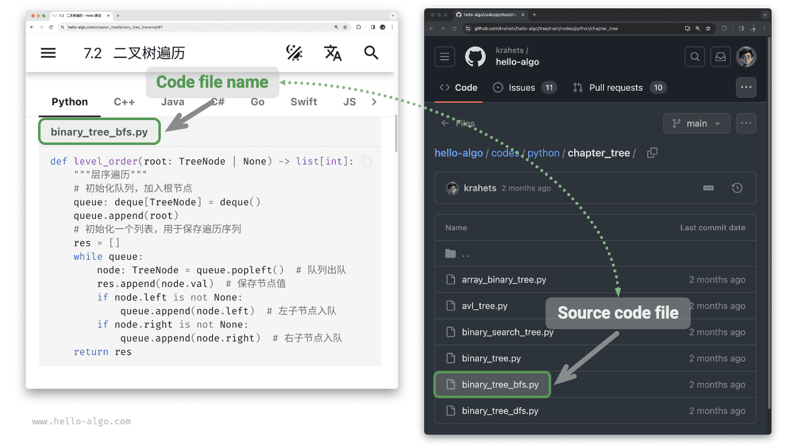
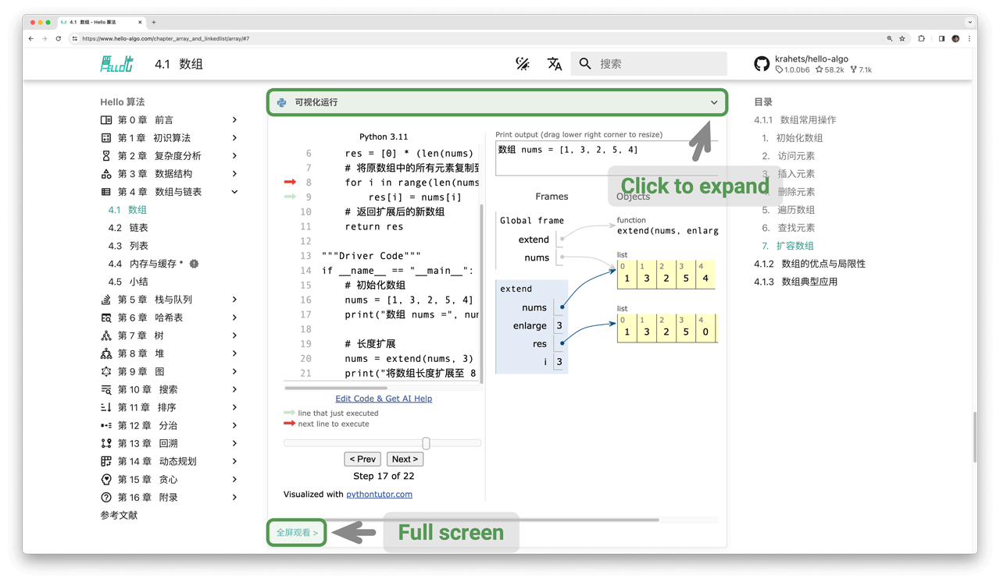
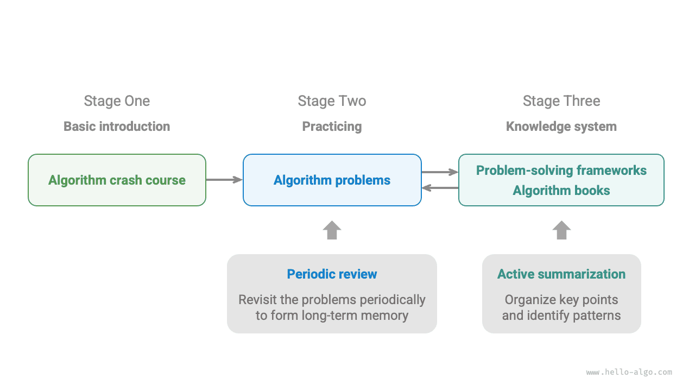

# 이 책을 활용하는 방법

!!! tip "참고"

    가장 좋은 독서 경험을 위해 이 절을 끝까지 읽어 보기를 권장한다.

## 글의 표현과 서식에 관한 약속

- 제목 뒤에 `*`가 붙은 절은 선택해서 읽는 심화 내용이다. 시간이 부족하면 우선 건너뛰어도 된다.
- 웹 버전에서는 전문 용어를 밑줄로 표시한다. 예를 들면 <u>배열(array)</u>과 같다. 문헌을 읽을 때 도움이 되므로 용어를 기억해 두기를 권장한다.
- 핵심 내용과 요약 문장은 **굵게 표시**한다. 이러한 문장은 특히 주의 깊게 읽을 필요가 있다.
- 특정한 의미로 사용하는 단어나 문구는 모호함을 피하기 위해 ‘따옴표’로 표시한다.
- 프로그래밍 언어마다 명칭이 다를 때는 Python을 기준으로 삼는다. 예를 들어 ‘비어 있음’을 나타낼 때 `None`을 사용한다.
- 이 책은 내용을 더 간결하게 배치하기 위해 프로그래밍 언어의 주석 작성 규칙을 일부 따르지 않는다. 주석은 주로 제목 주석, 설명 주석, 여러 줄 주석의 세 유형으로 나뉜다.

=== "Python"

    ```python title=""
    """함수, 클래스, 테스트 사례 등을 표시하는 제목 주석"""
    
    # 코드를 자세히 설명하는 설명 주석
    
    """
    여러 줄
    주석
    """
    ```

=== "C++"

    ```cpp title=""
    /* 함수, 클래스, 테스트 사례 등을 표시하는 제목 주석 */
    
    // 코드를 자세히 설명하는 설명 주석
    
    /**
     * 여러 줄
     * 주석
     */
    ```

=== "Java"

    ```java title=""
    /* 함수, 클래스, 테스트 사례 등을 표시하는 제목 주석 */
    
    // 코드를 자세히 설명하는 설명 주석
    
    /**
     * 여러 줄
     * 주석
     */
    ```

=== "C#"

    ```csharp title=""
    /* 함수, 클래스, 테스트 사례 등을 표시하는 제목 주석 */
    
    // 코드를 자세히 설명하는 설명 주석
    
    /**
     * 여러 줄
     * 주석
     */
    ```

=== "Go"

    ```go title=""
    /* 함수, 클래스, 테스트 사례 등을 표시하는 제목 주석 */
    
    // 코드를 자세히 설명하는 설명 주석
    
    /**
     * 여러 줄
     * 주석
     */
    ```

=== "Swift"

    ```swift title=""
    /* 함수, 클래스, 테스트 사례 등을 표시하는 제목 주석 */
    
    // 코드를 자세히 설명하는 설명 주석
    
    /**
     * 여러 줄
     * 주석
     */
    ```

=== "JS"

    ```javascript title=""
    /* 함수, 클래스, 테스트 사례 등을 표시하는 제목 주석 */
    
    // 코드를 자세히 설명하는 설명 주석
    
    /**
     * 여러 줄
     * 주석
     */
    ```

=== "TS"

    ```typescript title=""
    /* 함수, 클래스, 테스트 사례 등을 표시하는 제목 주석 */
    
    // 코드를 자세히 설명하는 설명 주석
    
    /**
     * 여러 줄
     * 주석
     */
    ```

=== "Dart"

    ```dart title=""
    /* 함수, 클래스, 테스트 사례 등을 표시하는 제목 주석 */
    
    // 코드를 자세히 설명하는 설명 주석
    
    /**
     * 여러 줄
     * 주석
     */
    ```

=== "Rust"

    ```rust title=""
    /* 함수, 클래스, 테스트 사례 등을 표시하는 제목 주석 */

    // 코드를 자세히 설명하는 설명 주석
    
    // 여러 줄
    // 주석
    ```

=== "C"

    ```c title=""
    /* 함수, 클래스, 테스트 사례 등을 표시하는 제목 주석 */
    
    // 코드를 자세히 설명하는 설명 주석
    
    /**
     * 여러 줄
     * 주석
     */
    ```

=== "Kotlin"

    ```kotlin title=""
    /* 함수, 클래스, 테스트 사례 등을 표시하는 제목 주석 */
    
    // 코드를 자세히 설명하는 설명 주석
    
    /**
     * 여러 줄
     * 주석
     */
    ```

=== "Ruby"

    ```ruby title=""
    ### 함수, 클래스, 테스트 사례 등을 표시하는 제목 주석 ###

    # 코드를 자세히 설명하는 설명 주석
    
    # 여러 줄
    # 주석
    ```

## 애니메이션 그림으로 효율적으로 배우기

영상과 그림은 글보다 정보 밀도가 높고 구조가 뚜렷하여 이해하기 쉽다. 이 책에서는 **핵심 내용과 어려운 개념을 주로 애니메이션 그림으로 보여 주고**, 글은 설명과 보충을 담당한다.

책을 읽다가 아래 그림과 같은 애니메이션 설명을 만나면 **그림을 중심으로 보고 글을 보조 자료로 활용하여** 두 가지를 함께 이해하기 바란다.



## 코드 실습으로 이해를 깊게 하기

이 책의 예제 코드는 [GitHub 저장소](https://github.com/krahets/hello-algo)에 있다. 아래 그림과 같이 **소스 코드에는 테스트 사례가 포함되어 있어 클릭 한 번으로 실행할 수 있다.**

시간이 허락한다면 **예제 코드를 참고하여 직접 한 번 작성해 보기를 권장한다.** 공부할 시간이 부족하더라도 적어도 모든 코드를 읽고 실행해 보자.

코드를 읽는 것보다 직접 작성하는 과정에서 더 많은 것을 얻는 경우가 많다. **직접 해 보며 배우는 것이 진짜 배움이다.**



코드를 실행하기 위한 준비는 크게 세 단계로 나뉜다.

**1단계: 로컬 프로그래밍 환경 설치**. 부록의 [안내](../chapter_appendix/installation.md)에 따라 설치한다. 이미 설치했다면 이 단계는 건너뛰어도 된다.

**2단계: 코드 저장소 복제 또는 내려받기**. [GitHub 저장소](https://github.com/krahets/hello-algo)로 이동한다. [Git](https://git-scm.com/downloads)이 설치되어 있다면 다음 명령으로 저장소를 복제할 수 있다.

```shell
git clone https://github.com/krahets/hello-algo.git
```

물론 아래 그림에 표시된 위치에서 ‘Download ZIP’ 버튼을 눌러 코드 압축 파일을 바로 내려받은 뒤 로컬에서 압축을 풀어도 된다.


**3단계: 소스 코드 실행**. 아래 그림처럼 위쪽에 파일명이 표시된 코드 블록은 저장소의 `ko/codes` 폴더에서 해당 한국어판 소스 파일을 찾을 수 있다. 소스 파일은 클릭 한 번으로 실행할 수 있으므로 불필요한 디버깅 시간을 줄이고 학습 내용에 집중할 수 있다.



로컬에서 실행하는 것 외에 **웹 버전에서는 Python 코드의 실행 과정을 시각화할 수도 있다**([pythontutor](https://pythontutor.com/) 기반). 아래 그림처럼 코드 블록 아래의 ‘코드 시각화’를 누르면 화면이 펼쳐져 알고리즘 코드의 실행 과정을 관찰할 수 있다. ‘전체 화면’을 누르면 더 넓은 화면에서 볼 수 있다.



## 질문과 토론으로 함께 성장하기

책을 읽다가 이해하지 못한 내용을 만나도 쉽게 건너뛰지 않기를 바란다. **댓글란에 질문을 남기면** 나와 동료들이 성심껏 답변하겠다. 보통 이틀 안에 답변을 받을 수 있다.

아래 그림처럼 웹 버전의 각 장 아래에는 댓글란이 있다. 댓글의 내용에도 관심을 가져 주기 바란다. 다른 사람들이 겪은 문제를 살펴보면서 놓친 내용을 보완하고 더 깊이 생각할 수 있다. 또한 다른 독자의 질문에 답하고 자신의 생각을 나누어 서로의 성장을 도울 수 있기를 기대한다.


## 알고리즘 학습 경로

자료 구조와 알고리즘을 배우는 과정은 크게 세 단계로 나눌 수 있다.

1. **1단계: 알고리즘 입문**. 다양한 자료 구조의 특성과 사용법에 익숙해지고, 각 알고리즘의 원리, 절차, 용도, 효율성 등을 배운다.
2. **2단계: 알고리즘 문제 풀기**. 많이 다루는 문제부터 시작하여 최소 100문제 정도를 풀고 주요 알고리즘 문제에 익숙해지기를 권장한다. 처음 문제를 풀 때는 배운 내용을 잊는 일이 어려움으로 느껴질 수 있지만, 이는 매우 자연스러운 일이므로 걱정하지 않아도 된다. ‘에빙하우스의 망각 곡선’에 맞추어 문제를 복습하면 보통 3~5번 반복한 뒤에는 확실하게 기억할 수 있다. 추천 문제 목록과 학습 계획은 이 [GitHub 저장소](https://github.com/krahets/LeetCode-Book)를 참고하기 바란다.
3. **3단계: 지식 체계 세우기**. 학습 측면에서는 알고리즘 전문 글, 문제 해결 틀, 알고리즘 교재를 읽으며 지식 체계를 꾸준히 넓힐 수 있다. 문제 풀이 측면에서는 주제별 분류, 한 문제를 여러 방법으로 풀기, 한 해법을 여러 문제에 적용하기 등의 심화 전략을 시도할 수 있다. 관련 경험과 조언은 여러 커뮤니티에서 찾아볼 수 있다.

아래 그림처럼 이 책은 주로 ‘1단계’를 다루며, 이후 2단계와 3단계의 학습을 더 효율적으로 진행하도록 돕는 것을 목표로 한다.


