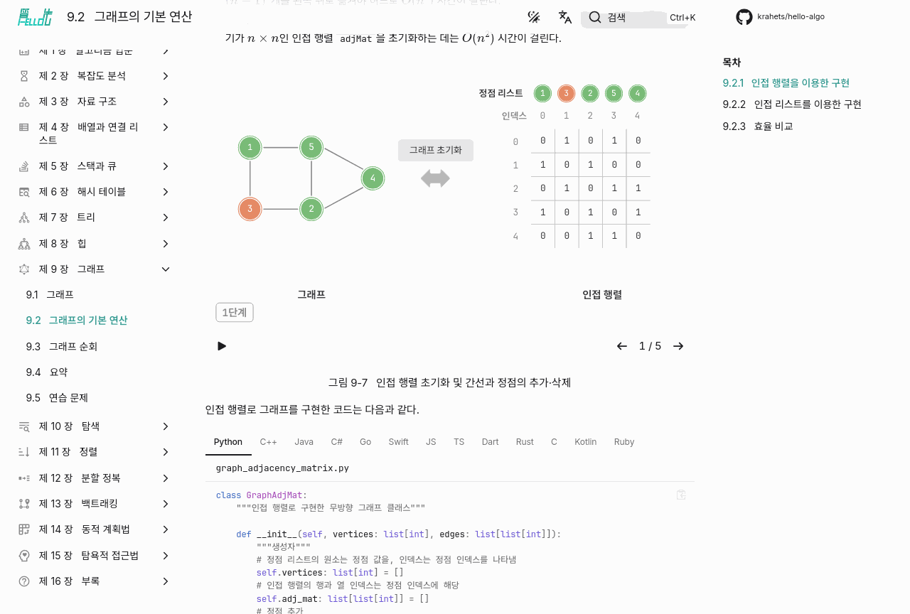
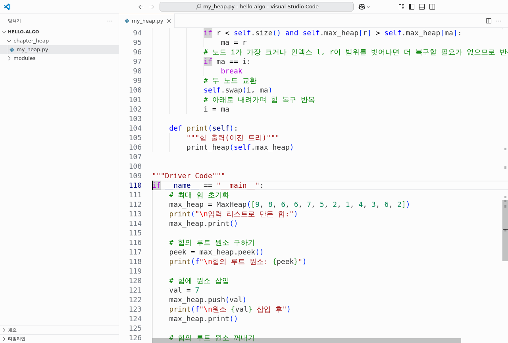
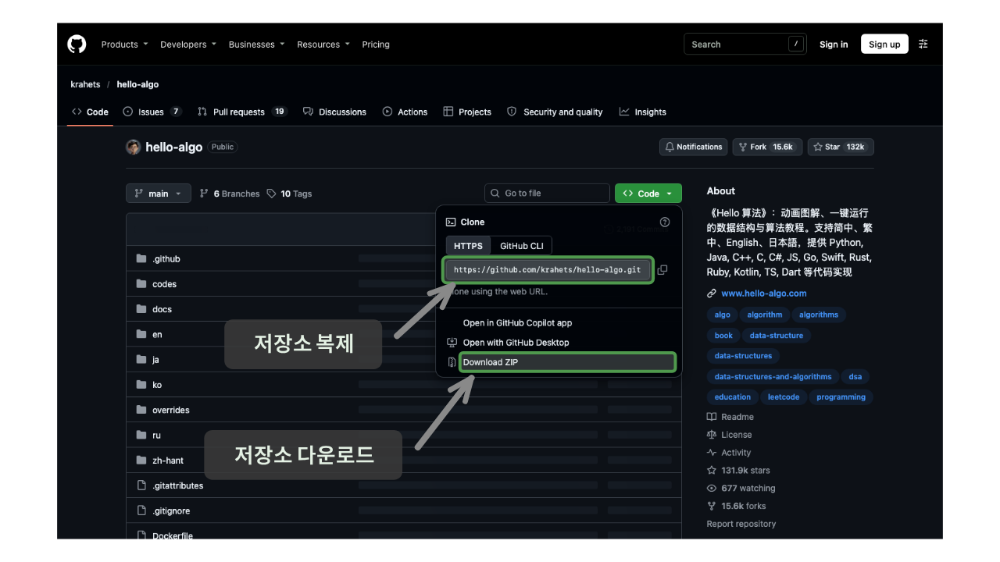
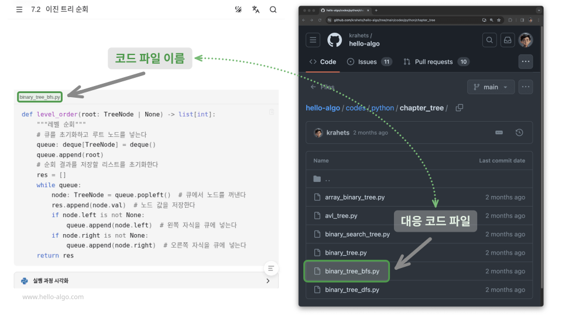
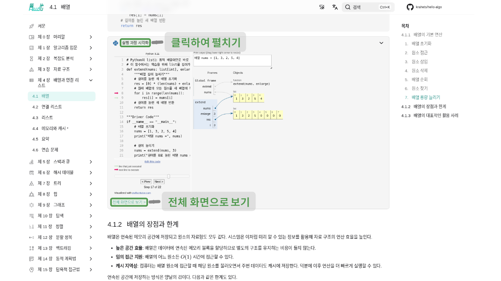
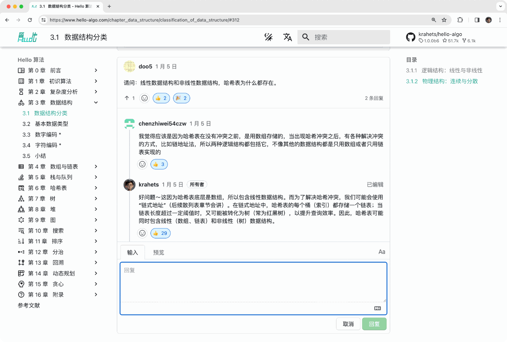
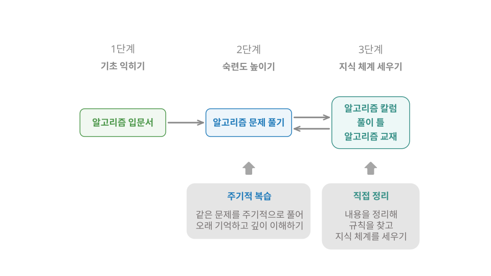

# 0.2 &nbsp; 이 책을 활용하는 방법

!!! tip

    이 책을 최대한 잘 활용하려면 이 절을 처음부터 끝까지 읽어 보기 바란다.

## 0.2.1 &nbsp; 표기 규칙

- 제목 뒤에 `*`가 붙은 절은 선택해서 읽는 내용으로 난도가 다소 높다. 시간이 부족하면 우선 건너뛰어도 좋다.
- 전문 용어는 종이책과 PDF판에서는 굵은 글꼴로, 웹판에서는 밑줄로 표시한다. 예를 들면 <u>배열(array)</u>과 같다. 문헌을 읽을 때 도움이 되므로 기억해 두기를 권한다.
- 중요한 내용과 요약 문장은 **굵게** 표시한다. 이런 부분은 특히 주의 깊게 읽어 보자.
- 특정한 뜻으로 쓰는 표현은 혼동을 피하도록 “따옴표”로 표시한다.
- 프로그래밍 언어마다 용어가 다를 때는 파이썬을 기준으로 한다. 예를 들어 ‘값이 없음’은 `None`으로 나타낸다.
- 이 책은 내용을 간결하게 배치하기 위해 언어별 주석 작성 관례를 일부 따르지 않는다. 주석은 주로 제목 주석, 내용 주석, 여러 줄 주석 세 가지로 나눈다.

=== "Python"

    ```python title=""
    """함수, 클래스, 테스트 케이스 등을 표시하는 제목 주석"""

    # 코드를 자세히 설명하는 내용 주석

    """
    여러 줄
    주석
    """
    ```

=== "C++"

    ```cpp title=""
    /* 함수, 클래스, 테스트 케이스 등을 표시하는 제목 주석 */

    // 코드를 자세히 설명하는 내용 주석

    /**
     * 여러 줄
     * 주석
     */
    ```

=== "Java"

    ```java title=""
    /* 함수, 클래스, 테스트 케이스 등을 표시하는 제목 주석 */

    // 코드를 자세히 설명하는 내용 주석

    /**
     * 여러 줄
     * 주석
     */
    ```

=== "C#"

    ```csharp title=""
    /* 함수, 클래스, 테스트 케이스 등을 표시하는 제목 주석 */

    // 코드를 자세히 설명하는 내용 주석

    /**
     * 여러 줄
     * 주석
     */
    ```

=== "Go"

    ```go title=""
    /* 함수, 클래스, 테스트 케이스 등을 표시하는 제목 주석 */

    // 코드를 자세히 설명하는 내용 주석

    /**
     * 여러 줄
     * 주석
     */
    ```

=== "Swift"

    ```swift title=""
    /* 함수, 클래스, 테스트 케이스 등을 표시하는 제목 주석 */

    // 코드를 자세히 설명하는 내용 주석

    /**
     * 여러 줄
     * 주석
     */
    ```

=== "JS"

    ```javascript title=""
    /* 함수, 클래스, 테스트 케이스 등을 표시하는 제목 주석 */

    // 코드를 자세히 설명하는 내용 주석

    /**
     * 여러 줄
     * 주석
     */
    ```

=== "TS"

    ```typescript title=""
    /* 함수, 클래스, 테스트 케이스 등을 표시하는 제목 주석 */

    // 코드를 자세히 설명하는 내용 주석

    /**
     * 여러 줄
     * 주석
     */
    ```

=== "Dart"

    ```dart title=""
    /* 함수, 클래스, 테스트 케이스 등을 표시하는 제목 주석 */

    // 코드를 자세히 설명하는 내용 주석

    /**
     * 여러 줄
     * 주석
     */
    ```

=== "Rust"

    ```rust title=""
    /* 함수, 클래스, 테스트 케이스 등을 표시하는 제목 주석 */

    // 코드를 자세히 설명하는 내용 주석

    // 여러 줄
    // 주석
    ```

=== "C"

    ```c title=""
    /* 함수, 클래스, 테스트 케이스 등을 표시하는 제목 주석 */

    // 코드를 자세히 설명하는 내용 주석

    /**
     * 여러 줄
     * 주석
     */
    ```

=== "Kotlin"

    ```kotlin title=""
    /* 함수, 클래스, 테스트 케이스 등을 표시하는 제목 주석 */

    // 코드를 자세히 설명하는 내용 주석

    /**
     * 여러 줄
     * 주석
     */
    ```

=== "Ruby"

    ```ruby title=""
    ### 함수, 클래스, 테스트 케이스 등을 표시하는 제목 주석 ###

    # 코드를 자세히 설명하는 내용 주석

    # 여러 줄
    # 주석
    ```

## 0.2.2 &nbsp; 애니메이션 그림으로 효율적으로 배우기

영상과 그림은 글보다 많은 정보를 구조적으로 담을 수 있어 이해하기 쉽다. 이 책에서는 **중요하거나 어려운 개념을 주로 애니메이션 그림으로 설명하고** 글로 풀이를 덧붙인다.

읽는 중에 아래와 같은 애니메이션 그림이 나오면 **그림을 중심으로 보고 글을 곁들여** 두 가지를 함께 이해하자.

{ class="animation-figure" }

<p align="center"> 그림 0-2 &nbsp; 애니메이션 그림 예시 </p>

## 0.2.3 &nbsp; 코드 실습으로 이해를 깊게 하기

이 책의 예제 코드는 [깃허브 저장소](https://github.com/krahets/hello-algo)에 있다. 아래 그림(0-3)처럼 **소스 코드에는 테스트 예제가 포함되어 있어 클릭 한 번으로 실행할 수 있다**.

시간이 된다면 **예제를 참고해 코드를 직접 한 번 작성해 보기를 권한다**. 공부할 시간이 부족하더라도 적어도 모든 코드를 읽고 실행해 보자.

눈으로 읽기만 할 때보다 직접 코드를 작성할 때 얻는 것이 더 많은 경우가 많다. **직접 해 보아야 제대로 배울 수 있다**.

{ class="animation-figure" }

<p align="center"> 그림 0-3 &nbsp; 코드 실행 예시 </p>

코드를 실행하기 위한 준비는 크게 세 단계로 나뉜다.

**첫째, 로컬 프로그래밍 환경을 설치한다**. 부록의 [설치 안내](../chapter_appendix/installation.md)를 따른다. 이미 설치했다면 이 단계는 건너뛰어도 된다.

**둘째, 코드 저장소를 복제하거나 내려받는다**. [깃허브 저장소](https://github.com/krahets/hello-algo)로 이동한다. [Git](https://git-scm.com/downloads)을 설치했다면 다음 명령으로 저장소를 복제할 수 있다.

```shell
git clone https://github.com/krahets/hello-algo.git
```

아래 그림(0-4)의 위치에서 ‘Download ZIP’ 버튼을 눌러 코드 압축 파일을 바로 내려받은 뒤 컴퓨터에서 압축을 풀어도 된다.

{ class="animation-figure" }

<p align="center"> 그림 0-4 &nbsp; 저장소 복제와 코드 다운로드 </p>

**셋째, 소스 코드를 실행한다**. 아래 그림(0-5)처럼 코드 블록 위에 파일 이름이 적혀 있으면 저장소의 `codes` 폴더에서 대응하는 소스 파일을 찾을 수 있다. 클릭 한 번으로 실행할 수 있어 불필요한 디버깅 시간을 줄이고 학습 내용에 집중할 수 있다.

{ class="animation-figure" }

<p align="center"> 그림 0-5 &nbsp; 코드 블록과 대응하는 소스 파일 </p>

로컬에서 코드를 실행하는 방법 외에 **웹판은 파이썬 코드의 실행 과정 시각화도 지원한다**([pythontutor](https://pythontutor.com/) 기반). 아래 그림(0-6)처럼 코드 블록 아래의 ‘실행 과정 시각화’를 누르면 화면이 펼쳐져 알고리즘의 실행 과정을 관찰할 수 있다. ‘전체 화면으로 보기’를 누르면 더 편하게 살펴볼 수 있다.

{ class="animation-figure" }

<p align="center"> 그림 0-6 &nbsp; 파이썬 코드의 실행 과정 시각화 </p>

## 0.2.4 &nbsp; 질문과 토론으로 함께 성장하기

책을 읽다가 제대로 이해되지 않는 부분을 쉽게 넘기지 말자. **댓글로 자유롭게 질문해 주기 바란다**. 나와 동료들이 정성껏 답하며 대개 이틀 안에 답변을 받을 수 있다.

아래 그림(0-7)처럼 웹판의 각 절 맨 아래에는 댓글란이 있다. 댓글에도 관심을 기울여 주기 바란다. 다른 독자가 부딪힌 문제를 살피면 놓친 부분을 채우고 한층 깊이 생각할 수 있다. 또 다른 독자의 질문에 기꺼이 답하고 자신의 생각을 나누며 서로의 성장을 도와주면 좋겠다.

{ class="animation-figure" }

<p align="center"> 그림 0-7 &nbsp; 댓글란 예시 </p>

## 0.2.5 &nbsp; 알고리즘 학습 경로

자료 구조와 알고리즘 학습은 크게 세 단계로 나눌 수 있다.

1. **1단계: 알고리즘 입문**. 다양한 자료 구조의 특성과 사용법을 익히고 여러 알고리즘의 원리, 절차, 용도, 효율 등을 배운다.
2. **2단계: 알고리즘 문제 풀이**. 널리 알려진 문제부터 시작해 적어도 100문제를 풀면서 주요 알고리즘 문제에 익숙해지기를 권한다. 처음에는 배운 내용을 잊어버려 어려움을 겪을 수도 있지만 자연스러운 일이다. 에빙하우스의 망각 곡선에 맞춰 문제를 복습해 보자. 보통 3~5차례 되풀이하면 오래 기억할 수 있다. 추천 문제 목록과 풀이 계획은 이 [깃허브 저장소](https://github.com/krahets/LeetCode-Book)를 참고하자.
3. **3단계: 지식 체계 세우기**. 알고리즘 연재 글, 문제 풀이의 기본 틀, 알고리즘 교재를 읽으면 지식 체계가 계속 풍부해진다. 연습할 때는 주제별로 문제를 분류하거나, 한 문제를 여러 방법으로 풀거나, 한 해법을 여러 문제에 적용하는 등 심화 전략도 시도해 보자. 관련 경험담은 여러 커뮤니티에서 찾아볼 수 있다.

아래 그림(0-8)처럼 이 책은 주로 ‘1단계’를 다룬다. 이를 바탕으로 2단계와 3단계의 학습을 더 효율적으로 시작하도록 돕는 것이 목표다.

{ class="animation-figure" }

<p align="center"> 그림 0-8 &nbsp; 알고리즘 학습 경로 </p>
