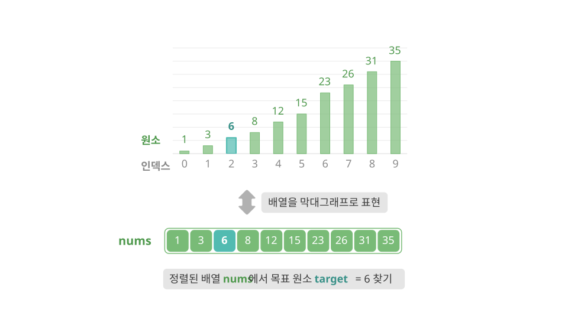
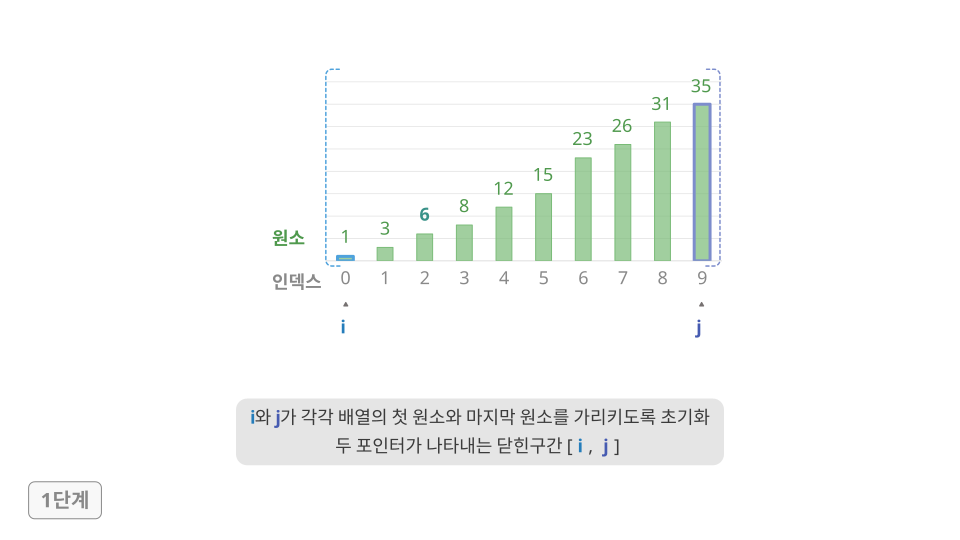
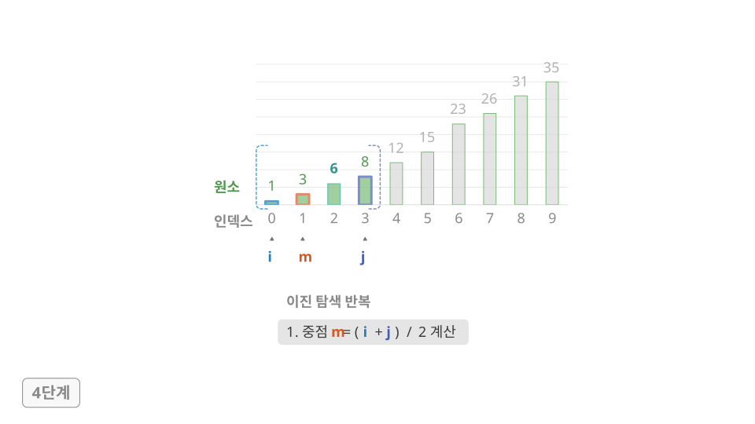
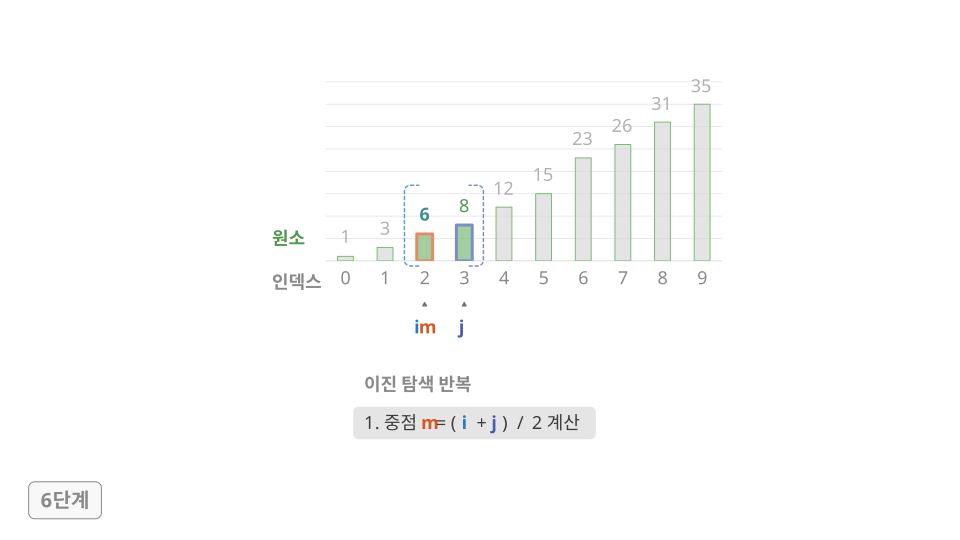
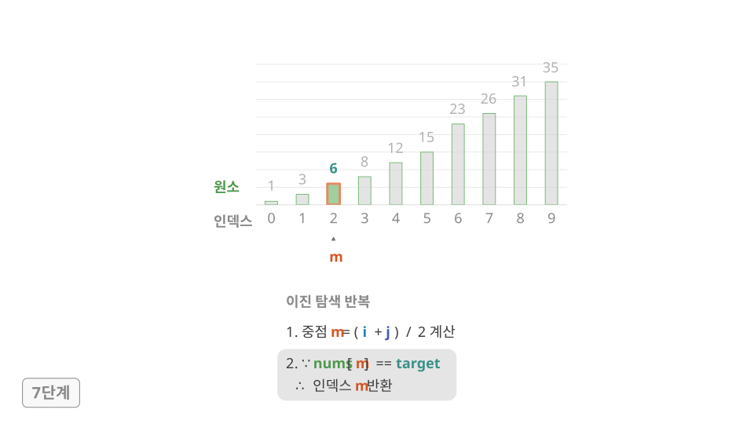

# 이진 탐색

<u>이진 탐색(binary search)</u>은 분할 정복 전략을 이용하는 효율적인 탐색 알고리즘이다. 데이터가 정렬되어 있다는 성질을 이용해 목표 원소를 찾거나 구간이 빌 때까지 탐색 범위를 매번 절반으로 줄인다.

!!! question

    길이가 $n$인 배열 `nums`가 주어진다. 원소는 중복 없이 오름차순으로 정렬되어 있다. 이 배열에서 원소 `target`을 찾아 그 인덱스를 반환하라. 해당 원소가 없으면 $-1$을 반환하라. 아래 그림은 예제 데이터다.



아래 그림처럼 포인터 $i = 0$과 $j = n - 1$을 초기화하여 각각 배열의 첫 원소와 마지막 원소를 가리키게 한다. 두 포인터가 나타내는 탐색 구간은 $[0, n - 1]$이다. 대괄호는 끝점 자체를 포함하는 닫힌구간을 뜻한다.

이제 다음 두 단계를 반복한다.

1. 중점 인덱스 $m = \lfloor {(i + j) / 2} \rfloor$을 계산한다. 여기서 $\lfloor \: \rfloor$는 내림 연산을 뜻한다.
2. `nums[m]`와 `target`을 비교한다. 결과는 다음 세 가지다.
    1. `nums[m] < target`이면 `target`을 찾을 구간은 $[m + 1, j]$이므로 $i = m + 1$로 놓는다.
    2. `nums[m] > target`이면 `target`을 찾을 구간은 $[i, m - 1]$이므로 $j = m - 1$로 놓는다.
    3. `nums[m] = target`이면 `target`을 찾았으므로 인덱스 $m$을 반환한다.

배열에 목표 원소가 없으면 탐색 구간은 결국 비게 된다. 이때 $-1$을 반환한다.

=== "<1>"
    

=== "<2>"
    

=== "<3>"
    

=== "<4>"
    

=== "<5>"
    

=== "<6>"
    

=== "<7>"
    

$i$와 $j$가 모두 `int`형이므로 **두 값의 합 $i + j$가 `int`형의 표현 범위를 벗어날 수 있다**. 오버플로를 피하기 위해 보통 $m = \lfloor {i + (j - i) / 2} \rfloor$로 중점을 계산한다.

코드는 다음과 같다.

```src
[file]{binary_search}-[class]{}-[func]{binary_search}
```

**시간 복잡도는 $O(\log n)$이다**. 이진 탐색은 매번 구간을 절반으로 줄이므로 반복 횟수는 $\log_2 n$이다.

**공간 복잡도는 $O(1)$이다**. 포인터 $i$와 $j$는 상수 크기의 공간을 사용한다.

## 구간을 나타내는 방법

앞에서 사용한 닫힌구간 외에 왼쪽 끝만 포함하는 반열린구간도 자주 쓴다. $[0, n)$처럼 표기하며 왼쪽 경계는 포함하고 오른쪽 경계는 제외한다. 이 표기에서 구간 $[i, j)$는 $i = j$일 때 비어 있다.

이 표기로도 같은 기능의 이진 탐색 알고리즘을 구현할 수 있다.

```src
[file]{binary_search}-[class]{}-[func]{binary_search_lcro}
```

아래 그림처럼 구간을 어느 방식으로 나타내느냐에 따라 이진 탐색의 초기화, 반복 조건, 구간을 줄이는 연산이 모두 달라진다.

닫힌구간에서는 왼쪽과 오른쪽 경계를 모두 포함하므로 포인터 $i$와 $j$로 구간을 줄이는 연산도 서로 대칭이다. 실수할 가능성이 더 작아 **일반적으로 닫힌구간을 사용하는 방식을 권한다**.


## 장점과 한계

이진 탐색은 시간과 공간 면에서 모두 효율적이다.

- 이진 탐색은 시간 효율이 높다. 특히 데이터가 많을 때는 로그 시간 복잡도의 이점이 크다. 예를 들어 데이터 크기가 $n = 2^{20}$이면 선형 탐색은 $2^{20} = 1048576$번 반복해야 하지만 이진 탐색은 $\log_2 2^{20} = 20$번이면 된다.
- 이진 탐색에는 추가 공간이 필요 없다. 해시 탐색처럼 별도 공간을 사용하는 탐색 알고리즘과 비교하면 공간을 절약할 수 있다.

다만 이진 탐색을 모든 상황에 적용할 수 있는 것은 아니다. 주된 이유는 다음과 같다.

- 이진 탐색은 정렬된 데이터에만 적용할 수 있다. 입력 데이터가 정렬되어 있지 않다면 이진 탐색만을 위해 정렬하는 데 드는 비용이 이득보다 크다. 정렬 알고리즘의 시간 복잡도는 보통 $O(n \log n)$으로, 선형 탐색과 이진 탐색보다 모두 높기 때문이다. 원소를 자주 삽입할 때도 정렬 상태를 유지하려면 배열의 특정 위치에 삽입해야 한다. 이때 시간 복잡도는 $O(n)$으로 비용이 상당히 크다.
- 이진 탐색은 배열에만 적합하다. 연속된 순서를 따르지 않고 위치를 건너뛰어 원소에 접근해야 하기 때문이다. 연결 리스트에서는 이런 접근의 효율이 낮아 연결 리스트나 이를 기반으로 구현한 자료 구조에는 적합하지 않다.
- 데이터가 적으면 선형 탐색의 성능이 더 좋다. 선형 탐색은 회차당 비교가 한 번이면 된다. 이진 탐색은 덧셈 한 번, 나눗셈 한 번, 비교 한 번에서 세 번, 덧셈 또는 뺄셈 한 번으로 총 네 번에서 여섯 번의 기본 연산이 필요하다. 따라서 데이터 수 $n$이 작으면 오히려 선형 탐색이 더 빠르다.
