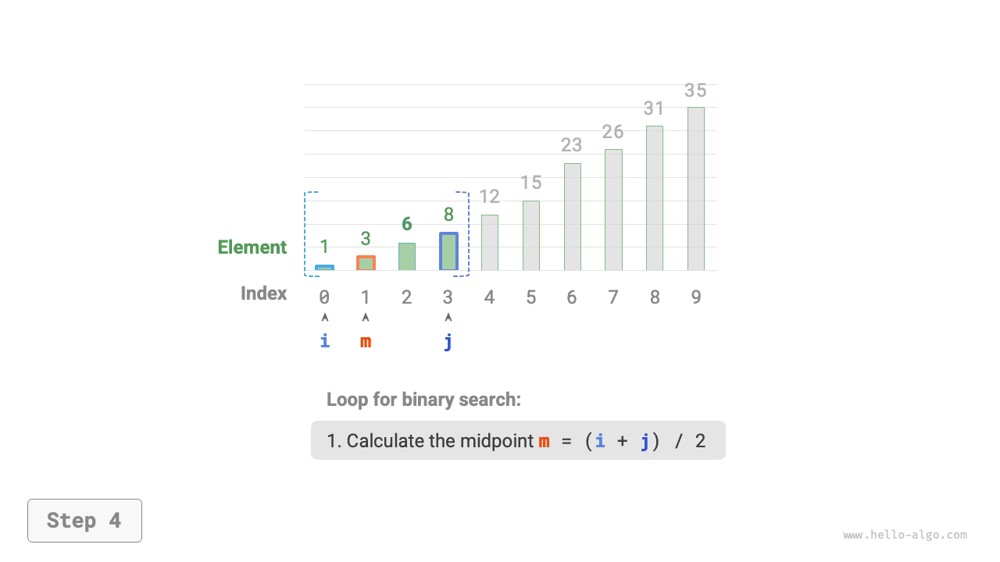
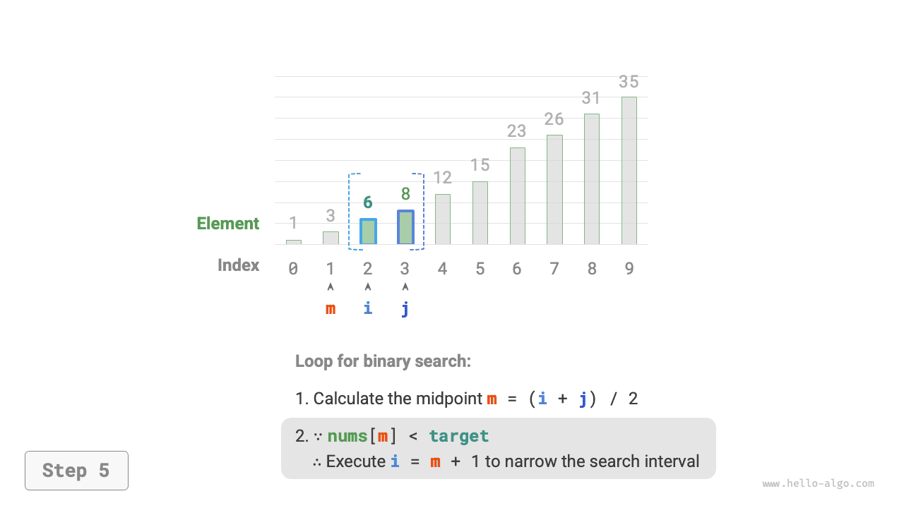
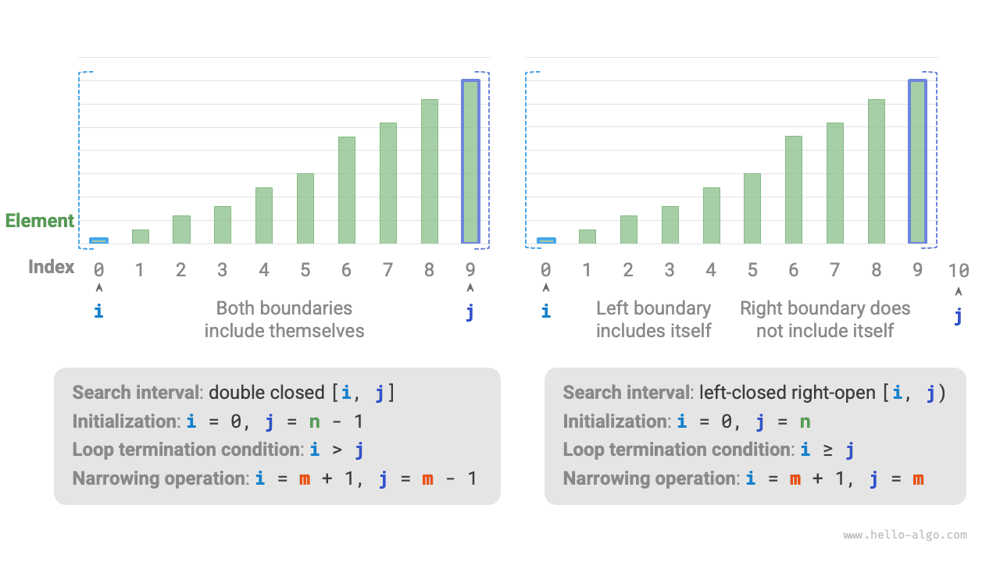

# 이진 탐색

<u>이진 탐색(binary search)</u>은 분할 정복 전략에 기반한 효율적인 탐색 알고리즘이다. 데이터가 정렬되어 있다는 성질을 이용하여 매번 탐색 범위를 절반으로 줄이며, 목표 원소를 찾거나 탐색 구간이 빌 때까지 반복한다.

!!! question "문제"

    길이가 $n$인 배열 `nums`가 주어진다. 원소는 오름차순으로 정렬되어 있고 중복되지 않는다. 이 배열에서 원소 `target`을 찾아 그 인덱스를 반환하라. 배열에 해당 원소가 없으면 $-1$을 반환하라. 예시는 아래 그림과 같다.


아래 그림과 같이 포인터 $i = 0$과 $j = n - 1$을 초기화하여 각각 배열의 첫 원소와 마지막 원소를 가리키게 한다. 이는 탐색 구간 $[0, n - 1]$을 나타낸다. 대괄호는 경곗값 자체를 포함하는 닫힌 구간을 뜻한다.

이어서 다음 두 단계를 반복한다.

1. 중간 인덱스 $m = \lfloor {(i + j) / 2} \rfloor$를 계산한다. 여기서 $\lfloor \: \rfloor$는 내림 연산이다.
2. `nums[m]`과 `target`의 대소 관계를 비교하며, 다음 세 경우로 나뉜다.
    1. `nums[m] < target`이면 `target`은 구간 $[m + 1, j]$에 있으므로 $i = m + 1$을 수행한다.
    2. `nums[m] > target`이면 `target`은 구간 $[i, m - 1]$에 있으므로 $j = m - 1$을 수행한다.
    3. `nums[m] = target`이면 `target`을 찾았으므로 인덱스 $m$을 반환한다.

배열에 목표 원소가 없으면 탐색 구간은 결국 비게 된다. 이때 $-1$을 반환한다.

=== "<1>"
    

=== "<2>"
    

=== "<3>"
    

=== "<4>"
    

=== "<5>"
    

=== "<6>"
    

=== "<7>"
    

$i$와 $j$가 모두 `int` 타입이므로 **$i + j$가 `int` 타입의 표현 범위를 벗어날 수 있다**. 정수 오버플로를 피하기 위해 보통 $m = \lfloor {i + (j - i) / 2} \rfloor$ 공식으로 중간 인덱스를 계산한다.

코드는 다음과 같다.

```src
[file]{binary_search}-[class]{}-[func]{binary_search}
```

**시간 복잡도는 $O(\log n)$이다**. 이진 탐색의 반복문에서 구간이 매번 절반으로 줄어들므로 반복 횟수는 $\log_2 n$이다.

**공간 복잡도는 $O(1)$이다**. 포인터 $i$와 $j$는 상수 크기의 공간을 사용한다.

## 구간 표현 방법

위의 양끝이 닫힌 구간 외에 '왼쪽은 닫히고 오른쪽은 열린' 구간도 자주 사용한다. $[0, n)$으로 정의하며 왼쪽 경곗값은 포함하고 오른쪽 경곗값은 포함하지 않는다. 이 표현에서 구간 $[i, j)$는 $i = j$일 때 비어 있다.

이 표현을 사용하여 같은 기능의 이진 탐색 알고리즘을 구현할 수 있다.

```src
[file]{binary_search}-[class]{}-[func]{binary_search_lcro}
```

아래 그림과 같이 구간을 표현하는 방식에 따라 이진 탐색 알고리즘의 초기화, 반복 조건, 구간 축소 연산이 모두 달라진다.

'양끝이 닫힌 구간'에서는 왼쪽과 오른쪽 경계를 모두 포함하므로, 포인터 $i$와 $j$로 구간을 줄이는 연산도 대칭적이다. 실수할 가능성이 더 작으므로 **일반적으로 '양끝이 닫힌 구간'으로 작성하기를 권장한다**.



## 장점과 한계

이진 탐색은 시간과 공간 양쪽에서 좋은 성능을 보인다.

- 이진 탐색은 시간 효율이 높다. 데이터가 많을수록 로그 시간 복잡도의 이점이 뚜렷하다. 예를 들어 데이터 크기가 $n = 2^{20}$이면 선형 탐색은 $2^{20} = 1048576$ 번 반복해야 하지만, 이진 탐색은 $\log_2 2^{20} = 20$ 번이면 된다.
- 이진 탐색은 추가 공간이 필요하지 않다. 해시 탐색처럼 추가 공간을 사용하는 탐색 알고리즘보다 공간을 절약한다.

하지만 이진 탐색이 모든 상황에 적합한 것은 아니다. 주요 이유는 다음과 같다.

- 이진 탐색은 정렬된 데이터에만 적용할 수 있다. 입력이 정렬되지 않았다면 이진 탐색만을 위해 정렬하는 것은 오히려 손해다. 정렬 알고리즘의 시간 복잡도는 보통 $O(n \log n)$으로 선형 탐색과 이진 탐색보다 높기 때문이다. 원소를 자주 삽입하는 상황에서도 정렬 상태를 유지하려면 특정 위치에 삽입해야 하므로, $O(n)$의 큰 시간 비용이 든다.
- 이진 탐색은 배열에만 적합하다. 원소를 건너뛰며(연속적이지 않게) 접근해야 하는데, 연결 리스트에서는 이런 접근이 비효율적이다. 따라서 연결 리스트나 연결 리스트 기반 자료 구조에는 적합하지 않다.
- 데이터가 적을 때는 선형 탐색의 성능이 더 좋다. 선형 탐색은 매번 비교 1회만 필요하지만, 이진 탐색은 덧셈 1회, 나눗셈 1회, 비교 1 ~ 3회, 덧셈(뺄셈) 1회로 총 4 ~ 6회의 기본 연산이 필요하다. 따라서 데이터 수 $n$이 작으면 선형 탐색이 오히려 더 빠르다.
