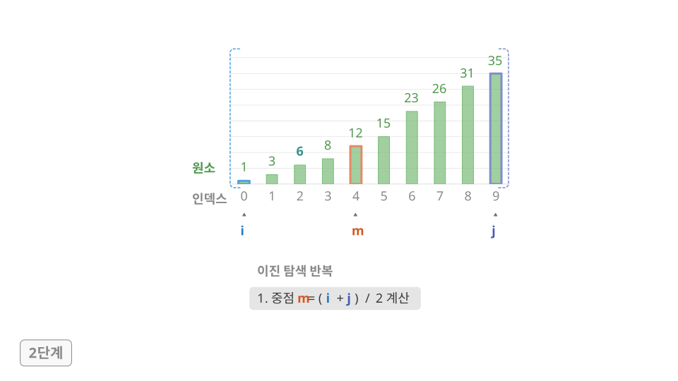
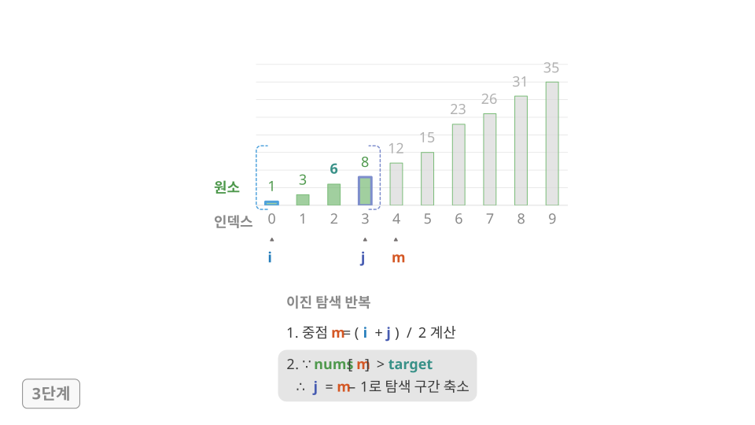
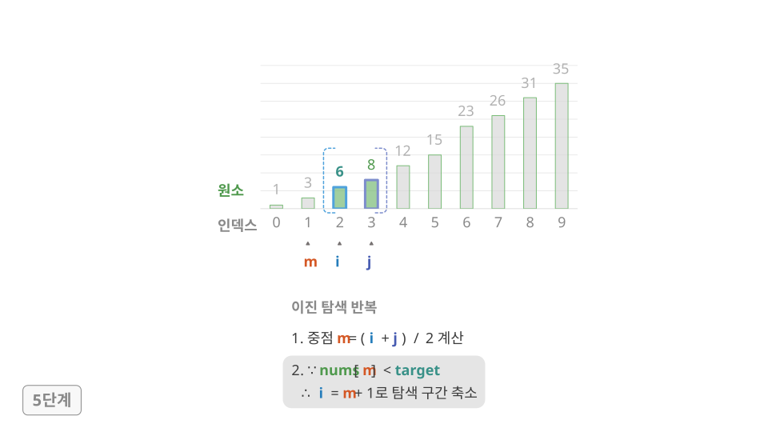
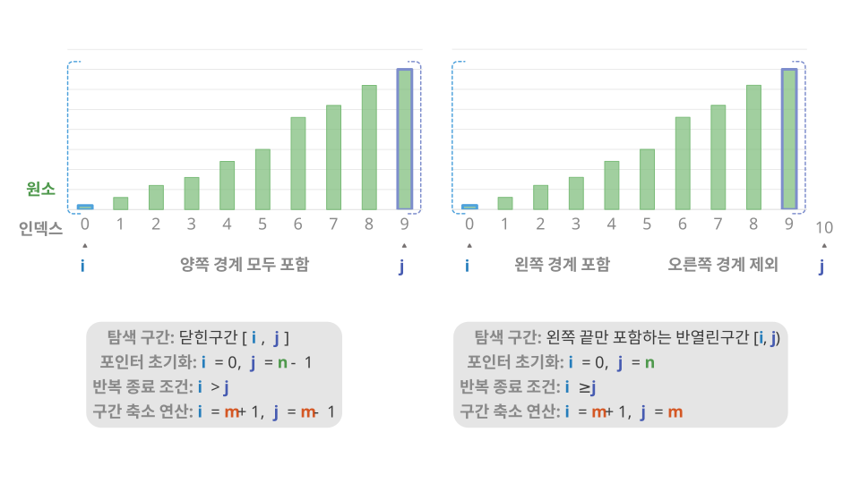

# 10.1 &nbsp; 이진 탐색

<u>이진 탐색(binary search)</u>은 분할 정복 전략을 이용하는 효율적인 탐색 알고리즘이다. 데이터가 정렬되어 있다는 성질을 이용해 목표 원소를 찾거나 구간이 빌 때까지 탐색 범위를 매번 절반으로 줄인다.

!!! question

    길이가 $n$인 배열 `nums`가 주어진다. 원소는 중복 없이 오름차순으로 정렬되어 있다. 이 배열에서 원소 `target`을 찾아 그 인덱스를 반환하라. 해당 원소가 없으면 $-1$을 반환하라. 아래 그림(10-1)은 예제 데이터다.

{ class="animation-figure" }

<p align="center"> 그림 10-1 &nbsp; 이진 탐색 예제 데이터 </p>

아래 그림(10-2)처럼 포인터 $i = 0$과 $j = n - 1$을 초기화하여 각각 배열의 첫 원소와 마지막 원소를 가리키게 한다. 두 포인터가 나타내는 탐색 구간은 $[0, n - 1]$이다. 대괄호는 끝점 자체를 포함하는 닫힌구간을 뜻한다.

이제 다음 두 단계를 반복한다.

1. 중점 인덱스 $m = \lfloor {(i + j) / 2} \rfloor$을 계산한다. 여기서 $\lfloor \: \rfloor$는 내림 연산을 뜻한다.
2. `nums[m]`와 `target`을 비교한다. 결과는 다음 세 가지다.
    1. `nums[m] < target`이면 `target`을 찾을 구간은 $[m + 1, j]$이므로 $i = m + 1$로 놓는다.
    2. `nums[m] > target`이면 `target`을 찾을 구간은 $[i, m - 1]$이므로 $j = m - 1$로 놓는다.
    3. `nums[m] = target`이면 `target`을 찾았으므로 인덱스 $m$을 반환한다.

배열에 목표 원소가 없으면 탐색 구간은 결국 비게 된다. 이때 $-1$을 반환한다.

=== "<1>"
    { class="animation-figure" }

=== "<2>"
    { class="animation-figure" }

=== "<3>"
    { class="animation-figure" }

=== "<4>"
    { class="animation-figure" }

=== "<5>"
    { class="animation-figure" }

=== "<6>"
    { class="animation-figure" }

=== "<7>"
    { class="animation-figure" }

<p align="center"> 그림 10-2 &nbsp; 이진 탐색 과정 </p>

$i$와 $j$가 모두 `int`형이므로 **두 값의 합 $i + j$가 `int`형의 표현 범위를 벗어날 수 있다**. 오버플로를 피하기 위해 보통 $m = \lfloor {i + (j - i) / 2} \rfloor$로 중점을 계산한다.

코드는 다음과 같다.

=== "Python"

    ```python title="binary_search.py"
    def binary_search(nums: list[int], target: int) -> int:
        """이진 탐색(닫힌구간)"""
        # 닫힌구간 [0, n-1]을 초기화한다. i와 j는 각각 배열의 첫 원소와 마지막 원소를 가리킨다.
        i, j = 0, len(nums) - 1
        # 탐색 구간이 빌 때까지 반복한다(i > j이면 빈 구간).
        while i <= j:
            # 파이썬 정수는 메모리가 허용하는 한 커질 수 있으므로 정수 오버플로를 고려할 필요가 없다.
            m = (i + j) // 2  # 중점 인덱스 m을 계산한다.
            if nums[m] < target:
                i = m + 1  # 이 경우 target을 찾을 구간은 [m+1, j]이다.
            elif nums[m] > target:
                j = m - 1  # 이 경우 target을 찾을 구간은 [i, m-1]이다.
            else:
                return m  # 목표 원소를 찾았으므로 그 인덱스를 반환한다.
        return -1  # 목표 원소를 찾지 못했으므로 -1을 반환한다.
    ```

=== "C++"

    ```cpp title="binary_search.cpp"
    /* 이진 탐색(닫힌구간) */
    int binarySearch(vector<int> &nums, int target) {
        // 닫힌구간 [0, n-1]을 초기화한다. i와 j는 각각 배열의 첫 원소와 마지막 원소를 가리킨다.
        int i = 0, j = nums.size() - 1;
        // 탐색 구간이 빌 때까지 반복한다(i > j이면 빈 구간).
        while (i <= j) {
            int m = i + (j - i) / 2; // 중점 인덱스 m을 계산한다.
            if (nums[m] < target)    // 이 경우 target을 찾을 구간은 [m+1, j]이다.
                i = m + 1;
            else if (nums[m] > target) // 이 경우 target을 찾을 구간은 [i, m-1]이다.
                j = m - 1;
            else // 목표 원소를 찾았으므로 그 인덱스를 반환한다.
                return m;
        }
        // 목표 원소를 찾지 못했으므로 -1을 반환한다.
        return -1;
    }
    ```

=== "Java"

    ```java title="binary_search.java"
    /* 이진 탐색(닫힌구간) */
    int binarySearch(int[] nums, int target) {
        // 닫힌구간 [0, n-1]을 초기화한다. i와 j는 각각 배열의 첫 원소와 마지막 원소를 가리킨다.
        int i = 0, j = nums.length - 1;
        // 탐색 구간이 빌 때까지 반복한다(i > j이면 빈 구간).
        while (i <= j) {
            int m = i + (j - i) / 2; // 중점 인덱스 m을 계산한다.
            if (nums[m] < target) // 이 경우 target을 찾을 구간은 [m+1, j]이다.
                i = m + 1;
            else if (nums[m] > target) // 이 경우 target을 찾을 구간은 [i, m-1]이다.
                j = m - 1;
            else // 목표 원소를 찾았으므로 그 인덱스를 반환한다.
                return m;
        }
        // 목표 원소를 찾지 못했으므로 -1을 반환한다.
        return -1;
    }
    ```

=== "C#"

    ```csharp title="binary_search.cs"
    /* 이진 탐색(닫힌구간) */
    int BinarySearch(int[] nums, int target) {
        // 닫힌구간 [0, n-1]을 초기화한다. i와 j는 각각 배열의 첫 원소와 마지막 원소를 가리킨다.
        int i = 0, j = nums.Length - 1;
        // 탐색 구간이 빌 때까지 반복한다(i > j이면 빈 구간).
        while (i <= j) {
            int m = i + (j - i) / 2;   // 중점 인덱스 m을 계산한다.
            if (nums[m] < target)      // 이 경우 target을 찾을 구간은 [m+1, j]이다.
                i = m + 1;
            else if (nums[m] > target) // 이 경우 target을 찾을 구간은 [i, m-1]이다.
                j = m - 1;
            else                       // 목표 원소를 찾았으므로 그 인덱스를 반환한다.
                return m;
        }
        // 목표 원소를 찾지 못했으므로 -1을 반환한다.
        return -1;
    }
    ```

=== "Go"

    ```go title="binary_search.go"
    /* 이진 탐색(닫힌구간) */
    func binarySearch(nums []int, target int) int {
        // 닫힌구간 [0, n-1]을 초기화한다. i와 j는 각각 배열의 첫 원소와 마지막 원소를 가리킨다.
        i, j := 0, len(nums)-1
        // 탐색 구간이 빌 때까지 반복한다(i > j이면 빈 구간).
        for i <= j {
            m := i + (j-i)/2      // 중점 인덱스 m을 계산한다.
            if nums[m] < target { // 이 경우 target을 찾을 구간은 [m+1, j]이다.
                i = m + 1
            } else if nums[m] > target { // 이 경우 target을 찾을 구간은 [i, m-1]이다.
                j = m - 1
            } else { // 목표 원소를 찾았으므로 그 인덱스를 반환한다.
                return m
            }
        }
        // 목표 원소를 찾지 못했으므로 -1을 반환한다.
        return -1
    }
    ```

=== "Swift"

    ```swift title="binary_search.swift"
    /* 이진 탐색(닫힌구간) */
    func binarySearch(nums: [Int], target: Int) -> Int {
        // 닫힌구간 [0, n-1]을 초기화한다. i와 j는 각각 배열의 첫 원소와 마지막 원소를 가리킨다.
        var i = nums.startIndex
        var j = nums.endIndex - 1
        // 탐색 구간이 빌 때까지 반복한다(i > j이면 빈 구간).
        while i <= j {
            let m = i + (j - i) / 2 // 중점 인덱스 m을 계산한다.
            if nums[m] < target { // 이 경우 target을 찾을 구간은 [m+1, j]이다.
                i = m + 1
            } else if nums[m] > target { // 이 경우 target을 찾을 구간은 [i, m-1]이다.
                j = m - 1
            } else { // 목표 원소를 찾았으므로 그 인덱스를 반환한다.
                return m
            }
        }
        // 목표 원소를 찾지 못했으므로 -1을 반환한다.
        return -1
    }
    ```

=== "JS"

    ```javascript title="binary_search.js"
    /* 이진 탐색(닫힌구간) */
    function binarySearch(nums, target) {
        // 닫힌구간 [0, n-1]을 초기화한다. i와 j는 각각 배열의 첫 원소와 마지막 원소를 가리킨다.
        let i = 0,
            j = nums.length - 1;
        // 탐색 구간이 빌 때까지 반복한다(i > j이면 빈 구간).
        while (i <= j) {
            // parseInt()로 소수점 이하를 버려 중점 인덱스 m을 구한다.
            const m = parseInt(i + (j - i) / 2);
            if (nums[m] < target)
                // 이 경우 target을 찾을 구간은 [m+1, j]이다.
                i = m + 1;
            else if (nums[m] > target)
                // 이 경우 target을 찾을 구간은 [i, m-1]이다.
                j = m - 1;
            else return m; // 목표 원소를 찾았으므로 그 인덱스를 반환한다.
        }
        // 목표 원소를 찾지 못했으므로 -1을 반환한다.
        return -1;
    }
    ```

=== "TS"

    ```typescript title="binary_search.ts"
    /* 이진 탐색(닫힌구간) */
    function binarySearch(nums: number[], target: number): number {
        // 닫힌구간 [0, n-1]을 초기화한다. i와 j는 각각 배열의 첫 원소와 마지막 원소를 가리킨다.
        let i = 0,
            j = nums.length - 1;
        // 탐색 구간이 빌 때까지 반복한다(i > j이면 빈 구간).
        while (i <= j) {
            // 중점 인덱스 m을 계산한다.
            const m = Math.floor(i + (j - i) / 2);
            if (nums[m] < target) {
                // 이 경우 target을 찾을 구간은 [m+1, j]이다.
                i = m + 1;
            } else if (nums[m] > target) {
                // 이 경우 target을 찾을 구간은 [i, m-1]이다.
                j = m - 1;
            } else {
                // 목표 원소를 찾았으므로 그 인덱스를 반환한다.
                return m;
            }
        }
        return -1; // 목표 원소를 찾지 못했으므로 -1을 반환한다.
    }
    ```

=== "Dart"

    ```dart title="binary_search.dart"
    /* 이진 탐색(닫힌구간) */
    int binarySearch(List<int> nums, int target) {
      // 닫힌구간 [0, n-1]을 초기화한다. i와 j는 각각 배열의 첫 원소와 마지막 원소를 가리킨다.
      int i = 0, j = nums.length - 1;
      // 탐색 구간이 빌 때까지 반복한다(i > j이면 빈 구간).
      while (i <= j) {
        int m = i + (j - i) ~/ 2; // 중점 인덱스 m을 계산한다.
        if (nums[m] < target) {
          // 이 경우 target을 찾을 구간은 [m+1, j]이다.
          i = m + 1;
        } else if (nums[m] > target) {
          // 이 경우 target을 찾을 구간은 [i, m-1]이다.
          j = m - 1;
        } else {
          // 목표 원소를 찾았으므로 그 인덱스를 반환한다.
          return m;
        }
      }
      // 목표 원소를 찾지 못했으므로 -1을 반환한다.
      return -1;
    }
    ```

=== "Rust"

    ```rust title="binary_search.rs"
    /* 이진 탐색(닫힌구간) */
    fn binary_search(nums: &[i32], target: i32) -> i32 {
        // 닫힌구간 [0, n-1]을 초기화한다. i와 j는 각각 배열의 첫 원소와 마지막 원소를 가리킨다.
        let mut i = 0;
        let mut j = nums.len() as i32 - 1;
        // 탐색 구간이 빌 때까지 반복한다(i > j이면 빈 구간).
        while i <= j {
            let m = i + (j - i) / 2; // 중점 인덱스 m을 계산한다.
            if nums[m as usize] < target {
                // 이 경우 target을 찾을 구간은 [m+1, j]이다.
                i = m + 1;
            } else if nums[m as usize] > target {
                // 이 경우 target을 찾을 구간은 [i, m-1]이다.
                j = m - 1;
            } else {
                // 목표 원소를 찾았으므로 그 인덱스를 반환한다.
                return m;
            }
        }
        // 목표 원소를 찾지 못했으므로 -1을 반환한다.
        return -1;
    }
    ```

=== "C"

    ```c title="binary_search.c"
    /* 이진 탐색(닫힌구간) */
    int binarySearch(int *nums, int len, int target) {
        // 닫힌구간 [0, n-1]을 초기화한다. i와 j는 각각 배열의 첫 원소와 마지막 원소를 가리킨다.
        int i = 0, j = len - 1;
        // 탐색 구간이 빌 때까지 반복한다(i > j이면 빈 구간).
        while (i <= j) {
            int m = i + (j - i) / 2; // 중점 인덱스 m을 계산한다.
            if (nums[m] < target)    // 이 경우 target을 찾을 구간은 [m+1, j]이다.
                i = m + 1;
            else if (nums[m] > target) // 이 경우 target을 찾을 구간은 [i, m-1]이다.
                j = m - 1;
            else // 목표 원소를 찾았으므로 그 인덱스를 반환한다.
                return m;
        }
        // 목표 원소를 찾지 못했으므로 -1을 반환한다.
        return -1;
    }
    ```

=== "Kotlin"

    ```kotlin title="binary_search.kt"
    /* 이진 탐색(닫힌구간) */
    fun binarySearch(nums: IntArray, target: Int): Int {
        // 닫힌구간 [0, n-1]을 초기화한다. i와 j는 각각 배열의 첫 원소와 마지막 원소를 가리킨다.
        var i = 0
        var j = nums.size - 1
        // 탐색 구간이 빌 때까지 반복한다(i > j이면 빈 구간).
        while (i <= j) {
            val m = i + (j - i) / 2 // 중점 인덱스 m을 계산한다.
            if (nums[m] < target) // 이 경우 target을 찾을 구간은 [m+1, j]이다.
                i = m + 1
            else if (nums[m] > target) // 이 경우 target을 찾을 구간은 [i, m-1]이다.
                j = m - 1
            else  // 목표 원소를 찾았으므로 그 인덱스를 반환한다.
                return m
        }
        // 목표 원소를 찾지 못했으므로 -1을 반환한다.
        return -1
    }
    ```

=== "Ruby"

    ```ruby title="binary_search.rb"
    ### 이진 탐색(닫힌구간) ###
    def binary_search(nums, target)
      # 닫힌구간 [0, n-1]을 초기화한다. i와 j는 각각 배열의 첫 원소와 마지막 원소를 가리킨다.
      i, j = 0, nums.length - 1

      # 탐색 구간이 빌 때까지 반복한다(i > j이면 빈 구간).
      while i <= j
        # 루비 정수는 메모리가 허용하는 한 커질 수 있으므로 정수 오버플로를 고려할 필요가 없다.
        m = (i + j) / 2   # 중점 인덱스 m을 계산한다.
      
        if nums[m] < target
          i = m + 1 # 이 경우 target을 찾을 구간은 [m+1, j]이다.
        elsif nums[m] > target
          j = m - 1 # 이 경우 target을 찾을 구간은 [i, m-1]이다.
        else
          return m  # 목표 원소를 찾았으므로 그 인덱스를 반환한다.
        end
      end

      -1  # 목표 원소를 찾지 못했으므로 -1을 반환한다.
    end
    ```

??? pythontutor "실행 과정 시각화"

    <div style="height: 549px; width: 100%;"><iframe class="pythontutor-iframe" title="실행 과정 시각화" src="https://pythontutor.com/iframe-embed.html#code=def%20binary_search%28nums%3A%20list%5Bint%5D,%20target%3A%20int%29%20-%3E%20int%3A%0A%20%20%20%20%22%22%22%EC%9D%B4%EC%A7%84%20%ED%83%90%EC%83%89%28%EB%8B%AB%ED%9E%8C%EA%B5%AC%EA%B0%84%29%22%22%22%0A%20%20%20%20%23%20%EB%8B%AB%ED%9E%8C%EA%B5%AC%EA%B0%84%20%5B0,%20n-1%5D%EC%9D%84%20%EC%B4%88%EA%B8%B0%ED%99%94%ED%95%9C%EB%8B%A4.%20i%EC%99%80%20j%EB%8A%94%20%EA%B0%81%EA%B0%81%20%EB%B0%B0%EC%97%B4%EC%9D%98%20%EC%B2%AB%20%EC%9B%90%EC%86%8C%EC%99%80%20%EB%A7%88%EC%A7%80%EB%A7%89%20%EC%9B%90%EC%86%8C%EB%A5%BC%20%EA%B0%80%EB%A6%AC%ED%82%A8%EB%8B%A4.%0A%20%20%20%20i,%20j%20%3D%200,%20len%28nums%29%20-%201%0A%20%20%20%20%23%20%ED%83%90%EC%83%89%20%EA%B5%AC%EA%B0%84%EC%9D%B4%20%EB%B9%8C%20%EB%95%8C%EA%B9%8C%EC%A7%80%20%EB%B0%98%EB%B3%B5%ED%95%9C%EB%8B%A4%28i%20%3E%20j%EC%9D%B4%EB%A9%B4%20%EB%B9%88%20%EA%B5%AC%EA%B0%84%29.%0A%20%20%20%20while%20i%20%3C%3D%20j%3A%0A%20%20%20%20%20%20%20%20%23%20%ED%8C%8C%EC%9D%B4%EC%8D%AC%20%EC%A0%95%EC%88%98%EB%8A%94%20%EB%A9%94%EB%AA%A8%EB%A6%AC%EA%B0%80%20%ED%97%88%EC%9A%A9%ED%95%98%EB%8A%94%20%ED%95%9C%20%EC%BB%A4%EC%A7%88%20%EC%88%98%20%EC%9E%88%EC%9C%BC%EB%AF%80%EB%A1%9C%20%EC%A0%95%EC%88%98%20%EC%98%A4%EB%B2%84%ED%94%8C%EB%A1%9C%EB%A5%BC%20%EA%B3%A0%EB%A0%A4%ED%95%A0%20%ED%95%84%EC%9A%94%EA%B0%80%20%EC%97%86%EB%8B%A4.%0A%20%20%20%20%20%20%20%20m%20%3D%20%28i%20%2B%20j%29%20//%202%20%20%23%20%EC%A4%91%EC%A0%90%20%EC%9D%B8%EB%8D%B1%EC%8A%A4%20m%EC%9D%84%20%EA%B3%84%EC%82%B0%ED%95%9C%EB%8B%A4.%0A%20%20%20%20%20%20%20%20if%20nums%5Bm%5D%20%3C%20target%3A%0A%20%20%20%20%20%20%20%20%20%20%20%20i%20%3D%20m%20%2B%201%20%20%23%20%EC%9D%B4%20%EA%B2%BD%EC%9A%B0%20target%EC%9D%84%20%EC%B0%BE%EC%9D%84%20%EA%B5%AC%EA%B0%84%EC%9D%80%20%5Bm%2B1,%20j%5D%EC%9D%B4%EB%8B%A4.%0A%20%20%20%20%20%20%20%20elif%20nums%5Bm%5D%20%3E%20target%3A%0A%20%20%20%20%20%20%20%20%20%20%20%20j%20%3D%20m%20-%201%20%20%23%20%EC%9D%B4%20%EA%B2%BD%EC%9A%B0%20target%EC%9D%84%20%EC%B0%BE%EC%9D%84%20%EA%B5%AC%EA%B0%84%EC%9D%80%20%5Bi,%20m-1%5D%EC%9D%B4%EB%8B%A4.%0A%20%20%20%20%20%20%20%20else%3A%0A%20%20%20%20%20%20%20%20%20%20%20%20return%20m%20%20%23%20%EB%AA%A9%ED%91%9C%20%EC%9B%90%EC%86%8C%EB%A5%BC%20%EC%B0%BE%EC%95%98%EC%9C%BC%EB%AF%80%EB%A1%9C%20%EA%B7%B8%20%EC%9D%B8%EB%8D%B1%EC%8A%A4%EB%A5%BC%20%EB%B0%98%ED%99%98%ED%95%9C%EB%8B%A4.%0A%20%20%20%20return%20-1%20%20%23%20%EB%AA%A9%ED%91%9C%20%EC%9B%90%EC%86%8C%EB%A5%BC%20%EC%B0%BE%EC%A7%80%20%EB%AA%BB%ED%96%88%EC%9C%BC%EB%AF%80%EB%A1%9C%20-1%EC%9D%84%20%EB%B0%98%ED%99%98%ED%95%9C%EB%8B%A4.%0A%0A%0A%22%22%22Driver%20Code%22%22%22%0Aif%20__name__%20%3D%3D%20%22__main__%22%3A%0A%20%20%20%20target%20%3D%206%0A%20%20%20%20nums%20%3D%20%5B1,%203,%206,%208,%2012,%2015,%2023,%2026,%2031,%2035%5D%0A%0A%20%20%20%20%23%20%EC%9D%B4%EC%A7%84%20%ED%83%90%EC%83%89%28%EB%8B%AB%ED%9E%8C%EA%B5%AC%EA%B0%84%29%0A%20%20%20%20index%20%3D%20binary_search%28nums,%20target%29%0A%20%20%20%20print%28%22%EB%AA%A9%ED%91%9C%20%EC%9B%90%EC%86%8C%206%EC%9D%98%20%EC%9D%B8%EB%8D%B1%EC%8A%A4%20%3D%20%22,%20index%29&codeDivHeight=472&codeDivWidth=350&cumulative=false&curInstr=5&heapPrimitives=nevernest&origin=opt-frontend.js&py=311&rawInputLstJSON=%5B%5D&textReferences=false"> </iframe></div>
    <div style="margin-top: 5px;"><a href="https://pythontutor.com/iframe-embed.html#code=def%20binary_search%28nums%3A%20list%5Bint%5D,%20target%3A%20int%29%20-%3E%20int%3A%0A%20%20%20%20%22%22%22%EC%9D%B4%EC%A7%84%20%ED%83%90%EC%83%89%28%EB%8B%AB%ED%9E%8C%EA%B5%AC%EA%B0%84%29%22%22%22%0A%20%20%20%20%23%20%EB%8B%AB%ED%9E%8C%EA%B5%AC%EA%B0%84%20%5B0,%20n-1%5D%EC%9D%84%20%EC%B4%88%EA%B8%B0%ED%99%94%ED%95%9C%EB%8B%A4.%20i%EC%99%80%20j%EB%8A%94%20%EA%B0%81%EA%B0%81%20%EB%B0%B0%EC%97%B4%EC%9D%98%20%EC%B2%AB%20%EC%9B%90%EC%86%8C%EC%99%80%20%EB%A7%88%EC%A7%80%EB%A7%89%20%EC%9B%90%EC%86%8C%EB%A5%BC%20%EA%B0%80%EB%A6%AC%ED%82%A8%EB%8B%A4.%0A%20%20%20%20i,%20j%20%3D%200,%20len%28nums%29%20-%201%0A%20%20%20%20%23%20%ED%83%90%EC%83%89%20%EA%B5%AC%EA%B0%84%EC%9D%B4%20%EB%B9%8C%20%EB%95%8C%EA%B9%8C%EC%A7%80%20%EB%B0%98%EB%B3%B5%ED%95%9C%EB%8B%A4%28i%20%3E%20j%EC%9D%B4%EB%A9%B4%20%EB%B9%88%20%EA%B5%AC%EA%B0%84%29.%0A%20%20%20%20while%20i%20%3C%3D%20j%3A%0A%20%20%20%20%20%20%20%20%23%20%ED%8C%8C%EC%9D%B4%EC%8D%AC%20%EC%A0%95%EC%88%98%EB%8A%94%20%EB%A9%94%EB%AA%A8%EB%A6%AC%EA%B0%80%20%ED%97%88%EC%9A%A9%ED%95%98%EB%8A%94%20%ED%95%9C%20%EC%BB%A4%EC%A7%88%20%EC%88%98%20%EC%9E%88%EC%9C%BC%EB%AF%80%EB%A1%9C%20%EC%A0%95%EC%88%98%20%EC%98%A4%EB%B2%84%ED%94%8C%EB%A1%9C%EB%A5%BC%20%EA%B3%A0%EB%A0%A4%ED%95%A0%20%ED%95%84%EC%9A%94%EA%B0%80%20%EC%97%86%EB%8B%A4.%0A%20%20%20%20%20%20%20%20m%20%3D%20%28i%20%2B%20j%29%20//%202%20%20%23%20%EC%A4%91%EC%A0%90%20%EC%9D%B8%EB%8D%B1%EC%8A%A4%20m%EC%9D%84%20%EA%B3%84%EC%82%B0%ED%95%9C%EB%8B%A4.%0A%20%20%20%20%20%20%20%20if%20nums%5Bm%5D%20%3C%20target%3A%0A%20%20%20%20%20%20%20%20%20%20%20%20i%20%3D%20m%20%2B%201%20%20%23%20%EC%9D%B4%20%EA%B2%BD%EC%9A%B0%20target%EC%9D%84%20%EC%B0%BE%EC%9D%84%20%EA%B5%AC%EA%B0%84%EC%9D%80%20%5Bm%2B1,%20j%5D%EC%9D%B4%EB%8B%A4.%0A%20%20%20%20%20%20%20%20elif%20nums%5Bm%5D%20%3E%20target%3A%0A%20%20%20%20%20%20%20%20%20%20%20%20j%20%3D%20m%20-%201%20%20%23%20%EC%9D%B4%20%EA%B2%BD%EC%9A%B0%20target%EC%9D%84%20%EC%B0%BE%EC%9D%84%20%EA%B5%AC%EA%B0%84%EC%9D%80%20%5Bi,%20m-1%5D%EC%9D%B4%EB%8B%A4.%0A%20%20%20%20%20%20%20%20else%3A%0A%20%20%20%20%20%20%20%20%20%20%20%20return%20m%20%20%23%20%EB%AA%A9%ED%91%9C%20%EC%9B%90%EC%86%8C%EB%A5%BC%20%EC%B0%BE%EC%95%98%EC%9C%BC%EB%AF%80%EB%A1%9C%20%EA%B7%B8%20%EC%9D%B8%EB%8D%B1%EC%8A%A4%EB%A5%BC%20%EB%B0%98%ED%99%98%ED%95%9C%EB%8B%A4.%0A%20%20%20%20return%20-1%20%20%23%20%EB%AA%A9%ED%91%9C%20%EC%9B%90%EC%86%8C%EB%A5%BC%20%EC%B0%BE%EC%A7%80%20%EB%AA%BB%ED%96%88%EC%9C%BC%EB%AF%80%EB%A1%9C%20-1%EC%9D%84%20%EB%B0%98%ED%99%98%ED%95%9C%EB%8B%A4.%0A%0A%0A%22%22%22Driver%20Code%22%22%22%0Aif%20__name__%20%3D%3D%20%22__main__%22%3A%0A%20%20%20%20target%20%3D%206%0A%20%20%20%20nums%20%3D%20%5B1,%203,%206,%208,%2012,%2015,%2023,%2026,%2031,%2035%5D%0A%0A%20%20%20%20%23%20%EC%9D%B4%EC%A7%84%20%ED%83%90%EC%83%89%28%EB%8B%AB%ED%9E%8C%EA%B5%AC%EA%B0%84%29%0A%20%20%20%20index%20%3D%20binary_search%28nums,%20target%29%0A%20%20%20%20print%28%22%EB%AA%A9%ED%91%9C%20%EC%9B%90%EC%86%8C%206%EC%9D%98%20%EC%9D%B8%EB%8D%B1%EC%8A%A4%20%3D%20%22,%20index%29&codeDivHeight=800&codeDivWidth=600&cumulative=false&curInstr=5&heapPrimitives=nevernest&origin=opt-frontend.js&py=311&rawInputLstJSON=%5B%5D&textReferences=false" target="_blank" rel="noopener noreferrer">전체 화면으로 보기 ></a></div>

**시간 복잡도는 $O(\log n)$이다**. 이진 탐색은 매번 구간을 절반으로 줄이므로 반복 횟수는 $\log_2 n$이다.

**공간 복잡도는 $O(1)$이다**. 포인터 $i$와 $j$는 상수 크기의 공간을 사용한다.

## 10.1.1 &nbsp; 구간을 나타내는 방법

앞에서 사용한 닫힌구간 외에 왼쪽 끝만 포함하는 반열린구간도 자주 쓴다. $[0, n)$처럼 표기하며 왼쪽 경계는 포함하고 오른쪽 경계는 제외한다. 이 표기에서 구간 $[i, j)$는 $i = j$일 때 비어 있다.

이 표기로도 같은 기능의 이진 탐색 알고리즘을 구현할 수 있다.

=== "Python"

    ```python title="binary_search.py"
    def binary_search_lcro(nums: list[int], target: int) -> int:
        """이진 탐색(왼쪽 끝만 포함하는 반열린구간)"""
        # 왼쪽 끝만 포함하는 반열린구간 [0, n)을 초기화한다. i는 첫 원소를, j는 마지막 원소 바로 다음 위치를 가리킨다.
        i, j = 0, len(nums)
        # 탐색 구간이 빌 때까지 반복한다(i = j이면 빈 구간).
        while i < j:
            m = (i + j) // 2  # 중점 인덱스 m을 계산한다.
            if nums[m] < target:
                i = m + 1  # 이 경우 target을 찾을 구간은 [m+1, j)이다.
            elif nums[m] > target:
                j = m  # 이 경우 target을 찾을 구간은 [i, m)이다.
            else:
                return m  # 목표 원소를 찾았으므로 그 인덱스를 반환한다.
        return -1  # 목표 원소를 찾지 못했으므로 -1을 반환한다.
    ```

=== "C++"

    ```cpp title="binary_search.cpp"
    /* 이진 탐색(왼쪽 끝만 포함하는 반열린구간) */
    int binarySearchLCRO(vector<int> &nums, int target) {
        // 왼쪽 끝만 포함하는 반열린구간 [0, n)을 초기화한다. i는 첫 원소를, j는 마지막 원소 바로 다음 위치를 가리킨다.
        int i = 0, j = nums.size();
        // 탐색 구간이 빌 때까지 반복한다(i = j이면 빈 구간).
        while (i < j) {
            int m = i + (j - i) / 2; // 중점 인덱스 m을 계산한다.
            if (nums[m] < target)    // 이 경우 target을 찾을 구간은 [m+1, j)이다.
                i = m + 1;
            else if (nums[m] > target) // 이 경우 target을 찾을 구간은 [i, m)이다.
                j = m;
            else // 목표 원소를 찾았으므로 그 인덱스를 반환한다.
                return m;
        }
        // 목표 원소를 찾지 못했으므로 -1을 반환한다.
        return -1;
    }
    ```

=== "Java"

    ```java title="binary_search.java"
    /* 이진 탐색(왼쪽 끝만 포함하는 반열린구간) */
    int binarySearchLCRO(int[] nums, int target) {
        // 왼쪽 끝만 포함하는 반열린구간 [0, n)을 초기화한다. i는 첫 원소를, j는 마지막 원소 바로 다음 위치를 가리킨다.
        int i = 0, j = nums.length;
        // 탐색 구간이 빌 때까지 반복한다(i = j이면 빈 구간).
        while (i < j) {
            int m = i + (j - i) / 2; // 중점 인덱스 m을 계산한다.
            if (nums[m] < target) // 이 경우 target을 찾을 구간은 [m+1, j)이다.
                i = m + 1;
            else if (nums[m] > target) // 이 경우 target을 찾을 구간은 [i, m)이다.
                j = m;
            else // 목표 원소를 찾았으므로 그 인덱스를 반환한다.
                return m;
        }
        // 목표 원소를 찾지 못했으므로 -1을 반환한다.
        return -1;
    }
    ```

=== "C#"

    ```csharp title="binary_search.cs"
    /* 이진 탐색(왼쪽 끝만 포함하는 반열린구간) */
    int BinarySearchLCRO(int[] nums, int target) {
        // 왼쪽 끝만 포함하는 반열린구간 [0, n)을 초기화한다. i는 첫 원소를, j는 마지막 원소 바로 다음 위치를 가리킨다.
        int i = 0, j = nums.Length;
        // 탐색 구간이 빌 때까지 반복한다(i = j이면 빈 구간).
        while (i < j) {
            int m = i + (j - i) / 2;   // 중점 인덱스 m을 계산한다.
            if (nums[m] < target)      // 이 경우 target을 찾을 구간은 [m+1, j)이다.
                i = m + 1;
            else if (nums[m] > target) // 이 경우 target을 찾을 구간은 [i, m)이다.
                j = m;
            else                       // 목표 원소를 찾았으므로 그 인덱스를 반환한다.
                return m;
        }
        // 목표 원소를 찾지 못했으므로 -1을 반환한다.
        return -1;
    }
    ```

=== "Go"

    ```go title="binary_search.go"
    /* 이진 탐색(왼쪽 끝만 포함하는 반열린구간) */
    func binarySearchLCRO(nums []int, target int) int {
        // 왼쪽 끝만 포함하는 반열린구간 [0, n)을 초기화한다. i는 첫 원소를, j는 마지막 원소 바로 다음 위치를 가리킨다.
        i, j := 0, len(nums)
        // 탐색 구간이 빌 때까지 반복한다(i = j이면 빈 구간).
        for i < j {
            m := i + (j-i)/2      // 중점 인덱스 m을 계산한다.
            if nums[m] < target { // 이 경우 target을 찾을 구간은 [m+1, j)이다.
                i = m + 1
            } else if nums[m] > target { // 이 경우 target을 찾을 구간은 [i, m)이다.
                j = m
            } else { // 목표 원소를 찾았으므로 그 인덱스를 반환한다.
                return m
            }
        }
        // 목표 원소를 찾지 못했으므로 -1을 반환한다.
        return -1
    }
    ```

=== "Swift"

    ```swift title="binary_search.swift"
    /* 이진 탐색(왼쪽 끝만 포함하는 반열린구간) */
    func binarySearchLCRO(nums: [Int], target: Int) -> Int {
        // 왼쪽 끝만 포함하는 반열린구간 [0, n)을 초기화한다. i는 첫 원소를, j는 마지막 원소 바로 다음 위치를 가리킨다.
        var i = nums.startIndex
        var j = nums.endIndex
        // 탐색 구간이 빌 때까지 반복한다(i = j이면 빈 구간).
        while i < j {
            let m = i + (j - i) / 2 // 중점 인덱스 m을 계산한다.
            if nums[m] < target { // 이 경우 target을 찾을 구간은 [m+1, j)이다.
                i = m + 1
            } else if nums[m] > target { // 이 경우 target을 찾을 구간은 [i, m)이다.
                j = m
            } else { // 목표 원소를 찾았으므로 그 인덱스를 반환한다.
                return m
            }
        }
        // 목표 원소를 찾지 못했으므로 -1을 반환한다.
        return -1
    }
    ```

=== "JS"

    ```javascript title="binary_search.js"
    /* 이진 탐색(왼쪽 끝만 포함하는 반열린구간) */
    function binarySearchLCRO(nums, target) {
        // 왼쪽 끝만 포함하는 반열린구간 [0, n)을 초기화한다. i는 첫 원소를, j는 마지막 원소 바로 다음 위치를 가리킨다.
        let i = 0,
            j = nums.length;
        // 탐색 구간이 빌 때까지 반복한다(i = j이면 빈 구간).
        while (i < j) {
            // parseInt()로 소수점 이하를 버려 중점 인덱스 m을 구한다.
            const m = parseInt(i + (j - i) / 2);
            if (nums[m] < target)
                // 이 경우 target을 찾을 구간은 [m+1, j)이다.
                i = m + 1;
            else if (nums[m] > target)
                // 이 경우 target을 찾을 구간은 [i, m)이다.
                j = m;
            // 목표 원소를 찾았으므로 그 인덱스를 반환한다.
            else return m;
        }
        // 목표 원소를 찾지 못했으므로 -1을 반환한다.
        return -1;
    }
    ```

=== "TS"

    ```typescript title="binary_search.ts"
    /* 이진 탐색(왼쪽 끝만 포함하는 반열린구간) */
    function binarySearchLCRO(nums: number[], target: number): number {
        // 왼쪽 끝만 포함하는 반열린구간 [0, n)을 초기화한다. i는 첫 원소를, j는 마지막 원소 바로 다음 위치를 가리킨다.
        let i = 0,
            j = nums.length;
        // 탐색 구간이 빌 때까지 반복한다(i = j이면 빈 구간).
        while (i < j) {
            // 중점 인덱스 m을 계산한다.
            const m = Math.floor(i + (j - i) / 2);
            if (nums[m] < target) {
                // 이 경우 target을 찾을 구간은 [m+1, j)이다.
                i = m + 1;
            } else if (nums[m] > target) {
                // 이 경우 target을 찾을 구간은 [i, m)이다.
                j = m;
            } else {
                // 목표 원소를 찾았으므로 그 인덱스를 반환한다.
                return m;
            }
        }
        return -1; // 목표 원소를 찾지 못했으므로 -1을 반환한다.
    }
    ```

=== "Dart"

    ```dart title="binary_search.dart"
    /* 이진 탐색(왼쪽 끝만 포함하는 반열린구간) */
    int binarySearchLCRO(List<int> nums, int target) {
      // 왼쪽 끝만 포함하는 반열린구간 [0, n)을 초기화한다. i는 첫 원소를, j는 마지막 원소 바로 다음 위치를 가리킨다.
      int i = 0, j = nums.length;
      // 탐색 구간이 빌 때까지 반복한다(i = j이면 빈 구간).
      while (i < j) {
        int m = i + (j - i) ~/ 2; // 중점 인덱스 m을 계산한다.
        if (nums[m] < target) {
          // 이 경우 target을 찾을 구간은 [m+1, j)이다.
          i = m + 1;
        } else if (nums[m] > target) {
          // 이 경우 target을 찾을 구간은 [i, m)이다.
          j = m;
        } else {
          // 목표 원소를 찾았으므로 그 인덱스를 반환한다.
          return m;
        }
      }
      // 목표 원소를 찾지 못했으므로 -1을 반환한다.
      return -1;
    }
    ```

=== "Rust"

    ```rust title="binary_search.rs"
    /* 이진 탐색(왼쪽 끝만 포함하는 반열린구간) */
    fn binary_search_lcro(nums: &[i32], target: i32) -> i32 {
        // 왼쪽 끝만 포함하는 반열린구간 [0, n)을 초기화한다. i는 첫 원소를, j는 마지막 원소 바로 다음 위치를 가리킨다.
        let mut i = 0;
        let mut j = nums.len() as i32;
        // 탐색 구간이 빌 때까지 반복한다(i = j이면 빈 구간).
        while i < j {
            let m = i + (j - i) / 2; // 중점 인덱스 m을 계산한다.
            if nums[m as usize] < target {
                // 이 경우 target을 찾을 구간은 [m+1, j)이다.
                i = m + 1;
            } else if nums[m as usize] > target {
                // 이 경우 target을 찾을 구간은 [i, m)이다.
                j = m;
            } else {
                // 목표 원소를 찾았으므로 그 인덱스를 반환한다.
                return m;
            }
        }
        // 목표 원소를 찾지 못했으므로 -1을 반환한다.
        return -1;
    }
    ```

=== "C"

    ```c title="binary_search.c"
    /* 이진 탐색(왼쪽 끝만 포함하는 반열린구간) */
    int binarySearchLCRO(int *nums, int len, int target) {
        // 왼쪽 끝만 포함하는 반열린구간 [0, n)을 초기화한다. i는 첫 원소를, j는 마지막 원소 바로 다음 위치를 가리킨다.
        int i = 0, j = len;
        // 탐색 구간이 빌 때까지 반복한다(i = j이면 빈 구간).
        while (i < j) {
            int m = i + (j - i) / 2; // 중점 인덱스 m을 계산한다.
            if (nums[m] < target)    // 이 경우 target을 찾을 구간은 [m+1, j)이다.
                i = m + 1;
            else if (nums[m] > target) // 이 경우 target을 찾을 구간은 [i, m)이다.
                j = m;
            else // 목표 원소를 찾았으므로 그 인덱스를 반환한다.
                return m;
        }
        // 목표 원소를 찾지 못했으므로 -1을 반환한다.
        return -1;
    }
    ```

=== "Kotlin"

    ```kotlin title="binary_search.kt"
    /* 이진 탐색(왼쪽 끝만 포함하는 반열린구간) */
    fun binarySearchLCRO(nums: IntArray, target: Int): Int {
        // 왼쪽 끝만 포함하는 반열린구간 [0, n)을 초기화한다. i는 첫 원소를, j는 마지막 원소 바로 다음 위치를 가리킨다.
        var i = 0
        var j = nums.size
        // 탐색 구간이 빌 때까지 반복한다(i = j이면 빈 구간).
        while (i < j) {
            val m = i + (j - i) / 2 // 중점 인덱스 m을 계산한다.
            if (nums[m] < target) // 이 경우 target을 찾을 구간은 [m+1, j)이다.
                i = m + 1
            else if (nums[m] > target) // 이 경우 target을 찾을 구간은 [i, m)이다.
                j = m
            else  // 목표 원소를 찾았으므로 그 인덱스를 반환한다.
                return m
        }
        // 목표 원소를 찾지 못했으므로 -1을 반환한다.
        return -1
    }
    ```

=== "Ruby"

    ```ruby title="binary_search.rb"
    ### 이진 탐색(왼쪽 끝만 포함하는 반열린구간) ###
    def binary_search_lcro(nums, target)
      # 왼쪽 끝만 포함하는 반열린구간 [0, n)을 초기화한다. i는 첫 원소를, j는 마지막 원소 바로 다음 위치를 가리킨다.
      i, j = 0, nums.length

      # 탐색 구간이 빌 때까지 반복한다(i = j이면 빈 구간).
      while i < j
        # 중점 인덱스 m을 계산한다.
        m = (i + j) / 2

        if nums[m] < target
          i = m + 1 # 이 경우 target을 찾을 구간은 [m+1, j)이다.
        elsif nums[m] > target
          j = m # 이 경우 target을 찾을 구간은 [i, m)이다.
        else
          return m  # 목표 원소를 찾았으므로 그 인덱스를 반환한다.
        end
      end

      -1  # 목표 원소를 찾지 못했으므로 -1을 반환한다.
    end
    ```

??? pythontutor "실행 과정 시각화"

    <div style="height: 549px; width: 100%;"><iframe class="pythontutor-iframe" title="실행 과정 시각화" src="https://pythontutor.com/iframe-embed.html#code=def%20binary_search_lcro%28nums%3A%20list%5Bint%5D,%20target%3A%20int%29%20-%3E%20int%3A%0A%20%20%20%20%22%22%22%EC%9D%B4%EC%A7%84%20%ED%83%90%EC%83%89%28%EC%99%BC%EC%AA%BD%20%EB%81%9D%EB%A7%8C%20%ED%8F%AC%ED%95%A8%ED%95%98%EB%8A%94%20%EB%B0%98%EC%97%B4%EB%A6%B0%EA%B5%AC%EA%B0%84%29%22%22%22%0A%20%20%20%20%23%20%EC%99%BC%EC%AA%BD%20%EB%81%9D%EB%A7%8C%20%ED%8F%AC%ED%95%A8%ED%95%98%EB%8A%94%20%EB%B0%98%EC%97%B4%EB%A6%B0%EA%B5%AC%EA%B0%84%20%5B0,%20n%29%EC%9D%84%20%EC%B4%88%EA%B8%B0%ED%99%94%ED%95%9C%EB%8B%A4.%20i%EB%8A%94%20%EC%B2%AB%20%EC%9B%90%EC%86%8C%EB%A5%BC,%20j%EB%8A%94%20%EB%A7%88%EC%A7%80%EB%A7%89%20%EC%9B%90%EC%86%8C%20%EB%B0%94%EB%A1%9C%20%EB%8B%A4%EC%9D%8C%20%EC%9C%84%EC%B9%98%EB%A5%BC%20%EA%B0%80%EB%A6%AC%ED%82%A8%EB%8B%A4.%0A%20%20%20%20i,%20j%20%3D%200,%20len%28nums%29%0A%20%20%20%20%23%20%ED%83%90%EC%83%89%20%EA%B5%AC%EA%B0%84%EC%9D%B4%20%EB%B9%8C%20%EB%95%8C%EA%B9%8C%EC%A7%80%20%EB%B0%98%EB%B3%B5%ED%95%9C%EB%8B%A4%28i%20%3D%20j%EC%9D%B4%EB%A9%B4%20%EB%B9%88%20%EA%B5%AC%EA%B0%84%29.%0A%20%20%20%20while%20i%20%3C%20j%3A%0A%20%20%20%20%20%20%20%20m%20%3D%20%28i%20%2B%20j%29%20//%202%20%20%23%20%EC%A4%91%EC%A0%90%20%EC%9D%B8%EB%8D%B1%EC%8A%A4%20m%EC%9D%84%20%EA%B3%84%EC%82%B0%ED%95%9C%EB%8B%A4.%0A%20%20%20%20%20%20%20%20if%20nums%5Bm%5D%20%3C%20target%3A%0A%20%20%20%20%20%20%20%20%20%20%20%20i%20%3D%20m%20%2B%201%20%20%23%20%EC%9D%B4%20%EA%B2%BD%EC%9A%B0%20target%EC%9D%84%20%EC%B0%BE%EC%9D%84%20%EA%B5%AC%EA%B0%84%EC%9D%80%20%5Bm%2B1,%20j%29%EC%9D%B4%EB%8B%A4.%0A%20%20%20%20%20%20%20%20elif%20nums%5Bm%5D%20%3E%20target%3A%0A%20%20%20%20%20%20%20%20%20%20%20%20j%20%3D%20m%20%20%23%20%EC%9D%B4%20%EA%B2%BD%EC%9A%B0%20target%EC%9D%84%20%EC%B0%BE%EC%9D%84%20%EA%B5%AC%EA%B0%84%EC%9D%80%20%5Bi,%20m%29%EC%9D%B4%EB%8B%A4.%0A%20%20%20%20%20%20%20%20else%3A%0A%20%20%20%20%20%20%20%20%20%20%20%20return%20m%20%20%23%20%EB%AA%A9%ED%91%9C%20%EC%9B%90%EC%86%8C%EB%A5%BC%20%EC%B0%BE%EC%95%98%EC%9C%BC%EB%AF%80%EB%A1%9C%20%EA%B7%B8%20%EC%9D%B8%EB%8D%B1%EC%8A%A4%EB%A5%BC%20%EB%B0%98%ED%99%98%ED%95%9C%EB%8B%A4.%0A%20%20%20%20return%20-1%20%20%23%20%EB%AA%A9%ED%91%9C%20%EC%9B%90%EC%86%8C%EB%A5%BC%20%EC%B0%BE%EC%A7%80%20%EB%AA%BB%ED%96%88%EC%9C%BC%EB%AF%80%EB%A1%9C%20-1%EC%9D%84%20%EB%B0%98%ED%99%98%ED%95%9C%EB%8B%A4.%0A%0A%0A%22%22%22Driver%20Code%22%22%22%0Aif%20__name__%20%3D%3D%20%22__main__%22%3A%0A%20%20%20%20target%20%3D%206%0A%20%20%20%20nums%20%3D%20%5B1,%203,%206,%208,%2012,%2015,%2023,%2026,%2031,%2035%5D%0A%0A%20%20%20%20%23%20%EC%9D%B4%EC%A7%84%20%ED%83%90%EC%83%89%28%EC%99%BC%EC%AA%BD%20%EB%81%9D%EB%A7%8C%20%ED%8F%AC%ED%95%A8%ED%95%98%EB%8A%94%20%EB%B0%98%EC%97%B4%EB%A6%B0%EA%B5%AC%EA%B0%84%29%0A%20%20%20%20index%20%3D%20binary_search_lcro%28nums,%20target%29%0A%20%20%20%20print%28%22%EB%AA%A9%ED%91%9C%20%EC%9B%90%EC%86%8C%206%EC%9D%98%20%EC%9D%B8%EB%8D%B1%EC%8A%A4%20%3D%20%22,%20index%29&codeDivHeight=472&codeDivWidth=350&cumulative=false&curInstr=5&heapPrimitives=nevernest&origin=opt-frontend.js&py=311&rawInputLstJSON=%5B%5D&textReferences=false"> </iframe></div>
    <div style="margin-top: 5px;"><a href="https://pythontutor.com/iframe-embed.html#code=def%20binary_search_lcro%28nums%3A%20list%5Bint%5D,%20target%3A%20int%29%20-%3E%20int%3A%0A%20%20%20%20%22%22%22%EC%9D%B4%EC%A7%84%20%ED%83%90%EC%83%89%28%EC%99%BC%EC%AA%BD%20%EB%81%9D%EB%A7%8C%20%ED%8F%AC%ED%95%A8%ED%95%98%EB%8A%94%20%EB%B0%98%EC%97%B4%EB%A6%B0%EA%B5%AC%EA%B0%84%29%22%22%22%0A%20%20%20%20%23%20%EC%99%BC%EC%AA%BD%20%EB%81%9D%EB%A7%8C%20%ED%8F%AC%ED%95%A8%ED%95%98%EB%8A%94%20%EB%B0%98%EC%97%B4%EB%A6%B0%EA%B5%AC%EA%B0%84%20%5B0,%20n%29%EC%9D%84%20%EC%B4%88%EA%B8%B0%ED%99%94%ED%95%9C%EB%8B%A4.%20i%EB%8A%94%20%EC%B2%AB%20%EC%9B%90%EC%86%8C%EB%A5%BC,%20j%EB%8A%94%20%EB%A7%88%EC%A7%80%EB%A7%89%20%EC%9B%90%EC%86%8C%20%EB%B0%94%EB%A1%9C%20%EB%8B%A4%EC%9D%8C%20%EC%9C%84%EC%B9%98%EB%A5%BC%20%EA%B0%80%EB%A6%AC%ED%82%A8%EB%8B%A4.%0A%20%20%20%20i,%20j%20%3D%200,%20len%28nums%29%0A%20%20%20%20%23%20%ED%83%90%EC%83%89%20%EA%B5%AC%EA%B0%84%EC%9D%B4%20%EB%B9%8C%20%EB%95%8C%EA%B9%8C%EC%A7%80%20%EB%B0%98%EB%B3%B5%ED%95%9C%EB%8B%A4%28i%20%3D%20j%EC%9D%B4%EB%A9%B4%20%EB%B9%88%20%EA%B5%AC%EA%B0%84%29.%0A%20%20%20%20while%20i%20%3C%20j%3A%0A%20%20%20%20%20%20%20%20m%20%3D%20%28i%20%2B%20j%29%20//%202%20%20%23%20%EC%A4%91%EC%A0%90%20%EC%9D%B8%EB%8D%B1%EC%8A%A4%20m%EC%9D%84%20%EA%B3%84%EC%82%B0%ED%95%9C%EB%8B%A4.%0A%20%20%20%20%20%20%20%20if%20nums%5Bm%5D%20%3C%20target%3A%0A%20%20%20%20%20%20%20%20%20%20%20%20i%20%3D%20m%20%2B%201%20%20%23%20%EC%9D%B4%20%EA%B2%BD%EC%9A%B0%20target%EC%9D%84%20%EC%B0%BE%EC%9D%84%20%EA%B5%AC%EA%B0%84%EC%9D%80%20%5Bm%2B1,%20j%29%EC%9D%B4%EB%8B%A4.%0A%20%20%20%20%20%20%20%20elif%20nums%5Bm%5D%20%3E%20target%3A%0A%20%20%20%20%20%20%20%20%20%20%20%20j%20%3D%20m%20%20%23%20%EC%9D%B4%20%EA%B2%BD%EC%9A%B0%20target%EC%9D%84%20%EC%B0%BE%EC%9D%84%20%EA%B5%AC%EA%B0%84%EC%9D%80%20%5Bi,%20m%29%EC%9D%B4%EB%8B%A4.%0A%20%20%20%20%20%20%20%20else%3A%0A%20%20%20%20%20%20%20%20%20%20%20%20return%20m%20%20%23%20%EB%AA%A9%ED%91%9C%20%EC%9B%90%EC%86%8C%EB%A5%BC%20%EC%B0%BE%EC%95%98%EC%9C%BC%EB%AF%80%EB%A1%9C%20%EA%B7%B8%20%EC%9D%B8%EB%8D%B1%EC%8A%A4%EB%A5%BC%20%EB%B0%98%ED%99%98%ED%95%9C%EB%8B%A4.%0A%20%20%20%20return%20-1%20%20%23%20%EB%AA%A9%ED%91%9C%20%EC%9B%90%EC%86%8C%EB%A5%BC%20%EC%B0%BE%EC%A7%80%20%EB%AA%BB%ED%96%88%EC%9C%BC%EB%AF%80%EB%A1%9C%20-1%EC%9D%84%20%EB%B0%98%ED%99%98%ED%95%9C%EB%8B%A4.%0A%0A%0A%22%22%22Driver%20Code%22%22%22%0Aif%20__name__%20%3D%3D%20%22__main__%22%3A%0A%20%20%20%20target%20%3D%206%0A%20%20%20%20nums%20%3D%20%5B1,%203,%206,%208,%2012,%2015,%2023,%2026,%2031,%2035%5D%0A%0A%20%20%20%20%23%20%EC%9D%B4%EC%A7%84%20%ED%83%90%EC%83%89%28%EC%99%BC%EC%AA%BD%20%EB%81%9D%EB%A7%8C%20%ED%8F%AC%ED%95%A8%ED%95%98%EB%8A%94%20%EB%B0%98%EC%97%B4%EB%A6%B0%EA%B5%AC%EA%B0%84%29%0A%20%20%20%20index%20%3D%20binary_search_lcro%28nums,%20target%29%0A%20%20%20%20print%28%22%EB%AA%A9%ED%91%9C%20%EC%9B%90%EC%86%8C%206%EC%9D%98%20%EC%9D%B8%EB%8D%B1%EC%8A%A4%20%3D%20%22,%20index%29&codeDivHeight=800&codeDivWidth=600&cumulative=false&curInstr=5&heapPrimitives=nevernest&origin=opt-frontend.js&py=311&rawInputLstJSON=%5B%5D&textReferences=false" target="_blank" rel="noopener noreferrer">전체 화면으로 보기 ></a></div>

아래 그림(10-3)처럼 구간을 어느 방식으로 나타내느냐에 따라 이진 탐색의 초기화, 반복 조건, 구간을 줄이는 연산이 모두 달라진다.

닫힌구간에서는 왼쪽과 오른쪽 경계를 모두 포함하므로 포인터 $i$와 $j$로 구간을 줄이는 연산도 서로 대칭이다. 실수할 가능성이 더 작아 **일반적으로 닫힌구간을 사용하는 방식을 권한다**.

{ class="animation-figure" }

<p align="center"> 그림 10-3 &nbsp; 두 가지 구간 정의 </p>

## 10.1.2 &nbsp; 장점과 한계

이진 탐색은 시간과 공간 면에서 모두 효율적이다.

- 이진 탐색은 시간 효율이 높다. 특히 데이터가 많을 때는 로그 시간 복잡도의 이점이 크다. 예를 들어 데이터 크기가 $n = 2^{20}$이면 선형 탐색은 $2^{20} = 1048576$번 반복해야 하지만 이진 탐색은 $\log_2 2^{20} = 20$번이면 된다.
- 이진 탐색에는 추가 공간이 필요 없다. 해시 탐색처럼 별도 공간을 사용하는 탐색 알고리즘과 비교하면 공간을 절약할 수 있다.

다만 이진 탐색을 모든 상황에 적용할 수 있는 것은 아니다. 주된 이유는 다음과 같다.

- 이진 탐색은 정렬된 데이터에만 적용할 수 있다. 입력 데이터가 정렬되어 있지 않다면 이진 탐색만을 위해 정렬하는 데 드는 비용이 이득보다 크다. 정렬 알고리즘의 시간 복잡도는 보통 $O(n \log n)$으로, 선형 탐색과 이진 탐색보다 모두 높기 때문이다. 원소를 자주 삽입할 때도 정렬 상태를 유지하려면 배열의 특정 위치에 삽입해야 한다. 이때 시간 복잡도는 $O(n)$으로 비용이 상당히 크다.
- 이진 탐색은 배열에만 적합하다. 연속된 순서를 따르지 않고 위치를 건너뛰어 원소에 접근해야 하기 때문이다. 연결 리스트에서는 이런 접근의 효율이 낮아 연결 리스트나 이를 기반으로 구현한 자료 구조에는 적합하지 않다.
- 데이터가 적으면 선형 탐색의 성능이 더 좋다. 선형 탐색은 회차당 비교가 한 번이면 된다. 이진 탐색은 덧셈 한 번, 나눗셈 한 번, 비교 한 번에서 세 번, 덧셈 또는 뺄셈 한 번으로 총 네 번에서 여섯 번의 기본 연산이 필요하다. 따라서 데이터 수 $n$이 작으면 오히려 선형 탐색이 더 빠르다.
