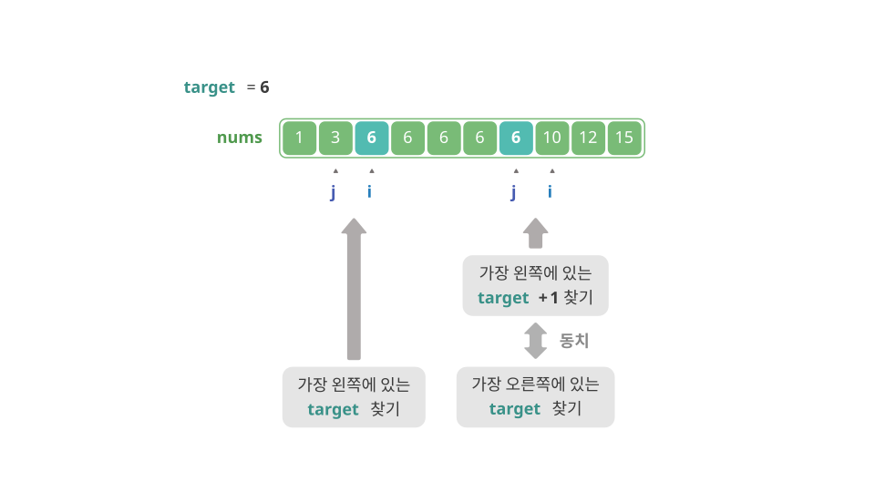
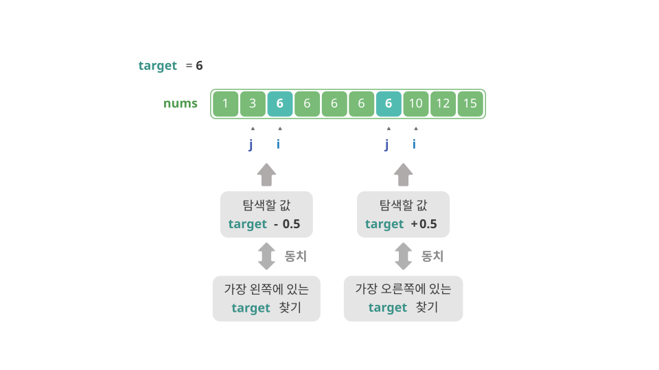

# 이진 탐색으로 경계 찾기

## 왼쪽 경계 찾기

!!! question

    중복 원소가 있을 수 있는 길이 $n$의 정렬된 배열 `nums`가 주어진다. 배열에서 가장 왼쪽에 있는 `target`의 인덱스를 반환하라. 해당 원소가 없으면 $-1$을 반환하라.

이진 탐색으로 삽입 위치를 구하는 방법을 떠올려 보자. 탐색을 마치면 $i$는 가장 왼쪽의 `target`을 가리킨다. **따라서 삽입 위치를 찾는 것은 곧 `target`이 처음 나타나는 인덱스를 찾는 것이다**.

삽입 위치를 찾는 함수로 왼쪽 경계를 구해 보자. 배열에 `target`이 없을 수도 있다. 그때는 다음 두 결과 중 하나가 나온다.

- 삽입 위치의 인덱스 $i$가 배열의 범위를 벗어난다.
- 원소 `nums[i]`가 `target`과 다르다.

두 경우 모두 $-1$을 바로 반환하면 된다. 코드는 다음과 같다.

```src
[file]{binary_search_edge}-[class]{}-[func]{binary_search_left_edge}
```

## 오른쪽 경계 찾기

그러면 가장 오른쪽에 있는 `target`은 어떻게 찾을까? 가장 직접적인 방법은 코드를 수정해 `nums[m] == target`일 때 포인터로 구간을 줄이는 방향을 바꾸는 것이다. 여기서는 코드를 생략하니 관심 있는 독자는 직접 구현해 보자.

이제 조금 더 간단히 풀 수 있는 두 가지 방법을 살펴보자.

### 왼쪽 경계 탐색 재사용

가장 왼쪽 원소를 찾는 함수로 가장 오른쪽 원소도 찾을 수 있다. **가장 오른쪽의 `target`을 찾는 문제를 가장 왼쪽의 `target + 1`을 찾는 문제로 바꾸면 된다**.

아래 그림처럼 탐색이 끝나면 맨 왼쪽의 `target + 1`이 존재할 경우 포인터 $i$가 그 원소를 가리키고, $j$는 맨 오른쪽의 `target`을 가리킨다. **따라서 $j$를 반환하면 된다**.



반환된 삽입 위치는 $i$이므로 여기서 $1$을 빼면 $j$를 얻는다.

```src
[file]{binary_search_edge}-[class]{}-[func]{binary_search_right_edge}
```

### 원소를 찾는 문제로 바꾸기

배열에 `target`이 없으면 탐색을 마쳤을 때 $i$는 `target`보다 큰 첫 원소를 가리키고, $j$는 `target`보다 작은 마지막 원소를 가리킨다.

따라서 아래 그림처럼 배열에 없는 값을 만들어 왼쪽 경계와 오른쪽 경계를 찾을 수 있다.

- 가장 왼쪽의 `target`을 찾으려면 `target - 0.5`을 탐색한 뒤 포인터 $i$를 반환한다.
- 가장 오른쪽의 `target`을 찾으려면 `target + 0.5`을 탐색한 뒤 포인터 $j$를 반환한다.



코드는 생략한다. 다음 두 가지에 유의하자.

- 주어진 배열의 원소는 모두 정수이므로 새로 만든 목표값과 원소가 같은 경우는 고려할 필요가 없다.
- 이 방법은 소수를 사용하므로 함수의 변수 `target`을 부동 소수점형으로 바꿔야 한다(파이썬에서는 바꿀 필요가 없다).
