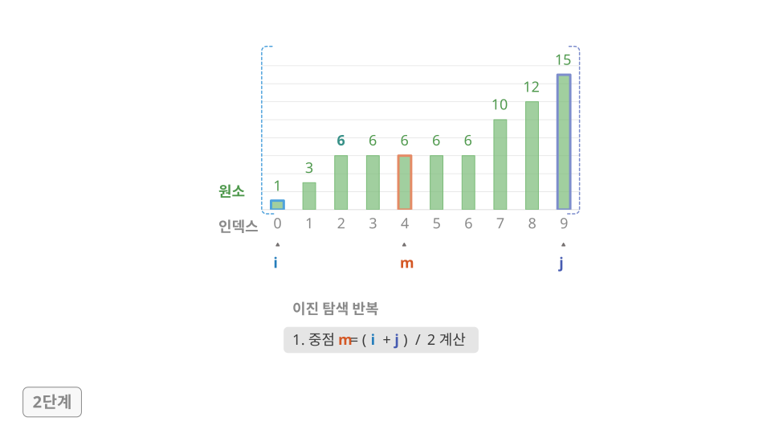
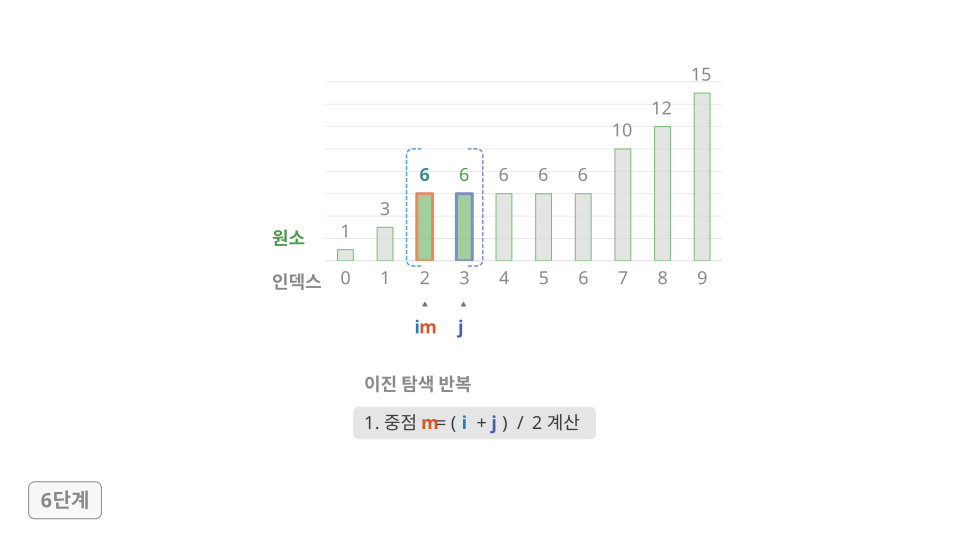

# 10.2 &nbsp; 이진 탐색으로 삽입 위치 찾기

이진 탐색은 목표 원소 자체를 찾는 데 쓰일 뿐 아니라, 목표 원소를 삽입할 위치를 찾는 등 다양한 응용 문제에도 쓰인다.

## 10.2.1 &nbsp; 중복 원소가 없는 경우

!!! question

    길이가 $n$이고 중복 원소가 없는 정렬된 배열 `nums`와 원소 `target`이 주어진다. `target`을 배열 `nums`에 삽입해 정렬 상태를 유지하려 한다. 배열에 `target`이 이미 있으면 그 왼쪽에 삽입한다. 삽입한 뒤 새 `target`이 차지할 인덱스를 반환하라. 아래 그림(10-4)은 그 예다.

{ class="animation-figure" }

<p align="center"> 그림 10-4 &nbsp; 이진 탐색으로 삽입 위치를 찾는 예제 데이터 </p>

앞 절의 이진 탐색 코드를 재사용하려면 다음 두 질문에 답해야 한다.

**질문 1**. 배열에 `target`이 있으면 삽입 인덱스는 그 원소의 인덱스인가?

문제에서는 `target`을 같은 값의 왼쪽에 삽입하라고 했다. 따라서 새로 삽입한 `target`이 기존 `target`의 자리를 차지한다. 즉, **배열에 `target`이 있으면 삽입 인덱스는 기존 `target`의 인덱스와 같다**.

**질문 2**. 배열에 `target`이 없으면 어느 원소의 인덱스가 삽입 위치인가?

이진 탐색 과정을 좀 더 살펴보자. `nums[m] < target`일 때 $i$가 이동한다. 이는 포인터 $i$가 `target` 이상인 원소에 가까워진다는 뜻이다. 마찬가지로 포인터 $j$는 계속해서 `target` 이하인 원소에 가까워진다.

따라서 이진 탐색이 끝났을 때 $i$는 `target`보다 큰 첫 원소를 가리키고, $j$는 `target`보다 작은 마지막 원소를 가리킨다. **배열에 `target`이 없을 때의 삽입 인덱스는 바로 $i$다**. 코드는 다음과 같다.

=== "Python"

    ```python title="binary_search_insertion.py"
    def binary_search_insertion_simple(nums: list[int], target: int) -> int:
        """이진 탐색으로 삽입 위치 찾기(중복 원소가 없는 경우)"""
        i, j = 0, len(nums) - 1  # 닫힌구간 [0, n-1]을 초기화한다.
        while i <= j:
            m = (i + j) // 2  # 중점 인덱스 m을 계산한다.
            if nums[m] < target:
                i = m + 1  # target을 찾을 구간은 [m+1, j]이다.
            elif nums[m] > target:
                j = m - 1  # target을 찾을 구간은 [i, m-1]이다.
            else:
                return m  # target을 찾았으므로 삽입 위치 m을 반환한다.
        # target을 찾지 못했으므로 삽입 위치 i를 반환한다.
        return i
    ```

=== "C++"

    ```cpp title="binary_search_insertion.cpp"
    /* 이진 탐색으로 삽입 위치 찾기(중복 원소가 없는 경우) */
    int binarySearchInsertionSimple(vector<int> &nums, int target) {
        int i = 0, j = nums.size() - 1; // 닫힌구간 [0, n-1]을 초기화한다.
        while (i <= j) {
            int m = i + (j - i) / 2; // 중점 인덱스 m을 계산한다.
            if (nums[m] < target) {
                i = m + 1; // target을 찾을 구간은 [m+1, j]이다.
            } else if (nums[m] > target) {
                j = m - 1; // target을 찾을 구간은 [i, m-1]이다.
            } else {
                return m; // target을 찾았으므로 삽입 위치 m을 반환한다.
            }
        }
        // target을 찾지 못했으므로 삽입 위치 i를 반환한다.
        return i;
    }
    ```

=== "Java"

    ```java title="binary_search_insertion.java"
    /* 이진 탐색으로 삽입 위치 찾기(중복 원소가 없는 경우) */
    int binarySearchInsertionSimple(int[] nums, int target) {
        int i = 0, j = nums.length - 1; // 닫힌구간 [0, n-1]을 초기화한다.
        while (i <= j) {
            int m = i + (j - i) / 2; // 중점 인덱스 m을 계산한다.
            if (nums[m] < target) {
                i = m + 1; // target을 찾을 구간은 [m+1, j]이다.
            } else if (nums[m] > target) {
                j = m - 1; // target을 찾을 구간은 [i, m-1]이다.
            } else {
                return m; // target을 찾았으므로 삽입 위치 m을 반환한다.
            }
        }
        // target을 찾지 못했으므로 삽입 위치 i를 반환한다.
        return i;
    }
    ```

=== "C#"

    ```csharp title="binary_search_insertion.cs"
    /* 이진 탐색으로 삽입 위치 찾기(중복 원소가 없는 경우) */
    int BinarySearchInsertionSimple(int[] nums, int target) {
        int i = 0, j = nums.Length - 1; // 닫힌구간 [0, n-1]을 초기화한다.
        while (i <= j) {
            int m = i + (j - i) / 2; // 중점 인덱스 m을 계산한다.
            if (nums[m] < target) {
                i = m + 1; // target을 찾을 구간은 [m+1, j]이다.
            } else if (nums[m] > target) {
                j = m - 1; // target을 찾을 구간은 [i, m-1]이다.
            } else {
                return m; // target을 찾았으므로 삽입 위치 m을 반환한다.
            }
        }
        // target을 찾지 못했으므로 삽입 위치 i를 반환한다.
        return i;
    }
    ```

=== "Go"

    ```go title="binary_search_insertion.go"
    /* 이진 탐색으로 삽입 위치 찾기(중복 원소가 없는 경우) */
    func binarySearchInsertionSimple(nums []int, target int) int {
        // 닫힌구간 [0, n-1]을 초기화한다.
        i, j := 0, len(nums)-1
        for i <= j {
            // 중점 인덱스 m을 계산한다.
            m := i + (j-i)/2
            if nums[m] < target {
                // target을 찾을 구간은 [m+1, j]이다.
                i = m + 1
            } else if nums[m] > target {
                // target을 찾을 구간은 [i, m-1]이다.
                j = m - 1
            } else {
                // target을 찾았으므로 삽입 위치 m을 반환한다.
                return m
            }
        }
        // target을 찾지 못했으므로 삽입 위치 i를 반환한다.
        return i
    }
    ```

=== "Swift"

    ```swift title="binary_search_insertion.swift"
    /* 이진 탐색으로 삽입 위치 찾기(중복 원소가 없는 경우) */
    func binarySearchInsertionSimple(nums: [Int], target: Int) -> Int {
        // 닫힌구간 [0, n-1]을 초기화한다.
        var i = nums.startIndex
        var j = nums.endIndex - 1
        while i <= j {
            let m = i + (j - i) / 2 // 중점 인덱스 m을 계산한다.
            if nums[m] < target {
                i = m + 1 // target을 찾을 구간은 [m+1, j]이다.
            } else if nums[m] > target {
                j = m - 1 // target을 찾을 구간은 [i, m-1]이다.
            } else {
                return m // target을 찾았으므로 삽입 위치 m을 반환한다.
            }
        }
        // target을 찾지 못했으므로 삽입 위치 i를 반환한다.
        return i
    }
    ```

=== "JS"

    ```javascript title="binary_search_insertion.js"
    /* 이진 탐색으로 삽입 위치 찾기(중복 원소가 없는 경우) */
    function binarySearchInsertionSimple(nums, target) {
        let i = 0,
            j = nums.length - 1; // 닫힌구간 [0, n-1]을 초기화한다.
        while (i <= j) {
            const m = Math.floor(i + (j - i) / 2); // Math.floor()로 소수점 이하를 버려 중점 인덱스 m을 구한다.
            if (nums[m] < target) {
                i = m + 1; // target을 찾을 구간은 [m+1, j]이다.
            } else if (nums[m] > target) {
                j = m - 1; // target을 찾을 구간은 [i, m-1]이다.
            } else {
                return m; // target을 찾았으므로 삽입 위치 m을 반환한다.
            }
        }
        // target을 찾지 못했으므로 삽입 위치 i를 반환한다.
        return i;
    }
    ```

=== "TS"

    ```typescript title="binary_search_insertion.ts"
    /* 이진 탐색으로 삽입 위치 찾기(중복 원소가 없는 경우) */
    function binarySearchInsertionSimple(
        nums: Array<number>,
        target: number
    ): number {
        let i = 0,
            j = nums.length - 1; // 닫힌구간 [0, n-1]을 초기화한다.
        while (i <= j) {
            const m = Math.floor(i + (j - i) / 2); // Math.floor()로 소수점 이하를 버려 중점 인덱스 m을 구한다.
            if (nums[m] < target) {
                i = m + 1; // target을 찾을 구간은 [m+1, j]이다.
            } else if (nums[m] > target) {
                j = m - 1; // target을 찾을 구간은 [i, m-1]이다.
            } else {
                return m; // target을 찾았으므로 삽입 위치 m을 반환한다.
            }
        }
        // target을 찾지 못했으므로 삽입 위치 i를 반환한다.
        return i;
    }
    ```

=== "Dart"

    ```dart title="binary_search_insertion.dart"
    /* 이진 탐색으로 삽입 위치 찾기(중복 원소가 없는 경우) */
    int binarySearchInsertionSimple(List<int> nums, int target) {
      int i = 0, j = nums.length - 1; // 닫힌구간 [0, n-1]을 초기화한다.
      while (i <= j) {
        int m = i + (j - i) ~/ 2; // 중점 인덱스 m을 계산한다.
        if (nums[m] < target) {
          i = m + 1; // target을 찾을 구간은 [m+1, j]이다.
        } else if (nums[m] > target) {
          j = m - 1; // target을 찾을 구간은 [i, m-1]이다.
        } else {
          return m; // target을 찾았으므로 삽입 위치 m을 반환한다.
        }
      }
      // target을 찾지 못했으므로 삽입 위치 i를 반환한다.
      return i;
    }
    ```

=== "Rust"

    ```rust title="binary_search_insertion.rs"
    /* 이진 탐색으로 삽입 위치 찾기(중복 원소가 없는 경우) */
    fn binary_search_insertion_simple(nums: &[i32], target: i32) -> i32 {
        let (mut i, mut j) = (0, nums.len() as i32 - 1); // 닫힌구간 [0, n-1]을 초기화한다.
        while i <= j {
            let m = i + (j - i) / 2; // 중점 인덱스 m을 계산한다.
            if nums[m as usize] < target {
                i = m + 1; // target을 찾을 구간은 [m+1, j]이다.
            } else if nums[m as usize] > target {
                j = m - 1; // target을 찾을 구간은 [i, m-1]이다.
            } else {
                return m;
            }
        }
        // target을 찾지 못했으므로 삽입 위치 i를 반환한다.
        i
    }
    ```

=== "C"

    ```c title="binary_search_insertion.c"
    /* 이진 탐색으로 삽입 위치 찾기(중복 원소가 없는 경우) */
    int binarySearchInsertionSimple(int *nums, int numSize, int target) {
        int i = 0, j = numSize - 1; // 닫힌구간 [0, n-1]을 초기화한다.
        while (i <= j) {
            int m = i + (j - i) / 2; // 중점 인덱스 m을 계산한다.
            if (nums[m] < target) {
                i = m + 1; // target을 찾을 구간은 [m+1, j]이다.
            } else if (nums[m] > target) {
                j = m - 1; // target을 찾을 구간은 [i, m-1]이다.
            } else {
                return m; // target을 찾았으므로 삽입 위치 m을 반환한다.
            }
        }
        // target을 찾지 못했으므로 삽입 위치 i를 반환한다.
        return i;
    }
    ```

=== "Kotlin"

    ```kotlin title="binary_search_insertion.kt"
    /* 이진 탐색으로 삽입 위치 찾기(중복 원소가 없는 경우) */
    fun binarySearchInsertionSimple(nums: IntArray, target: Int): Int {
        var i = 0
        var j = nums.size - 1 // 닫힌구간 [0, n-1]을 초기화한다.
        while (i <= j) {
            val m = i + (j - i) / 2 // 중점 인덱스 m을 계산한다.
            if (nums[m] < target) {
                i = m + 1 // target을 찾을 구간은 [m+1, j]이다.
            } else if (nums[m] > target) {
                j = m - 1 // target을 찾을 구간은 [i, m-1]이다.
            } else {
                return m // target을 찾았으므로 삽입 위치 m을 반환한다.
            }
        }
        // target을 찾지 못했으므로 삽입 위치 i를 반환한다.
        return i
    }
    ```

=== "Ruby"

    ```ruby title="binary_search_insertion.rb"
    ### 이진 탐색으로 삽입 위치 찾기(중복 원소가 없는 경우) ###
    def binary_search_insertion_simple(nums, target)
      # 닫힌구간 [0, n-1]을 초기화한다.
      i, j = 0, nums.length - 1

      while i <= j
        # 중점 인덱스 m을 계산한다.
        m = (i + j) / 2

        if nums[m] < target
          i = m + 1 # target을 찾을 구간은 [m+1, j]이다.
        elsif nums[m] > target
          j = m - 1 # target을 찾을 구간은 [i, m-1]이다.
        else
          return m  # target을 찾았으므로 삽입 위치 m을 반환한다.
        end
      end

      i # target을 찾지 못했으므로 삽입 위치 i를 반환한다.
    end
    ```

??? pythontutor "실행 과정 시각화"

    <div style="height: 549px; width: 100%;"><iframe class="pythontutor-iframe" title="실행 과정 시각화" src="https://pythontutor.com/iframe-embed.html#code=def%20binary_search_insertion_simple%28nums%3A%20list%5Bint%5D,%20target%3A%20int%29%20-%3E%20int%3A%0A%20%20%20%20%22%22%22%EC%9D%B4%EC%A7%84%20%ED%83%90%EC%83%89%EC%9C%BC%EB%A1%9C%20%EC%82%BD%EC%9E%85%20%EC%9C%84%EC%B9%98%20%EC%B0%BE%EA%B8%B0%28%EC%A4%91%EB%B3%B5%20%EC%9B%90%EC%86%8C%EA%B0%80%20%EC%97%86%EB%8A%94%20%EA%B2%BD%EC%9A%B0%29%22%22%22%0A%20%20%20%20i,%20j%20%3D%200,%20len%28nums%29%20-%201%20%20%23%20%EB%8B%AB%ED%9E%8C%EA%B5%AC%EA%B0%84%20%5B0,%20n-1%5D%EC%9D%84%20%EC%B4%88%EA%B8%B0%ED%99%94%ED%95%9C%EB%8B%A4.%0A%20%20%20%20while%20i%20%3C%3D%20j%3A%0A%20%20%20%20%20%20%20%20m%20%3D%20%28i%20%2B%20j%29%20//%202%20%20%23%20%EC%A4%91%EC%A0%90%20%EC%9D%B8%EB%8D%B1%EC%8A%A4%20m%EC%9D%84%20%EA%B3%84%EC%82%B0%ED%95%9C%EB%8B%A4.%0A%20%20%20%20%20%20%20%20if%20nums%5Bm%5D%20%3C%20target%3A%0A%20%20%20%20%20%20%20%20%20%20%20%20i%20%3D%20m%20%2B%201%20%20%23%20target%EC%9D%84%20%EC%B0%BE%EC%9D%84%20%EA%B5%AC%EA%B0%84%EC%9D%80%20%5Bm%2B1,%20j%5D%EC%9D%B4%EB%8B%A4.%0A%20%20%20%20%20%20%20%20elif%20nums%5Bm%5D%20%3E%20target%3A%0A%20%20%20%20%20%20%20%20%20%20%20%20j%20%3D%20m%20-%201%20%20%23%20target%EC%9D%84%20%EC%B0%BE%EC%9D%84%20%EA%B5%AC%EA%B0%84%EC%9D%80%20%5Bi,%20m-1%5D%EC%9D%B4%EB%8B%A4.%0A%20%20%20%20%20%20%20%20else%3A%0A%20%20%20%20%20%20%20%20%20%20%20%20return%20m%20%20%23%20target%EC%9D%84%20%EC%B0%BE%EC%95%98%EC%9C%BC%EB%AF%80%EB%A1%9C%20%EC%82%BD%EC%9E%85%20%EC%9C%84%EC%B9%98%20m%EC%9D%84%20%EB%B0%98%ED%99%98%ED%95%9C%EB%8B%A4.%0A%20%20%20%20%23%20target%EC%9D%84%20%EC%B0%BE%EC%A7%80%20%EB%AA%BB%ED%96%88%EC%9C%BC%EB%AF%80%EB%A1%9C%20%EC%82%BD%EC%9E%85%20%EC%9C%84%EC%B9%98%20i%EB%A5%BC%20%EB%B0%98%ED%99%98%ED%95%9C%EB%8B%A4.%0A%20%20%20%20return%20i%0A%0A%0A%22%22%22Driver%20Code%22%22%22%0Aif%20__name__%20%3D%3D%20%22__main__%22%3A%0A%20%20%20%20%23%20%EC%A4%91%EB%B3%B5%20%EC%9B%90%EC%86%8C%EA%B0%80%20%EC%97%86%EB%8A%94%20%EB%B0%B0%EC%97%B4%0A%20%20%20%20nums%20%3D%20%5B1,%203,%206,%208,%2012,%2015,%2023,%2026,%2031,%2035%5D%0A%20%20%20%20%23%20%EC%9D%B4%EC%A7%84%20%ED%83%90%EC%83%89%EC%9C%BC%EB%A1%9C%20%EC%82%BD%EC%9E%85%20%EC%9C%84%EC%B9%98%20%EC%B0%BE%EA%B8%B0%0A%20%20%20%20target%20%3D%206%0A%20%20%20%20index%20%3D%20binary_search_insertion_simple%28nums,%20target%29%0A%20%20%20%20print%28f%22%EC%82%BD%EC%9E%85%ED%95%A0%20%EA%B0%92%20%3D%20%7Btarget%7D%20%7C%20%EC%82%BD%EC%9E%85%20%EC%9D%B8%EB%8D%B1%EC%8A%A4%20%3D%20%7Bindex%7D%22%29&codeDivHeight=472&codeDivWidth=350&cumulative=false&curInstr=5&heapPrimitives=nevernest&origin=opt-frontend.js&py=311&rawInputLstJSON=%5B%5D&textReferences=false"> </iframe></div>
    <div style="margin-top: 5px;"><a href="https://pythontutor.com/iframe-embed.html#code=def%20binary_search_insertion_simple%28nums%3A%20list%5Bint%5D,%20target%3A%20int%29%20-%3E%20int%3A%0A%20%20%20%20%22%22%22%EC%9D%B4%EC%A7%84%20%ED%83%90%EC%83%89%EC%9C%BC%EB%A1%9C%20%EC%82%BD%EC%9E%85%20%EC%9C%84%EC%B9%98%20%EC%B0%BE%EA%B8%B0%28%EC%A4%91%EB%B3%B5%20%EC%9B%90%EC%86%8C%EA%B0%80%20%EC%97%86%EB%8A%94%20%EA%B2%BD%EC%9A%B0%29%22%22%22%0A%20%20%20%20i,%20j%20%3D%200,%20len%28nums%29%20-%201%20%20%23%20%EB%8B%AB%ED%9E%8C%EA%B5%AC%EA%B0%84%20%5B0,%20n-1%5D%EC%9D%84%20%EC%B4%88%EA%B8%B0%ED%99%94%ED%95%9C%EB%8B%A4.%0A%20%20%20%20while%20i%20%3C%3D%20j%3A%0A%20%20%20%20%20%20%20%20m%20%3D%20%28i%20%2B%20j%29%20//%202%20%20%23%20%EC%A4%91%EC%A0%90%20%EC%9D%B8%EB%8D%B1%EC%8A%A4%20m%EC%9D%84%20%EA%B3%84%EC%82%B0%ED%95%9C%EB%8B%A4.%0A%20%20%20%20%20%20%20%20if%20nums%5Bm%5D%20%3C%20target%3A%0A%20%20%20%20%20%20%20%20%20%20%20%20i%20%3D%20m%20%2B%201%20%20%23%20target%EC%9D%84%20%EC%B0%BE%EC%9D%84%20%EA%B5%AC%EA%B0%84%EC%9D%80%20%5Bm%2B1,%20j%5D%EC%9D%B4%EB%8B%A4.%0A%20%20%20%20%20%20%20%20elif%20nums%5Bm%5D%20%3E%20target%3A%0A%20%20%20%20%20%20%20%20%20%20%20%20j%20%3D%20m%20-%201%20%20%23%20target%EC%9D%84%20%EC%B0%BE%EC%9D%84%20%EA%B5%AC%EA%B0%84%EC%9D%80%20%5Bi,%20m-1%5D%EC%9D%B4%EB%8B%A4.%0A%20%20%20%20%20%20%20%20else%3A%0A%20%20%20%20%20%20%20%20%20%20%20%20return%20m%20%20%23%20target%EC%9D%84%20%EC%B0%BE%EC%95%98%EC%9C%BC%EB%AF%80%EB%A1%9C%20%EC%82%BD%EC%9E%85%20%EC%9C%84%EC%B9%98%20m%EC%9D%84%20%EB%B0%98%ED%99%98%ED%95%9C%EB%8B%A4.%0A%20%20%20%20%23%20target%EC%9D%84%20%EC%B0%BE%EC%A7%80%20%EB%AA%BB%ED%96%88%EC%9C%BC%EB%AF%80%EB%A1%9C%20%EC%82%BD%EC%9E%85%20%EC%9C%84%EC%B9%98%20i%EB%A5%BC%20%EB%B0%98%ED%99%98%ED%95%9C%EB%8B%A4.%0A%20%20%20%20return%20i%0A%0A%0A%22%22%22Driver%20Code%22%22%22%0Aif%20__name__%20%3D%3D%20%22__main__%22%3A%0A%20%20%20%20%23%20%EC%A4%91%EB%B3%B5%20%EC%9B%90%EC%86%8C%EA%B0%80%20%EC%97%86%EB%8A%94%20%EB%B0%B0%EC%97%B4%0A%20%20%20%20nums%20%3D%20%5B1,%203,%206,%208,%2012,%2015,%2023,%2026,%2031,%2035%5D%0A%20%20%20%20%23%20%EC%9D%B4%EC%A7%84%20%ED%83%90%EC%83%89%EC%9C%BC%EB%A1%9C%20%EC%82%BD%EC%9E%85%20%EC%9C%84%EC%B9%98%20%EC%B0%BE%EA%B8%B0%0A%20%20%20%20target%20%3D%206%0A%20%20%20%20index%20%3D%20binary_search_insertion_simple%28nums,%20target%29%0A%20%20%20%20print%28f%22%EC%82%BD%EC%9E%85%ED%95%A0%20%EA%B0%92%20%3D%20%7Btarget%7D%20%7C%20%EC%82%BD%EC%9E%85%20%EC%9D%B8%EB%8D%B1%EC%8A%A4%20%3D%20%7Bindex%7D%22%29&codeDivHeight=800&codeDivWidth=600&cumulative=false&curInstr=5&heapPrimitives=nevernest&origin=opt-frontend.js&py=311&rawInputLstJSON=%5B%5D&textReferences=false" target="_blank" rel="noopener noreferrer">전체 화면으로 보기 ></a></div>

## 10.2.2 &nbsp; 중복 원소가 있는 경우

!!! question

    앞 문제에서 배열에 중복 원소가 있을 수 있다는 조건만 바꾸고 나머지 조건은 그대로 둔다.

배열에 `target`이 여러 개 있다면 일반적인 이진 탐색은 그중 `target` 하나의 인덱스만 반환한다. **찾은 원소의 왼쪽과 오른쪽에 `target`이 몇 개씩 더 있는지는 알 수 없다**.

문제에서 목표 원소를 같은 값들 중 가장 왼쪽에 삽입하라고 했으므로 **배열에서 가장 왼쪽에 있는 `target`의 인덱스를 찾아야 한다**. 먼저 아래 그림(10-5)과 같은 방법을 생각해 볼 수 있다.

1. 이진 탐색으로 `target`이 있는 인덱스 하나를 찾아 $k$라고 한다.
2. 인덱스 $k$부터 왼쪽으로 한 칸씩 확인하다가 가장 왼쪽의 `target`을 찾으면 그 인덱스를 반환한다.

{ class="animation-figure" }

<p align="center"> 그림 10-5 &nbsp; 선형 탐색으로 중복 원소의 삽입 위치 찾기 </p>

이 방법으로 문제를 풀 수는 있지만 선형 탐색을 포함하므로 시간 복잡도는 $O(n)$이다. 배열에 `target`이 많이 중복되어 있으면 효율이 매우 낮다.

이번에는 이진 탐색 코드를 확장해 보자. 아래 그림(10-6)처럼 전체 흐름은 같다. 매번 먼저 중점 인덱스 $m$을 구한 뒤 `target`과 `nums[m]`를 비교한다. 결과에 따라 다음과 같이 처리한다.

- `nums[m] < target`이거나 `nums[m] > target`이면 아직 `target`을 찾지 못한 것이다. 일반적인 이진 탐색과 같은 방식으로 구간을 줄이면 **포인터 $i$와 $j$가 `target`에 가까워진다**.
- `nums[m] == target`이면 `target`보다 작은 원소를 찾을 구간은 $[i, m - 1]$이다. 따라서 $j = m - 1$로 구간을 줄여 **포인터 $j$가 `target`보다 작은 원소에 가까워지게 한다**.

반복이 끝나면 $i$는 가장 왼쪽의 `target`을, $j$는 `target`보다 작은 마지막 원소를 가리킨다. **따라서 인덱스 $i$가 삽입 위치다**.

=== "<1>"
    { class="animation-figure" }

=== "<2>"
    { class="animation-figure" }

=== "<3>"
    { class="animation-figure" }

=== "<4>"
    { class="animation-figure" }

=== "<5>"
    { class="animation-figure" }

=== "<6>"
    { class="animation-figure" }

=== "<7>"
    { class="animation-figure" }

=== "<8>"
    { class="animation-figure" }

<p align="center"> 그림 10-6 &nbsp; 이진 탐색으로 중복 원소의 삽입 위치를 찾는 단계 </p>

아래 코드를 보면 `nums[m] > target`인 분기와 `nums[m] == target`인 분기에서 하는 일이 같으므로 두 분기를 합칠 수 있다.

다만 조건을 이렇게 나누어 두면 논리가 더 분명하고 코드를 읽기도 쉽다.

=== "Python"

    ```python title="binary_search_insertion.py"
    def binary_search_insertion(nums: list[int], target: int) -> int:
        """이진 탐색으로 삽입 위치 찾기(중복 원소가 있는 경우)"""
        i, j = 0, len(nums) - 1  # 닫힌구간 [0, n-1]을 초기화한다.
        while i <= j:
            m = (i + j) // 2  # 중점 인덱스 m을 계산한다.
            if nums[m] < target:
                i = m + 1  # target을 찾을 구간은 [m+1, j]이다.
            elif nums[m] > target:
                j = m - 1  # target을 찾을 구간은 [i, m-1]이다.
            else:
                j = m - 1  # target보다 작은 원소 중 가장 오른쪽 원소를 찾을 구간은 [i, m-1]이다.
        # 삽입 위치 i를 반환한다.
        return i
    ```

=== "C++"

    ```cpp title="binary_search_insertion.cpp"
    /* 이진 탐색으로 삽입 위치 찾기(중복 원소가 있는 경우) */
    int binarySearchInsertion(vector<int> &nums, int target) {
        int i = 0, j = nums.size() - 1; // 닫힌구간 [0, n-1]을 초기화한다.
        while (i <= j) {
            int m = i + (j - i) / 2; // 중점 인덱스 m을 계산한다.
            if (nums[m] < target) {
                i = m + 1; // target을 찾을 구간은 [m+1, j]이다.
            } else if (nums[m] > target) {
                j = m - 1; // target을 찾을 구간은 [i, m-1]이다.
            } else {
                j = m - 1; // target보다 작은 원소 중 가장 오른쪽 원소를 찾을 구간은 [i, m-1]이다.
            }
        }
        // 삽입 위치 i를 반환한다.
        return i;
    }
    ```

=== "Java"

    ```java title="binary_search_insertion.java"
    /* 이진 탐색으로 삽입 위치 찾기(중복 원소가 있는 경우) */
    int binarySearchInsertion(int[] nums, int target) {
        int i = 0, j = nums.length - 1; // 닫힌구간 [0, n-1]을 초기화한다.
        while (i <= j) {
            int m = i + (j - i) / 2; // 중점 인덱스 m을 계산한다.
            if (nums[m] < target) {
                i = m + 1; // target을 찾을 구간은 [m+1, j]이다.
            } else if (nums[m] > target) {
                j = m - 1; // target을 찾을 구간은 [i, m-1]이다.
            } else {
                j = m - 1; // target보다 작은 원소 중 가장 오른쪽 원소를 찾을 구간은 [i, m-1]이다.
            }
        }
        // 삽입 위치 i를 반환한다.
        return i;
    }
    ```

=== "C#"

    ```csharp title="binary_search_insertion.cs"
    /* 이진 탐색으로 삽입 위치 찾기(중복 원소가 있는 경우) */
    int BinarySearchInsertion(int[] nums, int target) {
        int i = 0, j = nums.Length - 1; // 닫힌구간 [0, n-1]을 초기화한다.
        while (i <= j) {
            int m = i + (j - i) / 2; // 중점 인덱스 m을 계산한다.
            if (nums[m] < target) {
                i = m + 1; // target을 찾을 구간은 [m+1, j]이다.
            } else if (nums[m] > target) {
                j = m - 1; // target을 찾을 구간은 [i, m-1]이다.
            } else {
                j = m - 1; // target보다 작은 원소 중 가장 오른쪽 원소를 찾을 구간은 [i, m-1]이다.
            }
        }
        // 삽입 위치 i를 반환한다.
        return i;
    }
    ```

=== "Go"

    ```go title="binary_search_insertion.go"
    /* 이진 탐색으로 삽입 위치 찾기(중복 원소가 있는 경우) */
    func binarySearchInsertion(nums []int, target int) int {
        // 닫힌구간 [0, n-1]을 초기화한다.
        i, j := 0, len(nums)-1
        for i <= j {
            // 중점 인덱스 m을 계산한다.
            m := i + (j-i)/2
            if nums[m] < target {
                // target을 찾을 구간은 [m+1, j]이다.
                i = m + 1
            } else if nums[m] > target {
                // target을 찾을 구간은 [i, m-1]이다.
                j = m - 1
            } else {
                // target보다 작은 원소 중 가장 오른쪽 원소를 찾을 구간은 [i, m-1]이다.
                j = m - 1
            }
        }
        // 삽입 위치 i를 반환한다.
        return i
    }
    ```

=== "Swift"

    ```swift title="binary_search_insertion.swift"
    /* 이진 탐색으로 삽입 위치 찾기(중복 원소가 있는 경우) */
    func binarySearchInsertion(nums: [Int], target: Int) -> Int {
        // 닫힌구간 [0, n-1]을 초기화한다.
        var i = nums.startIndex
        var j = nums.endIndex - 1
        while i <= j {
            let m = i + (j - i) / 2 // 중점 인덱스 m을 계산한다.
            if nums[m] < target {
                i = m + 1 // target을 찾을 구간은 [m+1, j]이다.
            } else if nums[m] > target {
                j = m - 1 // target을 찾을 구간은 [i, m-1]이다.
            } else {
                j = m - 1 // target보다 작은 원소 중 가장 오른쪽 원소를 찾을 구간은 [i, m-1]이다.
            }
        }
        // 삽입 위치 i를 반환한다.
        return i
    }
    ```

=== "JS"

    ```javascript title="binary_search_insertion.js"
    /* 이진 탐색으로 삽입 위치 찾기(중복 원소가 있는 경우) */
    function binarySearchInsertion(nums, target) {
        let i = 0,
            j = nums.length - 1; // 닫힌구간 [0, n-1]을 초기화한다.
        while (i <= j) {
            const m = Math.floor(i + (j - i) / 2); // Math.floor()로 소수점 이하를 버려 중점 인덱스 m을 구한다.
            if (nums[m] < target) {
                i = m + 1; // target을 찾을 구간은 [m+1, j]이다.
            } else if (nums[m] > target) {
                j = m - 1; // target을 찾을 구간은 [i, m-1]이다.
            } else {
                j = m - 1; // target보다 작은 원소 중 가장 오른쪽 원소를 찾을 구간은 [i, m-1]이다.
            }
        }
        // 삽입 위치 i를 반환한다.
        return i;
    }
    ```

=== "TS"

    ```typescript title="binary_search_insertion.ts"
    /* 이진 탐색으로 삽입 위치 찾기(중복 원소가 있는 경우) */
    function binarySearchInsertion(nums: Array<number>, target: number): number {
        let i = 0,
            j = nums.length - 1; // 닫힌구간 [0, n-1]을 초기화한다.
        while (i <= j) {
            const m = Math.floor(i + (j - i) / 2); // Math.floor()로 소수점 이하를 버려 중점 인덱스 m을 구한다.
            if (nums[m] < target) {
                i = m + 1; // target을 찾을 구간은 [m+1, j]이다.
            } else if (nums[m] > target) {
                j = m - 1; // target을 찾을 구간은 [i, m-1]이다.
            } else {
                j = m - 1; // target보다 작은 원소 중 가장 오른쪽 원소를 찾을 구간은 [i, m-1]이다.
            }
        }
        // 삽입 위치 i를 반환한다.
        return i;
    }
    ```

=== "Dart"

    ```dart title="binary_search_insertion.dart"
    /* 이진 탐색으로 삽입 위치 찾기(중복 원소가 있는 경우) */
    int binarySearchInsertion(List<int> nums, int target) {
      int i = 0, j = nums.length - 1; // 닫힌구간 [0, n-1]을 초기화한다.
      while (i <= j) {
        int m = i + (j - i) ~/ 2; // 중점 인덱스 m을 계산한다.
        if (nums[m] < target) {
          i = m + 1; // target을 찾을 구간은 [m+1, j]이다.
        } else if (nums[m] > target) {
          j = m - 1; // target을 찾을 구간은 [i, m-1]이다.
        } else {
          j = m - 1; // target보다 작은 원소 중 가장 오른쪽 원소를 찾을 구간은 [i, m-1]이다.
        }
      }
      // 삽입 위치 i를 반환한다.
      return i;
    }
    ```

=== "Rust"

    ```rust title="binary_search_insertion.rs"
    /* 이진 탐색으로 삽입 위치 찾기(중복 원소가 있는 경우) */
    pub fn binary_search_insertion(nums: &[i32], target: i32) -> i32 {
        let (mut i, mut j) = (0, nums.len() as i32 - 1); // 닫힌구간 [0, n-1]을 초기화한다.
        while i <= j {
            let m = i + (j - i) / 2; // 중점 인덱스 m을 계산한다.
            if nums[m as usize] < target {
                i = m + 1; // target을 찾을 구간은 [m+1, j]이다.
            } else if nums[m as usize] > target {
                j = m - 1; // target을 찾을 구간은 [i, m-1]이다.
            } else {
                j = m - 1; // target보다 작은 원소 중 가장 오른쪽 원소를 찾을 구간은 [i, m-1]이다.
            }
        }
        // 삽입 위치 i를 반환한다.
        i
    }
    ```

=== "C"

    ```c title="binary_search_insertion.c"
    /* 이진 탐색으로 삽입 위치 찾기(중복 원소가 있는 경우) */
    int binarySearchInsertion(int *nums, int numSize, int target) {
        int i = 0, j = numSize - 1; // 닫힌구간 [0, n-1]을 초기화한다.
        while (i <= j) {
            int m = i + (j - i) / 2; // 중점 인덱스 m을 계산한다.
            if (nums[m] < target) {
                i = m + 1; // target을 찾을 구간은 [m+1, j]이다.
            } else if (nums[m] > target) {
                j = m - 1; // target을 찾을 구간은 [i, m-1]이다.
            } else {
                j = m - 1; // target보다 작은 원소 중 가장 오른쪽 원소를 찾을 구간은 [i, m-1]이다.
            }
        }
        // 삽입 위치 i를 반환한다.
        return i;
    }
    ```

=== "Kotlin"

    ```kotlin title="binary_search_insertion.kt"
    /* 이진 탐색으로 삽입 위치 찾기(중복 원소가 있는 경우) */
    fun binarySearchInsertion(nums: IntArray, target: Int): Int {
        var i = 0
        var j = nums.size - 1 // 닫힌구간 [0, n-1]을 초기화한다.
        while (i <= j) {
            val m = i + (j - i) / 2 // 중점 인덱스 m을 계산한다.
            if (nums[m] < target) {
                i = m + 1 // target을 찾을 구간은 [m+1, j]이다.
            } else if (nums[m] > target) {
                j = m - 1 // target을 찾을 구간은 [i, m-1]이다.
            } else {
                j = m - 1 // target보다 작은 원소 중 가장 오른쪽 원소를 찾을 구간은 [i, m-1]이다.
            }
        }
        // 삽입 위치 i를 반환한다.
        return i
    }
    ```

=== "Ruby"

    ```ruby title="binary_search_insertion.rb"
    ### 이진 탐색으로 삽입 위치 찾기(중복 원소가 있는 경우) ###
    def binary_search_insertion(nums, target)
      # 닫힌구간 [0, n-1]을 초기화한다.
      i, j = 0, nums.length - 1

      while i <= j
        # 중점 인덱스 m을 계산한다.
        m = (i + j) / 2

        if nums[m] < target
          i = m + 1 # target을 찾을 구간은 [m+1, j]이다.
        elsif nums[m] > target
          j = m - 1 # target을 찾을 구간은 [i, m-1]이다.
        else
          j = m - 1 # target보다 작은 원소 중 가장 오른쪽 원소를 찾을 구간은 [i, m-1]이다.
        end
      end

      i # 삽입 위치 i를 반환한다.
    end
    ```

??? pythontutor "실행 과정 시각화"

    <div style="height: 549px; width: 100%;"><iframe class="pythontutor-iframe" title="실행 과정 시각화" src="https://pythontutor.com/iframe-embed.html#code=def%20binary_search_insertion%28nums%3A%20list%5Bint%5D,%20target%3A%20int%29%20-%3E%20int%3A%0A%20%20%20%20%22%22%22%EC%9D%B4%EC%A7%84%20%ED%83%90%EC%83%89%EC%9C%BC%EB%A1%9C%20%EC%82%BD%EC%9E%85%20%EC%9C%84%EC%B9%98%20%EC%B0%BE%EA%B8%B0%28%EC%A4%91%EB%B3%B5%20%EC%9B%90%EC%86%8C%EA%B0%80%20%EC%9E%88%EB%8A%94%20%EA%B2%BD%EC%9A%B0%29%22%22%22%0A%20%20%20%20i,%20j%20%3D%200,%20len%28nums%29%20-%201%20%20%23%20%EB%8B%AB%ED%9E%8C%EA%B5%AC%EA%B0%84%20%5B0,%20n-1%5D%EC%9D%84%20%EC%B4%88%EA%B8%B0%ED%99%94%ED%95%9C%EB%8B%A4.%0A%20%20%20%20while%20i%20%3C%3D%20j%3A%0A%20%20%20%20%20%20%20%20m%20%3D%20%28i%20%2B%20j%29%20//%202%20%20%23%20%EC%A4%91%EC%A0%90%20%EC%9D%B8%EB%8D%B1%EC%8A%A4%20m%EC%9D%84%20%EA%B3%84%EC%82%B0%ED%95%9C%EB%8B%A4.%0A%20%20%20%20%20%20%20%20if%20nums%5Bm%5D%20%3C%20target%3A%0A%20%20%20%20%20%20%20%20%20%20%20%20i%20%3D%20m%20%2B%201%20%20%23%20target%EC%9D%84%20%EC%B0%BE%EC%9D%84%20%EA%B5%AC%EA%B0%84%EC%9D%80%20%5Bm%2B1,%20j%5D%EC%9D%B4%EB%8B%A4.%0A%20%20%20%20%20%20%20%20elif%20nums%5Bm%5D%20%3E%20target%3A%0A%20%20%20%20%20%20%20%20%20%20%20%20j%20%3D%20m%20-%201%20%20%23%20target%EC%9D%84%20%EC%B0%BE%EC%9D%84%20%EA%B5%AC%EA%B0%84%EC%9D%80%20%5Bi,%20m-1%5D%EC%9D%B4%EB%8B%A4.%0A%20%20%20%20%20%20%20%20else%3A%0A%20%20%20%20%20%20%20%20%20%20%20%20j%20%3D%20m%20-%201%20%20%23%20target%EB%B3%B4%EB%8B%A4%20%EC%9E%91%EC%9D%80%20%EC%B2%AB%20%EC%9B%90%EC%86%8C%EB%A5%BC%20%EC%B0%BE%EC%9D%84%20%EA%B5%AC%EA%B0%84%EC%9D%80%20%5Bi,%20m-1%5D%EC%9D%B4%EB%8B%A4.%0A%20%20%20%20%23%20%EC%82%BD%EC%9E%85%20%EC%9C%84%EC%B9%98%20i%EB%A5%BC%20%EB%B0%98%ED%99%98%ED%95%9C%EB%8B%A4.%0A%20%20%20%20return%20i%0A%0A%0A%22%22%22Driver%20Code%22%22%22%0Aif%20__name__%20%3D%3D%20%22__main__%22%3A%0A%20%20%20%20%23%20%EC%A4%91%EB%B3%B5%20%EC%9B%90%EC%86%8C%EA%B0%80%20%EC%9E%88%EB%8A%94%20%EB%B0%B0%EC%97%B4%0A%20%20%20%20nums%20%3D%20%5B1,%203,%206,%206,%206,%206,%206,%2010,%2012,%2015%5D%0A%20%20%20%20%23%20%EC%9D%B4%EC%A7%84%20%ED%83%90%EC%83%89%EC%9C%BC%EB%A1%9C%20%EC%82%BD%EC%9E%85%20%EC%9C%84%EC%B9%98%20%EC%B0%BE%EA%B8%B0%0A%20%20%20%20target%20%3D%206%0A%20%20%20%20index%20%3D%20binary_search_insertion%28nums,%20target%29%0A%20%20%20%20print%28f%22%EC%82%BD%EC%9E%85%ED%95%A0%20%EA%B0%92%20%3D%20%7Btarget%7D%20%7C%20%EC%82%BD%EC%9E%85%20%EC%9D%B8%EB%8D%B1%EC%8A%A4%20%3D%20%7Bindex%7D%22%29&codeDivHeight=472&codeDivWidth=350&cumulative=false&curInstr=5&heapPrimitives=nevernest&origin=opt-frontend.js&py=311&rawInputLstJSON=%5B%5D&textReferences=false"> </iframe></div>
    <div style="margin-top: 5px;"><a href="https://pythontutor.com/iframe-embed.html#code=def%20binary_search_insertion%28nums%3A%20list%5Bint%5D,%20target%3A%20int%29%20-%3E%20int%3A%0A%20%20%20%20%22%22%22%EC%9D%B4%EC%A7%84%20%ED%83%90%EC%83%89%EC%9C%BC%EB%A1%9C%20%EC%82%BD%EC%9E%85%20%EC%9C%84%EC%B9%98%20%EC%B0%BE%EA%B8%B0%28%EC%A4%91%EB%B3%B5%20%EC%9B%90%EC%86%8C%EA%B0%80%20%EC%9E%88%EB%8A%94%20%EA%B2%BD%EC%9A%B0%29%22%22%22%0A%20%20%20%20i,%20j%20%3D%200,%20len%28nums%29%20-%201%20%20%23%20%EB%8B%AB%ED%9E%8C%EA%B5%AC%EA%B0%84%20%5B0,%20n-1%5D%EC%9D%84%20%EC%B4%88%EA%B8%B0%ED%99%94%ED%95%9C%EB%8B%A4.%0A%20%20%20%20while%20i%20%3C%3D%20j%3A%0A%20%20%20%20%20%20%20%20m%20%3D%20%28i%20%2B%20j%29%20//%202%20%20%23%20%EC%A4%91%EC%A0%90%20%EC%9D%B8%EB%8D%B1%EC%8A%A4%20m%EC%9D%84%20%EA%B3%84%EC%82%B0%ED%95%9C%EB%8B%A4.%0A%20%20%20%20%20%20%20%20if%20nums%5Bm%5D%20%3C%20target%3A%0A%20%20%20%20%20%20%20%20%20%20%20%20i%20%3D%20m%20%2B%201%20%20%23%20target%EC%9D%84%20%EC%B0%BE%EC%9D%84%20%EA%B5%AC%EA%B0%84%EC%9D%80%20%5Bm%2B1,%20j%5D%EC%9D%B4%EB%8B%A4.%0A%20%20%20%20%20%20%20%20elif%20nums%5Bm%5D%20%3E%20target%3A%0A%20%20%20%20%20%20%20%20%20%20%20%20j%20%3D%20m%20-%201%20%20%23%20target%EC%9D%84%20%EC%B0%BE%EC%9D%84%20%EA%B5%AC%EA%B0%84%EC%9D%80%20%5Bi,%20m-1%5D%EC%9D%B4%EB%8B%A4.%0A%20%20%20%20%20%20%20%20else%3A%0A%20%20%20%20%20%20%20%20%20%20%20%20j%20%3D%20m%20-%201%20%20%23%20target%EB%B3%B4%EB%8B%A4%20%EC%9E%91%EC%9D%80%20%EC%B2%AB%20%EC%9B%90%EC%86%8C%EB%A5%BC%20%EC%B0%BE%EC%9D%84%20%EA%B5%AC%EA%B0%84%EC%9D%80%20%5Bi,%20m-1%5D%EC%9D%B4%EB%8B%A4.%0A%20%20%20%20%23%20%EC%82%BD%EC%9E%85%20%EC%9C%84%EC%B9%98%20i%EB%A5%BC%20%EB%B0%98%ED%99%98%ED%95%9C%EB%8B%A4.%0A%20%20%20%20return%20i%0A%0A%0A%22%22%22Driver%20Code%22%22%22%0Aif%20__name__%20%3D%3D%20%22__main__%22%3A%0A%20%20%20%20%23%20%EC%A4%91%EB%B3%B5%20%EC%9B%90%EC%86%8C%EA%B0%80%20%EC%9E%88%EB%8A%94%20%EB%B0%B0%EC%97%B4%0A%20%20%20%20nums%20%3D%20%5B1,%203,%206,%206,%206,%206,%206,%2010,%2012,%2015%5D%0A%20%20%20%20%23%20%EC%9D%B4%EC%A7%84%20%ED%83%90%EC%83%89%EC%9C%BC%EB%A1%9C%20%EC%82%BD%EC%9E%85%20%EC%9C%84%EC%B9%98%20%EC%B0%BE%EA%B8%B0%0A%20%20%20%20target%20%3D%206%0A%20%20%20%20index%20%3D%20binary_search_insertion%28nums,%20target%29%0A%20%20%20%20print%28f%22%EC%82%BD%EC%9E%85%ED%95%A0%20%EA%B0%92%20%3D%20%7Btarget%7D%20%7C%20%EC%82%BD%EC%9E%85%20%EC%9D%B8%EB%8D%B1%EC%8A%A4%20%3D%20%7Bindex%7D%22%29&codeDivHeight=800&codeDivWidth=600&cumulative=false&curInstr=5&heapPrimitives=nevernest&origin=opt-frontend.js&py=311&rawInputLstJSON=%5B%5D&textReferences=false" target="_blank" rel="noopener noreferrer">전체 화면으로 보기 ></a></div>

!!! tip

    이 절의 코드는 모두 닫힌구간을 사용한다. 관심 있는 독자는 왼쪽 끝만 포함하는 반열린구간으로도 구현해 보자.

결국 이진 탐색에서는 포인터 $i$와 $j$ 각각에 탐색 목표를 정해 준다. 목표는 특정 원소(예를 들어 `target`)일 수도 있고, 일정 범위의 원소(예를 들어 `target`보다 작은 원소)일 수도 있다.

구간을 반씩 나누는 과정을 반복하면 포인터 $i$와 $j$가 미리 정해 둔 목표에 점차 가까워진다. 결국 답을 찾거나 경계를 넘어서 멈춘다.
