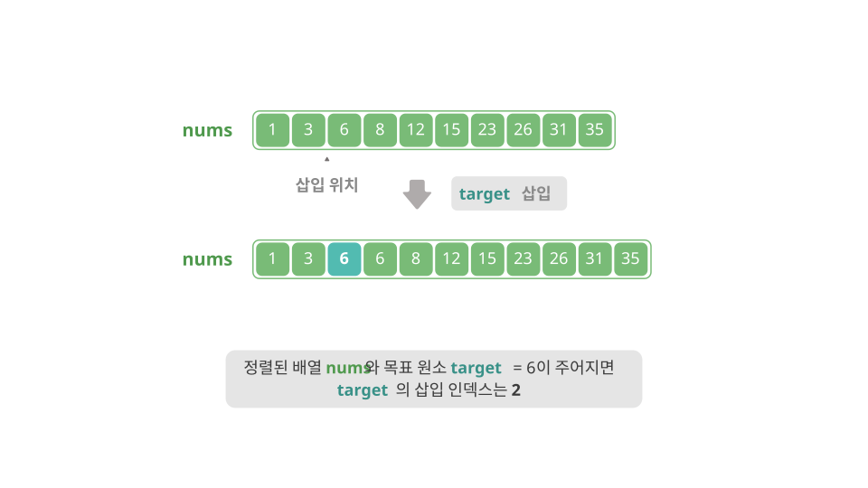
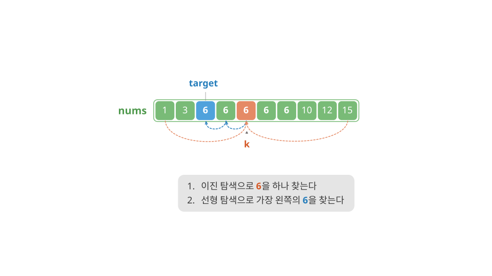
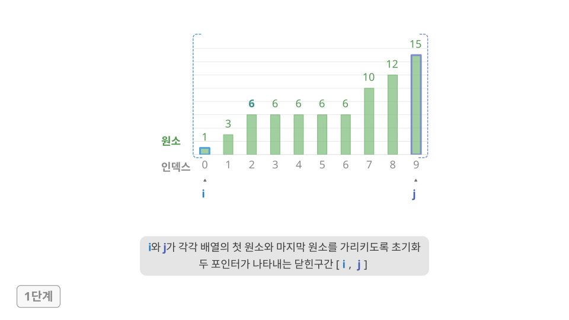
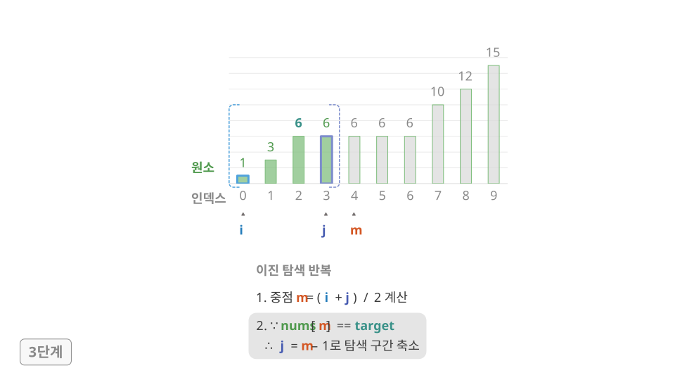
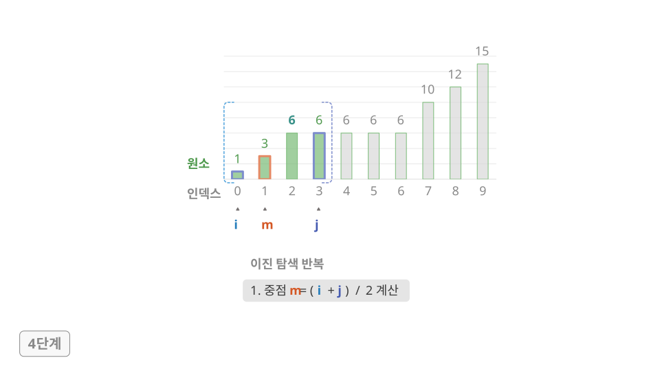
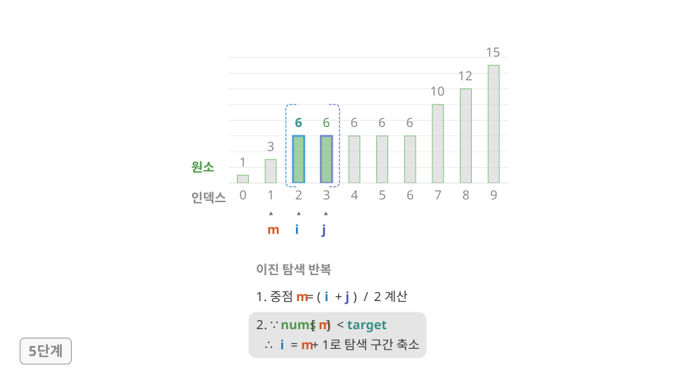
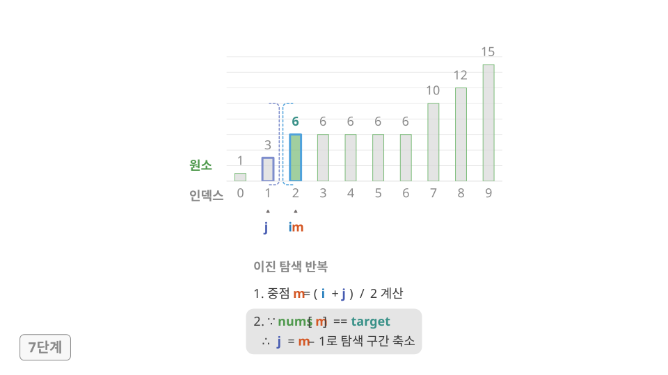

# 이진 탐색으로 삽입 위치 찾기

이진 탐색은 목표 원소 자체를 찾는 데 쓰일 뿐 아니라, 목표 원소를 삽입할 위치를 찾는 등 다양한 응용 문제에도 쓰인다.

## 중복 원소가 없는 경우

!!! question

    길이가 $n$이고 중복 원소가 없는 정렬된 배열 `nums`와 원소 `target`이 주어진다. `target`을 배열 `nums`에 삽입해 정렬 상태를 유지하려 한다. 배열에 `target`이 이미 있으면 그 왼쪽에 삽입한다. 삽입한 뒤 새 `target`이 차지할 인덱스를 반환하라. 아래 그림은 그 예다.



앞 절의 이진 탐색 코드를 재사용하려면 다음 두 질문에 답해야 한다.

**질문 1**. 배열에 `target`이 있으면 삽입 인덱스는 그 원소의 인덱스인가?

문제에서는 `target`을 같은 값의 왼쪽에 삽입하라고 했다. 따라서 새로 삽입한 `target`이 기존 `target`의 자리를 차지한다. 즉, **배열에 `target`이 있으면 삽입 인덱스는 기존 `target`의 인덱스와 같다**.

**질문 2**. 배열에 `target`이 없으면 어느 원소의 인덱스가 삽입 위치인가?

이진 탐색 과정을 좀 더 살펴보자. `nums[m] < target`일 때 $i$가 이동한다. 이는 포인터 $i$가 `target` 이상인 원소에 가까워진다는 뜻이다. 마찬가지로 포인터 $j$는 계속해서 `target` 이하인 원소에 가까워진다.

따라서 이진 탐색이 끝났을 때 $i$는 `target`보다 큰 첫 원소를 가리키고, $j$는 `target`보다 작은 마지막 원소를 가리킨다. **배열에 `target`이 없을 때의 삽입 인덱스는 바로 $i$다**. 코드는 다음과 같다.

```src
[file]{binary_search_insertion}-[class]{}-[func]{binary_search_insertion_simple}
```

## 중복 원소가 있는 경우

!!! question

    앞 문제에서 배열에 중복 원소가 있을 수 있다는 조건만 바꾸고 나머지 조건은 그대로 둔다.

배열에 `target`이 여러 개 있다면 일반적인 이진 탐색은 그중 `target` 하나의 인덱스만 반환한다. **찾은 원소의 왼쪽과 오른쪽에 `target`이 몇 개씩 더 있는지는 알 수 없다**.

문제에서 목표 원소를 같은 값들 중 가장 왼쪽에 삽입하라고 했으므로 **배열에서 가장 왼쪽에 있는 `target`의 인덱스를 찾아야 한다**. 먼저 아래 그림과 같은 방법을 생각해 볼 수 있다.

1. 이진 탐색으로 `target`이 있는 인덱스 하나를 찾아 $k$라고 한다.
2. 인덱스 $k$부터 왼쪽으로 한 칸씩 확인하다가 가장 왼쪽의 `target`을 찾으면 그 인덱스를 반환한다.



이 방법으로 문제를 풀 수는 있지만 선형 탐색을 포함하므로 시간 복잡도는 $O(n)$이다. 배열에 `target`이 많이 중복되어 있으면 효율이 매우 낮다.

이번에는 이진 탐색 코드를 확장해 보자. 아래 그림처럼 전체 흐름은 같다. 매번 먼저 중점 인덱스 $m$을 구한 뒤 `target`과 `nums[m]`를 비교한다. 결과에 따라 다음과 같이 처리한다.

- `nums[m] < target`이거나 `nums[m] > target`이면 아직 `target`을 찾지 못한 것이다. 일반적인 이진 탐색과 같은 방식으로 구간을 줄이면 **포인터 $i$와 $j$가 `target`에 가까워진다**.
- `nums[m] == target`이면 `target`보다 작은 원소를 찾을 구간은 $[i, m - 1]$이다. 따라서 $j = m - 1$로 구간을 줄여 **포인터 $j$가 `target`보다 작은 원소에 가까워지게 한다**.

반복이 끝나면 $i$는 가장 왼쪽의 `target`을, $j$는 `target`보다 작은 마지막 원소를 가리킨다. **따라서 인덱스 $i$가 삽입 위치다**.

=== "<1>"
    

=== "<2>"
    

=== "<3>"
    

=== "<4>"
    

=== "<5>"
    

=== "<6>"
    

=== "<7>"
    

=== "<8>"
    

아래 코드를 보면 `nums[m] > target`인 분기와 `nums[m] == target`인 분기에서 하는 일이 같으므로 두 분기를 합칠 수 있다.

다만 조건을 이렇게 나누어 두면 논리가 더 분명하고 코드를 읽기도 쉽다.

```src
[file]{binary_search_insertion}-[class]{}-[func]{binary_search_insertion}
```

!!! tip

    이 절의 코드는 모두 닫힌구간을 사용한다. 관심 있는 독자는 왼쪽 끝만 포함하는 반열린구간으로도 구현해 보자.

결국 이진 탐색에서는 포인터 $i$와 $j$ 각각에 탐색 목표를 정해 준다. 목표는 특정 원소(예를 들어 `target`)일 수도 있고, 일정 범위의 원소(예를 들어 `target`보다 작은 원소)일 수도 있다.

구간을 반씩 나누는 과정을 반복하면 포인터 $i$와 $j$가 미리 정해 둔 목표에 점차 가까워진다. 결국 답을 찾거나 경계를 넘어서 멈춘다.
