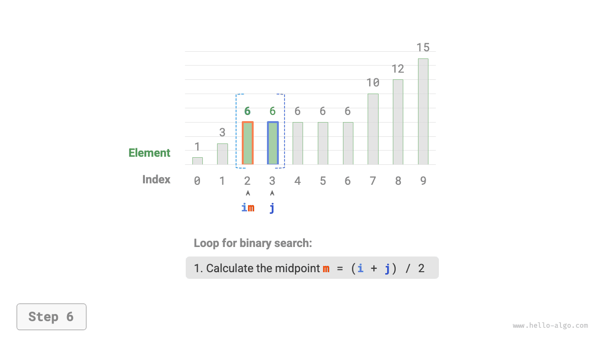

# 이진 탐색으로 삽입 위치 찾기

이진 탐색은 목표 원소를 찾는 데만 쓰이는 것이 아니다. 목표 원소를 삽입할 위치를 찾는 등 여러 변형 문제에도 사용할 수 있다.

## 중복 원소가 없는 경우

!!! question "문제"

    중복 원소가 없는 길이 $n$의 정렬된 배열 `nums`와 원소 `target`이 주어진다. 정렬 상태를 유지하면서 `target`을 배열 `nums`에 삽입하려고 한다. 이미 `target`이 있으면 그 왼쪽에 삽입한다. 삽입 후 `target`의 배열 인덱스를 반환하라. 예시는 아래 그림과 같다.


앞 절의 이진 탐색 코드를 재사용하려면 다음 두 질문에 답해야 한다.

**질문 1**: 배열에 `target`이 있을 때 삽입 위치의 인덱스는 해당 원소의 인덱스인가?

문제에서는 값이 같은 원소의 왼쪽에 `target`을 삽입하라고 한다. 따라서 새로 삽입하는 `target`이 기존 `target`의 자리를 차지한다. 즉, **배열에 `target`이 있으면 삽입 위치의 인덱스는 그 `target`의 인덱스다**.

**질문 2**: 배열에 `target`이 없을 때 삽입 위치는 어느 원소의 인덱스인가?

이진 탐색 과정을 더 살펴보자. `nums[m] < target`이면 $i$가 이동하므로 포인터 $i$는 `target` 이상인 원소에 가까워진다. 마찬가지로 포인터 $j$는 항상 `target` 이하인 원소에 가까워진다.

따라서 이진 탐색이 끝나면 $i$는 `target`보다 큰 첫 번째 원소를, $j$는 `target`보다 작은 가장 오른쪽 원소를 가리킨다. **배열에 `target`이 없을 때 삽입 인덱스가 $i$임을 쉽게 알 수 있다**. 코드는 다음과 같다.

```src
[file]{binary_search_insertion}-[class]{}-[func]{binary_search_insertion_simple}
```

## 중복 원소가 있는 경우

!!! question "문제"

    앞 문제에서 배열에 중복 원소가 있을 수 있다는 조건만 추가하고, 나머지 조건은 그대로 둔다.

배열에 `target`이 여러 개 있다면 일반적인 이진 탐색으로는 그중 하나의 인덱스만 구할 수 있다. **그 원소의 왼쪽과 오른쪽에 `target`이 몇 개 더 있는지는 알 수 없다**.

문제에서는 목표 원소를 가장 왼쪽에 삽입하라고 한다. **따라서 배열에서 가장 왼쪽 `target`의 인덱스를 찾아야 한다**. 먼저 아래 그림과 같은 방법을 생각해 볼 수 있다.

1. 이진 탐색으로 임의의 `target`의 인덱스를 구하고 이를 $k$라고 한다.
2. 인덱스 $k$부터 왼쪽으로 선형 순회하여 가장 왼쪽 `target`을 찾으면 반환한다.


이 방법도 가능하지만 선형 탐색이 포함되어 시간 복잡도가 $O(n)$이다. 배열에 중복된 `target`이 많으면 매우 비효율적이다.

이제 이진 탐색 코드를 확장해 보자. 아래 그림과 같이 전체 흐름은 그대로 유지한다. 매 반복에서 중간 인덱스 $m$을 계산하고, `target`과 `nums[m]`의 대소 관계에 따라 다음과 같이 처리한다.

- `nums[m] < target` 또는 `nums[m] > target`이면 아직 `target`을 찾지 못했으므로, 일반적인 이진 탐색처럼 구간을 줄여 **포인터 $i$와 $j$가 `target`에 가까워지게 한다**.
- `nums[m] == target`이면 `target`보다 작은 원소는 구간 $[i, m - 1]$에 있으므로, $j = m - 1$로 구간을 줄여 **포인터 $j$가 `target`보다 작은 원소에 가까워지게 한다**.

반복이 끝나면 $i$는 가장 왼쪽 `target`을, $j$는 `target`보다 작은 가장 오른쪽 원소를 가리킨다. **따라서 인덱스 $i$가 삽입 위치다**.

=== "<1>"
    

=== "<2>"
    

=== "<3>"
    

=== "<4>"
    

=== "<5>"
    

=== "<6>"
    

=== "<7>"
    

=== "<8>"
    

아래 코드를 보면 `nums[m] > target`과 `nums[m] == target` 분기에서 수행하는 연산이 같으므로 두 분기를 합칠 수 있다.

그렇더라도 조건을 나누어 두면 논리가 더 명확하고 가독성이 좋으므로 그대로 둘 수 있다.

```src
[file]{binary_search_insertion}-[class]{}-[func]{binary_search_insertion}
```

!!! tip "참고"

    이 절의 코드는 모두 '양끝이 닫힌 구간'을 사용한다. 관심 있는 독자는 '왼쪽은 닫히고 오른쪽은 열린 구간'으로 직접 구현해 보자.

종합하면 이진 탐색은 포인터 $i$와 $j$에 각각 탐색 목표를 정해 주는 과정이다. 목표는 특정 원소(예: `target`)일 수도 있고, 원소의 범위(예: `target`보다 작은 원소)일 수도 있다.

구간을 계속 반으로 나누는 동안 포인터 $i$와 $j$는 미리 정한 목표에 점차 가까워진다. 결국 답을 찾거나 경계를 넘어선 뒤 멈춘다.
