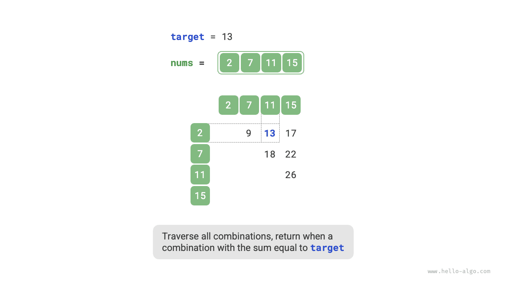
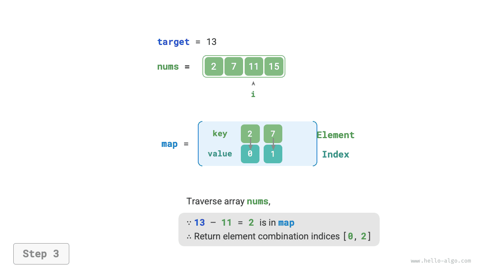

# 해시를 이용한 최적화 전략

알고리즘 문제에서는 **선형 탐색을 해시 탐색으로 바꾸어 시간 복잡도를 줄이는 경우가 많다**. 한 가지 문제를 통해 더 자세히 알아보자.

!!! question "문제"

    정수 배열 `nums`와 목표 원소 `target`이 주어진다. 배열에서 '합'이 `target`인 두 원소를 찾아 그 인덱스를 반환하라. 답이 여러 개라면 아무거나 하나를 반환해도 된다.

## 선형 탐색: 시간을 더 써서 공간 절약

가능한 모든 조합을 직접 순회해 보자. 아래 그림과 같이 이중 반복문을 사용하여 매번 두 정수의 합이 `target`인지 확인하고, 맞으면 두 인덱스를 반환한다.



코드는 다음과 같다.

```src
[file]{two_sum}-[class]{}-[func]{two_sum_brute_force}
```

이 방법의 시간 복잡도는 $O(n^2)$, 공간 복잡도는 $O(1)$이다. 데이터가 많으면 시간이 매우 오래 걸린다.

## 해시 탐색: 공간을 더 써서 시간 절약

키와 값으로 각각 배열 원소와 그 인덱스를 저장하는 해시 테이블을 사용해 보자. 배열을 순회하면서 매번 아래 그림의 단계를 수행한다.

1. 수 `target - nums[i]`가 해시 테이블에 있는지 확인하고, 있으면 두 원소의 인덱스를 바로 반환한다.
2. `nums[i]`와 인덱스 `i`로 이루어진 키-값 쌍을 해시 테이블에 추가한다.

=== "<1>"
    

=== "<2>"
    

=== "<3>"
    

구현 코드는 다음과 같으며, 단일 반복문만 있으면 된다.

```src
[file]{two_sum}-[class]{}-[func]{two_sum_hash_table}
```

이 방법은 해시 탐색으로 시간 복잡도를 $O(n^2)$에서 $O(n)$으로 줄여 실행 효율을 크게 높인다.

해시 테이블을 추가로 유지해야 하므로 공간 복잡도는 $O(n)$이다. **그렇더라도 시간과 공간 효율의 균형이 더 좋으므로 이 문제의 최적 풀이에 해당한다**.
