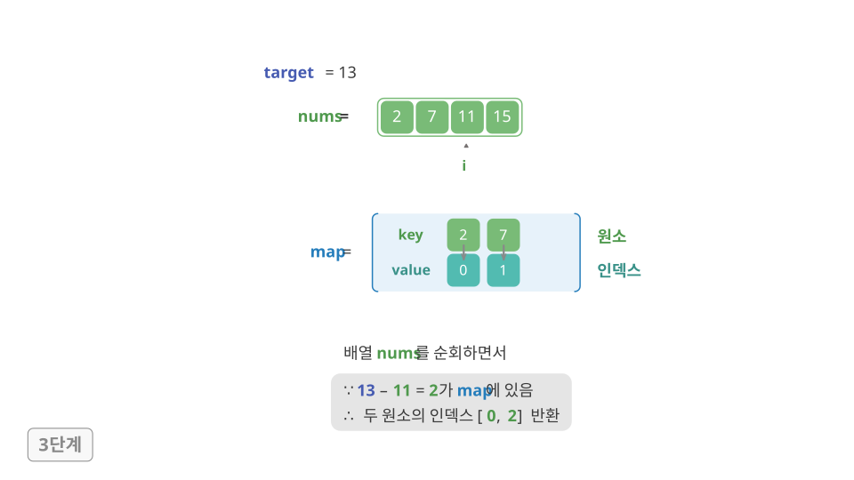

# 해시를 이용한 최적화 전략

알고리즘 문제에서는 **선형 탐색을 해시 탐색으로 바꾸어 알고리즘의 시간 복잡도를 줄이는 방법을 자주 쓴다**. 실제 문제로 살펴보자.

!!! question

    정수 배열 `nums`와 목표값 `target`이 주어진다. 배열에서 합이 `target`인 두 원소를 찾아 두 인덱스를 반환하라. 답이 여러 개라면 그중 하나만 반환하면 된다.

## 선형 탐색으로 시간을 들여 공간 절약하기

가능한 조합을 모두 직접 확인하는 방법을 생각해 보자. 아래 그림처럼 이중 반복문을 사용해 매번 두 정수의 합이 `target`인지 확인한다. 같으면 두 인덱스를 반환한다.


코드는 다음과 같다.

```src
[file]{two_sum}-[class]{}-[func]{two_sum_brute_force}
```

이 방법의 시간 복잡도는 $O(n^2)$이고 공간 복잡도는 $O(1)$이다. 데이터가 많으면 시간이 매우 오래 걸린다.

## 해시 탐색으로 공간을 사용해 시간 줄이기

배열의 원소를 키로, 해당 원소의 인덱스를 값으로 저장하는 해시 테이블을 사용해 보자. 배열을 순회하면서 매번 아래 그림의 단계를 수행한다.

1. 해시 테이블에 수 `target - nums[i]`가 있는지 확인한다. 있으면 두 원소의 인덱스를 즉시 반환한다.
2. 원소 `nums[i]`를 키로, 인덱스 `i`를 값으로 하는 쌍을 해시 테이블에 추가한다.

=== "<1>"
    

=== "<2>"
    

=== "<3>"
    

다음 코드처럼 반복문 하나로 구현할 수 있다.

```src
[file]{two_sum}-[class]{}-[func]{two_sum_hash_table}
```

해시 탐색을 사용하면 시간 복잡도가 $O(n^2)$에서 $O(n)$으로 줄어 실행 효율이 크게 높아진다.

별도의 해시 테이블을 유지해야 하므로 공간 복잡도는 $O(n)$이다. **그래도 시간과 공간 효율이 전반적으로 더 균형을 이루므로 이 문제의 최적 해법이다**.
