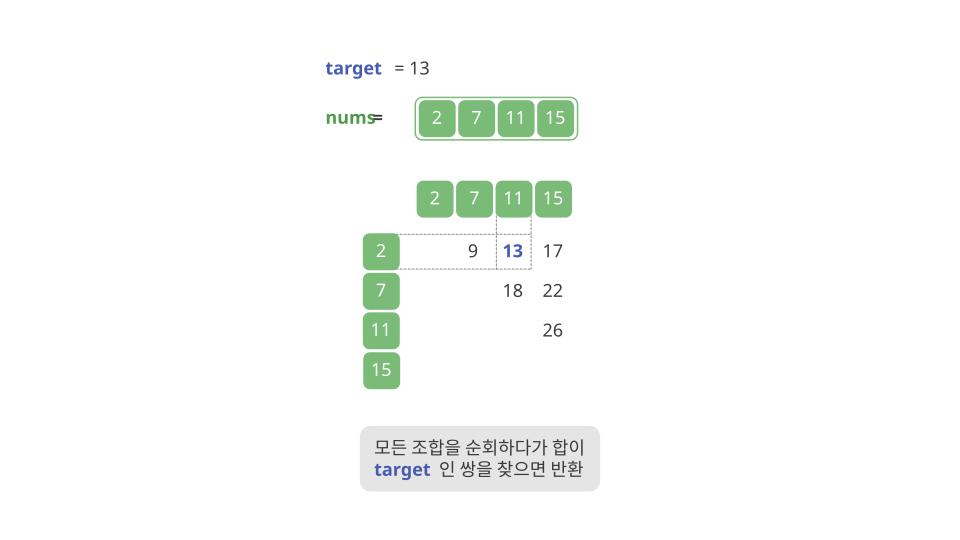
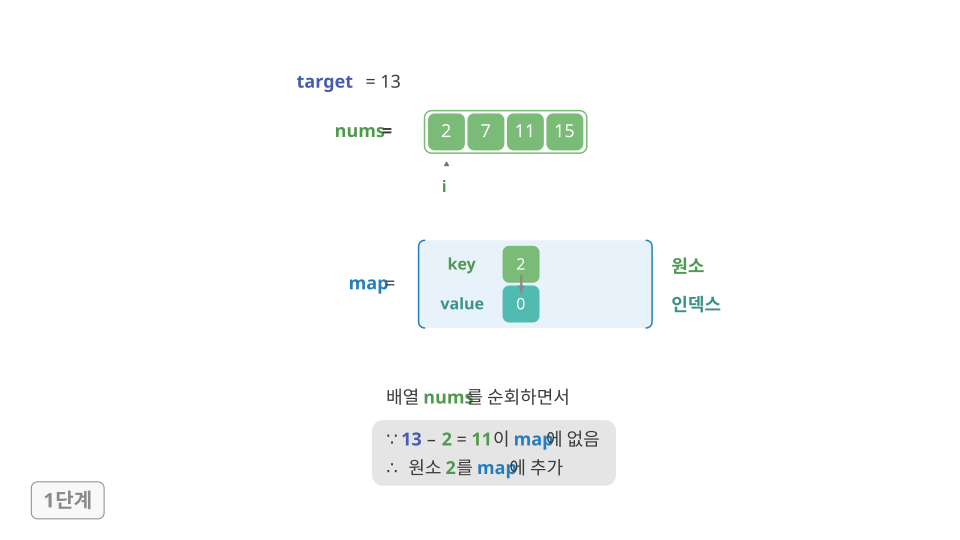
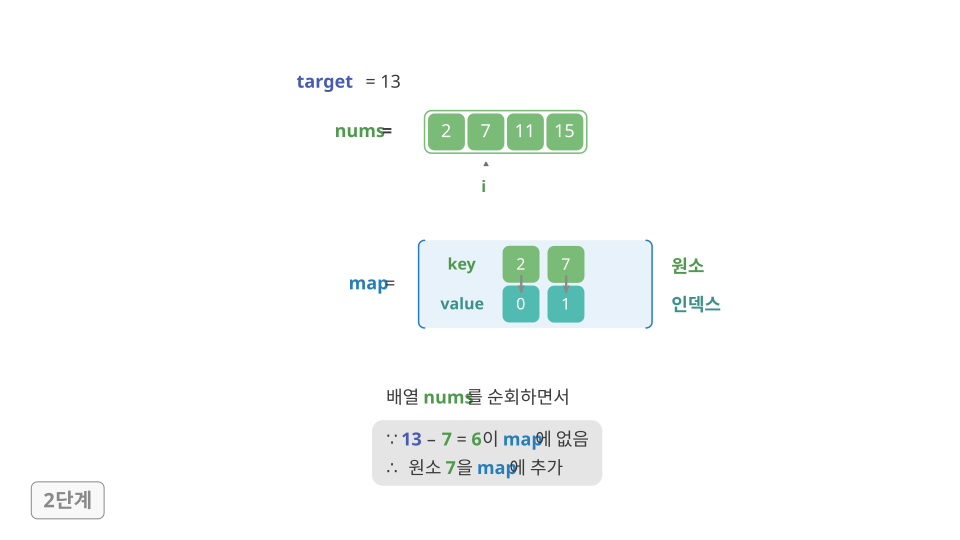

# 10.4 &nbsp; 해시를 이용한 최적화 전략

알고리즘 문제에서는 **선형 탐색을 해시 탐색으로 바꾸어 알고리즘의 시간 복잡도를 줄이는 방법을 자주 쓴다**. 실제 문제로 살펴보자.

!!! question

    정수 배열 `nums`와 목표값 `target`이 주어진다. 배열에서 합이 `target`인 두 원소를 찾아 두 인덱스를 반환하라. 답이 여러 개라면 그중 하나만 반환하면 된다.

## 10.4.1 &nbsp; 선형 탐색으로 시간을 들여 공간 절약하기

가능한 조합을 모두 직접 확인하는 방법을 생각해 보자. 아래 그림(10-9)처럼 이중 반복문을 사용해 매번 두 정수의 합이 `target`인지 확인한다. 같으면 두 인덱스를 반환한다.

{ class="animation-figure" }

<p align="center"> 그림 10-9 &nbsp; 선형 탐색으로 두 수의 합 구하기 </p>

코드는 다음과 같다.

=== "Python"

    ```python title="two_sum.py"
    def two_sum_brute_force(nums: list[int], target: int) -> list[int]:
        """방법 1. 모든 조합 확인"""
        # 이중 반복문을 사용하므로 시간 복잡도는 O(n^2)이다.
        for i in range(len(nums) - 1):
            for j in range(i + 1, len(nums)):
                if nums[i] + nums[j] == target:
                    return [i, j]
        return []
    ```

=== "C++"

    ```cpp title="two_sum.cpp"
    /* 방법 1. 모든 조합 확인 */
    vector<int> twoSumBruteForce(vector<int> &nums, int target) {
        int size = nums.size();
        // 이중 반복문을 사용하므로 시간 복잡도는 O(n^2)이다.
        for (int i = 0; i < size - 1; i++) {
            for (int j = i + 1; j < size; j++) {
                if (nums[i] + nums[j] == target)
                    return {i, j};
            }
        }
        return {};
    }
    ```

=== "Java"

    ```java title="two_sum.java"
    /* 방법 1. 모든 조합 확인 */
    int[] twoSumBruteForce(int[] nums, int target) {
        int size = nums.length;
        // 이중 반복문을 사용하므로 시간 복잡도는 O(n^2)이다.
        for (int i = 0; i < size - 1; i++) {
            for (int j = i + 1; j < size; j++) {
                if (nums[i] + nums[j] == target)
                    return new int[] { i, j };
            }
        }
        return new int[0];
    }
    ```

=== "C#"

    ```csharp title="two_sum.cs"
    /* 방법 1. 모든 조합 확인 */
    int[] TwoSumBruteForce(int[] nums, int target) {
        int size = nums.Length;
        // 이중 반복문을 사용하므로 시간 복잡도는 O(n^2)이다.
        for (int i = 0; i < size - 1; i++) {
            for (int j = i + 1; j < size; j++) {
                if (nums[i] + nums[j] == target)
                    return [i, j];
            }
        }
        return [];
    }
    ```

=== "Go"

    ```go title="two_sum.go"
    /* 방법 1. 모든 조합 확인 */
    func twoSumBruteForce(nums []int, target int) []int {
        size := len(nums)
        // 이중 반복문을 사용하므로 시간 복잡도는 O(n^2)이다.
        for i := 0; i < size-1; i++ {
            for j := i + 1; j < size; j++ {
                if nums[i]+nums[j] == target {
                    return []int{i, j}
                }
            }
        }
        return nil
    }
    ```

=== "Swift"

    ```swift title="two_sum.swift"
    /* 방법 1. 모든 조합 확인 */
    func twoSumBruteForce(nums: [Int], target: Int) -> [Int] {
        // 이중 반복문을 사용하므로 시간 복잡도는 O(n^2)이다.
        for i in nums.indices.dropLast() {
            for j in nums.indices.dropFirst(i + 1) {
                if nums[i] + nums[j] == target {
                    return [i, j]
                }
            }
        }
        return [0]
    }
    ```

=== "JS"

    ```javascript title="two_sum.js"
    /* 방법 1. 모든 조합 확인 */
    function twoSumBruteForce(nums, target) {
        const n = nums.length;
        // 이중 반복문을 사용하므로 시간 복잡도는 O(n^2)이다.
        for (let i = 0; i < n; i++) {
            for (let j = i + 1; j < n; j++) {
                if (nums[i] + nums[j] === target) {
                    return [i, j];
                }
            }
        }
        return [];
    }
    ```

=== "TS"

    ```typescript title="two_sum.ts"
    /* 방법 1. 모든 조합 확인 */
    function twoSumBruteForce(nums: number[], target: number): number[] {
        const n = nums.length;
        // 이중 반복문을 사용하므로 시간 복잡도는 O(n^2)이다.
        for (let i = 0; i < n; i++) {
            for (let j = i + 1; j < n; j++) {
                if (nums[i] + nums[j] === target) {
                    return [i, j];
                }
            }
        }
        return [];
    }
    ```

=== "Dart"

    ```dart title="two_sum.dart"
    /* 방법 1. 모든 조합 확인 */
    List<int> twoSumBruteForce(List<int> nums, int target) {
      int size = nums.length;
      // 이중 반복문을 사용하므로 시간 복잡도는 O(n^2)이다.
      for (var i = 0; i < size - 1; i++) {
        for (var j = i + 1; j < size; j++) {
          if (nums[i] + nums[j] == target) return [i, j];
        }
      }
      return [0];
    }
    ```

=== "Rust"

    ```rust title="two_sum.rs"
    /* 방법 1. 모든 조합 확인 */
    pub fn two_sum_brute_force(nums: &Vec<i32>, target: i32) -> Option<Vec<i32>> {
        let size = nums.len();
        // 이중 반복문을 사용하므로 시간 복잡도는 O(n^2)이다.
        for i in 0..size - 1 {
            for j in i + 1..size {
                if nums[i] + nums[j] == target {
                    return Some(vec![i as i32, j as i32]);
                }
            }
        }
        None
    }
    ```

=== "C"

    ```c title="two_sum.c"
    /* 방법 1. 모든 조합 확인 */
    int *twoSumBruteForce(int *nums, int numsSize, int target, int *returnSize) {
        for (int i = 0; i < numsSize; ++i) {
            for (int j = i + 1; j < numsSize; ++j) {
                if (nums[i] + nums[j] == target) {
                    int *res = malloc(sizeof(int) * 2);
                    res[0] = i, res[1] = j;
                    *returnSize = 2;
                    return res;
                }
            }
        }
        *returnSize = 0;
        return NULL;
    }
    ```

=== "Kotlin"

    ```kotlin title="two_sum.kt"
    /* 방법 1. 모든 조합 확인 */
    fun twoSumBruteForce(nums: IntArray, target: Int): IntArray {
        val size = nums.size
        // 이중 반복문을 사용하므로 시간 복잡도는 O(n^2)이다.
        for (i in 0..<size - 1) {
            for (j in i + 1..<size) {
                if (nums[i] + nums[j] == target) return intArrayOf(i, j)
            }
        }
        return IntArray(0)
    }
    ```

=== "Ruby"

    ```ruby title="two_sum.rb"
    ### 방법 1. 모든 조합 확인 ###
    def two_sum_brute_force(nums, target)
      # 이중 반복문을 사용하므로 시간 복잡도는 O(n^2)이다.
      for i in 0...(nums.length - 1)
        for j in (i + 1)...nums.length
          return [i, j] if nums[i] + nums[j] == target
        end
      end

      []
    end
    ```

??? pythontutor "실행 과정 시각화"

    <div style="height: 441px; width: 100%;"><iframe class="pythontutor-iframe" title="실행 과정 시각화" src="https://pythontutor.com/iframe-embed.html#code=def%20two_sum_brute_force%28nums%3A%20list%5Bint%5D,%20target%3A%20int%29%20-%3E%20list%5Bint%5D%3A%0A%20%20%20%20%22%22%22%EB%B0%A9%EB%B2%95%201.%20%EB%AA%A8%EB%93%A0%20%EC%A1%B0%ED%95%A9%20%ED%99%95%EC%9D%B8%22%22%22%0A%20%20%20%20%23%20%EC%9D%B4%EC%A4%91%20%EB%B0%98%EB%B3%B5%EB%AC%B8%EC%9D%84%20%EC%82%AC%EC%9A%A9%ED%95%98%EB%AF%80%EB%A1%9C%20%EC%8B%9C%EA%B0%84%20%EB%B3%B5%EC%9E%A1%EB%8F%84%EB%8A%94%20O%28n%5E2%29%EC%9D%B4%EB%8B%A4.%0A%20%20%20%20for%20i%20in%20range%28len%28nums%29%20-%201%29%3A%0A%20%20%20%20%20%20%20%20for%20j%20in%20range%28i%20%2B%201,%20len%28nums%29%29%3A%0A%20%20%20%20%20%20%20%20%20%20%20%20if%20nums%5Bi%5D%20%2B%20nums%5Bj%5D%20%3D%3D%20target%3A%0A%20%20%20%20%20%20%20%20%20%20%20%20%20%20%20%20return%20%5Bi,%20j%5D%0A%20%20%20%20return%20%5B%5D%0A%0A%22%22%22Driver%20Code%22%22%22%0Aif%20__name__%20%3D%3D%20%22__main__%22%3A%0A%20%20%20%20nums%20%3D%20%5B2,%207,%2011,%2015%5D%0A%20%20%20%20target%20%3D%2013%0A%20%20%20%20res%20%3D%20two_sum_brute_force%28nums,%20target%29&codeDivHeight=472&codeDivWidth=350&cumulative=false&curInstr=5&heapPrimitives=nevernest&origin=opt-frontend.js&py=311&rawInputLstJSON=%5B%5D&textReferences=false"> </iframe></div>
    <div style="margin-top: 5px;"><a href="https://pythontutor.com/iframe-embed.html#code=def%20two_sum_brute_force%28nums%3A%20list%5Bint%5D,%20target%3A%20int%29%20-%3E%20list%5Bint%5D%3A%0A%20%20%20%20%22%22%22%EB%B0%A9%EB%B2%95%201.%20%EB%AA%A8%EB%93%A0%20%EC%A1%B0%ED%95%A9%20%ED%99%95%EC%9D%B8%22%22%22%0A%20%20%20%20%23%20%EC%9D%B4%EC%A4%91%20%EB%B0%98%EB%B3%B5%EB%AC%B8%EC%9D%84%20%EC%82%AC%EC%9A%A9%ED%95%98%EB%AF%80%EB%A1%9C%20%EC%8B%9C%EA%B0%84%20%EB%B3%B5%EC%9E%A1%EB%8F%84%EB%8A%94%20O%28n%5E2%29%EC%9D%B4%EB%8B%A4.%0A%20%20%20%20for%20i%20in%20range%28len%28nums%29%20-%201%29%3A%0A%20%20%20%20%20%20%20%20for%20j%20in%20range%28i%20%2B%201,%20len%28nums%29%29%3A%0A%20%20%20%20%20%20%20%20%20%20%20%20if%20nums%5Bi%5D%20%2B%20nums%5Bj%5D%20%3D%3D%20target%3A%0A%20%20%20%20%20%20%20%20%20%20%20%20%20%20%20%20return%20%5Bi,%20j%5D%0A%20%20%20%20return%20%5B%5D%0A%0A%22%22%22Driver%20Code%22%22%22%0Aif%20__name__%20%3D%3D%20%22__main__%22%3A%0A%20%20%20%20nums%20%3D%20%5B2,%207,%2011,%2015%5D%0A%20%20%20%20target%20%3D%2013%0A%20%20%20%20res%20%3D%20two_sum_brute_force%28nums,%20target%29&codeDivHeight=800&codeDivWidth=600&cumulative=false&curInstr=5&heapPrimitives=nevernest&origin=opt-frontend.js&py=311&rawInputLstJSON=%5B%5D&textReferences=false" target="_blank" rel="noopener noreferrer">전체 화면으로 보기 ></a></div>

이 방법의 시간 복잡도는 $O(n^2)$이고 공간 복잡도는 $O(1)$이다. 데이터가 많으면 시간이 매우 오래 걸린다.

## 10.4.2 &nbsp; 해시 탐색으로 공간을 사용해 시간 줄이기

배열의 원소를 키로, 해당 원소의 인덱스를 값으로 저장하는 해시 테이블을 사용해 보자. 배열을 순회하면서 매번 아래 그림(10-10)의 단계를 수행한다.

1. 해시 테이블에 수 `target - nums[i]`가 있는지 확인한다. 있으면 두 원소의 인덱스를 즉시 반환한다.
2. 원소 `nums[i]`를 키로, 인덱스 `i`를 값으로 하는 쌍을 해시 테이블에 추가한다.

=== "<1>"
    { class="animation-figure" }

=== "<2>"
    { class="animation-figure" }

=== "<3>"
    { class="animation-figure" }

<p align="center"> 그림 10-10 &nbsp; 보조 해시 테이블로 두 수의 합 구하기 </p>

다음 코드처럼 반복문 하나로 구현할 수 있다.

=== "Python"

    ```python title="two_sum.py"
    def two_sum_hash_table(nums: list[int], target: int) -> list[int]:
        """방법 2. 보조 해시 테이블 사용"""
        # 보조 해시 테이블을 사용하므로 공간 복잡도는 O(n)이다.
        dic = {}
        # 반복문 하나만 사용하므로 시간 복잡도는 O(n)이다.
        for i in range(len(nums)):
            if target - nums[i] in dic:
                return [dic[target - nums[i]], i]
            dic[nums[i]] = i
        return []
    ```

=== "C++"

    ```cpp title="two_sum.cpp"
    /* 방법 2. 보조 해시 테이블 사용 */
    vector<int> twoSumHashTable(vector<int> &nums, int target) {
        int size = nums.size();
        // 보조 해시 테이블을 사용하므로 공간 복잡도는 O(n)이다.
        unordered_map<int, int> dic;
        // 반복문 하나만 사용하므로 시간 복잡도는 O(n)이다.
        for (int i = 0; i < size; i++) {
            if (dic.find(target - nums[i]) != dic.end()) {
                return {dic[target - nums[i]], i};
            }
            dic.emplace(nums[i], i);
        }
        return {};
    }
    ```

=== "Java"

    ```java title="two_sum.java"
    /* 방법 2. 보조 해시 테이블 사용 */
    int[] twoSumHashTable(int[] nums, int target) {
        int size = nums.length;
        // 보조 해시 테이블을 사용하므로 공간 복잡도는 O(n)이다.
        Map<Integer, Integer> dic = new HashMap<>();
        // 반복문 하나만 사용하므로 시간 복잡도는 O(n)이다.
        for (int i = 0; i < size; i++) {
            if (dic.containsKey(target - nums[i])) {
                return new int[] { dic.get(target - nums[i]), i };
            }
            dic.put(nums[i], i);
        }
        return new int[0];
    }
    ```

=== "C#"

    ```csharp title="two_sum.cs"
    /* 방법 2. 보조 해시 테이블 사용 */
    int[] TwoSumHashTable(int[] nums, int target) {
        int size = nums.Length;
        // 보조 해시 테이블을 사용하므로 공간 복잡도는 O(n)이다.
        Dictionary<int, int> dic = [];
        // 반복문 하나만 사용하므로 시간 복잡도는 O(n)이다.
        for (int i = 0; i < size; i++) {
            if (dic.ContainsKey(target - nums[i])) {
                return [dic[target - nums[i]], i];
            }
            dic[nums[i]] = i;
        }
        return [];
    }
    ```

=== "Go"

    ```go title="two_sum.go"
    /* 방법 2. 보조 해시 테이블 사용 */
    func twoSumHashTable(nums []int, target int) []int {
        // 보조 해시 테이블을 사용하므로 공간 복잡도는 O(n)이다.
        hashTable := map[int]int{}
        // 반복문 하나만 사용하므로 시간 복잡도는 O(n)이다.
        for idx, val := range nums {
            if preIdx, ok := hashTable[target-val]; ok {
                return []int{preIdx, idx}
            }
            hashTable[val] = idx
        }
        return nil
    }
    ```

=== "Swift"

    ```swift title="two_sum.swift"
    /* 방법 2. 보조 해시 테이블 사용 */
    func twoSumHashTable(nums: [Int], target: Int) -> [Int] {
        // 보조 해시 테이블을 사용하므로 공간 복잡도는 O(n)이다.
        var dic: [Int: Int] = [:]
        // 반복문 하나만 사용하므로 시간 복잡도는 O(n)이다.
        for i in nums.indices {
            if let j = dic[target - nums[i]] {
                return [j, i]
            }
            dic[nums[i]] = i
        }
        return [0]
    }
    ```

=== "JS"

    ```javascript title="two_sum.js"
    /* 방법 2. 보조 해시 테이블 사용 */
    function twoSumHashTable(nums, target) {
        // 보조 해시 테이블을 사용하므로 공간 복잡도는 O(n)이다.
        let m = {};
        // 반복문 하나만 사용하므로 시간 복잡도는 O(n)이다.
        for (let i = 0; i < nums.length; i++) {
            if (m[target - nums[i]] !== undefined) {
                return [m[target - nums[i]], i];
            } else {
                m[nums[i]] = i;
            }
        }
        return [];
    }
    ```

=== "TS"

    ```typescript title="two_sum.ts"
    /* 방법 2. 보조 해시 테이블 사용 */
    function twoSumHashTable(nums: number[], target: number): number[] {
        // 보조 해시 테이블을 사용하므로 공간 복잡도는 O(n)이다.
        let m: Map<number, number> = new Map();
        // 반복문 하나만 사용하므로 시간 복잡도는 O(n)이다.
        for (let i = 0; i < nums.length; i++) {
            let index = m.get(target - nums[i]);
            if (index !== undefined) {
                return [index, i];
            } else {
                m.set(nums[i], i);
            }
        }
        return [];
    }
    ```

=== "Dart"

    ```dart title="two_sum.dart"
    /* 방법 2. 보조 해시 테이블 사용 */
    List<int> twoSumHashTable(List<int> nums, int target) {
      int size = nums.length;
      // 보조 해시 테이블을 사용하므로 공간 복잡도는 O(n)이다.
      Map<int, int> dic = HashMap();
      // 반복문 하나만 사용하므로 시간 복잡도는 O(n)이다.
      for (var i = 0; i < size; i++) {
        if (dic.containsKey(target - nums[i])) {
          return [dic[target - nums[i]]!, i];
        }
        dic.putIfAbsent(nums[i], () => i);
      }
      return [0];
    }
    ```

=== "Rust"

    ```rust title="two_sum.rs"
    /* 방법 2. 보조 해시 테이블 사용 */
    pub fn two_sum_hash_table(nums: &Vec<i32>, target: i32) -> Option<Vec<i32>> {
        // 보조 해시 테이블을 사용하므로 공간 복잡도는 O(n)이다.
        let mut dic = HashMap::new();
        // 반복문 하나만 사용하므로 시간 복잡도는 O(n)이다.
        for (i, num) in nums.iter().enumerate() {
            match dic.get(&(target - num)) {
                Some(v) => return Some(vec![*v as i32, i as i32]),
                None => dic.insert(num, i as i32),
            };
        }
        None
    }
    ```

=== "C"

    ```c title="two_sum.c"
    /* 해시 테이블 */
    typedef struct {
        int key;
        int val;
        UT_hash_handle hh; // uthash.h를 사용해 구현한다.
    } HashTable;

    /* 해시 테이블 조회 */
    HashTable *find(HashTable *h, int key) {
        HashTable *tmp;
        HASH_FIND_INT(h, &key, tmp);
        return tmp;
    }

    /* 해시 테이블에 원소 삽입 */
    void insert(HashTable **h, int key, int val) {
        HashTable *t = find(*h, key);
        if (t == NULL) {
            HashTable *tmp = malloc(sizeof(HashTable));
            tmp->key = key, tmp->val = val;
            HASH_ADD_INT(*h, key, tmp);
        } else {
            t->val = val;
        }
    }

    /* 방법 2. 보조 해시 테이블 사용 */
    int *twoSumHashTable(int *nums, int numsSize, int target, int *returnSize) {
        HashTable *hashtable = NULL;
        for (int i = 0; i < numsSize; i++) {
            HashTable *t = find(hashtable, target - nums[i]);
            if (t != NULL) {
                int *res = malloc(sizeof(int) * 2);
                res[0] = t->val, res[1] = i;
                *returnSize = 2;
                return res;
            }
            insert(&hashtable, nums[i], i);
        }
        *returnSize = 0;
        return NULL;
    }
    ```

=== "Kotlin"

    ```kotlin title="two_sum.kt"
    /* 방법 2. 보조 해시 테이블 사용 */
    fun twoSumHashTable(nums: IntArray, target: Int): IntArray {
        val size = nums.size
        // 보조 해시 테이블을 사용하므로 공간 복잡도는 O(n)이다.
        val dic = HashMap<Int, Int>()
        // 반복문 하나만 사용하므로 시간 복잡도는 O(n)이다.
        for (i in 0..<size) {
            if (dic.containsKey(target - nums[i])) {
                return intArrayOf(dic[target - nums[i]]!!, i)
            }
            dic[nums[i]] = i
        }
        return IntArray(0)
    }
    ```

=== "Ruby"

    ```ruby title="two_sum.rb"
    ### 방법 2. 보조 해시 테이블 사용 ###
    def two_sum_hash_table(nums, target)
      # 보조 해시 테이블을 사용하므로 공간 복잡도는 O(n)이다.
      dic = {}
      # 반복문 하나만 사용하므로 시간 복잡도는 O(n)이다.
      for i in 0...nums.length
        return [dic[target - nums[i]], i] if dic.has_key?(target - nums[i])

        dic[nums[i]] = i
      end

      []
    end
    ```

??? pythontutor "실행 과정 시각화"

    <div style="height: 477px; width: 100%;"><iframe class="pythontutor-iframe" title="실행 과정 시각화" src="https://pythontutor.com/iframe-embed.html#code=def%20two_sum_hash_table%28nums%3A%20list%5Bint%5D,%20target%3A%20int%29%20-%3E%20list%5Bint%5D%3A%0A%20%20%20%20%22%22%22%EB%B0%A9%EB%B2%95%202.%20%EB%B3%B4%EC%A1%B0%20%ED%95%B4%EC%8B%9C%20%ED%85%8C%EC%9D%B4%EB%B8%94%20%EC%82%AC%EC%9A%A9%22%22%22%0A%20%20%20%20%23%20%EB%B3%B4%EC%A1%B0%20%ED%95%B4%EC%8B%9C%20%ED%85%8C%EC%9D%B4%EB%B8%94%EC%9D%84%20%EC%82%AC%EC%9A%A9%ED%95%98%EB%AF%80%EB%A1%9C%20%EA%B3%B5%EA%B0%84%20%EB%B3%B5%EC%9E%A1%EB%8F%84%EB%8A%94%20O%28n%29%EC%9D%B4%EB%8B%A4.%0A%20%20%20%20dic%20%3D%20%7B%7D%0A%20%20%20%20%23%20%EB%B0%98%EB%B3%B5%EB%AC%B8%20%ED%95%98%EB%82%98%EB%A7%8C%20%EC%82%AC%EC%9A%A9%ED%95%98%EB%AF%80%EB%A1%9C%20%EC%8B%9C%EA%B0%84%20%EB%B3%B5%EC%9E%A1%EB%8F%84%EB%8A%94%20O%28n%29%EC%9D%B4%EB%8B%A4.%0A%20%20%20%20for%20i%20in%20range%28len%28nums%29%29%3A%0A%20%20%20%20%20%20%20%20if%20target%20-%20nums%5Bi%5D%20in%20dic%3A%0A%20%20%20%20%20%20%20%20%20%20%20%20return%20%5Bdic%5Btarget%20-%20nums%5Bi%5D%5D,%20i%5D%0A%20%20%20%20%20%20%20%20dic%5Bnums%5Bi%5D%5D%20%3D%20i%0A%20%20%20%20return%20%5B%5D%0A%0A%22%22%22Driver%20Code%22%22%22%0Aif%20__name__%20%3D%3D%20%22__main__%22%3A%0A%20%20%20%20nums%20%3D%20%5B2,%207,%2011,%2015%5D%0A%20%20%20%20target%20%3D%2013%0A%20%20%20%20res%20%3D%20two_sum_hash_table%28nums,%20target%29&codeDivHeight=472&codeDivWidth=350&cumulative=false&curInstr=5&heapPrimitives=nevernest&origin=opt-frontend.js&py=311&rawInputLstJSON=%5B%5D&textReferences=false"> </iframe></div>
    <div style="margin-top: 5px;"><a href="https://pythontutor.com/iframe-embed.html#code=def%20two_sum_hash_table%28nums%3A%20list%5Bint%5D,%20target%3A%20int%29%20-%3E%20list%5Bint%5D%3A%0A%20%20%20%20%22%22%22%EB%B0%A9%EB%B2%95%202.%20%EB%B3%B4%EC%A1%B0%20%ED%95%B4%EC%8B%9C%20%ED%85%8C%EC%9D%B4%EB%B8%94%20%EC%82%AC%EC%9A%A9%22%22%22%0A%20%20%20%20%23%20%EB%B3%B4%EC%A1%B0%20%ED%95%B4%EC%8B%9C%20%ED%85%8C%EC%9D%B4%EB%B8%94%EC%9D%84%20%EC%82%AC%EC%9A%A9%ED%95%98%EB%AF%80%EB%A1%9C%20%EA%B3%B5%EA%B0%84%20%EB%B3%B5%EC%9E%A1%EB%8F%84%EB%8A%94%20O%28n%29%EC%9D%B4%EB%8B%A4.%0A%20%20%20%20dic%20%3D%20%7B%7D%0A%20%20%20%20%23%20%EB%B0%98%EB%B3%B5%EB%AC%B8%20%ED%95%98%EB%82%98%EB%A7%8C%20%EC%82%AC%EC%9A%A9%ED%95%98%EB%AF%80%EB%A1%9C%20%EC%8B%9C%EA%B0%84%20%EB%B3%B5%EC%9E%A1%EB%8F%84%EB%8A%94%20O%28n%29%EC%9D%B4%EB%8B%A4.%0A%20%20%20%20for%20i%20in%20range%28len%28nums%29%29%3A%0A%20%20%20%20%20%20%20%20if%20target%20-%20nums%5Bi%5D%20in%20dic%3A%0A%20%20%20%20%20%20%20%20%20%20%20%20return%20%5Bdic%5Btarget%20-%20nums%5Bi%5D%5D,%20i%5D%0A%20%20%20%20%20%20%20%20dic%5Bnums%5Bi%5D%5D%20%3D%20i%0A%20%20%20%20return%20%5B%5D%0A%0A%22%22%22Driver%20Code%22%22%22%0Aif%20__name__%20%3D%3D%20%22__main__%22%3A%0A%20%20%20%20nums%20%3D%20%5B2,%207,%2011,%2015%5D%0A%20%20%20%20target%20%3D%2013%0A%20%20%20%20res%20%3D%20two_sum_hash_table%28nums,%20target%29&codeDivHeight=800&codeDivWidth=600&cumulative=false&curInstr=5&heapPrimitives=nevernest&origin=opt-frontend.js&py=311&rawInputLstJSON=%5B%5D&textReferences=false" target="_blank" rel="noopener noreferrer">전체 화면으로 보기 ></a></div>

해시 탐색을 사용하면 시간 복잡도가 $O(n^2)$에서 $O(n)$으로 줄어 실행 효율이 크게 높아진다.

별도의 해시 테이블을 유지해야 하므로 공간 복잡도는 $O(n)$이다. **그래도 시간과 공간 효율이 전반적으로 더 균형을 이루므로 이 문제의 최적 해법이다**.
