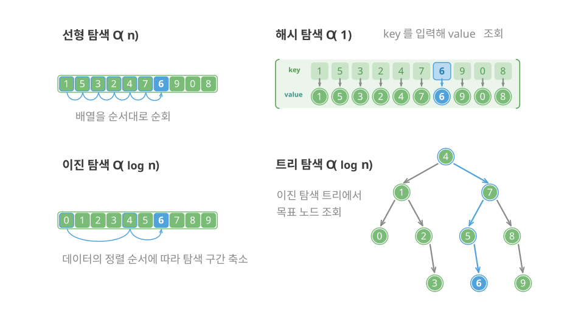

# 10.5 &nbsp; 탐색 알고리즘 다시 보기

<u>탐색 알고리즘(searching algorithm)</u>은 배열, 연결 리스트, 트리, 그래프 등의 자료 구조에서 특정 조건을 만족하는 원소 하나 또는 여러 개를 찾는 데 쓰인다.

탐색 알고리즘은 구현 아이디어에 따라 다음 두 부류로 나눌 수 있다.

- **자료 구조를 순회해 목표 원소를 찾는다**. 배열, 연결 리스트, 트리, 그래프 순회가 그 예다.
- **데이터의 구성 방식이나 미리 알고 있는 성질을 이용해 원소를 효율적으로 찾는다**. 이진 탐색, 해시 탐색, 이진 탐색 트리에서의 탐색이 그 예다.

이 방법들은 모두 앞 장에서 다룬 내용이므로 탐색 알고리즘은 이미 익숙하다. 이번 절에서는 좀 더 체계적인 관점에서 탐색 알고리즘을 다시 살펴보자.

## 10.5.1 &nbsp; 완전 탐색

완전 탐색은 자료 구조의 원소를 하나씩 방문하며 목표 원소를 찾는다.

- 선형 탐색은 배열이나 연결 리스트 같은 선형 자료 구조에 적합하다. 자료 구조의 한쪽 끝에서 시작해 원소를 하나씩 확인한다. 목표 원소를 찾거나, 찾지 못한 채 반대쪽 끝에 이르면 탐색을 멈춘다.
- 너비 우선 탐색과 깊이 우선 탐색은 그래프와 트리에서 사용하는 두 가지 순회 전략이다. 너비 우선 탐색은 시작 노드에서 출발해 한 층씩 탐색하며 가까운 노드부터 먼 노드 순으로 방문한다. 깊이 우선 탐색은 시작 노드에서 한 경로를 끝까지 따라간 뒤 되돌아와 다른 경로를 시도한다. 자료 구조 전체를 순회할 때까지 이를 반복한다.

완전 탐색은 단순하고 폭넓게 적용할 수 있다. **데이터를 전처리하거나 별도의 자료 구조를 사용할 필요가 없다**.

다만 **이러한 알고리즘의 시간 복잡도는 $O(n)$이다**. 여기서 $n$은 원소 수다. 따라서 데이터가 많으면 성능이 떨어진다.

## 10.5.2 &nbsp; 적응형 탐색

적응형 탐색은 정렬 여부와 같이 데이터 고유의 성질을 이용해 탐색 과정을 개선하고 목표 원소를 더 효율적으로 찾는다.

- 이진 탐색은 데이터가 정렬되어 있다는 성질로 효율을 높이며 배열에만 적합하다.
- 해시 탐색은 조회할 데이터와 찾으려는 데이터를 해시 테이블에서 키와 값의 쌍으로 연결해 조회한다.
- 트리 탐색은 이진 탐색 트리와 같은 특정 트리 구조에서 노드의 값을 비교해 후보 노드를 빠르게 제외하면서 목표 원소를 찾는다.

이러한 알고리즘은 효율이 높아 **시간 복잡도가 $O(\log n)$이거나 심지어 $O(1)$에 이르기도 한다**.

다만 **이러한 알고리즘을 쓰려면 데이터를 미리 가공해야 하는 경우가 많다**. 예를 들어 이진 탐색은 배열을 미리 정렬해야 한다. 해시 탐색과 트리 탐색에는 별도의 자료 구조가 필요하고 이를 유지하는 데도 시간과 공간이 더 든다.

!!! tip

    적응형 탐색 알고리즘은 흔히 조회 알고리즘이라고도 하며, **주로 특정 자료 구조에서 목표 원소를 빠르게 찾는 데 쓰인다**.

## 10.5.3 &nbsp; 탐색 방법 선택

크기가 $n$인 데이터 집합에서 목표 원소를 찾는 방법으로는 선형 탐색, 이진 탐색, 트리 탐색, 해시 탐색 등이 있다. 아래 그림(10-11)은 각 방법의 작동 원리를 보여 준다.

{ class="animation-figure" }

 그림 10-11 &nbsp; 여러 가지 탐색 전략 

각 방법의 연산 효율과 특성은 다음 표(10-1)와 같다.

 표 10-1 &nbsp; 탐색 알고리즘의 효율 비교 

|              | 선형 탐색 | 이진 탐색           | 트리 탐색             | 해시 탐색        |
| ------------ | -------- | ------------------ | ------------------ | --------------- |
| 원소 탐색     | $O(n)$   | $O(\log n)$        | $O(\log n)$        | $O(1)$          |
| 원소 삽입     | $O(1)$   | $O(n)$             | $O(\log n)$        | $O(1)$          |
| 원소 삭제     | $O(n)$   | $O(n)$             | $O(\log n)$        | $O(1)$          |
| 추가 공간     | $O(1)$   | $O(1)$             | $O(n)$             | $O(n)$          |
| 데이터 전처리   | /        | 정렬 $O(n \log n)$ | 트리 구축 $O(n \log n)$ | 해시 테이블 구축 $O(n)$ |
| 데이터 정렬 여부 | 정렬되지 않음     | 정렬됨               | 정렬됨               | 정렬되지 않음            |

어떤 탐색 알고리즘을 선택할지는 데이터의 규모, 요구되는 탐색 성능, 데이터 조회 및 갱신 빈도 등에 따라서도 달라진다.

**선형 탐색**

- 폭넓게 적용할 수 있고 데이터 전처리가 전혀 필요 없다. 데이터를 한 번만 조회한다면 다른 세 방법에서는 전처리에만 선형 탐색보다 더 긴 시간이 걸린다.
- 데이터가 적을 때 적합하다. 이때는 시간 복잡도가 실제 효율에 미치는 영향이 작다.
- 데이터를 별도로 유지·관리할 필요가 없어 갱신이 잦은 경우에 적합하다.

**이진 탐색**

- 데이터가 많을 때 적합하다. 성능이 안정적이며 최악의 시간 복잡도도 $O(\log n)$이다.
- 배열을 저장하려면 연속된 메모리 공간이 필요하므로 데이터가 지나치게 많으면 곤란하다.
- 정렬된 배열을 유지하는 비용이 크므로 데이터를 자주 삽입하거나 삭제하는 경우에는 적합하지 않다.

**해시 탐색**

- 조회 성능이 매우 중요할 때 적합하다. 평균 시간 복잡도는 $O(1)$이다.
- 해시 테이블은 데이터의 정렬 상태를 유지할 수 없으므로 정렬된 데이터나 범위 탐색이 필요한 경우에는 적합하지 않다.
- 해시 함수와 해시 충돌 처리 방식에 크게 의존하므로 성능이 크게 떨어질 위험이 있다.
- 해시 테이블이 높은 조회 성능을 내려면 추가 공간을 사용해 충돌을 최대한 줄여야 하므로 데이터가 지나치게 많은 경우에는 적합하지 않다.

**트리 탐색**

- 트리 노드는 메모리 여러 곳에 나누어 저장하므로 방대한 데이터를 다루기에 적합하다.
- 데이터를 정렬된 상태로 유지하거나 범위 탐색을 해야 할 때 적합하다.
- 노드를 계속 삽입하고 삭제하다 보면 이진 탐색 트리가 한쪽으로 치우쳐 시간 복잡도가 $O(n)$까지 나빠질 수 있다.
- AVL 트리나 레드 블랙 트리를 사용하면 각 연산을 안정적으로 $O(\log n)$ 시간에 수행할 수 있다. 다만 트리의 균형을 유지하는 연산에 추가 비용이 든다.
