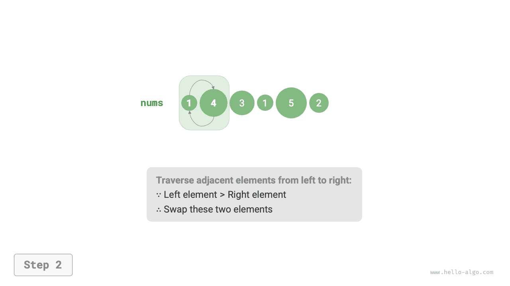
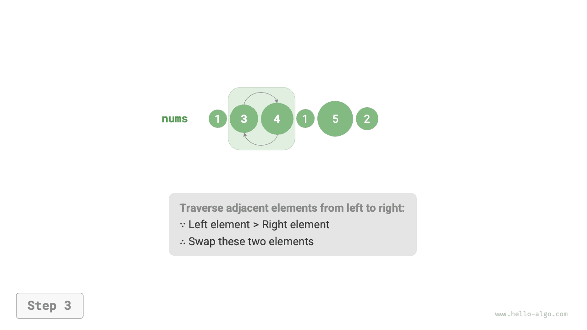
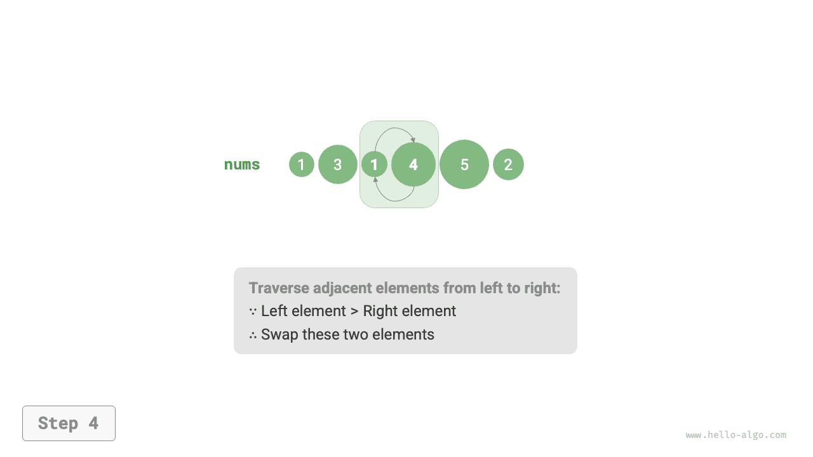
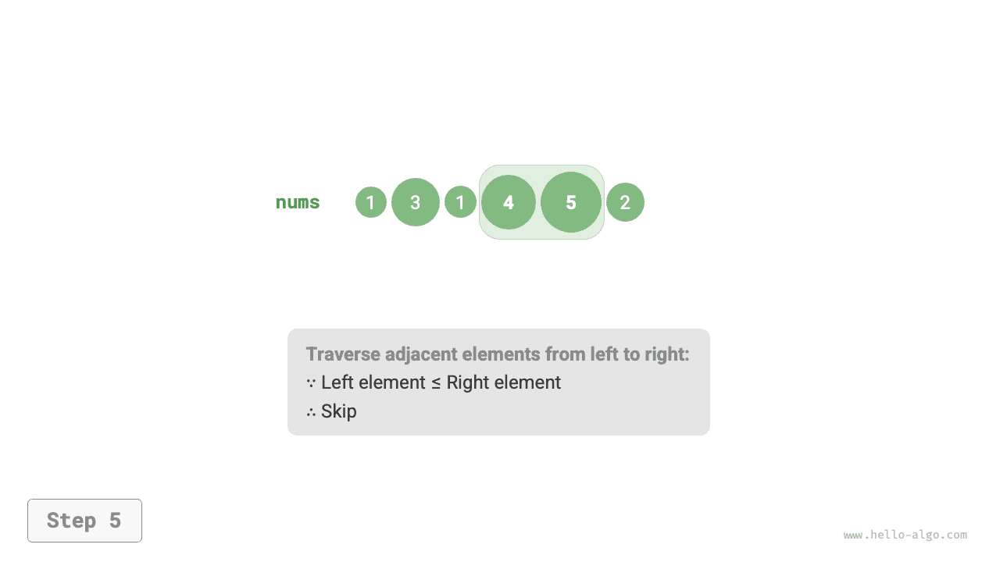

# 버블 정렬

<u>버블 정렬(bubble sort)</u>은 인접한 원소를 계속 비교하고 교환하여 정렬한다. 이 과정이 거품이 아래에서 위로 올라오는 모습과 비슷하여 버블 정렬이라는 이름이 붙었다.

아래 그림과 같이 원소 교환으로 거품이 올라오는 과정을 흉내 낼 수 있다. 배열의 맨 왼쪽부터 오른쪽으로 순회하며 인접한 두 원소를 비교하고, '왼쪽 원소 > 오른쪽 원소'이면 둘을 교환한다. 순회를 마치면 가장 큰 원소가 배열의 맨 오른쪽으로 이동한다.

=== "<1>"
    

=== "<2>"
    

=== "<3>"
    

=== "<4>"
    

=== "<5>"
    

=== "<6>"
    

=== "<7>"
    

## 알고리즘 과정

배열의 길이가 $n$일 때 버블 정렬의 단계는 아래 그림과 같다.

1. 먼저 $n$ 개 원소에 '버블 연산'을 수행하여 **배열에서 가장 큰 원소를 올바른 위치로 옮긴다**.
2. 이어서 남은 $n - 1$ 개 원소에 '버블 연산'을 수행하여 **두 번째로 큰 원소를 올바른 위치로 옮긴다**.
3. 같은 과정을 반복하여 $n - 1$ 회의 '버블 연산'을 수행하면 **큰 순서로 $n - 1$ 개 원소가 모두 올바른 위치에 놓인다**.
4. 남은 원소 하나는 반드시 가장 작은 원소이므로 정렬할 필요가 없으며, 배열 정렬이 완료된다.


예시 코드는 다음과 같다.

```src
[file]{bubble_sort}-[class]{}-[func]{bubble_sort}
```

## 효율 최적화

어느 회의 '버블 연산'에서 교환이 한 번도 일어나지 않았다면 배열은 이미 정렬되어 있으므로 결과를 바로 반환할 수 있다. 따라서 이 상황을 감지하는 플래그 `flag`를 추가하고, 발생하는 즉시 반환할 수 있다.

최적화 후에도 버블 정렬의 최악 및 평균 시간 복잡도는 $O(n^2)$이다. 하지만 입력 배열이 완전히 정렬되어 있으면 최선 시간 복잡도인 $O(n)$에 도달한다.

```src
[file]{bubble_sort}-[class]{}-[func]{bubble_sort_with_flag}
```

## 알고리즘 특성

- **시간 복잡도 $O(n^2)$, 적응형 정렬**: 각 회의 '버블 연산'에서 순회하는 배열 길이는 차례로 $n - 1$, $n - 2$, $\dots$, $2$, $1$이며, 합은 $(n - 1) n / 2$이다. `flag`를 도입하여 최적화하면 최선 시간 복잡도가 $O(n)$이 된다.
- **공간 복잡도 $O(1)$, 제자리 정렬**: 포인터 $i$와 $j$는 상수 크기의 추가 공간을 사용한다.
- **안정 정렬**: '버블 연산'에서 값이 같은 원소는 교환하지 않는다.
