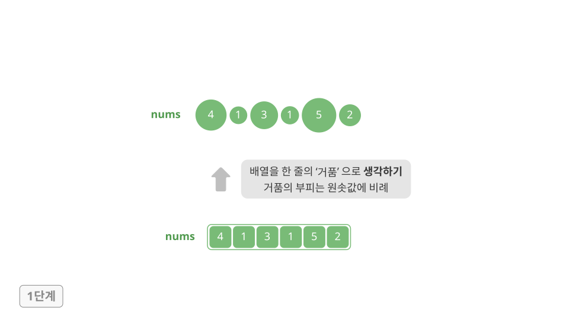
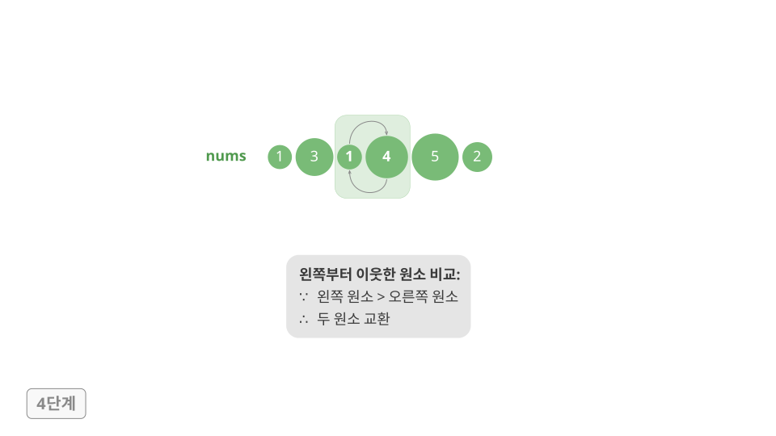
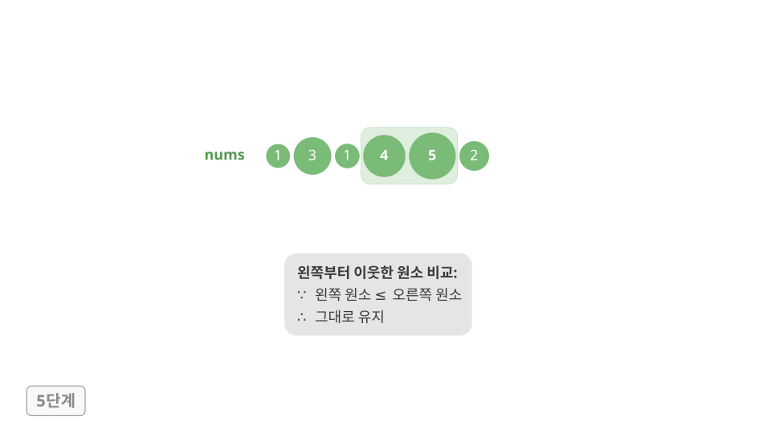
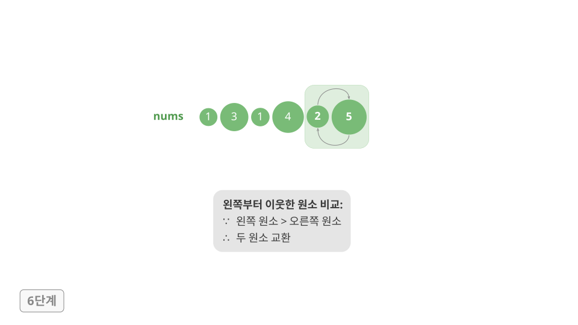
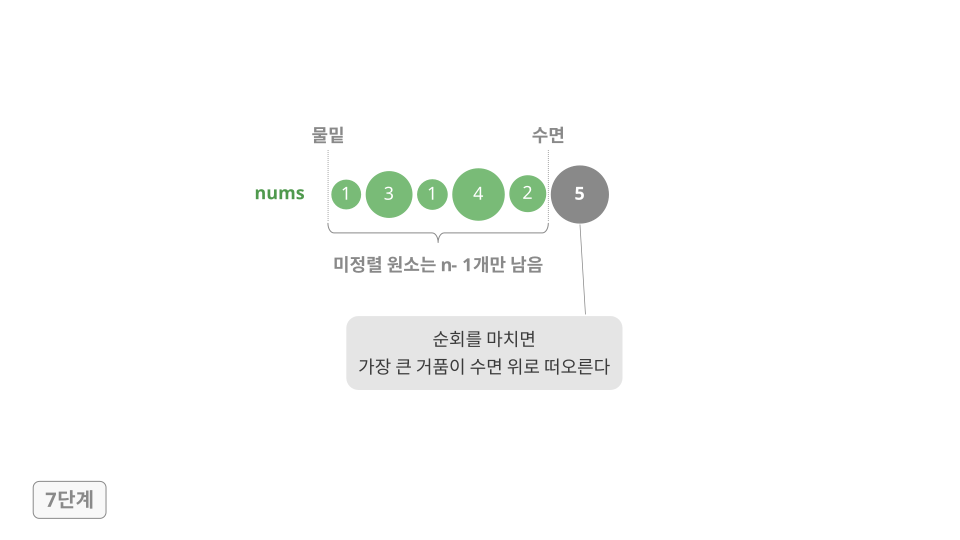

# 버블 정렬

<u>버블 정렬(bubble sort)</u>은 이웃한 원소의 비교와 교환을 반복하여 정렬한다. 이 과정이 거품이 바닥에서 수면으로 올라가는 모습과 비슷하여 버블 정렬이라는 이름이 붙었다.

아래 그림처럼 원소를 교환하면 거품이 올라가는 과정을 흉내 낼 수 있다. 배열의 왼쪽 끝에서 오른쪽으로 이동하며 이웃한 원소를 차례로 비교한다. 왼쪽 원소가 오른쪽 원소보다 크면 두 원소를 교환한다. 한 번 순회를 마치면 가장 큰 원소가 배열의 오른쪽 끝으로 이동한다.

=== "<1>"
    

=== "<2>"
    

=== "<3>"
    

=== "<4>"
    

=== "<5>"
    

=== "<6>"
    

=== "<7>"
    

## 알고리즘의 동작 과정

배열의 길이가 $n$일 때 버블 정렬의 단계는 아래 그림과 같다.

1. 먼저 원소 $n$개에 대해 한 회전을 수행하여 **배열의 최댓값을 제자리로 보낸다**.
2. 다음으로 남은 원소 $n - 1$개에 대해 한 회전을 수행하여 **두 번째로 큰 원소를 제자리로 보낸다**.
3. 같은 방식으로 $n - 1$회전을 거치면 **가장 큰 원소부터 $n - 1$개가 모두 제자리를 찾는다**.
4. 마지막으로 남은 원소 하나는 반드시 최솟값이므로 따로 정렬할 필요가 없다. 이로써 배열의 정렬이 끝난다.


예제 코드는 다음과 같다.

```src
[file]{bubble_sort}-[class]{}-[func]{bubble_sort}
```

## 효율 개선

한 회전에서 교환이 한 번도 일어나지 않았다면 배열은 이미 정렬되어 있으므로 결과를 바로 반환할 수 있다. 플래그 `flag`를 추가해 이런 경우를 감지하면 즉시 반환한다.

최적화 후에도 버블 정렬의 최악 및 평균 시간 복잡도는 $O(n^2)$이다. 다만 입력 배열이 이미 완전히 정렬되어 있으면 최선의 시간 복잡도 $O(n)$을 달성한다.

```src
[file]{bubble_sort}-[class]{}-[func]{bubble_sort_with_flag}
```

## 알고리즘의 특성

- **시간 복잡도 $O(n^2)$, 적응형 정렬**: 각 회전에서 순회하는 배열의 길이는 차례로 $n - 1$, $n - 2$, $\dots$, $2$, $1$이고 합은 $(n - 1) n / 2$이다. `flag`를 이용한 최적화를 적용하면 최선의 시간 복잡도는 $O(n)$이다.
- **공간 복잡도 $O(1)$, 제자리 정렬**: 포인터 $i$와 $j$에 필요한 추가 공간은 상수 크기다.
- **안정 정렬**: 한 회전에서 값이 같은 원소끼리는 교환하지 않는다.
