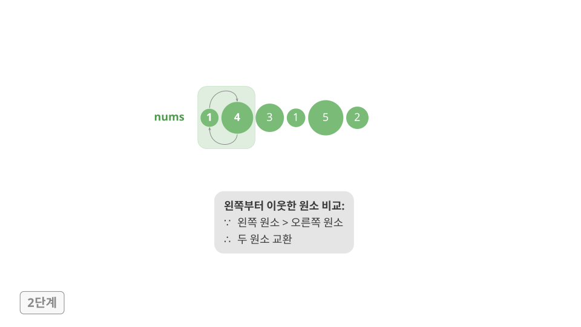
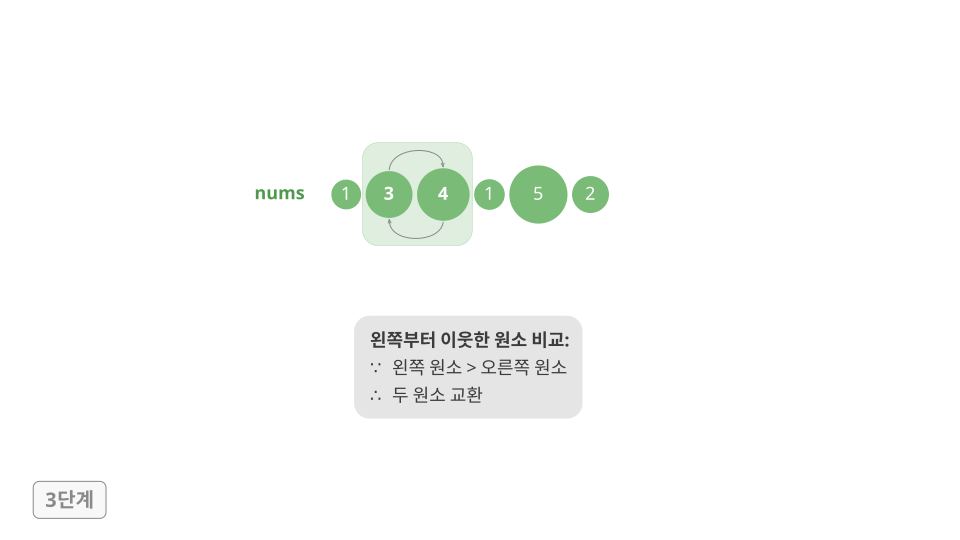
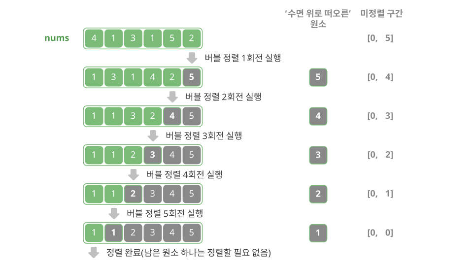

# 11.3 &nbsp; 버블 정렬

<u>버블 정렬(bubble sort)</u>은 이웃한 원소의 비교와 교환을 반복하여 정렬한다. 이 과정이 거품이 바닥에서 수면으로 올라가는 모습과 비슷하여 버블 정렬이라는 이름이 붙었다.

아래 그림(11-4)처럼 원소를 교환하면 거품이 올라가는 과정을 흉내 낼 수 있다. 배열의 왼쪽 끝에서 오른쪽으로 이동하며 이웃한 원소를 차례로 비교한다. 왼쪽 원소가 오른쪽 원소보다 크면 두 원소를 교환한다. 한 번 순회를 마치면 가장 큰 원소가 배열의 오른쪽 끝으로 이동한다.

=== "<1>"
    { class="animation-figure" }

=== "<2>"
    { class="animation-figure" }

=== "<3>"
    { class="animation-figure" }

=== "<4>"
    { class="animation-figure" }

=== "<5>"
    { class="animation-figure" }

=== "<6>"
    { class="animation-figure" }

=== "<7>"
    { class="animation-figure" }

<p align="center"> 그림 11-4 &nbsp; 원소 교환으로 나타낸 거품의 이동 </p>

## 11.3.1 &nbsp; 알고리즘의 동작 과정

배열의 길이가 $n$일 때 버블 정렬의 단계는 아래 그림(11-5)과 같다.

1. 먼저 원소 $n$개에 대해 한 회전을 수행하여 **배열의 최댓값을 제자리로 보낸다**.
2. 다음으로 남은 원소 $n - 1$개에 대해 한 회전을 수행하여 **두 번째로 큰 원소를 제자리로 보낸다**.
3. 같은 방식으로 $n - 1$회전을 거치면 **가장 큰 원소부터 $n - 1$개가 모두 제자리를 찾는다**.
4. 마지막으로 남은 원소 하나는 반드시 최솟값이므로 따로 정렬할 필요가 없다. 이로써 배열의 정렬이 끝난다.

{ class="animation-figure" }

<p align="center"> 그림 11-5 &nbsp; 버블 정렬 과정 </p>

예제 코드는 다음과 같다.

=== "Python"

    ```python title="bubble_sort.py"
    def bubble_sort(nums: list[int]):
        """버블 정렬"""
        n = len(nums)
        # 바깥 루프: 미정렬 구간은 [0, i]
        for i in range(n - 1, 0, -1):
            # 안쪽 루프: 미정렬 구간 [0, i]의 최댓값을 교환을 통해 구간의 오른쪽 끝으로 이동
            for j in range(i):
                if nums[j] > nums[j + 1]:
                    # nums[j]와 nums[j + 1] 교환
                    nums[j], nums[j + 1] = nums[j + 1], nums[j]
    ```

=== "C++"

    ```cpp title="bubble_sort.cpp"
    /* 버블 정렬 */
    void bubbleSort(vector<int> &nums) {
        // 바깥 루프: 미정렬 구간은 [0, i]
        for (int i = nums.size() - 1; i > 0; i--) {
            // 안쪽 루프: 미정렬 구간 [0, i]의 최댓값을 교환을 통해 구간의 오른쪽 끝으로 이동
            for (int j = 0; j < i; j++) {
                if (nums[j] > nums[j + 1]) {
                    // nums[j]와 nums[j + 1] 교환
                    // 여기서는 std::swap() 함수 사용
                    swap(nums[j], nums[j + 1]);
                }
            }
        }
    }
    ```

=== "Java"

    ```java title="bubble_sort.java"
    /* 버블 정렬 */
    void bubbleSort(int[] nums) {
        // 바깥 루프: 미정렬 구간은 [0, i]
        for (int i = nums.length - 1; i > 0; i--) {
            // 안쪽 루프: 미정렬 구간 [0, i]의 최댓값을 교환을 통해 구간의 오른쪽 끝으로 이동
            for (int j = 0; j < i; j++) {
                if (nums[j] > nums[j + 1]) {
                    // nums[j]와 nums[j + 1] 교환
                    int tmp = nums[j];
                    nums[j] = nums[j + 1];
                    nums[j + 1] = tmp;
                }
            }
        }
    }
    ```

=== "C#"

    ```csharp title="bubble_sort.cs"
    /* 버블 정렬 */
    void BubbleSort(int[] nums) {
        // 바깥 루프: 미정렬 구간은 [0, i]
        for (int i = nums.Length - 1; i > 0; i--) {
            // 안쪽 루프: 미정렬 구간 [0, i]의 최댓값을 교환을 통해 구간의 오른쪽 끝으로 이동
            for (int j = 0; j < i; j++) {
                if (nums[j] > nums[j + 1]) {
                    // nums[j]와 nums[j + 1] 교환
                    (nums[j + 1], nums[j]) = (nums[j], nums[j + 1]);
                }
            }
        }
    }
    ```

=== "Go"

    ```go title="bubble_sort.go"
    /* 버블 정렬 */
    func bubbleSort(nums []int) {
        // 바깥 루프: 미정렬 구간은 [0, i]
        for i := len(nums) - 1; i > 0; i-- {
            // 안쪽 루프: 미정렬 구간 [0, i]의 최댓값을 교환을 통해 구간의 오른쪽 끝으로 이동
            for j := 0; j < i; j++ {
                if nums[j] > nums[j+1] {
                    // nums[j]와 nums[j + 1] 교환
                    nums[j], nums[j+1] = nums[j+1], nums[j]
                }
            }
        }
    }
    ```

=== "Swift"

    ```swift title="bubble_sort.swift"
    /* 버블 정렬 */
    func bubbleSort(nums: inout [Int]) {
        // 바깥 루프: 미정렬 구간은 [0, i]
        for i in nums.indices.dropFirst().reversed() {
            // 안쪽 루프: 미정렬 구간 [0, i]의 최댓값을 교환을 통해 구간의 오른쪽 끝으로 이동
            for j in 0 ..< i {
                if nums[j] > nums[j + 1] {
                    // nums[j]와 nums[j + 1] 교환
                    nums.swapAt(j, j + 1)
                }
            }
        }
    }
    ```

=== "JS"

    ```javascript title="bubble_sort.js"
    /* 버블 정렬 */
    function bubbleSort(nums) {
        // 바깥 루프: 미정렬 구간은 [0, i]
        for (let i = nums.length - 1; i > 0; i--) {
            // 안쪽 루프: 미정렬 구간 [0, i]의 최댓값을 교환을 통해 구간의 오른쪽 끝으로 이동
            for (let j = 0; j < i; j++) {
                if (nums[j] > nums[j + 1]) {
                    // nums[j]와 nums[j + 1] 교환
                    let tmp = nums[j];
                    nums[j] = nums[j + 1];
                    nums[j + 1] = tmp;
                }
            }
        }
    }
    ```

=== "TS"

    ```typescript title="bubble_sort.ts"
    /* 버블 정렬 */
    function bubbleSort(nums: number[]): void {
        // 바깥 루프: 미정렬 구간은 [0, i]
        for (let i = nums.length - 1; i > 0; i--) {
            // 안쪽 루프: 미정렬 구간 [0, i]의 최댓값을 교환을 통해 구간의 오른쪽 끝으로 이동
            for (let j = 0; j < i; j++) {
                if (nums[j] > nums[j + 1]) {
                    // nums[j]와 nums[j + 1] 교환
                    let tmp = nums[j];
                    nums[j] = nums[j + 1];
                    nums[j + 1] = tmp;
                }
            }
        }
    }
    ```

=== "Dart"

    ```dart title="bubble_sort.dart"
    /* 버블 정렬 */
    void bubbleSort(List<int> nums) {
      // 바깥 루프: 미정렬 구간은 [0, i]
      for (int i = nums.length - 1; i > 0; i--) {
        // 안쪽 루프: 미정렬 구간 [0, i]의 최댓값을 교환을 통해 구간의 오른쪽 끝으로 이동
        for (int j = 0; j < i; j++) {
          if (nums[j] > nums[j + 1]) {
            // nums[j]와 nums[j + 1] 교환
            int tmp = nums[j];
            nums[j] = nums[j + 1];
            nums[j + 1] = tmp;
          }
        }
      }
    }
    ```

=== "Rust"

    ```rust title="bubble_sort.rs"
    /* 버블 정렬 */
    fn bubble_sort(nums: &mut [i32]) {
        // 바깥 루프: 미정렬 구간은 [0, i]
        for i in (1..nums.len()).rev() {
            // 안쪽 루프: 미정렬 구간 [0, i]의 최댓값을 교환을 통해 구간의 오른쪽 끝으로 이동
            for j in 0..i {
                if nums[j] > nums[j + 1] {
                    // nums[j]와 nums[j + 1] 교환
                    nums.swap(j, j + 1);
                }
            }
        }
    }
    ```

=== "C"

    ```c title="bubble_sort.c"
    /* 버블 정렬 */
    void bubbleSort(int nums[], int size) {
        // 바깥 루프: 미정렬 구간은 [0, i]
        for (int i = size - 1; i > 0; i--) {
            // 안쪽 루프: 미정렬 구간 [0, i]의 최댓값을 교환을 통해 구간의 오른쪽 끝으로 이동
            for (int j = 0; j < i; j++) {
                if (nums[j] > nums[j + 1]) {
                    int temp = nums[j];
                    nums[j] = nums[j + 1];
                    nums[j + 1] = temp;
                }
            }
        }
    }
    ```

=== "Kotlin"

    ```kotlin title="bubble_sort.kt"
    /* 버블 정렬 */
    fun bubbleSort(nums: IntArray) {
        // 바깥 루프: 미정렬 구간은 [0, i]
        for (i in nums.size - 1 downTo 1) {
            // 안쪽 루프: 미정렬 구간 [0, i]의 최댓값을 교환을 통해 구간의 오른쪽 끝으로 이동
            for (j in 0..<i) {
                if (nums[j] > nums[j + 1]) {
                    // nums[j]와 nums[j + 1] 교환
                    val temp = nums[j]
                    nums[j] = nums[j + 1]
                    nums[j + 1] = temp
                }
            }
        }
    }
    ```

=== "Ruby"

    ```ruby title="bubble_sort.rb"
    ### 버블 정렬 ###
    def bubble_sort(nums)
      n = nums.length
      # 바깥 루프: 미정렬 구간은 [0, i]
      for i in (n - 1).downto(1)
        # 안쪽 루프: 미정렬 구간 [0, i]의 최댓값을 교환을 통해 구간의 오른쪽 끝으로 이동
        for j in 0...i
          if nums[j] > nums[j + 1]
            # nums[j]와 nums[j + 1] 교환
            nums[j], nums[j + 1] = nums[j + 1], nums[j]
          end
        end
      end
    end
    ```

??? pythontutor "실행 과정 시각화"

    <div style="height: 477px; width: 100%;"><iframe class="pythontutor-iframe" title="실행 과정 시각화" src="https://pythontutor.com/iframe-embed.html#code=def%20bubble_sort%28nums%3A%20list%5Bint%5D%29%3A%0A%20%20%20%20%22%22%22%EB%B2%84%EB%B8%94%20%EC%A0%95%EB%A0%AC%22%22%22%0A%20%20%20%20n%20%3D%20len%28nums%29%0A%20%20%20%20%23%20%EB%B0%94%EA%B9%A5%20%EB%A3%A8%ED%94%84%3A%20%EB%AF%B8%EC%A0%95%EB%A0%AC%20%EA%B5%AC%EA%B0%84%EC%9D%80%20%5B0,%20i%5D%0A%20%20%20%20for%20i%20in%20range%28n%20-%201,%200,%20-1%29%3A%0A%20%20%20%20%20%20%20%20%23%20%EC%95%88%EC%AA%BD%20%EB%A3%A8%ED%94%84%3A%20%EB%AF%B8%EC%A0%95%EB%A0%AC%20%EA%B5%AC%EA%B0%84%20%5B0,%20i%5D%EC%9D%98%20%EC%B5%9C%EB%8C%93%EA%B0%92%EC%9D%84%20%EA%B5%90%ED%99%98%EC%9D%84%20%ED%86%B5%ED%95%B4%20%EA%B5%AC%EA%B0%84%EC%9D%98%20%EC%98%A4%EB%A5%B8%EC%AA%BD%20%EB%81%9D%EC%9C%BC%EB%A1%9C%20%EC%9D%B4%EB%8F%99%0A%20%20%20%20%20%20%20%20for%20j%20in%20range%28i%29%3A%0A%20%20%20%20%20%20%20%20%20%20%20%20if%20nums%5Bj%5D%20%3E%20nums%5Bj%20%2B%201%5D%3A%0A%20%20%20%20%20%20%20%20%20%20%20%20%20%20%20%20%23%20nums%5Bj%5D%EC%99%80%20nums%5Bj%20%2B%201%5D%20%EA%B5%90%ED%99%98%0A%20%20%20%20%20%20%20%20%20%20%20%20%20%20%20%20nums%5Bj%5D,%20nums%5Bj%20%2B%201%5D%20%3D%20nums%5Bj%20%2B%201%5D,%20nums%5Bj%5D%0A%0A%22%22%22Driver%20Code%22%22%22%0Aif%20__name__%20%3D%3D%20%22__main__%22%3A%0A%20%20%20%20nums%20%3D%20%5B4,%201,%203,%201,%205,%202%5D%0A%20%20%20%20bubble_sort%28nums%29%0A%20%20%20%20print%28%22%EB%B2%84%EB%B8%94%20%EC%A0%95%EB%A0%AC%20%ED%9B%84%20nums%20%3D%22,%20nums%29&codeDivHeight=472&codeDivWidth=350&cumulative=false&curInstr=4&heapPrimitives=nevernest&origin=opt-frontend.js&py=311&rawInputLstJSON=%5B%5D&textReferences=false"> </iframe></div>
    <div style="margin-top: 5px;"><a href="https://pythontutor.com/iframe-embed.html#code=def%20bubble_sort%28nums%3A%20list%5Bint%5D%29%3A%0A%20%20%20%20%22%22%22%EB%B2%84%EB%B8%94%20%EC%A0%95%EB%A0%AC%22%22%22%0A%20%20%20%20n%20%3D%20len%28nums%29%0A%20%20%20%20%23%20%EB%B0%94%EA%B9%A5%20%EB%A3%A8%ED%94%84%3A%20%EB%AF%B8%EC%A0%95%EB%A0%AC%20%EA%B5%AC%EA%B0%84%EC%9D%80%20%5B0,%20i%5D%0A%20%20%20%20for%20i%20in%20range%28n%20-%201,%200,%20-1%29%3A%0A%20%20%20%20%20%20%20%20%23%20%EC%95%88%EC%AA%BD%20%EB%A3%A8%ED%94%84%3A%20%EB%AF%B8%EC%A0%95%EB%A0%AC%20%EA%B5%AC%EA%B0%84%20%5B0,%20i%5D%EC%9D%98%20%EC%B5%9C%EB%8C%93%EA%B0%92%EC%9D%84%20%EA%B5%90%ED%99%98%EC%9D%84%20%ED%86%B5%ED%95%B4%20%EA%B5%AC%EA%B0%84%EC%9D%98%20%EC%98%A4%EB%A5%B8%EC%AA%BD%20%EB%81%9D%EC%9C%BC%EB%A1%9C%20%EC%9D%B4%EB%8F%99%0A%20%20%20%20%20%20%20%20for%20j%20in%20range%28i%29%3A%0A%20%20%20%20%20%20%20%20%20%20%20%20if%20nums%5Bj%5D%20%3E%20nums%5Bj%20%2B%201%5D%3A%0A%20%20%20%20%20%20%20%20%20%20%20%20%20%20%20%20%23%20nums%5Bj%5D%EC%99%80%20nums%5Bj%20%2B%201%5D%20%EA%B5%90%ED%99%98%0A%20%20%20%20%20%20%20%20%20%20%20%20%20%20%20%20nums%5Bj%5D,%20nums%5Bj%20%2B%201%5D%20%3D%20nums%5Bj%20%2B%201%5D,%20nums%5Bj%5D%0A%0A%22%22%22Driver%20Code%22%22%22%0Aif%20__name__%20%3D%3D%20%22__main__%22%3A%0A%20%20%20%20nums%20%3D%20%5B4,%201,%203,%201,%205,%202%5D%0A%20%20%20%20bubble_sort%28nums%29%0A%20%20%20%20print%28%22%EB%B2%84%EB%B8%94%20%EC%A0%95%EB%A0%AC%20%ED%9B%84%20nums%20%3D%22,%20nums%29&codeDivHeight=800&codeDivWidth=600&cumulative=false&curInstr=4&heapPrimitives=nevernest&origin=opt-frontend.js&py=311&rawInputLstJSON=%5B%5D&textReferences=false" target="_blank" rel="noopener noreferrer">전체 화면으로 보기 ></a></div>

## 11.3.2 &nbsp; 효율 개선

한 회전에서 교환이 한 번도 일어나지 않았다면 배열은 이미 정렬되어 있으므로 결과를 바로 반환할 수 있다. 플래그 `flag`를 추가해 이런 경우를 감지하면 즉시 반환한다.

최적화 후에도 버블 정렬의 최악 및 평균 시간 복잡도는 $O(n^2)$이다. 다만 입력 배열이 이미 완전히 정렬되어 있으면 최선의 시간 복잡도 $O(n)$을 달성한다.

=== "Python"

    ```python title="bubble_sort.py"
    def bubble_sort_with_flag(nums: list[int]):
        """플래그로 최적화한 버블 정렬"""
        n = len(nums)
        # 바깥 루프: 미정렬 구간은 [0, i]
        for i in range(n - 1, 0, -1):
            flag = False  # 플래그 초기화
            # 안쪽 루프: 미정렬 구간 [0, i]의 최댓값을 교환을 통해 구간의 오른쪽 끝으로 이동
            for j in range(i):
                if nums[j] > nums[j + 1]:
                    # nums[j]와 nums[j + 1] 교환
                    nums[j], nums[j + 1] = nums[j + 1], nums[j]
                    flag = True  # 원소가 교환되었음을 기록
            if not flag:
                break  # 이 회전에서 교환이 한 번도 없으면 바로 종료
    ```

=== "C++"

    ```cpp title="bubble_sort.cpp"
    /* 플래그로 최적화한 버블 정렬*/
    void bubbleSortWithFlag(vector<int> &nums) {
        // 바깥 루프: 미정렬 구간은 [0, i]
        for (int i = nums.size() - 1; i > 0; i--) {
            bool flag = false; // 플래그 초기화
            // 안쪽 루프: 미정렬 구간 [0, i]의 최댓값을 교환을 통해 구간의 오른쪽 끝으로 이동
            for (int j = 0; j < i; j++) {
                if (nums[j] > nums[j + 1]) {
                    // nums[j]와 nums[j + 1] 교환
                    // 여기서는 std::swap() 함수 사용
                    swap(nums[j], nums[j + 1]);
                    flag = true; // 원소가 교환되었음을 기록
                }
            }
            if (!flag)
                break; // 이 회전에서 교환이 한 번도 없으면 바로 종료
        }
    }
    ```

=== "Java"

    ```java title="bubble_sort.java"
    /* 플래그로 최적화한 버블 정렬 */
    void bubbleSortWithFlag(int[] nums) {
        // 바깥 루프: 미정렬 구간은 [0, i]
        for (int i = nums.length - 1; i > 0; i--) {
            boolean flag = false; // 플래그 초기화
            // 안쪽 루프: 미정렬 구간 [0, i]의 최댓값을 교환을 통해 구간의 오른쪽 끝으로 이동
            for (int j = 0; j < i; j++) {
                if (nums[j] > nums[j + 1]) {
                    // nums[j]와 nums[j + 1] 교환
                    int tmp = nums[j];
                    nums[j] = nums[j + 1];
                    nums[j + 1] = tmp;
                    flag = true; // 원소가 교환되었음을 기록
                }
            }
            if (!flag)
                break; // 이 회전에서 교환이 한 번도 없으면 바로 종료
        }
    }
    ```

=== "C#"

    ```csharp title="bubble_sort.cs"
    /* 플래그로 최적화한 버블 정렬*/
    void BubbleSortWithFlag(int[] nums) {
        // 바깥 루프: 미정렬 구간은 [0, i]
        for (int i = nums.Length - 1; i > 0; i--) {
            bool flag = false; // 플래그 초기화
            // 안쪽 루프: 미정렬 구간 [0, i]의 최댓값을 교환을 통해 구간의 오른쪽 끝으로 이동
            for (int j = 0; j < i; j++) {
                if (nums[j] > nums[j + 1]) {
                    // nums[j]와 nums[j + 1] 교환
                    (nums[j + 1], nums[j]) = (nums[j], nums[j + 1]);
                    flag = true;  // 원소가 교환되었음을 기록
                }
            }
            if (!flag) break;     // 이 회전에서 교환이 한 번도 없으면 바로 종료
        }
    }
    ```

=== "Go"

    ```go title="bubble_sort.go"
    /* 플래그로 최적화한 버블 정렬*/
    func bubbleSortWithFlag(nums []int) {
        // 바깥 루프: 미정렬 구간은 [0, i]
        for i := len(nums) - 1; i > 0; i-- {
            flag := false // 플래그 초기화
            // 안쪽 루프: 미정렬 구간 [0, i]의 최댓값을 교환을 통해 구간의 오른쪽 끝으로 이동
            for j := 0; j < i; j++ {
                if nums[j] > nums[j+1] {
                    // nums[j]와 nums[j + 1] 교환
                    nums[j], nums[j+1] = nums[j+1], nums[j]
                    flag = true // 원소가 교환되었음을 기록
                }
            }
            if flag == false { // 이 회전에서 교환이 한 번도 없으면 바로 종료
                break
            }
        }
    }
    ```

=== "Swift"

    ```swift title="bubble_sort.swift"
    /* 플래그로 최적화한 버블 정렬*/
    func bubbleSortWithFlag(nums: inout [Int]) {
        // 바깥 루프: 미정렬 구간은 [0, i]
        for i in nums.indices.dropFirst().reversed() {
            var flag = false // 플래그 초기화
            for j in 0 ..< i {
                if nums[j] > nums[j + 1] {
                    // nums[j]와 nums[j + 1] 교환
                    nums.swapAt(j, j + 1)
                    flag = true // 원소가 교환되었음을 기록
                }
            }
            if !flag { // 이 회전에서 교환이 한 번도 없으면 바로 종료
                break
            }
        }
    }
    ```

=== "JS"

    ```javascript title="bubble_sort.js"
    /* 플래그로 최적화한 버블 정렬*/
    function bubbleSortWithFlag(nums) {
        // 바깥 루프: 미정렬 구간은 [0, i]
        for (let i = nums.length - 1; i > 0; i--) {
            let flag = false; // 플래그 초기화
            // 안쪽 루프: 미정렬 구간 [0, i]의 최댓값을 교환을 통해 구간의 오른쪽 끝으로 이동
            for (let j = 0; j < i; j++) {
                if (nums[j] > nums[j + 1]) {
                    // nums[j]와 nums[j + 1] 교환
                    let tmp = nums[j];
                    nums[j] = nums[j + 1];
                    nums[j + 1] = tmp;
                    flag = true; // 원소가 교환되었음을 기록
                }
            }
            if (!flag) break; // 이 회전에서 교환이 한 번도 없으면 바로 종료
        }
    }
    ```

=== "TS"

    ```typescript title="bubble_sort.ts"
    /* 플래그로 최적화한 버블 정렬*/
    function bubbleSortWithFlag(nums: number[]): void {
        // 바깥 루프: 미정렬 구간은 [0, i]
        for (let i = nums.length - 1; i > 0; i--) {
            let flag = false; // 플래그 초기화
            // 안쪽 루프: 미정렬 구간 [0, i]의 최댓값을 교환을 통해 구간의 오른쪽 끝으로 이동
            for (let j = 0; j < i; j++) {
                if (nums[j] > nums[j + 1]) {
                    // nums[j]와 nums[j + 1] 교환
                    let tmp = nums[j];
                    nums[j] = nums[j + 1];
                    nums[j + 1] = tmp;
                    flag = true; // 원소가 교환되었음을 기록
                }
            }
            if (!flag) break; // 이 회전에서 교환이 한 번도 없으면 바로 종료
        }
    }
    ```

=== "Dart"

    ```dart title="bubble_sort.dart"
    /* 플래그로 최적화한 버블 정렬*/
    void bubbleSortWithFlag(List<int> nums) {
      // 바깥 루프: 미정렬 구간은 [0, i]
      for (int i = nums.length - 1; i > 0; i--) {
        bool flag = false; // 플래그 초기화
        // 안쪽 루프: 미정렬 구간 [0, i]의 최댓값을 교환을 통해 구간의 오른쪽 끝으로 이동
        for (int j = 0; j < i; j++) {
          if (nums[j] > nums[j + 1]) {
            // nums[j]와 nums[j + 1] 교환
            int tmp = nums[j];
            nums[j] = nums[j + 1];
            nums[j + 1] = tmp;
            flag = true; // 원소가 교환되었음을 기록
          }
        }
        if (!flag) break; // 이 회전에서 교환이 한 번도 없으면 바로 종료
      }
    }
    ```

=== "Rust"

    ```rust title="bubble_sort.rs"
    /* 플래그로 최적화한 버블 정렬 */
    fn bubble_sort_with_flag(nums: &mut [i32]) {
        // 바깥 루프: 미정렬 구간은 [0, i]
        for i in (1..nums.len()).rev() {
            let mut flag = false; // 플래그 초기화
            // 안쪽 루프: 미정렬 구간 [0, i]의 최댓값을 교환을 통해 구간의 오른쪽 끝으로 이동
            for j in 0..i {
                if nums[j] > nums[j + 1] {
                    // nums[j]와 nums[j + 1] 교환
                    nums.swap(j, j + 1);
                    flag = true; // 원소가 교환되었음을 기록
                }
            }
            if !flag {
                break; // 이 회전에서 교환이 한 번도 없으면 바로 종료
            };
        }
    }
    ```

=== "C"

    ```c title="bubble_sort.c"
    /* 플래그로 최적화한 버블 정렬*/
    void bubbleSortWithFlag(int nums[], int size) {
        // 바깥 루프: 미정렬 구간은 [0, i]
        for (int i = size - 1; i > 0; i--) {
            bool flag = false;
            // 안쪽 루프: 미정렬 구간 [0, i]의 최댓값을 교환을 통해 구간의 오른쪽 끝으로 이동
            for (int j = 0; j < i; j++) {
                if (nums[j] > nums[j + 1]) {
                    int temp = nums[j];
                    nums[j] = nums[j + 1];
                    nums[j + 1] = temp;
                    flag = true;
                }
            }
            if (!flag)
                break;
        }
    }
    ```

=== "Kotlin"

    ```kotlin title="bubble_sort.kt"
    /* 플래그로 최적화한 버블 정렬 */
    fun bubbleSortWithFlag(nums: IntArray) {
        // 바깥 루프: 미정렬 구간은 [0, i]
        for (i in nums.size - 1 downTo 1) {
            var flag = false // 플래그 초기화
            // 안쪽 루프: 미정렬 구간 [0, i]의 최댓값을 교환을 통해 구간의 오른쪽 끝으로 이동
            for (j in 0..<i) {
                if (nums[j] > nums[j + 1]) {
                    // nums[j]와 nums[j + 1] 교환
                    val temp = nums[j]
                    nums[j] = nums[j + 1]
                    nums[j + 1] = temp
                    flag = true // 원소가 교환되었음을 기록
                }
            }
            if (!flag) break // 이 회전에서 교환이 한 번도 없으면 바로 종료
        }
    }
    ```

=== "Ruby"

    ```ruby title="bubble_sort.rb"
    ### 플래그로 최적화한 버블 정렬###
    def bubble_sort_with_flag(nums)
      n = nums.length
      # 바깥 루프: 미정렬 구간은 [0, i]
      for i in (n - 1).downto(1)
        flag = false # 플래그 초기화

        # 안쪽 루프: 미정렬 구간 [0, i]의 최댓값을 교환을 통해 구간의 오른쪽 끝으로 이동
        for j in 0...i
          if nums[j] > nums[j + 1]
            # nums[j]와 nums[j + 1] 교환
            nums[j], nums[j + 1] = nums[j + 1], nums[j]
            flag = true # 원소가 교환되었음을 기록
          end
        end

        break unless flag # 이 회전에서 교환이 한 번도 없으면 바로 종료
      end
    end
    ```

??? pythontutor "실행 과정 시각화"

    <div style="height: 549px; width: 100%;"><iframe class="pythontutor-iframe" title="실행 과정 시각화" src="https://pythontutor.com/iframe-embed.html#code=def%20bubble_sort_with_flag%28nums%3A%20list%5Bint%5D%29%3A%0A%20%20%20%20%22%22%22%ED%94%8C%EB%9E%98%EA%B7%B8%EB%A1%9C%20%EC%B5%9C%EC%A0%81%ED%99%94%ED%95%9C%20%EB%B2%84%EB%B8%94%20%EC%A0%95%EB%A0%AC%22%22%22%0A%20%20%20%20n%20%3D%20len%28nums%29%0A%20%20%20%20%23%20%EB%B0%94%EA%B9%A5%20%EB%A3%A8%ED%94%84%3A%20%EB%AF%B8%EC%A0%95%EB%A0%AC%20%EA%B5%AC%EA%B0%84%EC%9D%80%20%5B0,%20i%5D%0A%20%20%20%20for%20i%20in%20range%28n%20-%201,%200,%20-1%29%3A%0A%20%20%20%20%20%20%20%20flag%20%3D%20False%20%20%23%20%ED%94%8C%EB%9E%98%EA%B7%B8%20%EC%B4%88%EA%B8%B0%ED%99%94%0A%20%20%20%20%20%20%20%20%23%20%EC%95%88%EC%AA%BD%20%EB%A3%A8%ED%94%84%3A%20%EB%AF%B8%EC%A0%95%EB%A0%AC%20%EA%B5%AC%EA%B0%84%20%5B0,%20i%5D%EC%9D%98%20%EC%B5%9C%EB%8C%93%EA%B0%92%EC%9D%84%20%EA%B5%90%ED%99%98%EC%9D%84%20%ED%86%B5%ED%95%B4%20%EA%B5%AC%EA%B0%84%EC%9D%98%20%EC%98%A4%EB%A5%B8%EC%AA%BD%20%EB%81%9D%EC%9C%BC%EB%A1%9C%20%EC%9D%B4%EB%8F%99%0A%20%20%20%20%20%20%20%20for%20j%20in%20range%28i%29%3A%0A%20%20%20%20%20%20%20%20%20%20%20%20if%20nums%5Bj%5D%20%3E%20nums%5Bj%20%2B%201%5D%3A%0A%20%20%20%20%20%20%20%20%20%20%20%20%20%20%20%20%23%20nums%5Bj%5D%EC%99%80%20nums%5Bj%20%2B%201%5D%20%EA%B5%90%ED%99%98%0A%20%20%20%20%20%20%20%20%20%20%20%20%20%20%20%20nums%5Bj%5D,%20nums%5Bj%20%2B%201%5D%20%3D%20nums%5Bj%20%2B%201%5D,%20nums%5Bj%5D%0A%20%20%20%20%20%20%20%20%20%20%20%20%20%20%20%20flag%20%3D%20True%20%20%23%20%EC%9B%90%EC%86%8C%EA%B0%80%20%EA%B5%90%ED%99%98%EB%90%98%EC%97%88%EC%9D%8C%EC%9D%84%20%EA%B8%B0%EB%A1%9D%0A%20%20%20%20%20%20%20%20if%20not%20flag%3A%0A%20%20%20%20%20%20%20%20%20%20%20%20break%20%20%23%20%EC%9D%B4%20%ED%9A%8C%EC%A0%84%EC%97%90%EC%84%9C%20%EA%B5%90%ED%99%98%EC%9D%B4%20%ED%95%9C%20%EB%B2%88%EB%8F%84%20%EC%97%86%EC%9C%BC%EB%A9%B4%20%EB%B0%94%EB%A1%9C%20%EC%A2%85%EB%A3%8C%0A%0A%22%22%22Driver%20Code%22%22%22%0Aif%20__name__%20%3D%3D%20%22__main__%22%3A%0A%20%20%20%20nums%20%3D%20%5B4,%201,%203,%201,%205,%202%5D%0A%20%20%20%20bubble_sort_with_flag%28nums%29%0A%20%20%20%20print%28%22%EB%B2%84%EB%B8%94%20%EC%A0%95%EB%A0%AC%20%ED%9B%84%20nums%20%3D%22,%20nums%29&codeDivHeight=472&codeDivWidth=350&cumulative=false&curInstr=4&heapPrimitives=nevernest&origin=opt-frontend.js&py=311&rawInputLstJSON=%5B%5D&textReferences=false"> </iframe></div>
    <div style="margin-top: 5px;"><a href="https://pythontutor.com/iframe-embed.html#code=def%20bubble_sort_with_flag%28nums%3A%20list%5Bint%5D%29%3A%0A%20%20%20%20%22%22%22%ED%94%8C%EB%9E%98%EA%B7%B8%EB%A1%9C%20%EC%B5%9C%EC%A0%81%ED%99%94%ED%95%9C%20%EB%B2%84%EB%B8%94%20%EC%A0%95%EB%A0%AC%22%22%22%0A%20%20%20%20n%20%3D%20len%28nums%29%0A%20%20%20%20%23%20%EB%B0%94%EA%B9%A5%20%EB%A3%A8%ED%94%84%3A%20%EB%AF%B8%EC%A0%95%EB%A0%AC%20%EA%B5%AC%EA%B0%84%EC%9D%80%20%5B0,%20i%5D%0A%20%20%20%20for%20i%20in%20range%28n%20-%201,%200,%20-1%29%3A%0A%20%20%20%20%20%20%20%20flag%20%3D%20False%20%20%23%20%ED%94%8C%EB%9E%98%EA%B7%B8%20%EC%B4%88%EA%B8%B0%ED%99%94%0A%20%20%20%20%20%20%20%20%23%20%EC%95%88%EC%AA%BD%20%EB%A3%A8%ED%94%84%3A%20%EB%AF%B8%EC%A0%95%EB%A0%AC%20%EA%B5%AC%EA%B0%84%20%5B0,%20i%5D%EC%9D%98%20%EC%B5%9C%EB%8C%93%EA%B0%92%EC%9D%84%20%EA%B5%90%ED%99%98%EC%9D%84%20%ED%86%B5%ED%95%B4%20%EA%B5%AC%EA%B0%84%EC%9D%98%20%EC%98%A4%EB%A5%B8%EC%AA%BD%20%EB%81%9D%EC%9C%BC%EB%A1%9C%20%EC%9D%B4%EB%8F%99%0A%20%20%20%20%20%20%20%20for%20j%20in%20range%28i%29%3A%0A%20%20%20%20%20%20%20%20%20%20%20%20if%20nums%5Bj%5D%20%3E%20nums%5Bj%20%2B%201%5D%3A%0A%20%20%20%20%20%20%20%20%20%20%20%20%20%20%20%20%23%20nums%5Bj%5D%EC%99%80%20nums%5Bj%20%2B%201%5D%20%EA%B5%90%ED%99%98%0A%20%20%20%20%20%20%20%20%20%20%20%20%20%20%20%20nums%5Bj%5D,%20nums%5Bj%20%2B%201%5D%20%3D%20nums%5Bj%20%2B%201%5D,%20nums%5Bj%5D%0A%20%20%20%20%20%20%20%20%20%20%20%20%20%20%20%20flag%20%3D%20True%20%20%23%20%EC%9B%90%EC%86%8C%EA%B0%80%20%EA%B5%90%ED%99%98%EB%90%98%EC%97%88%EC%9D%8C%EC%9D%84%20%EA%B8%B0%EB%A1%9D%0A%20%20%20%20%20%20%20%20if%20not%20flag%3A%0A%20%20%20%20%20%20%20%20%20%20%20%20break%20%20%23%20%EC%9D%B4%20%ED%9A%8C%EC%A0%84%EC%97%90%EC%84%9C%20%EA%B5%90%ED%99%98%EC%9D%B4%20%ED%95%9C%20%EB%B2%88%EB%8F%84%20%EC%97%86%EC%9C%BC%EB%A9%B4%20%EB%B0%94%EB%A1%9C%20%EC%A2%85%EB%A3%8C%0A%0A%22%22%22Driver%20Code%22%22%22%0Aif%20__name__%20%3D%3D%20%22__main__%22%3A%0A%20%20%20%20nums%20%3D%20%5B4,%201,%203,%201,%205,%202%5D%0A%20%20%20%20bubble_sort_with_flag%28nums%29%0A%20%20%20%20print%28%22%EB%B2%84%EB%B8%94%20%EC%A0%95%EB%A0%AC%20%ED%9B%84%20nums%20%3D%22,%20nums%29&codeDivHeight=800&codeDivWidth=600&cumulative=false&curInstr=4&heapPrimitives=nevernest&origin=opt-frontend.js&py=311&rawInputLstJSON=%5B%5D&textReferences=false" target="_blank" rel="noopener noreferrer">전체 화면으로 보기 ></a></div>

## 11.3.3 &nbsp; 알고리즘의 특성

- **시간 복잡도 $O(n^2)$, 적응형 정렬**: 각 회전에서 순회하는 배열의 길이는 차례로 $n - 1$, $n - 2$, $\dots$, $2$, $1$이고 합은 $(n - 1) n / 2$이다. `flag`를 이용한 최적화를 적용하면 최선의 시간 복잡도는 $O(n)$이다.
- **공간 복잡도 $O(1)$, 제자리 정렬**: 포인터 $i$와 $j$에 필요한 추가 공간은 상수 크기다.
- **안정 정렬**: 한 회전에서 값이 같은 원소끼리는 교환하지 않는다.
