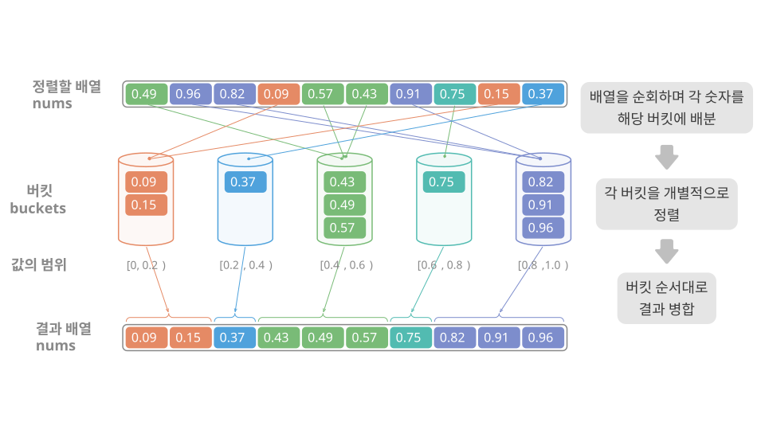
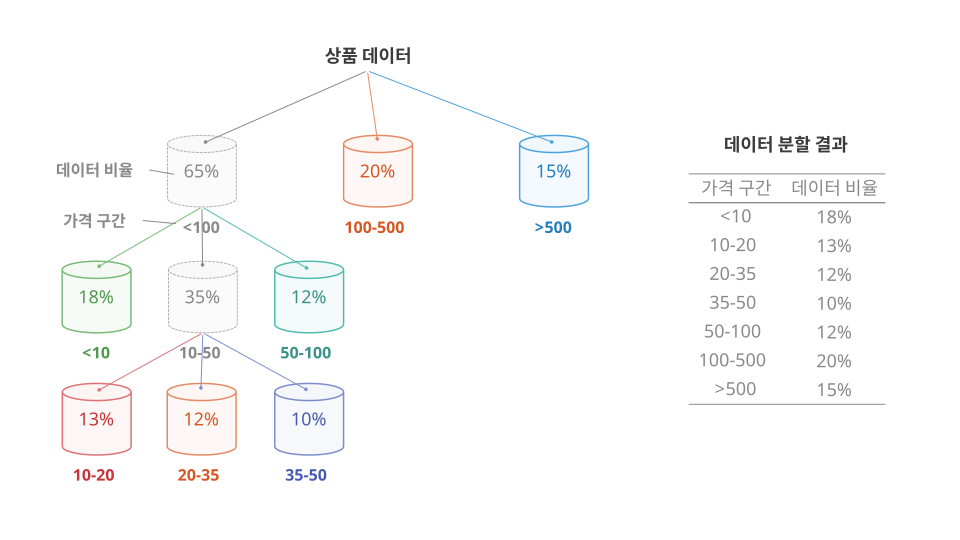
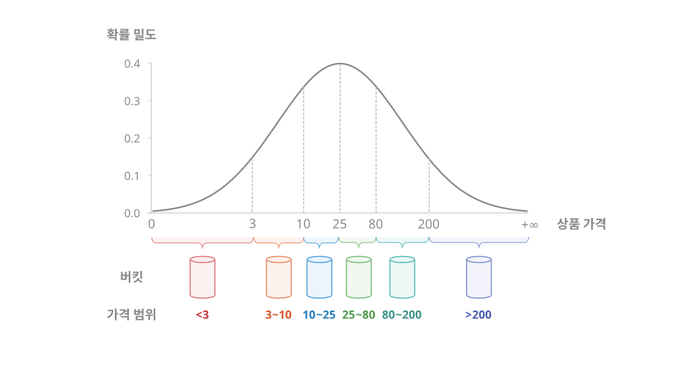

# 버킷 정렬

앞에서 살펴본 알고리즘은 모두 원소의 크기를 비교해 순서를 정하는 ‘비교 기반 정렬 알고리즘’이다. 이런 알고리즘의 최악 시간 복잡도에는 $\Omega(n \log n)$이라는 하한이 있다. 이제 시간 복잡도가 선형에 이를 수 있는 ‘비교를 사용하지 않는 정렬 알고리즘’을 몇 가지 살펴보자.

<u>버킷 정렬(bucket sort)</u>은 분할 정복 전략의 대표적인 응용이다. 값의 범위별로 순서가 정해진 여러 버킷을 마련하고 데이터를 각 버킷에 고르게 나눈다. 그런 다음 버킷마다 따로 정렬하고 버킷 순서대로 모든 데이터를 합친다.

## 알고리즘의 동작 과정

길이가 $n$이고 원소가 $[0, 1)$ 범위의 부동 소수점 수인 배열을 생각해 보자. 버킷 정렬의 과정은 아래 그림과 같다.

1. 버킷 $k$개를 초기화하고 원소 $n$개를 버킷 $k$개에 나눈다.
2. 각 버킷을 따로 정렬한다(여기서는 언어의 내장 정렬 함수를 사용한다).
3. 값의 범위가 작은 버킷부터 차례로 결과를 합친다.



코드는 다음과 같다.

```src
[file]{bucket_sort}-[class]{}-[func]{bucket_sort}
```

## 알고리즘의 특성

버킷 정렬은 대용량 데이터를 처리하기에 적합하다. 예를 들어 입력에 원소가 100만 개 있고 메모리 용량이 부족해 한꺼번에 불러올 수 없다고 하자. 이때 데이터를 버킷 1000개에 나누어 버킷별로 정렬한 뒤 결과를 합칠 수 있다.

- **시간 복잡도 $O(n + k)$**: 원소가 고르게 분포한다면 버킷 하나에 원소가 $\frac{n}{k}$개씩 들어간다. 버킷 하나를 정렬하는 데 $O(\frac{n}{k} \log\frac{n}{k})$의 시간이 걸린다면 모든 버킷을 정렬하는 데는 $O(n \log\frac{n}{k})$의 시간이 걸린다. **버킷 수 $k$가 충분히 크면 시간 복잡도는 $O(n)$에 가까워진다**. 결과를 합칠 때는 모든 버킷과 원소를 순회하므로 $O(n + k)$의 시간이 걸린다. 최악의 경우 데이터가 한 버킷에 몰려 그 버킷을 정렬하는 데 $O(n^2)$의 시간이 걸린다.
- **공간 복잡도 $O(n + k)$, 비제자리 정렬**: 버킷 $k$개와 원소 총 $n$개를 위한 추가 공간이 필요하다.
- 버킷 정렬의 안정성은 버킷 내부를 정렬하는 알고리즘이 안정적인지에 달려 있다.

## 데이터를 고르게 나누는 방법

버킷 정렬의 시간 복잡도는 이론적으로 $O(n)$에 이를 수 있다. **관건은 원소를 버킷에 고르게 나누는 것이다**. 실제 데이터는 균일하게 분포하지 않는 경우가 많다. 예를 들어 타오바오의 모든 상품을 가격 범위에 따라 버킷 10개에 고르게 나누려고 한다고 하자. 100위안 미만인 상품은 매우 많고 1000위안을 넘는 상품은 매우 적다. 가격 범위를 같은 폭으로 열 등분하면 버킷별 상품 수에 큰 차이가 생긴다.

고르게 배분하려면 먼저 대략적인 경계를 정해 데이터를 버킷 3개로 크게 나눈다. **그런 다음 상품이 많은 버킷을 다시 3개로 나누는 일을 모든 버킷의 원소 수가 비슷해질 때까지 반복한다**.

아래 그림처럼 이 방법은 본질적으로 재귀 트리를 만드는 과정이다. 목표는 리프 노드의 값을 최대한 고르게 만드는 것이다. 매번 버킷 3개로 나눌 필요는 없으며 데이터 특성에 맞게 나누는 방법을 선택할 수 있다.



상품 가격의 확률 분포를 미리 알면 **그 분포에 따라 버킷별 가격 경계를 정할 수 있다**. 분포를 반드시 따로 집계할 필요는 없다. 데이터의 특성에 맞는 확률 모형으로 근사해도 된다.

아래 그림에서는 상품 가격이 정규 분포를 따른다고 가정한다. 그러면 적절한 가격 구간을 정해 상품을 각 버킷에 고르게 배분할 수 있다.


