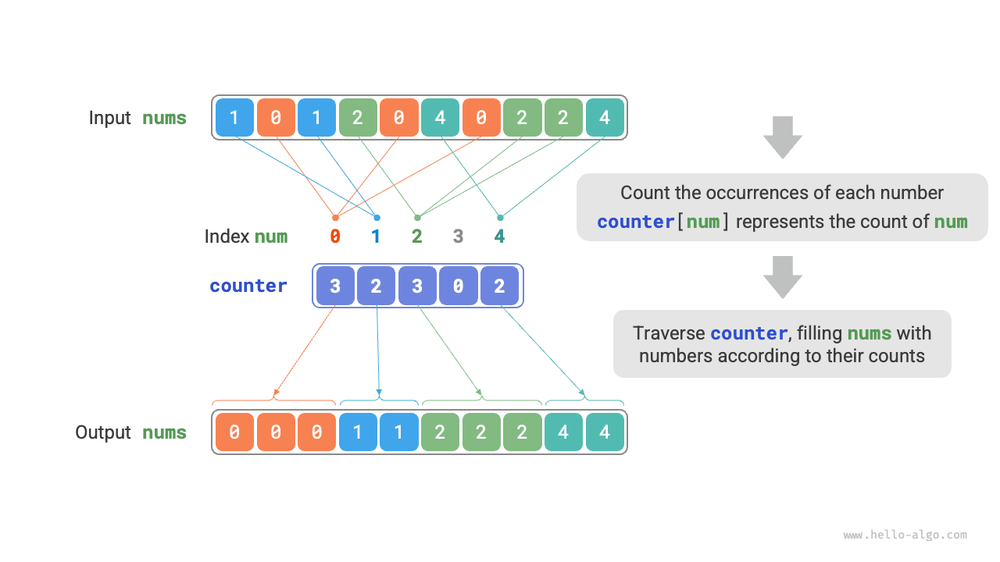
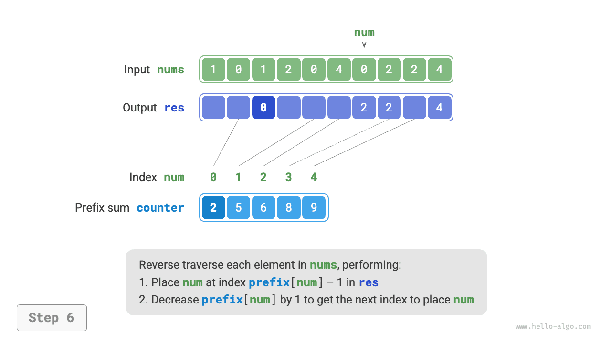

# 계수 정렬

<u>계수 정렬(counting sort)</u>은 원소의 개수를 세어 정렬하며, 주로 정수 배열에 사용한다.

## 간단한 구현

먼저 간단한 예를 보자. 길이가 $n$인 배열 `nums`의 모든 원소가 '음이 아닌 정수'라고 하자. 계수 정렬의 전체 과정은 아래 그림과 같다.

1. 배열을 순회하여 가장 큰 수 $m$을 찾고, 길이가 $m + 1$인 보조 배열 `counter`를 만든다.
2. **`counter`를 이용하여 `nums`에서 각 수가 나타나는 횟수를 센다**. `counter[num]`은 수 `num`의 등장 횟수다. 세는 방법은 간단하다. `nums`를 순회하면서 현재 수를 `num`이라고 할 때 `counter[num]`을 $1$씩 늘리면 된다.
3. **`counter`의 인덱스는 본래 순서대로 배열되어 있으므로, 모든 수가 이미 정렬된 셈이다**. 이어서 `counter`를 순회하며 각 수의 등장 횟수만큼 작은 수부터 큰 수 순서로 `nums`에 채우면 된다.



코드는 다음과 같다.

```src
[file]{counting_sort}-[class]{}-[func]{counting_sort_naive}
```

!!! note "계수 정렬과 버킷 정렬의 관계"

    버킷 정렬의 관점에서는 계수 배열 `counter`의 각 인덱스를 하나의 버킷으로, 개수를 세는 과정을 원소를 해당 버킷에 분배하는 과정으로 볼 수 있다. 본질적으로 계수 정렬은 정수 데이터에 적용되는 버킷 정렬의 특수한 경우다.

## 완전한 구현

주의 깊게 읽었다면 **입력 데이터가 객체일 때 위의 `3.` 단계가 작동하지 않는다는 것**을 알아차렸을 것이다. 입력이 상품 객체이고 상품 가격(클래스의 멤버 변수)에 따라 정렬하려 한다고 하자. 위 알고리즘으로는 가격의 정렬 결과만 얻을 수 있다.

그렇다면 원래 데이터의 정렬 결과는 어떻게 얻을까? 먼저 `counter`의 '접두 합'을 계산한다. 이름 그대로 인덱스 `i`의 접두 합 `prefix[i]`는 배열의 앞 `i` 개 원소를 더한 값이다.

$$
\text{prefix}[i] = \sum_{j=0}^i \text{counter[j]}
$$

**접두 합은 명확한 의미를 가진다. `prefix[num] - 1`은 결과 배열 `res`에서 원소 `num`이 마지막으로 나타나는 인덱스다**. 이는 각 원소가 결과 배열의 어디에 놓여야 하는지 알려 주는 핵심 정보다. 이어서 원래 배열 `nums`의 각 원소 `num`을 역순으로 순회하며 매번 다음 두 단계를 수행한다.

1. 배열 `res`의 인덱스 `prefix[num] - 1`에 `num`을 넣는다.
2. 접두 합 `prefix[num]`을 $1$ 줄여 다음에 `num`을 넣을 인덱스를 얻는다.

순회를 마치면 배열 `res`에 정렬된 결과가 들어 있다. 마지막으로 `res`를 원래 배열 `nums`에 덮어쓰면 된다. 아래 그림은 계수 정렬의 전체 과정을 보여 준다.

=== "<1>"
    

=== "<2>"
    

=== "<3>"
    

=== "<4>"
    

=== "<5>"
    

=== "<6>"
    

=== "<7>"
    

=== "<8>"
    

계수 정렬의 구현 코드는 다음과 같다.

```src
[file]{counting_sort}-[class]{}-[func]{counting_sort}
```

## 알고리즘 특성

- **시간 복잡도 $O(n + m)$, 비적응형 정렬**: `nums`와 `counter`를 순회하며, 각각 선형 시간이 걸린다. 보통 $n \gg m$이므로 시간 복잡도는 $O(n)$에 가까워진다.
- **공간 복잡도 $O(n + m)$, 제자리 정렬이 아님**: 길이가 각각 $n$과 $m$인 배열 `res`와 `counter`를 사용한다.
- **안정 정렬**: `res`에는 '오른쪽에서 왼쪽으로' 원소를 채우므로, `nums`를 역순으로 순회하면 값이 같은 원소의 상대적 위치가 바뀌지 않아 안정 정렬이 된다. 정방향으로 순회해도 정렬 결과 자체는 올바르지만 안정적이지 않다.

## 한계

여기까지 보면 계수 정렬이 매우 기발하다고 느낄 수 있다. 개수만 세어도 효율적으로 정렬할 수 있기 때문이다. 하지만 계수 정렬을 사용하기 위한 전제 조건은 비교적 엄격하다.

**계수 정렬은 음이 아닌 정수에만 적합하다**. 다른 타입에 적용하려면 해당 데이터를 음이 아닌 정수로 바꿀 수 있어야 하며, 변환 과정에서 원소 간 대소 관계가 바뀌면 안 된다. 예를 들어 음수가 포함된 정수 배열은 모든 수에 일정한 상수를 더해 양수로 바꾼 뒤, 정렬 후 다시 원래 값으로 돌릴 수 있다.

**계수 정렬은 데이터 수는 많지만 값의 범위는 작은 경우에 적합하다**. 위 예시에서 $m$이 너무 크면 공간을 지나치게 많이 차지한다. 또한 $n \ll m$이면 계수 정렬에 $O(m)$ 시간이 걸리므로 $O(n \log n)$ 정렬 알고리즘보다 느릴 수도 있다.
