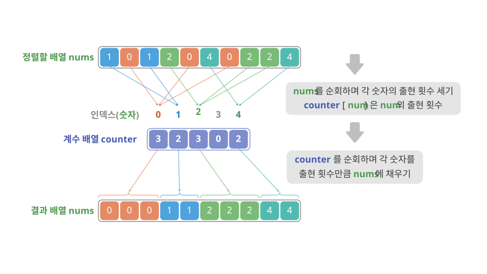
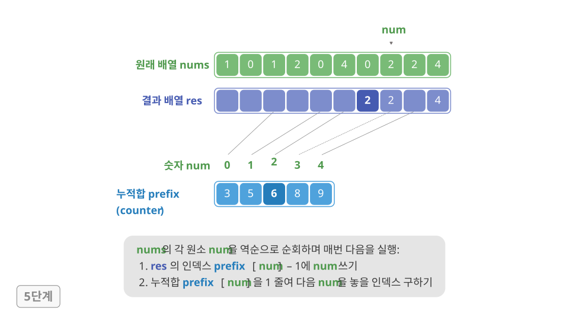
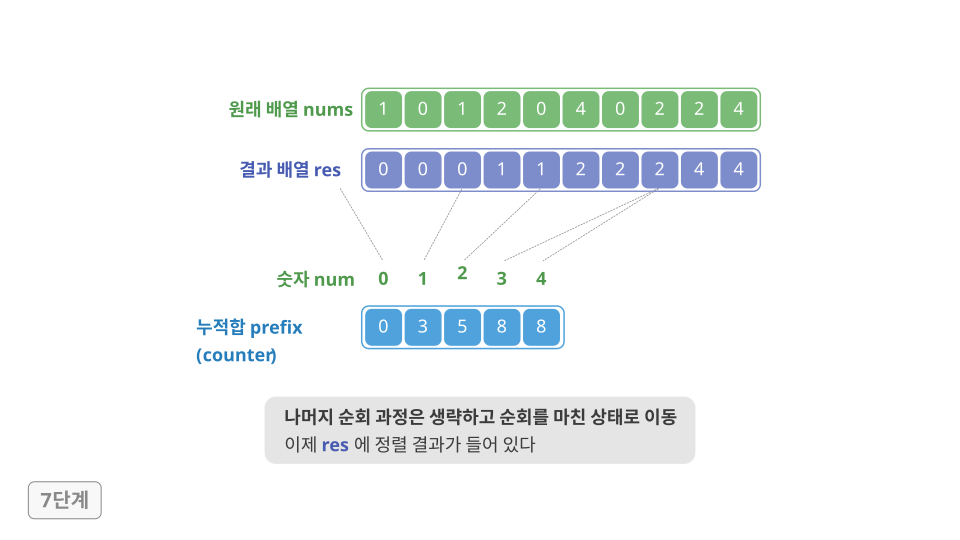

# 11.9 &nbsp; 계수 정렬

<u>계수 정렬(counting sort)</u>은 원소의 개수를 세어 정렬하는 방법으로, 주로 정수 배열에 사용한다.

## 11.9.1 &nbsp; 간단한 구현

간단한 예부터 살펴보자. 길이가 $n$인 배열 `nums`의 원소가 모두 음이 아닌 정수라고 하자. 계수 정렬의 전체 과정은 아래 그림(11-16)과 같다.

1. 배열을 순회하여 가장 큰 수 $m$을 찾은 다음 길이가 $m + 1$인 보조 배열 `counter`를 만든다.
2. **`counter`로 `nums`의 각 숫자가 몇 번 나타나는지 센다**. `counter[num]`에 숫자 `num`의 출현 횟수가 기록된다. 방법은 간단하다. `nums`를 순회하며 현재 숫자를 `num`이라고 할 때 매번 `counter[num]`을 $1$만큼 늘리면 된다.
3. **`counter`의 인덱스는 본래 순서가 정해져 있으므로 모든 숫자가 이미 정렬된 셈이다**. 이제 `counter`를 순회하면서 작은 수부터 출현 횟수만큼 `nums`에 채우면 된다.

{ class="animation-figure" }

<p align="center"> 그림 11-16 &nbsp; 계수 정렬 과정 </p>

코드는 다음과 같다.

=== "Python"

    ```python title="counting_sort.py"
    def counting_sort_naive(nums: list[int]):
        """계수 정렬"""
        # 객체를 정렬할 수 없는 간단한 구현
        # 1. 배열의 최댓값 m 구하기
        m = max(nums)
        # 2. 각 숫자의 출현 횟수 세기
        # counter[num]은 num의 출현 횟수
        counter = [0] * (m + 1)
        for num in nums:
            counter[num] += 1
        # 3. counter를 순회하며 각 원소를 원래 배열 nums에 채우기
        i = 0
        for num in range(m + 1):
            for _ in range(counter[num]):
                nums[i] = num
                i += 1
    ```

=== "C++"

    ```cpp title="counting_sort.cpp"
    /* 계수 정렬 */
    // 객체를 정렬할 수 없는 간단한 구현
    void countingSortNaive(vector<int> &nums) {
        // 1. 배열의 최댓값 m 구하기
        int m = 0;
        for (int num : nums) {
            m = max(m, num);
        }
        // 2. 각 숫자의 출현 횟수 세기
        // counter[num]은 num의 출현 횟수
        vector<int> counter(m + 1, 0);
        for (int num : nums) {
            counter[num]++;
        }
        // 3. counter를 순회하며 각 원소를 원래 배열 nums에 채우기
        int i = 0;
        for (int num = 0; num < m + 1; num++) {
            for (int j = 0; j < counter[num]; j++, i++) {
                nums[i] = num;
            }
        }
    }
    ```

=== "Java"

    ```java title="counting_sort.java"
    /* 계수 정렬 */
    // 객체를 정렬할 수 없는 간단한 구현
    void countingSortNaive(int[] nums) {
        // 1. 배열의 최댓값 m 구하기
        int m = 0;
        for (int num : nums) {
            m = Math.max(m, num);
        }
        // 2. 각 숫자의 출현 횟수 세기
        // counter[num]은 num의 출현 횟수
        int[] counter = new int[m + 1];
        for (int num : nums) {
            counter[num]++;
        }
        // 3. counter를 순회하며 각 원소를 원래 배열 nums에 채우기
        int i = 0;
        for (int num = 0; num < m + 1; num++) {
            for (int j = 0; j < counter[num]; j++, i++) {
                nums[i] = num;
            }
        }
    }
    ```

=== "C#"

    ```csharp title="counting_sort.cs"
    /* 계수 정렬 */
    // 객체를 정렬할 수 없는 간단한 구현
    void CountingSortNaive(int[] nums) {
        // 1. 배열의 최댓값 m 구하기
        int m = 0;
        foreach (int num in nums) {
            m = Math.Max(m, num);
        }
        // 2. 각 숫자의 출현 횟수 세기
        // counter[num]은 num의 출현 횟수
        int[] counter = new int[m + 1];
        foreach (int num in nums) {
            counter[num]++;
        }
        // 3. counter를 순회하며 각 원소를 원래 배열 nums에 채우기
        int i = 0;
        for (int num = 0; num < m + 1; num++) {
            for (int j = 0; j < counter[num]; j++, i++) {
                nums[i] = num;
            }
        }
    }
    ```

=== "Go"

    ```go title="counting_sort.go"
    /* 계수 정렬 */
    // 객체를 정렬할 수 없는 간단한 구현
    func countingSortNaive(nums []int) {
        // 1. 배열의 최댓값 m 구하기
        m := 0
        for _, num := range nums {
            if num > m {
                m = num
            }
        }
        // 2. 각 숫자의 출현 횟수 세기
        // counter[num]은 num의 출현 횟수
        counter := make([]int, m+1)
        for _, num := range nums {
            counter[num]++
        }
        // 3. counter를 순회하며 각 원소를 원래 배열 nums에 채우기
        for i, num := 0, 0; num < m+1; num++ {
            for j := 0; j < counter[num]; j++ {
                nums[i] = num
                i++
            }
        }
    }
    ```

=== "Swift"

    ```swift title="counting_sort.swift"
    /* 계수 정렬 */
    // 객체를 정렬할 수 없는 간단한 구현
    func countingSortNaive(nums: inout [Int]) {
        // 1. 배열의 최댓값 m 구하기
        let m = nums.max()!
        // 2. 각 숫자의 출현 횟수 세기
        // counter[num]은 num의 출현 횟수
        var counter = Array(repeating: 0, count: m + 1)
        for num in nums {
            counter[num] += 1
        }
        // 3. counter를 순회하며 각 원소를 원래 배열 nums에 채우기
        var i = 0
        for num in 0 ..< m + 1 {
            for _ in 0 ..< counter[num] {
                nums[i] = num
                i += 1
            }
        }
    }
    ```

=== "JS"

    ```javascript title="counting_sort.js"
    /* 계수 정렬 */
    // 객체를 정렬할 수 없는 간단한 구현
    function countingSortNaive(nums) {
        // 1. 배열의 최댓값 m 구하기
        let m = Math.max(...nums);
        // 2. 각 숫자의 출현 횟수 세기
        // counter[num]은 num의 출현 횟수
        const counter = new Array(m + 1).fill(0);
        for (const num of nums) {
            counter[num]++;
        }
        // 3. counter를 순회하며 각 원소를 원래 배열 nums에 채우기
        let i = 0;
        for (let num = 0; num < m + 1; num++) {
            for (let j = 0; j < counter[num]; j++, i++) {
                nums[i] = num;
            }
        }
    }
    ```

=== "TS"

    ```typescript title="counting_sort.ts"
    /* 계수 정렬 */
    // 객체를 정렬할 수 없는 간단한 구현
    function countingSortNaive(nums: number[]): void {
        // 1. 배열의 최댓값 m 구하기
        let m: number = Math.max(...nums);
        // 2. 각 숫자의 출현 횟수 세기
        // counter[num]은 num의 출현 횟수
        const counter: number[] = new Array<number>(m + 1).fill(0);
        for (const num of nums) {
            counter[num]++;
        }
        // 3. counter를 순회하며 각 원소를 원래 배열 nums에 채우기
        let i = 0;
        for (let num = 0; num < m + 1; num++) {
            for (let j = 0; j < counter[num]; j++, i++) {
                nums[i] = num;
            }
        }
    }
    ```

=== "Dart"

    ```dart title="counting_sort.dart"
    /* 계수 정렬 */
    // 객체를 정렬할 수 없는 간단한 구현
    void countingSortNaive(List<int> nums) {
      // 1. 배열의 최댓값 m 구하기
      int m = 0;
      for (int _num in nums) {
        m = max(m, _num);
      }
      // 2. 각 숫자의 출현 횟수 세기
      // counter[_num]은 _num의 출현 횟수
      List<int> counter = List.filled(m + 1, 0);
      for (int _num in nums) {
        counter[_num]++;
      }
      // 3. counter를 순회하며 각 원소를 원래 배열 nums에 채우기
      int i = 0;
      for (int _num = 0; _num < m + 1; _num++) {
        for (int j = 0; j < counter[_num]; j++, i++) {
          nums[i] = _num;
        }
      }
    }
    ```

=== "Rust"

    ```rust title="counting_sort.rs"
    /* 계수 정렬 */
    // 객체를 정렬할 수 없는 간단한 구현
    fn counting_sort_naive(nums: &mut [i32]) {
        // 1. 배열의 최댓값 m 구하기
        let m = *nums.iter().max().unwrap();
        // 2. 각 숫자의 출현 횟수 세기
        // counter[num]은 num의 출현 횟수
        let mut counter = vec![0; m as usize + 1];
        for &num in nums.iter() {
            counter[num as usize] += 1;
        }
        // 3. counter를 순회하며 각 원소를 원래 배열 nums에 채우기
        let mut i = 0;
        for num in 0..m + 1 {
            for _ in 0..counter[num as usize] {
                nums[i] = num;
                i += 1;
            }
        }
    }
    ```

=== "C"

    ```c title="counting_sort.c"
    /* 계수 정렬 */
    // 객체를 정렬할 수 없는 간단한 구현
    void countingSortNaive(int nums[], int size) {
        // 1. 배열의 최댓값 m 구하기
        int m = 0;
        for (int i = 0; i < size; i++) {
            if (nums[i] > m) {
                m = nums[i];
            }
        }
        // 2. 각 숫자의 출현 횟수 세기
        // counter[num]은 num의 출현 횟수
        int *counter = calloc(m + 1, sizeof(int));
        for (int i = 0; i < size; i++) {
            counter[nums[i]]++;
        }
        // 3. counter를 순회하며 각 원소를 원래 배열 nums에 채우기
        int i = 0;
        for (int num = 0; num < m + 1; num++) {
            for (int j = 0; j < counter[num]; j++, i++) {
                nums[i] = num;
            }
        }
        // 4. 메모리 해제
        free(counter);
    }
    ```

=== "Kotlin"

    ```kotlin title="counting_sort.kt"
    /* 계수 정렬 */
    // 객체를 정렬할 수 없는 간단한 구현
    fun countingSortNaive(nums: IntArray) {
        // 1. 배열의 최댓값 m 구하기
        var m = 0
        for (num in nums) {
            m = max(m, num)
        }
        // 2. 각 숫자의 출현 횟수 세기
        // counter[num]은 num의 출현 횟수
        val counter = IntArray(m + 1)
        for (num in nums) {
            counter[num]++
        }
        // 3. counter를 순회하며 각 원소를 원래 배열 nums에 채우기
        var i = 0
        for (num in 0..<m + 1) {
            var j = 0
            while (j < counter[num]) {
                nums[i] = num
                j++
                i++
            }
        }
    }
    ```

=== "Ruby"

    ```ruby title="counting_sort.rb"
    ### 계수 정렬 ###
    def counting_sort_naive(nums)
      # 객체를 정렬할 수 없는 간단한 구현
      # 1. 배열의 최댓값 m 구하기
      m = 0
      nums.each { |num| m = [m, num].max }
      # 2. 각 숫자의 출현 횟수 세기
      # counter[num]은 num의 출현 횟수
      counter = Array.new(m + 1, 0)
      nums.each { |num| counter[num] += 1 }
      # 3. counter를 순회하며 각 원소를 원래 배열 nums에 채우기
      i = 0
      for num in 0...(m + 1)
        (0...counter[num]).each do
          nums[i] = num
          i += 1
        end
      end
    end
    ```

??? pythontutor "실행 과정 시각화"

    <div style="height: 549px; width: 100%;"><iframe class="pythontutor-iframe" title="실행 과정 시각화" src="https://pythontutor.com/iframe-embed.html#code=def%20counting_sort_naive%28nums%3A%20list%5Bint%5D%29%3A%0A%20%20%20%20%22%22%22%EA%B3%84%EC%88%98%20%EC%A0%95%EB%A0%AC%22%22%22%0A%20%20%20%20%23%20%EA%B0%9D%EC%B2%B4%EB%A5%BC%20%EC%A0%95%EB%A0%AC%ED%95%A0%20%EC%88%98%20%EC%97%86%EB%8A%94%20%EA%B0%84%EB%8B%A8%ED%95%9C%20%EA%B5%AC%ED%98%84%0A%20%20%20%20%23%201.%20%EB%B0%B0%EC%97%B4%EC%9D%98%20%EC%B5%9C%EB%8C%93%EA%B0%92%20m%20%EA%B5%AC%ED%95%98%EA%B8%B0%0A%20%20%20%20m%20%3D%200%0A%20%20%20%20for%20num%20in%20nums%3A%0A%20%20%20%20%20%20%20%20m%20%3D%20max%28m,%20num%29%0A%20%20%20%20%23%202.%20%EA%B0%81%20%EC%88%AB%EC%9E%90%EC%9D%98%20%EC%B6%9C%ED%98%84%20%ED%9A%9F%EC%88%98%20%EC%84%B8%EA%B8%B0%0A%20%20%20%20%23%20counter%5Bnum%5D%EC%9D%80%20num%EC%9D%98%20%EC%B6%9C%ED%98%84%20%ED%9A%9F%EC%88%98%0A%20%20%20%20counter%20%3D%20%5B0%5D%20%2A%20%28m%20%2B%201%29%0A%20%20%20%20for%20num%20in%20nums%3A%0A%20%20%20%20%20%20%20%20counter%5Bnum%5D%20%2B%3D%201%0A%20%20%20%20%23%203.%20counter%EB%A5%BC%20%EC%88%9C%ED%9A%8C%ED%95%98%EB%A9%B0%20%EA%B0%81%20%EC%9B%90%EC%86%8C%EB%A5%BC%20%EC%9B%90%EB%9E%98%20%EB%B0%B0%EC%97%B4%20nums%EC%97%90%20%EC%B1%84%EC%9A%B0%EA%B8%B0%0A%20%20%20%20i%20%3D%200%0A%20%20%20%20for%20num%20in%20range%28m%20%2B%201%29%3A%0A%20%20%20%20%20%20%20%20for%20_%20in%20range%28counter%5Bnum%5D%29%3A%0A%20%20%20%20%20%20%20%20%20%20%20%20nums%5Bi%5D%20%3D%20num%0A%20%20%20%20%20%20%20%20%20%20%20%20i%20%2B%3D%201%0A%0A%22%22%22Driver%20Code%22%22%22%0Aif%20__name__%20%3D%3D%20%22__main__%22%3A%0A%20%20%20%20nums%20%3D%20%5B1,%200,%201,%202,%200,%204,%200,%202,%202,%204%5D%0A%20%20%20%20counting_sort_naive%28nums%29%0A%20%20%20%20print%28f%22%EA%B3%84%EC%88%98%20%EC%A0%95%EB%A0%AC%28%EA%B0%9D%EC%B2%B4%20%EC%A0%95%EB%A0%AC%20%EB%B6%88%EA%B0%80%29%20%ED%9B%84%20nums%20%3D%20%7Bnums%7D%22%29&codeDivHeight=472&codeDivWidth=350&cumulative=false&curInstr=4&heapPrimitives=nevernest&origin=opt-frontend.js&py=311&rawInputLstJSON=%5B%5D&textReferences=false"> </iframe></div>
    <div style="margin-top: 5px;"><a href="https://pythontutor.com/iframe-embed.html#code=def%20counting_sort_naive%28nums%3A%20list%5Bint%5D%29%3A%0A%20%20%20%20%22%22%22%EA%B3%84%EC%88%98%20%EC%A0%95%EB%A0%AC%22%22%22%0A%20%20%20%20%23%20%EA%B0%9D%EC%B2%B4%EB%A5%BC%20%EC%A0%95%EB%A0%AC%ED%95%A0%20%EC%88%98%20%EC%97%86%EB%8A%94%20%EA%B0%84%EB%8B%A8%ED%95%9C%20%EA%B5%AC%ED%98%84%0A%20%20%20%20%23%201.%20%EB%B0%B0%EC%97%B4%EC%9D%98%20%EC%B5%9C%EB%8C%93%EA%B0%92%20m%20%EA%B5%AC%ED%95%98%EA%B8%B0%0A%20%20%20%20m%20%3D%200%0A%20%20%20%20for%20num%20in%20nums%3A%0A%20%20%20%20%20%20%20%20m%20%3D%20max%28m,%20num%29%0A%20%20%20%20%23%202.%20%EA%B0%81%20%EC%88%AB%EC%9E%90%EC%9D%98%20%EC%B6%9C%ED%98%84%20%ED%9A%9F%EC%88%98%20%EC%84%B8%EA%B8%B0%0A%20%20%20%20%23%20counter%5Bnum%5D%EC%9D%80%20num%EC%9D%98%20%EC%B6%9C%ED%98%84%20%ED%9A%9F%EC%88%98%0A%20%20%20%20counter%20%3D%20%5B0%5D%20%2A%20%28m%20%2B%201%29%0A%20%20%20%20for%20num%20in%20nums%3A%0A%20%20%20%20%20%20%20%20counter%5Bnum%5D%20%2B%3D%201%0A%20%20%20%20%23%203.%20counter%EB%A5%BC%20%EC%88%9C%ED%9A%8C%ED%95%98%EB%A9%B0%20%EA%B0%81%20%EC%9B%90%EC%86%8C%EB%A5%BC%20%EC%9B%90%EB%9E%98%20%EB%B0%B0%EC%97%B4%20nums%EC%97%90%20%EC%B1%84%EC%9A%B0%EA%B8%B0%0A%20%20%20%20i%20%3D%200%0A%20%20%20%20for%20num%20in%20range%28m%20%2B%201%29%3A%0A%20%20%20%20%20%20%20%20for%20_%20in%20range%28counter%5Bnum%5D%29%3A%0A%20%20%20%20%20%20%20%20%20%20%20%20nums%5Bi%5D%20%3D%20num%0A%20%20%20%20%20%20%20%20%20%20%20%20i%20%2B%3D%201%0A%0A%22%22%22Driver%20Code%22%22%22%0Aif%20__name__%20%3D%3D%20%22__main__%22%3A%0A%20%20%20%20nums%20%3D%20%5B1,%200,%201,%202,%200,%204,%200,%202,%202,%204%5D%0A%20%20%20%20counting_sort_naive%28nums%29%0A%20%20%20%20print%28f%22%EA%B3%84%EC%88%98%20%EC%A0%95%EB%A0%AC%28%EA%B0%9D%EC%B2%B4%20%EC%A0%95%EB%A0%AC%20%EB%B6%88%EA%B0%80%29%20%ED%9B%84%20nums%20%3D%20%7Bnums%7D%22%29&codeDivHeight=800&codeDivWidth=600&cumulative=false&curInstr=4&heapPrimitives=nevernest&origin=opt-frontend.js&py=311&rawInputLstJSON=%5B%5D&textReferences=false" target="_blank" rel="noopener noreferrer">전체 화면으로 보기 ></a></div>

!!! note "계수 정렬과 버킷 정렬의 관계"

    버킷 정렬의 관점에서 보면 계수 배열 `counter`의 각 인덱스는 버킷 하나에 해당한다. 개수를 세는 과정은 각 원소를 해당 버킷에 배분하는 것으로 볼 수 있다. 본질적으로 계수 정렬은 정수 데이터를 대상으로 하는 버킷 정렬의 특수한 경우다.

## 11.9.2 &nbsp; 전체 구현

눈치챈 독자도 있겠지만 **입력 데이터가 객체라면 위의 `3.`단계가 제대로 동작하지 않는다**. 상품 객체를 입력받아 가격(클래스의 멤버 변수)을 기준으로 상품을 정렬하려 한다고 하자. 위 알고리즘으로는 가격을 정렬한 결과만 얻을 수 있다.

원래 데이터 자체를 정렬한 결과를 얻으려면 어떻게 해야 할까? 먼저 `counter`의 ‘누적합’을 구한다. 이름 그대로 인덱스 `i`에서의 누적합 `prefix[i]`는 배열의 처음 `i + 1`개 원소의 합이다.

$$
\text{prefix}[i] = \sum_{j=0}^i \text{counter[j]}
$$

**누적합의 의미는 분명하다. `prefix[num] - 1`은 결과 배열 `res`에서 원소 `num`이 마지막으로 나타나는 인덱스다**. 이 값은 각 원소를 결과 배열의 어느 위치에 놓을지 알려 준다. 이제 원래 배열 `nums`의 각 원소 `num`을 역순으로 순회하며 매번 다음 두 단계를 실행한다.

1. 배열 `res`의 인덱스 `prefix[num] - 1`에 `num`을 쓴다.
2. 누적합 `prefix[num]`을 $1$만큼 줄여 다음 `num`을 배치할 인덱스를 구한다.

순회가 끝나면 배열 `res`에 정렬된 결과가 들어 있다. 마지막으로 `res`로 원래 배열 `nums`를 덮어쓰면 된다. 전체 계수 정렬 과정은 아래 그림(11-17)과 같다.

=== "<1>"
    { class="animation-figure" }

=== "<2>"
    { class="animation-figure" }

=== "<3>"
    { class="animation-figure" }

=== "<4>"
    { class="animation-figure" }

=== "<5>"
    { class="animation-figure" }

=== "<6>"
    { class="animation-figure" }

=== "<7>"
    { class="animation-figure" }

=== "<8>"
    { class="animation-figure" }

<p align="center"> 그림 11-17 &nbsp; 계수 정렬 단계 </p>

계수 정렬의 구현 코드는 다음과 같다.

=== "Python"

    ```python title="counting_sort.py"
    def counting_sort(nums: list[int]):
        """계수 정렬"""
        # 객체도 정렬할 수 있는 안정 정렬의 전체 구현
        # 1. 배열의 최댓값 m 구하기
        m = max(nums)
        # 2. 각 숫자의 출현 횟수 세기
        # counter[num]은 num의 출현 횟수
        counter = [0] * (m + 1)
        for num in nums:
            counter[num] += 1
        # 3. counter의 누적합을 구해 ‘출현 횟수’를 ‘끝 위치’로 변환
        # 즉, counter[num]-1은 res에서 num이 마지막으로 나타나는 인덱스
        for i in range(m):
            counter[i + 1] += counter[i]
        # 4. nums를 역순으로 순회하며 각 원소를 결과 배열 res에 채우기
        # 결과를 기록할 배열 res 초기화
        n = len(nums)
        res = [0] * n
        for i in range(n - 1, -1, -1):
            num = nums[i]
            res[counter[num] - 1] = num  # num을 해당 인덱스에 배치
            counter[num] -= 1  # 누적합을 1 줄여 다음 num을 배치할 인덱스 구하기
        # 결과 배열 res로 원래 배열 nums를 덮어쓰기
        for i in range(n):
            nums[i] = res[i]
    ```

=== "C++"

    ```cpp title="counting_sort.cpp"
    /* 계수 정렬 */
    // 객체도 정렬할 수 있는 안정 정렬의 전체 구현
    void countingSort(vector<int> &nums) {
        // 1. 배열의 최댓값 m 구하기
        int m = 0;
        for (int num : nums) {
            m = max(m, num);
        }
        // 2. 각 숫자의 출현 횟수 세기
        // counter[num]은 num의 출현 횟수
        vector<int> counter(m + 1, 0);
        for (int num : nums) {
            counter[num]++;
        }
        // 3. counter의 누적합을 구해 ‘출현 횟수’를 ‘끝 위치’로 변환
        // 즉, counter[num]-1은 res에서 num이 마지막으로 나타나는 인덱스
        for (int i = 0; i < m; i++) {
            counter[i + 1] += counter[i];
        }
        // 4. nums를 역순으로 순회하며 각 원소를 결과 배열 res에 채우기
        // 결과를 기록할 배열 res 초기화
        int n = nums.size();
        vector<int> res(n);
        for (int i = n - 1; i >= 0; i--) {
            int num = nums[i];
            res[counter[num] - 1] = num; // num을 해당 인덱스에 배치
            counter[num]--;              // 누적합을 1 줄여 다음 num을 배치할 인덱스 구하기
        }
        // 결과 배열 res로 원래 배열 nums를 덮어쓰기
        nums = res;
    }
    ```

=== "Java"

    ```java title="counting_sort.java"
    /* 계수 정렬 */
    // 객체도 정렬할 수 있는 안정 정렬의 전체 구현
    void countingSort(int[] nums) {
        // 1. 배열의 최댓값 m 구하기
        int m = 0;
        for (int num : nums) {
            m = Math.max(m, num);
        }
        // 2. 각 숫자의 출현 횟수 세기
        // counter[num]은 num의 출현 횟수
        int[] counter = new int[m + 1];
        for (int num : nums) {
            counter[num]++;
        }
        // 3. counter의 누적합을 구해 ‘출현 횟수’를 ‘끝 위치’로 변환
        // 즉, counter[num]-1은 res에서 num이 마지막으로 나타나는 인덱스
        for (int i = 0; i < m; i++) {
            counter[i + 1] += counter[i];
        }
        // 4. nums를 역순으로 순회하며 각 원소를 결과 배열 res에 채우기
        // 결과를 기록할 배열 res 초기화
        int n = nums.length;
        int[] res = new int[n];
        for (int i = n - 1; i >= 0; i--) {
            int num = nums[i];
            res[counter[num] - 1] = num; // num을 해당 인덱스에 배치
            counter[num]--; // 누적합을 1 줄여 다음 num을 배치할 인덱스 구하기
        }
        // 결과 배열 res로 원래 배열 nums를 덮어쓰기
        for (int i = 0; i < n; i++) {
            nums[i] = res[i];
        }
    }
    ```

=== "C#"

    ```csharp title="counting_sort.cs"
    /* 계수 정렬 */
    // 객체도 정렬할 수 있는 안정 정렬의 전체 구현
    void CountingSort(int[] nums) {
        // 1. 배열의 최댓값 m 구하기
        int m = 0;
        foreach (int num in nums) {
            m = Math.Max(m, num);
        }
        // 2. 각 숫자의 출현 횟수 세기
        // counter[num]은 num의 출현 횟수
        int[] counter = new int[m + 1];
        foreach (int num in nums) {
            counter[num]++;
        }
        // 3. counter의 누적합을 구해 ‘출현 횟수’를 ‘끝 위치’로 변환
        // 즉, counter[num]-1은 res에서 num이 마지막으로 나타나는 인덱스
        for (int i = 0; i < m; i++) {
            counter[i + 1] += counter[i];
        }
        // 4. nums를 역순으로 순회하며 각 원소를 결과 배열 res에 채우기
        // 결과를 기록할 배열 res 초기화
        int n = nums.Length;
        int[] res = new int[n];
        for (int i = n - 1; i >= 0; i--) {
            int num = nums[i];
            res[counter[num] - 1] = num; // num을 해당 인덱스에 배치
            counter[num]--; // 누적합을 1 줄여 다음 num을 배치할 인덱스 구하기
        }
        // 결과 배열 res로 원래 배열 nums를 덮어쓰기
        for (int i = 0; i < n; i++) {
            nums[i] = res[i];
        }
    }
    ```

=== "Go"

    ```go title="counting_sort.go"
    /* 계수 정렬 */
    // 객체도 정렬할 수 있는 안정 정렬의 전체 구현
    func countingSort(nums []int) {
        // 1. 배열의 최댓값 m 구하기
        m := 0
        for _, num := range nums {
            if num > m {
                m = num
            }
        }
        // 2. 각 숫자의 출현 횟수 세기
        // counter[num]은 num의 출현 횟수
        counter := make([]int, m+1)
        for _, num := range nums {
            counter[num]++
        }
        // 3. counter의 누적합을 구해 ‘출현 횟수’를 ‘끝 위치’로 변환
        // 즉, counter[num]-1은 res에서 num이 마지막으로 나타나는 인덱스
        for i := 0; i < m; i++ {
            counter[i+1] += counter[i]
        }
        // 4. nums를 역순으로 순회하며 각 원소를 결과 배열 res에 채우기
        // 결과를 기록할 배열 res 초기화
        n := len(nums)
        res := make([]int, n)
        for i := n - 1; i >= 0; i-- {
            num := nums[i]
            // num을 해당 인덱스에 배치
            res[counter[num]-1] = num
            // 누적합을 1 줄여 다음 num을 배치할 인덱스 구하기
            counter[num]--
        }
        // 결과 배열 res로 원래 배열 nums를 덮어쓰기
        copy(nums, res)
    }
    ```

=== "Swift"

    ```swift title="counting_sort.swift"
    /* 계수 정렬 */
    // 객체도 정렬할 수 있는 안정 정렬의 전체 구현
    func countingSort(nums: inout [Int]) {
        // 1. 배열의 최댓값 m 구하기
        let m = nums.max()!
        // 2. 각 숫자의 출현 횟수 세기
        // counter[num]은 num의 출현 횟수
        var counter = Array(repeating: 0, count: m + 1)
        for num in nums {
            counter[num] += 1
        }
        // 3. counter의 누적합을 구해 ‘출현 횟수’를 ‘끝 위치’로 변환
        // 즉, counter[num]-1은 res에서 num이 마지막으로 나타나는 인덱스
        for i in 0 ..< m {
            counter[i + 1] += counter[i]
        }
        // 4. nums를 역순으로 순회하며 각 원소를 결과 배열 res에 채우기
        // 결과를 기록할 배열 res 초기화
        var res = Array(repeating: 0, count: nums.count)
        for i in nums.indices.reversed() {
            let num = nums[i]
            res[counter[num] - 1] = num // num을 해당 인덱스에 배치
            counter[num] -= 1 // 누적합을 1 줄여 다음 num을 배치할 인덱스 구하기
        }
        // 결과 배열 res로 원래 배열 nums를 덮어쓰기
        for i in nums.indices {
            nums[i] = res[i]
        }
    }
    ```

=== "JS"

    ```javascript title="counting_sort.js"
    /* 계수 정렬 */
    // 객체도 정렬할 수 있는 안정 정렬의 전체 구현
    function countingSort(nums) {
        // 1. 배열의 최댓값 m 구하기
        let m = Math.max(...nums);
        // 2. 각 숫자의 출현 횟수 세기
        // counter[num]은 num의 출현 횟수
        const counter = new Array(m + 1).fill(0);
        for (const num of nums) {
            counter[num]++;
        }
        // 3. counter의 누적합을 구해 ‘출현 횟수’를 ‘끝 위치’로 변환
        // 즉, counter[num]-1은 res에서 num이 마지막으로 나타나는 인덱스
        for (let i = 0; i < m; i++) {
            counter[i + 1] += counter[i];
        }
        // 4. nums를 역순으로 순회하며 각 원소를 결과 배열 res에 채우기
        // 결과를 기록할 배열 res 초기화
        const n = nums.length;
        const res = new Array(n);
        for (let i = n - 1; i >= 0; i--) {
            const num = nums[i];
            res[counter[num] - 1] = num; // num을 해당 인덱스에 배치
            counter[num]--; // 누적합을 1 줄여 다음 num을 배치할 인덱스 구하기
        }
        // 결과 배열 res로 원래 배열 nums를 덮어쓰기
        for (let i = 0; i < n; i++) {
            nums[i] = res[i];
        }
    }
    ```

=== "TS"

    ```typescript title="counting_sort.ts"
    /* 계수 정렬 */
    // 객체도 정렬할 수 있는 안정 정렬의 전체 구현
    function countingSort(nums: number[]): void {
        // 1. 배열의 최댓값 m 구하기
        let m: number = Math.max(...nums);
        // 2. 각 숫자의 출현 횟수 세기
        // counter[num]은 num의 출현 횟수
        const counter: number[] = new Array<number>(m + 1).fill(0);
        for (const num of nums) {
            counter[num]++;
        }
        // 3. counter의 누적합을 구해 ‘출현 횟수’를 ‘끝 위치’로 변환
        // 즉, counter[num]-1은 res에서 num이 마지막으로 나타나는 인덱스
        for (let i = 0; i < m; i++) {
            counter[i + 1] += counter[i];
        }
        // 4. nums를 역순으로 순회하며 각 원소를 결과 배열 res에 채우기
        // 결과를 기록할 배열 res 초기화
        const n = nums.length;
        const res: number[] = new Array<number>(n);
        for (let i = n - 1; i >= 0; i--) {
            const num = nums[i];
            res[counter[num] - 1] = num; // num을 해당 인덱스에 배치
            counter[num]--; // 누적합을 1 줄여 다음 num을 배치할 인덱스 구하기
        }
        // 결과 배열 res로 원래 배열 nums를 덮어쓰기
        for (let i = 0; i < n; i++) {
            nums[i] = res[i];
        }
    }
    ```

=== "Dart"

    ```dart title="counting_sort.dart"
    /* 계수 정렬 */
    // 객체도 정렬할 수 있는 안정 정렬의 전체 구현
    void countingSort(List<int> nums) {
      // 1. 배열의 최댓값 m 구하기
      int m = 0;
      for (int _num in nums) {
        m = max(m, _num);
      }
      // 2. 각 숫자의 출현 횟수 세기
      // counter[_num]은 _num의 출현 횟수
      List<int> counter = List.filled(m + 1, 0);
      for (int _num in nums) {
        counter[_num]++;
      }
      // 3. counter의 누적합을 구해 ‘출현 횟수’를 ‘끝 위치’로 변환
      // 즉, counter[_num]-1은 res에서 _num이 마지막으로 나타나는 인덱스
      for (int i = 0; i < m; i++) {
        counter[i + 1] += counter[i];
      }
      // 4. nums를 역순으로 순회하며 각 원소를 결과 배열 res에 채우기
      // 결과를 기록할 배열 res 초기화
      int n = nums.length;
      List<int> res = List.filled(n, 0);
      for (int i = n - 1; i >= 0; i--) {
        int _num = nums[i];
        res[counter[_num] - 1] = _num; // _num을 해당 인덱스에 배치
        counter[_num]--; // 누적합을 1 줄여 다음 _num을 배치할 인덱스 구하기
      }
      // 결과 배열 res로 원래 배열 nums를 덮어쓰기
      nums.setAll(0, res);
    }
    ```

=== "Rust"

    ```rust title="counting_sort.rs"
    /* 계수 정렬 */
    // 객체도 정렬할 수 있는 안정 정렬의 전체 구현
    fn counting_sort(nums: &mut [i32]) {
        // 1. 배열의 최댓값 m 구하기
        let m = *nums.iter().max().unwrap() as usize;
        // 2. 각 숫자의 출현 횟수 세기
        // counter[num]은 num의 출현 횟수
        let mut counter = vec![0; m + 1];
        for &num in nums.iter() {
            counter[num as usize] += 1;
        }
        // 3. counter의 누적합을 구해 ‘출현 횟수’를 ‘끝 위치’로 변환
        // 즉, counter[num]-1은 res에서 num이 마지막으로 나타나는 인덱스
        for i in 0..m {
            counter[i + 1] += counter[i];
        }
        // 4. nums를 역순으로 순회하며 각 원소를 결과 배열 res에 채우기
        // 결과를 기록할 배열 res 초기화
        let n = nums.len();
        let mut res = vec![0; n];
        for i in (0..n).rev() {
            let num = nums[i];
            res[counter[num as usize] - 1] = num; // num을 해당 인덱스에 배치
            counter[num as usize] -= 1; // 누적합을 1 줄여 다음 num을 배치할 인덱스 구하기
        }
        // 결과 배열 res로 원래 배열 nums를 덮어쓰기
        nums.copy_from_slice(&res)
    }
    ```

=== "C"

    ```c title="counting_sort.c"
    /* 계수 정렬 */
    // 객체도 정렬할 수 있는 안정 정렬의 전체 구현
    void countingSort(int nums[], int size) {
        // 1. 배열의 최댓값 m 구하기
        int m = 0;
        for (int i = 0; i < size; i++) {
            if (nums[i] > m) {
                m = nums[i];
            }
        }
        // 2. 각 숫자의 출현 횟수 세기
        // counter[num]은 num의 출현 횟수
        int *counter = calloc(m + 1, sizeof(int));
        for (int i = 0; i < size; i++) {
            counter[nums[i]]++;
        }
        // 3. counter의 누적합을 구해 ‘출현 횟수’를 ‘끝 위치’로 변환
        // 즉, counter[num]-1은 res에서 num이 마지막으로 나타나는 인덱스
        for (int i = 0; i < m; i++) {
            counter[i + 1] += counter[i];
        }
        // 4. nums를 역순으로 순회하며 각 원소를 결과 배열 res에 채우기
        // 결과를 기록할 배열 res 초기화
        int *res = malloc(sizeof(int) * size);
        for (int i = size - 1; i >= 0; i--) {
            int num = nums[i];
            res[counter[num] - 1] = num; // num을 해당 인덱스에 배치
            counter[num]--;              // 누적합을 1 줄여 다음 num을 배치할 인덱스 구하기
        }
        // 결과 배열 res로 원래 배열 nums를 덮어쓰기
        memcpy(nums, res, size * sizeof(int));
        // 5. 메모리 해제
        free(res);
        free(counter);
    }
    ```

=== "Kotlin"

    ```kotlin title="counting_sort.kt"
    /* 계수 정렬 */
    // 객체도 정렬할 수 있는 안정 정렬의 전체 구현
    fun countingSort(nums: IntArray) {
        // 1. 배열의 최댓값 m 구하기
        var m = 0
        for (num in nums) {
            m = max(m, num)
        }
        // 2. 각 숫자의 출현 횟수 세기
        // counter[num]은 num의 출현 횟수
        val counter = IntArray(m + 1)
        for (num in nums) {
            counter[num]++
        }
        // 3. counter의 누적합을 구해 ‘출현 횟수’를 ‘끝 위치’로 변환
        // 즉, counter[num]-1은 res에서 num이 마지막으로 나타나는 인덱스
        for (i in 0..<m) {
            counter[i + 1] += counter[i]
        }
        // 4. nums를 역순으로 순회하며 각 원소를 결과 배열 res에 채우기
        // 결과를 기록할 배열 res 초기화
        val n = nums.size
        val res = IntArray(n)
        for (i in n - 1 downTo 0) {
            val num = nums[i]
            res[counter[num] - 1] = num // num을 해당 인덱스에 배치
            counter[num]-- // 누적합을 1 줄여 다음 num을 배치할 인덱스 구하기
        }
        // 결과 배열 res로 원래 배열 nums를 덮어쓰기
        for (i in 0..<n) {
            nums[i] = res[i]
        }
    }
    ```

=== "Ruby"

    ```ruby title="counting_sort.rb"
    ### 계수 정렬 ###
    def counting_sort(nums)
      # 객체도 정렬할 수 있는 안정 정렬의 전체 구현
      # 1. 배열의 최댓값 m 구하기
      m = nums.max
      # 2. 각 숫자의 출현 횟수 세기
      # counter[num]은 num의 출현 횟수
      counter = Array.new(m + 1, 0)
      nums.each { |num| counter[num] += 1 }
      # 3. counter의 누적합을 구해 ‘출현 횟수’를 ‘끝 위치’로 변환
      # 즉, counter[num]-1은 res에서 num이 마지막으로 나타나는 인덱스
      (0...m).each { |i| counter[i + 1] += counter[i] }
      # 4. nums를 역순으로 순회하며 각 원소를 결과 배열 res에 채우기
      # 결과를 기록할 배열 res 초기화
      n = nums.length
      res = Array.new(n, 0)
      (n - 1).downto(0).each do |i|
        num = nums[i]
        res[counter[num] - 1] = num # num을 해당 인덱스에 배치
        counter[num] -= 1 # 누적합을 1 줄여 다음 num을 배치할 인덱스 구하기
      end
      # 결과 배열 res로 원래 배열 nums를 덮어쓰기
      (0...n).each { |i| nums[i] = res[i] }
    end
    ```

??? pythontutor "실행 과정 시각화"

    <div style="height: 549px; width: 100%;"><iframe class="pythontutor-iframe" title="실행 과정 시각화" src="https://pythontutor.com/iframe-embed.html#code=def%20counting_sort%28nums%3A%20list%5Bint%5D%29%3A%0A%20%20%20%20%22%22%22%EA%B3%84%EC%88%98%20%EC%A0%95%EB%A0%AC%22%22%22%0A%20%20%20%20%23%20%EA%B0%9D%EC%B2%B4%EB%8F%84%20%EC%A0%95%EB%A0%AC%ED%95%A0%20%EC%88%98%20%EC%9E%88%EB%8A%94%20%EC%95%88%EC%A0%95%20%EC%A0%95%EB%A0%AC%EC%9D%98%20%EC%A0%84%EC%B2%B4%20%EA%B5%AC%ED%98%84%0A%20%20%20%20%23%201.%20%EB%B0%B0%EC%97%B4%EC%9D%98%20%EC%B5%9C%EB%8C%93%EA%B0%92%20m%20%EA%B5%AC%ED%95%98%EA%B8%B0%0A%20%20%20%20m%20%3D%20max%28nums%29%0A%20%20%20%20%23%202.%20%EA%B0%81%20%EC%88%AB%EC%9E%90%EC%9D%98%20%EC%B6%9C%ED%98%84%20%ED%9A%9F%EC%88%98%20%EC%84%B8%EA%B8%B0%0A%20%20%20%20%23%20counter%5Bnum%5D%EC%9D%80%20num%EC%9D%98%20%EC%B6%9C%ED%98%84%20%ED%9A%9F%EC%88%98%0A%20%20%20%20counter%20%3D%20%5B0%5D%20%2A%20%28m%20%2B%201%29%0A%20%20%20%20for%20num%20in%20nums%3A%0A%20%20%20%20%20%20%20%20counter%5Bnum%5D%20%2B%3D%201%0A%20%20%20%20%23%203.%20counter%EC%9D%98%20%EB%88%84%EC%A0%81%ED%95%A9%EC%9D%84%20%EA%B5%AC%ED%95%B4%20%E2%80%98%EC%B6%9C%ED%98%84%20%ED%9A%9F%EC%88%98%E2%80%99%EB%A5%BC%20%E2%80%98%EB%81%9D%20%EC%9C%84%EC%B9%98%E2%80%99%EB%A1%9C%20%EB%B3%80%ED%99%98%0A%20%20%20%20%23%20%EC%A6%89,%20counter%5Bnum%5D-1%EC%9D%80%20res%EC%97%90%EC%84%9C%20num%EC%9D%B4%20%EB%A7%88%EC%A7%80%EB%A7%89%EC%9C%BC%EB%A1%9C%20%EB%82%98%ED%83%80%EB%82%98%EB%8A%94%20%EC%9D%B8%EB%8D%B1%EC%8A%A4%0A%20%20%20%20for%20i%20in%20range%28m%29%3A%0A%20%20%20%20%20%20%20%20counter%5Bi%20%2B%201%5D%20%2B%3D%20counter%5Bi%5D%0A%20%20%20%20%23%204.%20nums%EB%A5%BC%20%EC%97%AD%EC%88%9C%EC%9C%BC%EB%A1%9C%20%EC%88%9C%ED%9A%8C%ED%95%98%EB%A9%B0%20%EA%B0%81%20%EC%9B%90%EC%86%8C%EB%A5%BC%20%EA%B2%B0%EA%B3%BC%20%EB%B0%B0%EC%97%B4%20res%EC%97%90%20%EC%B1%84%EC%9A%B0%EA%B8%B0%0A%20%20%20%20%23%20%EA%B2%B0%EA%B3%BC%EB%A5%BC%20%EA%B8%B0%EB%A1%9D%ED%95%A0%20%EB%B0%B0%EC%97%B4%20res%20%EC%B4%88%EA%B8%B0%ED%99%94%0A%20%20%20%20n%20%3D%20len%28nums%29%0A%20%20%20%20res%20%3D%20%5B0%5D%20%2A%20n%0A%20%20%20%20for%20i%20in%20range%28n%20-%201,%20-1,%20-1%29%3A%0A%20%20%20%20%20%20%20%20num%20%3D%20nums%5Bi%5D%0A%20%20%20%20%20%20%20%20res%5Bcounter%5Bnum%5D%20-%201%5D%20%3D%20num%20%20%23%20num%EC%9D%84%20%ED%95%B4%EB%8B%B9%20%EC%9D%B8%EB%8D%B1%EC%8A%A4%EC%97%90%20%EB%B0%B0%EC%B9%98%0A%20%20%20%20%20%20%20%20counter%5Bnum%5D%20-%3D%201%20%20%23%20%EB%88%84%EC%A0%81%ED%95%A9%EC%9D%84%201%20%EC%A4%84%EC%97%AC%20%EB%8B%A4%EC%9D%8C%20num%EC%9D%84%20%EB%B0%B0%EC%B9%98%ED%95%A0%20%EC%9D%B8%EB%8D%B1%EC%8A%A4%20%EA%B5%AC%ED%95%98%EA%B8%B0%0A%20%20%20%20%23%20%EA%B2%B0%EA%B3%BC%20%EB%B0%B0%EC%97%B4%20res%EB%A1%9C%20%EC%9B%90%EB%9E%98%20%EB%B0%B0%EC%97%B4%20nums%EB%A5%BC%20%EB%8D%AE%EC%96%B4%EC%93%B0%EA%B8%B0%0A%20%20%20%20for%20i%20in%20range%28n%29%3A%0A%20%20%20%20%20%20%20%20nums%5Bi%5D%20%3D%20res%5Bi%5D%0A%0A%22%22%22Driver%20Code%22%22%22%0Aif%20__name__%20%3D%3D%20%22__main__%22%3A%0A%20%20%20%20nums%20%3D%20%5B1,%200,%201,%202,%200,%204,%200,%202,%202,%204%5D%0A%20%20%20%20counting_sort%28nums%29%0A%20%20%20%20print%28f%22%EA%B3%84%EC%88%98%20%EC%A0%95%EB%A0%AC%20%ED%9B%84%20nums%20%3D%20%7Bnums%7D%22%29&codeDivHeight=472&codeDivWidth=350&cumulative=false&curInstr=4&heapPrimitives=nevernest&origin=opt-frontend.js&py=311&rawInputLstJSON=%5B%5D&textReferences=false"> </iframe></div>
    <div style="margin-top: 5px;"><a href="https://pythontutor.com/iframe-embed.html#code=def%20counting_sort%28nums%3A%20list%5Bint%5D%29%3A%0A%20%20%20%20%22%22%22%EA%B3%84%EC%88%98%20%EC%A0%95%EB%A0%AC%22%22%22%0A%20%20%20%20%23%20%EA%B0%9D%EC%B2%B4%EB%8F%84%20%EC%A0%95%EB%A0%AC%ED%95%A0%20%EC%88%98%20%EC%9E%88%EB%8A%94%20%EC%95%88%EC%A0%95%20%EC%A0%95%EB%A0%AC%EC%9D%98%20%EC%A0%84%EC%B2%B4%20%EA%B5%AC%ED%98%84%0A%20%20%20%20%23%201.%20%EB%B0%B0%EC%97%B4%EC%9D%98%20%EC%B5%9C%EB%8C%93%EA%B0%92%20m%20%EA%B5%AC%ED%95%98%EA%B8%B0%0A%20%20%20%20m%20%3D%20max%28nums%29%0A%20%20%20%20%23%202.%20%EA%B0%81%20%EC%88%AB%EC%9E%90%EC%9D%98%20%EC%B6%9C%ED%98%84%20%ED%9A%9F%EC%88%98%20%EC%84%B8%EA%B8%B0%0A%20%20%20%20%23%20counter%5Bnum%5D%EC%9D%80%20num%EC%9D%98%20%EC%B6%9C%ED%98%84%20%ED%9A%9F%EC%88%98%0A%20%20%20%20counter%20%3D%20%5B0%5D%20%2A%20%28m%20%2B%201%29%0A%20%20%20%20for%20num%20in%20nums%3A%0A%20%20%20%20%20%20%20%20counter%5Bnum%5D%20%2B%3D%201%0A%20%20%20%20%23%203.%20counter%EC%9D%98%20%EB%88%84%EC%A0%81%ED%95%A9%EC%9D%84%20%EA%B5%AC%ED%95%B4%20%E2%80%98%EC%B6%9C%ED%98%84%20%ED%9A%9F%EC%88%98%E2%80%99%EB%A5%BC%20%E2%80%98%EB%81%9D%20%EC%9C%84%EC%B9%98%E2%80%99%EB%A1%9C%20%EB%B3%80%ED%99%98%0A%20%20%20%20%23%20%EC%A6%89,%20counter%5Bnum%5D-1%EC%9D%80%20res%EC%97%90%EC%84%9C%20num%EC%9D%B4%20%EB%A7%88%EC%A7%80%EB%A7%89%EC%9C%BC%EB%A1%9C%20%EB%82%98%ED%83%80%EB%82%98%EB%8A%94%20%EC%9D%B8%EB%8D%B1%EC%8A%A4%0A%20%20%20%20for%20i%20in%20range%28m%29%3A%0A%20%20%20%20%20%20%20%20counter%5Bi%20%2B%201%5D%20%2B%3D%20counter%5Bi%5D%0A%20%20%20%20%23%204.%20nums%EB%A5%BC%20%EC%97%AD%EC%88%9C%EC%9C%BC%EB%A1%9C%20%EC%88%9C%ED%9A%8C%ED%95%98%EB%A9%B0%20%EA%B0%81%20%EC%9B%90%EC%86%8C%EB%A5%BC%20%EA%B2%B0%EA%B3%BC%20%EB%B0%B0%EC%97%B4%20res%EC%97%90%20%EC%B1%84%EC%9A%B0%EA%B8%B0%0A%20%20%20%20%23%20%EA%B2%B0%EA%B3%BC%EB%A5%BC%20%EA%B8%B0%EB%A1%9D%ED%95%A0%20%EB%B0%B0%EC%97%B4%20res%20%EC%B4%88%EA%B8%B0%ED%99%94%0A%20%20%20%20n%20%3D%20len%28nums%29%0A%20%20%20%20res%20%3D%20%5B0%5D%20%2A%20n%0A%20%20%20%20for%20i%20in%20range%28n%20-%201,%20-1,%20-1%29%3A%0A%20%20%20%20%20%20%20%20num%20%3D%20nums%5Bi%5D%0A%20%20%20%20%20%20%20%20res%5Bcounter%5Bnum%5D%20-%201%5D%20%3D%20num%20%20%23%20num%EC%9D%84%20%ED%95%B4%EB%8B%B9%20%EC%9D%B8%EB%8D%B1%EC%8A%A4%EC%97%90%20%EB%B0%B0%EC%B9%98%0A%20%20%20%20%20%20%20%20counter%5Bnum%5D%20-%3D%201%20%20%23%20%EB%88%84%EC%A0%81%ED%95%A9%EC%9D%84%201%20%EC%A4%84%EC%97%AC%20%EB%8B%A4%EC%9D%8C%20num%EC%9D%84%20%EB%B0%B0%EC%B9%98%ED%95%A0%20%EC%9D%B8%EB%8D%B1%EC%8A%A4%20%EA%B5%AC%ED%95%98%EA%B8%B0%0A%20%20%20%20%23%20%EA%B2%B0%EA%B3%BC%20%EB%B0%B0%EC%97%B4%20res%EB%A1%9C%20%EC%9B%90%EB%9E%98%20%EB%B0%B0%EC%97%B4%20nums%EB%A5%BC%20%EB%8D%AE%EC%96%B4%EC%93%B0%EA%B8%B0%0A%20%20%20%20for%20i%20in%20range%28n%29%3A%0A%20%20%20%20%20%20%20%20nums%5Bi%5D%20%3D%20res%5Bi%5D%0A%0A%22%22%22Driver%20Code%22%22%22%0Aif%20__name__%20%3D%3D%20%22__main__%22%3A%0A%20%20%20%20nums%20%3D%20%5B1,%200,%201,%202,%200,%204,%200,%202,%202,%204%5D%0A%20%20%20%20counting_sort%28nums%29%0A%20%20%20%20print%28f%22%EA%B3%84%EC%88%98%20%EC%A0%95%EB%A0%AC%20%ED%9B%84%20nums%20%3D%20%7Bnums%7D%22%29&codeDivHeight=800&codeDivWidth=600&cumulative=false&curInstr=4&heapPrimitives=nevernest&origin=opt-frontend.js&py=311&rawInputLstJSON=%5B%5D&textReferences=false" target="_blank" rel="noopener noreferrer">전체 화면으로 보기 ></a></div>

## 11.9.3 &nbsp; 알고리즘의 특성

- **시간 복잡도 $O(n + m)$, 비적응형 정렬**: `nums`와 `counter`를 순회하는 데 각각 선형 시간이 걸린다. 일반적으로 $n \gg m$이므로 시간 복잡도는 $O(n)$에 가까워진다.
- **공간 복잡도 $O(n + m)$, 비제자리 정렬**: 길이가 각각 $n$과 $m$인 배열 `res`와 `counter`를 사용한다.
- **안정 정렬**: `res`를 오른쪽부터 채우므로 `nums`를 역순으로 순회하면 값이 같은 원소들의 상대적 순서가 유지되어 안정 정렬이 된다. 사실 `nums`를 정방향으로 순회해도 값은 올바르게 정렬되지만 그 결과는 안정적이지 않다.

## 11.9.4 &nbsp; 제약 사항

개수만 세어도 효율적으로 정렬할 수 있다는 점에서 계수 정렬은 꽤 영리한 방법처럼 보인다. 그러나 계수 정렬을 사용하려면 비교적 엄격한 전제 조건을 충족해야 한다.

**계수 정렬은 음이 아닌 정수에만 적용할 수 있다**. 다른 유형의 데이터에 적용하려면 각 값을 음이 아닌 정수로 변환할 수 있어야 하고 변환 과정에서 원소 간 대소 관계가 바뀌지 않아야 한다. 예를 들어 음수가 포함된 정수 배열이라면 모든 수에 같은 상수를 더해 양수로 바꾸고 정렬이 끝난 뒤 원래 값으로 되돌릴 수 있다.

**계수 정렬은 데이터는 많지만 값의 범위는 좁을 때 적합하다**. 위 예에서 $m$이 너무 크면 공간을 지나치게 많이 사용한다. 또한 $n \ll m$이면 계수 정렬에 $O(m)$의 시간이 걸려 시간 복잡도가 $O(n \log n)$인 정렬 알고리즘보다 느릴 수도 있다.
