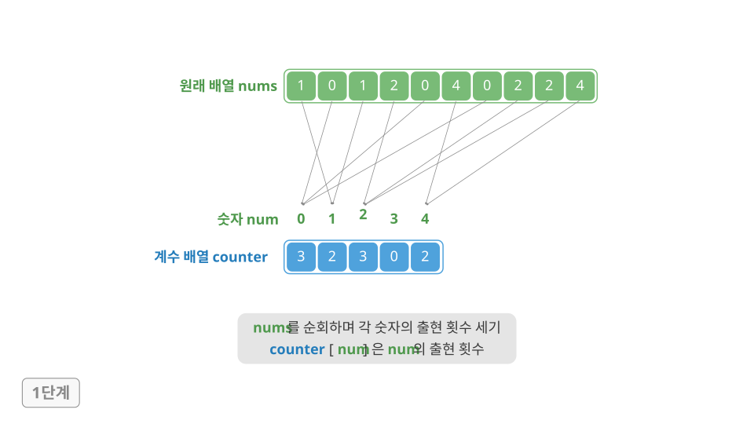
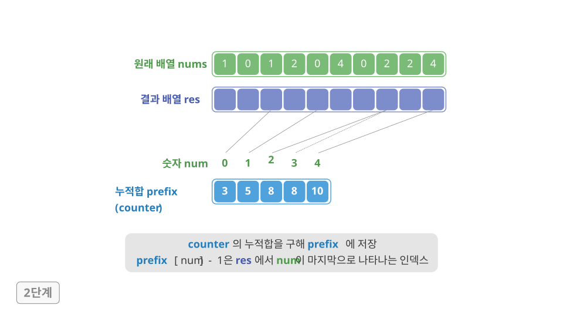
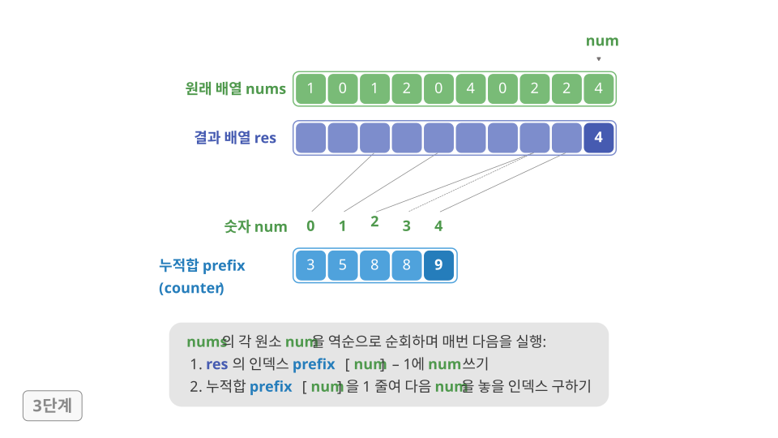
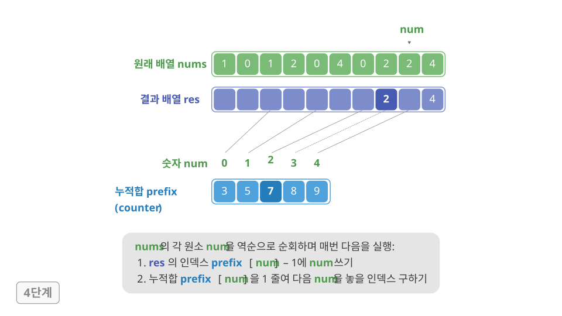
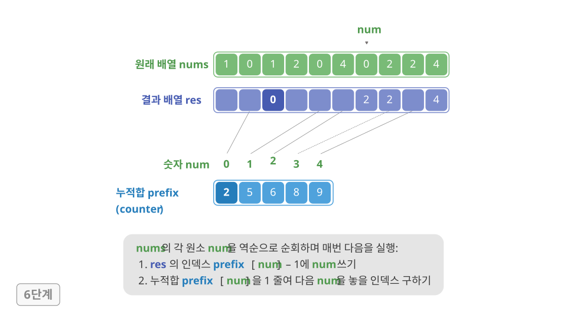
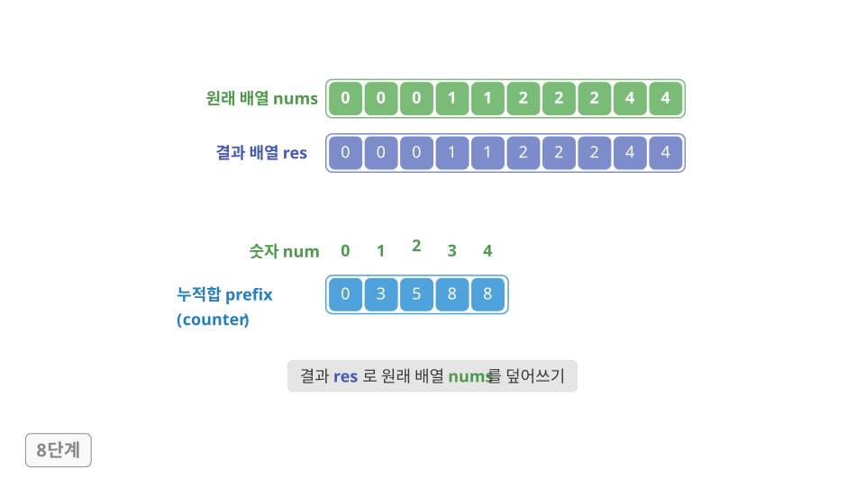

# 계수 정렬

<u>계수 정렬(counting sort)</u>은 원소의 개수를 세어 정렬하는 방법으로, 주로 정수 배열에 사용한다.

## 간단한 구현

간단한 예부터 살펴보자. 길이가 $n$인 배열 `nums`의 원소가 모두 음이 아닌 정수라고 하자. 계수 정렬의 전체 과정은 아래 그림과 같다.

1. 배열을 순회하여 가장 큰 수 $m$을 찾은 다음 길이가 $m + 1$인 보조 배열 `counter`를 만든다.
2. **`counter`로 `nums`의 각 숫자가 몇 번 나타나는지 센다**. `counter[num]`에 숫자 `num`의 출현 횟수가 기록된다. 방법은 간단하다. `nums`를 순회하며 현재 숫자를 `num`이라고 할 때 매번 `counter[num]`을 $1$만큼 늘리면 된다.
3. **`counter`의 인덱스는 본래 순서가 정해져 있으므로 모든 숫자가 이미 정렬된 셈이다**. 이제 `counter`를 순회하면서 작은 수부터 출현 횟수만큼 `nums`에 채우면 된다.


코드는 다음과 같다.

```src
[file]{counting_sort}-[class]{}-[func]{counting_sort_naive}
```

!!! note "계수 정렬과 버킷 정렬의 관계"

    버킷 정렬의 관점에서 보면 계수 배열 `counter`의 각 인덱스는 버킷 하나에 해당한다. 개수를 세는 과정은 각 원소를 해당 버킷에 배분하는 것으로 볼 수 있다. 본질적으로 계수 정렬은 정수 데이터를 대상으로 하는 버킷 정렬의 특수한 경우다.

## 전체 구현

눈치챈 독자도 있겠지만 **입력 데이터가 객체라면 위의 `3.`단계가 제대로 동작하지 않는다**. 상품 객체를 입력받아 가격(클래스의 멤버 변수)을 기준으로 상품을 정렬하려 한다고 하자. 위 알고리즘으로는 가격을 정렬한 결과만 얻을 수 있다.

원래 데이터 자체를 정렬한 결과를 얻으려면 어떻게 해야 할까? 먼저 `counter`의 ‘누적합’을 구한다. 이름 그대로 인덱스 `i`에서의 누적합 `prefix[i]`는 배열의 처음 `i`개 원소의 합이다.

$$
\text{prefix}[i] = \sum_{j=0}^i \text{counter[j]}
$$

**누적합의 의미는 분명하다. `prefix[num] - 1`은 결과 배열 `res`에서 원소 `num`이 마지막으로 나타나는 인덱스다**. 이 값은 각 원소를 결과 배열의 어느 위치에 놓을지 알려 준다. 이제 원래 배열 `nums`의 각 원소 `num`을 역순으로 순회하며 매번 다음 두 단계를 실행한다.

1. 배열 `res`의 인덱스 `prefix[num] - 1`에 `num`을 쓴다.
2. 누적합 `prefix[num]`을 $1$만큼 줄여 다음 `num`을 배치할 인덱스를 구한다.

순회가 끝나면 배열 `res`에 정렬된 결과가 들어 있다. 마지막으로 `res`로 원래 배열 `nums`를 덮어쓰면 된다. 전체 계수 정렬 과정은 아래 그림과 같다.

=== "<1>"
    

=== "<2>"
    

=== "<3>"
    

=== "<4>"
    

=== "<5>"
    

=== "<6>"
    

=== "<7>"
    

=== "<8>"
    

계수 정렬의 구현 코드는 다음과 같다.

```src
[file]{counting_sort}-[class]{}-[func]{counting_sort}
```

## 알고리즘의 특성

- **시간 복잡도 $O(n + m)$, 비적응형 정렬**: `nums`와 `counter`를 순회하는 데 각각 선형 시간이 걸린다. 일반적으로 $n \gg m$이므로 시간 복잡도는 $O(n)$에 가까워진다.
- **공간 복잡도 $O(n + m)$, 비제자리 정렬**: 길이가 각각 $n$과 $m$인 배열 `res`와 `counter`를 사용한다.
- **안정 정렬**: `res`를 오른쪽부터 채우므로 `nums`를 역순으로 순회하면 값이 같은 원소들의 상대적 순서가 유지되어 안정 정렬이 된다. 사실 `nums`를 정방향으로 순회해도 값은 올바르게 정렬되지만 그 결과는 안정적이지 않다.

## 제약 사항

개수만 세어도 효율적으로 정렬할 수 있다는 점에서 계수 정렬은 꽤 영리한 방법처럼 보인다. 그러나 계수 정렬을 사용하려면 비교적 엄격한 전제 조건을 충족해야 한다.

**계수 정렬은 음이 아닌 정수에만 적용할 수 있다**. 다른 유형의 데이터에 적용하려면 각 값을 음이 아닌 정수로 변환할 수 있어야 하고 변환 과정에서 원소 간 대소 관계가 바뀌지 않아야 한다. 예를 들어 음수가 포함된 정수 배열이라면 모든 수에 같은 상수를 더해 양수로 바꾸고 정렬이 끝난 뒤 원래 값으로 되돌릴 수 있다.

**계수 정렬은 데이터는 많지만 값의 범위는 좁을 때 적합하다**. 위 예에서 $m$이 너무 크면 공간을 지나치게 많이 사용한다. 또한 $n \ll m$이면 계수 정렬에 $O(m)$의 시간이 걸려 시간 복잡도가 $O(n \log n)$인 정렬 알고리즘보다 느릴 수도 있다.
