# 힙 정렬

!!! tip

    이 절을 읽기 전에 ‘힙’ 장을 먼저 학습하자.

<u>힙 정렬(heap sort)</u>은 힙 자료 구조를 이용하는 효율적인 정렬 알고리즘이다. 앞에서 익힌 ‘힙 구성’과 ‘힙에서 원소 꺼내기’ 연산으로 힙 정렬을 구현할 수 있다.

1. 입력 배열로 최소 힙을 구성한다. 그러면 최솟값이 루트에 놓인다.
2. 힙에서 원소를 계속 꺼내 차례로 기록하면 오름차순으로 정렬된 수열을 얻는다.

이 방법도 가능하지만 꺼낸 원소를 보관할 배열이 하나 더 필요해 공간을 낭비한다. 실제로는 보통 이보다 간결한 방법을 사용한다.

## 알고리즘의 동작 과정

배열의 길이가 $n$일 때 힙 정렬의 과정은 아래 그림과 같다.

1. 입력 배열로 최대 힙을 구성한다. 완성되면 최댓값이 루트에 놓인다.
2. 힙의 루트(첫 원소)와 힙의 끝(마지막 원소)을 교환한다. 교환 후 힙의 길이는 $1$만큼 줄고 정렬된 원소 수는 $1$만큼 늘어난다.
3. 루트부터 아래로 내려가며 힙 속성을 복원한다(sift down). 이 작업을 마치면 힙의 속성이 다시 성립한다.
4. `2.`단계와 `3.`단계를 반복한다. $n - 1$회전이 끝나면 배열이 정렬된다.

!!! tip

    실제로 힙에서 원소를 꺼내는 연산에도 `2.`단계와 `3.`단계가 들어 있다. 원소를 꺼내는 단계가 하나 더 있을 뿐이다.

=== "<1>"
    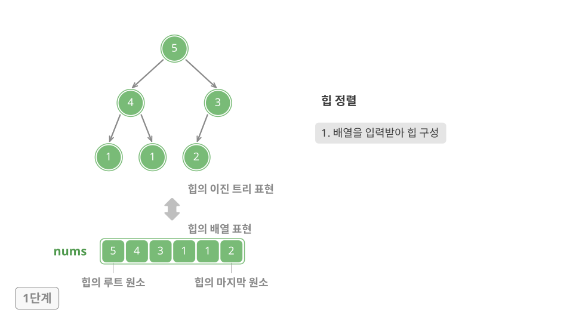

=== "<2>"
    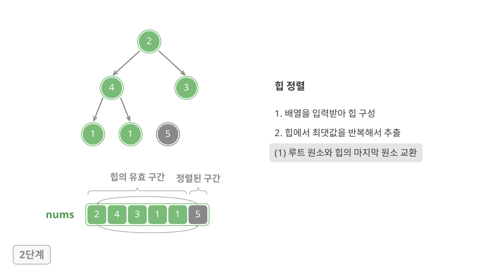

=== "<3>"
    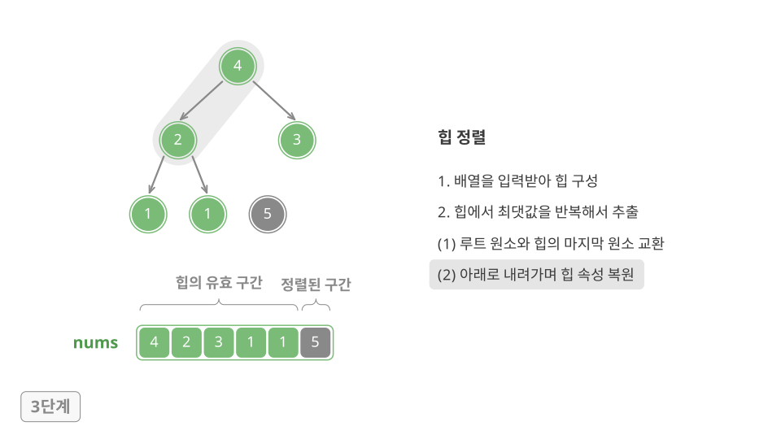

=== "<4>"
    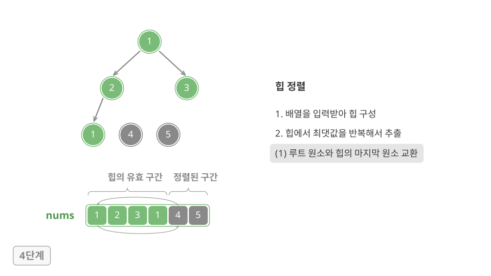

=== "<5>"
    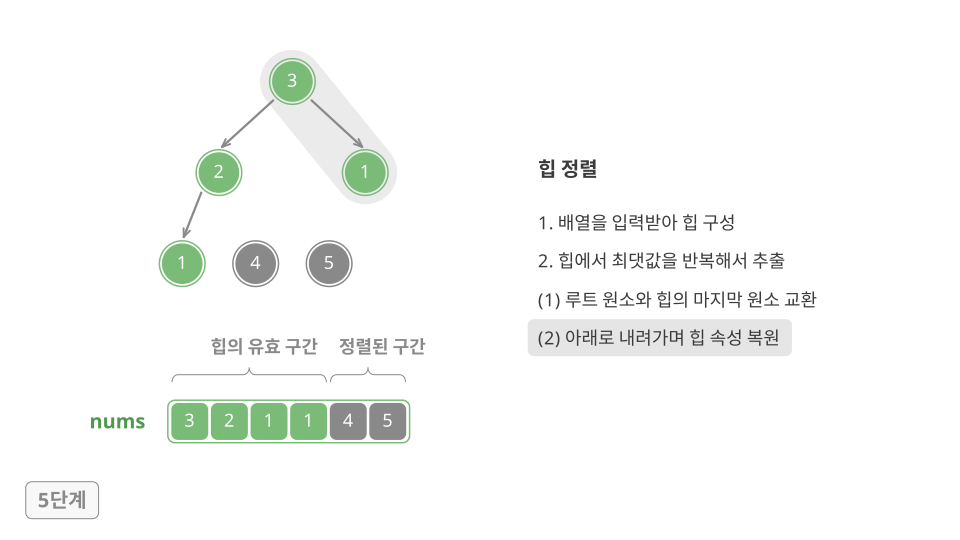

=== "<6>"
    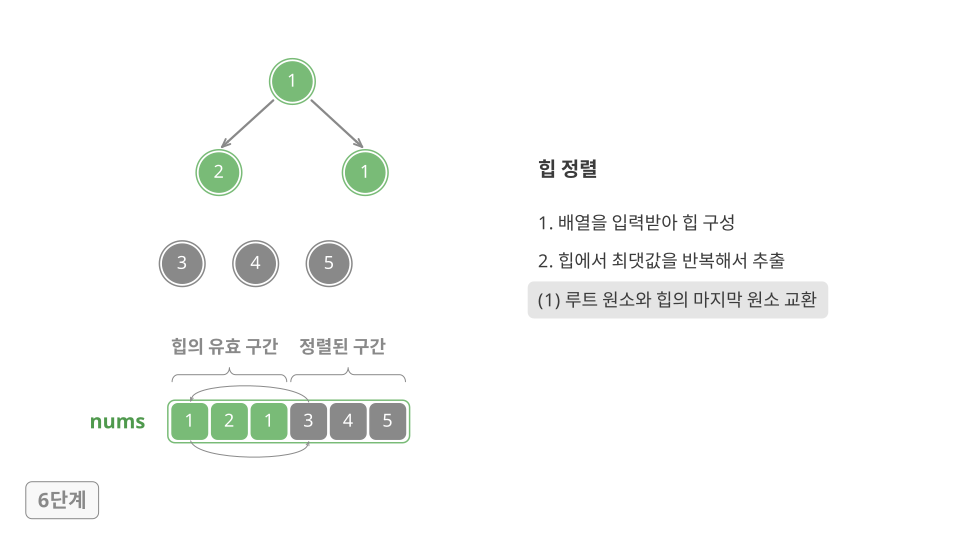

=== "<7>"
    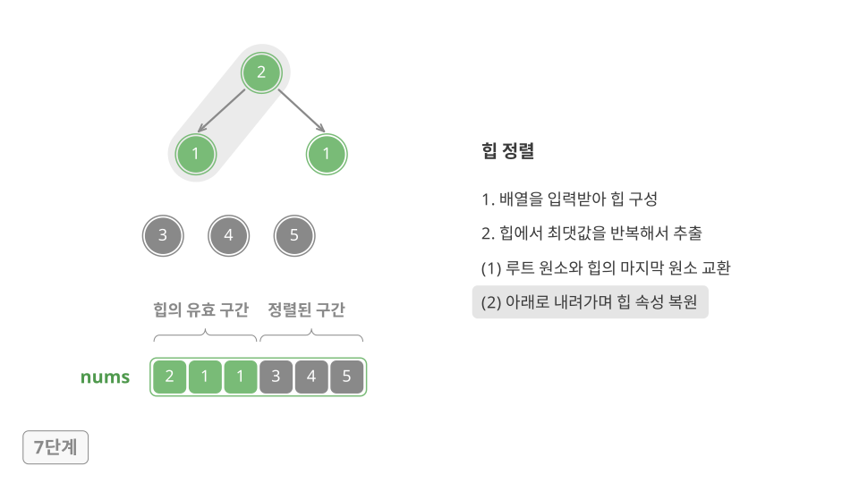

=== "<8>"
    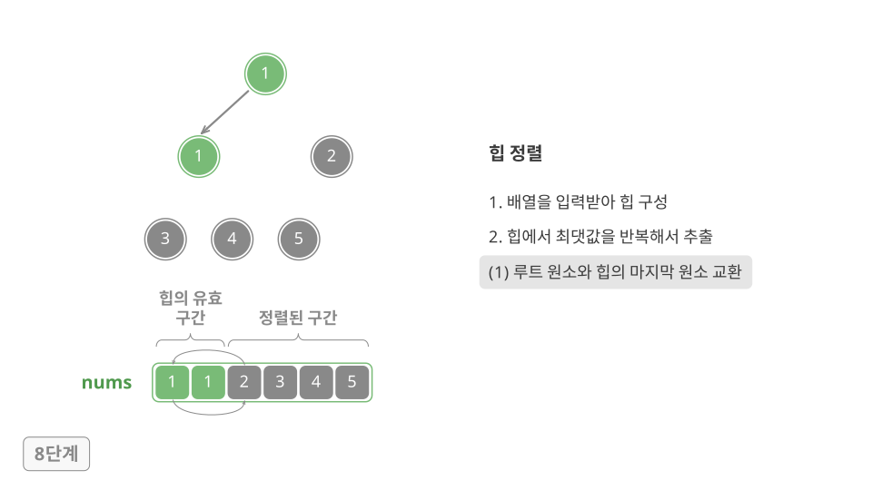

=== "<9>"
    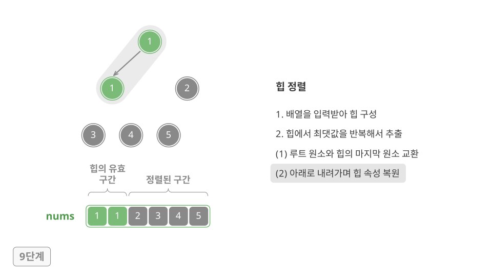

=== "<10>"
    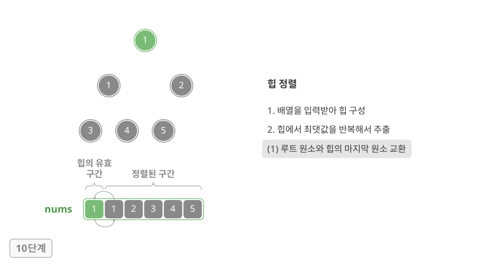

=== "<11>"
    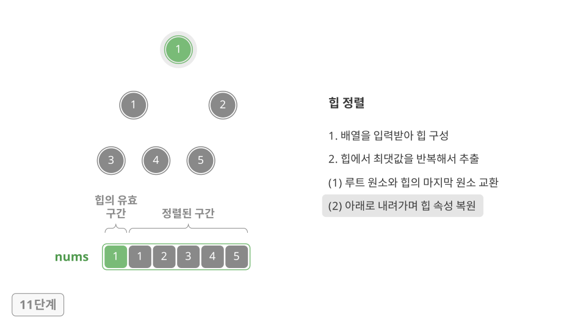

=== "<12>"
    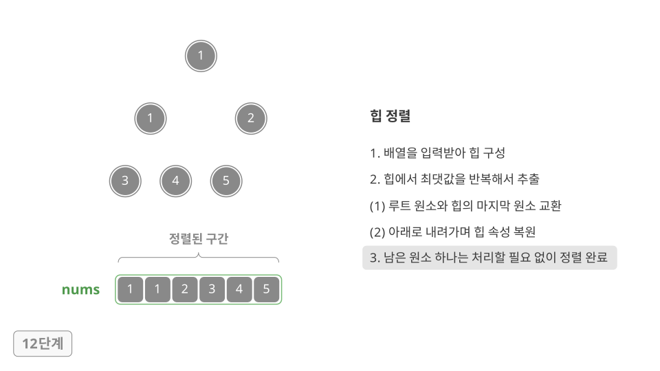

코드에서는 ‘힙’ 장과 같은 하향식 힙 복원 함수 `sift_down()`을 사용한다. 최댓값을 꺼낼 때마다 힙의 길이가 줄어들므로 `sift_down()` 함수에 현재 유효한 길이를 지정하는 매개변수 $n$을 추가해야 한다. 코드는 다음과 같다.

```src
[file]{heap_sort}-[class]{}-[func]{heap_sort}
```

## 알고리즘의 특성

- **시간 복잡도 $O(n \log n)$, 비적응형 정렬**: 힙을 구성하는 데 $O(n)$의 시간이 걸린다. 힙에서 최댓값을 꺼내는 시간 복잡도는 $O(\log n)$이고 이를 총 $n - 1$회 반복한다.
- **공간 복잡도 $O(1)$, 제자리 정렬**: 몇 개의 포인터 변수가 $O(1)$의 공간을 사용한다. 원소 교환과 힙 복원은 모두 원래 배열에서 이루어진다.
- **불안정 정렬**: 루트와 힙의 마지막 원소를 교환할 때 값이 같은 원소들의 상대적 위치가 바뀔 수 있다.
