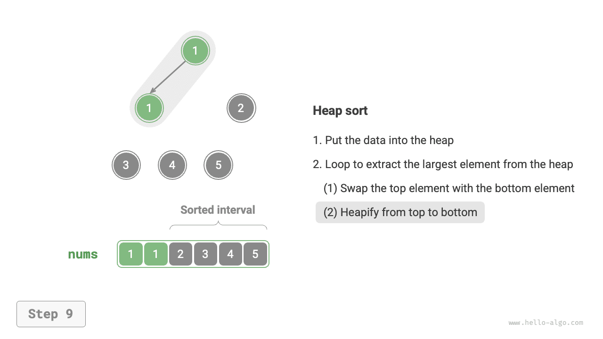

# 힙 정렬

!!! tip "참고"

    이 절을 읽기 전에 '힙' 장을 먼저 학습하자.

<u>힙 정렬(heap sort)</u>은 힙 자료 구조를 이용한 효율적인 정렬 알고리즘이다. 이미 배운 '힙 구성 연산'과 '힙에서 원소를 꺼내는 연산'으로 구현할 수 있다.

1. 배열을 입력받아 최소 힙을 구성한다. 이때 가장 작은 원소가 힙의 루트에 놓인다.
2. 힙에서 원소를 계속 꺼내며 순서대로 기록하면 오름차순으로 정렬된 수열을 얻는다.

위 방법도 가능하지만 꺼낸 원소를 저장할 추가 배열이 필요하여 공간을 낭비한다. 실제로는 보통 더 간결한 구현 방식을 사용한다.

## 알고리즘 과정

배열의 길이가 $n$일 때 힙 정렬의 과정은 아래 그림과 같다.

1. 배열을 입력받아 최대 힙을 구성한다. 완료하면 가장 큰 원소가 힙의 루트에 놓인다.
2. 힙의 루트 원소(첫 번째 원소)와 끝 원소(마지막 원소)를 교환한다. 교환 후 힙의 길이는 $1$ 줄고, 정렬된 원소 수는 $1$ 늘어난다.
3. 힙의 루트 원소부터 위에서 아래로 힙 재정렬(sift down)을 수행한다. 재정렬을 마치면 힙의 성질이 복구된다.
4. `2.` 단계와 `3.` 단계를 반복한다. $n - 1$ 회 반복하면 배열 정렬이 완료된다.

!!! tip "참고"

    힙에서 원소를 꺼내는 연산에도 `2.` 단계와 `3.` 단계가 포함되며, 실제로 원소를 꺼내는 단계가 하나 더 있을 뿐이다.

=== "<1>"
    

=== "<2>"
    

=== "<3>"
    

=== "<4>"
    

=== "<5>"
    

=== "<6>"
    

=== "<7>"
    

=== "<8>"
    

=== "<9>"
    

=== "<10>"
    

=== "<11>"
    

=== "<12>"
    

구현에서는 '힙' 장과 동일한 하향 힙 재정렬 함수 `sift_down()`을 사용한다. 가장 큰 원소를 꺼낼 때마다 힙의 길이가 줄어들므로, 현재 유효한 힙 길이를 지정하는 매개변수 $n$을 `sift_down()`에 추가해야 한다. 코드는 다음과 같다.

```src
[file]{heap_sort}-[class]{}-[func]{heap_sort}
```

## 알고리즘 특성

- **시간 복잡도 $O(n \log n)$, 비적응형 정렬**: 힙 구성에는 $O(n)$ 시간이 걸린다. 힙에서 최댓값을 꺼내는 시간 복잡도는 $O(\log n)$이며, 총 $n - 1$ 회 반복한다.
- **공간 복잡도 $O(1)$, 제자리 정렬**: 몇 개의 포인터 변수가 $O(1)$ 공간을 사용한다. 원소 교환과 힙 재정렬은 모두 원래 배열에서 수행한다.
- **불안정 정렬**: 힙의 루트 원소와 끝 원소를 교환할 때 값이 같은 원소들의 상대적 위치가 바뀔 수 있다.
