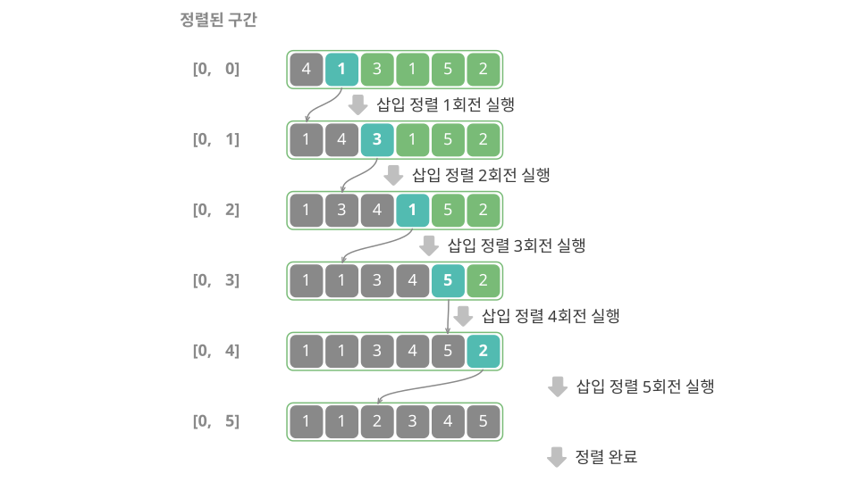

# 삽입 정렬

<u>삽입 정렬(insertion sort)</u>은 손에 쥔 카드를 정리하는 과정과 원리가 매우 비슷한 간단한 정렬 알고리즘이다.

미정렬 구간에서 기준 원소를 하나 고른 뒤 왼쪽의 정렬된 구간에 있는 원소와 하나씩 크기를 비교하여 알맞은 위치에 삽입한다.

배열에 원소를 삽입하는 과정은 아래 그림과 같다. 기준 원소가 `base`라면 목표 인덱스부터 `base` 사이의 원소를 모두 오른쪽으로 한 칸씩 옮긴 다음 목표 인덱스에 `base`를 대입한다.


## 알고리즘의 동작 과정

삽입 정렬의 전체 과정은 아래 그림과 같다.

1. 처음에는 배열의 첫 번째 원소가 이미 정렬되어 있다.
2. 배열의 두 번째 원소를 `base`로 선택하여 알맞은 위치에 삽입하면 **앞의 두 원소가 정렬된다**.
3. 세 번째 원소를 `base`로 선택하여 알맞은 위치에 삽입하면 **앞의 세 원소가 정렬된다**.
4. 이를 반복해 마지막 회전에서 마지막 원소를 `base`로 선택하고 알맞은 위치에 삽입하면 **모든 원소가 정렬된다**.



예제 코드는 다음과 같다.

```src
[file]{insertion_sort}-[class]{}-[func]{insertion_sort}
```

## 알고리즘의 특성

- **시간 복잡도 $O(n^2)$, 적응형 정렬**: 최악의 경우 각 삽입에 필요한 반복 횟수는 차례로 $n - 1$, $n-2$, $\dots$, $2$, $1$이고 그 합은 $(n - 1) n / 2$이므로 시간 복잡도는 $O(n^2)$이다. 이미 정렬된 데이터를 만나면 삽입 과정이 일찍 끝난다. 입력 배열 전체가 정렬되어 있으면 최선의 시간 복잡도 $O(n)$을 달성한다.
- **공간 복잡도 $O(1)$, 제자리 정렬**: 포인터 $i$와 $j$에 필요한 추가 공간은 상수 크기다.
- **안정 정렬**: 삽입할 원소는 값이 같은 원소의 오른쪽에 놓으므로 이들의 순서가 바뀌지 않는다.

## 삽입 정렬의 장점

삽입 정렬의 시간 복잡도는 $O(n^2)$이고 곧 살펴볼 퀵 정렬의 시간 복잡도는 $O(n \log n)$이다. 삽입 정렬의 시간 복잡도가 더 높지만 **데이터가 적을 때는 대개 삽입 정렬이 더 빠르다**.

이는 선형 탐색과 이진 탐색이 각각 어떤 상황에 적합한지 살펴봤을 때와 비슷하다. 퀵 정렬처럼 시간 복잡도가 $O(n \log n)$인 분할 정복 기반 알고리즘에는 흔히 더 많은 기본 연산이 들어간다. 데이터가 적으면 $n^2$과 $n \log n$의 값이 비슷하여 복잡도가 성능을 좌우하지 않고 회전마다 수행하는 기본 연산의 수가 결정적이다.

실제로 Java를 비롯한 여러 언어의 내장 정렬 함수가 삽입 정렬을 활용한다. 대체로 긴 배열에는 퀵 정렬 같은 분할 정복 방식의 정렬 알고리즘을 적용하고 짧은 배열에는 삽입 정렬을 바로 사용한다.

버블 정렬, 선택 정렬, 삽입 정렬의 시간 복잡도는 모두 $O(n^2)$이지만 실제로는 **삽입 정렬을 버블 정렬이나 선택 정렬보다 훨씬 자주 사용한다**. 주된 이유는 다음과 같다.

- 버블 정렬은 원소를 교환하므로 임시 변수가 필요하고 교환 한 번에 기본 연산이 세 번 든다. 삽입 정렬은 원소 대입을 사용하므로 한 번에 기본 연산이 한 번만 든다. 따라서 **버블 정렬의 연산 비용이 대개 삽입 정렬보다 크다**.
- 선택 정렬의 시간 복잡도는 어떤 경우에도 $O(n^2)$이다. **부분적으로 정렬된 데이터가 주어지면 삽입 정렬이 대개 선택 정렬보다 효율적이다**.
- 선택 정렬은 불안정 정렬이므로 여러 기준을 차례로 적용하는 정렬에 사용할 수 없다.
